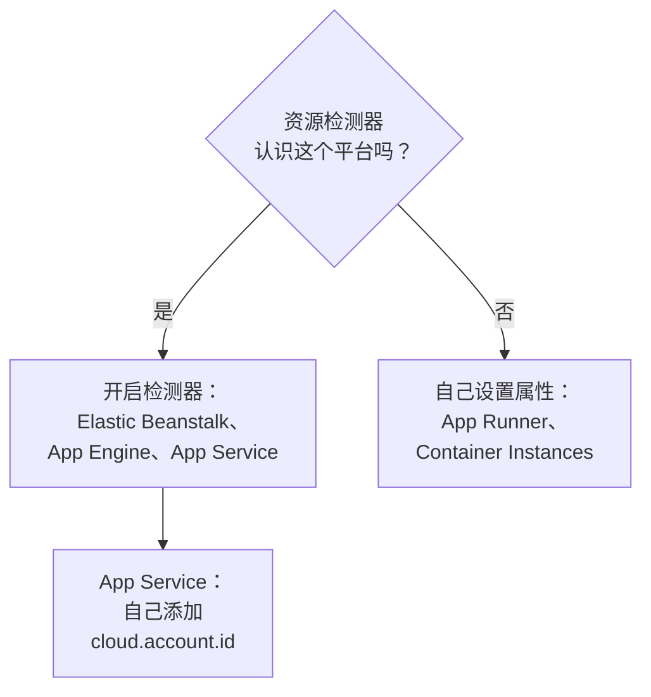

# 其他云平台

设置那些没有单独页面的托管平台：AWS Elastic Beanstalk、AWS App Runner、Google App Engine、Azure App Service 和 Azure Container Instances。规则与每个平台都一样：带有托管 `cloud.platform`、`cloud.account.id` 和 `cloud.region` 的遥测数据，会按平台、账户和区域进入一个 **Cloud Environment**，而实例标识会让每个运行中的实例在 **实例** 下各占一行。

:::cards
- [AWS Elastic Beanstalk](#aws-elastic-beanstalk): 每个实例上的 Collector，配合 Beanstalk 和 EC2 检测器。
- [AWS App Runner](#aws-app-runner): 手动设置的属性，来自 Secrets Manager 的令牌。
- [Google App Engine](#google-app-engine): GCP 检测器，设置写在 `app.yaml` 中。
- [Azure App Service](#azure-app-service): Azure 检测器、Key Vault 引用，以及手动设置的订阅。
- [Azure Container Instances](#azure-container-instances): 手动设置的属性，令牌作为安全变量传入。
:::

## 每个平台需要什么

这些平台的区别在于由谁设置 `cloud.*` 属性，以及这些设置位于云控制台的什么位置：



| 平台 | `cloud.platform` | `cloud.*` 由谁填写 | 实例标识 |
| ------------------------- | --------------------------- | ------------------------------------------------------------------------------------------ | ----------------------------------------------------------- |
| AWS Elastic Beanstalk | `aws_elastic_beanstalk` | Collector 的 `elastic_beanstalk` 和 `ec2` 检测器；Node.js 的 `aws` | `host.id`（删除部署的 `service.instance.id`） |
| AWS App Runner | `aws_app_runner` | 你自己（没有检测器） | `host.name` |
| Google App Engine | `gcp_app_engine` | `gcp` 检测器（Collector 和所有 SDK 中的） | `faas.instance` |
| Azure App Service | `azure_app_service` | Collector 的 `azureappservice`，Node.js 和 .NET 的 `azure` 检测器；`cloud.account.id` 由你设置 | `service.instance.id`，其次是 `host.id` |
| Azure Container Instances | `azure_container_instances` | 你自己（没有检测器） | `host.name` |

下面每一节都需要一个来自 **项目设置 → 遥测与 APM → 摄取密钥** 的 **服务器** 摄取密钥，以及一个用 OpenTelemetry SDK 插桩的应用。如果你自托管 OneUptime，请把 `https://oneuptime.com/otlp` 替换为 `https://YOUR-ONEUPTIME-HOST/otlp`。

> [!IMPORTANT]
> 在所有这些平台上，令牌都属于机密。每一节都会指出该平台的机密存储。写在普通环境变量中的令牌，任何能读取应用配置的人都能读到。

## AWS Elastic Beanstalk

`cloud.platform`：`aws_elastic_beanstalk`。Beanstalk 检测器会读取实例上的 `/var/elasticbeanstalk/xray/environment.conf`，并设置 `cloud.platform`、`service.instance.id`、`service.version` 和环境名称。它不知道账户和区域，因此要与知道这两者、并且还会设置 `host.id` 的 EC2 检测器搭配使用。

在每个实例上运行一个 OpenTelemetry Collector，配置如下：

```yaml title="config.yaml"
receivers:
  otlp:
    protocols:
      http:
        endpoint: 0.0.0.0:4318
      grpc:
        endpoint: 0.0.0.0:4317
processors:
  # elastic_beanstalk sets cloud.platform and service.instance.id; ec2 adds
  # cloud.account.id, cloud.region and host.id. The first detector to set an
  # attribute wins, so elastic_beanstalk comes first.
  resourcedetection:
    detectors: [env, elastic_beanstalk, ec2]
    timeout: 5s
  # The Beanstalk detector's service.instance.id is the deployment ID, shared
  # by every instance of a deployment: drop it, so that ec2's host.id names
  # each instance.
  resource:
    attributes:
      - key: service.instance.id
        action: delete
  batch: {}
exporters:
  otlphttp/oneuptime:
    endpoint: https://oneuptime.com/otlp
    headers:
      x-oneuptime-token: ${env:ONEUPTIME_TOKEN}
service:
  pipelines:
    traces:
      receivers: [otlp]
      processors: [resourcedetection, resource, batch]
      exporters: [otlphttp/oneuptime]
    metrics:
      receivers: [otlp]
      processors: [resourcedetection, resource, batch]
      exporters: [otlphttp/oneuptime]
    logs:
      receivers: [otlp]
      processors: [resourcedetection, resource, batch]
      exporters: [otlphttp/oneuptime]
```

:::steps
1. 将令牌保存到 Secrets Manager：`aws secretsmanager create-secret --name oneuptime/ingestion-token --secret-string "YOUR_TELEMETRY_INGESTION_TOKEN"`。Beanstalk 的环境属性保存在环境配置中，而不是机密存储中，因此请改为在平台钩子中借助实例配置文件读取该机密。实例配置文件需要对该机密拥有 `secretsmanager:GetSecretValue`。
2. 通过 `.platform/hooks/postdeploy/`（或 `.ebextensions`）中的脚本安装 Collector：使用 `otelcol-contrib` 软件包和上面的配置，并把机密作为 `ONEUPTIME_TOKEN` 放入它的环境。
3. **AWS Console → Elastic Beanstalk → Environments → your environment → Configuration**。
4. 在 **Updates, monitoring, and logging** 类别中点击 **Edit**，滚动到 **Environment properties**。添加 `OTEL_SERVICE_NAME`、设为 `http://localhost:4318` 的 `OTEL_EXPORTER_OTLP_ENDPOINT`，以及设为 `http/protobuf` 的 `OTEL_EXPORTER_OTLP_PROTOCOL`。
5. 点击 **Apply**。Beanstalk 会用新的属性重启应用。
:::

Node.js 应用可以不用 Collector：SDK 的检测器已包含 Beanstalk 和 EC2。将 `OTEL_EXPORTER_OTLP_ENDPOINT` 设为 `https://oneuptime.com/otlp`，将 `OTEL_EXPORTER_OTLP_HEADERS` 设为 `x-oneuptime-token=YOUR_TELEMETRY_INGESTION_TOKEN`，并设置 `OTEL_NODE_RESOURCE_DETECTORS=env,host,os,aws`。这时令牌位于环境属性中。之后检查某条追踪的资源属性：如果 `cloud.platform` 显示为 `aws_ec2`，说明你的 SDK 版本让 EC2 检测器占了上风，使用 Collector 才是可靠的方式。

**网络：** 私有子网中的实例需要 NAT 网关，实例的安全组必须允许通过 TCP 443 出站访问 OneUptime 主机。

## AWS App Runner

`cloud.platform`：`aws_app_runner`。没有检测器，因此需要你自己设置属性。App Runner 可以把 Secrets Manager（或 SSM Parameter Store）中的机密放入环境变量。

```bash
OTEL_SERVICE_NAME=checkout-api
OTEL_EXPORTER_OTLP_ENDPOINT=https://oneuptime.com/otlp
OTEL_EXPORTER_OTLP_PROTOCOL=http/protobuf
# From Secrets Manager: the secret holds the whole header.
OTEL_EXPORTER_OTLP_HEADERS=x-oneuptime-token=YOUR_TELEMETRY_INGESTION_TOKEN
OTEL_RESOURCE_ATTRIBUTES=cloud.provider=aws,cloud.platform=aws_app_runner,cloud.region=us-east-1,cloud.account.id=123456789012
OTEL_NODE_RESOURCE_DETECTORS=env,host,os
```

请把区域和账户 ID 换成你自己的。`host` 检测器会提供 `host.name`，即容器的主机名，它在每个 App Runner 实例上都不同，OneUptime 用它为实例命名。

:::steps
1. 将完整的标头保存到 Secrets Manager：`aws secretsmanager create-secret --name oneuptime/otlp-headers --secret-string "x-oneuptime-token=YOUR_TELEMETRY_INGESTION_TOKEN"`。App Runner 会把机密的值原样放入变量。
2. **AWS Console → App Runner → Services → your service → Configuration → Configure service**（在 **Configuration** 选项卡中点击 **Edit**）。
3. 在 **Environment variables** 下，为上面每个普通值点击 **Add environment variable**。
4. 添加 `OTEL_EXPORTER_OTLP_HEADERS`，选择 **Source: Secrets Manager** 并填入机密的 ARN。在 **Security → Instance role** 下选择一个对该机密拥有 `secretsmanager:GetSecretValue` 的角色：是实例角色，而不是拉取镜像的访问角色。
5. 点击 **Save changes**。App Runner 会部署一个新版本。
:::

**网络：** 没有 VPC 连接器的服务可以直接访问互联网。使用 **Outgoing network traffic: Custom VPC** 时，出站流量会经过你的 VPC，这时 VPC 需要 NAT 网关，以及允许通过 TCP 443 访问 OneUptime 主机的安全组出站规则。

## Google App Engine

`cloud.platform`：`gcp_app_engine`。GCP 检测器根据 `GAE_SERVICE`、`GAE_VERSION`、`GAE_INSTANCE` 和元数据服务器识别 App Engine 标准环境和柔性环境。它会设置 `cloud.account.id`（项目）、`cloud.region`、`faas.name`、`faas.version` 和 `faas.instance`。与 Cloud Run 一样，`faas.name` 会让每个 App Engine 服务也出现在 **无服务器函数** 下，而环境则汇总项目和区域。

| 语言 | 开启 GCP 检测器 |
| -------- | ------------------------------------------------------------------------------------------------------------------- |
| Node.js | `OTEL_NODE_RESOURCE_DETECTORS=env,host,os,gcp` |
| Python | `pip install opentelemetry-resourcedetector-gcp`，然后设置 `OTEL_EXPERIMENTAL_RESOURCE_DETECTORS=gcp_resource_detector` |
| Java | `-Dotel.resource.providers.gcp.enabled=true` |
| Go | `go.opentelemetry.io/contrib/detectors/gcp` → `gcp.NewDetector()` |
| .NET | `OpenTelemetry.Resources.Gcp` → `.AddGcpDetector()` |

App Engine 的控制台中没有环境变量编辑器：环境变量写在 `app.yaml` 中。

```yaml title="app.yaml"
runtime: nodejs22
env_variables:
  OTEL_SERVICE_NAME: checkout-api
  OTEL_EXPORTER_OTLP_ENDPOINT: https://oneuptime.com/otlp
  OTEL_EXPORTER_OTLP_PROTOCOL: http/protobuf
  OTEL_NODE_RESOURCE_DETECTORS: env,host,os,gcp
  # Do not commit the real value. Template it in CI, or read the secret at
  # start-up with the Secret Manager client instead.
  OTEL_EXPORTER_OTLP_HEADERS: x-oneuptime-token=YOUR_TELEMETRY_INGESTION_TOKEN
```

:::steps
1. 将完整的标头保存到 Secret Manager：`printf '%s' "x-oneuptime-token=YOUR_TELEMETRY_INGESTION_TOKEN" | gcloud secrets create oneuptime-otlp-headers --data-file=-`。为 App Engine 服务账号（`my-project@appspot.gserviceaccount.com`）授予对它的 `roles/secretmanager.secretAccessor`。
2. 在部署流水线中把机密写入 `app.yaml`，在提交的文件中保留占位符。也可以在启动时读取 `projects/PROJECT_ID/secrets/oneuptime-otlp-headers/versions/latest`，并在代码中传给导出器的 `headers` 选项。
3. 用 `gcloud app deploy` 部署。在控制台中，**App Engine → Versions** 显示新版本，**App Engine → Services** 显示会出现在 **无服务器函数** 下的服务。
:::

**网络：** App Engine 标准环境可以直接访问互联网。柔性环境的实例位于 VPC 中：如果子网没有外部 IP，它们需要 Cloud NAT，以及允许通过 TCP 443 访问 OneUptime 主机的出站防火墙规则。

## Azure App Service

`cloud.platform`：`azure_app_service`。Node.js 和 .NET 的 Azure 检测器，以及 Collector 的 `azureappservice` 检测器，会读取 App Service 设置的 `WEBSITE_*` 变量。它们会填写 `cloud.platform`、`cloud.region`、`service.instance.id`（来自 `WEBSITE_INSTANCE_ID`）、`deployment.environment`（部署槽）和 `host.id`。它们都不会设置 `cloud.account.id`：请自己添加订阅 ID，否则环境密钥中的账户段会是空的。

```bash
OTEL_SERVICE_NAME=checkout-api
OTEL_EXPORTER_OTLP_ENDPOINT=https://oneuptime.com/otlp
OTEL_EXPORTER_OTLP_PROTOCOL=http/protobuf
# The Key Vault reference, which resolves to the whole header.
OTEL_EXPORTER_OTLP_HEADERS=@Microsoft.KeyVault(SecretUri=https://my-vault.vault.azure.net/secrets/oneuptime-otlp-headers/)
OTEL_RESOURCE_ATTRIBUTES=cloud.account.id=00000000-0000-0000-0000-000000000000
# Node.js:
OTEL_NODE_RESOURCE_DETECTORS=env,host,os,azure
```

SDK 检测器把平台写作带点号的 `azure.app_service`；OneUptime 收到时会把它改写为 `azure_app_service`。在 .NET 中添加 `OpenTelemetry.Resources.Azure` 并调用 `.ConfigureResource(r => r.AddAzureAppServiceDetector())`。其他语言需要把 `cloud.provider=azure,cloud.platform=azure_app_service,cloud.region=<region>` 添加到 `OTEL_RESOURCE_ATTRIBUTES`，并在代码中从 `WEBSITE_INSTANCE_ID` 获取 `service.instance.id`。

:::steps
1. 开启应用的系统分配托管标识（**Settings → Identity**），并授予它对该保管库的 **Key Vault Secrets User**。将完整的标头 `x-oneuptime-token=YOUR_TELEMETRY_INGESTION_TOKEN` 保存为机密 `oneuptime-otlp-headers`。
2. **Azure portal → App Services → your app → Settings → Environment variables**（旧版门户中为 **Configuration → Application settings**）。
3. 通过 **+ Add** 添加上面的每个变量。`OTEL_EXPORTER_OTLP_HEADERS` 的值就是 Key Vault 引用。
4. 点击 **Apply**，然后点击 **Confirm**：应用会用新设置重启。部署槽有各自的设置：如果只应由一个槽发送遥测数据，请把令牌标记为 **deployment slot setting**。
:::

**网络：** 除非开启了 **VNet integration** 并启用 **Route All**，否则 App Service 可以直接访问互联网。开启后，VNet 需要 NAT 网关，或一条通往允许 TCP 443 访问 OneUptime 主机的防火墙的路由。

## Azure Container Instances

`cloud.platform`：`azure_container_instances`。没有检测器，因此需要你自己设置属性。容器组的环境变量在创建时就固定了：修改任何一个都意味着重新创建容器组。用 `--secure-environment-variables` 传入令牌，这样 `az container show` 就不会返回它：

```bash
az container create \
  --resource-group my-rg \
  --name checkout-api \
  --image myregistry.azurecr.io/checkout-api:1.4.2 \
  --location eastus \
  --environment-variables \
    OTEL_SERVICE_NAME=checkout-api \
    OTEL_EXPORTER_OTLP_ENDPOINT=https://oneuptime.com/otlp \
    OTEL_EXPORTER_OTLP_PROTOCOL=http/protobuf \
    "OTEL_RESOURCE_ATTRIBUTES=cloud.provider=azure,cloud.platform=azure_container_instances,cloud.region=eastus,cloud.account.id=00000000-0000-0000-0000-000000000000" \
    OTEL_NODE_RESOURCE_DETECTORS=env,host,os \
  --secure-environment-variables \
    "OTEL_EXPORTER_OTLP_HEADERS=x-oneuptime-token=YOUR_TELEMETRY_INGESTION_TOKEN"
```

`host` 检测器的 `host.name`，即容器组的主机名，会成为实例的名称。sidecar Collector 在这里同样适用，因为容器组像 ECS 任务一样运行多个容器：请使用 [Azure Container Apps](/docs/telemetry/cloud-azure-container-apps) 中 `detectors: [env]` 加 `OTEL_RESOURCE_ATTRIBUTES` 的方式。如果它发送带有容器组标识的 `container.cpu.utilization` 和 `container.memory.usage`，**CPU** 和 **内存** 磁贴也会由它填充。

:::steps
1. **Azure portal → Container Instances → + Create**。填写 **Basics** 选项卡：资源组、名称、区域和镜像。
2. 在 **Advanced** 选项卡的 **Environment variables** 下添加每个变量。对于 `OTEL_EXPORTER_OTLP_HEADERS`，将 **Mark as secure** 设为 **Yes**，这样门户和 API 都不会显示它的值。
3. 点击 **Review + create**，然后点击 **Create**。以后要修改变量，请删除容器组再重新创建。
:::

**网络：** 带公共 IP 的容器组可以直接访问互联网。位于 VNet 子网中的容器组只能通过 VNet 的路由出站：请添加 NAT 网关，或在防火墙或 NSG 上允许通过 TCP 443 访问 OneUptime 主机。

## 检查连接

无论设置的是哪个平台，都先检查令牌，然后再查找环境：

```bash
curl -i https://oneuptime.com/otlp/v1/validate \
  -H "x-oneuptime-token: YOUR_TELEMETRY_INGESTION_TOKEN"
```

返回 `200` 且 `"valid": true` 表示令牌已被接受。`401` 表示令牌未知、已吊销、已停用或已过期。在第一个 span、日志或指标到达后的 1 分钟内，环境就会出现在 **云 → All Environments** 中，并以平台、区域和账户命名。

## 故障排除

:::details Beanstalk 实例出现在主机下
EC2 检测器的 `cloud.platform=aws_ec2` 占了上风。第一个设置某个属性的检测器胜出，因此请在 `detectors` 中把 `elastic_beanstalk` 放在 `ec2` 前面。没有 Collector 时，Node.js SDK 也可能偏向 EC2 检测器：请运行 Collector。
:::

:::details 所有 Beanstalk 实例共用实例下的同一行
Beanstalk 检测器的 `service.instance.id` 是部署 ID，同一次部署的所有实例共用它，而且它在 `host.id` 之前被读取。请在每个管道中保留删除它的 `resource` 处理器。
:::

:::details App Service 应用收到 401
Key Vault 引用没有解析成功，因此 App Service 把字面文本 `@Microsoft.KeyVault(...)` 当作标头传了过去。请为应用的托管标识授予对该保管库的 **Key Vault Secrets User**，并检查机密中保存的是完整的标头 `x-oneuptime-token=...`。
:::

:::details App Service 环境的账户段为空
App Service 的检测器都不会设置 `cloud.account.id`。请在每个应用的 `OTEL_RESOURCE_ATTRIBUTES` 中添加订阅 ID：带有和不带这个值的遥测数据会进入两个环境。
:::

:::details 修改 Container Instances 变量后没有效果
容器组的环境变量在创建时就固定了。请删除容器组，再用新的值重新创建。
:::

其余问题见 [云故障排除](/docs/telemetry/cloud-troubleshooting)，尤其是环境出现在 **主机** 下、只出现在 **无服务器函数** 下（没有 GCP 检测器的 App Engine），或者出现两次（部分部署设置了 `cloud.account.id`，部分没有）的情况。

## 后续步骤

:::cards
- [云环境](/docs/telemetry/cloud-environments): 环境和实例是如何识别的。
- [云故障排除](/docs/telemetry/cloud-troubleshooting): 所有平台共有的故障。
- [无服务器函数](/docs/telemetry/serverless-functions): Lambda、Cloud Functions 和 Azure Functions。
- [云资源(IaaS 与 PaaS)](/docs/telemetry/cloud-resources): 来自云自身监控的、应用周边的资源。
:::
