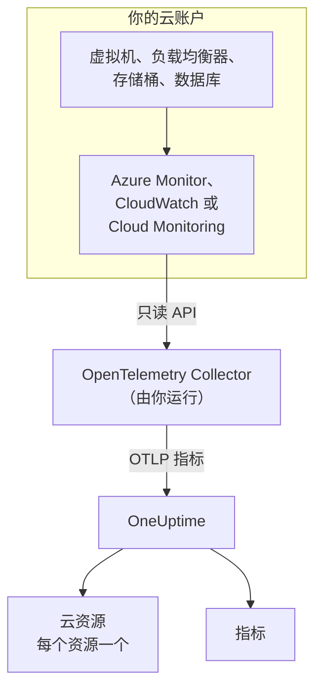
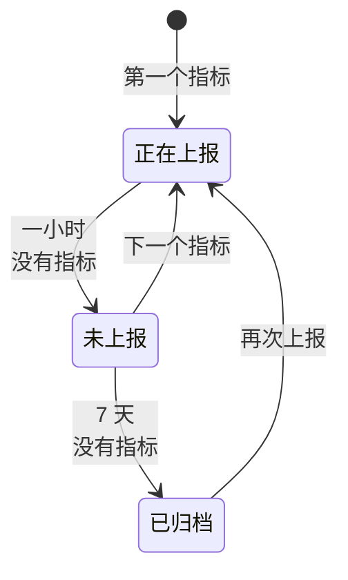

# 云资源(IaaS 与 PaaS)

**Cloud Resources** 列出了你的 AWS、Azure 和 Google Cloud 账户中的 IaaS 和 PaaS 资源：虚拟机、磁盘、负载均衡器、存储桶、托管数据库、缓存、队列、API 网关等等。每个资源都有自己的页面，显示它的类型、区域和账户、提供商为它分配的 ID、提供商发布的关于它的每个指标，并且可以像 OneUptime 中的其他资源一样设置所有者和标签。你可以在 **云 → 所有资源** 下找到它们。

:::cards
- [连接 Azure](#连接-azure): 从 Azure Monitor 读取订阅中的每个资源。
- [连接 AWS](#连接-aws): 轮询 CloudWatch，或通过 Amazon Data Firehose 流式传输。
- [连接 Google Cloud](#连接-google-cloud): 从 Cloud Monitoring 读取项目的服务。
- [如何识别资源](#如何识别资源): 按提供商列出 OneUptime 识别的每种资源类型。
:::

## 工作原理



- **提供商已经在度量你的资源。** Azure Monitor、Amazon CloudWatch 和 Google Cloud Monitoring 会发布它们为你运行的每个资源的指标。
- **由你运行的 Collector 读取这些指标。** 一个对该监控服务拥有只读权限的 OpenTelemetry Collector 会把指标导出到 OneUptime。资源上无需安装任何东西，OneUptime 也从不持有你的云凭据：凭据由 Collector 在你的环境中持有。
- **每个资源随它的第一个指标出现。** OneUptime 会从每个数据点判断它属于哪个资源，并在第一次看到该资源时创建云资源。

云资源只是你的云会出现的几个地方之一：

| 你运行的内容 | 出现的位置 | 方式 |
| --- | --- | --- |
| ECS、Cloud Run、Container Apps、App Service 等上的容器 | **云 → All Environments** | 工作负载自身的遥测数据，按其 `cloud.platform` 区分。参见 [云环境](/docs/telemetry/cloud-environments) |
| 提供商监控的任何 IaaS 或 PaaS 资源 | **云 → 所有资源** | 由 Collector 读取的提供商监控 API：即本页 |
| 装有 OpenTelemetry Collector 的虚拟机 | **主机** | 主机自身的指标和日志。参见 [主机 OpenTelemetry Collector](/docs/telemetry/host-otel-collector) |
| 你的应用使用的队列和主题 | **Queues** | span，以及相同的云指标。参见 [队列](/docs/telemetry/queues) |

一个资源可能出现在多个地方。装有 Collector 的虚拟机是一台 **主机**，而它的平台指标（虚拟机监控程序看到的 CPU 积分、磁盘和网络）又让它成为一个 **云资源**。SQS 队列既是 **Queue**，也是 **云资源**。每个视图显示的是其数据来源所知道的内容。

## 开始之前

- **摄取密钥。** 在 **项目设置 → 遥测与 APM → 摄取密钥** 中创建一个 **服务器** 密钥。下面的 Collector 从环境变量 `ONEUPTIME_TOKEN` 读取它，而不是从配置文件中读取。
- **运行 OpenTelemetry Collector 的地方**：使用 `otelcol-contrib` 发行版（镜像 `otel/opentelemetry-collector-contrib`），并且能够出站访问你的云提供商和 OneUptime。一台小型 VM、一个容器或你的 Kubernetes 集群都可以，一个 Collector 可以读取多个账户和提供商。
- **对提供商监控 API 的读取权限。** 下面每个提供商的第一步会创建它。

> [!TIP]
> 同样的步骤也在仪表板中，并已填好你的令牌：在第一个资源到达之前位于 **云 → 所有资源**，之后位于每个资源的 **文档** 选项卡，该选项卡会打开该资源所属提供商的说明。

如果你自托管 OneUptime，请把 `https://oneuptime.com/otlp` 替换为 `https://YOUR-ONEUPTIME-HOST/otlp`。

## 连接 Azure

`azure_monitor` 接收器会列出订阅中的资源，并每分钟读取一次它们的平台指标。如果没有 `services` 列表，它会读取所有资源类型，因此订阅中的每个资源都会成为云资源。

:::steps
### 创建 Monitoring Reader 服务主体

**Monitoring Reader** 可以读取指标并列出资源，但无法更改任何内容：

```bash
az ad sp create-for-rbac \
  --name oneuptime-cloud-collector \
  --role "Monitoring Reader" \
  --scopes /subscriptions/<SUBSCRIPTION_ID>
```

它会打印出 `appId`（客户端 ID）、`password`（客户端密码）和 `tenant`。在更多订阅上为同一个服务主体授予该角色，就能用同一个 Collector 读取这些订阅。

### 配置 Azure Monitor 接收器

将以下内容保存为 `config.yaml`：

```yaml
extensions:
  azure_auth:
    service_principal:
      tenant_id: ${env:AZURE_TENANT_ID}
      client_id: ${env:AZURE_CLIENT_ID}
      client_secret: ${env:AZURE_CLIENT_SECRET}

receivers:
  azure_monitor:
    subscription_ids: ["${env:AZURE_SUBSCRIPTION_ID}"]
    auth:
      authenticator: azure_auth
    collection_interval: 60s
    # No `services` list: every resource type in the subscription.
    # Series Azure returns per metric and resource (default 10).
    maximum_number_of_records_per_resource: 50

processors:
  batch: {}

exporters:
  otlphttp/oneuptime:
    endpoint: https://oneuptime.com/otlp
    headers:
      x-oneuptime-token: ${env:ONEUPTIME_TOKEN}

service:
  extensions: [azure_auth]
  pipelines:
    metrics:
      receivers: [azure_monitor]
      processors: [batch]
      exporters: [otlphttp/oneuptime]
```

### 运行 Azure Collector

```bash
docker run -d --name oneuptime-cloud-collector --restart unless-stopped \
  -e ONEUPTIME_TOKEN=YOUR_TELEMETRY_INGESTION_TOKEN \
  -e AZURE_TENANT_ID=<TENANT> \
  -e AZURE_CLIENT_ID=<APP_ID> \
  -e AZURE_CLIENT_SECRET=<PASSWORD> \
  -e AZURE_SUBSCRIPTION_ID=<SUBSCRIPTION_ID> \
  -v "$(pwd)/config.yaml:/etc/otelcol-contrib/config.yaml" \
  otel/opentelemetry-collector-contrib:latest
```

几分钟内，资源就会出现在 **云 → 所有资源** 下。
:::

`azure_monitor` 接收器的选项：

| 选项 | 作用 |
| --- | --- |
| `resource_groups`, `services`, `resource_tags` | 缩小读取范围：资源组、Resource Manager 类型（`Microsoft.Compute/virtualMachines`）或资源必须带有的标记的列表 |
| `metrics` | 把每种资源类型限制为你列出的指标和聚合。一旦列出某个类型，就只读取该类型列出的指标 |
| `discover_subscriptions: true` | 读取服务主体能看到的每个订阅，而不是 `subscription_ids` |
| `maximum_number_of_records_per_resource` | Azure 每个指标和资源返回的序列数（默认 10）。当某个指标按取值很多的维度拆分时请调高 |
| `use_batch_api: true` | 用于大型订阅。接收器对每个资源和每批 20 个指标调用一次 Resource Manager，而 Resource Manager 每小时只允许约 12,000 次读取；批处理 API 每次调用可从 Azure Monitor 数据平面读取最多 50 个资源，其限额要高得多 |
| `cache_resources` | 接收器列出资源的间隔（以秒为单位）：默认每天一次。在 Collector 启动后创建的资源最多可能需要一天才会出现；重启 Collector 即可立即列出它们 |

## 连接 AWS

CloudWatch 指标通过以下两种方式之一到达 OneUptime：

| | Polling | Metric Streams |
| --- | --- | --- |
| 方式 | Collector 的 `aws_cloudwatch` 接收器向 CloudWatch 查询 | CloudWatch 通过 Amazon Data Firehose 推送到 Collector 的 `awsfirehose` 接收器 |
| AWS 端需要什么 | 只需凭据 | 每个区域一个 Firehose 流和一个指标流 |
| AWS 必须能访问 Collector | 否 | 是，通过 443 端口的 HTTPS |
| 延迟 | 10 到 20 分钟 | 几分钟 |
| 适用场景 | 大多数账户 | 大型账户 |

### 使用 aws_cloudwatch 接收器轮询

:::steps
#### 允许 Collector 读取 CloudWatch

将以下策略附加到 Collector 运行时使用的角色（EC2 实例配置文件、ECS 任务角色、EKS 服务账号），或附加到你提供其访问密钥的 IAM 用户：

```json
{
  "Version": "2012-10-17",
  "Statement": [
    {
      "Effect": "Allow",
      "Action": [
        "cloudwatch:ListMetrics",
        "cloudwatch:GetMetricData",
        "sts:GetCallerIdentity"
      ],
      "Resource": "*"
    }
  ]
}
```

`sts:GetCallerIdentity` 让接收器能够上报账户 ID，而每个资源的 ARN 都需要它。

#### 配置 CloudWatch 接收器

一个接收器读取一个区域中的一个命名空间，因此请为你需要的每个命名空间和区域各添加一个。此示例读取常用的命名空间；将其保存为 `config.yaml`：

```yaml
receivers:
  aws_cloudwatch/ec2:
    region: ${env:AWS_REGION}
    metrics:
      collection_interval: 5m
      period: 5m
      delay: 10m
      discovery:
        filters:
          namespace: AWS/EC2
        # Metrics read per scrape, at most. Each costs 4 GetMetricData queries.
        limit: 1000
  aws_cloudwatch/ebs:
    region: ${env:AWS_REGION}
    metrics:
      collection_interval: 5m
      period: 5m
      delay: 10m
      discovery:
        filters:
          namespace: AWS/EBS
        # Metrics read per scrape, at most. Each costs 4 GetMetricData queries.
        limit: 1000
  aws_cloudwatch/applicationelb:
    region: ${env:AWS_REGION}
    metrics:
      collection_interval: 5m
      period: 5m
      delay: 10m
      discovery:
        filters:
          namespace: AWS/ApplicationELB
        # Metrics read per scrape, at most. Each costs 4 GetMetricData queries.
        limit: 1000
  aws_cloudwatch/rds:
    region: ${env:AWS_REGION}
    metrics:
      collection_interval: 5m
      period: 5m
      delay: 10m
      discovery:
        filters:
          namespace: AWS/RDS
        # Metrics read per scrape, at most. Each costs 4 GetMetricData queries.
        limit: 1000
  aws_cloudwatch/lambda:
    region: ${env:AWS_REGION}
    metrics:
      collection_interval: 5m
      period: 5m
      delay: 10m
      discovery:
        filters:
          namespace: AWS/Lambda
        # Metrics read per scrape, at most. Each costs 4 GetMetricData queries.
        limit: 1000
  aws_cloudwatch/dynamodb:
    region: ${env:AWS_REGION}
    metrics:
      collection_interval: 5m
      period: 5m
      delay: 10m
      discovery:
        filters:
          namespace: AWS/DynamoDB
        # Metrics read per scrape, at most. Each costs 4 GetMetricData queries.
        limit: 1000

processors:
  batch: {}

exporters:
  otlphttp/oneuptime:
    endpoint: https://oneuptime.com/otlp
    headers:
      x-oneuptime-token: ${env:ONEUPTIME_TOKEN}

service:
  pipelines:
    metrics:
      receivers: [aws_cloudwatch/ec2, aws_cloudwatch/ebs, aws_cloudwatch/applicationelb, aws_cloudwatch/rds, aws_cloudwatch/lambda, aws_cloudwatch/dynamodb]
      processors: [batch]
      exporters: [otlphttp/oneuptime]
```

#### 运行 CloudWatch Collector

```bash
docker run -d --name oneuptime-cloud-collector --restart unless-stopped \
  -e ONEUPTIME_TOKEN=YOUR_TELEMETRY_INGESTION_TOKEN \
  -e AWS_REGION=us-east-1 \
  -e AWS_ACCESS_KEY_ID=<ACCESS_KEY_ID> \
  -e AWS_SECRET_ACCESS_KEY=<SECRET_ACCESS_KEY> \
  -v "$(pwd)/config.yaml:/etc/otelcol-contrib/config.yaml" \
  otel/opentelemetry-collector-contrib:latest
```

在拥有该角色的 EC2 实例、ECS 任务或 EKS Pod 上，请省略这两个密钥变量。
:::

- **不要设置 `stats`。** 这样每个指标会按每个周期一个摘要来读取：四个统计量、四个 `GetMetricData` 查询，而 AWS 按请求的每个指标对 `GetMetricData` 计费。`discovery.limit` 限制接收器每次抓取读取的指标数（请务必设置：接收器自身的默认值是 100），更长的 `collection_interval` 会降低读取频率。
- **数据会延迟到达。** `delay` 会等待 CloudWatch 发布一个周期，因此数据点会在其度量时间之后 10 到 20 分钟到达，资源大约二十分钟内出现。

### 使用 CloudWatch Metric Streams 流式传输

:::steps
#### 配置 Firehose 接收器

Collector 需要一张与其地址匹配的证书：Firehose 只投递到 443 端口上的 `https://`。将以下内容保存为 `config.yaml`：

```yaml
extensions:
  awscloudwatchmetricstreams_encoding:
    format: opentelemetry1.0

receivers:
  awsfirehose:
    # Firehose delivers to HTTPS on port 443 only: expose this port as
    # 443, for example behind a load balancer.
    endpoint: 0.0.0.0:4433
    encoding: awscloudwatchmetricstreams_encoding
    access_key: ${env:FIREHOSE_ACCESS_KEY}
    tls:
      cert_file: /etc/otelcol-contrib/tls/server.crt
      key_file: /etc/otelcol-contrib/tls/server.key

processors:
  batch: {}

exporters:
  otlphttp/oneuptime:
    endpoint: https://oneuptime.com/otlp
    headers:
      x-oneuptime-token: ${env:ONEUPTIME_TOKEN}

service:
  extensions: [awscloudwatchmetricstreams_encoding]
  pipelines:
    metrics:
      receivers: [awsfirehose]
      processors: [batch]
      exporters: [otlphttp/oneuptime]
```

#### 运行 Firehose Collector

```bash
docker run -d --name oneuptime-cloud-collector --restart unless-stopped \
  -e ONEUPTIME_TOKEN=YOUR_TELEMETRY_INGESTION_TOKEN \
  -e FIREHOSE_ACCESS_KEY=<A_LONG_RANDOM_SECRET> \
  -p 4433:4433 \
  -v "$(pwd)/tls:/etc/otelcol-contrib/tls:ro" \
  -v "$(pwd)/config.yaml:/etc/otelcol-contrib/config.yaml" \
  otel/opentelemetry-collector-contrib:latest
```

证书及其密钥放在 `tls/` 中，名为 `server.crt` 和 `server.key`。把 4433 端口发布在某个在 443 上响应的组件之后，例如负载均衡器。

#### 创建 Firehose 流和指标流

1. **Amazon Data Firehose → Create Firehose stream**：来源选 **Direct PUT**，目标选 **HTTP Endpoint**。端点 URL 是 Collector 的 `https://` 地址；访问密钥是 `FIREHOSE_ACCESS_KEY`。为投递失败的数据选择或创建一个 S3 存储桶。
2. **CloudWatch → Metrics → Streams → Create metric stream**：要包含的命名空间（或全部）、Firehose 流，以及输出格式 **OpenTelemetry 1.0**。
3. 在每个区域重复操作：一个指标流只承载它所在区域的指标。
:::

AWS 按指标流投递的每次指标更新计费，另加 Firehose 的数据费用，因此只包含你需要的命名空间。**JSON** 格式（编码扩展上的 `format: json`）的流也能识别相同的资源，但还会把每个命名空间写入 `service.name`，因此每个命名空间也会出现在 **服务** 下：请优先使用 **OpenTelemetry 1.0**。

## 连接 Google Cloud

`googlecloudmonitoring` 接收器针对一个项目，读取其 `metrics_list` 中列出的指标类型。

:::steps
### 创建 Monitoring Viewer 服务账号

**Monitoring Viewer** 可以读取指标，但无法更改任何内容：

```bash
gcloud iam service-accounts create oneuptime-cloud-collector \
  --project <PROJECT_ID>

gcloud projects add-iam-policy-binding <PROJECT_ID> \
  --member "serviceAccount:oneuptime-cloud-collector@<PROJECT_ID>.iam.gserviceaccount.com" \
  --role roles/monitoring.viewer

gcloud iam service-accounts keys create key.json \
  --iam-account oneuptime-cloud-collector@<PROJECT_ID>.iam.gserviceaccount.com
```

如果在 Google Cloud 上运行 Collector，请以该服务账号身份运行，而不是创建密钥。

### 配置 Cloud Monitoring 接收器

每个过滤器读取一个服务的所有指标类型。将以下内容保存为 `config.yaml`：

```yaml
receivers:
  googlecloudmonitoring:
    project_id: ${env:GCP_PROJECT_ID}
    collection_interval: 2m
    # Only the metric types these filters list are read.
    metrics_list:
      - metric_descriptor_filter: 'metric.type = starts_with("compute.googleapis.com/")'
      - metric_descriptor_filter: 'metric.type = starts_with("cloudsql.googleapis.com/")'
      - metric_descriptor_filter: 'metric.type = starts_with("loadbalancing.googleapis.com/")'
      - metric_descriptor_filter: 'metric.type = starts_with("storage.googleapis.com/")'
      - metric_descriptor_filter: 'metric.type = starts_with("redis.googleapis.com/")'
      - metric_descriptor_filter: 'metric.type = starts_with("run.googleapis.com/")'

processors:
  batch: {}

exporters:
  otlphttp/oneuptime:
    endpoint: https://oneuptime.com/otlp
    headers:
      x-oneuptime-token: ${env:ONEUPTIME_TOKEN}

service:
  pipelines:
    metrics:
      receivers: [googlecloudmonitoring]
      processors: [batch]
      exporters: [otlphttp/oneuptime]
```

### 运行 Google Cloud Collector

```bash
docker run -d --name oneuptime-cloud-collector --restart unless-stopped \
  -e ONEUPTIME_TOKEN=YOUR_TELEMETRY_INGESTION_TOKEN \
  -e GCP_PROJECT_ID=<PROJECT_ID> \
  -e GOOGLE_APPLICATION_CREDENTIALS=/etc/otelcol-contrib/key.json \
  -v "$(pwd)/key.json:/etc/otelcol-contrib/key.json:ro" \
  -v "$(pwd)/config.yaml:/etc/otelcol-contrib/config.yaml" \
  otel/opentelemetry-collector-contrib:latest
```
:::

- **列表在 Collector 启动时读取：** 更改后请重启它。`metric_name: compute.googleapis.com/instance/cpu/utilization` 只读取一个类型，而不是某个服务的所有类型。
- **一个接收器读取一个项目：** 每个项目添加一个接收器。
- **读取有成本也有配额。** 每个指标类型在每个采集间隔内都会产生一次 Cloud Monitoring API 读取。在 API 的每月免费额度内，读取 Google Cloud 自身的指标是免费的；更长的 `collection_interval` 可以让大型项目保持在该额度以内，并保持在每分钟配额以内。

## 让管道远离资源检测

> [!WARNING]
> 不要在读取云监控的管道中添加 `resourcedetection` 处理器。它会把 Collector 所在机器自己的 `host.name` 和 `os.type` 标记到每个数据点上，OneUptime 随后会把你的云指标也归档到 **主机** 中那台机器的名下。同时监控自身主机的 Collector 应在单独的管道中完成这项工作。

## 如何识别资源

这些接收器发出的每个数据点都指向一个资源，OneUptime 会把云资源与该资源的标识关联，而不是与可以更改的名称关联。标识的比较不区分大小写，因此以两种写法上报的资源仍是同一个资源。

### Azure

每个数据点都带有其资源的 Azure 资源 ID（`azuremonitor.resource_id`），因此接收器读取的每个资源都会成为云资源：下面列出的类型使用易读的名称，其他类型使用其 Resource Manager 类型。资源 ID、区域、订阅和资源组都会显示在资源上。

:::details 使用易读名称的 Azure 资源类型
| 资源类型 | 显示为 | 模型 |
| --- | --- | --- |
| `Microsoft.Compute/virtualMachines` | Virtual Machine | IaaS |
| `Microsoft.Compute/virtualMachineScaleSets` | Virtual Machine Scale Set | IaaS |
| `Microsoft.Compute/disks` | Managed Disk | IaaS |
| `Microsoft.Network/loadBalancers` | Load Balancer | IaaS |
| `Microsoft.Network/applicationGateways` | Application Gateway | IaaS |
| `Microsoft.Network/publicIPAddresses` | Public IP Address | IaaS |
| `Microsoft.Network/natGateways` | NAT Gateway | IaaS |
| `Microsoft.Network/virtualNetworkGateways` | Virtual Network Gateway | IaaS |
| `Microsoft.Network/expressRouteCircuits` | ExpressRoute Circuit | IaaS |
| `Microsoft.Network/azureFirewalls` | Azure Firewall | IaaS |
| `Microsoft.Network/frontdoors` | Front Door (classic) | IaaS |
| `Microsoft.Cdn/profiles` | Front Door and CDN Profile | IaaS |
| `Microsoft.Network/trafficmanagerprofiles` | Traffic Manager Profile | IaaS |
| `Microsoft.Network/networkInterfaces` | Network Interface | IaaS |
| `Microsoft.Network/virtualNetworks` | Virtual Network | IaaS |
| `Microsoft.Network/privateEndpoints` | Private Endpoint | IaaS |
| `Microsoft.Network/dnszones` | DNS Zone | IaaS |
| `Microsoft.Network/bastionHosts` | Bastion | IaaS |
| `Microsoft.Storage/storageAccounts` | Storage Account | IaaS |
| `Microsoft.RecoveryServices/vaults` | Recovery Services Vault | PaaS |
| `Microsoft.Web/sites` | App Service or Function App | PaaS |
| `Microsoft.Web/serverfarms` | App Service Plan | PaaS |
| `Microsoft.Web/staticSites` | Static Web App | PaaS |
| `Microsoft.App/containerApps` | Container App | PaaS |
| `Microsoft.App/managedEnvironments` | Container Apps Environment | PaaS |
| `Microsoft.ContainerInstance/containerGroups` | Container Instance | PaaS |
| `Microsoft.ContainerService/managedClusters` | AKS Cluster | PaaS |
| `Microsoft.ContainerRegistry/registries` | Container Registry | PaaS |
| `Microsoft.SignalRService/SignalR` | SignalR Service | PaaS |
| `Microsoft.Sql/servers/databases` | SQL Database | PaaS |
| `Microsoft.Sql/servers/elasticpools` | SQL Elastic Pool | PaaS |
| `Microsoft.Sql/managedInstances` | SQL Managed Instance | PaaS |
| `Microsoft.DBforPostgreSQL/flexibleServers` | PostgreSQL Flexible Server | PaaS |
| `Microsoft.DBforMySQL/flexibleServers` | MySQL Flexible Server | PaaS |
| `Microsoft.DocumentDB/databaseAccounts` | Cosmos DB Account | PaaS |
| `Microsoft.Cache/redis` | Azure Cache for Redis | PaaS |
| `Microsoft.Cache/redisEnterprise` | Azure Managed Redis | PaaS |
| `Microsoft.ServiceBus/namespaces` | Service Bus Namespace | PaaS |
| `Microsoft.EventHub/namespaces` | Event Hubs Namespace | PaaS |
| `Microsoft.EventGrid/topics` | Event Grid Topic | PaaS |
| `Microsoft.EventGrid/systemTopics` | Event Grid System Topic | PaaS |
| `Microsoft.EventGrid/namespaces` | Event Grid Namespace | PaaS |
| `Microsoft.ApiManagement/service` | API Management | PaaS |
| `Microsoft.Logic/workflows` | Logic App | PaaS |
| `Microsoft.DataFactory/factories` | Data Factory | PaaS |
| `Microsoft.Synapse/workspaces` | Synapse Workspace | PaaS |
| `Microsoft.Kusto/clusters` | Data Explorer Cluster | PaaS |
| `Microsoft.StreamAnalytics/streamingjobs` | Stream Analytics Job | PaaS |
| `Microsoft.CognitiveServices/accounts` | Azure AI Services or OpenAI | PaaS |
| `Microsoft.Search/searchServices` | AI Search Service | PaaS |
| `Microsoft.MachineLearningServices/workspaces` | Machine Learning Workspace | PaaS |
| `Microsoft.KeyVault/vaults` | Key Vault | PaaS |
| `Microsoft.Insights/components` | Application Insights | PaaS |
| `Microsoft.OperationalInsights/workspaces` | Log Analytics Workspace | PaaS |
| `Microsoft.Automation/automationAccounts` | Automation Account | PaaS |
| `Microsoft.Devices/IotHubs` | IoT Hub | PaaS |
:::

### AWS

CloudWatch 指标通过一个取决于命名空间的维度指明其资源。带有 **识别依据** 中所列维度的数据点属于该资源，并连同其账户和区域一起。额外的维度只会缩小序列的范围，而不会改变资源（Application Load Balancer 按目标组拆分的序列属于该负载均衡器）。按其他维度聚合的数据点（`InstanceType`、`DatabaseClass`、整个账户的总量）不指向任何资源，也不会被发现。未列出的命名空间同样不会被发现：它的指标仍会到达 **指标**。

如果指标能完整给出资源的 ARN，资源就以 ARN 显示；如果不能（Auto Scaling 组的 ARN 中带有任何指标都不会上报的 UUID），则以其命名空间和维度显示。

:::details CloudWatch 命名空间及识别资源的维度
| 命名空间 | 识别依据 | 显示为 | 资源类型 | 模型 |
| --- | --- | --- | --- | --- |
| `AWS/EC2` | `InstanceId` | EC2 Instance | `AWS::EC2::Instance` | IaaS |
| `AWS/EC2` | `AutoScalingGroupName` (without `InstanceId`) | Auto Scaling Group | `AWS::AutoScaling::AutoScalingGroup` | IaaS |
| `AWS/AutoScaling` | `AutoScalingGroupName` | Auto Scaling Group | `AWS::AutoScaling::AutoScalingGroup` | IaaS |
| `AWS/EBS` | `VolumeId` | EBS Volume | `AWS::EC2::Volume` | IaaS |
| `AWS/ELB` | `LoadBalancerName` | Classic Load Balancer | `AWS::ElasticLoadBalancing::LoadBalancer` | IaaS |
| `AWS/ApplicationELB` | `LoadBalancer` | Elastic Load Balancer (ALB, NLB, GWLB) | `AWS::ElasticLoadBalancingV2::LoadBalancer` | IaaS |
| `AWS/NetworkELB` | `LoadBalancer` | Elastic Load Balancer (ALB, NLB, GWLB) | `AWS::ElasticLoadBalancingV2::LoadBalancer` | IaaS |
| `AWS/GatewayELB` | `LoadBalancer` | Elastic Load Balancer (ALB, NLB, GWLB) | `AWS::ElasticLoadBalancingV2::LoadBalancer` | IaaS |
| `AWS/NATGateway` | `NatGatewayId` | NAT Gateway | `AWS::EC2::NatGateway` | IaaS |
| `AWS/TransitGateway` | `TransitGateway` | Transit Gateway | `AWS::EC2::TransitGateway` | IaaS |
| `AWS/VPN` | `VpnId` | Site-to-Site VPN Connection | `AWS::EC2::VPNConnection` | IaaS |
| `AWS/DX` | `ConnectionId` | Direct Connect Connection | `AWS::DirectConnect::Connection` | IaaS |
| `AWS/CloudFront` | `DistributionId` | CloudFront Distribution | `AWS::CloudFront::Distribution` | IaaS |
| `AWS/GlobalAccelerator` | `Accelerator` (without `Listener`, `EndpointGroup`) | Global Accelerator | `AWS::GlobalAccelerator::Accelerator` | IaaS |
| `AWS/Route53` | `HealthCheckId` | Route 53 Health Check | `AWS::Route53::HealthCheck` | IaaS |
| `AWS/NetworkFirewall` | `FirewallName` | Network Firewall | `AWS::NetworkFirewall::Firewall` | IaaS |
| `AWS/WAFV2` | `WebACL` (without `Rule`, `RuleGroup`) | WAF Web ACL | `AWS::WAFv2::WebACL` | PaaS |
| `AWS/S3` | `BucketName` | S3 Bucket | `AWS::S3::Bucket` | IaaS |
| `AWS/EFS` | `FileSystemId` | EFS File System | `AWS::EFS::FileSystem` | IaaS |
| `AWS/FSx` | `FileSystemId` | FSx File System | `AWS::FSx::FileSystem` | IaaS |
| `AWS/ECS` | `ClusterName` + `ServiceName` | ECS Service | `AWS::ECS::Service` | PaaS |
| `AWS/ECS` | `ClusterName` (without `ServiceName`) | ECS Cluster | `AWS::ECS::Cluster` | PaaS |
| `AWS/AppRunner` | `ServiceName` | App Runner Service | `AWS::AppRunner::Service` | PaaS |
| `AWS/ElasticBeanstalk` | `EnvironmentName` | Elastic Beanstalk Environment | `AWS::ElasticBeanstalk::Environment` | PaaS |
| `AWS/Lambda` | `FunctionName` | Lambda Function | `AWS::Lambda::Function` | PaaS |
| `AWS/States` | `StateMachineArn` | Step Functions State Machine | `AWS::StepFunctions::StateMachine` | PaaS |
| `AWS/RDS` | `DBInstanceIdentifier` | RDS DB Instance | `AWS::RDS::DBInstance` | PaaS |
| `AWS/RDS` | `DBClusterIdentifier` (without `DBInstanceIdentifier`) | Aurora / RDS DB Cluster | `AWS::RDS::DBCluster` | PaaS |
| `AWS/DocDB` | `DBInstanceIdentifier` | DocumentDB Instance | `AWS::DocDB::DBInstance` | PaaS |
| `AWS/DocDB` | `DBClusterIdentifier` (without `DBInstanceIdentifier`) | DocumentDB Cluster | `AWS::DocDB::DBCluster` | PaaS |
| `AWS/Neptune` | `DBInstanceIdentifier` | Neptune Instance | `AWS::Neptune::DBInstance` | PaaS |
| `AWS/Neptune` | `DBClusterIdentifier` (without `DBInstanceIdentifier`) | Neptune Cluster | `AWS::Neptune::DBCluster` | PaaS |
| `AWS/DynamoDB` | `TableName` | DynamoDB Table | `AWS::DynamoDB::Table` | PaaS |
| `AWS/ElastiCache` | `CacheClusterId` | ElastiCache Cluster | `AWS::ElastiCache::CacheCluster` | PaaS |
| `AWS/ElastiCache` | `ReplicationGroupId` (without `CacheClusterId`) | ElastiCache Replication Group | `AWS::ElastiCache::ReplicationGroup` | PaaS |
| `AWS/ElastiCache` | `clusterId` (without `CacheClusterId`) | ElastiCache Serverless Cache | `AWS::ElastiCache::ServerlessCache` | PaaS |
| `AWS/MemoryDB` | `ClusterName` | MemoryDB Cluster | `AWS::MemoryDB::Cluster` | PaaS |
| `AWS/Redshift` | `ClusterIdentifier` | Redshift Cluster | `AWS::Redshift::Cluster` | PaaS |
| `AWS/ES` | `DomainName` | OpenSearch Domain | `AWS::OpenSearchService::Domain` | PaaS |
| `AWS/SQS` | `QueueName` | SQS Queue | `AWS::SQS::Queue` | PaaS |
| `AWS/SNS` | `TopicName` | SNS Topic | `AWS::SNS::Topic` | PaaS |
| `AWS/Kinesis` | `StreamName` | Kinesis Data Stream | `AWS::Kinesis::Stream` | PaaS |
| `AWS/Firehose` | `DeliveryStreamName` | Data Firehose Stream | `AWS::KinesisFirehose::DeliveryStream` | PaaS |
| `AWS/AmazonMQ` | `Broker` | Amazon MQ Broker | `AWS::AmazonMQ::Broker` | PaaS |
| `AWS/Kafka` | `Cluster Name` | MSK Cluster | `AWS::MSK::Cluster` | PaaS |
| `AWS/Events` | `RuleName` | EventBridge Rule | `AWS::Events::Rule` | PaaS |
| `AWS/ApiGateway` | `ApiName` | API Gateway REST API | `AWS::ApiGateway::RestApi` | PaaS |
| `AWS/ApiGateway` | `ApiId` (without `ApiName`) | API Gateway HTTP or WebSocket API | `AWS::ApiGatewayV2::Api` | PaaS |
| `AWS/AppSync` | `GraphQLAPIId` | AppSync GraphQL API | `AWS::AppSync::GraphQLApi` | PaaS |
| `AWS/CertificateManager` | `CertificateArn` | ACM Certificate | `AWS::CertificateManager::Certificate` | PaaS |
| `AWS/KMS` | `KeyId` | KMS Key | `AWS::KMS::Key` | PaaS |
| `AWS/Cognito` | `UserPool` | Cognito User Pool | `AWS::Cognito::UserPool` | PaaS |
| `AWS/SageMaker` | `EndpointName` | SageMaker Endpoint | `AWS::SageMaker::Endpoint` | PaaS |
| `AWS/Logs` | `LogGroupName` | CloudWatch Log Group | `AWS::Logs::LogGroup` | PaaS |
:::

### Google Cloud

Cloud Monitoring 用类型和标签来指明每个指标的受监控资源。下面所列类型的数据点属于由所列标签识别的那个资源；资源的其他标签及其元数据标签永远不会把它拆开。Kubernetes 类型（`k8s_container`、`k8s_pod`、…）交给 [Kubernetes](/docs/telemetry/kubernetes-agent) 产品处理。

:::details Cloud Monitoring 资源类型及识别它们的标签
| 受监控资源类型 | 识别依据 | 显示为 | 模型 |
| --- | --- | --- | --- |
| `gce_instance` | `project_id`, `zone`, `instance_id` | Compute Engine VM Instance | IaaS |
| `instance_group` | `project_id`, `location`, `instance_group_id` | Instance Group | IaaS |
| `gcs_bucket` | `project_id`, `bucket_name` | Cloud Storage Bucket | IaaS |
| `filestore_instance` | `project_id`, `location`, `instance_name` | Filestore Instance | IaaS |
| `https_lb_rule` | `project_id`, `url_map_name` | External Application Load Balancer | IaaS |
| `internal_http_lb_rule` | `project_id`, `region`, `url_map_name` | Internal Application Load Balancer | IaaS |
| `vpn_gateway` | `project_id`, `region`, `gateway_id` | Cloud VPN Gateway | IaaS |
| `nat_gateway` | `project_id`, `region`, `router_id`, `gateway_name` | Cloud NAT Gateway | IaaS |
| `gce_router` | `project_id`, `region`, `router_id` | Cloud Router | IaaS |
| `cloudsql_database` | `project_id`, `database_id` | Cloud SQL Instance | PaaS |
| `alloydb.googleapis.com/Instance` | `resource_container`, `location`, `cluster_id`, `instance_id` | AlloyDB Instance | PaaS |
| `redis_instance` | `project_id`, `region`, `instance_id` | Memorystore for Redis Instance | PaaS |
| `spanner_instance` | `project_id`, `instance_id` | Spanner Instance | PaaS |
| `bigtable_table` | `project_id`, `instance` | Bigtable Instance | PaaS |
| `bigquery_dataset` | `project_id`, `dataset_id` | BigQuery Dataset | PaaS |
| `cloud_function` | `project_id`, `region`, `function_name` | Cloud Run Function | PaaS |
| `cloud_run_revision` | `project_id`, `location`, `service_name` | Cloud Run Service | PaaS |
| `cloud_run_job` | `project_id`, `location`, `job_name` | Cloud Run Job | PaaS |
| `gae_app` | `project_id`, `module_id` | App Engine Service | PaaS |
| `pubsub_topic` | `project_id`, `topic_id` | Pub/Sub Topic | PaaS |
| `pubsub_subscription` | `project_id`, `subscription_id` | Pub/Sub Subscription | PaaS |
| `cloud_tasks_queue` | `project_id`, `location`, `queue_id` | Cloud Tasks Queue | PaaS |
| `cloud_composer_environment` | `project_id`, `location`, `environment_name` | Cloud Composer Environment | PaaS |
| `dataproc_cluster` | `project_id`, `region`, `cluster_name` | Dataproc Cluster | PaaS |
| `aiplatform.googleapis.com/Endpoint` | `resource_container`, `location`, `endpoint_id` | Vertex AI Endpoint | PaaS |
:::

### 名称

资源以其提供商对它的称呼命名（`vm-prod-01`、`checkout`、`orders`）。名称在项目内是唯一的，而提供商的名称不是：两个订阅可能各有一个 `web-01`，一个 App Service 计划和它的应用可能都叫 `checkout`。因此，名称已被占用的资源会依次加上其类型、资源组或区域、账户来命名：`web-01 (Virtual Machine, rg-prod)`。你可以在任意资源的 **设置** 选项卡中重命名它：指标是按标识而不是按名称匹配的。

## 状态、归档和限制



- **正在上报** 表示提供商在过去一小时内发送过关于该资源的指标；一小时没有指标后会显示 **未上报**。有些资源天生就很安静，例如没人调用过的 Key Vault，或者 CloudWatch 每天只发布一次存储指标的存储桶，它们会在下一个数据点到来时恢复。
- **连续 7 天没有指标** 的资源会被自动归档：例如被 Auto Scaling 组替换的实例、已删除的卷、已经不存在的存储桶。它会在 **云 → 高级 → 已归档** 下保留其标签、所有者和历史记录，并在再次上报时自动恢复。你自己归档的资源会一直保持归档；在它安静期间恢复的资源会留在列表中，直到它上报。
- 删除一个提供商仍在上报的资源并不会生效：它会根据下一批指标再次被发现。请改为归档它。
- 当一个项目拥有 **5,000** 个在线（未归档）资源时，发现过程会停止创建资源并记录警告；已归档的资源不计入在内。

自托管安装可以通过应用上的环境变量更改这些值：

| 变量 | 默认值 | 含义 |
| --- | --- | --- |
| `CLOUD_RESOURCE_AUTO_ARCHIVE_DAYS` | `7` | 资源被归档前没有指标的天数（至少 1） |
| `CLOUD_RESOURCE_AUTO_CREATE_BUDGET` | `5000` | 在发现过程停止创建更多资源之前，一个项目可以拥有的在线资源数（`0` 表示关闭发现） |

## 针对资源设置告警

:::steps
1. 打开资源及其 **指标** 选项卡，其中列出了提供商上报的关于该资源的每个指标。
2. 打开一个指标，在指标浏览器中以图表查看它，图表已按该资源过滤。
3. 点击 **从此视图创建监视器**：该监视器会监视这个资源的这个指标。
:::

> [!IMPORTANT]
> 云监控会在度量时间之后几分钟才发布每个数值：按上面方式轮询的 CloudWatch 为 10 到 20 分钟，Azure Monitor 和 Cloud Monitoring 为几分钟。数值按其度量时间存储。请为基于这些指标的监视器设置比该延迟更长的时间窗口（CloudWatch 为 30 分钟，其他为 15 分钟），否则它看不到数据，永远不会触发。

## 资产清单和规则

- **资产清单：** 云资源会以 **云资源** 条目列在 [资产清单](/docs/inventory/overview) 中，提供商的 ID 为 `cloud.resource.id`，类型为 `cloud.resource.type`。AI 代理的资源工具也会列出它们。
- **规则：** **云 → 设置 → 标签规则** 和 **所有者规则** 对它们的作用与对云环境的作用相同。

## 故障排除

### 没有出现任何资源

1. 检查令牌：`curl -i https://oneuptime.com/otlp/v1/validate -H "x-oneuptime-token: YOUR_TELEMETRY_INGESTION_TOKEN"` 必须返回 `200` 且带有 `"valid": true`。
2. 查看 Collector 的日志（`docker logs oneuptime-cloud-collector`）。授权错误会指出缺少的权限：`AuthorizationFailed`（Azure：订阅上的 **Monitoring Reader**）、`cloudwatch:GetMetricData` 上的 `AccessDenied`（AWS：上面的策略）、`PermissionDenied`（Google Cloud：**Monitoring Viewer**）。
3. 在 **指标** 中查找提供商的指标（`azure_…`、`amazonaws.com/aws/…`、`compute.googleapis.com/…`）。如果指标存在但没有资源，说明数据点没有指向 OneUptime 能识别的资源：可能是上面未列出的 AWS 命名空间或 Google Cloud 类型，也可能是按资源以外的维度聚合的数据点。
4. 等待延迟的数据：按上面方式轮询的 CloudWatch 会落后 10 到 20 分钟。

### 缺少某个资源

- **Azure：** 接收器每天列出一次资源；重启 Collector 可以立即列出新资源。在 Azure Monitor 中没有平台指标的资源类型没有可上报的内容。
- **AWS：** 每个接收器读取一个区域中的一个命名空间，`discovery.limit` 限制它读取的指标数：账户中的指标更多时请调高。
- **Google Cloud：** `metrics_list` 中必须包含该资源的服务。
- **所有提供商：** 达到上限的项目在部分资源被归档之前不会创建新资源。参见 [状态、归档和限制](#状态归档和限制)。

### 同一个资源出现两次

一个 AWS 资源如果一次带着账户 ID、一次不带账户 ID 被读取，就会成为两个资源：轮询接收器只有在可以调用 `sts:GetCallerIdentity` 时才会上报账户。请为每个 Collector 授予该权限，并归档不带账户的那个副本。

### 我的云指标出现在某台主机下

管道中有 `resourcedetection` 处理器。参见 [让管道远离资源检测](#让管道远离资源检测)。

## 限制

- **只有指标。** 提供商的监控 API 不会发布关于资源的日志或追踪。请用 OpenTelemetry 从你的工作负载发送它们。
- **发现依赖于指标。** 提供商不发布指标的资源，或 Collector 没有读取的资源，都不会被发现。
- **没有单独的保留期设置。** 资源指标的保留时间与其 Collector 发送的其他指标相同。
- **轮询需要花钱**，并且会计入云 API 的限额：请参阅上面每个提供商的说明。

## 后续步骤

:::cards
- [云环境](/docs/telemetry/cloud-environments): 你在 ECS、Cloud Run 和 Container Apps 上的容器，来自它们自身的遥测数据。
- [队列](/docs/telemetry/queues): SQS、Service Bus 和 Pub/Sub，使用相同的云指标。
- [标签与所有者规则](/docs/configuration/label-and-owner-rules): 在发现资源时为其添加标签并分配所有者。
- [资产清单](/docs/inventory/overview): 在一个列表中查看每台主机、每个设备和每个云资源。
:::
