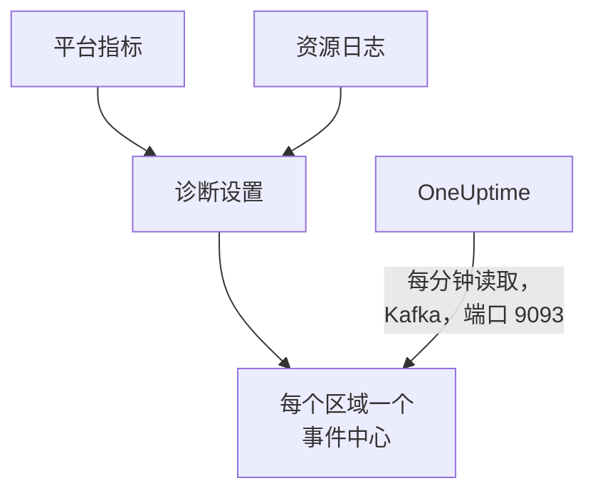

# 流式传输 Azure Monitor 指标和日志

已连接的 Azure 订阅可以把 Azure Monitor 指标和资源日志流式传输到 OneUptime。诊断设置把它们发送到你订阅中的事件中心，OneUptime 每分钟读取这些事件中心：大多数关键指标在 Azure Monitor 拿到后几分钟内到达，而不必等连接的下一次读取；资源日志作为 OneUptime 日志到达，每条都归档在它所涉及的资源下。在 Azure Cloud Shell 中运行一条命令即可完成设置，无需运行任何东西。

:::cards
- [工作原理](#工作原理): 诊断设置发送到每个区域的事件中心，OneUptime 读取它们。
- [设置流式传输](#设置流式传输): 选择要流式传输的内容，开启读取，再运行一条命令。
- [到达的内容](#到达的内容): 指标到达它们所衡量的资源，日志到达它们来自的资源。
- [命令创建的内容](#命令创建的内容): 命令在你的订阅中创建的每个资源和每项权限。
- [停止流式传输](#停止流式传输): 停止读取，然后删除命令创建的内容。
:::

## 工作原理



- **每个区域一个事件中心。** 诊断设置只能发送到资源所在区域的事件中心，因此命令会在你的资源所在的每个区域创建一个 Event Hubs 命名空间，全部放在同一个资源组中，并把每个资源的诊断设置指向其所在区域的事件中心。
- **OneUptime 读取它们。** Azure Monitor 只发送到事件中心、存储账户或 Log Analytics 工作区，从不发送到你的地址：由 OneUptime 读取的事件中心，是你无需运行任何东西的方式。OneUptime 以连接自己的应用身份登录，该应用只能读取这些事件中心。
- **读取把流式传输的指标交给流。** 当流在某个区域传送某种资源类型的关键指标时，连接的读取会停止写入流所携带的那些指标，因此不会有数据点被计算两次，并继续写入[流无法携带的那些](#到达的内容)。读取会继续发现资源、它们的状态和变更，并在 15 分钟没有事件后重新接手这些指标。
- **OneUptime 无法读取时也不会丢失任何数据。** 事件会在事件中心里等待 OneUptime 读取，只要事件中心还保留着它们；OneUptime 会记住每个分区读到了哪里，从停下的地方继续。

## 开始之前

- **一个已连接的 Azure 订阅。** 先在 **云 → 连接** 中连接它：参见 [连接云账户](/docs/telemetry/cloud-accounts)。
- **项目所有者或管理员。** 只有他们可以开启读取和停止流式传输。
- **Azure Cloud Shell**，以订阅的 **Owner** 身份登录，或以同时是 **User Access Administrator** 的 **Contributor** 身份登录：命令会创建资源组和角色分配，并更改诊断设置。
- **在自托管的 OneUptime 上，能访问 Azure 的出口。** OneUptime 通过端口 9093 在 `<namespace>.servicebus.windows.net` 读取每个命名空间，命名空间接受来自互联网的连接。

## 设置流式传输

:::steps
### 打开流式传输对话框

转到 **云 → 连接**，在 Azure 订阅所在行选择 **流式传输指标和日志**。

### 选择要流式传输的内容

**指标** 按分钟流式传输每个资源的关键指标，也就是 OneUptime 为每个资源绘制图表并据以评估它的指标，但[诊断设置无法发送的那些](#到达的内容)除外，连接会继续读取它们。**指标和日志** 加上每个资源自己的日志，即 Azure 为它保留的每个类别；**日志** 只流式传输资源日志。

### 开启读取

选择 **开启读取**。OneUptime 每分钟查找一次事件中心，并一直等到命令创建了它们。

### 在 Azure Cloud Shell 中运行命令

复制命令，在 Azure Cloud Shell 中运行并等待它完成。它会列出创建了事件中心的每个区域、向这些事件中心发送数据的资源数量，以及它跳过的资源和 Azure 给出的原因。

### 等待首批事件

对话框每隔几秒询问一次到达了什么。Azure 在命令完成后几分钟内开始发送；随后对话框会说明什么从哪里到达，连接所在行会显示 **流式传输中**。
:::

**更多字段** 包含其余内容：

| 字段 | 作用 |
| --- | --- |
| **订阅** | 要流式传输的订阅：起初是连接读取的订阅。第一个订阅中存放事件中心，OneUptime 在那里读取它们。最多 50 个 |
| **用其他方式设置** | 命令使用的名称，用于通过 Terraform 或门户进行设置 |

如果连接尚未读取任何订阅，或读取的订阅超过 50 个，对话框会改为在步骤之前询问 **订阅**。

如果第一个订阅不是 OneUptime 读取事件中心的那个订阅，对话框会提示：运行命令前请选择 **改为在那里读取**。

## 到达的内容

| 内容 | 到达位置 |
| --- | --- |
| 关键指标 | 到达它们所衡量的云资源，与连接的读取写入的是同一组序列 |
| 资源日志 | 到达日志浏览器中连接的遥测服务下，订阅、区域和类别作为属性 |
| OneUptime 认识的资源的日志 | 也到达该资源：它在云中的页面会多出一个 **日志** 标签页 |

流传送的是连接按分钟读取的关键指标。其余的仍由读取按计划继续写入：连接以更粗的粒度读取的指标，例如容器注册表的已用存储，以及诊断设置无法发送的每个关键指标，即 Azure Monitor 支持的指标列表在 DS Export 列中标记为不可导出的指标：

- 虚拟机和规模集：`Network In Total`、`Network Out Total`。
- 磁盘：`Composite Disk Read Bytes/sec`、`Composite Disk Write Bytes/sec`、`Composite Disk Read Operations/sec`、`Composite Disk Write Operations/sec`。
- Azure Cosmos DB 账户：`TotalRequests`、`TotalRequestUnits`、`NormalizedRUConsumption`、`ServerSideLatency`。
- 存储账户：`UsedCapacity`。
- AKS 群集：`kube_pod_status_ready`。
- 应用程序网关：`ApplicationGatewayTotalTime`、`Throughput`。
- 防火墙：`Throughput`。
- NAT 网关：`ByteCount`、`SNATConnectionCount`、`DatapathAvailability`。

Service Bus 或 Event Hubs 命名空间不流式传输任何指标。读取按每个队列、主题和事件中心读取它的关键指标，命名空间自己的总计是它们之和；而诊断设置只发送命名空间的总计，并且完全不发送 Service Bus 命名空间 6 个关键指标中的 4 个，或 Event Hubs 命名空间 4 个中的 2 个。因此无论是否流式传输，读取都会写入全部这些指标，不会有消息被计算两次。

日志按资源的 ARM ID 归档在该资源下，以 `cloud.resource_id` 携带，并把类别、操作、结果和属性保留为属性，例如 `azure.category`。

虚拟机、规模集、磁盘、网络接口、虚拟网络、专用终结点、NAT 网关、DNS 区域和 App Service 计划不发送自己的资源日志，因此它们的页面没有 **日志** 标签页。存储账户的日志是其各项服务的日志，容器应用的日志是其环境的日志。

## 命令创建的内容

资源组名为 `oneuptime-stream-` 加上连接 ID 的前 8 个字符。它不会让 OneUptime 访问你的资源：连接的应用只能读取事件中心，仅此而已。

| 资源 | 可以做什么 |
| --- | --- |
| 第一个订阅中的资源组 `oneuptime-stream-<suffix>` | 存放事件中心，并以 `oneuptime-connection` 标签标记连接的 ID |
| 每个区域一个 Event Hubs 命名空间 `oneuptime-<suffix>-<region>`，标准层，1 个吞吐量单位 | 接收其所在区域的诊断设置发送的内容 |
| 每个命名空间中的事件中心 `oneuptime`，2 个分区 | 保存事件，直到 OneUptime 读取它们 |
| 授予连接应用的 **Azure Event Hubs Data Receiver** 角色，仅作用于该资源组 | 让应用读取事件中心，别无其他 |
| 每个资源上的诊断设置 `OneUptime-<suffix>` | 把资源的指标、日志或两者发送到其所在区域的事件中心 |

全局区域的资源（例如 Front Door）发送到第一个区域的事件中心。Azure 只保留指标或只保留日志的资源，会按其已有的内容设置；已经有 5 个诊断设置（Azure 允许的上限）的资源会被跳过。Azure 按小时对每个命名空间的吞吐量单位计费，并对诊断设置发送的事件计费。

## 停止流式传输

:::steps
### 停止读取

在 **云 → 连接** 中订阅所在行选择 **停止流式传输**。OneUptime 会立即停止读取事件中心，连接会重新按计划读取其所有指标。已读取的内容会保留。

### 删除命令创建的内容

在删除之前，事件中心和诊断设置会一直保留在 Azure 中，并由 Azure 计费。对话框会显示命令：它会删除每个资源的诊断设置，然后删除资源组，无论资源组位于哪个订阅。

```bash
oneuptime_stream_stop() {
  local SUB ID N=0
  for SUB in '11111111-aaaa-4aaa-8aaa-111111111111' '22222222-bbbb-4bbb-8bbb-222222222222'; do
    while IFS= read -r ID; do
      if [ -z "$ID" ]; then continue; fi
      az monitor diagnostic-settings delete --name OneUptime-6f1c3a2e --resource "$ID" --output none 2> /dev/null &
      N=$((N + 1))
      if [ $((N % 4)) -eq 0 ]; then wait; fi
    done < <(az resource list --subscription "$SUB" --query "[].id" --output tsv)
  done
  wait
  for SUB in '11111111-aaaa-4aaa-8aaa-111111111111' '22222222-bbbb-4bbb-8bbb-222222222222'; do
    if [ "$(az group exists --subscription "$SUB" --name oneuptime-stream-6f1c3a2e 2> /dev/null)" = true ]; then
      az group delete --subscription "$SUB" --name oneuptime-stream-6f1c3a2e --yes --no-wait && echo "Deleting oneuptime-stream-6f1c3a2e in $SUB."
    fi
  done
}
oneuptime_stream_stop
```
:::

要更改流式传输的内容，请再次打开 **流式传输指标和日志**，选择要流式传输的内容并运行新命令：它会更新第一次运行创建的内容，不会重复创建任何东西。

## 用其他方式设置

用 Terraform 或门户，以这些名称创建命令所创建的内容：

| 设置 | 值 |
| --- | --- |
| 资源组 | `oneuptime-stream-<suffix>`，位于 OneUptime 读取事件中心的订阅中 |
| Event Hubs 命名空间 | `oneuptime-<suffix>-<region>`，每个有待流式传输资源的区域一个 |
| 事件中心 | `oneuptime`，位于每个命名空间中 |
| 诊断设置 | 每个资源上的 `OneUptime-<suffix>`，发送到其所在区域的事件中心，使用命名空间的 `RootManageSharedAccessKey` 规则 |
| 角色 | 授予连接应用的 **Azure Event Hubs Data Receiver**，作用于资源组 |

然后开启读取，并把该订阅放在 **订阅** 的第一位。

## 故障排除

:::details 对话框一直在等待首批事件
检查命令是否已完成，并已提示某个区域的事件中心已就绪：`az eventhubs namespace list --resource-group oneuptime-stream-6f1c3a2e` 会列出命名空间。诊断设置只发送 Azure Monitor 拥有的内容，因此什么都不做的资源发送得很少。新角色可能需要几分钟才能生效：在此之前，读取看不到事件。
:::

:::details 连接显示流失败
对话框和该行的工具提示会说明原因。如果应用无权读取事件中心，请再次运行命令：它会重新为应用授予角色。如果 OneUptime 无法访问它们，请检查命名空间是否接受来自互联网的连接，以及自托管的 OneUptime 能否访问端口 9093。
:::

:::details 命令跳过了一些资源
它会列出这些资源，每个都附有 Azure 给出的原因。没有诊断设置的资源类型不会发送任何内容；已经有 5 个诊断设置的资源需要先删除其中一个。然后再次运行命令。
:::

## 后续步骤

:::cards
- [连接云账户](/docs/telemetry/cloud-accounts): 连接读取什么，以及多久读取一次。
- [流式传输 Google Cloud 日志](/docs/telemetry/cloud-streaming-google-cloud): Google Cloud 项目的日志，通过 Pub/Sub 推送。
- [流式传输 CloudWatch 指标和日志](/docs/telemetry/cloud-streaming): AWS 账户的指标和日志，由 Amazon Data Firehose 投递。
- [日志浏览器](/docs/telemetry/logs-explorer): 搜索和筛选流投递的内容。
:::
