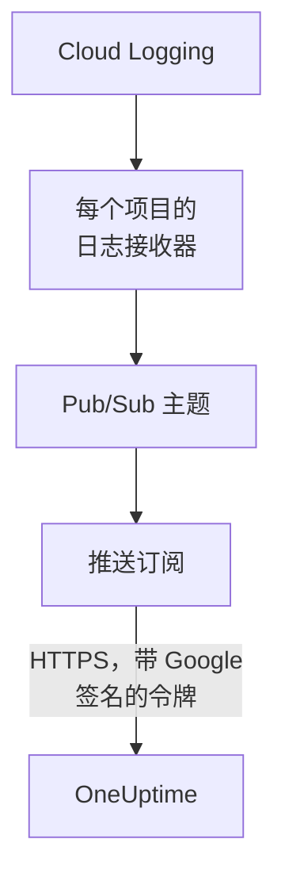

# 流式传输 Google Cloud 日志

已连接的 Google Cloud 项目可以在日志写入时就把它们流式传输到 OneUptime。Cloud Logging 通过日志接收器把日志路由到一个 Pub/Sub 主题，主题的推送订阅在一分钟内把每个条目投递到 OneUptime，作为 OneUptime 日志归档在它所涉及的资源下。在 Google Cloud Shell 中运行一条命令即可完成设置，无需运行任何东西。Cloud Monitoring 没有可推送指标的导出功能，因此连接仍按计划读取指标。

:::cards
- [工作原理](#工作原理): 每个项目一个日志接收器、一个主题及其推送订阅。
- [设置流式传输](#设置流式传输): 选择哪些日志，创建流密钥，再运行一条命令。
- [到达的内容](#到达的内容): 日志到达它们来自的资源。
- [命令创建的内容](#命令创建的内容): 命令在你的项目中创建的每个资源和每项权限。
- [停止流式传输](#停止流式传输): 停用密钥，然后删除命令创建的内容。
:::

## 工作原理



- **每个项目一个日志接收器。** 每个项目的接收器把与其过滤器匹配的条目路由到同一个 Pub/Sub 主题，该主题位于连接自己的服务账号所在的项目中。
- **每次推送两项检查。** Pub/Sub 为一个专门用于推送的服务账号签发 OpenID Connect 令牌，令牌的受众 (audience) 是连接的流密钥。只有当 Google 为该服务账号签发了令牌，并且密钥是连接的密钥之一时，OneUptime 才接受推送。密钥指明连接，也就指明了项目：推送中的任何内容都不能决定它写入哪里。OneUptime 只保存密钥的 SHA-256。
- **OneUptime 无法接受时也不会丢失任何数据。** Pub/Sub 会重新推送被拒绝的条目，两次尝试之间等待 10 秒到最多 10 分钟，并保留它一天。

## 开始之前

- **一个已连接的 Google Cloud 项目。** 先在 **云 → 连接** 中连接它：参见 [连接云账户](/docs/telemetry/cloud-accounts)。
- **项目所有者或管理员。** 只有他们可以创建流密钥和停止流式传输。
- **Google Cloud Shell**，以项目的 **Owner** 身份登录，或以可在这些项目中创建服务账号、Pub/Sub 主题和日志接收器的人员身份登录。
- **在自托管的 OneUptime 上，需要 HTTPS 地址。** Pub/Sub 只推送到 `https://` 地址，证书须受 Google 信任，并且该地址必须能从 Google Cloud 访问。

## 设置流式传输

:::steps
### 打开流式传输对话框

转到 **云 → 连接**，在 Google Cloud 项目所在行选择 **流式传输日志**。

### 选择哪些日志

**警告和错误** 流式传输严重性为 `WARNING` 或更高的每个条目：只是出问题的部分，而不是每个请求。**所有日志** 流式传输除 Data Access 审核日志以外的每个条目，这些审核日志记录每次读取，可能超过项目写入的其他所有内容。**自定义过滤器** 流式传输与 Cloud Logging 查询匹配的条目，查询写在 **过滤器** 字段中。

### 创建流密钥

选择 **创建流密钥**。密钥只在这一次、在命令中显示：OneUptime 只保存它的 SHA-256。

### 在 Google Cloud Shell 中运行命令

复制命令，在 Google Cloud Shell 中运行并等待它完成。它会列出设置了接收器的每个项目，并在 Google 拒绝的第一步停下，附上 Google 给出的原因。

### 等待首次推送

对话框每隔几秒询问一次到达了什么。项目写入过滤器接受的条目后，Pub/Sub 会在一分钟内推送它；随后对话框会说明什么从哪里到达，连接所在行会显示 **流式传输中**。
:::

**更多字段** 包含其余内容：

| 字段 | 作用 |
| --- | --- |
| **项目** | 要流式传输日志的项目：起初是连接读取的项目。主题创建在连接的服务账号所在的项目中。最多 100 个 |
| **用其他方式设置** | 推送端点、推送服务账号和密钥，用于通过 Terraform 或控制台进行设置 |

## 到达的内容

| 内容 | 到达位置 |
| --- | --- |
| 日志 | 到达日志浏览器中连接的遥测服务下，项目、区域和日志名称作为属性 |
| OneUptime 认识的资源的日志 | 也到达该资源：它在云中的页面会多出一个 **日志** 标签页 |

每条日志都保留其条目精确到纳秒的时间、严重性、追踪和 span，以及采用 OpenTelemetry 语义约定名称的 HTTP 请求。当它的受监控资源是 OneUptime 读取其指标的一种类型时，例如虚拟机 (`gce_instance`)、Cloud Run 服务 (`cloud_run_revision`) 或 Cloud SQL 实例 (`cloudsql_database`)，日志就归档在该资源下，并以 `cloud.resource_id` 携带资源的 ID。外部负载均衡器的请求日志写在 `http_load_balancer` 下，但会归档在其 URL 映射，也就是其指标所落的 `https_lb_rule` 下。

实例组的日志是其虚拟机的日志，因此它的页面没有 **日志** 标签页。其他类型的条目照样会流式传输，归在其项目下。

## 命令创建的内容

它创建的资源以连接 ID 的前 8 个字符命名。它不会让 OneUptime 访问你的项目：条目只会向外流出。

| 资源 | 可以做什么 |
| --- | --- |
| 连接的服务账号所在项目中的服务账号 `oneuptime-push-<suffix>` | 没有任何角色：Pub/Sub 为它签发推送的令牌 |
| 授予 Pub/Sub 服务代理的 **Service Account OpenID Connect Identity Token Creator** 角色，仅作用于该服务账号 | 让 Pub/Sub 创建这些令牌，别无其他 |
| Pub/Sub 主题 `oneuptime-stream-<suffix>` | 存放接收器路由过来的条目 |
| 其推送订阅 `oneuptime-stream-<suffix>-push` | 以 60 秒的确认期限把每个条目推送到 OneUptime，并把无法推送的内容保留一天 |
| 每个项目中的日志接收器 `oneuptime-stream-<suffix>` | 把与其过滤器匹配的条目路由到主题 |
| 授予每个接收器写入者的 **Pub/Sub Publisher** 角色，仅作用于主题 | 让接收器发布到主题，别无其他 |

如果主题所在项目的 Pub/Sub 和 Cloud Logging API 处于关闭状态，命令会开启它们。Google 会按投递的日志收取 Pub/Sub 费用：只流式传输你需要的日志。

## 停止流式传输

:::steps
### 停用密钥

在 **云 → 连接** 中项目所在行选择 **停止流式传输**。连接的所有流密钥会立即失效，OneUptime 会拒绝 Pub/Sub 推送的内容。已投递的内容会保留。

### 删除命令创建的内容

在删除之前，接收器、主题及其推送订阅会一直保留在 Google Cloud 中，Pub/Sub 也会继续推送。对话框会显示针对连接所读取项目的命令：

```bash
for SOURCE in 'acme-prod' 'acme-data'; do
  gcloud logging sinks delete oneuptime-stream-6f1c3a2e --project "$SOURCE" --quiet
done
gcloud pubsub subscriptions delete oneuptime-stream-6f1c3a2e-push --project 'acme-prod' --quiet
gcloud pubsub topics delete oneuptime-stream-6f1c3a2e --project 'acme-prod' --quiet
gcloud iam service-accounts delete 'oneuptime-push-6f1c3a2e@acme-prod.iam.gserviceaccount.com' --project 'acme-prod' --quiet
```
:::

要更改流式传输哪些日志，请再次打开 **流式传输日志**，选择 **创建新密钥** 并运行新命令。被替换的密钥在 24 小时内仍然有效，因此在订阅更新期间不会有推送被拒绝。最多 3 个被替换的密钥可同时有效。

## 用其他方式设置

为 Pub/Sub 主题添加使用这些值的推送订阅，并允许 Pub/Sub 服务代理为推送服务账号创建令牌：

| 设置 | 值 |
| --- | --- |
| 推送端点 | `https://oneuptime.com/telemetry/gcp-pubsub/v1/logs` |
| 身份验证 | 为 `oneuptime-push-<suffix>@<project>.iam.gserviceaccount.com` 签发的 OpenID Connect 令牌 |
| 受众 (audience) | 流密钥 |
| 载荷 | 封装格式，即 Pub/Sub 默认的发送方式 |
| 确认期限 | 60 秒 |
| 消息保留期 | 1 天 |

然后用日志接收器把每个项目的日志路由到该主题，并为每个接收器的写入者授予该主题上的 **Pub/Sub Publisher**。在自托管的 OneUptime 上，请把 `https://oneuptime.com` 换成你的 OneUptime 的 HTTPS 地址。

OneUptime 按 Pub/Sub 期望的方式应答每次推送：

| 应答 | 何时 | Pub/Sub 的处理 |
| --- | --- | --- |
| `204` | 条目已被接受，或之前已被接受，或该消息不是日志条目 | 继续 |
| `400` | 不是 OneUptime 能读取的 Pub/Sub 推送 | 重新推送，每次等待更久，持续一天 |
| `401` | 令牌不是 Google 为推送服务账号签发的，或其受众不是连接的密钥 | 重新推送，每次等待更久，持续一天 |
| `402` | 无法为该项目的遥测数据计费 | 重新推送，每次等待更久，持续一天 |
| `403` | 连接已关闭，或项目无法接收遥测数据 | 重新推送，每次等待更久，持续一天 |
| `413` | 请求超过 1 MiB，或其条目超过 512 KiB | 重新推送，每次等待更久，持续一天 |
| `429` | 连接的订阅一分钟内推送了超过 12,000 个条目 | 重新推送，每次等待更久，持续一天 |
| `503` | OneUptime 当时无法检查令牌或无法将条目加入队列 | 重新推送，每次等待更久，持续一天 |

## 故障排除

:::details 对话框一直在等待首次推送
检查命令是否在没有中断的情况下完成，以及项目是否写入了过滤器接受的条目：选择 **警告和错误** 时，安静的项目什么也不会发送。`gcloud pubsub subscriptions describe oneuptime-stream-6f1c3a2e-push --project acme-prod` 会显示订阅的端点。在自托管的 OneUptime 上，检查 Google Cloud 能否通过 HTTPS 访问其地址。
:::

:::details 连接显示流被拒绝
对话框和该行的工具提示会说明原因。密钥错误表示订阅使用一个已失效的密钥推送：请创建新密钥并再次运行命令。未针对推送服务账号签名的推送，表示订阅以另一个账号签名，或 Pub/Sub 无权为该账号签名：请再次运行命令。
:::

:::details 资源的日志没有显示在其页面上
页面显示的是 Cloud Logging 归档在该资源的受监控资源下、带有与其指标相同标签的日志。工作负载写在其他资源下的日志（例如容器的日志）只会在其项目下流式传输。
:::

## 后续步骤

:::cards
- [连接云账户](/docs/telemetry/cloud-accounts): 连接读取什么，以及多久读取一次。
- [流式传输 Azure Monitor 指标和日志](/docs/telemetry/cloud-streaming-azure): Azure 订阅的指标和日志，从事件中心读取。
- [流式传输 CloudWatch 指标和日志](/docs/telemetry/cloud-streaming): AWS 账户的指标和日志，由 Amazon Data Firehose 投递。
- [日志浏览器](/docs/telemetry/logs-explorer): 搜索和筛选流投递的内容。
:::
