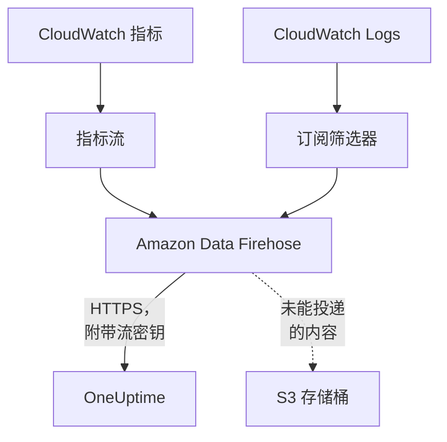

# 流式传输 CloudWatch 指标和日志

已连接的 AWS 账户可以通过 Amazon Data Firehose 将其 CloudWatch 指标和日志流式传输到 OneUptime。这样，指标会在 CloudWatch 拿到后几分钟内到达，而不必等连接的下一次读取；CloudWatch Logs 会作为 OneUptime 日志到达，每条都归入它所涉及的资源。只需在 AWS CloudShell 中运行一条命令即可完成设置，无需运行任何程序。

:::cards
- [工作原理](#工作原理): 每个区域中的指标流和日志订阅，由 Firehose 投递。
- [设置流式传输](#设置流式传输): 选择要流式传输的内容，创建流密钥并运行一条命令。
- [到达的内容](#到达的内容): 指标落在其度量的资源上，日志落在其来源的资源上。
- [堆栈创建的内容](#堆栈创建的内容): 命令在你的账户中创建的每个资源和每项权限。
- [停止流式传输](#停止流式传输): 先停用密钥，再删除堆栈。
:::

## 工作原理



- **每个区域一个堆栈。** 命令会在你要流式传输的每个区域部署一个 CloudFormation 堆栈。堆栈中的指标流和日志订阅筛选器把所有内容交给两个 Firehose 流，再由 Firehose 通过 HTTPS 投递到 OneUptime。
- **流密钥表明数据属于谁。** Firehose 每次投递都会发送连接的流密钥。密钥指明连接，进而指明项目：投递中的任何内容都不能决定它被写到哪里。OneUptime 只保存密钥的 SHA-256。
- **读取把已流式传输的指标交给流。** 当某个流在投递某个区域的一个命名空间时，连接的读取就不再写入该命名空间的指标，因此不会有数据点被计算两次。读取仍会继续发现资源及其健康状况和变更，并在 15 分钟没有投递后重新接管该命名空间。
- **OneUptime 无法接收时也不会丢失任何内容。** Firehose 会在最长一小时内重新发送被拒绝的批次，之后将其在堆栈的 S3 存储桶中保留 30 天。

## 开始之前

- **一个已连接的 AWS 账户。** 先在 **云 → 连接** 中连接它：请参阅[连接云账户](/docs/telemetry/cloud-accounts)。
- **项目所有者或管理员。** 只有他们可以创建流密钥并停止流式传输。
- **该账户中的 AWS CloudShell**，以可以创建 CloudFormation 堆栈和 IAM 角色的用户身份登录。
- **自托管 OneUptime 需要一个 HTTPS 地址。** Firehose 只投递到端口 443 上的 `https://` 地址，需要 AWS 信任的证书，并且该地址必须能从 AWS 访问。

## 设置流式传输

:::steps
### 打开流式传输对话框

进入 **云 → 连接**，在 AWS 账户所在行选择 **流式传输指标和日志**。

### 选择要流式传输的内容

**指标** 每分钟流式传输每个资源的每个关键指标：也就是 OneUptime 绘制图表并评估每个资源所依据的指标。**指标和日志** 会加上 CloudWatch Logs，**日志** 则只流式传输 CloudWatch Logs。

对于日志，请在 **日志组** 中每行填写一个，可以是旁边 **区域** 中的名称，也可以是位于其自身区域的 ARN；或者选择 **账户的所有日志组，包括新建的**。一条命令最多按名称订阅 50 个日志组，最多覆盖 10 个区域。

### 创建流密钥

选择 **创建流密钥**。密钥只在命令中显示这一次：OneUptime 只保存它的 SHA-256。

### 在 AWS CloudShell 中运行命令

复制命令，在 AWS CloudShell 中运行并等待它完成。命令会把模板写入 `oneuptime-stream.json`，并把密钥作为不会再次显示的参数，在每个区域中部署它。

### 等待首次投递

对话框每隔几秒询问一次到达了什么。命令完成后几分钟内 Firehose 就会投递；随后对话框会说明什么内容从哪里到达，连接所在行会显示 **流式传输中**。
:::

**更多字段** 中包含其余设置：

| 字段 | 作用 |
| --- | --- |
| **所有指标，而不仅是关键指标** | 流式传输 CloudWatch 中该账户的所有指标，包括你的自定义指标。AWS 按流发送的每次指标更新计费，因此费用可能高出许多倍 |
| **区域** | 从哪里流式传输：初始为连接找到资源的区域。留空时，命令会从 AWS CloudShell 自身所在的区域流式传输。最多 30 个 |
| **用其他方式设置** | 指标和日志的端点以及密钥，用于通过 Terraform 或控制台设置流 |

**下载模板** 会保存命令所部署的模板，方便你用自己的方式部署。

## 到达的内容

| 内容 | 落在哪里 |
| --- | --- |
| 指标 | 落在其度量的云资源上，名称和属性与连接的读取所赋予的相同 |
| 日志 | 落在日志浏览器中，归于连接的遥测服务之下，并以账户、区域和日志组作为属性 |
| AWS 以资源命名的日志组中的日志 | 也会落在该资源上：该资源在云中的页面会多出一个 **日志** 选项卡 |

当 AWS 以某个资源为日志组命名时，该日志组会归入这个资源：

| 日志组 | 资源类型 |
| --- | --- |
| `/aws/lambda/<function>` | `AWS::Lambda::Function` |
| `/aws/rds/instance/<instance>/<log>` | `AWS::RDS::DBInstance` |
| `/aws/rds/cluster/<cluster>/<log>` | `AWS::RDS::DBCluster` |
| `/aws/docdb/<cluster>/<log>` | `AWS::DocDB::DBCluster` |
| `/aws/neptune/<cluster>/<log>` | `AWS::Neptune::DBCluster` |
| `/aws/redshift/cluster/<cluster>/<log>` | `AWS::Redshift::Cluster` |
| `/aws/OpenSearchService/domains/<domain>/<log>` | `AWS::OpenSearchService::Domain` |
| `/aws/aes/domains/<domain>/<log>` | `AWS::OpenSearchService::Domain` |
| `/aws/apprunner/<service>/<service-id>/<log>` | `AWS::AppRunner::Service` |
| `/aws/elasticbeanstalk/<environment>/<log>` | `AWS::ElasticBeanstalk::Environment` |
| `/aws/ecs/containerinsights/<cluster>/performance` | `AWS::ECS::Cluster` |

每条日志都以 `cloud.resource_id` 携带资源的 ID，Lambda 函数的日志还携带 `faas.name`，因此它们也会显示在 Serverless 中的该函数上。其他名称的日志组同样会被流式传输，归于其账户和区域之下。日志的严重性就是其消息中按 Lambda 的写法注明的严重性。

## 堆栈创建的内容

堆栈名为 `OneUptimeStream-` 加上连接 ID 的前 8 个字符。它不会给予 OneUptime 任何访问你账户的权限：数据只会向外流出。

| 资源 | 允许做什么 |
| --- | --- |
| 一个 OpenTelemetry 1.0 格式的 CloudWatch 指标流 | 只能把记录写入指标的 Firehose 流 |
| 日志订阅筛选器，或一个针对所有日志组的账户级订阅策略 | 只能把记录写入日志的 Firehose 流 |
| 两个 Firehose 流，`OneUptime-<suffix>-metrics` 和 `OneUptime-<suffix>-logs` | 以 GZIP、1 MiB 或 60 秒的缓冲区以及一小时的重试投递到 OneUptime，并把未能投递的内容写入存储桶 |
| 一个存放未能投递内容的 S3 存储桶 | 阻止公共访问、加密、30 天后清空，删除堆栈时保留 |
| 一个日志组 `/aws/kinesisfirehose/OneUptime-<suffix>` | 存放 Firehose 自身的投递错误，且从不被流式传输 |
| 三个 IAM 角色 | 每个角色只信任此账户的一个 AWS 服务，并且只允许上面各行所说的操作 |

AWS 按指标流发送的每次指标更新计费，并按 Firehose 投递的数据量计费。请只流式传输你需要的指标和日志组。

## 停止流式传输

:::steps
### 停用密钥

在 **云 → 连接** 中该账户所在行，选择 **停止流式传输**。连接的所有流密钥会立即失效，OneUptime 会拒绝流投递的内容，连接会重新按计划读取所有指标。流已投递的内容会保留。

### 删除堆栈

在删除其堆栈之前，这些流会保留在 AWS 中并由 AWS 计费。对话框会显示针对连接找到资源的区域的命令：

```bash
for REGION in us-east-1 eu-west-1; do
  aws cloudformation delete-stack --region "$REGION" --stack-name OneUptimeStream-6f1c3a2e
done
```
:::

要更改堆栈流式传输的内容，请再次打开 **流式传输指标和日志**，选择 **创建新密钥** 并运行新的命令。被替换的密钥在 24 小时内仍然有效，因此堆栈更新期间不会有投递被拒绝。同时最多有 3 个被替换的密钥有效。

## 用其他方式设置

为每个 Firehose 流设置使用这些值的 HTTP 端点目标，并将指标流的输出格式设为 OpenTelemetry 1.0：

| 设置 | 值 |
| --- | --- |
| 指标端点 | `https://oneuptime.com/telemetry/aws-firehose/v1/metrics` |
| 日志端点 | `https://oneuptime.com/telemetry/aws-firehose/v1/logs` |
| 访问密钥 | 流密钥，以 `X-Amz-Firehose-Access-Key` 发送 |
| 内容编码 | `GZIP` |
| 缓冲区 | 1 MiB 或 60 秒 |
| 重试时长 | 3600 秒，并配一个存放未能投递内容的 S3 存储桶 |

在自托管的 OneUptime 上，请把 `https://oneuptime.com` 替换为你的 OneUptime 的 HTTPS 地址。指标端点也接受 JSON 格式的指标流。

OneUptime 会按照 Firehose 期望的方式回应每次投递：

| 回应 | 何时 | Firehose 的做法 |
| --- | --- | --- |
| `200` | 投递已被接收，或之前已被接收 | 继续 |
| `400` | 不是 OneUptime 能读取的 Firehose 投递，例如超过 10,000 条记录的投递 | 在最长一小时内重新发送 |
| `401` | 密钥不是该连接的密钥之一 | 在最长一小时内重新发送 |
| `402` | 无法为该项目的遥测计费 | 在最长一小时内重新发送 |
| `403` | 连接已关闭，或项目无法接收遥测 | 在最长一小时内重新发送 |
| `413` | 请求大于 4 MiB，或解压后超过 32 MiB | 保留在存储桶中 |
| `429` | 连接的流在一分钟内发送了超过 600 次投递 | 稍后重新发送 |

## 故障排除

:::details 对话框一直在等待首次投递
检查命令是否在每个区域都已无错误地完成：`aws cloudformation describe-stacks --stack-name OneUptimeStream-6f1c3a2e` 会显示堆栈的状态。指标流只投递 CloudWatch 中已有的指标，因此没有资源的区域什么也不会发送。在自托管的 OneUptime 上，请检查 AWS 能否通过端口 443 上的 HTTPS 访问其地址。
:::

:::details 连接显示流被拒绝
对话框和该行的工具提示会说明原因。密钥错误意味着堆栈正在使用一个已失效的密钥运行：请创建新密钥并重新运行命令。Firehose 会继续发送它保留的内容，密钥正确后就会被接收。
:::

:::details Lambda 函数的日志没有显示在其页面上
页面显示的是以函数命名的日志组 `/aws/lambda/<function>` 中的日志。写入其他名称日志组的函数，其日志只会归于其账户和区域之下进行流式传输。
:::

## 后续步骤

:::cards
- [连接云账户](/docs/telemetry/cloud-accounts): 连接读取哪些内容，以及多久读取一次。
- [云资源(IaaS 与 PaaS)](/docs/telemetry/cloud-resources): OneUptime 识别的每种资源类型。
- [日志浏览器](/docs/telemetry/logs-explorer): 搜索和筛选流投递的内容。
:::
