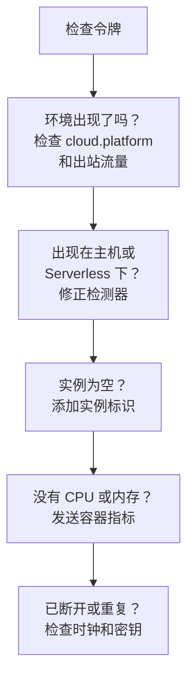

# 云故障排除

查明云环境为什么缺失、归档到了错误的位置、为空或出现重复。各节按这些问题发生的顺序排列，每一节排除一层原因，所以请从上往下逐一检查。只属于某个平台的故障列在该平台页面的末尾：[AWS ECS / Fargate](/docs/telemetry/cloud-aws-ecs)、[Google Cloud Run](/docs/telemetry/cloud-gcp-cloud-run)、[Azure Container Apps](/docs/telemetry/cloud-azure-container-apps) 和 [其他云平台](/docs/telemetry/cloud-other-platforms)。



## 先检查令牌

这是最省事的检查，没有它，下面的一切都无法工作：

```bash
curl -i https://oneuptime.com/otlp/v1/validate \
  -H "x-oneuptime-token: YOUR_TELEMETRY_INGESTION_TOKEN"
```

| 响应 | 含义 |
| ------------------------- | -------------------------------------------------------------------------------------------------------------------------- |
| `200`, `"valid": true` | 令牌已被接受。它的 `keyType` 应为 `Server`：从 Collector 或后端服务发送时，`Browser` 密钥会被拒绝。 |
| `401`, `"valid": false` | 令牌缺失、未知、已吊销、已停用或已过期，响应中的 `message` 会说明是哪一种。在 **项目设置 → 遥测与 APM → 摄取密钥** 中创建新密钥，然后重新部署。 |

如果你自托管 OneUptime，请使用 `https://YOUR-ONEUPTIME-HOST/otlp/v1/validate`。尽可能在任务、实例或副本内部运行检查（ECS Exec、`az containerapp exec`）：这样能证明工作负载本身可以访问 OneUptime，而不仅仅是你的笔记本电脑。

## 环境没有出现

第一个请求发出 1 分钟后，**云 → All Environments** 下仍然什么都没有。请按顺序检查以下三点。

**`cloud.platform` 缺失，或不是托管值。** 只有当资源带有以下值之一时，OneUptime 才会把遥测数据归档到云环境下：`aws_ecs`、`aws_elastic_beanstalk`、`aws_app_runner`、`gcp_cloud_run`、`gcp_app_engine`、`azure_container_apps`、`azure_container_instances` 或 `azure_app_service`。常见原因：

- SDK 中关闭了资源检测器（`OTEL_NODE_RESOURCE_DETECTORS`、`OTEL_EXPERIMENTAL_RESOURCE_DETECTORS`、`-Dotel.resource.providers.<cloud>.enabled=true`）。
- Collector 的管道跳过了 `resourcedetection` 处理器。
- 在没有检测器的平台上，`OTEL_RESOURCE_ATTRIBUTES` 有拼写错误。

Node.js 和 .NET 的 Azure 检测器写入的是 `azure.container_apps`、`azure.app_service` 和 `azure.functions`；OneUptime 会把它们改写为带下划线的值，所以它们同样有效。要查看遥测数据带有什么，请在 **服务** 下打开该服务，从 **追踪** 选项卡打开它的一条追踪，然后查看资源属性。如果其中没有 `cloud.platform`，问题就全在这里。

**令牌错误。** 令牌检查返回了 `401`。Collector 会把它记录为 `Permanent error: ... 401`。SDK 只记录一次就停止重试，这是正确的 OTLP 行为，但很容易被忽略。

**出站流量被阻断。** Collector 记录了 `connection refused`、`context deadline exceeded`、`i/o timeout` 或 DNS 错误：

- **ECS 和 Fargate：** 私有子网需要 NAT 网关或 `assignPublicIp=ENABLED`，安全组必须允许 TCP 443 出站。
- **Cloud Run：** **VPC egress: All traffic** 需要 Cloud NAT。
- **Container Apps：** 通往防火墙的用户定义路由必须放行 OneUptime 主机。
- **所有平台：** 位于私有 DNS 名称之后的自托管 OneUptime，必须能从工作负载的网络中解析。

## 它出现在了主机下

资源带有虚拟机的平台值（`aws_ec2`、`gcp_compute_engine` 或 `azure_vm`），因此 OneUptime 把它归档到 **主机** 下：这对虚拟机是对的，对托管计算则是错的。虚拟机的检测器胜过了托管平台的检测器：在 Collector 中配置了 `detectors: [ec2, elastic_beanstalk]`，而第一个设置 `cloud.platform` 的检测器胜出；或者 SDK 的顺序偏向 EC2 检测器。请把 `elastic_beanstalk` 放在前面，或者自己在 `OTEL_RESOURCE_ATTRIBUTES` 中设置 `cloud.platform`，并只保留 `env` 检测器。

## 它只出现在无服务器函数下

资源带有 `faas.name`，但没有托管的 `cloud.platform`。GCP 检测器运行时，Cloud Run 和 App Engine 会同时设置两者。如果你手动设置了 `faas.name`，或者 Collector 丢弃了 SDK 检测器设置的资源属性，那么只满足了无服务器一侧的条件。请开启检测器，或者自己设置 `cloud.platform=gcp_cloud_run`（或 `gcp_app_engine`）、`cloud.account.id` 和 `cloud.region`。

> [!NOTE]
> 在 Cloud Run 和 App Engine 上，服务本来就应该同时出现在两个地方：环境汇总项目和区域，而 **无服务器函数** 显示单个服务。

## 实例为空

环境已经存在，但它的 **实例** 选项卡中什么都没有：遥测数据没有带实例标识。OneUptime 会用它找到的以下第一个资源属性为实例命名：

1. `aws.ecs.task.id`
2. `aws.ecs.task.arn`（缩短为任务 ID）
3. `faas.instance`
4. `azure.container_app.instance.id`
5. `service.instance.id`
6. `container.id`
7. `host.id`
8. `host.name`

平台自身的标识排在 `service.instance.id` 之前，因此 SDK 为每个进程生成的 ID（Node.js SDK 默认如此）不会把任务与其 sidecar 的 CPU 和内存拆开。各平台由谁设置标识：

| 平台 | 由谁设置标识 |
| ----------------------------------------- | ------------------------------------------------------------------------------------------------------------------------------------------------ |
| ECS | `ecs` 检测器设置任务 ARN |
| Cloud Run, App Engine | `gcp` 检测器设置 `faas.instance` |
| Container Apps | Collector 的 `azurecontainerapps` 检测器设置副本 ID；或者根据 `CONTAINER_APP_REPLICA_NAME` 设置 `service.instance.id`，或运行主机检测器 |
| App Runner, Container Instances | 主机检测器的 `host.name` |
| App Service, Elastic Beanstalk | 平台的检测器设置 `service.instance.id`；在 Beanstalk 上请删除它，让 `host.id` 为每个实例命名 |

在第一个带有该属性的信号到达后的 1 分钟内，实例就会出现。

## CPU 和内存为空

实例已经列出，但概览中的 **CPU** 和 **内存** 磁贴以及 **实例** 中的 CPU 和内存列都是空的。这些数据来自指标而不是追踪：即 `container.cpu.utilization` 和 `container.memory.usage`（或 `container.memory.usage.total`）数据点，其资源带有与追踪相同的实例标识以及 `cloud.platform`。

- **在 ECS 上**，sidecar Collector 中的 `awsecscontainermetrics` 接收器会以 `ecs.task.cpu.utilized` 和 `ecs.task.memory.utilized` 的形式提供它们。请把它保留在 `metrics` 管道中，并在该管道中同样保留 `resourcedetection`，否则指标到达时不带 `cloud.platform`，会被归档到别处。
- **在 Cloud Run、Container Apps 和其他平台上**，平台不会向 sidecar 公开容器的使用情况。除非你自己发送这些指标，否则磁贴会保持为空：请改为查看请求磁贴。
- **使用 SDK direct 时**，没有任何东西发送容器指标，因此磁贴为空是正常的。

## 环境显示已断开

当一个环境 15 分钟内没有收到任何遥测数据时，会显示 **已断开**，下一个 span、日志或指标会让它恢复。OneUptime 自身停机或追赶积压数据的时间不计入在内。在遥测数据持续流入时，最后一次出现的时间最多可能滞后五分钟，这就是阈值定为 15 的原因。

- **繁忙的环境显示已断开：** 导出器停止了。请在 Collector 日志中查找上面提到的 `401` 和出站流量错误。
- **夜间缩容到零的预发布环境** 会一直显示已断开，直到早上第一个请求到来，这是正确的。

实例有两个时钟：

- **Stale：** 如果任务、实例或副本在过去 15 分钟内没有上报，**实例** 选项卡会将其标记为 **Stale**，概览只把其余的计为在线。
- **删除：** 清理任务会删除在 `CLOUD_INSTANCE_STALE_MINUTES`（默认 15，最少 10）内未出现的实例行，这段时间从环境自身最后一次收到遥测数据算起，因此 Collector 中断只会冻结这个时钟，而不会清空最后已知的任务列表。无服务器函数使用 `SERVERLESS_INSTANCE_STALE_MINUTES`。提高阈值会让行保留得更久，但不会改变它们变为 **Stale** 的时间。

## 本应只有一个环境却出现了两个

环境密钥是 `cloud.platform|cloud.account.id|cloud.region`，按字符逐一比较。如果一些工作负载设置了 `cloud.account.id` 而另一些没有，一个写 `eastus` 而另一个写 `East US`，或者一个 Collector 运行了 `ecs` 检测器而另一个没有，你就会并排看到 `aws_ecs|123456789012|us-east-1` 和 `aws_ecs||us-east-1`。

打开每个环境的 **概览**：它的 **环境密钥** 会显示哪一部分不同。修正缺少该值的工作负载。带有空段的环境将不再收到遥测数据，你可以将其归档。

## 手动创建的环境始终无法匹配

摄取过程只按密钥匹配环境，密钥必须正好是 `platform|account|region`，例如 `aws_ecs|123456789012|us-east-1`：即与遥测数据带有的完全相同的平台值、账户 ID 和区域。创建表单（**云 → All Environments** 下的 **创建云资源**）会用 **云平台**、**云账户 ID** 和 **云区域** 字段构建密钥，因此这三个值必须与遥测数据逐字符一致。如果不一致，摄取过程就会用它算出的密钥创建第二个环境，而你创建的环境会保持为空。请归档手动创建的环境，让摄取过程创建正确的环境，或者用更正后的值重新创建。

## 仍然无法解决

在寻求帮助之前，请收集以下信息：

- 工作负载中一条真实 span 或日志记录的资源属性。Collector 的 `debug` 导出器可以打印它们，你也可以在 **服务** 下打开该服务的一条追踪。
- 在工作负载内部运行 `/otlp/v1/validate` 检查得到的响应。
- Collector 日志的最后 50 行，或开启 `OTEL_LOG_LEVEL=debug` 后 SDK 的诊断日志。
- 每个已出现的环境的 **环境密钥**。

然后联系 support@oneuptime.com，或在 [GitHub](https://github.com/OneUptime/oneuptime) 上提交 issue。

## 后续步骤

:::cards
- [云环境](/docs/telemetry/cloud-environments): 环境和实例是如何识别的。
- [AWS ECS / Fargate](/docs/telemetry/cloud-aws-ecs): ECS 的设置，附带完整的任务定义。
- [OpenTelemetry](/docs/telemetry/open-telemetry): 端点、限制以及每种响应的含义。
:::
