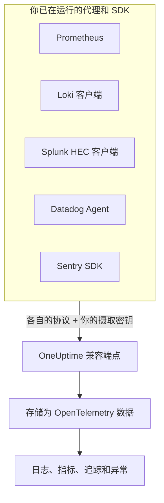

# Prometheus, Loki, Splunk, Datadog & Sentry

已经在运行 Prometheus、Loki 客户端、Splunk 转发器、Datadog Agent 或 Sentry SDK？保留它们即可。OneUptime 在这些工具本来就使用的路径上接收它们各自发送的数据，并将其存储为 OpenTelemetry 数据。试用 OneUptime 只需更换 URL 和密钥，无需重新埋点；你的丢弃过滤器、清理规则、日志管道、数据保留和摄取预算，也会像对待其他数据一样作用于这些数据。

:::cards
- [Prometheus remote write](#prometheus-remote-write): 来自 Prometheus、Grafana Alloy 或任何 remote write 发送方的指标。
- [Loki](#loki): 来自 Promtail、Grafana Alloy、Fluent Bit 或 Vector 的日志。
- [Splunk HTTP Event Collector](#splunk-http-event-collector): 来自任何 HEC 客户端的日志和指标事件。
- [Datadog Agent](#datadog-agent): 来自 Datadog Agent 的指标和日志。
- [Sentry SDK](#sentry-sdk): 来自任何 Sentry SDK 的错误、事务和日志。
:::

## 工作原理



每个端点都按其工具自己的方式应答：Prometheus 和 Loki 得到 `204`，HEC 得到 `{"text": "Success", "code": 0}`，Datadog 得到 `202`，Sentry 得到事件 ID，因此工具会像以往一样报告成功和失败。随后，这些数据的处理方式与来自 OpenTelemetry SDK 的数据完全相同。

## 开始之前

- **一个 OneUptime 项目**：在 OneUptime Cloud 上，遥测数据按摄取的 GB 计费，而且 Free 套餐的项目需要先添加付款方式才能发送遥测数据。
- **遥测摄取密钥**：在 **产品 → 项目设置 → 遥测与 APM → 摄取密钥** 下创建一个 **服务器** 密钥，并复制它的 **密钥**。每个工具都会在发送自身凭据的位置发送它。浏览器应用的 Sentry DSN 则要改用一个 **浏览器** 密钥，并在其中设置你网站的来源。
- **你的主机**：示例使用 `oneuptime.com`。如果你自托管 OneUptime，请使用你自己的主机。

> [!TIP]
> 日志、指标、追踪和异常的设置指南标签页，在它自己的发送方式中列出了这些工具，并已填好你的主机和你选择的密钥。

## 端点

| 工具 | 指向的地址 | 密钥放在哪里 |
| --- | --- | --- |
| Prometheus remote write | `https://oneuptime.com/telemetry/prometheus/api/v1/write` | Bearer 令牌，或以密钥作为密码的 Basic 认证。 |
| Loki | `https://oneuptime.com/telemetry/loki/api/v1/push` | 以密钥作为密码的 Basic 认证，或 Bearer 令牌。 |
| Splunk HTTP Event Collector | `https://oneuptime.com/telemetry/services/collector` | HEC 令牌：`Authorization: Splunk <key>`。 |
| Datadog Agent | `https://oneuptime.com/telemetry/datadog` | API 密钥：`DD-API-KEY`。 |
| Sentry SDK | DSN `https://<key>@oneuptime.com/telemetry/sentry/1` | DSN 的公钥。 |

每个端点也都接受放在 `x-oneuptime-token` 请求头中的密钥，而 `x-oneuptime-service-name` 请求头用来指定所发送的全部数据所属的服务。密钥可以写成不带连字符的 32 个十六进制字符；Sentry DSN 和 Datadog API 密钥必须这样写。

## Prometheus remote write

把 OneUptime 添加为 remote write 目标。Prometheus 会像现在一样继续抓取，并把每个样本的副本发送过来：

```yaml title="prometheus.yml"
remote_write:
  - url: https://oneuptime.com/telemetry/prometheus/api/v1/write
    authorization:
      credentials: YOUR_TELEMETRY_KEY
```

使用 Grafana Alloy 时，添加一个 `prometheus.remote_write` 组件，并把抓取结果转发给它：

```text title="config.alloy"
prometheus.remote_write "oneuptime" {
  endpoint {
    url          = "https://oneuptime.com/telemetry/prometheus/api/v1/write"
    bearer_token = "YOUR_TELEMETRY_KEY"
  }
}
```

remote write 1.0 和 2.0 都可以接受，并且与所有发送方的发送方式一样，经过 snappy 压缩。

### 序列会变成什么

- **名称和标签保持不变。** `http_requests_total{job="checkout", code="500"}` 会成为带有属性 `job` 和 `code` 的指标 `http_requests_total`，因此从 Grafana 迁移过来的查询也能找到它。
- **job 就是服务。** 按照 OpenTelemetry 对 Prometheus 的映射规则，每个 `job` 成为一个服务，每个 `instance` 成为该服务的实例。
- **类型会保留。** 计数器以及直方图的桶和计数都是累积总和，因此它们的速率能正确绘制成图表。类型来自发送方附带的元数据；没有元数据时，名称以 `_total` 结尾的是计数器，带有 `le` 标签的 `_bucket` 是直方图的桶。
- **原生直方图** 会变成指数直方图，带自定义桶的原生直方图会变成直方图。
- **不保留：** 陈旧标记（staleness marker）以及其他 NaN 或无穷大样本、计数器的 `_created` 序列，以及 exemplar。

## Loki

OneUptime 在 Loki 自己的路径上接收 Loki 的 push API，格式可以是 JSON，也可以是 Promtail 和 Grafana Alloy 发送的 snappy 压缩 protobuf。把它添加为一个客户端：

```yaml title="promtail.yaml"
clients:
  - url: https://oneuptime.com/telemetry/loki/api/v1/push
    bearer_token: YOUR_TELEMETRY_KEY
```

Fluent Bit 的 `loki` 输出需要分开填写主机和路径：

```text title="fluent-bit.conf"
[OUTPUT]
    Name         loki
    Match        *
    Host         oneuptime.com
    Port         443
    Tls          On
    Uri          /telemetry/loki/api/v1/push
    Http_User    oneuptime
    Http_Passwd  YOUR_TELEMETRY_KEY
    Labels       job=fluent-bit
```

### 日志流会变成什么

- **每个条目都是一条日志**，带有精确到纳秒的自身时间戳，并以该行作为正文。
- **标签和结构化元数据都是属性**，名称与在 Loki 中的相同。
- **服务** 取流所带有的 `service_name`、`service`、`app`、`application`、`name`、`app_kubernetes_io_name`、`container`、`container_name`、`component`、`workload` 和 `job` 中排在最前面的一个，与 Loki 的查找方式相同。`host` 或 `hostname` 标签指定主机。
- **级别** 来自 `level`、`detected_level` 或 `severity` 标签或元数据，否则来自 logfmt 的 `level=` 或 JSON 行的 `level` 字段。
- **追踪上下文：** 结构化元数据中的 `trace_id` 和 `span_id` 会把日志关联到它的追踪。

## Splunk HTTP Event Collector

把 OneUptime 用作 HTTP Event Collector，并以你的摄取密钥作为 HEC 令牌。Splunk 的 Docker 日志驱动会自己添加路径，所以只需填写主机：

```bash
docker run \
  --log-driver=splunk \
  --log-opt splunk-url=https://oneuptime.com \
  --log-opt splunk-token=YOUR_TELEMETRY_KEY \
  --log-opt splunk-format=json \
  your-image
```

其他任何 HEC 客户端都会 POST 到 `/services/collector/event` 或 `/services/collector/raw`。发送一个事件：

```bash
curl https://oneuptime.com/telemetry/services/collector/event \
  -H "Authorization: Splunk YOUR_TELEMETRY_KEY" \
  -d '{"event": "Payment failed for order 42", "sourcetype": "app", "fields": {"service": "checkout"}}'
```

返回 `200` 且带有 `{"text": "Success", "code": 0}`，表示事件已被接受。该端点也会用 HEC 自己的代码应答：`No data`（5）、附带无效事件序号的 `Invalid data format`（6），以及 `Event field is required`（12）；并且无需令牌即可应答 `GET /services/collector/health`。

### 事件会变成什么

- **一条日志**，以其 `time` 作为时间戳。字符串事件本身就是正文；对象事件的 `message`、`msg`、`log`、`line` 或 `text` 是正文，其他字段是属性。
- **元数据会保留：** `host` 是主机，`source`、`sourcetype` 和 `index` 分别保存为 `com.splunk.source`、`com.splunk.sourcetype` 和 `com.splunk.index`。事件中缺少的部分，由查询字符串中的 `host`、`source`、`sourcetype` 和 `index` 补上。
- **字段都是属性。** `service.name` 字段指定服务，日志的 `service` 字段也一样。
- **指标事件**（`"event": "metric"`，带有 `metric_name` 和 `_value`，或 `metric_name:<name>` 字段）会存储为指标，绝不会存储为日志。
- **不提供：** 索引器确认（indexer acknowledgement）。请求它的客户端不会得到 `ackId`。

## Datadog Agent

把 Agent 的指标和日志指向 OneUptime，并以你的摄取密钥作为它的 API 密钥：

```yaml title="datadog.yaml"
api_key: YOUR_TELEMETRY_KEY_WITHOUT_HYPHENS
dd_url: https://oneuptime.com/telemetry/datadog
logs_enabled: true
logs_config:
  use_http: true
  logs_dd_url: oneuptime.com:443
apm_config:
  enabled: false
process_config:
  process_collection:
    enabled: false
```

Agent 会在 `dd_url` 后加上自己的路径，并把日志发送到 `logs_dd_url` 所指定主机和端口上的 `/api/v2/logs`。只有对带有 `DD-API-KEY` 请求头的请求，OneUptime 才会在根路径上应答这些路径。修改后重启 Agent；当 OneUptime 接受该 API 密钥时，`datadog-agent status` 会显示它有效。

### Agent 的数据会变成什么

- **指标** 保留名称。Gauge 仍为 Gauge，Count 变为 Sum，Rate 变为其每秒值的 Gauge。
- **分布**（distribution）会变为带有计数、总和、最小值和最大值的摘要（summary）。
- **服务检查** 会变成以该检查命名的指标，其值为检查的状态：0 表示 OK，1 表示警告，2 表示严重，3 表示未知。
- **日志** 保留消息、状态、主机和服务，其余字段作为属性保留。
- **标签都是属性**，`service`、`env` 和 `version` 标签分别指定服务、其环境和其版本。
- **尚未读取：** APM 追踪、进程、容器、网络数据和性能剖析数据。请像上面那样在 `datadog.yaml` 中把它们关闭。

Datadog 的 HTTP API 客户端（向 `/api/v2/logs` 发送 POST 的日志库、发送序列的脚本）也可以带上 `DD-API-KEY` 请求头，发送到同一个端点。

## Sentry SDK

在你设置 Sentry 的地方替换 DSN。其余的 Sentry 代码保持不变：

```javascript
Sentry.init({
  dsn: "https://YOUR_TELEMETRY_KEY_WITHOUT_HYPHENS@oneuptime.com/telemetry/sentry/1",
  release: "checkout@1.4.2",
  environment: "production",
});
```

```python
sentry_sdk.init(
    dsn="https://YOUR_TELEMETRY_KEY_WITHOUT_HYPHENS@oneuptime.com/telemetry/sentry/1",
    release="checkout@1.4.2",
    environment="production",
)
```

DSN 末尾的 `1` 是 Sentry SDK 所要求的，不会被读取。浏览器应用的 DSN 是公开的，所以那里请使用一个 **浏览器** 摄取密钥，并在其中设置你网站的来源。

### 信封会变成什么

- **错误** 会出现在“异常”中，带有它们的堆栈跟踪和导致它们的异常，并像其他异常一样被分组。每个错误都是其追踪上的一个 span，位于当时处于活动状态的 span 之下。
- **事务** 及其 span 会出现在“追踪”中。
- **Sentry 日志** 以及用 `capture_message` 捕获的消息会出现在“日志”中。
- **服务** 取 `service` 标签，否则取发布版本名称中 `@` 之前的部分：`checkout@1.4.2` 即 `checkout`。发布版本即服务版本，环境也会保留。
- **不保留：** 会话、回放、附件、性能剖析数据和 check-in。SDK 仍会发送它们；OneUptime 接受后将其丢弃。

## 限制与摄取预算

- **请求大小**：OneUptime 的入口在 `/telemetry` 下接受最大 4 MB 的请求，每个正文解压后最多 64 MB。
- **摄取预算**：Prometheus remote write 和 Loki 在读取正文之前就会对照指标或日志预算进行检查，预算用完时以 `403` 拒绝。HEC 批次、Datadog 负载或 Sentry 信封可能携带多种信号，因此每种信号会在存储时计入它自己的预算，并在该预算用完时被丢弃。

## 故障排除

### 每个请求都以 401 被拒绝

密钥没有出现在端点查找它的位置，或者它不是这个项目的密钥。对照[端点](#端点)表检查工具的凭据设置，并确认该密钥没有被关闭或过期。

### Sentry SDK 提示 DSN 无效

Sentry SDK 会拒绝密钥中带有连字符的 DSN。请把密钥写成不带连字符的 32 个十六进制字符。

### Datadog 指标能到达，但日志没有

检查 `logs_config.use_http` 是否为 `true`，以及 `logs_config.logs_dd_url` 是否为主机和端口，而不是 URL。未设置 `use_http` 时，Agent 会通过 TCP 发送日志。

### Prometheus 报告 415

发送方请求了 OneUptime 不读取的 remote write 协议。请发送 remote write 1.0 或 2.0。
