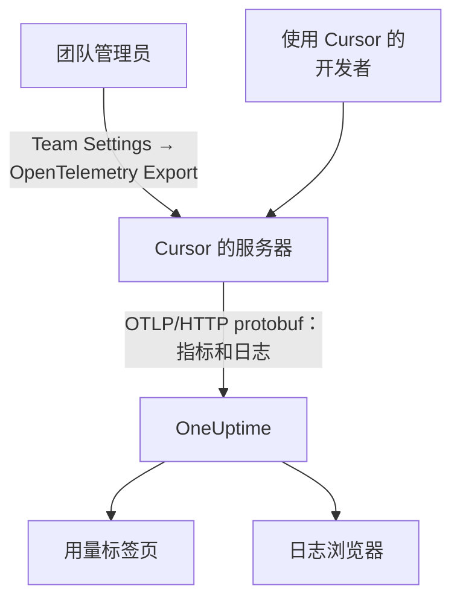

# Cursor

Cursor 从 Cursor 自己的服务器导出团队的遥测。团队管理员在 Cursor 仪表盘中把 OneUptime 添加为目标一次，整个团队的 token、估算成本和工具调用就会到达：无需在开发者机器上安装或设置任何东西。

:::cards
- [开始设置](#开始设置): 在 OneUptime 中创建密钥，在 Cursor 中创建目标。
- [你能得到什么](#你能得到什么得不到什么): 指标和日志；没有跟踪。
- [谁花了什么](#员工归属): 人员以 Cursor 用户 ID 的形式到达。
- [故障排除](#故障排除): 什么都没有到达时要检查什么。
:::

## 工作原理



## 开始之前

- **Cursor 的 Enterprise 套餐。** 其他套餐中没有 OpenTelemetry Export 页面。
- **Cursor 能从互联网访问到的端点。** 是 Cursor 主动连接你，并且从一组固定的地址发起连接。OneUptime Cloud 无需其他操作；位于防火墙后的自托管 OneUptime 必须放行 Cursor 在其 [OpenTelemetry Export](https://cursor.com/docs/enterprise/opentelemetry-export) 页面上列出的出口地址。

## 开始设置

:::steps
### 创建摄取密钥

在 OneUptime 中打开 **项目设置 → 遥测与 APM → 摄取密钥** ，点击 **创建摄取密钥** 并复制密钥。你的 OTLP 基础 URL 是 `https://oneuptime.com/otlp`；如果你自托管 OneUptime，则是 `https://YOUR-ONEUPTIME-HOST/otlp`。

### 在 Cursor 中创建目标

在 Cursor 的网页仪表盘中，以团队管理员身份打开 **Team Settings → OpenTelemetry Export** 并创建一个目标：

| 字段 | 值 |
| --- | --- |
| Endpoint (base URL) | `https://oneuptime.com/otlp` |
| Header name | `x-oneuptime-token` |
| Header value | `YOUR_INGESTION_TOKEN` |

输入基础 URL 时不要带 `/v1`：Cursor 会自行追加 `/v1/metrics` 和 `/v1/logs`，而 `https://oneuptime.com/otlp/v1` 会发送到 `/otlp/v1/v1/metrics`，那里什么也收不到。

### 测试并启用

点击 **Test connection** 检查 URL 和请求头，然后点击 **Enable** 。导出大约一分钟内开始；之后对请求头的修改大约 30 秒生效。

### 检查数据是否到达

使用 Cursor 一两分钟，然后在 OneUptime 中打开 **日志** ，按服务名称 `cursor` 筛选：带有 token 数的 `cursor.api.request` 记录说明密钥和 URL 都正确。
:::

Cursor 只使用基于 HTTP 的二进制 protobuf 格式的 OTLP（不支持 gRPC，也不支持 JSON），OneUptime 可以直接接受。它会加密存储请求头，并且每个团队只发送到一个目标：如果要同时发送到 OneUptime 和其他地方，请在前面放一个 Collector。

## 你能得到什么，得不到什么

| 信号 | 来自 Cursor |
| --- | --- |
| 指标：token、估算成本、工具调用 | 是，以增量形式 |
| 日志事件：请求、错误、更正、技能、钩子、插件、云端代理 | 是 |
| 提示词和回答文本 | 只有开启 `conversation_content` 系列时才有 |
| 跟踪 | 否 |
| 启用目标之前的任何数据 | 否 |

因此在 OneUptime 中，Cursor 会根据 `cursor.token.usage` 和 `cursor.cost.usage` 显示在 **产品 → AI / LLM** 的 **用量** 标签页上，但从不出现在由跟踪构建的 **调用** 或 **对话** 中。逐个请求的详细信息是 **日志** 浏览器中的 `cursor.api.request` 事件。

### 系列

每种信号以及每个遥测系列，在 Cursor 的设置中都有自己的开关：

| 系列 | 涵盖内容 |
| --- | --- |
| `model_usage` | `cursor.token.usage`、`cursor.cost.usage`，以及 `cursor.api.request`、`cursor.api.error` 和 `cursor.api.correction` 事件 |
| `tool_calls` | `cursor.tool.calls` |
| `skills_hooks_plugins` | 技能、钩子和插件事件 |
| `cloud_agents` | `cursor.cloud_agent.*` 事件 |
| `grok_bot_agent_actions` | `cursor.grok_bot.*` 事件；需要 Action Recording |
| `conversation_content` | 消息文本以及 MCP 工具的输入和输出；默认关闭 |

除 `conversation_content` 外，所有系列一开始都是开启的。Cursor 之后新增的系列也会默认开启，除非你关闭 `auto_enable_new_families`。

## 指标和事件

三个指标都是增量求和：

| 指标 | 单位 | 属性 |
| --- | --- | --- |
| `cursor.token.usage` | `{token}` | `cursor.token.type`：`input`、`output`、`cache_read`、`cache_creation`；`cursor.model.name`；`cursor.api.status`：`success`、`errored`、`aborted`；`cursor.api.billable` |
| `cursor.cost.usage` | `USD` | `cursor.model.name` |
| `cursor.tool.calls` | `{call}` | `cursor.tool.kind`：`builtin`、`mcp`；`cursor.tool.name`；`cursor.tool.status`：`success`、`failure`、`aborted`；`cursor.mcp.server.name` |

数据点不带任何对话 ID 或请求 ID，因此指标中没有按会话的成本。`cursor.model.name` 是请求的模型，路由后的选择会被合并：按模型的细分中有一行名为 `Auto`，无法拆分到 Cursor 实际路由到的各个模型。

你最常用的日志事件是 `cursor.api.request`：每个请求一条，包含输入、输出和缓存的 token 数、模型，以及是否计费。`cursor.api.error` 记录失败的请求（不含错误信息），`cursor.api.correction` 会稍后到达，说明某个请求最终没有计费。Cursor 的 [格式参考](https://cursor.com/docs/enterprise/opentelemetry-export/wire) 列出了每个事件和属性。

每条记录都带有以下资源属性：

| 属性 | 含义 |
| --- | --- |
| `service.name` | 始终为 `cursor`：在 **日志** 和 **指标** 浏览器中按它筛选 |
| `cursor.team.id` | 你的团队，一个整数；始终存在 |
| `cursor.user.id` | 人员，一个在团队范围内有效的整数；可选 |
| `cursor.surface` | 活动的来源，例如 `desktop`、`cli`、`cloud_agent` 或 `bugbot` |
| `cursor.entrypoint` | 活动的启动方式，例如 `desktop`、`cli`、`web`、`api` 或 `github_pr` |

## 员工归属

**Cursor 用 `cursor.user.id` 指明一个人，这是一个只有 Cursor 才能转换为姓名的整数，而且云端代理经常省略它。** OneUptime 把它读作员工，把 `cursor.team.id` 读作团队，因此 **用量** 标签页无需设置即可对人员和团队排名，但人员会显示为整数。

- 两者都以资源属性（`resource.cursor.user.id`、`resource.cursor.team.id`）的形式到达，OneUptime 会读取它们。
- Cursor 也可以发送 `cursor.user.email`，但 OneUptime 还不读取它，因此对 Cursor 而言，员工邮箱列保持为空。
- `gen_ai.user`、`llm.user` 和 LiteLLM 的最终用户 ID 从不被读作员工：它们指的是你的客户，而不是你的员工。请参阅 [员工和团队归属](/docs/telemetry/ai-coding-assistants#员工和团队归属)。

### Cursor 在用量标签页上的显示位置

Cursor 发送指标而不发送 GenAI span，而指标只用于补充 span： **如果同一个项目接收带成本的 GenAI span，Cursor 的支出就不会显示。** 请把 Cursor 发送到单独的项目。请参阅 [span 优先，指标补充](/docs/telemetry/ai-llm-observability#span-优先指标补充)。

| 细分 | 对 Cursor 而言 |
| --- | --- |
| **员工** | 是，按 `cursor.user.id` |
| **团队** | 是，按 `cursor.team.id` |
| **模型** | 是，按 `cursor.model.name` |
| **提供商** | 否：Cursor 从不说明是哪个提供商处理了调用 |
| **应用 / 服务** | 否：Cursor 的指标不属于任何 OneUptime 服务 |

Cursor 的行只携带成本：其调用和 token 单元格显示 `—`，因为 `cursor.cost.usage` 没有逐次调用的细节。`cursor.token.usage` 仍会为表格上方的 token 总数提供数据（它的 `input` 和 `output` 类型；不计缓存 token），你也可以在仪表盘上按 `cursor.token.type` 绘制它。

:::details 把 Cursor 用户 ID 转换成人员
姓名和计费金额位于 Cursor 的 Admin API 中，OneUptime 不会调用它：如有需要，请自行调用。它仅限 Enterprise，地址为 `https://api.cursor.com`，使用管理员 API 密钥作为用户名、密码留空：

```bash
curl -u YOUR_API_KEY: https://api.cursor.com/teams/members
```

`GET /teams/members` 列出每位成员的邮箱和姓名。`POST /teams/filtered-usage-events` 返回按事件的计费用量；把其中的 `chargedCents` 相加即可得到支出。它的 `conversationId` 与 Cursor 日志事件上的 `cursor.conversation.id` 一致，当两边都带有它时，就能把一个人和一笔计费金额关联到你已经看到的会话。Cursor 并未说明整数 `cursor.user.id` 与 Admin API 的用户 ID 是否相同，因此在据此向任何人收费之前，请先在你自己的团队中核实。
:::

## Cursor 的投递方式

这些规则会改变你在图表中看到的内容，因此在报告数据缺口之前请先了解它们：

- **指标最多发送一次。** 失败的导出不会重试，因此失败后出现短暂缺口是正常的：不要因为 Cursor 指标中的缺口而呼叫任何人。
- **日志至少发送一次**，按 `cursor.event.id` 去重，并在大约 7 天内自动重试。
- **没有顺序保证。** `cursor.api.correction` 会在它所更正的请求之后到达：请按记录的时间戳排序，而不是按到达顺序。
- **不会回填。** 启用目标之前的数据不会到达，而处于故障状态的目标会丢失 Cursor 未能发送的数据。
- **停用或删除目标会丢弃传输中的数据。** 若要更换摄取密钥，请编辑目标的请求头，而不是删除后重新创建。

## 成本是估算，不是发票

Cursor 将 `cursor.cost.usage` 描述为尽力而为的估算。它不区分包含在套餐内的用量和按需计费的用量；使用你自己的模型密钥时，它只反映 Cursor 的 token 费率，而不是你的提供商的账单；而且之后到达的 `cursor.api.correction` 可能会撤回已经计入的用量。请把它当作趋势来看。如需与发票一致的数字，请把 Cursor Admin API 中的 `chargedCents` 相加。

## 故障排除

:::details 什么都没有到达
在 Cursor 中再次运行 **Test connection** 。检查基础 URL 是否没有以 `/v1` 结尾、请求头名称是否为 `x-oneuptime-token` 且其值正是密钥，以及 `model_usage` 系列是否已开启。导出会在你启用目标后大约一分钟开始。
:::

:::details 自托管的 OneUptime 什么都没收到
Cursor 从自己的服务器发起连接：你的 OTLP 端点必须能通过公共 DNS 名称从互联网访问，并在防火墙中放行 Cursor 的出口地址。
:::

:::details 日志到达了，但用量标签页没有显示 Cursor 的支出
该项目还接收带成本的 GenAI span，因此不会读取 Cursor 的指标。请把 Cursor 发送到单独的项目，并使用它自己的摄取密钥。
:::

:::details 人员显示为数字
那就是 `cursor.user.id`：这是 OneUptime 目前从 Cursor 读取的唯一人员 ID。请用 Cursor 的 Admin API 把它映射到姓名。
:::

## 后续步骤

:::cards
- [AI 编程助手](/docs/telemetry/ai-coding-assistants): 支出如何在所有编程助手之间归属。
- [AI 网关](/docs/telemetry/ai-gateways): 为你自己的应用发起的模型调用提供完整的跟踪和提示词。
- [指标监控](/docs/monitor/metrics-monitor): 针对 `cursor.cost.usage`、`cursor.token.usage` 或 `cursor.tool.calls` 设置警报。
:::
