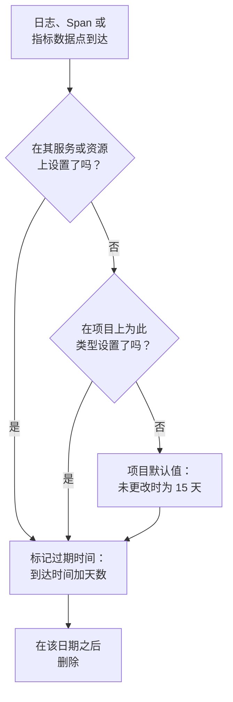

# 数据保留

OneUptime 会把你的日志、追踪、指标和性能剖析数据保留一定天数，然后删除：除非你更改，否则为 15 天。本页介绍这个天数是如何确定的、如何为整个项目更改它，以及如何让部分遥测比其余遥测保留得更长或更短。

:::cards
- [遥测保留多长时间](#遥测保留多长时间): OneUptime 读取设置的顺序。
- [更改项目的保留期](#更改项目的保留期): 为你的所有遥测设置一个天数。
- [让部分遥测保留更长或更短](#让部分遥测保留更长或更短): 按类型、严重程度、状态或服务。
- [保留的成本](#保留的成本): OneUptime Cloud 上的计费，自托管时的磁盘。
:::

## 遥测保留多长时间

每条日志、Span、指标数据点和性能剖析样本都在到达时获得其保留期。OneUptime 计算要保留多少天，标记它的过期日期，并在该日期之后删除它。最具体的设置优先：

具体来说，OneUptime 按以下顺序读取这些设置，第一个已设置的设置起决定作用：

| 顺序 | 设置 | 设置位置 |
| --- | --- | --- |
| 1 | 针对某个服务或资源，某个日志严重程度或 Span 状态的天数 | 其 **设置** 页面上的 **按遥测类型保留** |
| 2 | 针对某个服务或资源，某种遥测类型的天数 | 同一张卡片 |
| 3 | 来自某个服务或资源的所有内容的天数 | 同一页面上的 **遥测数据保留** |
| 4 | 针对项目，某个日志严重程度或 Span 状态的天数 | **数据保留** 上的 **按遥测类型保留** |
| 5 | 针对项目，某种遥测类型的天数 | 同一张卡片 |
| 6 | 其他所有内容的天数 | **数据保留** 上的 **默认保留期（天）** |

- **设置 1 到 5 是保留期覆盖。** 它们属于 [企业版](/docs/self-hosted/enterprise)，以及 OneUptime Cloud 上的 Scale 套餐。没有它们时，每条记录都按项目默认值保留。
- **更改适用于新的遥测。** 记录会保留它被标记的日期：更短的保留期不会让它更早被删除，更长的保留期也不会让它保留得更久。新记录会在大约五分钟内遵循更改。
- **异常跟随其来源。** 异常的保留时间与它所在的 Span 或日志相同。Session Replay 有自己的保留期：请参阅 [有自己保留期的其他数据](#有自己保留期的其他数据)。

## 开始之前

- **能够修改项目的角色。** Project Owner 或 Project Admin 可以更改项目的保留期。服务或资源的保留期需要能够修改其其他设置的角色。
- **覆盖需要企业版或 Scale 套餐。** 自托管安装需要 Enterprise 许可证，OneUptime Cloud 项目需要 Scale 或更高套餐。项目的默认保留期在所有版本和套餐中都有。

## 更改项目的保留期

:::steps
### 打开数据保留

前往 **项目设置 → 遥测与 APM → 数据保留**。侧边菜单中的 **遥测与 APM** 默认是折叠的：点击它即可展开。**遥测数据保留** 卡片会显示 **默认保留期（天）**。

### 设置天数

点击 **Edit Retention Settings**，输入天数（至少为 1），然后点击 **保存更改**。
:::

新的天数适用于此后到达且没有自己覆盖的每条记录。

## 让部分遥测保留更长或更短

覆盖让你需要的内容保留更久，其余内容保留更短：例如错误日志保留一个季度，调试日志保留几天。

### 针对整个项目

在默认值下方，**按遥测类型保留** 卡片为每种遥测类型设置天数。点击 **Edit Overrides**，填写需要的字段，其余留空：

| 类型 | 字段 |
| --- | --- |
| 日志 | **Logs default (days)**，以及每个日志严重程度各一个字段 |
| 追踪 | **Traces default (days)**，以及每个 Span 状态各一个字段：错误、正常和未设置 |
| 指标 | **Metrics default (days)** |
| 性能剖析 | **Profiles default (days)** |

留空的字段会回退到上述顺序中的下一个设置，因此没有自己天数的严重程度会按日志默认值保留其日志。

### 针对某个服务或资源

打开服务或资源的 **设置** 页面。它的 **遥测数据保留** 卡片包含 **遥测数据保留时长（天）**，这是它发送的所有内容的一个天数；它的 **按遥测类型保留** 卡片拥有与项目相同的字段。将字段留空即可使用项目的设置。

服务、主机、Kubernetes 集群、Docker 和 Podman 主机、Docker Swarm、Proxmox 和 Ceph 集群、存储阵列、vCenter、数据库、无服务器函数、云资源、RUM 应用和 IoT 设备群都有这些卡片。服务的 **设置** 页面请参阅 [服务目录](/docs/telemetry/services#更改服务)。

### 当套餐或许可证不再包含覆盖时

- **在自托管安装上，** 一旦 Enterprise 试用期或宽限期在没有许可证的情况下结束，覆盖就不再生效。新的遥测按项目默认值保留，卡片变为只读，你设置的内容不会被删除：激活许可证后，它们会重新生效。请参阅 [企业版](/docs/self-hosted/enterprise#许可证过期或缺失时)。
- **在 OneUptime Cloud 上，** 试用期间设置并保留下来的覆盖在低于 Scale 的套餐中仍然生效。它的页面会在升级卡片下方显示它，并提供在所有套餐中都可用的 **移除覆盖** 按钮。再次设置覆盖需要 Scale 套餐。

## 有自己保留期的其他数据

| 数据 | 保留时长 | 更改位置 |
| --- | --- | --- |
| Session Replay | 未更改时为 7 天 | RUM 应用的回放策略：请参阅 [管理应用程序](/docs/rum/applications#会话回放保留)。 |
| 监视器日志，每次检查一行 | 未更改时为 1 天 | 在自托管安装上，Admin Dashboard 中的 **监视器日志保留期（天）** |
| 监视器指标，以及 SLO 记录的指标 | 未更改时为 30 天 | 在自托管安装上，Admin Dashboard 中的 **监视器指标保留期（天）** |

## 保留的成本

- **在 OneUptime Cloud 上，** 遥测按摄取的 GB 计费，每 GB 的价格包含 15 天的保留期。更长的保留期按比例收取更多费用：30 天每 GB 的费用是 15 天的两倍。更短的保留期按比例收取更少费用，但不足 7 天的保留期按 7 天计费。**项目设置 → 账单和发票 → 使用历史** 按天显示每个服务发送了多少数据以及保留多长时间。
- **自托管时，** 遥测存放在 ClickHouse 中，保留期会成倍增加其磁盘占用。请参阅 [规模与容量规划](/docs/installation/sizing#保留期及其对存储的影响)。

你不需要的遥测如果从不存储，就不会产生任何费用：[丢弃过滤器与清理规则](/docs/telemetry/drop-filters-and-scrub-rules) 会在它到达时将其丢弃。

## 故障排除

:::details 我缩短了保留期，但旧数据仍然存在
记录会保留它到达时被标记的过期日期。更改之前存储的记录会在各自的日期被删除，只有新记录才遵循新的保留期。
:::

:::details 覆盖卡片显示升级提示
保留期覆盖在自托管安装上需要企业版，在 OneUptime Cloud 上需要 Scale 套餐。在此之前，所有内容都按项目默认值保留。
:::

:::details 数据过期一天后磁盘空间才回来
过期的记录一旦过期，就不再出现在搜索、图表和列表中。在磁盘上，日志和指标会在之后的第一个午夜被删除，因此它们的空间最多要一天后才会回来。
:::

## 后续步骤

:::cards
- [摄取密钥](/docs/telemetry/ingestion-keys): 把遥测发送到你的项目。
- [丢弃过滤器与清理规则](/docs/telemetry/drop-filters-and-scrub-rules): 只保留你需要的遥测。
- [服务目录](/docs/telemetry/services): 设置服务自己的保留期。
- [企业版](/docs/self-hosted/enterprise): 保留期覆盖包含在哪些版本中。
:::
