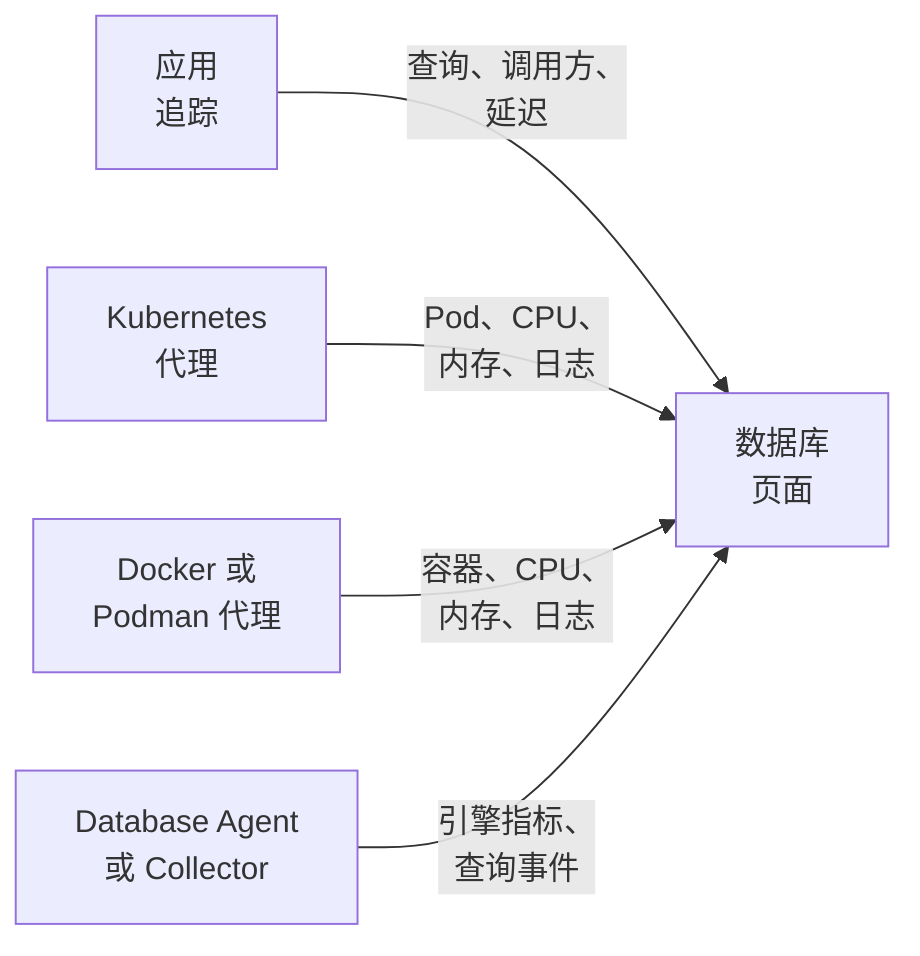

# 数据库

**Databases** 为你的项目运行或连接的每台数据库服务器提供独立的页面：谁在调用它、调用有多快、它在哪里运行、引擎自身的健康指标、它的日志和追踪、与它关联的事件、警报和计划维护，以及为其引擎推荐的警报监视器。与其他所有资源一样，数据库也有标签、所有者、标签和所有者规则、按数据库设置的保留期以及归档。在 **产品 → 资源 → 数据库** 下打开它们。

:::cards
- [Database Agent](#database-agent): PostgreSQL、MySQL、SQL Server、Oracle、Redis、MongoDB、Elasticsearch 和 Memcached 的引擎指标。
- [如何发现数据库](#如何发现数据库): 来自追踪、Kubernetes、Docker、Podman 和 Collector。
- [数据库的警报](#数据库的警报): 推荐的监视器，以及你自己创建的监视器。
- [故障排查](#故障排查): 一个诊断脚本，以及常见问题。
:::

## 工作原理

大多数数据库会自动出现。OneUptime 最多从四个来源组装每个数据库，每个来源贡献的内容各不相同：

| 来源 | 需要你提供什么 | 为数据库页面添加什么 |
| --- | --- | --- |
| **应用追踪** | 已插桩的应用（OpenTelemetry） | 来自应用的查询：调用速率、错误、延迟，以及调用它的服务 |
| **Kubernetes** | [OneUptime Kubernetes 代理](/docs/telemetry/kubernetes-agent) | 运行位置：Pod、CPU 和内存，以及 Pod 的日志 |
| **Docker / Podman** | [Docker 代理](/docs/telemetry/docker-host) 或 [Podman 代理](/docs/telemetry/podman-host) | 运行位置：容器、容器的 CPU 和内存，以及容器的日志 |
| **Database Agent**（一个 OpenTelemetry Collector） | [Database Agent](#database-agent) 或你自己的 Collector | **Engine metrics**：连接、吞吐量、缓存命中率、锁、复制延迟、内存，视引擎提供的范围而定（见 [收集的内容](#收集的内容)），以及可选的查询样本、热门查询和引擎的日志文件 |



引擎指标只来自与数据库本身通信的 Collector（对于托管云数据库，则是与其提供商的监控 API 通信的 Collector）。追踪和容器清单告诉 OneUptime 数据库存在以及它的使用方式，但不会告诉它数据库内部的运行状况；每个数据库上的 **Engine metrics** 状态会显示这部分是否已连接。

你也可以手动添加数据库：在 **Databases → 创建数据库** 中填写引擎、地址和端口。如需完全不需要代理、基于探测器的健康检查，请参阅 [数据库健康监控](/docs/monitor/database-health-monitor)。

## 支持的数据库

OneUptime 按名称识别下列引擎：它会把插桩写入 `db.system.name`（或旧的 `db.system`）的值规范化为第二列中的值，显示引擎名称，在 span 或地址没有端口时使用引擎的默认端口，识别它的容器镜像和 Helm chart，并知道它的引擎指标从哪里来。未列出的引擎在所有按地址识别数据库的地方同样可用，只是会以你的 span 报告的原始名称显示，并且永远不会仅凭追踪创建。

**系列** 是访问分支（fork）或协议兼容引擎时所经由的引擎：客户端库无法区分 MariaDB 和 MySQL，也无法区分 Valkey 和 Redis，因此 span 报告的是 `mysql` 或 `redis`，而容器镜像、Helm chart 或 Database Agent 会给出分支的名称。两者会落到同一个数据库上；一旦数据库的容器镜像，或者至少与其当前引擎背后的来源同样可靠的来源给出了更具体的引擎，数据库就会显示该引擎（见 [数据库显示哪个引擎](#数据库显示哪个引擎)）。

**从追踪创建** 表示仅凭客户端 span 是否会创建该引擎的数据库（见 [从应用追踪](#从应用追踪)）：通过提供商的共享 API 主机访问的托管服务，以及在应用进程内运行的引擎，永远不会被创建。**Engine metrics** 表示引擎自身健康指标的来源：Database Agent 配置、你添加到自己 Collector 中的 collector-contrib 接收器、引擎自身的 Prometheus 端点（`:port/path`，用 Collector 的 `prometheus` 接收器抓取）、云提供商的监控 API，或者无内置来源。每个数据库的 **文档** 选项卡会把这些变成该数据库可直接使用的 Collector 配置。

| 引擎 | `db.system.name` | 默认端口 | 系列 | 从追踪创建 | Engine metrics |
| --- | --- | --- | --- | --- | --- |
| Actian Ingres | `actian.ingres` | — | — | 是 | 无内置 |
| Actian Zen (Pervasive PSQL) | `pervasive` | 1583 | — | 是 | 无内置 |
| Aerospike | `aerospike` | 3000 | — | 是 | `aerospike` 接收器 |
| Amazon DocumentDB | `aws.documentdb` | 27017 | MongoDB | 是 | `awsfirehose` 接收器（云监控） |
| Amazon DynamoDB | `aws.dynamodb` | 443 | — | 否（云 API） | `awsfirehose` 接收器（云监控） |
| Amazon Neptune | `aws.neptune` | 8182 | — | 是 | `awsfirehose` 接收器（云监控） |
| Amazon Redshift | `aws.redshift` | 5439 | PostgreSQL | 是 | `awsfirehose` 接收器（云监控） |
| Apache Derby | `derby` | 1527 | — | 否（进程内） | 无（进程内） |
| Apache Doris | `doris` | 9030 | MySQL | 是 | Prometheus, `:8030/metrics` |
| Apache Druid | `druid` | 8888 | — | 是 | 无内置 |
| Apache Geode | `geode` | 10334 | — | 是 | 无内置 |
| Apache HBase | `hbase` | — | — | 是 | 无内置 |
| Apache Hive | `hive` | 10000 | — | 是 | 无内置 |
| Apache Ignite | `ignite` | 10800 | — | 是 | 无内置 |
| Apache Impala | `impala` | 21050 | — | 是 | 无内置 |
| Apache Pinot | `pinot` | 8099 | — | 是 | 无内置 |
| Apache Solr | `solr` | 8983 | — | 是 | 无内置 |
| ArangoDB | `arangodb` | 8529 | — | 是 | Prometheus, `:8529/_admin/metrics/v2` |
| Azure Cosmos DB | `azure.cosmosdb` | 443 | — | 否（云 API） | `azure_monitor` 接收器（云监控） |
| Cassandra | `cassandra` | 9042 | — | 是 | 无内置 |
| Chroma | `chroma` | 8000 | — | 是 | 无内置 |
| Claris FileMaker | `filemaker` | 2399 | — | 是 | 无内置 |
| ClickHouse | `clickhouse` | 9000 | — | 是 | Prometheus, `:9363/metrics` |
| Cloud Bigtable | `gcp.bigtable` | 443 | — | 否（云 API） | `googlecloudmonitoring` 接收器（云监控） |
| Cloud Firestore | `gcp.firestore` | 443 | — | 否（云 API） | `googlecloudmonitoring` 接收器（云监控） |
| Cloud Spanner | `gcp.spanner` | 443 | — | 否（云 API） | `google_cloud_spanner` 接收器 |
| CockroachDB | `cockroachdb` | 26257 | PostgreSQL | 是 | Prometheus, `:8080/_status/vars` |
| Couchbase | `couchbase` | 11210 | — | 是 | Prometheus, `:8091/metrics` |
| CouchDB | `couchdb` | 5984 | — | 是 | `couchdb` 接收器 |
| Databricks | `databricks` | 443 | — | 是 | 无内置 |
| Dragonfly | `dragonfly` | 6379 | Redis | 是 | Database Agent（`redis` 接收器） |
| DuckDB | `duckdb` | — | — | 否（进程内） | 无（进程内） |
| Elasticsearch | `elasticsearch` | 9200 | — | 是 | Database Agent（`elasticsearch` 接收器） |
| etcd | `etcd` | 2379 | — | 是 | Prometheus, `:2379/metrics` |
| FerretDB | `ferretdb` | 27017 | MongoDB | 是 | Prometheus, `:8088/debug/metrics` |
| Firebird | `firebirdsql` | 3050 | — | 是 | 无内置 |
| FoundationDB | `foundationdb` | 4500 | — | 是 | 无内置 |
| Google BigQuery | `bigquery` | 443 | — | 否（云 API） | `googlecloudmonitoring` 接收器（云监控） |
| Greenplum | `greenplum` | 5432 | PostgreSQL | 是 | 无内置 |
| H2 | `h2database` | 9092 | — | 否（进程内） | 无（进程内） |
| Hazelcast | `hazelcast` | 5701 | — | 是 | 无内置 |
| HyperSQL | `hsqldb` | 9001 | — | 否（进程内） | 无（进程内） |
| IBM Db2 | `ibm.db2` | 50000 | — | 是 | 无内置 |
| IBM Informix | `ibm.informix` | 9088 | — | 是 | 无内置 |
| IBM Netezza | `ibm.netezza` | 5480 | — | 是 | 无内置 |
| InfluxDB | `influxdb` | 8086 | — | 是 | Prometheus, `:8086/metrics` |
| InstantDB | `instantdb` | — | — | 否（进程内） | 无（进程内） |
| InterBase | `interbase` | 3050 | Firebird | 是 | 无内置 |
| InterSystems IRIS / Caché | `intersystems.cache` | 1972 | — | 是 | Prometheus, `:52773/api/monitor/metrics` |
| KeyDB | `keydb` | 6379 | Redis | 是 | Database Agent（`redis` 接收器） |
| MariaDB | `mariadb` | 3306 | MySQL | 是 | Database Agent（`mysql` 接收器） |
| Meilisearch | `meilisearch` | 7700 | — | 是 | Prometheus, `:7700/metrics` |
| Memcached | `memcached` | 11211 | — | 是 | Database Agent（`memcached` 接收器） |
| Milvus | `milvus` | 19530 | — | 是 | Prometheus, `:9091/metrics` |
| MongoDB | `mongodb` | 27017 | — | 是 | Database Agent（`mongodb` 接收器） |
| MySQL | `mysql` | 3306 | — | 是 | Database Agent（`mysql` 接收器） |
| Neo4j | `neo4j` | 7687 | — | 是 | Prometheus, `:2004/metrics` |
| OceanBase | `oceanbase` | 2881 | MySQL | 是 | 无内置 |
| OpenSearch | `opensearch` | 9200 | Elasticsearch | 是 | Database Agent（`elasticsearch` 接收器） |
| Oracle | `oracle.db` | 1521 | — | 是 | Database Agent（`oracledb` 接收器） |
| Pinecone | `pinecone` | 443 | — | 否（云 API） | 无内置 |
| PostgreSQL | `postgresql` | 5432 | — | 是 | Database Agent（`postgresql` 接收器） |
| Presto | `presto` | 8080 | — | 是 | 无内置 |
| Progress OpenEdge | `progress` | — | — | 是 | 无内置 |
| Qdrant | `qdrant` | 6333 | — | 是 | Prometheus, `:6333/metrics` |
| QuestDB | `questdb` | 8812 | PostgreSQL | 是 | Prometheus, `:9003/metrics` |
| RavenDB | `ravendb` | 8080 | — | 是 | 无内置 |
| Redis | `redis` | 6379 | — | 是 | Database Agent（`redis` 接收器） |
| Riak KV | `riak` | 8087 | — | 是 | `riak` 接收器 |
| SAP ASE (Sybase) | `sybase` | 5000 | — | 是 | 无内置 |
| SAP HANA | `sap.hana` | 30015 | — | 是 | `saphana` 接收器 |
| SAP MaxDB | `sap.maxdb` | 7210 | — | 是 | 无内置 |
| ScyllaDB | `scylladb` | 9042 | Cassandra | 是 | Prometheus, `:9180/metrics` |
| SingleStore | `singlestore` | 3306 | MySQL | 是 | Prometheus, `:9104/metrics` |
| Snowflake | `snowflake` | 443 | — | 是 | `snowflake` 接收器 |
| Software AG Adabas | `softwareag.adabas` | — | — | 是 | 无内置 |
| SQL Server | `microsoft.sql_server` | 1433 | — | 是 | Database Agent（`sqlserver` 接收器） |
| SQLite | `sqlite` | — | — | 否（进程内） | 无（进程内） |
| StarRocks | `starrocks` | 9030 | MySQL | 是 | Prometheus, `:8030/metrics` |
| SurrealDB | `surrealdb` | 8000 | — | 是 | 无内置 |
| Teradata | `teradata` | 1025 | — | 是 | 无内置 |
| TiDB | `tidb` | 4000 | MySQL | 是 | Prometheus, `:10080/metrics` |
| Trino | `trino` | 8080 | — | 是 | Prometheus, `:8080/metrics` |
| Typesense | `typesense` | 8108 | — | 是 | 无内置 |
| Valkey | `valkey` | 6379 | Redis | 是 | Database Agent（`redis` 接收器） |
| Vertica | `vertica` | 5433 | — | 是 | 无内置 |
| Vitess | `vitess` | 3306 | MySQL | 是 | Prometheus, `:15000/metrics` |
| Weaviate | `weaviate` | 8080 | — | 是 | Prometheus, `:2112/metrics` |
| YugabyteDB | `yugabytedb` | 5433 | PostgreSQL | 是 | Prometheus, `:9000/prometheus-metrics` |

也接受其他常见写法：`postgres` 和 `pg`、`mssql` 和 `sqlserver`、`oracle`、`mongo`、`scylla`、`dragonflydb`、`memsql`，以及 OpenTelemetry 用过的所有旧版 `db.system` 值（`db2`、`hanadb`、`cosmosdb`、`dynamodb`、`spanner`、`redshift`、`informix`、`maxdb`、`cache`、`h2`、`firebird`、`edb`、`cloudscape`、…）。使用某个引擎协议的托管服务（Amazon RDS 和 Aurora、Azure Database、Cloud SQL、AlloyDB、Neon、Supabase、PlanetScale、ElastiCache、Memorystore、MongoDB Atlas）就视为该引擎。

## 如何发现数据库

每个数据库都会记住创建它的来源（**Discovered from** 列），它的 **动态** 中的第一条会说明是什么发现了它：Kubernetes 工作负载及其集群、Docker 或 Podman 容器（或 Compose、Swarm 服务）及其主机、应用调用的端点，或者报告它的 Database Agent（带版本）或 Collector。只要描述的是同一个端点，后来的来源就会补充到同一个数据库，而不是再创建一个（见 [端点](#端点和唯一所有者规则)）。

### 从应用追踪

OneUptime 每 10 分钟汇总一次你的应用在过去 15 分钟内发送的、带有 `db.system.name`（或旧的 `db.system`）的 CLIENT span。服务器取自 `server.address`（或旧的 `net.peer.name`，其次是 `network.peer.address` / `net.sock.peer.addr`），端口取自 `server.port`（或 `net.peer.port`、`network.peer.port`、`net.sock.peer.port`）；span 没有端口时，假定为引擎的默认端口。引擎名称会被规范化（见 [支持的数据库](#支持的数据库)），因此 `postgres`、`pg` 和 `postgresql` 是同一个引擎，`mssql` 和 `microsoft.sql_server` 也是；`mariadb` 和 `mysql` 是同一系列中的两个引擎。

只有在以下条件全部满足时，才会从追踪 **创建** 数据库；其他情况仍会计入已存在的数据库，只是永远不会创建新的数据库：

- 地址在整个项目中指向唯一的一台服务器：是 DNS 名称，而不是 IP 字面量，也不是只在一台机器上或一个网络内才能解析的名称，除非调用方的 Kubernetes 集群对其进行了限定（见 [端点](#端点和唯一所有者规则)）；
- 端口是服务器监听的端口。操作系统从 32768 及以上为连接的客户端一侧分配端口（Linux 的默认临时端口范围从这里开始；Windows 和 macOS 使用 49152–65535），因此 32768 及以上的端口永远不会创建数据库，除非它是该引擎自己的默认端口（IBM Db2 的 50000）。eBPF 插桩（包括 Kubernetes 代理的插桩）可能在长连接中途接入并把两端对调。这时 span 会把客户端自己的端口报告为服务器端口，如果没有这条规则，每个连接都会变成一个单独的数据库；
- 引擎是 OneUptime 知道且有独立地址的引擎：见 [支持的数据库](#支持的数据库) 中的 **从追踪创建** 列。所有客户共享主机的云 API（DynamoDB、BigQuery、Spanner、Firestore、Bigtable、Cosmos DB、Pinecone）、在应用内部运行的引擎（SQLite、DuckDB、H2、HyperSQL、Derby）以及 OneUptime 不认识的引擎，永远不会从追踪创建；请手动添加它们；
- 该端点在一次运行所查看的 15 分钟窗口内至少收到 10 个查询，这样一次性脚本就不会创建数据库。客户端库的连接管理 span（node-postgres 的 `pg.connect` 和 `pg-pool.connect`、`redis-connect`、`connect`、…）不是查询：它们既不计入这里，也不计入数据库的 **查询**；
- 项目未超出其 [自动创建额度](#自动创建额度)。

每个发往数据库的 CLIENT span 在摄取时也会被标记上它的端点，因此一旦某个数据库拥有了某个端点，**来自应用的查询** 部分和 **追踪** 选项卡就会显示对它的每一次调用，包括数据库创建之前的调用。带有 `server.address` 的 `db.client.*` 指标（例如 `db.client.operation.duration`）也以同样的方式标记。

**集群和主机列表。** 列出多台主机的连接字符串（`m1:27017,m2:27017,m3:27017`）是一个数据库，无论客户端以什么顺序列出它们。MongoDB Atlas 成员（`cluster0-shard-00-01.ab1cd.mongodb.net`）会成为一个以其集群命名的数据库（`cluster0.ab1cd.mongodb.net`），看到的每个成员都会成为它的一个端点。单独报告 Cassandra 环、Redis Cluster、Elasticsearch 集群的每个成员或 ElastiCache 节点的驱动程序，仍然会为每个成员生成一个数据库：这些主机名中没有任何信息说明它们属于哪个集群。保留一个，并把其他的 [合并](#端点和唯一所有者规则) 到它上面。

### 从 Kubernetes

OneUptime 每 5 分钟查看一次每个已连接 Kubernetes 集群中的 Pod，并识别数据库工作负载：

1. **先看 operator 和 chart 标签**：CloudNativePG、Zalando（Spilo）、Crunchy PGO、Bitnami chart、ECK、Altinity ClickHouse、cass-operator、Percona、Oracle MySQL operator 和 Vitess operator（它的 `vtgate` Pod 就是数据库；`vttablet`、`vtctld`、`vtorc` 和 `vtbackup` 是它的组成部分，而不是成员）。一个 operator 集群成为一个数据库。Vitess 集群自己的 vtgate Service 名称经过哈希处理，因此如果应用通过它连接，请在数据库的 **端点** 选项卡上添加它。
2. **否则看容器镜像**，按镜像名称精确匹配：[支持的数据库](#支持的数据库) 中每个提供镜像的引擎的官方镜像、Bitnami 镜像（包括迁移后的 `bitnamilegacy` 和 `bitnamisecure` 仓库）以及 Red Hat / OpenShift 镜像（`postgres`、`bitnami/postgresql`、`rhel9/postgresql-16`、`mysql`、`mariadb`、`mssql/server`、`gvenzl/oracle-free`、`redis`、`valkey/valkey`、`mongo`、`cockroachdb/cockroach`、`pingcap/tidb`、`clickhouse/clickhouse-server`、`qdrant/qdrant`、…）。分支会被识别为它自己：`mariadb` 镜像是 MariaDB，`valkey/valkey` 镜像是 Valkey。导出器、operator、管理界面、连接池（pgbouncer、pgpool、ProxySQL、HAProxy、Cloud SQL Proxy）和备份工具都不是数据库。同时运行应用容器的 Pod 也不被视为数据库（带有数据库 sidecar 的应用仍然是应用），不过，如果 StatefulSet 的数据库容器声明了引擎的默认端口，它可以多带一个 OneUptime 不识别的容器（例如日志转发器）。

数据库镜像并不会让一个 Pod 成为数据库服务器，但只有明确的证据才能让它被判定为别的东西。如果容器的程序是客户端或转储工具（`psql`、`redis-cli`、`mongosh`、`pg_dump`、`mysql`）、保活命令（`sleep infinity`、`tail -f /dev/null`）或交互式 shell（或者它的 `sh -c` 脚本只运行这类工具、shell 内置命令和 `echo`、`cp` 之类的简单工具），那就是一次客户端或调试运行，而不是数据库；Redis 或 Valkey Sentinel（`redis-sentinel`、`redis-server --sentinel`）也是如此。在启动器之后也同样适用：`env`（及其 `NAME=value` 设置）、`nohup`、`setsid`、`tini`、`dumb-init` 以及镜像的 `docker-entrypoint.sh` 会被看穿，直到它们启动的程序，脚本中的 `exec`、`env` 和 `nohup` 也是如此，因此 `env PGPASSWORD=… psql` 和 `tini -- redis-cli` 是客户端运行，而 `tini -- docker-entrypoint.sh postgres` 是服务器，`docker-entrypoint.sh -c max_connections=200`（镜像自己的服务器带一个参数启动）也是服务器。接着还会启动其他东西的脚本（`sleep 5 && exec redis-server`、`bash -ecx 'exec cockroach start …'`）、脚本文件（`sh /start.sh`）、在程序之前接收自身参数的包装器（`gosu postgres …`、`timeout 30 …`），或者长到无法读取的脚本，都会被视为可能的服务器。已结束的 Pod、批处理作业，以及没有声明端口的一次性 `kubectl run` Pod 也都不是数据库。

数据库会在它的某个 Pod 处于 Ready 状态约 10 分钟后出现（如果只是 sidecar 阻止 Pod 变为 Ready，则改为看已就绪的数据库容器）。崩溃循环中的 Pod 每次重启都会重新变为 Ready，因此永远不会成为数据库，CI 作业或运行一分钟就崩溃的 Pod 也不会。数据库一旦创建，每次运行都会刷新。

Pod 按其 StatefulSet、Deployment 或 operator 集群分组，因此一个有三个成员的 StatefulSet 是一个有三个成员的数据库。其页面上的 **实例** 统计数据库容器正在运行的 Pod：不包括在 `CrashLoopBackOff` 或 `ImagePullBackOff` 中等待的 Pod，也不包括已终止的 Pod，即使 Kubernetes 仍可能把这样的 Pod 报告为 Running；缩容到零的工作负载显示 0，并保留其页面，直到 [自动归档](#生命周期归档和保留) 将其撤下。反向链接同样有效：工作负载的 StatefulSet 或 Deployment 页面，以及它的每个 Pod 的页面，都会通过 **Open database** 链接指出它运行的数据库，包括名称与数据库不同的 StatefulSet 或 Deployment（Bitnami 为 `shop-redis` 创建的 `shop-redis-master`，Percona 为 `cluster1` 创建的 `cluster1-pxc`）；而 operator 标记为某个集群一部分的连接池或备份工作负载，会说明它属于该数据库的集群。

Kubernetes 代理不报告 Service 对象，因此数据库的 Service 名称来自 chart 和 operator 遵循的约定：所属 StatefulSet 或 Deployment 的名称、StatefulSet 的 headless Service（以及它背后的每个成员，`<pod>.<headless-service>`），以及各 operator 的代理和连接池 Service：Percona XtraDB Cluster 的 HAProxy 和 ProxySQL、Percona Server for MySQL 的 router 和 HAProxy、Percona Server for MongoDB 的 mongos、Crunchy 的 pgBouncer，以及 Zalando 和 CloudNativePG 的连接池。每一个都会成为由集群限定的端点（`postgres.prod.svc.cluster.local:5432@my-cluster`），因此两个集群中的同一个名称仍是两个数据库。在项目只有一个集群期间，未限定的 `postgres.prod.svc.cluster.local:5432` 也会被添加，并在第二个集群出现约 2 小时后再次释放。其他名称的 Service 请在数据库的 **端点** 选项卡上添加。

遥测经过 Kubernetes 代理的应用会带上它的命名空间和集群，因此它的调用会按其 Pod 的解析器的方式解读：`postgres`（来自同一命名空间）、`postgres.prod`（命名空间 `prod` 中的 Service `postgres`）、`postgres.prod.svc` 和完整名称都会匹配到该数据库，调用方自己命名空间中的 StatefulSet 成员 `mongo-0.mongo-headless` 也是如此。

OneUptime 读取 Pod 元数据、标签、镜像、声明的端口，以及容器命令行运行的内容（程序名称、shell 的参数，以及其脚本运行了哪些常见的客户端、保活和 shell 命令；其他命令只会被记为无法识别），从不读取环境变量、参数值、脚本文本或密钥。

### 从 Docker 和 Podman

每 5 分钟，每个已连接的 Docker 或 Podman 主机上的容器会以同样的方式按镜像分类，然后按其名称以及 Compose、Swarm 和 Testcontainers 标签分组和过滤，从不按它们运行的命令（见下文）。同一个 Compose 服务（按 Compose 的项目和服务标签）或同一个 Swarm 服务的容器是一个有多个成员的数据库，其工作负载就是该服务（`Compose service/<project>-<service>`、`Swarm service/<service>`）。其他任何容器都以其确切名称（`Container/<name>`）成为单独的数据库，因此 `redis-6379` 和 `redis-6380` 仍是两个。Testcontainers、`docker compose run` 一次性运行、kubelet 在 Docker 节点上运行的容器（Kubernetes 发现会把它们作为 Pod 找到）以及运行不到 10 分钟的容器，永远不会成为数据库。容器的年龄就是它的运行时间，因此已经运行了这么久的容器会在安装代理后的第一次运行中成为数据库。**实例** 统计正在运行的容器，每个容器的页面都会链接回它的数据库（**Open database**）。以同一名称注册了两次的主机只读取一次，使用最近看到的那次注册。

一旦代理的 `otel-collector-config.yaml` 复制了这些标签（`container_labels_to_metric_labels`），代理就会随每个容器的指标一起发送它们。旧版 Docker 或 Podman 代理不会这样做：请更新它，否则每个容器都会成为单独的数据库，包括 Testcontainers 运行和一次性运行。

与 Kubernetes 不同，容器的命令行从不读取（代理不会发送它，因为其中可能含有密钥），因此用数据库镜像长期运行的客户端或调试容器（`sleep infinity`、`psql` 或 `redis-cli` 循环）在运行 10 分钟后就会成为数据库。归档它即可将其移除：由人员归档的数据库会保持归档状态。如果不管它，它会在容器停止 7 天后被 [自动归档](#生命周期归档和保留)。

容器名称只在一个 Docker 网络内解析，因此这些数据库 **不会** 自动获得端点；它们的页面显示容器自身的指标和日志。要关联你的应用发送的查询，请在 [端点](#端点和唯一所有者规则) 选项卡上添加它们使用的地址。

要获取引擎指标，请从数据库自己的 **文档** 选项卡安装 [Database Agent](#database-agent)：其安装命令和 `.env` 带有预先填好的 `DATABASE_SERVER_ID`，因此代理的数据会进入这个数据库。不带它安装的代理会改为按其 `DATABASE_SERVER_ADDRESS` 匹配，而容器数据库并不拥有这个地址：如果是 DNS 名称，服务器会被注册为第二个数据库（一个页面有容器，另一个页面有引擎指标；见 [一台服务器出现两个数据库](#一台服务器出现两个数据库)），如果是私有 IP 或容器名称，则不会关联到任何东西。

### 从 Database Agent 或你自己的 Collector

当引擎指标或日志来自 Collector 的数据库接收器时，OneUptime 会在摄取的那一刻把它们匹配到数据库：如果数据带有 `oneuptime.database.server.id`（代理的 `DATABASE_SERVER_ID`），就直接按 id 匹配，否则按数据指明的端点（`server.address` / `server.port`）匹配：

- 按 id 关联的数据会进入该数据库并显示在其页面上（且只显示在那里），无论它报告的是什么地址：私有 IP、集群本地名称、另一个数据库拥有的地址，或者根本没有地址。如果它报告的地址在整个项目中指向唯一的一台服务器且尚不属于任何数据库，该地址会作为端点添加到这个数据库，这样发往该地址的应用追踪也会进入这里；
- 否则，数据库已拥有的端点会把数据关联到该数据库，无论该数据库是由什么创建的；
- 否则会 **创建** 一个数据库，但只从在整个项目中代表唯一一台服务器的名称创建（DNS 名称、公网 IP，或数据用其 Kubernetes 集群 `k8s.cluster.name` 限定过的集群本地名称、`.internal` 或 `.local` 名称；Database Agent 从不设置该集群属性），并且只针对可以自行创建的引擎（[支持的数据库](#支持的数据库) 中的 **从追踪创建** 列：绝不是共享云 API、进程内引擎或未知引擎）。私有 IP 和链路本地 IP、单标签名称（`db`）以及未限定的集群本地名称（`postgres.prod.svc.cluster.local`）、`.internal` 或 `.local` 名称，在每个网络中都可能指向不同的服务器；Pod 的 IP 每次重启都会变化；而由 Collector 自己的命名空间补全的单标签名称，可能是一个 Service，也可能是 Collector 自己的 Pod。指明这些名称之一的数据只会进入已经把它作为端点的数据库：对于 Service 名称，就是在 Kubernetes 中发现的工作负载。请手动创建该数据库（**Databases → 创建数据库**，相同的地址和端口），或用 `DATABASE_SERVER_ID` 把代理关联到它。在有 Kubernetes 集群的项目中，不带集群的集群本地 Service 名称会被拒绝：请将数据库创建为 `postgres.prod.svc.cluster.local:5432@my-cluster`，然后在它的 **端点** 选项卡上添加未限定的 `postgres.prod.svc.cluster.local:5432`（也就是代理报告的名称）；
- 完全没有指明服务器的接收器批次会被忽略（见 [使用你自己的 OpenTelemetry Collector](#使用你自己的-opentelemetry-collector)）。

Collector 创建的数据库与其他所有发现的数据库一样计入 [自动创建额度](#自动创建额度)；你手动创建并用 `DATABASE_SERVER_ID` 关联的数据库永远不需要创建。见 [Database Agent](#database-agent)。

### 数据库显示哪个引擎

当来源对数据库的引擎意见不一致时，证据更强的一方胜出：人员设置的引擎，其次是 Collector 或 Database Agent（引擎自报），其次是容器镜像或 Helm chart，最后是客户端 span；PostgreSQL 驱动即使在连接 CockroachDB 时也会报告 `postgresql`。只有当某个来源的证据强于确定当前引擎的证据时，它才会把数据库移到另一个引擎系列；人员设置的引擎永远不会被发现过程更改。在同一系列内，当给出分支名称的来源至少与确定当前引擎的来源同样可靠，或者它是容器镜像时，分支会细化引擎：span 报告 `redis`，镜像报告 `valkey`，数据库就显示 Valkey，即使 Collector 的 `redis` 接收器报告的是 `redis`，因为该接收器无法区分两者。仅凭应用追踪永远不会细化由镜像或 Collector 确定的引擎：客户端报告的是它所使用的协议，MariaDB Connector/J 连接 MySQL 服务器时也会报告 `mariadb`。当 Collector 在 `db.system.name` 中设置分支名称时（Database Agent 会根据 `DATABASE_SYSTEM` 这样做），或者批次的 `db.system.version` 指明了分支时，Collector 就给出了分支：带有分支名称的版本字符串（`8.0.11-TiDB-v7.5.1`），或者只有该分支发布过的主版本号；MySQL 没有 10.x 或 11.x，因此带有 `11.4.13`（`mysql` 接收器为 MariaDB 11.4 报告的纯数字）的 `mysql` 就是 MariaDB（见 [使用你自己的 OpenTelemetry Collector](#使用你自己的-opentelemetry-collector)）。只有指明其系列引擎的容器镜像才能撤销分支，并且仅当给出分支名称的只有应用追踪时才会撤销；指明系列的 Collector 或追踪永远不会撤销分支。镜像换成同一系列分支（`redis` 换成 `valkey`）的 Kubernetes 工作负载仍是同一个数据库。

### 自动创建额度

只有在项目中活跃的、未归档的已发现数据库少于 500 个时，追踪、Kubernetes、Docker、Podman 和 Collector 才会自行创建数据库（`DATABASE_SERVER_AUTO_CREATE_BUDGET`，见 [自托管调优](#自托管调优)）。你手动创建的数据库永远不计入，也永远不会被阻止；已归档的数据库不计入，因此 [自动归档](#生命周期归档和保留) 会释放额度；已存在的数据库会继续被匹配和更新。达到额度后，新端点的 Collector 数据不会创建任何东西（只会进入已存在的数据库），OneUptime 每个项目每 10 分钟最多记录一次警告。

## Database Agent

OneUptime Database Agent 是一个预先配置好的 OpenTelemetry Collector，适用于 **PostgreSQL**、**MySQL / MariaDB**、**SQL Server**、**Oracle**、**Redis / Valkey / KeyDB / Dragonfly**、**MongoDB**、**Elasticsearch / OpenSearch** 和 **Memcached**。它只由配置组成：一个标准的 `otel/opentelemetry-collector-contrib` 容器，运行 Collector 针对你的引擎的原生接收器，配置会给每个批次打上数据库的身份标识，并通过 OTLP 发送到 OneUptime。数据库服务器上不安装任何东西。同一个 `docker-compose.yml` 还会在 Collector 旁边运行 [数据库 AI 代理](#ai-代理)，供 OneUptime AI 使用。对于 [支持的数据库](#支持的数据库) 中的其他引擎，请参阅 [使用你自己的 OpenTelemetry Collector](#使用你自己的-opentelemetry-collector)；每个数据库的 **文档** 选项卡都有对应的配置。

**一个代理监控一台数据库服务器。** 代理发送的所有内容都会打上身份标识，因此每台服务器运行一个代理（一个安装目录）；如果希望副本有自己的页面，就为每个副本各运行一个。

代理位于 [DatabaseAgent 目录](https://github.com/OneUptime/oneuptime/tree/master/agents/DatabaseAgent)：`docker-compose.yml`、每个接收器一份 Collector 配置（`configs/postgresql.yaml`、`configs/mysql.yaml`、`configs/sqlserver.yaml`、`configs/oracledb.yaml`、`configs/redis.yaml`、`configs/mongodb.yaml`、`configs/elasticsearch.yaml`、`configs/memcached.yaml`）、`install.sh`、`troubleshoot.sh` 和一个 systemd 单元。分支或兼容替代品运行其系列的配置，并报告自己的名称：`DATABASE_SYSTEM=mariadb` 运行 `configs/mysql.yaml`，数据库显示为 MariaDB。

### 开始之前

- Docker Engine 20.10 或更高版本，带 Docker Compose v2 插件，所在机器能访问数据库的端口（或者一个 Kubernetes 集群：见 [Kubernetes](#kubernetes)）。
- 一个能在数据库上创建监控用户并授予下面统计权限的登录账号。
- 一个摄取密钥。在 **项目设置 → 遥测与 APM → 摄取密钥** 下创建一个并复制其值。

:::steps
### 创建监控用户

为代理提供它自己的、对引擎统计信息有读取权限的登录账号：绝不使用管理员账号，也绝不使用应用的登录账号。如果你已经为 [数据库健康监控](/docs/monitor/database-health-monitor#创建监控用户) 创建了监控用户，它在 PostgreSQL、MySQL 和 SQL Server 上的授权同样适用于代理。

:::tabs
@tab PostgreSQL
```sql
CREATE USER oneuptime_monitor WITH PASSWORD 'a-strong-password';
GRANT pg_monitor TO oneuptime_monitor;
```

`pg_monitor` 是一个内置角色（PostgreSQL 10 及更高版本），授予对统计和监控视图的读取权限，不授予对你的表的任何访问权限。它不是可选的：没有它，`pg_stat_activity` 不会报错，而是只返回代理自己的会话，因此在一台实际上已满的服务器上，连接数会显示为 `1`。接收器会连接每个数据库以读取按数据库的统计信息，因此该用户还需要每个数据库上的 `CONNECT` 权限（`PUBLIC` 默认就有）。PostgreSQL 接收器没有密码就拒绝启动。

热门查询（`DATABASE_QUERY_EVENTS=true`）还会读取 `pg_stat_statements`：用 `shared_preload_libraries = 'pg_stat_statements'` 加载它（需要重启），并在每个受监控的数据库中创建它：

```sql
CREATE EXTENSION IF NOT EXISTS pg_stat_statements;
```

热门查询的执行计划需要对查询涉及的表有 `SELECT` 权限，而 `pg_monitor` 不授予该权限；如果需要执行计划，请按 schema 授予（`GRANT SELECT ON ALL TABLES IN SCHEMA app TO oneuptime_monitor`）。没有它，热门查询仍会到达，只是执行计划为空，Collector 会为每个查询记录 `failed to explain`；诊断脚本会把这报告为警告，而不是缺少授权。

在无法使用 `pg_monitor` 的托管服务上，`pg_read_all_stats` 涵盖同样的视图。代理已经会跳过 Amazon RDS、Azure、Cloud SQL 和 AlloyDB 中任何客户登录账号都无法打开的内部数据库。
@tab MySQL / MariaDB
```sql
CREATE USER 'oneuptime_monitor'@'%' IDENTIFIED BY 'a-strong-password';
GRANT PROCESS, REPLICATION CLIENT ON *.* TO 'oneuptime_monitor'@'%';
GRANT SELECT ON performance_schema.* TO 'oneuptime_monitor'@'%';
```

`PROCESS` 和 `REPLICATION CLIENT` 涵盖全局状态计数器、InnoDB 状态和副本状态；读取 `performance_schema`（自 MySQL 5.6 起默认开启）以获取查询样本和热门查询。MariaDB 10.5.9 及更高版本把副本状态拆分成了单独的权限，因此在那里还要运行 `GRANT SLAVE MONITOR ON *.* TO 'oneuptime_monitor'@'%';`。对于 MariaDB 服务器，请设置 `DATABASE_SYSTEM=mariadb`：同一份配置即可监控它，数据库显示为 MariaDB。这是可靠的方式。以 `mysql` 安装、连接 MariaDB 10 或更高版本的代理也会凭版本号（`11.4.13`；MySQL 从未发布过 10.x 或 11.x）被识别为 MariaDB，但 MariaDB 5.5 会保持为 MySQL。
@tab SQL Server
```sql
CREATE LOGIN oneuptime_monitor WITH PASSWORD = 'a-strong-password';
GRANT VIEW SERVER STATE TO oneuptime_monitor;
GRANT VIEW ANY DEFINITION TO oneuptime_monitor;
```

`VIEW SERVER STATE`（在 SQL Server 2022 及更高版本上，`VIEW SERVER PERFORMANCE STATE` 就足够了）读取所有指标所依据的动态管理视图，不授予对你数据的访问权限。接收器把登录信息放进连接字符串时不加引号，因此用户名和密码不能包含分号（`;`）或双引号（`"`），也不能以空格开头或结尾；`install.sh` 会拒绝它们。驱动程序会自行与服务器协商加密，因此 TLS 变量不适用。

对于命名实例（`sql1.corp\INST01`），请把 `DATABASE_ENDPOINT` 指向该实例自己的 TCP 端口，而不是默认实例的 1433，后者连接到的是默认实例。SQL Server 配置管理器会显示该端口（实例的 TCP/IP 协议，IPAll），也可以在该实例上运行 `SELECT local_tcp_port FROM sys.dm_exec_connections WHERE session_id = @@SPID;`。`install.sh` 会拒绝 `host\instance`，并要求提供 `host:port`。
@tab Oracle
```sql
-- In the pluggable database the agent connects to, e.g. ALTER SESSION SET CONTAINER = FREEPDB1;
CREATE USER oneuptime_monitor IDENTIFIED BY "a-strong-password";
GRANT CREATE SESSION TO oneuptime_monitor;
GRANT SELECT_CATALOG_ROLE TO oneuptime_monitor;
```

`SELECT_CATALOG_ROLE` 读取指标、查询样本和热门查询所依据的 `V$` 和 `DBA_` 视图，不授予对你的表的访问权限。`DATABASE_ORACLE_SERVICE` 指定代理连接的服务（`FREEPDB1`、`ORCLPDB1`、…）。
@tab Redis / Valkey / KeyDB / Dragonfly
```text
ACL SETUSER oneuptime_monitor on >a-strong-password -@all +info +ping
```

接收器只运行 `INFO`。用 `ACL SAVE`（或 `redis.conf` / 你的 ACL 文件中的 `user` 行）持久保存该用户。在只用 `requirepass` 保护的服务器上，将 `DATABASE_USERNAME` 留空并设置 `DATABASE_PASSWORD`；在没有身份验证的服务器上，两者都留空。对于这些服务器，请将 `DATABASE_SYSTEM` 设置为 `valkey`、`keydb` 或 `dragonfly`。接收器从 `INFO` 的 `redis_version` 读取版本，Valkey 将其固定为 `7.2.4`（它分支出来时的 Redis 版本），Dragonfly 则将其设置为它所模拟的 Redis 版本。OneUptime 对它们会忽略该值，因此 Valkey 或 Dragonfly 数据库在由 Kubernetes、Docker 或 Podman 运行时显示其容器镜像的版本，仅有代理时不显示版本。
@tab MongoDB
```js
db.getSiblingDB("admin").createUser({
  user: "oneuptime_monitor",
  pwd: "a-strong-password",
  roles: [{ role: "clusterMonitor", db: "admin" }],
});
```

`clusterMonitor` 涵盖所有指标。热门查询的执行计划还需要为每个受监控的数据库授予 `{ role: "read", db: "<database>" }`；没有它，热门查询仍会到达，只是执行计划为空。代理只连接一个成员（`direct_connection`），因此请为副本集的每个成员各运行一个代理。
@tab Elasticsearch / OpenSearch
```text
POST /_security/role/oneuptime_monitor
{ "cluster": ["monitor"], "indices": [{ "names": ["*"], "privileges": ["monitor"] }] }

POST /_security/user/oneuptime_monitor
{ "password": "a-strong-password", "roles": ["oneuptime_monitor"] }
```

`monitor` 权限读取节点、集群和索引的统计信息，不读取文档。在启用了安全插件的 OpenSearch 上，请改为授予集群权限 `cluster_monitor` 和对 `*` 的索引权限 `indices_monitor`；在没有安全功能的集群上，将 `DATABASE_USERNAME` 和 `DATABASE_PASSWORD` 留空。一个代理通过一个端点（一个 URL：`http://search.internal:9200`，TLS 用 `https://`）监控整个集群。对于 OpenSearch 集群，请设置 `DATABASE_SYSTEM=opensearch`。
@tab Memcached
Memcached 没有用户：接收器通过文本协议运行 `stats`，因此请将 `DATABASE_USERNAME` 和 `DATABASE_PASSWORD` 留空。使用 SASL 身份验证（`-S`）启动的服务器无法用这种方式监控。
:::

### 安装并启动代理

每个 OneUptime 都提供其自身发布版本的代理安装脚本和文件：下面的命令从 `https://oneuptime.com` 下载它们，因此在自托管的 OneUptime 上请把这个地址替换为你的 URL。安装脚本会先保存为 `install.sh`，方便你在运行前先阅读它。

:::tabs
@tab install.sh
下载安装脚本，并在将要托管代理的机器上运行它：

```bash
curl -fsSL https://oneuptime.com/install/database-agent -o install.sh
bash install.sh
```

脚本会询问你的 OneUptime URL 和摄取密钥、引擎、要连接的端点和监控凭据（密码输入时不回显）；对于 [AI 代理](#ai-代理) 支持的引擎，还会询问它是否可以应用修复，如果可以，再询问它专用的登录账号。它会把 `docker-compose.yml` 和对应的 `configs/<receiver>.yaml`（保存为 `otel-collector-config.yaml`）下载到 `/opt/oneuptime-database-agent`，写入权限为 `0600` 的 `.env` 文件并启动代理。当端点只在这台机器上有意义时（`localhost`、`host.docker.internal`），它还会询问你的应用使用的主机名，因为该名称就是数据库的身份标识；当该名称只在一个网络内解析时（私有或链路本地 IP、单标签名称、集群本地名称、`.internal` 或 `.local` 名称），它会询问该数据库在 OneUptime 中的 id（`DATABASE_SERVER_ID`），因为这样的名称永远不会自行创建数据库。

每个提示都可以用同名的导出变量来回答，`INSTALL_DIR` 用于选择目录，例如为第二个数据库使用 `INSTALL_DIR=/opt/oneuptime-database-agent-orders bash install.sh`。重新运行脚本会重用现有 `.env` 中的所有值（见 [升级和卸载](#升级和卸载)）。

密码中可以使用任何字符，只有 SQL Server 连接字符串无法承载的少数字符除外（见 [创建监控用户](#创建监控用户) 中的 SQL Server 选项卡）。Collector 会对它读取的值中的 `$` 再展开一次（`$$` 变为 `$`，`${NAME}` 变为另一个变量），因此脚本除了为 Docker Compose 给值加引号外，还会把 `DATABASE_USERNAME` 和 `DATABASE_PASSWORD` 中的每个 `$` 写成两个。
@tab Docker Compose
从你的 OneUptime 把 `docker-compose.yml` 和你的引擎对应的配置下载到同一个文件夹，并把配置保存为 `otel-collector-config.yaml`：

```bash
curl -fsSL https://oneuptime.com/install/database-agent/docker-compose.yml -o docker-compose.yml
curl -fsSL https://oneuptime.com/install/database-agent/configs/postgresql.yaml -o otel-collector-config.yaml
```

在它们旁边创建一个 `.env` 文件（`chmod 600 .env`，因为其中保存着密码）：

```bash
# DATABASE_USERNAME and DATABASE_PASSWORD are escaped for the collector: every $ is written as $$.
ONEUPTIME_URL=YOUR_ONEUPTIME_URL
ONEUPTIME_TELEMETRY_INGESTION_KEY=YOUR_TELEMETRY_INGESTION_KEY
DATABASE_SYSTEM=postgresql
DATABASE_ENDPOINT=db.example.com:5432
DATABASE_ENDPOINT_HOST=db.example.com
DATABASE_ENDPOINT_PORT=5432
DATABASE_ORACLE_SERVICE=
DATABASE_SERVER_ADDRESS=db.example.com
DATABASE_SERVER_PORT=5432
DATABASE_USERNAME=oneuptime_monitor
DATABASE_PASSWORD='a-strong-password'
DATABASE_TLS_INSECURE=true
DATABASE_TLS_INSECURE_SKIP_VERIFY=false
DATABASE_COLLECTION_INTERVAL=30s
DATABASE_QUERY_EVENTS=false
DATABASE_SERVER_ID=
```

用单引号括起密码，并把其中的每个 `$` 写成 `$$`。第一行用 `install.sh` 写入的 `.env` 中的原话说明了这一点；在此文件夹（`INSTALL_DIR`）上重新运行的 `install.sh` 也会以同样的方式读取该文件。启动它：

```bash
docker compose up -d
```
:::

### 在 OneUptime 中找到数据库

第一次收集后，数据库会出现在 **Databases** 下；如果 OneUptime 已经从相同地址的追踪或容器中发现了它，它的 **Engine metrics** 状态会变为已连接。对于私有 IP 或只在你的网络内解析的名称（`db.prod.internal`、集群本地名称），请先创建数据库或设置 `DATABASE_SERVER_ID`（见 [从 Database Agent 或你自己的 Collector](#从-database-agent-或你自己的-collector)）。
:::

### 环境变量

| 变量 | 必需 | 说明 |
| --- | --- | --- |
| `ONEUPTIME_URL` | 是 | 你的 OneUptime 实例 URL（例如 `https://oneuptime.com` 或你的自托管主机） |
| `ONEUPTIME_TELEMETRY_INGESTION_KEY` | 是 | 来自 **项目设置 → 遥测与 APM → 摄取密钥** 的摄取密钥 |
| `DATABASE_SYSTEM` | 是 | 引擎，标记为 `db.system.name`：`postgresql`、`mysql`、`mariadb`、`redis`、`valkey`、`keydb`、`dragonfly`、`mongodb`、`microsoft.sql_server`、`oracle.db`、`elasticsearch`、`opensearch` 或 `memcached`。`install.sh` 接受常见写法并下载对应的配置 |
| `DATABASE_ENDPOINT` | 是 | 代理连接的 `host:port`。代理运行在数据库所在机器上时，使用 `host.docker.internal:<port>`（如果被拒绝，见 [故障排除](#故障排查)）。对于 Elasticsearch / OpenSearch 是一个 URL：`http://host:9200`，TLS 用 `https://` |
| `DATABASE_ENDPOINT_HOST` | SQL Server | 单独的 `DATABASE_ENDPOINT` 主机部分；SQL Server 接收器分别接收主机和端口。由 `install.sh` 写入 |
| `DATABASE_ENDPOINT_PORT` | SQL Server | 单独的 `DATABASE_ENDPOINT` 端口部分。由 `install.sh` 写入 |
| `DATABASE_ORACLE_SERVICE` | Oracle | 要连接的 Oracle 服务，例如 `FREEPDB1` 或 `ORCLPDB1` |
| `DATABASE_SERVER_ADDRESS` | 是 | 数据库的身份标识，标记为 `server.address`：你的 **应用** 访问它时使用的主机名。绝不能是 `localhost`；OneUptime 会忽略只在一台机器上有意义的地址。只在一个网络内解析的名称（私有 IP、单标签名称、集群本地名称、`.internal` 或 `.local` 名称）只会进入已经把它作为端点的数据库。请保持它稳定；更改它会注册第二个数据库 |
| `DATABASE_SERVER_PORT` | 是 | 你的应用使用的端口，标记为 `server.port` |
| `DATABASE_USERNAME` | PostgreSQL、MySQL、SQL Server、Oracle | 监控用户。对于没有身份验证的 Redis、MongoDB 和 Elasticsearch 服务器可选；Memcached 不使用 |
| `DATABASE_PASSWORD` | PostgreSQL、SQL Server、Oracle | 它的密码。在 `.env` 中用单引号括起，并把每个 `$` 写成 `$$`（`install.sh` 会替你完成这两件事） |
| `DATABASE_TLS_INSECURE` | 否 | `true`（默认）不使用 TLS 连接；`false` 开启 TLS |
| `DATABASE_TLS_INSECURE_SKIP_VERIFY` | 否 | `true` 接受 Collector 镜像不信任的证书（自签名、私有 CA）。默认为 `false` |
| `DATABASE_COLLECTION_INTERVAL` | 否 | 读取引擎统计信息的频率。默认为 `30s` |
| `DATABASE_QUERY_EVENTS` | 否 | `true` 会把查询样本和热门查询作为日志发送（PostgreSQL、MySQL、MongoDB、SQL Server 和 Oracle）。其中包含查询文本。默认为 `false` |
| `DATABASE_SERVER_ID` | 否 | OneUptime 已显示的数据库的 id（它的 **文档** 选项卡上已预先填好）。这样数据会直接进入该数据库并显示在其页面上，无论它报告什么地址（或没有地址）；这是在 Kubernetes 中和对私有 IP 的推荐做法。它必须是摄取密钥所属项目中的数据库 |

### 收集的内容

| 引擎 | 接收器 | 代理额外开启的项（上游默认关闭） | 查询事件 |
| --- | --- | --- | --- |
| PostgreSQL | `postgresql`：连接数与 `max_connections` 的对比、提交和回滚、块读取、数据库和表的大小、行操作、复制字节延迟、WAL 年龄、检查点、vacuum | `postgresql.blks_hit` / `postgresql.blks_read`（缓存命中率）、`postgresql.deadlocks`、`postgresql.temp_files`、`postgresql.tup_*`（行吞吐量）、`postgresql.database.locks`、`postgresql.wal.delay`（复制时间延迟） | 查询样本（`pg_stat_activity`）、热门查询（`pg_stat_statements`） |
| MySQL / MariaDB | `mysql`：线程和连接、缓冲池使用量和读取、行锁和表锁、handler、行操作（仅 MySQL）、运行时间 | `mysql.query.count`、`mysql.query.slow.count`、`mysql.commands`、`mysql.connection.count`、`mysql.connection.errors`、`mysql.max_used_connections`、`mysql.replica.time_behind_source`、`mysql.client.network.io` | 查询样本、热门查询（`performance_schema`） |
| SQL Server | `sqlserver`：用户连接、批处理请求、编译、缓冲区缓存命中率、页面预期寿命、锁等待 | `sqlserver.deadlock.rate`、`sqlserver.processes.blocked`、`sqlserver.memory.grants.pending.count`、`sqlserver.cpu.utilization`、`sqlserver.database.io`、`sqlserver.database.latency`、`sqlserver.availability_group.database_replica.secondary_lag` | 查询样本、热门查询（动态管理视图） |
| Oracle | `oracledb`：会话、执行、提交和回滚、解析、逻辑读和物理读、CPU 时间、PGA、表空间大小（连接到可插拔数据库时不报告进程数，也不报告会话或进程上限） | `oracledb.db.time`、`oracledb.tablespace.utilization`、`oracledb.sga.usage`、`oracledb.sga.limit` | 查询样本、热门查询（`V$SESSION`、`V$SQL`） |
| Redis / Valkey / KeyDB / Dragonfly | `redis`：客户端、每秒命令数、键空间命中和未命中、内存、驱逐、过期、复制偏移量、运行时间 | `redis.maxmemory`、`redis.role`、`redis.replication.replica_offset`、`redis.cmd.latency` | — |
| MongoDB | `mongodb`：连接、操作及其耗时、缓存操作、内存、数据、存储和索引大小、游标、会话 | `mongodb.uptime`、`mongodb.operation.latency.time`、`mongodb.page_faults`、`mongodb.lock.deadlock.count`、`mongodb.active.reads`、`mongodb.active.writes` | 查询样本（`$currentOp`）、热门查询（profiler 或 `getLog`） |
| Elasticsearch / OpenSearch | `elasticsearch`：集群健康状况、分片和待处理任务、每个节点的文档、操作及其耗时、线程池、缓存、磁盘、JVM 堆和 GC、每个索引的大小和操作 | `jvm.memory.heap.utilization`、`elasticsearch.process.cpu.usage`、`elasticsearch.node.operations.current` | — |
| Memcached | `memcached`：连接、命令、命中和未命中、驱逐、条目、字节、网络、线程、CPU（默认全部开启） | — | — |

PostgreSQL 接收器的 `postgresqlreceiver.preciselagmetrics` 功能开关默认开启，它把复制时间延迟记录为 `postgresql.wal.delay` 而不是 `postgresql.wal.lag`，而该指标在上游默认关闭，所以代理开启了它。每份配置都在注释中列出了更多可选指标；可以用同样的方式开启其中任何一个。数据库概览中的 **Engine metrics** 部分为本表中的每个引擎绘制一组精选指标（对于 Elasticsearch / OpenSearch：集群健康状况、节点、未分配的分片、待处理任务、JVM 堆、可用磁盘、搜索和索引；对于 Memcached：连接、内存、条目、get 命中和未命中、命令和驱逐），**指标** 选项卡则包含全部指标。在那里，概览中绘制的指标显示概览的值（其序列以同样的方式合并，计数器按每秒速率显示），并带有一个说明方式的标题（_total of series_、_per second, all series_）；其他每一行显示其序列的平均值，在你按属性过滤列表时，每一行也都显示平均值。MariaDB 把 `mysql.buffer_pool.limit` 报告为缓冲池的页数，而不是接收器声明的字节数，因此在 MariaDB 数据库上，该行及其图表的单位是页。MariaDB 没有 `Innodb_rows_*` 状态计数器，因此接收器不会为它发送 `mysql.row_operations`，MariaDB 的概览中也没有 **Row operations** 图表；它的行读写显示在 **Handler operations** 中。

数据库的 **版本** 来自接收器（如果接收器报告了版本）：`db.system.version`（MySQL / MariaDB、MongoDB）、`redis.version`（Redis、KeyDB）、`oracle.db.version`（Oracle）和 `elasticsearch.node.version`（Elasticsearch / OpenSearch）。PostgreSQL、SQL Server 和 Memcached 接收器不报告版本，因此仅有代理时，这些数据库不显示版本；同时在 Kubernetes、Docker 或 Podman 中运行的数据库会显示其容器镜像的版本。

查询样本和热门查询会出现在数据库的 **日志** 选项卡中，以查询文本作为消息。接收器发送它们时正文为空，查询位于 `db.query.text` 中；配置中的 `transform/query_event_body` 处理器会把它复制到正文并保留该属性，并为没有查询文本的事件设置其事件名称（`db.server.query_sample`、`db.server.top_query`）。

每个批次都带有 `db.system.name`（来自 `DATABASE_SYSTEM`）、`server.address`、`server.port`、`oneuptime.database.agent` 和 `oneuptime.agent.version`，设置了 `DATABASE_SERVER_ID` 时还带有 `oneuptime.database.server.id`。配置会删除 `service.name`，因此数据永远不会注册出一个幽灵服务；SQL Server 和 Oracle 的配置会关闭其接收器的 `host.name`（数据库机器的名称）；而且所有配置都没有 `resourcedetection` 处理器，因此不会有机器顶替数据库的身份标识。

### 可选：发送数据库的日志文件

PostgreSQL、MySQL、Redis 和 MongoDB 的配置中有一个被注释掉的 `filelog` 接收器。取消注释，把它添加到 `logs` 管道，并在 `docker-compose.yml` 中把引擎的日志目录挂载到 `/var/log/database`（例如 `- /var/log/postgresql:/var/log/database:ro`）。Collector 以非 root 用户运行，因此这些文件必须对它可读。`resource` 处理器会打上同样的身份标识，因此这些日志行会进入数据库的 **日志** 选项卡。

### 作为 systemd 服务运行

```bash
sudo cp /opt/oneuptime-database-agent/systemd/oneuptime-database-agent.service /etc/systemd/system/
sudo systemctl daemon-reload
sudo systemctl enable --now oneuptime-database-agent
```

该单元假定使用 `/opt/oneuptime-database-agent`（安装脚本的默认值）。对于第二个数据库，请用新名称复制它并修改 `WorkingDirectory`。

### 升级和卸载

重新运行 `install.sh`：它会重用现有 `.env` 中的所有值，用当前版本替换 `docker-compose.yml`、`otel-collector-config.yaml` 和 systemd 单元，并重新创建代理的容器，使新配置生效。你编辑过的文件（`network_mode: host`、`filelog` 接收器及其挂载、额外的指标）会以 `<file>.bak.<timestamp>` 的形式保留在新文件旁边，脚本会在最后列出它，方便你重新应用修改。对 `.env` 或 `otel-collector-config.yaml` 的任何修改都要用 `docker compose up -d --force-recreate` 应用：Collector 只在启动时读取配置，而当只有配置文件发生变化时，普通的 `docker compose up -d` 不会动正在运行的容器。脚本会在 `.agent-files.sha256` 中记录它安装的内容，因此没有人编辑过的文件会直接被替换而不保留副本，无论新版本改动多大；在没有该记录的目录（你手动设置的目录）中，每个与新版本不同的文件都会被保留，因为它可能包含修改。要移除代理，请运行 `cd /opt/oneuptime-database-agent && docker compose down`，然后删除监控用户（以及 AI 代理专用的登录账号，如果你创建过）。

代理会把其文件所固定的 Collector 版本报告为它的 **Agent version**。当该版本低于此 OneUptime 版本所固定的版本时，数据库的 **概览** 上会在它旁边显示一个警告标志。选择它即可查看升级方法：通过安装脚本、使用 Docker Compose，或者对于 Kubernetes 中的数据库，使用设置指南中的 Deployment。

## AI 代理

Database Agent 的 `docker-compose.yml` 还会运行 **数据库 AI 代理**，即 `oneuptime-database-ai-agent` 服务（镜像 `oneuptime/resource-ai-agent:release`）。当 OneUptime AI 调查此数据库上的事件或警报时，它会向代理请求诊断信息（`db sessions --limit 20`、`db long-queries --min-seconds 30`、`db locks`、`db replication`、`db settings work_mem`），并且仅在你允许时应用修复：取消一个正在运行的查询或结束一个会话。`db` 不是 SQL：每条命令都是固定目录中的一个操作，由代理通过引擎自己的驱动程序在只读会话中运行，每条语句都有时间限制。OneUptime AI 从不编写 SQL、Redis 命令或 MongoDB shell 代码，返回的查询文本中每个字面量都会被替换为 `?`。

- **AI 调查默认开启。** 代理连接后，OneUptime AI 会用它来调查此数据库上的事件和警报，数据库的 **概览** 会显示代理的状态。要停止，请在代理运行的位置设置 `ONEUPTIME_AI_INVESTIGATION=false`（AI 代理页面上 **AI 可以执行的操作** 下的 **更改** 会显示方法），或者不安装代理。
- 它支持 PostgreSQL、MySQL（以及 MariaDB 和 Percona Server）、Redis（以及 Valkey、KeyDB 和 Dragonfly）和 MongoDB。对于 SQL Server、Oracle、Elasticsearch / OpenSearch 和 Memcached，它不运行任何东西，并在数据库的 **人工智能 → AI 代理** 页面上说明这一点。
- 它注册为 Collector 所报告的数据库（`DATABASE_SERVER_ID`，或 `DATABASE_SYSTEM`、`DATABASE_SERVER_ADDRESS` 和 `DATABASE_SERVER_PORT`），并使用同一个 `.env` 中 Collector 的监控登录账号连接 `DATABASE_ENDPOINT`。**登录账号就是硬性边界**：监控登录账号只能读取，别无他用。
- 除非你设置 `ONEUPTIME_AI_ALLOW_WRITES=true`，否则它是 **只读** 的。修复需要一个 AI 代理专用、可以向其他会话发送信号的登录账号（PostgreSQL 上的 `pg_signal_backend`、MySQL 8 上的 `CONNECTION_ADMIN` 权限、Redis ACL 用户的 `+client|kill`、MongoDB 上的 `killop` 操作），在同一个 `.env` 中设置为 `ONEUPTIME_AI_DATABASE_USERNAME` / `ONEUPTIME_AI_DATABASE_PASSWORD`，这样 Collector 的登录账号仍保持只读（代理的 README 列出了这些授权，其他资源的授权见 [凭据和最小权限](/docs/ai/infrastructure-ai-agents#凭据与最小权限)）。它从不结束自己的会话。同一个 `.env` 中的 `ONEUPTIME_AI_FIXES` 决定修复如何运行：`ask-for-approval`（每个修复都由人员批准）、`automatic` 或 `bypass-approval`；AI 代理页面会以只读方式显示它（[由代理设置的 AI 可以执行的操作](/docs/ai/infrastructure-ai-agents#ai-可以做什么由代理设置)）。
- 它以 UID 1000 运行，没有任何 capabilities。如果你不使用 OneUptime AI，请从 `docker-compose.yml` 中删除 `oneuptime-database-ai-agent` 服务。

它自己的变量位于同一个 `.env` 中（compose 文件只把它们传给 AI 代理；更改任何一个后请运行 `docker compose up -d`）：

| 变量 | 默认值 | 说明 |
| --- | --- | --- |
| `ONEUPTIME_AI_INVESTIGATION` | `true` | `false` 会让 OneUptime AI 在调查时连只读诊断都不运行 |
| `ONEUPTIME_AI_FIXES` | 设置了 `ONEUPTIME_AI_ALLOW_WRITES=true` 时为 `ask-for-approval`，否则为 `off` | 修复的运行方式：`off`、`ask-for-approval`、`automatic` 或 `bypass-approval`。除 `off` 外的任何模式还需要 `ONEUPTIME_AI_ALLOW_WRITES=true`。数据库的 AI 代理页面会以只读方式显示这两项 |
| `ONEUPTIME_AI_ALLOW_WRITES` | `false` | `true` 允许它应用修复；其他任何值都使它保持只读 |
| `ONEUPTIME_AI_WRITE_TARGETS` | 任意会话 | 修复可以触及的 `session:<id>` glob，以逗号分隔 |
| `ONEUPTIME_AI_PROTECTED_TARGETS` | — | 修复永远不会触及的 `session:<id>` glob，以逗号分隔 |
| `ONEUPTIME_AI_DATABASE_USERNAME` | 监控登录账号 | AI 代理专用的登录账号，只要这两项中任意一项已设置，就会代替 `DATABASE_USERNAME` / `DATABASE_PASSWORD` 使用。按原样写入：与 Collector 的登录账号不同，其中的 `$` 不需要写成两个 |
| `ONEUPTIME_AI_DATABASE_PASSWORD` | — | 该登录账号的密码；请用单引号括起 |
| `ONEUPTIME_AI_DATABASE_NAME` | `postgres` / `admin` | PostgreSQL：代理连接的数据库。MongoDB：该登录账号的身份验证数据库 |
| `ONEUPTIME_AI_DATABASE_CA_FILE` | — | 挂载到容器中的 PEM CA 证书包（见 `oneuptime-database-ai-agent` 中被注释掉的 `volumes`），在 `DATABASE_TLS_INSECURE=false` 时用于验证服务器证书 |
| `ONEUPTIME_AI_AGENT_RESOURCE_NAME` | Collector 的身份标识 | 将 AI 代理注册为与 Collector 不同的数据库：它在 OneUptime 中的 id，或 `<engine>\|<address>:<port>`。请留空 |
| `LOG_LEVEL` | `info` | AI 代理的日志级别：`debug`、`info`、`warn` 或 `error` |

它可以运行什么、修复如何工作以及如何排查它的问题：[Infrastructure AI Agents](/docs/ai/infrastructure-ai-agents#数据库服务器)。

## Kubernetes

在装有 OneUptime Kubernetes 代理的集群中运行的数据库会连同其 Pod、资源使用情况和日志一起被 [自动发现](#从-kubernetes)。引擎指标需要在它们旁边运行 Database Agent：在数据库的命名空间中把它作为一个小型 Deployment 运行，并通过 id 关联到已发现的数据库。

已发现数据库在应用内的 **文档** 选项卡会为该数据库渲染预先填好的此清单：命名空间、引擎、地址和 id。手动操作：

:::steps
### 把配置和密钥放入命名空间

把引擎的配置放进 ConfigMap，把密钥放进 Secret（把密码中的每个 `$` 写成 `$$`，因为 Collector 会展开它）：

```bash
curl -fsSL https://oneuptime.com/install/database-agent/configs/postgresql.yaml -o config.yaml
kubectl -n prod create configmap oneuptime-database-agent --from-file=config.yaml=config.yaml
kubectl -n prod create secret generic oneuptime-database-agent \
  --from-literal=ONEUPTIME_TELEMETRY_INGESTION_KEY='YOUR_TELEMETRY_INGESTION_KEY' \
  --from-literal=DATABASE_PASSWORD='a-strong-password'
```

### 应用 Deployment

```yaml
apiVersion: apps/v1
kind: Deployment
metadata:
  name: oneuptime-database-agent
  namespace: prod
spec:
  replicas: 1
  selector:
    matchLabels:
      app.kubernetes.io/name: oneuptime-database-agent
  template:
    metadata:
      labels:
        app.kubernetes.io/name: oneuptime-database-agent
    spec:
      containers:
        - name: otel-collector
          image: otel/opentelemetry-collector-contrib:0.161.0
          env:
            - name: ONEUPTIME_URL
              value: "YOUR_ONEUPTIME_URL"
            - name: ONEUPTIME_TELEMETRY_INGESTION_KEY
              valueFrom:
                secretKeyRef:
                  name: oneuptime-database-agent
                  key: ONEUPTIME_TELEMETRY_INGESTION_KEY
            - name: DATABASE_SYSTEM
              value: "postgresql"
            - name: DATABASE_ENDPOINT
              value: "postgres.prod.svc.cluster.local:5432"
            - name: DATABASE_ENDPOINT_HOST
              value: "postgres.prod.svc.cluster.local"
            - name: DATABASE_ENDPOINT_PORT
              value: "5432"
            - name: DATABASE_ORACLE_SERVICE
              value: ""
            - name: DATABASE_SERVER_ADDRESS
              value: "postgres.prod.svc.cluster.local"
            - name: DATABASE_SERVER_PORT
              value: "5432"
            - name: DATABASE_USERNAME
              value: "oneuptime_monitor"
            - name: DATABASE_PASSWORD
              valueFrom:
                secretKeyRef:
                  name: oneuptime-database-agent
                  key: DATABASE_PASSWORD
            - name: DATABASE_TLS_INSECURE
              value: "true"
            - name: DATABASE_TLS_INSECURE_SKIP_VERIFY
              value: "false"
            - name: DATABASE_COLLECTION_INTERVAL
              value: "30s"
            - name: DATABASE_QUERY_EVENTS
              value: "false"
            - name: DATABASE_SERVER_ID
              value: "YOUR_DATABASE_ID"
          volumeMounts:
            - name: config
              mountPath: /etc/otelcol-contrib
              readOnly: true
          resources:
            requests:
              cpu: 50m
              memory: 64Mi
            limits:
              memory: 320Mi
      volumes:
        - name: config
          configMap:
            name: oneuptime-database-agent
```
:::

有两个值把指标关联到 OneUptime 已发现的数据库：

- `DATABASE_SERVER_ID`：来自数据库 **文档** 选项卡的 id。集群本地名称只在一个集群内唯一，因此永远不会自行创建数据库；id 会把数据直接关联到已发现的数据库，即使项目有多个集群，数据也会显示在该数据库的页面上。没有它，数据只会进入已经把普通的 `<service>.<namespace>.svc.cluster.local:<port>` 作为端点的数据库，而 OneUptime 只在项目恰好有一个集群时才会自动添加该端点。
- `DATABASE_SERVER_ADDRESS`：Service 的完整名称 `<service>.<namespace>.svc.cluster.local`，同时让 `DATABASE_ENDPOINT` 指向同一个 Service。如需按成员的指标，请为每个成员运行一个代理，把这两项都设置为该 Pod 的 headless 名称（`<pod>.<headless-service>.<namespace>.svc.cluster.local`），并使用相同的 `DATABASE_SERVER_ID`：这样成员的序列会按 `server.address` 区分开。

代理从不设置 `k8s.cluster.name`。OneUptime 会把该属性当作 Kubernetes 代理自身的心跳来读取，因此 Database Agent 如果设置它，会让集群一直看起来处于连接状态，或者因为拼写错误而注册一个新集群。

Collector 镜像会把 ConfigMap 挂载到其默认命令已经读取的路径上，因此不需要 `args`。它本身不会被发现为数据库：Collector 会被识别为基础设施。

## 使用你自己的 OpenTelemetry Collector

如果你已经在运行 Collector，请把接收器添加到其中一个，而不是运行代理。OneUptime 能识别来自 collector-contrib 的 `postgresql`、`mysql`、`sqlserver`、`oracledb`、`redis`、`mongodb`、`mongodbatlas`、`elasticsearch`、`memcached`、`couchdb`、`riak`、`saphana`、`snowflake`、`aerospike` 和 `googlecloudspanner` 接收器的数据（当前的 Collector 把 Atlas 和 Spanner 接收器配置为 `mongodb_atlas` 和 `google_cloud_spanner`），以及来自任何同时带有 `db.system.name`（或旧的 `db.system`）和 `server.address` 的资源的数据（例如你自己打上标识的、对引擎自身指标端点的 Prometheus 抓取）。每个数据库的 **文档** 选项卡都会为其引擎渲染完整的 Collector 配置：接收器或 Prometheus 抓取、身份标记、导出器和管道。有三条规则：

1. **每个批次都必须指明服务器。** OneUptime 依次读取 `server.address` / `server.port`、`service.instance.id` 中的 `host:port`、`mysql.instance.endpoint`、`mongodb_atlas.host.name` / `mongodb_atlas.process.port`，然后是 `saphana.host`（使用 SAP HANA 的默认端口 30015）；无法识别任何东西的值（`unknown`、容器 id、Pod 自己的名称）视为缺失。不报告其中任何一项的接收器（未开启 `resource_attributes.server.address` 和 `server.port` 的 Redis、Memcached、Elasticsearch、CouchDB、Snowflake、Riak、Aerospike 和 Cloud Spanner）会被忽略，直到你像代理配置那样用 `resource` 处理器标记 `server.address` 和 `server.port`（或标记 `oneuptime.database.server.id`）。`saphana` 接收器的批次按 HANA 自己的主机名关联；当该主机名是单标签名称（这种名称只会进入已经拥有它的数据库，永远不会创建数据库），或者不是你的应用使用的地址时，仍然要标记 `server.address` 和 `server.port`（或 id）。每个管道只放一个接收器实例，否则标记会把它们合并在一起。指向分支的接收器报告的是其系列：在默认设置下，`mysql` 接收器对 MariaDB 和 TiDB 报告 `mysql`，`redis` 接收器对 Valkey 报告 `redis`。`mysql` 接收器在开启其 `resource_attributes.db.system.name`（默认关闭）后会自己指明 MariaDB：此时它报告 `mariadb`。包含服务器自身版本字符串的 `db.system.version` 在指明 MariaDB、TiDB、Vitess 或 OceanBase 时也会细化引擎（`8.0.11-TiDB-v7.5.1` 就是 TiDB）。`mysql` 接收器在那里只报告数字（`11.4.13`，从不是 `11.4.13-MariaDB`）；由于 MySQL 从未发布过 10.x 或 11.x，这仍能指明 MariaDB 10 及更高版本，但无法指明 MariaDB 5.5，也无法指明版本号与 MySQL 相同的 TiDB、Vitess 或 OceanBase。在 `db.system.name` 中标记分支名称是让它以自身身份显示的可靠方式；Database Agent 就是这样做的，依据是 `DATABASE_SYSTEM`。
2. **不要在资源上保留 `service.name`。** 带有 `service.name` 的数据会优先路由到该服务。Prometheus 接收器总会设置它（设为作业名称），因此请在 `resource` 处理器中删除它，同时删除抓取目标 `service.instance.id`。
3. **指明你的应用所使用的服务器名称。** 环回端点（`localhost:5432`）不指明任何服务器。只有对直接运行在虚拟机或裸金属主机上的 Collector（`resourcedetection` 的 `system` 检测器报告了 `os.type`，且没有任何信息表明它是容器、Pod 或无服务器任务），OneUptime 才会退而使用 Collector 机器的 `host.name`；在其他任何地方，该批次都会被忽略。无论哪种情况，用应用使用的名称标记 `server.address` 都更可靠，也正是它把引擎指标和应用追踪关联起来。请像代理配置那样，为数据库接收器提供独立的管道：无论如何，接收器的数据都属于它的数据库（见 [指标落到了主机上](#指标落到了主机上或者出现了一个新服务)），但标记数据库身份的 `resource` 处理器会标记其管道中的每个资源，包括主机指标。

要把接收器关联到 OneUptime 已显示的数据库（无论其地址如何），还需要用该数据库的 id 标记 `oneuptime.database.server.id`（它的 **文档** 选项卡上有这个 id）。Collector 从环境中读取的值会再展开一次，因此请把密码中的每个 `$` 写成 `$$`。

如果你开启了接收器的查询事件（`db.server.query_sample`、`db.server.top_query`），请像代理配置那样把查询文本复制到日志正文中：接收器会让正文保持为空，**日志** 选项卡会把每个事件的消息显示为 `{}`：

```yaml
processors:
  transform/query_event_body:
    error_mode: ignore
    log_statements:
      - set(log.body, log.attributes["db.query.text"]) where (log.body == nil or log.body == "") and log.attributes["db.query.text"] != nil and log.attributes["db.query.text"] != ""
      - set(log.body, log.event_name) where (log.body == nil or log.body == "") and log.event_name != ""
```

把它添加到 `logs` 管道中，放在 `batch` 之前。

## 端点和唯一所有者规则

端点是数据库在其上应答的 `host:port`。数据库的 **端点** 选项卡会列出它们：主端点（创建数据库所依据的端点，无法移除）以及所有别名。所有指明端点的东西（span、`db.client.*` 指标、接收器批次、Database Health 或 SQL Query 监视器）都会归属到拥有该端点的数据库，因此正是端点把追踪、Kubernetes、引擎指标和警报联系到同一个页面上。

- **唯一所有者。** 一个端点在一个项目中最多属于一个数据库。添加另一个数据库已拥有的别名会被拒绝，如果你能看到那个数据库，还会显示它的名称。
- **添加或移除别名属于编辑。** 这需要编辑该数据库的权限（按标签或所有者限定范围的编辑权限只覆盖它所能触及的数据库），而且主端点永远无法移除。以这种方式添加或移除的每个别名都会记录到数据库的 **动态** 中，注明端点和修改者；发现过程自身的端点变更则不会记录。
- **合并实为同一台服务器的两个数据库。** 记下你不保留的那个数据库的端点，删除它，然后立即把这些端点作为别名添加到另一个数据库上。删除会释放被删除数据库的所有端点，包括主端点；归档则不会，已归档的数据库会保留其端点。添加别名后，所有指明这些端点的东西都会进入你保留的数据库，因此被删除的数据库不会再回来。
- **规范形式。** 端点以小写形式存储并带有端口（未提供时为引擎的默认端口），IPv6 放在方括号中。Kubernetes 名称会展开为 `<service>.<namespace>.svc.cluster.local`，只在一个网络内解析的名称会在已知集群时以集群为后缀（`postgres.prod.svc.cluster.local:5432@my-cluster`）。列出多台主机的连接字符串是一个端点，无论其中主机的顺序如何。
- **SQL Server 命名实例。** 同一台主机上的两个命名实例是两个数据库。指明实例但未指明端口的地址（`sql1.corp\INST01`，或 span 的 `db.mssql.instance_name`，或 `instance|database` 形式的 `db.namespace` 中的实例部分）会成为不带端口的端点 `sql1.corp\inst01`。已知端口本身就能识别实例，因此 `sql1.corp:14330` 不需要实例名称，而默认实例 `MSSQLSERVER` 则根本不算实例。如果有些应用指明实例、有些应用指明端口，请按上述方法合并这两个数据库。
- **仅本地有效的名称永远不会识别数据库。** `localhost`、`127.0.0.1`、`::1`、`host.docker.internal`、`host.containers.internal`、其他所有 `*.docker.internal` 名称，以及 minikube、k3d、Lima、OrbStack 和 Rancher Desktop 的 `host.<tool>.internal` 名称，对每个调用方指向的都是不同的地方，通常是 localhost 上的 sidecar 代理，例如 Cloud SQL Auth Proxy 或 pgbouncer。对它们的调用不会归属到任何数据库，它们也不能被添加为别名。
- **只在一个网络内解析的名称**（单标签名称如 `postgres`、集群本地名称、`.internal`、`.local`、`.home.arpa` 或 `.localdomain` 名称、私有 IP 如 `10/8`、`172.16/12`、`192.168/16`、`100.64/10`、`fc00::/7`）在调用方运行于 Kubernetes 中时，会用调用方的集群加以限定。没有集群时（来自虚拟机、笔记本电脑、无服务器函数或 Database Agent 的调用），它们会被记录在 span 和接收器数据上，但永远不会创建数据库：它们只会关联到已经拥有完全相同端点的数据库，也就是你用该地址创建的数据库，或者因为该名称在你的项目中确实唯一而把它添加为别名的数据库。链路本地地址（`169.254/16`、`fe80::/10`）即使来自 Pod 也永远不会创建数据库：每条网络链路都有自己的链路本地地址。
- **来自 Kubernetes 的调用带有其集群。** 遥测经过 Kubernetes 代理的应用会报告其命名空间和集群，因此它的调用会按其 Pod 的解析器的方式解读（`postgres` 是它自己命名空间中的 Service，`postgres.prod` 是命名空间 `prod` 中的 Service `postgres`），只在集群内解析的名称会附带集群记录下来。从虚拟机调用的两段式名称是普通的 DNS 名称。
- **自行指明集群。** 当你输入端点时（你创建的数据库的地址，或其端点选项卡上的别名），对于只在一个集群或网络内解析的名称，请在 `@` 之后写上集群：`postgres.prod.svc.cluster.local:5432@my-cluster` 或 `postgres.prod:5432@my-cluster`，使用安装 Kubernetes 代理时所用的集群名称；否则来自该集群的调用不会与它匹配。在 Kubernetes 中发现的数据库上，不带集群输入的名称会采用数据库自己的集群。在各处解析结果都相同的名称（`db.example.com@prod`）上不允许使用限定符，单标签名称需要先加上命名空间（`postgres.prod@prod`，而不是 `postgres@prod`），并且 `user@host`（`admin@10.0.0.5:5432`）会被拒绝：数据库用户不应出现在端点中。
- **与引擎无关。** 端点不带引擎信息，因此协议兼容的引擎会合并：应用通过 PostgreSQL 驱动访问的 CockroachDB 或 YugabyteDB 集群、通过 MySQL 驱动访问的 MariaDB 服务器，或客户端报告为 Elasticsearch 的 OpenSearch 集群，仍会落到其数据库上；一旦镜像、chart 或代理指明了具体引擎，数据库就会显示该引擎。
- **发现的端点会转移。** **Added by** 列显示端点是由人员添加还是由发现过程添加。发现过程维护它自己的端点：Kubernetes Service 名称会在工作负载不再产生它约 2 小时后被释放（Service 被重命名，或者项目有了第二个集群后的未限定形式）；当工作负载被替换时（Deployment 迁移为 StatefulSet、镜像被识别为另一个引擎），一旦旧工作负载一小时未被看到，旧数据库的端点就会转移到新数据库。它们也会从应用追踪在工作负载被发现之前创建的未经改动的重复数据库上移走，即过去 30 天内无人重命名、添加描述、加标签、指定所有者、关联到事件、警报或计划维护、添加端点、更改保留期或从归档中恢复的数据库。人员添加的端点永远不会被转移或释放。**Last Matched** 最多每小时刷新一次；对于 Kubernetes Service 名称，它表示工作负载最后一次产生该名称的时间。

数据库名称默认为引擎加端点（`PostgreSQL db.example.com:5432`）；对于从容器中发现的数据库，则为引擎加其工作负载：在 Kubernetes 中是 `<namespace>/<workload>`（`PostgreSQL data/postgres`），在 Docker 或 Podman 上是容器名称、其 Compose 服务（`<project>-<service>`）或其 Swarm 服务。名称可以随意修改；名称不是身份标识。这个默认值让按名称的标签和所有者规则变得简单：名称模式 `^PostgreSQL` 匹配所有 PostgreSQL 数据库，`^MariaDB` 匹配所有 MariaDB 数据库。

## 数据库的警报

数据库的 **警报** 和 **事件** 选项卡显示指明它的监视器所打开的内容。当数据库处于进行中的计划维护窗口内时，这些监视器不会打开新的事件或警报，除非它们还指明了窗口之外的资源。它们的状态仍会更新，它们在窗口之前打开的内容也仍会解决。与其他资源一样，数据库也可以手动关联到事件、警报和计划维护：从数据库自己的 **事件**、**警报** 或 **计划维护** 选项卡创建时，会预先选好该数据库。

### 推荐的监视器

数据库的 **建议** 选项卡为以下引擎提供针对其引擎的现成指标监视器（连接数接近上限、复制延迟、内存和缓存压力、被阻塞的会话、表空间已满、集群健康状况、重启，以及在引擎指标停止到达时触发的 **Engine Metrics Stopped** 检查）：PostgreSQL、MySQL、MariaDB、SQL Server、Oracle、Redis、Valkey、KeyDB、Dragonfly、Memcached、MongoDB、CouchDB、Elasticsearch 和 OpenSearch。它们读取引擎的 Collector 接收器报告的指标，因此一旦其中某个指标在过去 30 天内带着数据库的 `oneuptime.database.server.id` 到达，就会提供这些监视器（数据库的日志、另一个接收器（例如 MongoDB Atlas 集群的 `mongodbatlas` 接收器）或导出器都不算，在此之前，该选项卡会说明它为什么是空的），并且每一个都按数据库的 `oneuptime.database.server.id` 过滤。选项卡旁边的徽标统计尚未创建的监视器数量。

接收器的文档列出的是它能够报告的内容，而不是每种部署实际会到达的内容，因此 SQL Server 和 Oracle 的监视器只读取已观察到从 Database Agent 自身配置到达的指标。这就是为什么 SQL Server 没有事务日志或锁等待时间监视器（只有 Windows 性能计数器会报告它们，而代理是直接连接的），Oracle 也没有会话或进程上限的监视器（连接到可插拔数据库时不会报告它们）。

### 你自己创建的监视器

你自己创建的监视器在指明数据库时，会把其警报和事件关联到该数据库：

- **按 id。** 针对引擎指标的 **指标** 监视器，或针对其查询事件和日志文件的 **日志** 监视器，按 `oneuptime.database.server.id`（数据库 **文档** 选项卡上的 id）过滤。要用一个监视器监控多个数据库，请改为按 `oneuptime.database.server.id` 对查询分组：这样每个序列都会关联到它自己的数据库，并且只会被该数据库的计划维护静默。
- **按端点。** **Database Health** 和 **SQL Query** 监视器会关联到端点包含它们所连接的主机和端口的数据库（对于 SQL Server 命名实例 `host\instance`，是它的主机和实例：驱动程序会忽略命名实例的端口，并向 SQL Browser 查询实例自己的端口），按 `server.address` 过滤的指标监视器和 **追踪** 监视器也是如此：结合 `server.port`，否则使用 `db.system.name` 过滤条件或接收器指标（`postgresql.backends`）所指明的引擎的默认端口。针对发往 `orders-db.example.com` 的失败调用的追踪监视器属于该数据库。地址的解读方式与 span 的地址相同，因此集群本地名称旁边的 `k8s.namespace.name` 或 `k8s.cluster.name` 过滤条件会补全并限定它；探测器不带集群，因此只有当数据库同时拥有该名称的未限定形式时（只有一个 Kubernetes 集群的项目），它才会匹配只在一个集群内解析的名称。

最快的创建方式是直接从图表创建：从数据库的 **指标** 选项卡打开的图表带有 **创建监视器**，它会针对该指标打开一个新的指标监视器（沿用图表的聚合方式、属性过滤条件和时间范围），并按数据库的 `oneuptime.database.server.id` 过滤，因此它从一开始就属于该数据库。图表跨序列求和的精选仪表（每个数据库的连接数、每个副本集成员一个代理）会成为按每个序列发出警报的监视器（监视器无法把序列相加），而图表显示其序列最大值或最小值的仪表则用 Max 或 Min 读取；按钮下方的一行文字会说明这一点。对于累积计数器（图表显示其速率，而监视器没有速率）以及不带数据库 id 的指标（调用它的应用发出的 `db.client.*` 指标，或它所运行的 Pod 和容器的 CPU 和内存），该按钮会被禁用并说明原因。这些请改为在指标浏览器中创建。

按 `server.address` 分组不会关联任何东西：请按 `oneuptime.database.server.id` 分组。图表在按 `oneuptime.database.server.id` 过滤时会叠加显示数据库的事件和警报，按 `oneuptime.database.server.name` 过滤时则不会，后者是根据数据生成的显示名称，而不是数据库自己的名称。

### 针对什么设置警报

带阈值的仪表（连接数与其上限的对比、内存、复制延迟、缓存命中率、被阻塞的会话），或者同一次抓取中两个仪表的比值。累积计数器（慢查询、死锁、被拒绝的连接、驱逐）只会增长，而监视器没有速率函数，因此对其原始值设置的阈值只会触发一次且永不恢复；**指标** 选项卡仍会把它绘制为速率。要对这类计数器设置警报，请在 Collector 中用 `cumulativetodelta` 处理器把它转换为增量：这样每个点都是相对上一个点的增量，再对监视器窗口内的 Sum 设置阈值。在代理的 `otel-collector-config.yaml` 中添加该处理器，并把它放在 `metrics` 管道中 `batch` 之前：

```yaml
processors:
  cumulativetodelta/alerting:
    include:
      metrics:
        - postgresql.deadlocks
        - postgresql.rollbacks
      match_type: strict

service:
  pipelines:
    metrics:
      processors: [memory_limiter, resource, transform/optional_identity, cumulativetodelta/alerting, batch]
```

只列出你要设置警报的计数器：从那以后，数据库的图表会按间隔显示这些指标。升级会替换配置，并把你编辑过的副本保留在它旁边（见 [升级和卸载](#升级和卸载)），因此升级后请重新应用修改。

SQL Server 的 `sqlserver.*.rate` 指标（批处理请求、编译、锁等待、死锁）其实是伪装的计数器：通过代理的直接连接，它们带的是服务器启动以来计数器的总数，而不是每秒速率（只有 Windows 性能计数器会报告速率），并且 `cumulativetodelta` 不会处理它们，因为接收器把它们报告为仪表。请改为对 SQL Server 的时点值设置警报：被阻塞的会话、待处理的内存授予、页面预期寿命、缓冲区缓存命中率。

如需无需任何代理即可检查数据库的探测器，请参阅 [数据库健康监控](/docs/monitor/database-health-monitor)。

## 生命周期、归档和保留

- **最近出现** 由每个来源更新，数据库标题栏中的状态标签会读取它：只要有来源在过去 30 分钟内看到过该数据库，就显示 _最近出现过_，之后显示 _近期未出现_，在任何来源看到它之前显示 _从未出现_。它不反映引擎指标的情况，引擎指标有自己的状态。
- **Engine metrics** 在 Collector 数据持续到达时显示 _已连接_，当曾经报告过的 Collector 停止 15 分钟后显示 _已断开_，当从未有 Database Agent 或 Collector 报告过时显示 _未连接_。这 15 分钟是下限：在数据流动期间，OneUptime 大约每 5 分钟才记录一次 Collector 的心跳，因此它会从最后一次记录的心跳起再额外等待 7 分钟，并且每 5 分钟检查一次；停止的 Collector 会在其最后一个数据点之后 15 到大约 27 分钟之间显示 _已断开_。列表的 **Engine metrics** 过滤器提供全部三种状态。
- **归档以移除。** 删除已发现的数据库只能让它消失到某个来源再次看到它为止：下一个 span 或 Pod 会把它作为新数据库带回来。要永久移除，请 **归档** 它：已归档的数据库会保留其端点，因此所有与这些端点匹配的东西都会继续关联到已归档的数据库，而不会创建新的数据库。
- **为客户端端口创建的数据库。** 应用追踪为 32768 及以上端口（引擎的默认端口除外）创建的数据库，如果没有人对它进行过投入、重命名、添加描述、归档或恢复，就会被删除而不是归档。发现过程不再创建这类数据库（见 [每个连接一个数据库](#每个连接一个数据库各自位于不同的高位端口)），被删除的数据库也不会再回来。
- **自动归档。** 已发现的数据库如果 7 天内没有任何来源看到，就会被自动归档，除非有人对它进行过投入：人员添加的标签或所有者、事件、警报或计划维护、人员添加的端点，或者保留期设置。由标签或所有者规则或 `oneuptime.label.*` 属性自动附加的标签和所有者不算数（否则一条通配规则会让每个数据库永远保留），直到有人在数据库上保存它们。如果 Kubernetes 集群或 Docker、Podman 主机本身已经沉寂，那么在它沉寂期间，其数据库不会被归档：只有当数据库在其集群或主机沉寂之前很久就已不再出现时，才会被视为未被看到。
- **恢复。** 自动归档的数据库一旦再次被某个来源看到，就会自动恢复，但 Kubernetes、Docker 或 Podman 工作负载的数据库除外，它们只能由其工作负载或 Collector 带回来：仍然指明其 Service 的应用追踪既不会恢复它，也不算作看到了它（它的 **最近出现** 不会变化）。你创建的数据库以及由人员归档的数据库，永远不会被发现过程归档或恢复。由人员恢复的数据库即使没有任何东西看到它，也会保持恢复状态 30 天（如果归档窗口更长，则保持归档窗口的时长）；从下一次被看到起，7 天规则重新适用。
- **保留。** 数据库 **设置** 选项卡上的保留期设置适用于 Collector 或代理从数据库本身收集的遥测数据：引擎指标、查询事件和它的日志文件，包括与主机或 Kubernetes 指标共用一个 Collector 的数据库接收器的数据。没有设置时，适用项目的默认值。应用追踪遵循发送它们的服务的保留期，容器日志和指标遵循其集群或主机的保留期。

## 自托管调优

自托管安装可以通过 OneUptime 应用上的以下环境变量调整发现过程：

| 变量 | 默认值 | 控制的内容 |
| --- | --- | --- |
| `DATABASE_SERVER_MIN_CALLS` | `10` | 在每次 10 分钟运行所查看的 15 分钟窗口内，一个端点需要收到多少个查询，追踪才会为它创建数据库（`pg.connect` 之类的连接 span 不计入） |
| `DATABASE_SERVER_AUTO_CREATE_BUDGET` | `500` | 在追踪、Kubernetes、Docker、Podman 和 Collector 停止创建新数据库之前，一个项目可以拥有的活跃且未归档的已发现数据库数量。只有手动创建的数据库不受此限制；`0` 关闭自动创建 |
| `DATABASE_SERVER_AUTO_ARCHIVE_DAYS` | `7` | 未经改动的已发现数据库在多少天未被看到后被归档（最少 1） |
| `DATABASE_SERVER_COLLECTOR_STALE_MINUTES` | `15` | Collector 沉默多少分钟后 Engine metrics 显示已断开（最少 10）：距离最后的数据至少这么久，并且最多再多约 12 分钟（见 [生命周期](#生命周期归档和保留)） |

## 故障排查

### 先运行诊断脚本

```bash
curl -fsSL https://oneuptime.com/install/database-agent/troubleshoot.sh -o troubleshoot.sh
bash troubleshoot.sh    # add -d <dir> if you installed outside /opt/oneuptime-database-agent
```

它会检查容器、`.env` 中的身份标识、从代理自身网络到数据库的 TCP 可达性、Collector 日志中的登录、权限和 TLS 错误（并指出它在那里发现的其他接收器错误），以及摄取密钥。密钥检查很重要：OneUptime 的 OTLP 端点会用 `401`（对已禁用的密钥或浏览器密钥用 `422`）拒绝错误的密钥，而 Collector 会丢弃它无法投递的每个批次，每个批次只记录一行 `Exporting failed`，很容易淹没在接收器的输出中。脚本会调用 `GET <url>/otlp/v1/validate`，它会直接返回 `200` 或 `401`。它从一个固定版本的 curl 镜像运行探测，并通过 stdin 把密钥交给它，从不放在命令行上。

### 代理在运行，但没有出现数据库

- `DATABASE_SERVER_ADDRESS` 是 `localhost`、`127.0.0.1` 或 `host.docker.internal`：仅本地有效的地址会被忽略。请使用你的应用所使用的名称。
- 它是私有 IP、单标签名称或集群本地名称（`*.svc.cluster.local`）：这类名称永远不会自行创建数据库。请用该地址和端口手动创建数据库，或设置 `DATABASE_SERVER_ID`。在有 Kubernetes 集群的项目中，请带上集群创建集群本地 Service 名称（`postgres.prod.svc.cluster.local:5432@my-cluster`），因为那里会拒绝未限定的名称，然后在数据库的 **端点** 选项卡上添加代理报告的未限定名称。
- `DATABASE_SERVER_ID` 不是摄取密钥所属项目中某个数据库的 id。
- 摄取密钥错误：请运行诊断脚本。
- 你自己的 Collector 发送的接收器批次没有 `server.address`：**未指明其服务器的接收器批次会被忽略**。开启 `resource_attributes.server.address` / `server.port`（Redis），或用 `resource` 处理器标记这两项（Memcached、Elasticsearch、CouchDB、Snowflake、Riak、Aerospike、Cloud Spanner）。你自己标记的资源需要在 `server.address` 旁边带上 `db.system.name`（或旧的 `db.system`）。
- 你自己的 Collector 的批次只用单标签名称指明服务器（例如 SAP HANA 自己的主机名），这种名称永远不会创建数据库。请用应用使用的名称标记 `server.address` / `server.port`，或标记 `oneuptime.database.server.id`。

### Collector 无法连接到数据库

在代理的容器内，`localhost` 指的是容器本身。请使用 `host.docker.internal:<port>`（compose 文件在 Linux 上也会把它映射到宿主机），并让数据库同时监听 Docker 网桥地址；或者取消注释 `docker-compose.yml` 中的 `network_mode: host` 并使用 `localhost:<port>`。对于远程服务器，请检查 DNS、防火墙以及服务器自己的允许列表（`pg_hba.conf`、`bind-address`、`bind`、`net.bindIp`）。

### Collector 日志中的登录、权限或 TLS 错误

- `password authentication failed`、`Access denied for user`、`Login failed for user`、`ORA-01017`、`WRONGPASS`、`Authentication failed`：请检查凭据。Collector 会对其中的 `$` 再展开一次，因此在 `.env` 或 Kubernetes Secret 中，每个 `$` 都必须写成 `$$`（`install.sh` 会这样做）。在 `.env` 中，包含 `#`、空格或引号的密码要加引号。在 SQL Server 上，包含 `;` 或 `"`，或前后带有空格的登录账号总会失败：其连接字符串无法承载这些字符（见 [创建监控用户](#创建监控用户) 中的 SQL Server 选项卡）。
- 连接数总是 `1`、`permission denied`、`Access denied; you need … privilege(s)`（MySQL / MariaDB 错误 1227：`PROCESS`，或在 MariaDB 10.5.9 及更高版本上为 `SLAVE MONITOR`）、`NOPERM`、`not authorized`、`VIEW SERVER STATE`、`ORA-00942`：监控用户缺少相应授权，见 [创建监控用户](#创建监控用户)。
- `ORA-12514` 或 `ORA-12505`：Oracle 监听器有应答（因此连接检查会通过），但不认识 `DATABASE_ORACLE_SERVICE` 指定的服务；在数据库主机上运行 `lsnrctl services` 可以列出它认识的服务。
- `ORA-28000` 或 `ORA-28001`：Oracle 监控用户已被锁定或其密码已过期。
- PostgreSQL 热门查询上的 `failed to explain` 并不是缺少授权：执行计划需要对你的表有 `SELECT` 权限，而 `pg_monitor` 有意不授予该权限。指标和热门查询不受影响，只是执行计划为空。
- `SSL is not enabled on the server`：请设置 `DATABASE_TLS_INSECURE=true`。对于要求 TLS 的服务器：设置 `DATABASE_TLS_INSECURE=false`，如果镜像不信任其证书，再加上 `DATABASE_TLS_INSECURE_SKIP_VERIFY=true`。对于 Elasticsearch / OpenSearch，由 `DATABASE_ENDPOINT` 中的 `http://` 或 `https://` 决定。
- `pg_stat_statements` 错误：创建该扩展，或设置 `DATABASE_QUERY_EVENTS=false`。
- 对于其他任何接收器错误，诊断脚本会按数据库驱动程序的原始措辞打印出现最频繁的那一个（密码已隐去）。

### 指标落到了主机上，或者出现了一个新服务

只有当批次指明了数据库的服务器，或带有其 `oneuptime.database.server.id` 时，OneUptime 才会把该批次归属到数据库。否则会按批次的其他属性归属：当 `resourcedetection` 添加了 `host.name` 时归属到 Collector 的主机，当它带有 `service.name` 时归属到服务，而且后者甚至优先于数据库的身份标识。请标记 `server.address` / `server.port`（见 [使用你自己的 OpenTelemetry Collector](#使用你自己的-opentelemetry-collector)），并在 `resource` 处理器中删除 `service.name`。

即使数据库接收器与主机或 Kubernetes 指标共用一个 Collector（以及一个管道），它的数据也属于数据库：每个接收器都会产出自己的资源，因此添加到主机指标或 Kubernetes 代理管道中的 PostgreSQL 接收器会归属到它的数据库，而不是主机或集群，它既不会注册清单主机，也不会用心跳让主机保持在线。只有本身也带有 `system.*` 或 `process.*` 指标的单个资源才会保持为主机。在数据库存在之前以这种方式设置的 Collector，现在会把这些数据发送到数据库（在地址允许时会自动创建），因此：

- 数据库的保留期适用于这些数据（在数据库的 **设置** 选项卡上设置），在你设置之前，适用项目的默认值，而不是主机或集群的保留期；
- 它们的行带有 `oneuptime.database.server.id` 而不是 `oneuptime.host.id`：按 `oneuptime.host.id` 对这类指标分组的监视器或仪表板，应改为按 `oneuptime.database.server.id` 过滤或分组。

### 一台服务器出现两个数据库

各来源对它的命名不同：一处是 IP，另一处是 DNS 名称；两个 DNS 名称；一个 SQL Server 实例，一处按实例名、另一处按端口指明；或者驱动程序单独报告的集群成员（Cassandra、Redis Cluster、Elasticsearch、ElastiCache）。删除你不保留的那个，并把它的端点作为别名添加到另一个上（见 [端点](#端点和唯一所有者规则)）。用 `DATABASE_SERVER_ID` 把代理指向数据库可以避免引擎指标出现这个问题，特别是对于从 Docker 或 Podman 容器中发现的数据库，因为它没有可供代理地址匹配的端点：请从该数据库的 **文档** 选项卡安装代理，那里已经预先填好了 id。

### 每个连接一个数据库，各自位于不同的高位端口

许多主机相同、端口为 32768 及以上且各不相同的数据库，例如 `Redis my-worker.default.svc.cluster.local:46600`、`…:46482` 和 `…:60538`，全部由 **应用追踪** 发现，它们并不是数据库，而是每个连接的客户端一端。在连接中途接入的 eBPF 插桩把连接的两端对调了，因此每个 span 都把调用方工作负载及其临时端口当作服务器。发现过程不再为这类端口创建数据库（见 [从应用追踪](#从应用追踪)）。之前创建的这类数据库会在 5 分钟内被删除，除非有人对其中某个进行过重命名、添加描述、加标签、指定所有者、归档或恢复，把它关联到事件、警报或计划维护，为它添加了端点或更改了它的保留期。这些请你自己删除。

### 我的应用使用的数据库没有被创建

它很可能不符合 [创建策略](#从应用追踪)：IP 地址、仅本地有效的名称或单标签名称、从 Kubernetes 外部调用的只在一个网络内解析的名称（`.internal` 或 `.local` 名称、集群本地名称）、不是引擎默认端口的 32768 及以上端口（例如随机发布的 Docker 端口）、过去 15 分钟内少于 10 个查询（`pg.connect` 和 `pg-pool.connect` 之类的连接 span 不计入）、永远不会从追踪创建的引擎（共享云 API、进程内引擎或 OneUptime 不认识的引擎），或者项目的 [自动创建额度](#自动创建额度)。请用你的应用使用的地址手动创建它：它的 **来自应用的查询** 部分会用已存储的 span 填充。

### Kubernetes 数据库没有被发现

集群必须已连接（Kubernetes 代理在运行），并且数据库的某个 Pod 必须已处于 Ready 状态约 10 分钟；处于 `CrashLoopBackOff` 的 Pod 每次重启都会重新变为 Ready。同时运行应用容器的 Pod、数据库镜像的客户端或调试运行（直接运行、通过 `sh -c`，或在 `env`、`nohup`、`tini`、`dumb-init` 或 `docker-entrypoint.sh` 之后）、没有声明端口的 `kubectl run` Pod、OneUptime 不识别的镜像，或者连接池，都不是数据库。请手动创建它，并把它的 Service 名称作为附带集群的端点（`postgres.prod.svc.cluster.local:5432@my-cluster`）添加，这样来自集群中应用的调用就能匹配。

### 来自应用的查询为空

span 缺少 `db.system.name` / `db.system` 或 `server.address`，或者使用的地址不是数据库的端点之一：比较 **端点** 选项卡与 **追踪** 浏览器中某个 span 上的 `server.address`，并添加缺少的别名。

### Engine metrics 显示已断开或未连接

_未连接_：从未有 Database Agent 或 Collector 为该数据库报告过数据，请从它的 **文档** 选项卡安装代理。_已断开_：曾经有过报告，但至少 15 分钟没有发送任何数据（见 [生命周期](#生命周期归档和保留)），请在它运行的地方运行 [诊断脚本](#先运行诊断脚本)。一旦引擎接收器自身的指标到达，推荐的监视器就会出现在 **建议** 选项卡上。

### 监视器的警报没有显示在数据库上

该监视器没有指明数据库。请按 `oneuptime.database.server.id` 过滤或分组指标或日志监视器，或者检查 Database Health、SQL Query、指标或追踪监视器所指明的主机和端口，是否与 **端点** 选项卡列出的完全一致，是数据库的端点之一（见 [你自己创建的监视器](#你自己创建的监视器)）。

## 后续步骤

:::cards
- [指标监控](/docs/monitor/metrics-monitor): 对数据库的引擎指标设置警报，并按其 `oneuptime.database.server.id` 过滤。
- [数据库健康监控](/docs/monitor/database-health-monitor): 无需代理，从探测器检查 PostgreSQL、MySQL 或 SQL Server。
- [OpenTelemetry](/docs/telemetry/open-telemetry): 为你的应用插桩，让它们的数据库调用填充 **来自应用的查询**。
- [Infrastructure AI Agents](/docs/ai/infrastructure-ai-agents): 数据库 AI 代理可以运行什么，以及修复如何工作。
:::
