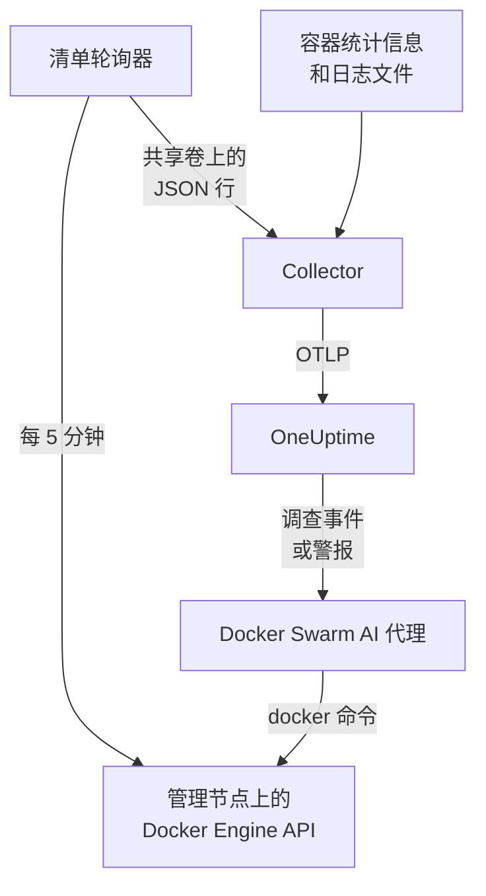

# Docker Swarm 代理

OneUptime Docker Swarm 代理监控 Docker Swarm 集群：它的节点、服务、任务、栈、overlay 网络、密钥、配置和卷，以及每个容器的指标和日志。你在 swarm 管理节点上用 Docker Compose 运行它，集群就会连同这些内容一起出现在 OneUptime 中。[Docker Swarm 监控](/docs/monitor/docker-swarm-monitor) 会根据收到的数据发出警报。

:::cards
- [安装代理](#安装代理): 在管理节点上使用安装脚本或 Docker Compose。
- [代理收集的内容](#代理采集的内容): 清单、集群计数，以及容器指标和日志。
- [AI 代理](#ai-代理): 让 OneUptime AI 在调查时读取 swarm。
- [故障排查](#故障排查): 一个诊断脚本，以及常见问题。
:::

## 工作原理

代理是三个容器，全部定义在一个 `docker-compose.yml` 中：

1. **Collector**：一个 OpenTelemetry Collector，读取 `docker_stats` 获取每个容器的指标，跟踪容器的日志文件，并跟踪清单快照文件。它为所有数据打上你的集群名称（`docker.swarm.cluster.name`），并通过 OTLP 发送到 OneUptime。
2. **清单轮询器**：一个基于 `curl` 和 `jq` 的小型边车容器，每 5 分钟遍历一次 swarm 管理节点的 API（`/nodes`、`/services`、`/tasks`、`/networks`、`/secrets`、`/configs`、`/volumes`），并根据服务标签 `com.docker.stack.namespace` 推断出栈。它为每个对象写入一行 JSON，由 Collector 转发。
3. **AI 代理**：`oneuptime-docker-swarm-ai-agent`，在 OneUptime AI 调查此集群上的事件或警报时运行它请求的 `docker` 命令。除非你允许修复，否则它是只读的（参见 [AI 代理](#ai-代理)）。



集群会随其第一批数据，以你配置的集群名称自行注册。

## 开始之前

- 一个用来运行代理的 swarm **管理** 节点：清单轮询器和 AI 代理调用的 API 端点只有管理节点才会响应。
- Docker Engine 20.10 或更高版本，带 Docker Compose v2 插件。
- 一个摄取密钥。在 **项目设置 → 遥测与 APM → 摄取密钥** 下创建一个并复制其值。
- 从节点到你的 OneUptime URL 的出站 HTTPS。

### 在哪里运行代理

请在管理节点上运行它。Collector 报告的是它所在节点的容器，因此要获得所有节点的容器指标，请在每个节点上运行 Collector，并且都使用相同的 `DOCKER_SWARM_CLUSTER_NAME`；清单轮询器和 AI 代理只需在一个管理节点上运行。`install.sh` 在非管理节点上不会安装 AI 代理（并会删除之前在那里安装的 AI 代理）。即使在工作节点上启动了 AI 代理，它也永远不会为集群注册：它会一直等到所在节点成为管理节点，因此无法挤掉管理节点上的 AI 代理。要以 swarm 栈而不是 Compose 部署代理？请用约束 `node.role == manager` 把清单轮询器和 AI 代理留在管理节点上。

## 安装代理

:::steps
### 安装并启动代理

:::tabs
@tab install.sh
下载安装脚本并在管理节点上运行：

```bash
curl -sSL https://raw.githubusercontent.com/OneUptime/oneuptime/master/agents/DockerSwarmAgent/install.sh -o install.sh
sh install.sh
```

脚本会询问你的 OneUptime URL、摄取密钥和集群名称。它安装到 `/opt/oneuptime-docker-swarm-agent`，写入一个只有所有者能读取的 `.env` 文件，并启动全部三个容器。添加 `--no-ai-agent` 可不安装 AI 代理。
@tab Docker Compose
从 [DockerSwarmAgent 目录](https://github.com/OneUptime/oneuptime/tree/master/agents/DockerSwarmAgent) 下载 `docker-compose.yml`、`otel-collector-config.yaml` 和 `inventory-snapshot.sh` 到管理节点上的一个新文件夹中：

```bash
curl -fsSL https://raw.githubusercontent.com/OneUptime/oneuptime/master/agents/DockerSwarmAgent/docker-compose.yml -o docker-compose.yml
curl -fsSL https://raw.githubusercontent.com/OneUptime/oneuptime/master/agents/DockerSwarmAgent/otel-collector-config.yaml -o otel-collector-config.yaml
curl -fsSL https://raw.githubusercontent.com/OneUptime/oneuptime/master/agents/DockerSwarmAgent/inventory-snapshot.sh -o inventory-snapshot.sh
chmod +x inventory-snapshot.sh
```

在它们旁边创建一个 `.env` 文件。它保存着摄取密钥，因此请用 `chmod 600 .env` 保持其私密：

```bash title=".env"
ONEUPTIME_URL=https://oneuptime.com
ONEUPTIME_SERVICE_TOKEN=your-telemetry-ingestion-key
DOCKER_SWARM_CLUSTER_NAME=my-swarm
```

启动代理：

```bash
docker compose up -d
```
:::

### 检查代理是否在运行

```bash
docker compose ps
docker compose logs --tail 50 oneuptime-docker-swarm-agent oneuptime-docker-swarm-inventory
```

`docker compose ps` 会列出三个容器：Collector（`oneuptime-docker-swarm-agent`）、清单轮询器（`oneuptime-docker-swarm-inventory`）和 AI 代理（`oneuptime-docker-swarm-ai-agent`）。

### 在 OneUptime 中找到集群

打开 **产品 → 基础设施 → Docker Swarm → 所有集群**。集群会在几分钟内出现，在第一次清单快照之后的 5 分钟内，其 **节点**、**服务**、**任务**、**Stacks**、**网络**、**密钥**、**Configs** 和 **卷** 页面会填充内容。
:::

## 环境变量

安装脚本会把前三个写入 `/opt/oneuptime-docker-swarm-agent/.env`；Docker Compose 安装则从 `docker-compose.yml` 旁边的 `.env` 中读取它们。在那里添加或更改其中任何一个，然后在该文件夹中运行 `docker compose up -d`。

| 变量 | 必需 | 说明 |
| --- | --- | --- |
| `ONEUPTIME_URL` | 是 | 你的 OneUptime URL，例如 `https://oneuptime.com` 或你的自托管实例。如果实例只支持 HTTP，请使用 `http://` 及其端口。 |
| `ONEUPTIME_SERVICE_TOKEN` | 是 | 来自 **项目设置 → 遥测与 APM → 摄取密钥** 的摄取密钥。 |
| `DOCKER_SWARM_CLUSTER_NAME` | 是 | 集群在 OneUptime 中的名称，也是汇合每个节点数据的键：作为 `docker.swarm.cluster.name` 资源属性打到所有数据上。请保持不变：之后更改它会注册另一个集群。默认为 `docker-swarm`。 |
| `DOCKER_INVENTORY_INTERVAL_SECONDS` | 否 | 清单轮询器拍摄快照的频率，单位为秒。默认为 `300`。 |
| `DOCKER_API_VERSION` | 否 | Collector 和清单轮询器使用的 Docker Engine API 版本。默认为 `1.44`；留空则与守护进程协商（参见 [故障排除](#故障排查)）。除非你指定一个版本，否则 AI 代理会自行协商。 |

AI 代理自己的设置见 [AI 代理](#ai-代理)。

## 代理采集的内容

| 信号 | 来源 | 显示位置 |
| --- | --- | --- |
| 节点、服务、任务、栈、网络、密钥、配置和卷 | 清单轮询器，来自 swarm 管理节点的 API | 集群的列表页和详情页 |
| 集群计数（就绪的节点、运行中的任务、服务、栈等） | 同一个快照 | 概览中的卡片和侧边菜单上的徽标 |
| 容器的 CPU、内存、进程数和运行时长 | `docker_stats` 接收器 | **指标** 页面 |
| 容器的 stdout 和 stderr 日志 | `filelog` 接收器 | **日志** 页面 |

### 它与 Docker 代理有何不同

[Docker 代理](/docs/telemetry/docker-host) 对单台主机建模，打上 `host.name` 和 `container.runtime=docker`。Docker Swarm 代理有意只打上 `docker.swarm.cluster.name`：这样 OneUptime 会把数据归到 swarm 集群下，而不是把每个节点注册为独立的主机。

## 用项目标签标记集群

以 `oneuptime.label.` 开头的资源属性会成为集群上的项目标签：`oneuptime.label.<dimension>=<value>` 就是标签 `<dimension>:<value>`。在 `otel-collector-config.yaml` 的 `resource` 处理器中，紧挨着 `docker.swarm.cluster.name` 添加这些属性：

```yaml
processors:
  resource:
    attributes:
      # ...existing attributes...
      - key: oneuptime.label.team
        value: platform
        action: upsert
      - key: oneuptime.label.env
        value: production
        action: upsert
```

Collector 只在启动时读取其配置：请运行 `docker compose restart oneuptime-docker-swarm-agent`。之后集群会显示标签 `team:platform` 和 `env:production`。标签匹配不区分大小写，因此现有的 `Production` 标签会被复用而不是重复创建，并且代理绝不会删除别人在 OneUptime 中添加的标签。

## 作为 systemd 服务运行

要让代理随节点启动，并在失败时重新启动，请安装它的 systemd 单元。它假定代理位于 `/opt/oneuptime-docker-swarm-agent`，即安装脚本放置它的位置：

```bash
sudo curl -fsSL https://raw.githubusercontent.com/OneUptime/oneuptime/master/agents/DockerSwarmAgent/systemd/oneuptime-docker-swarm-agent.service -o /etc/systemd/system/oneuptime-docker-swarm-agent.service
sudo systemctl daemon-reload
sudo systemctl enable --now oneuptime-docker-swarm-agent
```

## 升级代理

代理会报告它运行的 Collector 版本。当该版本早于此 OneUptime 版本固定的版本时，集群的 **概览** 页面上代理版本旁会出现一个警告标志。选择它即可查看这些命令。

在管理节点上再次运行安装脚本，并用相同的 URL、密钥和集群名称回答它的问题。它会下载最新文件、拉取镜像并重启代理：

```bash
curl -sSL https://raw.githubusercontent.com/OneUptime/oneuptime/master/agents/DockerSwarmAgent/install.sh -o install.sh
sh install.sh
```

脚本会根据你的回答重新写入 `.env`。它只保留 AI 代理的目标列表和 AI 可以执行的操作（`ONEUPTIME_AI_INVESTIGATION`、`ONEUPTIME_AI_FIXES`）：请把你自己设置的任何变量加回去，例如 `DOCKER_API_VERSION`。开启过 AI 修复？请以 `ONEUPTIME_AI_ALLOW_WRITES=true sh install.sh` 运行它，使修复保持开启。之前没有安装 AI 代理？请再次传入 `--no-ai-agent`。

如果使用 Docker Compose，请在代理的文件夹中重新下载这三个文件（然后重新做一遍你对 `docker-compose.yml` 所做的任何修改），再拉取镜像并重启：

```bash
docker compose pull
docker compose up -d
```

Collector 版本固定在这些文件中，因此仅拉取镜像并不能让代理升级。

## 卸载代理

```bash
cd /opt/oneuptime-docker-swarm-agent
docker compose down
```

## AI 代理

swarm 的 `docker-compose.yml`（以及 `install.sh`）还会运行 **Docker Swarm AI 代理**：第三个容器 `oneuptime-docker-swarm-ai-agent`（镜像 `oneuptime/resource-ai-agent:release`），在 OneUptime AI 调查此集群上的事件或警报时运行它请求的只读 `docker` 命令——`docker node ls`、`docker service ps web --no-trunc`、`docker service logs --tail 200 web`——并且仅在你允许时应用修复，例如对指定服务进行滚动重启。它读取与 Collector 相同的 `ONEUPTIME_URL`、`ONEUPTIME_SERVICE_TOKEN` 和 `DOCKER_SWARM_CLUSTER_NAME`，因此服务的正是这个集群，并显示在 OneUptime 中该集群的 **人工智能 → AI 代理** 页面上。

- **AI 调查默认开启。** 代理连接后，OneUptime AI 会用它来调查该集群上的事件和警报，集群的 **概览** 会显示代理的状态。要停止，请在代理运行的位置设置 `ONEUPTIME_AI_INVESTIGATION=false`（AI 代理页面上 **AI 可以执行的操作** 下的 **更改** 会显示方法），或者不安装代理。
- 和清单轮询器一样，它 **必须运行在管理节点上**：节点、服务和任务命令只在管理节点上可用。在工作节点上，它什么也不运行，并且在节点成为管理节点之前不会为集群注册（它的 `/status` 会说明原因）。每个集群运行一个。
- 除非你在 `.env` 中设置 `ONEUPTIME_AI_ALLOW_WRITES=true` 并运行 `docker compose up -d`（或带上该变量运行 `install.sh`；安装程序会把其环境中的 `ONEUPTIME_AI_ALLOW_WRITES`、`ONEUPTIME_AI_INVESTIGATION`、`ONEUPTIME_AI_FIXES`、`ONEUPTIME_AI_WRITE_TARGETS` 和 `ONEUPTIME_AI_PROTECTED_TARGETS` 写入 `.env`，再次运行时，除非你传入该变量（即使为空），否则后四个变量会保留 `.env` 中已有的值），否则它是 **只读** 的；`ONEUPTIME_AI_WRITE_TARGETS`（服务和节点名称的通配模式，例如 `web_*,api_*`）限制修复可以触及的范围。同一个 `.env` 中的 `ONEUPTIME_AI_FIXES` 决定修复如何运行——`ask-for-approval`（由人逐一批准）、`automatic` 或 `bypass-approval`——AI 代理页面会以只读方式显示它（[AI 可以执行的操作，由代理设定](/docs/ai/infrastructure-ai-agents#what-ai-may-do-set-by-the-agent)）。无论处于哪种模式，排空节点始终需要人工批准。
- 它以 root 身份运行并挂载了 Docker 套接字，因为该套接字归 root 所有——而在管理节点上，能使用该套接字的人就能控制整个 swarm，无论是否带 `:ro`。真正的限制是代理的命令策略：它绝不创建或删除服务或栈，绝不触碰密钥或配置，也绝不更改它自己、Collector、清单轮询器或 `ONEUPTIME_AI_PROTECTED_TARGETS`（服务和节点名称的通配模式）中的任何内容。
- `install.sh --no-ai-agent` 会不安装它；也可以从 `docker-compose.yml` 中删除 `oneuptime-docker-swarm-ai-agent` 服务。

它可以运行什么、修复如何工作以及如何排查它的问题：[Infrastructure AI Agents](/docs/ai/infrastructure-ai-agents#docker-swarm-clusters)。

## 故障排查

:::details 先运行诊断脚本
代理附带一个脚本 [`troubleshoot.sh`](https://github.com/OneUptime/oneuptime/blob/master/agents/DockerSwarmAgent/troubleshoot.sh)，它会检查整条链路：各个容器、清单轮询器是否在管理节点上（`docker node ls`）、快照文件、打到所有数据上的集群名称、令牌的格式、Collector 自身的指标，以及 OneUptime 是否接受摄取密钥。最后一项检查最重要。OneUptime 会以 `401` 拒绝错误的密钥（已禁用的密钥或浏览器密钥为 `422`），而 Collector 只会每个批次记录一行 `Exporting failed`，很容易被忽略。该脚本请求 `GET <url>/otlp/v1/validate`，直接得到 `200`（有效）或 `401`（无效）。请在管理节点上运行它：

```bash
curl -sSL https://raw.githubusercontent.com/OneUptime/oneuptime/master/agents/DockerSwarmAgent/troubleshoot.sh -o troubleshoot.sh
bash troubleshoot.sh    # add -d <dir> if you installed outside /opt/oneuptime-docker-swarm-agent
```
:::

:::details 集群始终没有出现
先运行诊断脚本。否则，请阅读 Collector 的日志（`docker compose logs oneuptime-docker-swarm-agent`），检查 `.env` 中的 `ONEUPTIME_SERVICE_TOKEN` 和 `ONEUPTIME_URL` 是否正确，以及节点能否访问你的 OneUptime URL。
:::

:::details 没有出现清单
检查清单轮询器是否运行在管理节点上：`docker node ls` 必须能在那里成功运行。然后在它的日志中查找 `failed to emit ...` 行：`docker compose logs oneuptime-docker-swarm-inventory`。
:::

:::details 集群变为已断开
当 OneUptime 在 15 分钟内没有从集群收到任何数据时，集群会变为已断开；OneUptime 每 5 分钟检查一次，并且它自身未在接收数据的时间不计入在内。请确保 Collector 容器保持运行：`docker compose ps` 会显示它。
:::

:::details Collector 以 "client version is too new" 退出
Collector 的日志显示：

```text
Error: cannot start pipelines: failed to start "docker_stats" receiver:
Error response from daemon: client version 1.44 is too new.
Maximum supported API version is 1.41
```

守护进程支持的最高 API 版本低于默认的 `1.44`（Docker Engine 20.10 最高为 `1.41`），因此 `docker_stats` 接收器无法启动，容器会不断重启。查出守护进程支持的最高版本：

```bash
docker version --format '{{ .Server.APIVersion }}'
```

在 `.env` 中把 `DOCKER_API_VERSION` 设为该值，并在运行代理的每个节点上运行 `docker compose up -d`。较新的守护进程仍然支持较旧的 API 版本，因此升级 Docker 后该设置仍然有效。或者设置 `DOCKER_API_VERSION=`（留空），让 Collector 与守护进程协商版本，而不是固定一个版本。
:::

:::details 集群以错误的名称出现
集群的名称来自 `DOCKER_SWARM_CLUSTER_NAME`。在 `.env` 中更改它并运行 `docker compose up -d`：新名称会注册一个新集群，而不是重命名旧集群。
:::

## 后续步骤

:::cards
- [Docker Swarm 监控](/docs/monitor/docker-swarm-monitor): 针对节点、服务、任务和容器发出警报。
- [Infrastructure AI Agents](/docs/ai/infrastructure-ai-agents): Docker Swarm AI 代理可以运行什么，以及修复如何工作。
- [Docker 代理](/docs/telemetry/docker-host): 改为监控单台 Docker 主机。
:::
