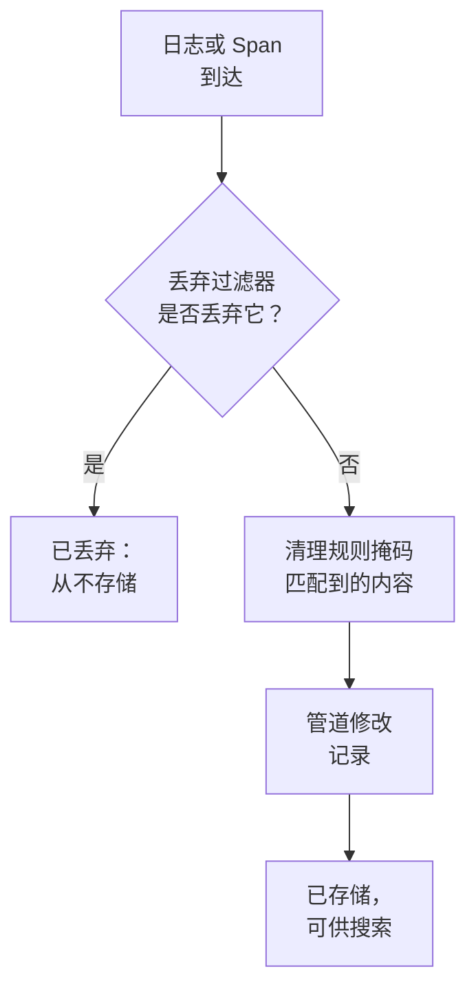

# 丢弃过滤器与清理规则

丢弃过滤器和清理规则在你的日志和 Span 到达时就对其起作用，早于任何存储。丢弃过滤器会扔掉你永远用不到的记录，或者只保留其中的一部分样本。清理规则会掩盖个人数据和机密，例如电子邮件地址、卡号和密码，使它们永远不会进入你的存储。

:::cards
- [它们在哪里运行](#它们在哪里运行): 在管道之前，在存储之前。
- [丢弃或采样记录](#丢弃或采样记录): 匹配记录，然后丢弃它们或保留一部分。
- [清理敏感数据](#清理敏感数据): 对模式找到的内容进行脱敏、掩码或哈希处理。
- [查看过滤器丢弃了什么](#查看过滤器丢弃了什么): 每个过滤器上的计数。
:::

## 它们在哪里运行

日志的规则位于 **日志 → 设置**，Span 的规则位于 **追踪 → 设置**。记录到达时，OneUptime 按以下顺序运行它们：



- **它们只作用于新记录。** 你创建或修改的规则适用于大约一分钟后到达的记录。已经存储的记录不会改变。
- **被丢弃的记录就没有了。** 任何搜索、图表、监视器或记录规则都看不到它，也不会从它生成异常。在 OneUptime Cloud 上，它也不会计费。
- **每个列表按顺序运行。** 拖动列表中的行即可更改顺序。只有已启用的过滤器和规则才会运行。

日志丢弃过滤器和清理规则同样适用于来自 OpenTelemetry、Syslog、Fluent Bit 和 Fluentd 的日志。[日志管道](/docs/telemetry/log-pipelines) 介绍了它们之后的步骤。

## 开始之前

- **正在到达的日志或 Span。** 请参阅 [OpenTelemetry](/docs/telemetry/open-telemetry)。
- **能够修改遥测设置的角色。** 项目所有者或项目管理员，或者拥有你所修改内容的权限（例如 Create Log Drop Filter 或 Create Trace Scrub Rule）的自定义角色。Telemetry 角色可以查看过滤器和规则，但不能修改它们。

## 丢弃或采样记录

:::steps
### 打开丢弃过滤器

前往 **日志 → 设置 → 丢弃过滤器**；对于 Span，前往 **追踪 → 设置 → 丢弃过滤器**。

### 匹配记录

点击 **创建日志丢弃过滤器**；对于 Span，点击 **创建追踪丢弃过滤器**。在 **匹配** 步骤中为过滤器指定 **名称**，然后构建它的 **过滤查询**：为每个条件指定字段、运算符和值，并选择必须匹配 **所有条件** 还是 **任一条件**。点击 **下一步**。

### 选择操作

在 **操作** 步骤中，保留 **丢弃** 以扔掉每条匹配的记录，或者选择 **样本** 并输入要保留的 **采样百分比**，范围为 1 到 99。然后创建过滤器。
:::

过滤器会在一分钟内开始丢弃。要先保存而暂不丢弃任何内容，请在创建之前关闭 **高级** 下的 **已启用**。

> [!WARNING]
> 被丢弃的记录无法找回。请让过滤器的查询尽量精确，并在创建后留意它的 **已丢弃** 计数。

过滤器可以检查以下字段，也可以通过 **Custom Attribute...** 检查任意属性：

| 记录 | 字段 |
| --- | --- |
| 日志 | **严重程度**、**日志正文**、**服务 ID** |
| Span | **Span 名称**、**Span 类型**、**状态**、**状态消息**、**服务 ID**、**存在异常**、**是根 Span** |

| 运算符 | 匹配 |
| --- | --- |
| **等于** | 完全相同的值，区分大小写：`Debug` 匹配，`DEBUG` 不匹配。 |
| **不等于** | 除完全相同的值之外的任何值。 |
| **包含** | 字段中任意位置出现的该值，不区分大小写。值中的 `%` 是通配符。 |
| **是其中之一** | 以逗号分隔的精确值列表中的任意一个。 |

**Preview query** 会显示这些条件组成的查询。下面这个查询会丢弃健康检查的调试日志行：

```text
severityText = 'Debug' AND body LIKE 'healthcheck'
```

采样逐条记录决定：当 **采样百分比** 为 10 时，大约每十条匹配的记录保留一条。过滤器按列表顺序运行，第一个丢弃某条记录的过滤器说了算；被样本保留的记录会继续进入下一个过滤器。

## 清理敏感数据

:::steps
### 打开清理规则

前往 **日志 → 设置 → 清理规则**；对于 Span，前往 **追踪 → 设置 → 清理规则**。

### 选择要查找的内容

点击 **创建日志清理规则**；对于 Span，点击 **创建追踪清理规则**。然后选择一个 **模式类型**。在你输入自己的名称之前，规则会以它命名，例如 **清理电子邮件地址**。对于 **自定义正则表达式**，还要输入 **自定义正则表达式模式**。

### 选择清理方式

在 **高级** 下选择 **清理操作** 和 **要清除的字段**，或者保持原样：新规则会把每个匹配项替换为 `[REDACTED]`，无论它位于记录中的什么位置。然后创建规则。
:::

| 模式类型 | 它查找的内容 |
| --- | --- |
| **电子邮件地址** | 电子邮件地址，例如 `jane@example.com` |
| **信用卡卡号** | 四位一组的十六位数字，例如 `4111 1111 1111 1111` |
| **SSN（社会安全号码）** | 美国社会安全号码，例如 `123-45-6789` |
| **电话号码** | 北美电话号码，例如 `555-123-4567` |
| **IP 地址** | 公网 IPv4 和 IPv6 地址，例如 `203.0.113.7` 或 `2001:db8::1`，但不包括私有地址、回环地址和链路本地地址 |
| **敏感属性键** | 键看起来像机密的任何属性的完整值，例如 `password`、`token`、`api_key`、`authorization` 或 `cookie` |
| **自定义正则表达式** | 你自己的正则表达式，不带斜杠或标志，并区分大小写进行匹配 |

| 清理操作 | 匹配项变成什么 |
| --- | --- |
| **脱敏** | `[REDACTED]`，即默认值 |
| **掩码** | 大部分被隐藏：电子邮件地址保留首字母和域名结尾，卡号、电话号码或社会安全号码保留最后四位，自定义匹配项或机密值保留第一个和最后一个字符。IP 地址会被完全隐藏。 |
| **哈希** | 你的项目独有的令牌，同一个值每次都相同，因此仍然可以统计重复次数，但没有人能据此还原出原值 |

例如，一条 **电子邮件地址** 规则会把下面这条日志正文：

```text
Payment failed for jane@example.com
```

根据它的 **清理操作** 存储为以下形式之一：

```text
Redact: Payment failed for [REDACTED]
Mask:   Payment failed for j***@***.com
Hash:   Payment failed for [HASHED:5e29db14e508e09a]
```

对于日志规则，**要清除的字段** 为 **两者（正文和属性）**，除非你选择 **仅正文** 或 **仅属性**；对于 Span 规则，它为 **全部（名称、属性和事件）**，除非你选择 **仅跨度名称**、**仅属性** 或 **仅事件属性**。Span 链接上的属性与 Span 自身的属性一起清理，**全部（名称、属性和事件）** 还会清理 Span 的状态消息及其事件的名称。**敏感属性键** 规则读取的是键，因此总会清理键下的值：属性中的，以及日志 JSON 正文中的。

- **规则可以只针对一个服务。** 在 **高级** 下的 **仅限一个服务** 中选择服务：规则会清理该服务的记录，其他服务的记录保持不变。留空时，它会清理所有服务的记录。列表的 **范围** 列会显示是哪一种。
- **表单会说明规则会为其他内容带来什么变化。** 在你创建规则之前以及启用规则时，OneUptime 会列出读取它将隐藏的值的内容：监视器、仪表板、已保存的视图、记录规则和 SLO，每项都是链接，还会说明 [安全事件](/docs/telemetry/security-events) 将失去什么。按隐藏值筛选的监视器将不再匹配该值。无论如何规则都会保存。
- **IP 地址规则隐藏属于个人数据的地址。** 即公网 IPv4 和 IPv6 地址，无论写法如何：简写形式，如 `2001:db8::1`；带端口的方括号形式，如 `[2001:db8::1]:443`，方括号和端口会保留；带区域的形式，如 `2001:db8::2%eth0`，区域会保留；或写成 IPv6 的 IPv4 地址，如 `::ffff:203.0.113.7`，会被整个隐藏。它保留私有地址、回环地址和链路本地地址，如 `10.0.0.12`、`127.0.0.1` 和 `fe80::1`，也保留请求 URL 中的云元数据地址 `169.254.169.254`，[安全事件](/docs/telemetry/security-events)正是在这里查找服务器端请求伪造。如果也要隐藏内部地址，请为它们添加一条 **自定义正则表达式** 规则，例如用 `\b(?:\d{1,3}\.){3}\d{1,3}\b` 匹配所有 IPv4 地址。
- **哈希令牌是你的项目独有的。** 它由你的项目自己的密钥生成，该密钥由安装的 `ENCRYPTION_SECRET` 派生而来，因此同一个值在另一个项目中会得到另一个令牌，读到令牌的人也无法据此还原出原值，或通过对猜测的值求哈希来比对。一个 IP 地址无论怎么写都只有一个令牌：`::ffff:203.0.113.7` 和 `203.0.113.7` 共用同一个。令牌还没有密钥时存储的记录中是 8 个字符的令牌，如 `[HASHED:8c87b489]`，与现在 16 个字符的令牌不同：在这些记录到达保留期限之前，请同时搜索两者。更改 `ENCRYPTION_SECRET` 会改变所有令牌；在自托管安装中，令牌的保密程度只与它相同。
- **安全事件仍能指出经过哈希的 IP 地址。** 当[安全事件](/docs/telemetry/security-events)读取你的日志或追踪时，执行哈希的 IP 地址规则还会把它隐藏的每个地址与其令牌一起保存在一个只有安全事件的扫描才会读取的存储中：任何页面、搜索、导出、API 或 AI 工具都无法读取它。因此，来自一个在日志中只显示为令牌的地址的攻击，仍会指出该地址，其案件也会说明应封禁哪个地址。每个地址会保存到最后一次出现后的 30 天。清除或遮盖地址的规则不会保存任何内容，此时安全事件会说明是某条清理规则隐藏了该地址；超过 30 天的令牌，或在令牌有密钥之前生成的令牌，也是如此。
- **列表和嵌套值也会被读取。** 规则会读取列表、列表的列表或键值列表中的每一段文本（例如 HTTP 标头的值），并保留值的形状：数字和布尔值保持不变。**敏感属性键** 规则还会读取值内部的键，因此键值列表中的 `password` 也会被隐藏。以映射或列表形式发送的日志正文会以其 JSON 文本存储，**敏感属性键** 规则会读取其中的键，就像读取以 JSON 写成的正文一样。模式规则会让这样的正文保持为 JSON，以 JSON 写成的属性（例如 AI 调用的消息）也一样：它按照你的应用程序写下的样子读取文本，把 `\n` 这样的转义读作它所代表的换行，并且只在其中的文本和数字内替换它找到的内容。
- **字符串中的 JSON 也会被读取。** 本身就是 JSON 的文本，例如包含 `{"password":"hunter2"}` 的属性 `http.request.body`，或日志正文中 Fluentd 记录的 `log` 行，会作为 JSON 读取，最多到彼此嵌套的 4 层 JSON，更深的部分作为文本读取。**敏感属性键** 规则会隐藏其中看起来像机密的键下的值，其他内容一概不变：其中的数字、空格和其他文本保持你的应用程序写下的样子。只是看起来像 JSON 的文本（例如 `{token}`）保持原样。
- **过大而无法逐项读取的值会作为文本读取。** 嵌套超过 32 层的值，或会使一条记录的列表和映射中的值超过 10,000 个的值，会作为其 JSON 文本读取并存储。模式规则会清理它在该文本中找到的内容；当其中出现 `password` 或 `token` 之类的词时，**敏感属性键** 规则会隐藏整个值。 在日志正文和字符串中的 JSON 里，只有超出这些上限的部分会作为文本读取，其余部分仍会逐个键读取。
- **异常来自清理后的记录。** 在日志中发现的异常在清理之后才生成，清理 Span 事件的规则也会清理记录在这些事件上的异常。 每个异常仍按清理前的内容分组，因此添加规则绝不会把你已有的异常变成新异常，也不会再次为它触发 **新异常**。当规则隐藏了新异常分组所依据内容的一部分时，它的指纹会像哈希令牌一样用你的项目自己的密钥生成，因此没有人能据此还原被隐藏的内容。
- **syslog 行的原始副本会隐藏规则在其各部分中隐藏的内容。** syslog 会把 RFC 5424 行的结构化数据按到达时的原样保存在 `syslog.structured.raw` 中，通过 HTTP 发送的 syslog 还会把整行保存在 `syslog.raw` 中。每个副本都会用规则对标头字段、结构化数据的每个参数和消息留下的内容重新拼成，然后规则会像读取任何属性一样读取它。因此，**敏感属性键** 规则在 `syslog.structured.auth_1.password` 中隐藏的密码，或 **仅正文** 规则在消息中隐藏的地址，在副本中也会被隐藏，并按 RFC 5424 写值的方式写成 `password="[REDACTED\]"`。规则没有改动任何内容的行会按到达时的原样保留其副本。
- **记录的会话 ID 会被保留。** **敏感属性键** 规则会隐藏登录会话，例如 `session_id`、`sessionid` 或 Cookie，但当 `session.id` 保存的是该日志或 Span 所属的会话时，会保留它：这是 [Session Replay](/docs/telemetry/session-replay) 用来把记录归档到录制下的随机 ID，记录无论如何都会把它保留为自己的会话。AI 调用的对话 ID 也以同样的方式保留。不要把登录会话的密钥作为 `session.id` 发送。
- **Session Replay 也会被清理。** 除了录制器在浏览器中进行的掩码之外，适用于所有服务的日志清理规则也会作用于 Session Replay 录制。
- **规则按列表顺序运行。** 每条规则看到的是前面的规则处理后的内容。
- **自定义模式所用的时间与记录长度成正比。** 无论怎么写，它都保留 JavaScript 的语法和结果，包括先行断言和后行断言。反向引用（例如 `\1`）无法这样运行：含有反向引用的规则在保存时会被拒绝，大到无法运行的模式也一样。如果要找出所有匹配需要一遍又一遍地重读一个很长的值，规则会清理整个值。项目的丢弃过滤器、清理规则和管道也为它发送的每一批数据共享一份工作额度，与这批数据的大小成正比，足以让数十个自定义模式读取每个值。当它们的模式需要更多工作时，自定义清理规则会清理整个值，而无法得出结果的过滤器不会应用于该记录。

## 查看过滤器丢弃了什么

**丢弃过滤器** 列表会显示每个过滤器的 **已丢弃** 计数，以及它最后一次丢弃的时间 **Last Dropped**。**Nothing dropped yet** 表示它从未匹配过。过滤器自己的页面会在 **活动** 下显示同样的信息，并在丢弃后一分钟内更新。它的 **筛选条件** 卡片显示它匹配的内容，你可以在那里修改条件。

## 故障排除

:::details 丢弃过滤器什么都没有丢弃
**等于**、**不等于** 和 **是其中之一** 比较的是精确文本，包括大小写。严重程度写作 `Information` 和 `Warning`，而不是 `INFO` 或 `WARN`。请检查过滤器是否已启用，并在修改后等待一分钟。
:::

:::details 我期望的日志不见了
查看每个丢弃过滤器的 **已丢弃** 计数和 **Last Dropped** 时间。关闭你怀疑的那个过滤器的 **已启用**，之后的日志就会重新到达。
:::

:::details 自定义清理规则显示不清理任何内容
它的模式为空，或者不是有效的正则表达式，或者无法运行（例如含有 `\1` 这样的反向引用），因此它不会清理任何内容。编辑该规则，为它指定一个至少匹配一个字符的模式。
:::

:::details 旧记录仍然显示新规则要清理的数据
清理规则在记录到达时起作用。在规则之前存储的记录会保留原有内容，直到其保留期结束。请参阅 [数据保留](/docs/telemetry/data-retention)。
:::

## 后续步骤

:::cards
- [日志管道](/docs/telemetry/log-pipelines): 解析并丰富你保留的日志。
- [日志浏览器](/docs/telemetry/logs-explorer): 搜索已存储的内容。
- [追踪浏览器](/docs/telemetry/traces-explorer): 追踪你保留的 Span。
- [数据保留](/docs/telemetry/data-retention): 决定它们保留多长时间。
:::
