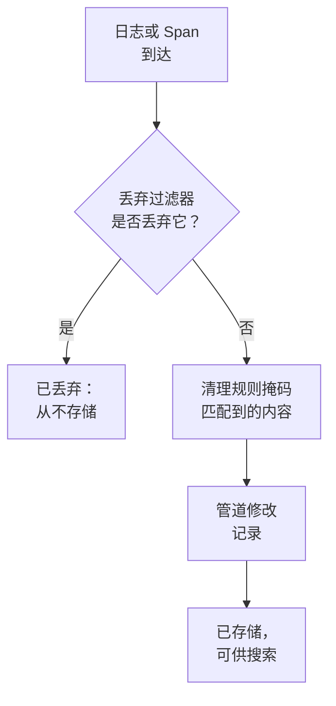

# 丢弃过滤器与清理规则

丢弃过滤器和清理规则在你的日志和 Span 到达时就对其起作用，早于任何存储。丢弃过滤器会扔掉你永远用不到的记录，或者只保留其中的一部分样本。清理规则会掩盖个人数据和机密，例如电子邮件地址、卡号和密码，使它们永远不会进入你的存储。

:::cards
- [它们在哪里运行](#它们在哪里运行): 在管道之前，在存储之前。
- [丢弃或采样记录](#丢弃或采样记录): 匹配记录，然后丢弃它们或保留一部分。
- [清理敏感数据](#清理敏感数据): 对模式找到的内容进行脱敏、掩码或哈希处理。
- [查看过滤器丢弃了什么](#查看过滤器丢弃了什么): 每个过滤器上的计数。
:::

## 它们在哪里运行

日志的规则位于 **日志 → 设置**，Span 的规则位于 **跟踪 → 设置**。记录到达时，OneUptime 按以下顺序运行它们：



- **它们只作用于新记录。** 你创建或修改的规则适用于大约一分钟后到达的记录。已经存储的记录不会改变。
- **被丢弃的记录就没有了。** 任何搜索、图表、监视器或记录规则都看不到它，也不会从它生成异常。在 OneUptime Cloud 上，它也不会计费。
- **每个列表按顺序运行。** 拖动列表中的行即可更改顺序。只有已启用的过滤器和规则才会运行。

日志丢弃过滤器和清理规则同样适用于来自 OpenTelemetry、Syslog、Fluent Bit 和 Fluentd 的日志。[日志管道](/docs/telemetry/log-pipelines) 介绍了它们之后的步骤。

## 开始之前

- **正在到达的日志或 Span。** 请参阅 [OpenTelemetry](/docs/telemetry/open-telemetry)。
- **能够修改遥测设置的角色。** Project Owner 或 Project Admin，或者拥有你所修改内容的权限（例如 Create Log Drop Filter 或 Create Trace Scrub Rule）的自定义角色。Telemetry 角色可以查看过滤器和规则，但不能修改它们。

## 丢弃或采样记录

:::steps
### 打开丢弃过滤器

前往 **日志 → 设置 → 丢弃过滤器**；对于 Span，前往 **跟踪 → 设置 → 丢弃过滤器**。

### 匹配记录

点击 **创建日志 丢弃 过滤器**；对于 Span，点击 **创建追踪 丢弃 过滤器**。在 **匹配** 步骤中为过滤器指定 **名称**，然后构建它的 **过滤查询**：为每个条件指定字段、运算符和值，并选择必须匹配 **所有条件** 还是 **任一条件**。点击 **下一步**。

### 选择操作

在 **操作** 步骤中，保留 **丢弃** 以扔掉每条匹配的记录，或者选择 **样本** 并输入要保留的 **采样百分比**，范围为 1 到 99。然后创建过滤器。
:::

过滤器会在一分钟内开始丢弃。要先保存而暂不丢弃任何内容，请在创建之前关闭 **高级** 下的 **已启用**。

> [!WARNING]
> 被丢弃的记录无法找回。请让过滤器的查询尽量精确，并在创建后留意它的 **Dropped** 计数。

过滤器可以检查以下字段，也可以通过 **Custom Attribute...** 检查任意属性：

| 记录 | 字段 |
| --- | --- |
| 日志 | **严重程度**、**日志正文**、**服务 ID** |
| Span | **Span 名称**、**Span 类型**、**状态**、**状态消息**、**服务 ID**、**存在异常**、**是根 Span** |

| 运算符 | 匹配 |
| --- | --- |
| **等于** | 完全相同的值，区分大小写：`Debug` 匹配，`DEBUG` 不匹配。 |
| **不等于** | 除完全相同的值之外的任何值。 |
| **包含** | 字段中任意位置出现的该值，不区分大小写。值中的 `%` 是通配符。 |
| **是其中之一** | 以逗号分隔的精确值列表中的任意一个。 |

**Preview query** 会显示这些条件组成的查询。下面这个查询会丢弃健康检查的调试日志行：

```text
severityText = 'Debug' AND body LIKE 'healthcheck'
```

采样逐条记录决定：当 **采样百分比** 为 10 时，大约每十条匹配的记录保留一条。过滤器按列表顺序运行，第一个丢弃某条记录的过滤器说了算；被样本保留的记录会继续进入下一个过滤器。

## 清理敏感数据

:::steps
### 打开清理规则

前往 **日志 → 设置 → 清理规则**；对于 Span，前往 **跟踪 → 设置 → 清理规则**。

### 选择要查找的内容

点击 **创建日志 清理 规则**；对于 Span，点击 **创建追踪 清理 规则**。然后选择一个 **模式类型**。在你输入自己的名称之前，规则会以它命名，例如 **清理电子邮件地址**。对于 **自定义正则表达式**，还要输入 **自定义正则表达式模式**。

### 选择清理方式

在 **高级** 下选择 **清理操作** 和 **要清除的字段**，或者保持原样：新规则会把每个匹配项替换为 `[REDACTED]`，无论它位于记录中的什么位置。然后创建规则。
:::

| 模式类型 | 它查找的内容 |
| --- | --- |
| **电子邮件地址** | 电子邮件地址，例如 `jane@example.com` |
| **信用卡卡号** | 四位一组的十六位数字，例如 `4111 1111 1111 1111` |
| **SSN（社会安全号码）** | 美国社会安全号码，例如 `123-45-6789` |
| **电话号码** | 北美电话号码，例如 `555-123-4567` |
| **IP 地址** | IPv4 地址，例如 `192.168.1.1` |
| **Sensitive Attribute Keys** | 键看起来像机密的任何属性的完整值，例如 `password`、`token`、`api_key`、`authorization` 或 `cookie` |
| **自定义正则表达式** | 你自己的正则表达式，不带斜杠或标志，并区分大小写进行匹配 |

| 清理操作 | 匹配项变成什么 |
| --- | --- |
| **脱敏** | `[REDACTED]`，即默认值 |
| **掩码** | 大部分被隐藏：电子邮件地址保留首字母和域名结尾，卡号、电话号码或社会安全号码保留最后四位，自定义匹配项或机密值保留第一个和最后一个字符。IP 地址会被完全隐藏。 |
| **哈希** | 该值的简短哈希，同一个值每次都相同，因此仍然可以统计重复次数 |

例如，一条 **电子邮件地址** 规则会把下面这条日志正文：

```text
Payment failed for jane@example.com
```

根据它的 **清理操作** 存储为以下形式之一：

```text
Redact: Payment failed for [REDACTED]
Mask:   Payment failed for j***@***.com
Hash:   Payment failed for [HASHED:8c87b489]
```

对于日志规则，**要清除的字段** 为 **两者（正文和属性）**，除非你选择 **仅正文** 或 **仅属性**；对于 Span 规则，它为 **全部（名称、属性和事件）**，除非你选择 **仅跨度名称**、**仅属性** 或 **仅事件属性**。**Sensitive Attribute Keys** 规则总是清理属性值，因为它读取的是属性键。

- **异常来自清理后的记录。** 在日志中发现的异常在清理之后才生成，清理 Span 事件的规则也会清理记录在这些事件上的异常。
- **Session Replay 也会被清理。** 除了录制器在浏览器中进行的掩码之外，日志清理规则也会作用于 Session Replay 录制。
- **规则按列表顺序运行。** 每条规则看到的是前面的规则处理后的内容。
- **自定义模式所用的时间与记录长度成正比。** 无论怎么写，它都保留 JavaScript 的语法和结果，包括先行断言和后行断言。反向引用（例如 `\1`）无法这样运行：含有反向引用的规则在保存时会被拒绝，大到无法运行的模式也一样。如果要找出所有匹配需要一遍又一遍地重读一个很长的值，规则会清理整个值。项目的丢弃过滤器、清理规则和管道也为它发送的每一批数据共享一份工作额度，与这批数据的大小成正比，足以让数十个自定义模式读取每个值。当它们的模式需要更多工作时，自定义清理规则会清理整个值，而无法得出结果的过滤器不会应用于该记录。

## 查看过滤器丢弃了什么

**丢弃过滤器** 列表会显示每个过滤器的 **Dropped** 计数，以及它最后一次丢弃的时间 **Last Dropped**。**Nothing dropped yet** 表示它从未匹配过。过滤器自己的页面会在 **活动** 下显示同样的信息，并在丢弃后一分钟内更新。它的 **筛选条件** 卡片显示它匹配的内容，你可以在那里修改条件。

## 故障排除

:::details 丢弃过滤器什么都没有丢弃
**等于**、**不等于** 和 **是其中之一** 比较的是精确文本，包括大小写。严重程度写作 `Information` 和 `Warning`，而不是 `INFO` 或 `WARN`。请检查过滤器是否已启用，并在修改后等待一分钟。
:::

:::details 我期望的日志不见了
查看每个丢弃过滤器的 **Dropped** 计数和 **Last Dropped** 时间。关闭你怀疑的那个过滤器的 **已启用**，之后的日志就会重新到达。
:::

:::details 自定义清理规则显示不清理任何内容
它的模式为空，或者不是有效的正则表达式，或者无法运行（例如含有 `\1` 这样的反向引用），因此它不会清理任何内容。编辑该规则，为它指定一个至少匹配一个字符的模式。
:::

:::details 旧记录仍然显示新规则要清理的数据
清理规则在记录到达时起作用。在规则之前存储的记录会保留原有内容，直到其保留期结束。请参阅 [数据保留](/docs/telemetry/data-retention)。
:::

## 后续步骤

:::cards
- [日志管道](/docs/telemetry/log-pipelines): 解析并丰富你保留的日志。
- [日志浏览器](/docs/telemetry/logs-explorer): 搜索已存储的内容。
- [跟踪浏览器](/docs/telemetry/traces-explorer): 跟踪你保留的 Span。
- [数据保留](/docs/telemetry/data-retention): 决定它们保留多长时间。
:::
