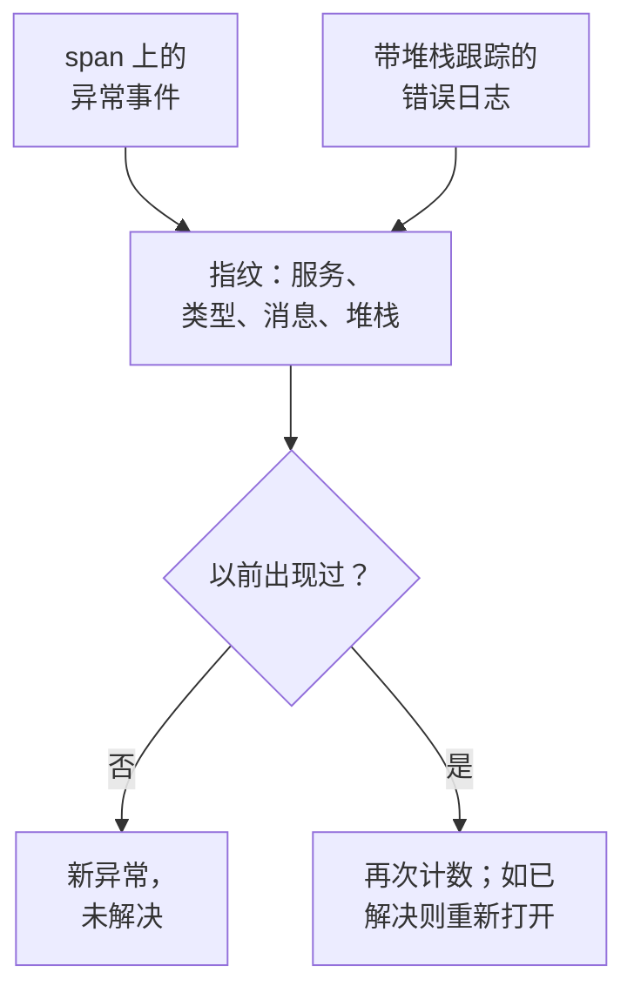

# 异常跟踪

异常跟踪收集你的代码抛出的错误，并把同一个错误的每次出现归并为一个异常，附带它的堆栈跟踪、趋势以及它发生时所在的请求。像处理待办清单一样分诊它们：修复、标记为已解决，或归档噪音，并让 AI 为它能修复的异常打开 pull request。

:::cards
- [异常从何而来](#异常从何而来): 你的服务已经在发送的 span 和日志。
- [分诊列表](#分诊列表): 未解决的在前，噪音隐藏。
- [异常的页面](#异常的页面): 堆栈跟踪、各次出现和上下文。
- [用 AI 修复](#用-ai-修复): 一个包含修复或回归测试的 pull request。
- [用 AI 查找并修复新出现和激增的异常](#用-ai-查找并修复新出现和激增的异常): 为 OneUptime 发现的异常打开的 pull request。
:::

## 异常从何而来

你不需要单独发送异常。OneUptime 会在你的服务已经发送的遥测中找到它们：

- span 上的异常事件，也就是 OpenTelemetry 的 `recordException()` 写入的内容；
- 带有 `exception.type`、`exception.message` 或 `exception.stacktrace` 属性的日志；
- 严重程度为 Error 或 Fatal、消息中包含堆栈跟踪的日志，前提是该日志不是在 span 内写入的（span 已经报告了它）。

每次出现都会与同一错误之前的出现归并为一个异常：

- **每个服务和错误对应一个异常。** 指纹由服务、异常类型、消息和堆栈跟踪生成。每次调用都会变化的值会先被去掉：UUID 和其他 ID、时间戳、IP 地址和电子邮件地址，以及七位或更多位的数字。因此 `Order id=1042 not found` 和 `Order id=2077 not found` 是同一个异常。
- **新的出现会重新打开已解决的异常。** 如果你解决之后它又发生了，说明修复没有生效。
- **已归档的异常保持归档。** 它的新出现仍会被计数，但不再发送通知。

> [!TIP]
> 要让预期内的错误（例如你的服务拒绝的无效输入）不进入异常跟踪，请在 span 的异常事件上把 `error.class` 属性设置为 `user-error` 或 `expected-denial`。这样 OneUptime 就不会为它记录异常。

## 开始之前

- **正在到达的 span 或日志。** 使用 [OpenTelemetry](/docs/telemetry/open-telemetry) 为你的服务埋点。**设置指南** 标签页会显示适合你的语言的代码。
- **可以读取遥测的角色。** Project Owner、Project Admin、Project Member、Viewer、Telemetry Admin、Telemetry Member 或 Telemetry Viewer，或者拥有 Read Telemetry Service Exception 权限的自定义角色。解决和归档需要 Project Owner 或 Project Admin，或者 Edit Telemetry Service Exception 权限。

## 分诊列表

:::steps
### 打开异常列表

前往 **产品 → 可观测性 → 异常**。**异常** 标签页上的徽标统计未解决的问题，列表打开时显示 **未解决** 的异常。

### 选择状态

在 **未解决**、**已解决**、**已归档** 和 **全部** 之间切换。列表上方的图表显示随时间推移，有多少次出现是 **未处理** 的，有多少次是 **已处理** 的。

### 选择什么算作问题

默认的 **问题** 会隐藏用户错误和预期内的拒绝，让列表只显示需要修复的内容。**User errors** 只显示这些错误，**全部** 显示所有异常。

### 搜索和过滤

输入查询，例如 `type:TypeError env:production`，参见 [搜索语法](/docs/telemetry/search-syntax#异常)；或者点击 **过滤器** 侧栏中的值：一个服务、一台主机或其他资源、一个 **异常类型**、一个 **环境** 或一个 **Error Class**。

### 打开一个异常

点击一行即可打开异常的页面。
:::

## 异常的页面

页面的侧边菜单把你对异常能做的事归在一起：

| 页面 | 显示内容 |
| --- | --- |
| **概览** | 消息、服务、发生的频率、首次和最后一次出现的时间、随时间的趋势，以及最近一次出现：版本、环境、span、追踪和用户会话。 |
| **堆栈跟踪** | 堆栈的各个帧。对于浏览器代码，在你为该版本上传 [源代码映射](/docs/telemetry/source-maps) 后，会显示原始文件和行。 |
| **Occurrences** | 每一次出现，以及它的时间、消息和它所在的追踪。 |
| **Context** | 最近一次出现的属性、录制过的话还有它的会话回放，以及导致它的步骤。 |
| **日志** | 最近一次出现前后写入的日志。 |
| **AI Assistance** | 修复或测试该异常的 AI 任务。 |
| **设置** | 解决或归档该异常。它位于 **Manage** 下，该部分默认折叠。 |

## 解决、重新打开和归档

异常页面顶部的按钮以及它的 **设置** 页面可以更改它的状态：

| 操作 | 何时使用 | 接下来会发生什么 |
| --- | --- | --- |
| **解决** | 你已经部署了修复。 | 它离开 **未解决** 列表。新的出现会重新打开它。 |
| **Reopen** | 修复没有生效。 | 它再次变为未解决。 |
| **归档** | 它是你不打算修复的噪音。 | 它离开列表。新的出现会被计数，但不再发送通知。 |
| **取消归档** | 你想再次收到它的消息。 | 它回到它所属的列表。 |

**设置** 显示最后是谁、在什么时候解决或归档了该异常。它的按钮显示为 **标记为已解决** 或 **标记为未解决**，以及 **归档** 或 **取消归档**。

## 错误类别

每个异常都有一个错误类别，说明这是谁的问题。OneUptime AI 在分诊关于该异常的洞察（例如新出现或激增的异常）时设置它：参见 [AI SRE](/docs/ai/ai-sre#洞察主动检测)。尚未被分诊的异常保持为 `unknown`。

| 类别 | 含义 | 在 **问题** 中 |
| --- | --- | --- |
| `code-fault` | 代码中的缺陷。AI 会自行修复的唯一类别。 | 是 |
| `infrastructure` | 超时、连接断开或资源耗尽。 | 是 |
| `unknown` | 尚未分类。 | 是 |
| `user-error` | 用户无效输入导致的结果。 | 否 |
| `expected-denial` | 检查在正常工作，例如被拒绝的登录。 | 否 |

在 AI 洞察的设置中打开 **归档预期内的异常** 后，分诊判定为预期内拒绝的异常会自动为你归档。

## 用 AI 修复

**AI Assistance** 页面提供三项任务。每一项都作为 AI 任务运行，在你的代码仓库中打开一个 pull request：

| 任务 | pull request 做什么 |
| --- | --- |
| **Fix this exception with AI** | 修复根本原因。点击 **用 AI 修复** 启动它。 |
| **Generate Regression Test** | 添加一个测试，在缺陷修复之前它会一直失败。 |
| **改进错误处理** | 针对预期内的错误：更早地校验输入，让用户数据不出现在消息中，并把错误标记为已处理。 |

AI 首先需要三样东西：一个 LLM 提供商、一个已连接的仓库（位于 GitHub、GitLab、Forgejo 或 Gitea，或任意 Git 服务器），以及一个在线运行任务的 AI 代理。页面会逐一检查，并链接到缺少的部分。异常处于已解决或已归档状态时，这些任务会暂停。参见 [代码](/docs/ai/ai-agent)。

## 用 AI 查找并修复新出现和激增的异常

OneUptime 每 15 分钟检查一次你的异常，查找新出现的异常、突然发生得频繁得多的异常，以及异常没有堆栈跟踪的服务，并将发现连同证据记录为 AI 洞察。随后 OneUptime AI 会调查每一条，并为它打开一个 pull request。绝不会自动合并：每个 pull request 都由你的团队审查。

| 发现 | OneUptime 何时记录 | pull request |
| --- | --- | --- |
| **New Exception** | 在最近 24 小时内首次出现、且已经发生 3 次或更多次的异常。 | 修复该异常，或更好地处理它。 |
| **Exception Spike** | 在最近一小时内发生 10 次或更多次、达到其之前 24 小时每小时发生率 5 倍或更多的异常。 | 修复该异常，或更好地处理它。 |
| **缺少堆栈跟踪** | 某个服务在最近一天记录的异常没有堆栈跟踪，且合计发生 20 次或更多次。 | 让该服务为每个异常记录堆栈跟踪。 |

新出现或激增的异常的 pull request 就是该异常自己的 AI 任务，即其 **AI Assistance** 页面启动的那个任务，它会等待 OneUptime AI 调查完这条发现。如果找到出错的代码（`code-fault`），pull request 会像 **Fix this exception with AI** 那样修复它。如果发现的是预期内的错误（`user-error` 或 `expected-denial`），pull request 会像 **改进错误处理** 那样更好地处理该错误。其他任何结论都不会自行打开 pull request。

OneUptime AI 只会为在你自己的代码中抛出的异常自行打开 pull request：即堆栈跟踪中包含你的代码的帧、而不仅仅是库或运行时的帧的异常。如果有人未合并就关闭了某个 pull request，该异常的自动 pull request 就会暂停。任何人仍可以在这条发现上通过 **用 AI 修复** 请求其中任意一个。

### 开启

**异常 → 人工智能 → 设置** 中有 **查找并修复新出现和激增的异常** 开关，新项目默认开启。在它关闭期间，新出现和激增的异常照旧归 AI 洞察处理：参见 [AI SRE](/docs/ai/ai-sre#洞察主动检测)。当 **启用 AI** 关闭时，这些异常仍会被发现，但 OneUptime AI 不会对它们做任何事。要打开 pull request，OneUptime AI 需要在 [代码](/docs/ai/ai-agent) 中连接的仓库：页面会先说明缺少什么。每个仓库的代码都在该仓库于“代码”中选择的 Runner 上修改。

OneUptime AI 每天（UTC）最多自行打开 5 个 pull request，每条发现一个，且绝不超过仓库对打开的 AI pull request 的上限。

### AI 规则

没有规则时，OneUptime AI 会立即调查它发现的每个异常，并为每个它能修复的异常打开 pull request。**更多设置** 下的 **AI 规则** 会分三步缩小范围：

| 步骤 | 决定什么 |
| --- | --- |
| **匹配** | 哪些服务：所选的服务、带有特定标签的服务，或名称匹配某个模式的服务。 |
| **调查** | **立即**，或 **仅在等待后仍被发现时**：在等待期间消失的异常不会被调查。 |
| **修复** | **不修复**、**修复前先询问** 或 **无需询问直接修复**。先询问时，pull request 交给人来打开：这条发现会提供 **用 AI 修复**。 |

在 **更多字段** 中，规则会选择 OneUptime AI 可为其使用的代码仓库、MCP 服务器和 LLM 提供商。若未选择任何项，它可以使用全部，并使用项目的默认 LLM 提供商。

### 查看它做了什么

- **异常 → 人工智能 → 洞察** 列出 OneUptime 发现的内容，每条发现都附有证据，其中包括其堆栈跟踪中你的代码的帧。**View Exception Group** 会打开该异常；对于某个服务缺少堆栈跟踪的发现，**在异常中打开** 会打开该服务最近一天未解决的异常。
- **异常 → 人工智能 → 日志** 按最新优先列出每次调查和每个 pull request，以及各自的状态。
- pull request 会说明打开它的原因，并附有指向其发现的链接。新出现或激增的异常的 pull request 还会链接到该异常，并显示在该异常的 **AI Assistance** 页面上。在“代码”中，其任务会写明它修复的异常，或它来自的发现。

## 异常洞察

**洞察** 标签页统计你的 **未解决**、**已解决** 和 **已归档** 异常以及解决率，并列出最常见的异常、它们影响的服务以及最近出现的异常。

## 故障排除

:::details 我刚抛出的异常不在列表中
先检查视角：**问题** 会隐藏用户错误和预期内的拒绝，所以请选择 **全部**。然后扩大时间范围，并检查该异常是否记录在 span 上，或记录在带有堆栈跟踪的日志中。
:::

:::details 一个错误显示为多个异常
指纹包含消息和堆栈跟踪。当它们不同时，例如消息中嵌入了每次调用都会变化的短数字或名称，每种变体都会成为单独的异常。
:::

:::details 已解决的异常不断回来
新的出现会有意地重新打开已解决的异常：错误仍在发生。检查修复是否已进入报告该错误的版本，如果你不想再收到它的消息，就把这个异常归档。
:::

## 后续步骤

:::cards
- [异常监控](/docs/monitor/exceptions-monitor): 在异常激增时收到警报。
- [源代码映射](/docs/telemetry/source-maps): 为浏览器代码提供可读的堆栈跟踪。
- [代码](/docs/ai/ai-agent): AI 如何修复代码并打开 pull request。
- [跟踪浏览器](/docs/telemetry/traces-explorer): 查看异常发生时所在的请求。
:::
