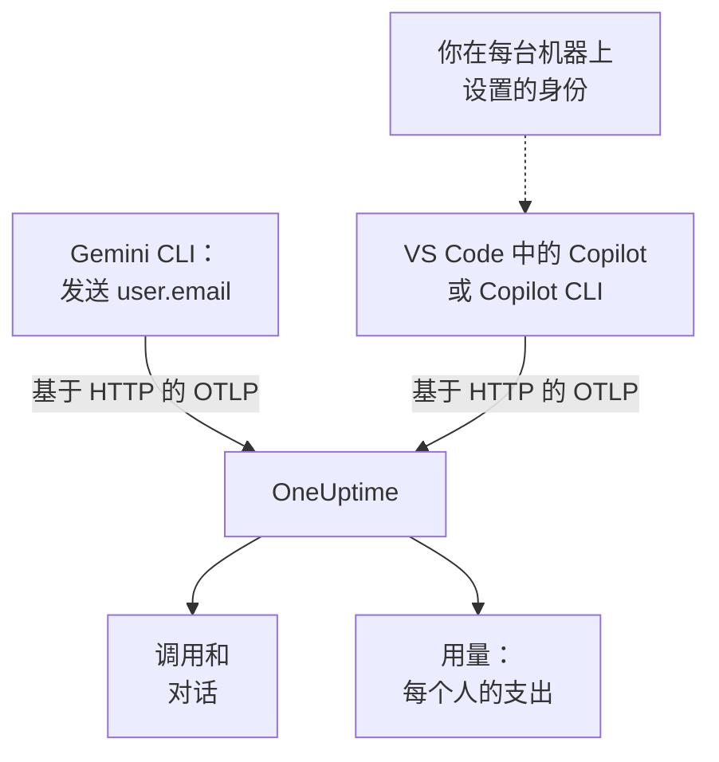

# Gemini CLI 与 GitHub Copilot

Gemini CLI 和 GitHub Copilot 都能自己导出 OpenTelemetry：把它们指向 OneUptime，它们的模型调用、token、成本和工具调用就会到达 [AI / LLM](/docs/telemetry/ai-llm-observability)，与你自己应用的 AI 调用放在一起。两者在成本分摊最关心的一点上不同：Gemini CLI 在每条记录上都指明是谁，而 Copilot 谁也不指明，所以你需要自己为每位开发者署名。

:::cards
- [Gemini CLI](#设置-gemini-cli): 打开带跟踪的遥测，并直接发送到 OneUptime。
- [GitHub Copilot](#设置-github-copilot): 从 VS Code 或 Copilot CLI 导出。
- [为每位开发者署名](#为每位开发者署名): Copilot 没有提供的身份。
- [故障排除](#故障排除): 没有数据到达时要检查什么。
:::

## 工作原理



| | Gemini CLI | GitHub Copilot |
| --- | --- | --- |
| 发送 | 跟踪、指标和日志 | 跟踪、指标和事件，仅来自其代理功能 |
| 指明是谁 | 登录时为 `user.email` | 无：由你设置 `enduser.id` 和 `user.email` |
| 提示词文本 | 发送，除非你关闭 `logPrompts` | 不发送，除非你打开 `captureContent` |
| 默认发送到 | `http://localhost:4317`，通过 gRPC | `http://localhost:4318`，通过 HTTP |

## 开始之前

- 一个摄取密钥：打开 **项目设置 → 遥测与 APM → 摄取密钥** ，点击 **创建摄取密钥** 。
- 你的 OTLP 基础 URL：`https://oneuptime.com/otlp`，如果你自托管 OneUptime，则为 `https://YOUR-ONEUPTIME-HOST/otlp`。
- 密钥通过每个导出请求的 `x-oneuptime-token` 标头传递。

## 设置 Gemini CLI

Gemini CLI 会发送跟踪、指标和日志事件，并在有人登录时在每条记录上加上 `user.email`。OneUptime 把 `user.email` 读作员工，所以无需映射表、也无需逐台机器设置，就能看到每个人的支出。

:::steps
### 打开遥测

在每台机器的用户设置文件中，或在仓库的 `.gemini/settings.json` 中添加一个 `telemetry` 块：

```json title="~/.gemini/settings.json"
{
  "telemetry": {
    "enabled": true,
    "target": "local",
    "otlpEndpoint": "https://oneuptime.com/otlp",
    "otlpProtocol": "http",
    "otlpHeaders": {
      "x-oneuptime-token": "YOUR_INGESTION_TOKEN"
    },
    "traces": true,
    "logPrompts": false
  }
}
```

### 开始新的会话

Gemini CLI 在启动时读取设置，所以请重新启动它并运行一个提示词。

### 检查数据是否到达

打开 **产品 → AI / LLM → 调用** ：调用会列在服务 `gemini-cli` 下，并带有模型和 token。
:::

这个块中有三项设置比其他的更重要：

- `otlpProtocol: "http"`。除非另行指定，Gemini CLI 使用 gRPC。通过 HTTP 时，它会自己在基础 URL 后加上 `/v1/traces`、`/v1/metrics` 和 `/v1/logs`。OneUptime 也在 443 端口接受 gRPC（参见 [基于 gRPC 的 OTLP](/docs/telemetry/open-telemetry#基于-grpc-的-otlp)），但 HTTP 更简单。
- `traces: true`。它默认关闭，没有它，Gemini CLI 的 span 既不带模型也不带 token 计数，就无法计价。Gemini CLI 也不发送成本指标：要看到它的调用花了多少钱，请打开跟踪。
- `logPrompts: false`。请阅读下面的警告。

> [!WARNING]
> `logPrompts` 默认为 `true`，所以一打开遥测，就会发送工程师输入的文本：其中常常有源代码、客户数据和粘贴进来的凭据。请在打开遥测的同一次修改中把它设为 `false`。如果你需要提示词来调试，请有意识地作出决定，并用 **跟踪 → 设置** 下的清理规则遮盖必须遮盖的内容。

### 面向大量机器的设置

每项设置都有一个环境变量，而且环境变量优先于仓库中的 `.gemini/settings.json`，因此它们适合用来承载通过 MDM 推送的统一策略：

```bash
export GEMINI_TELEMETRY_ENABLED=true
export GEMINI_TELEMETRY_TARGET=local
export GEMINI_TELEMETRY_OTLP_ENDPOINT="https://oneuptime.com/otlp"
export GEMINI_TELEMETRY_OTLP_PROTOCOL=http
export GEMINI_TELEMETRY_OTLP_HEADERS="x-oneuptime-token=YOUR_INGESTION_TOKEN"
export GEMINI_TELEMETRY_TRACES_ENABLED=true
export GEMINI_TELEMETRY_LOG_PROMPTS=false
```

| 设置 | 变量 | 默认值 | 作用 |
| --- | --- | --- | --- |
| `enabled` | `GEMINI_TELEMETRY_ENABLED` | `false` | 打开遥测 |
| `target` | `GEMINI_TELEMETRY_TARGET` | `local` | `local` 发送到你设置的端点；`gcp` 发送到 Google Cloud |
| `otlpEndpoint` | `GEMINI_TELEMETRY_OTLP_ENDPOINT` | `http://localhost:4317` | 遥测发往何处 |
| `otlpProtocol` | `GEMINI_TELEMETRY_OTLP_PROTOCOL` | `grpc` | `grpc` 或 `http` |
| `otlpHeaders` | `GEMINI_TELEMETRY_OTLP_HEADERS` | 无 | 每次导出携带的标头：文件中为对象，变量中为 `key=value` 对或 JSON |
| `traces` | `GEMINI_TELEMETRY_TRACES_ENABLED` | `false` | 把模型、token 和负载放到 span 上 |
| `logPrompts` | `GEMINI_TELEMETRY_LOG_PROMPTS` | `true` | 把提示词文本放进日志事件 |
| `outfile` | `GEMINI_TELEMETRY_OUTFILE` | 无 | 改为把遥测写入文件，以查看将会发送什么 |

命令行标志优先于 `GEMINI_TELEMETRY_*` 变量，后者优先于标准的 `OTEL_EXPORTER_OTLP_*` 变量，再后者优先于 `settings.json`。Gemini CLI 也会读取 `OTEL_EXPORTER_OTLP_HEADERS`，所以你已经为其他工具设置的标头也会传给它。

:::details 改为通过 OpenTelemetry Collector 发送
每台机器上一个收集器，或每个团队一个，可以在遥测到达 OneUptime 之前进行批处理、重试和路由。让 Gemini CLI 保持默认设置（通过 gRPC 发送到 `http://localhost:4317`），由收集器添加密钥：

```yaml title="otel-collector-config.yaml"
receivers:
  otlp:
    protocols:
      grpc:
        endpoint: 0.0.0.0:4317
      http:
        endpoint: 0.0.0.0:4318

exporters:
  otlphttp:
    endpoint: "https://oneuptime.com/otlp"
    headers:
      "x-oneuptime-token": "YOUR_INGESTION_TOKEN"

service:
  pipelines:
    traces:
      receivers: [otlp]
      exporters: [otlphttp]
    metrics:
      receivers: [otlp]
      exporters: [otlphttp]
    logs:
      receivers: [otlp]
      exporters: [otlphttp]
```

运行收集器的方法请参阅 [OpenTelemetry](/docs/telemetry/open-telemetry)。
:::

### Gemini CLI 发送的内容

| 指标 | 携带的内容 |
| --- | --- |
| `gen_ai.client.token.usage` | 输入和输出 token：OneUptime 计数的序列 |
| `gemini_cli.token.usage` | 以 Gemini CLI 自己的名称记录的相同 token，外加它的 `thought`、`cache` 和 `tool` token；不计数，以免 token 被重复计算 |
| `gen_ai.client.operation.duration` | 每次模型调用耗时多久 |
| `gemini_cli.api.request.count` | 模型调用 |
| `gemini_cli.tool.call.count` | 工具调用 |
| `gemini_cli.session.count` | 启动的会话 |
| `gemini_cli.lines.changed` | 代理修改的行数 |

它的日志事件包括 `gemini_cli.user_prompt`、`gemini_cli.api_request`、`gemini_cli.api_response`、`gemini_cli.api_error`、`gemini_cli.tool_call` 和 `gemini_cli.file_operation`。每条记录都带有 `session.id`、`installation.id`、`active_approval_mode`，有人登录时还带有 `user.email`。OneUptime 把 `session.id` 读作对话 ID，所以无论一个 Gemini CLI 会话用了多少条跟踪，它都会在 **对话** 下显示为一段对话。

这些指标是普通的 OpenTelemetry 指标：你可以把其中任何一个绘制到仪表板上，或用 [指标监控](/docs/monitor/metrics-monitor) 针对它发出警报。

## 设置 GitHub Copilot

GitHub 只为 Copilot 的代理功能记录了 OpenTelemetry：

| 功能 | 发送 OpenTelemetry |
| --- | --- |
| VS Code 中的 Copilot Chat 和代理模式 | 是 |
| Copilot CLI | 是 |
| Copilot SDK | 是 |
| JetBrains IDE 中的代理工作流 | 是，在 Copilot 插件的设置中配置 |
| 行内补全、github.com 上的 Copilot、Copilot 代码审查 | 未记录 |

所以一个主要使用行内补全的团队，无论导出怎么设置，在 OneUptime 中看起来都像是没有活动。

:::tabs
@tab VS Code
```json title="settings.json"
{
  "github.copilot.chat.otel.enabled": true,
  "github.copilot.chat.otel.exporterType": "otlp-http",
  "github.copilot.chat.otel.otlpEndpoint": "https://oneuptime.com/otlp",
  "github.copilot.chat.otel.captureContent": false
}
```
@tab Copilot CLI
```bash
export COPILOT_OTEL_ENABLED=true
export OTEL_EXPORTER_OTLP_ENDPOINT="https://oneuptime.com/otlp"
export OTEL_EXPORTER_OTLP_HEADERS="x-oneuptime-token=YOUR_INGESTION_TOKEN"
```
@tab 托管设置
```json
{
  "telemetry": {
    "enabled": true,
    "endpoint": "https://oneuptime.com/otlp",
    "protocol": "http/protobuf",
    "serviceName": "github-copilot",
    "captureContent": false,
    "lockCaptureContent": true,
    "headers": {
      "x-oneuptime-token": "YOUR_INGESTION_TOKEN"
    }
  }
}
```
:::

- VS Code 的设置中没有用于标头的键：请像 Copilot CLI 一样，在 VS Code 启动时所在的环境中设置 `OTEL_EXPORTER_OTLP_HEADERS`。环境变量优先于 VS Code 的设置。
- 托管设置由企业推送到 VS Code 和 Copilot CLI，它在 `headers` 中携带密钥，并且优先于每位开发者自己的设置。`lockCaptureContent` 会让所有人的提示词采集保持关闭。那里的 `protocol` 是传输格式，`http/protobuf` 或 `http/json`。
- `captureContent` 默认关闭，所以除非你打开它，否则不会发送提示词和回答。

## 为每位开发者署名

Copilot 不发送 OneUptime 可以使用的身份。它的 `captureIdentity` 设置会添加 `user.name`，Copilot CLI 可能会添加 `enduser.pseudo.id`，但 OneUptime 都不会把它们读作员工。没有身份时，Copilot 的全部支出都会落在 **用量** 标签页上的一行 **未归属** 中。

请在每台机器上，在 VS Code 和 Copilot CLI 启动时所在的环境中设置身份：可以是 shell 配置文件，也可以是你的 MDM 运行的脚本。

```bash
export OTEL_RESOURCE_ATTRIBUTES="enduser.id=alice@example.com,user.email=alice@example.com,team.id=platform,cost_center=eng-tools"
```

| 属性 | OneUptime 将其读作 |
| --- | --- |
| `enduser.id` | 员工的 ID |
| `user.email` | 员工的邮箱：**用量** 标签页显示的名称 |
| `team.id`、`team`、`cost_center`、`department` | 团队或成本中心 |

这些是资源属性，所以它们会以 `resource.enduser.id`、`resource.user.email` 等形式到达：OneUptime 读取每个身份和团队键时，带不带 `resource.` 前缀都可以。Gemini CLI 已经会发送 `user.email`；只需为团队给它设置 `OTEL_RESOURCE_ATTRIBUTES`。

- 请在第一次调用之前设置身份：没有身份到达的调用，事后无法归属。
- 不要在 Copilot 的托管设置中设置 `resourceAttributes`：它们优先于 `OTEL_RESOURCE_ATTRIBUTES`，会替换你在每台机器上设置的身份。
- 不要使用 `gen_ai.user` 或 `llm.user`。在为客户提供服务的应用中，它们指的是客户，所以 OneUptime 永远不会把它们读作员工。

## Copilot 的数据是什么样子

Copilot 遵循 OpenTelemetry GenAI 约定，所以它的调用会像你自己应用的调用一样出现在 **调用**、**对话** 和 **用量** 中。

| Span | 每个对应 |
| --- | --- |
| `invoke_agent` | 一轮代理交互 |
| `chat` | 一次模型调用 |
| `execute_tool` | 一次工具调用 |
| `execute_hook` | 一次钩子运行 |

它的 span 带有模型、`gen_ai.usage.input_tokens`、`gen_ai.usage.output_tokens` 和 `gen_ai.conversation.id`，所以一整轮代理交互会显示为一段对话。两种功能还都会发送 `gen_ai.client.token.usage` 和 `gen_ai.client.operation.duration` 指标，并在 OTLP 日志信号上发送事件：在你放在中间的任何收集器中，请保留一个 `logs` 管道。

OneUptime 根据每次调用的模型和 token，按 **定价** 下的费率为它计价。这是这些 token 按标价计算的花费，而不是 GitHub 向你收取的费用：Copilot 按席位和高级请求计费。

席位、席位活动和高级请求计费完全不在 OpenTelemetry 中：它们在 GitHub 的 REST API 中，而 OneUptime 不读取该 API。席位和账单数据请从 GitHub 获取。

## 故障排除

:::details Gemini CLI 没有任何数据到达
常见原因是端点是 HTTP URL，而 `otlpProtocol` 仍是默认的 `grpc`。请把 `otlpProtocol` 设为 `http`，并检查 `otlpEndpoint` 是否是以 `/otlp` 结尾的基础 URL，以及是否设置了 `x-oneuptime-token` 标头。暂时设置 `outfile`，可以查看 Gemini CLI 会发送什么。
:::

:::details Gemini CLI 的调用到达了，但没有模型、token 或成本
`traces` 处于关闭状态。请打开它：没有它，Gemini CLI 的 span 既不带模型也不带 token 计数，它也不发送成本指标。
:::

:::details Copilot 的支出显示为未归属
身份没有到达导出器。请检查 `OTEL_RESOURCE_ATTRIBUTES` 是否设置在 VS Code 或 Copilot CLI 启动时所在的环境中，以及 Copilot 的托管设置是否设置了会替换它的 `resourceAttributes`。
:::

:::details Copilot 完全没有发送任何数据
请检查你预期的那些人使用的是代理功能而不是行内补全，以及 `OTEL_EXPORTER_OTLP_HEADERS` 是否携带了密钥：VS Code 自己的设置做不到这一点。
:::

:::details 密钥被拒绝
密钥缺失、未知或已过期时，OneUptime 返回 `401`；密钥已停用或是浏览器密钥时，返回 `422`。请使用服务器密钥，并通过 `x-oneuptime-token` 发送。
:::

## 后续步骤

:::cards
- [AI 编程助手](/docs/telemetry/ai-coding-assistants): 谁在用哪个工具，以及每个人和每个团队的花费。
- [AI / LLM 可观测性](/docs/telemetry/ai-llm-observability): OneUptime 读取的属性、成本的计算方式，以及每日预算。
- [AI 网关](/docs/telemetry/ai-gateways): 通过网关接入没有自己导出功能的工具。
:::
