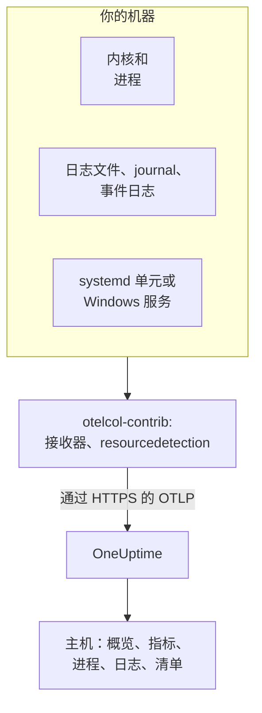

# 主机 OpenTelemetry Collector

在 Linux、macOS 或 Windows 机器上运行 OpenTelemetry Collector，把机器的指标、进程、日志和服务状态发送到 OneUptime。机器会出现在 **产品 → 基础设施 → 主机** 下，并拥有自己的页面，无需安装任何 OneUptime 代理：Collector 就是上游的 `otelcol-contrib` 发行版。[主机监控](/docs/monitor/host-monitor) 会根据它发送的数据发出警报。

:::cards
- [安装 Collector](#安装-collector): 在 Linux、macOS 或 Windows 上只需三步。
- [选择要采集的内容](#选择要采集的内容): 指标、文件日志、journal、事件日志和服务状态。
- [清单属性](#清单属性ipmac序列号厂商型号固件): 供 CMDB 使用的 IP、MAC、序列号、厂商、型号和固件。
- [减少发送量](#减少采集的数据量): 更少的日志行、更粗的间隔、更少的序列。
:::

## 工作原理

Collector 通过接收器读取机器，为每条记录打上机器的身份标识，并使用你的摄取密钥通过 OTLP 发送到 OneUptime。OneUptime 根据第一批指标注册主机，并在数据到达时填充它的页面。



| 你在主机上看到的内容 | 来源 |
| --- | --- |
| **概览** 和 **指标** | `hostmetrics` 接收器：CPU、内存、磁盘、文件系统、网络、负载、分页。 |
| **进程** | `hostmetrics` 的 `process` 抓取器：每个进程一组序列。 |
| **日志** | `filelog`、`journald` 和 `windowseventlog` 接收器。 |
| **Systemd Units**（Linux） | `systemd` 接收器。 |
| **服务**（Windows） | `windows_service` 接收器。 |
| 清单项 | `resourcedetection` 处理器，以及 [你自行打上的属性](#清单属性ipmac序列号厂商型号固件)。 |
| **代理版本** | `resource` 处理器中的 `oneuptime.agent.version`。 |

当一个携带 `host.name` 的批次同时携带 `hostmetrics` 或 `process` 指标，或 `os.type` 属性时，主机就会被注册。`resourcedetection` 处理器会设置所有这些属性，所以每份配置都把它放在第一位。仅有 `host.id` 或 `host.arch` 不会注册主机；携带 Kubernetes 身份（`k8s.cluster.name`、`k8s.node.name`、`k8s.pod.name`）的遥测会改为归入其集群：请使用 [Kubernetes 代理](/docs/telemetry/kubernetes-agent) 监视 Kubernetes 节点。

## 开始之前

- 一个摄取密钥。在 **项目设置 → 遥测与 APM → 摄取密钥** 下创建一个并复制其值。Collector 会将其作为 `x-oneuptime-token` 标头发送。
- 机器上的管理员权限：Linux 和 macOS 上的 `sudo`，Windows 上以管理员身份运行的 PowerShell。
- 从机器到你的 OneUptime URL 的出站 HTTPS。
- Collector 的 contrib 发行版 `otelcol-contrib`。核心 `otelcol` 构建缺少这些配置使用的接收器和处理器。`systemd` 接收器（Linux）从 v0.143.0 起可用，`windows_service` 接收器（Windows）从 v0.155.0 起可用；下面的命令会安装 v0.161.0，即 OneUptime 固定的版本。

## 安装 Collector

:::steps
### 保存配置

将以下内容保存为 `config.yaml`，放在你将运行安装命令的文件夹中，并把 `YOUR_TELEMETRY_INGESTION_TOKEN` 替换为你的摄取密钥（如果你自托管，还要把端点替换为你自己的 URL）。

:::tabs
@tab Linux
```yaml title="config.yaml"
receivers:
  hostmetrics:
    collection_interval: 30s
    scrapers:
      cpu:
        metrics:
          system.cpu.utilization:
            enabled: true
          system.cpu.logical.count:
            enabled: true
      memory:
        metrics:
          system.memory.utilization:
            enabled: true
      disk:
      filesystem:
        metrics:
          system.filesystem.utilization:
            enabled: true
      load:
      network:
      paging:
      processes:
      process:
        mute_process_name_error: true
        mute_process_exe_error: true
        mute_process_io_error: true
        metrics:
          process.cpu.utilization:
            enabled: true
          process.memory.utilization:
            enabled: true

  # The systemd journal: every unit's logs, info and above.
  journald:
    directory: /var/log/journal
    priority: info

  # Powers the Systemd Units tab (otelcol-contrib v0.143.0+).
  systemd:
    collection_interval: 30s
    units: ["*.service"]
    metrics:
      systemd.service.cpu.time:
        enabled: false

processors:
  # Stamps host.name, host.id and os.type: this is how OneUptime attaches
  # telemetry to the host. Without it the host's pages stay empty.
  resourcedetection:
    detectors: [system, env]
    system:
      hostname_sources: [os]
      resource_attributes:
        host.name:
          enabled: true
        host.id:
          enabled: true
        host.arch:
          enabled: true
        host.ip:
          enabled: true
        host.mac:
          enabled: true
        os.type:
          enabled: true
        os.description:
          enabled: true
        os.version:
          enabled: true
  # The collector release this config is for: the host's Agent Version.
  resource:
    attributes:
      - key: oneuptime.agent.version
        value: "0.161.0"
        action: upsert
  batch:

exporters:
  otlphttp/oneuptime:
    endpoint: https://oneuptime.com/otlp
    headers:
      x-oneuptime-token: YOUR_TELEMETRY_INGESTION_TOKEN

service:
  pipelines:
    metrics:
      receivers: [hostmetrics, systemd]
      processors: [resourcedetection, resource, batch]
      exporters: [otlphttp/oneuptime]
    logs:
      receivers: [journald]
      processors: [resourcedetection, resource, batch]
      exporters: [otlphttp/oneuptime]
```
@tab macOS
```yaml title="config.yaml"
receivers:
  hostmetrics:
    collection_interval: 30s
    scrapers:
      cpu:
        metrics:
          system.cpu.utilization:
            enabled: true
          system.cpu.logical.count:
            enabled: true
      memory:
        metrics:
          system.memory.utilization:
            enabled: true
      disk:
      filesystem:
        metrics:
          system.filesystem.utilization:
            enabled: true
      load:
      network:
      paging:
      processes:
      process:
        mute_process_name_error: true
        mute_process_exe_error: true
        mute_process_io_error: true
        metrics:
          process.cpu.utilization:
            enabled: true
          process.memory.utilization:
            enabled: true

  filelog/system:
    include:
      - /var/log/install.log
      - /var/log/wifi.log
    start_at: end

processors:
  # Stamps host.name, host.id and os.type: this is how OneUptime attaches
  # telemetry to the host. Without it the host's pages stay empty.
  resourcedetection:
    detectors: [system, env]
    system:
      hostname_sources: [os]
      resource_attributes:
        host.name:
          enabled: true
        host.id:
          enabled: true
        host.arch:
          enabled: true
        host.ip:
          enabled: true
        host.mac:
          enabled: true
        os.type:
          enabled: true
        os.description:
          enabled: true
        os.version:
          enabled: true
  # The collector release this config is for: the host's Agent Version.
  resource:
    attributes:
      - key: oneuptime.agent.version
        value: "0.161.0"
        action: upsert
  batch:

exporters:
  otlphttp/oneuptime:
    endpoint: https://oneuptime.com/otlp
    headers:
      x-oneuptime-token: YOUR_TELEMETRY_INGESTION_TOKEN

service:
  pipelines:
    metrics:
      receivers: [hostmetrics]
      processors: [resourcedetection, resource, batch]
      exporters: [otlphttp/oneuptime]
    logs:
      receivers: [filelog/system]
      processors: [resourcedetection, resource, batch]
      exporters: [otlphttp/oneuptime]
```
@tab Windows
```yaml title="config.yaml"
receivers:
  hostmetrics:
    collection_interval: 30s
    scrapers:
      cpu:
        metrics:
          system.cpu.utilization:
            enabled: true
          system.cpu.logical.count:
            enabled: true
      memory:
        metrics:
          system.memory.utilization:
            enabled: true
      disk:
      filesystem:
        metrics:
          system.filesystem.utilization:
            enabled: true
      load:
      network:
      paging:
      processes:
      process:
        mute_process_name_error: true
        mute_process_exe_error: true
        mute_process_io_error: true
        metrics:
          process.cpu.utilization:
            enabled: true
          process.memory.utilization:
            enabled: true

  windowseventlog/system:
    channel: System
    start_at: end

  windowseventlog/application:
    channel: Application
    start_at: end

  windowseventlog/security:
    channel: Security
    start_at: end

  # Powers the Services tab (otelcol-contrib v0.155.0+).
  windows_service:
    collection_interval: 30s

processors:
  # Stamps host.name, host.id and os.type: this is how OneUptime attaches
  # telemetry to the host. Without it the host's pages stay empty.
  resourcedetection:
    detectors: [system, env]
    system:
      hostname_sources: [os]
      resource_attributes:
        host.name:
          enabled: true
        host.id:
          enabled: true
        host.arch:
          enabled: true
        host.ip:
          enabled: true
        host.mac:
          enabled: true
        os.type:
          enabled: true
        os.description:
          enabled: true
        os.version:
          enabled: true
  # The collector release this config is for: the host's Agent Version.
  resource:
    attributes:
      - key: oneuptime.agent.version
        value: "0.161.0"
        action: upsert
  batch:

exporters:
  otlphttp/oneuptime:
    endpoint: https://oneuptime.com/otlp
    headers:
      x-oneuptime-token: YOUR_TELEMETRY_INGESTION_TOKEN

service:
  pipelines:
    metrics:
      receivers: [hostmetrics, windows_service]
      processors: [resourcedetection, resource, batch]
      exporters: [otlphttp/oneuptime]
    logs:
      receivers:
        - windowseventlog/system
        - windowseventlog/application
        - windowseventlog/security
      processors: [resourcedetection, resource, batch]
      exporters: [otlphttp/oneuptime]
```
:::

每份配置都是仪表板在 **产品 → 基础设施 → 主机 → 文档** 下写出的那份，另外加了一条日志管道：处理器为 `resourcedetection`、`resource` 和 `batch`，导出器为 `otlphttp/oneuptime`。它没有设置 `service.name`，因此主机的遥测属于主机本身，归档为 `host/<hostname>`。只有当你希望它改为归入同名的遥测服务时，才在 `resource` 处理器中添加 `service.name`。

### 安装并启动 Collector

:::tabs
@tab Linux
在 Debian 或 Ubuntu 上：

```bash
VERSION=0.161.0                      # the release OneUptime pins
ARCH=$(dpkg --print-architecture)   # amd64 or arm64

curl -fL -o /tmp/otelcol-contrib.deb \
  "https://github.com/open-telemetry/opentelemetry-collector-releases/releases/download/v${VERSION}/otelcol-contrib_${VERSION}_linux_${ARCH}.deb"
sudo dpkg -i /tmp/otelcol-contrib.deb
```

在 RHEL、CentOS、Fedora 或 Amazon Linux 上：

```bash
VERSION=0.161.0
ARCH=$(uname -m | sed 's/x86_64/amd64/;s/aarch64/arm64/')

curl -fL -o /tmp/otelcol-contrib.rpm \
  "https://github.com/open-telemetry/opentelemetry-collector-releases/releases/download/v${VERSION}/otelcol-contrib_${VERSION}_linux_${ARCH}.rpm"
sudo rpm -Uvh /tmp/otelcol-contrib.rpm
```

软件包会安装 `/usr/bin/otelcol-contrib` 和一个 systemd 单元，并使用默认配置启动它。放入你的配置，让 Collector 的用户能够读取 journal，然后重启：

```bash
sudo install -m 0644 config.yaml /etc/otelcol-contrib/config.yaml
sudo usermod -aG systemd-journal otelcol-contrib
sudo systemctl enable otelcol-contrib
sudo systemctl restart otelcol-contrib
sudo systemctl status otelcol-contrib
```

打包的单元以非特权的 `otelcol-contrib` 用户运行 Collector。`systemd-journal` 组使其能够读取 journal；要跟踪 `/var/log` 中的文件（在 Debian 和 Ubuntu 上可由 `adm` 组读取），也要加入该组。要让 `process` 抓取器看到其他用户的进程，请为它授予 `CAP_SYS_PTRACE` 能力。
@tab macOS
```bash
VERSION=0.161.0
ARCH=$(uname -m | sed 's/x86_64/amd64/')   # arm64 on Apple silicon, amd64 on Intel

curl -fL -o /tmp/otelcol-contrib.tar.gz \
  "https://github.com/open-telemetry/opentelemetry-collector-releases/releases/download/v${VERSION}/otelcol-contrib_${VERSION}_darwin_${ARCH}.tar.gz"

sudo mkdir -p /usr/local/otelcol-contrib /usr/local/bin /etc/otelcol-contrib
sudo tar -xzf /tmp/otelcol-contrib.tar.gz -C /usr/local/otelcol-contrib
sudo ln -sf /usr/local/otelcol-contrib/otelcol-contrib /usr/local/bin/otelcol-contrib
sudo install -m 0644 config.yaml /etc/otelcol-contrib/config.yaml
```

创建 `/Library/LaunchDaemons/com.oneuptime.otelcol-contrib.plist`，让 launchd 随 Mac 启动 Collector，并在其停止时重新启动：

```xml title="/Library/LaunchDaemons/com.oneuptime.otelcol-contrib.plist"
<?xml version="1.0" encoding="UTF-8"?>
<!DOCTYPE plist PUBLIC "-//Apple//DTD PLIST 1.0//EN" "http://www.apple.com/DTDs/PropertyList-1.0.dtd">
<plist version="1.0">
<dict>
  <key>Label</key><string>com.oneuptime.otelcol-contrib</string>
  <key>ProgramArguments</key>
  <array>
    <string>/usr/local/bin/otelcol-contrib</string>
    <string>--config=/etc/otelcol-contrib/config.yaml</string>
  </array>
  <key>RunAtLoad</key><true/>
  <key>KeepAlive</key><true/>
  <key>StandardOutPath</key><string>/var/log/otelcol-contrib.out.log</string>
  <key>StandardErrorPath</key><string>/var/log/otelcol-contrib.err.log</string>
</dict>
</plist>
```

加载它：

```bash
sudo launchctl load -w /Library/LaunchDaemons/com.oneuptime.otelcol-contrib.plist
sudo launchctl list | grep otelcol-contrib
```

请使用这个 tarball，而不是 Homebrew：Homebrew 公式是核心构建，使用此配置时会拒绝启动。
@tab Windows
在以管理员身份运行的 PowerShell 中，在包含 `config.yaml` 的文件夹里整体运行这段代码：每一行都依赖于其上方的变量。

```powershell
$VERSION = "0.161.0"                          # the release OneUptime pins; v0.155.0+ has the Services tab
$ARCH    = "amd64"                            # use "arm64" on ARM hosts
$dest    = "C:\Program Files\otelcol-contrib"
$tar     = "$env:TEMP\otelcol-contrib.tar.gz"

# Note the "-contrib" in the asset name; otelcol_... is the wrong archive.
$url = "https://github.com/open-telemetry/opentelemetry-collector-releases/releases/download/v$VERSION/otelcol-contrib_${VERSION}_windows_${ARCH}.tar.gz"

New-Item -ItemType Directory -Force -Path $dest | Out-Null
Invoke-WebRequest -Uri $url -OutFile $tar
tar -xf $tar -C $dest                          # tar.exe ships with Windows 10 1803+ / Server 2019+
Get-ChildItem $dest                            # expect otelcol-contrib.exe, not otelcol.exe
Copy-Item config.yaml "$dest\config.yaml" -Force

# --% hands the rest of the line to sc.exe unchanged, so its quoting
# survives PowerShell — keep the command on one line.
sc.exe --% create "otelcol-contrib" binPath= "\"C:\Program Files\otelcol-contrib\otelcol-contrib.exe\" --config=\"C:\Program Files\otelcol-contrib\config.yaml\"" start= auto DisplayName= "OpenTelemetry Collector (OneUptime)"
sc.exe description "otelcol-contrib" "Collects host telemetry and forwards it to OneUptime over OTLP."
sc.exe start "otelcol-contrib"
sc.exe query "otelcol-contrib"
```

该服务以 `LocalSystem` 运行，可以读取 `Security` 事件日志和所有 Windows 服务。在 Windows 上，`load` 抓取器只是根据 *Processor Queue Length* 计数器模拟负载平均值，从 0 开始。

资产名称必须以 `otelcol-contrib_` 开头。核心的 `otelcol_<version>_windows_amd64.tar.gz` 归档会解压出 `otelcol.exe`，它没有 `windowseventlog` 或 `windows_service` 接收器；把它重命名为 `otelcol-contrib.exe` 也不会添加这些接收器。更喜欢安装程序？同一个 [发布页面](https://github.com/open-telemetry/opentelemetry-collector-releases/releases) 提供已签名的 `otelcol-contrib_<version>_windows_x64.msi`，它会为你注册服务：将它指向这个 `config.yaml`，并让服务保持使用 `LocalSystem`。
:::

### 检查主机是否出现

打开 **产品 → 基础设施 → 主机 → 所有主机**。第一批指标到达后（通常在 30 秒内），主机会以其主机名出现，其 **概览**、**指标**、**进程** 和 **日志** 页面也会填充。如果没有出现，请查看 Collector 自身的日志：

:::tabs
@tab Linux
```bash
sudo journalctl -u otelcol-contrib -f
```
@tab macOS
```bash
tail -f /var/log/otelcol-contrib.err.log
```
@tab Windows
```powershell
Get-WinEvent -LogName Application -MaxEvents 20 | Where-Object ProviderName -eq "otelcol-contrib"
```
:::
:::

要生成一条测试日志，请运行 `logger "hello from oneuptime"`（Linux、macOS）或 `eventcreate /T INFORMATION /ID 999 /L APPLICATION /SO OneUptimeTest /D "hello from oneuptime"`（Windows，管理员权限），然后查看主机的 **日志** 页面。

## 选择要采集的内容

每份配置的结构都相同：用于读取内容的接收器，`resourcedetection`、`resource` 和 `batch` 处理器，以及 `otlphttp/oneuptime` 导出器。将下面的接收器添加到 `receivers:` 及其管道中，然后重启 Collector（`sudo systemctl restart otelcol-contrib`；在 Mac 上先 `launchctl unload` 再 `load`；在 Windows 上 `Restart-Service otelcol-contrib`）。把每个片段合并到你的配置已有的部分中：第二个 `processors:` 或 `service:` 键会替换第一个。

### 主机指标

`hostmetrics` 适用于所有操作系统。它每隔 `collection_interval` 从内核读取 CPU、内存、磁盘、文件系统、网络、负载、分页和进程。`*.utilization` 指标和 `system.cpu.logical.count` 在接收器中默认关闭，而主机的图表和 Host 警报模板会读取它们，所以请像上面的配置那样保持启用。`process` 抓取器为 **进程** 页面提供数据；它也是序列的最大来源（见 [减少发送量](#减少采集的数据量)）。

在 Linux 上，Collector 读取 `/proc` 和 `/sys`。容器中的 Collector 必须挂载主机的这两个目录并设置 `HOST_PROC` 和 `HOST_SYS`（见 [在 Docker 容器中](#在-docker-容器中)）；原生安装则什么都不需要。

### 文件日志

使用 `filelog` 接收器跟踪磁盘上的任何日志文件，并将其添加到 `logs` 管道：

```yaml
receivers:
  filelog/app:
    include:
      - /var/log/myapp/*.log
    start_at: end
    multiline:
      # A new entry starts with a timestamp; continuation lines (the
      # "at ...", "File ...", "Caused by: ..." frames) are folded into it.
      line_start_pattern: '^\d{4}-\d{2}-\d{2}[ T]\d{2}:\d{2}:\d{2}'
```

`start_at: end` 只读取新行；首次运行时若要从头读取文件，请使用 `beginning`。Collector 会记住在每个文件中的位置，因此重启后能正确继续。

OneUptime 会扫描 error 和 fatal 级别的日志行中的堆栈跟踪，并将它们分组为主机下的 **异常**。为此，多行堆栈跟踪（Java、Python、.NET、Ruby）必须作为一条记录到达，这正是 `multiline` 的作用；没有它，每一帧都会成为单独的一条日志。如果你的应用程序能够自行写入 OpenTelemetry 的 `exception.type`、`exception.message` 和 `exception.stacktrace` 属性，那就更加可靠。

在 systemd 主机上，`/var/log/syslog` 和 `/var/log/messages` 重复了 journal 中已有的内容，所以只读其中之一。

### systemd journal

在 systemd 主机上，`journald` 接收器在一个地方读取所有单元的日志，并带有它们的结构化字段。上面的 Linux 配置读取所有 `info` 及以上级别的日志；要缩小到部分单元：

```yaml
receivers:
  journald:
    directory: /var/log/journal
    units:
      # Drop this list to ingest everything; restrict it to limit volume.
      - ssh.service
      - cron.service
      - nginx.service
    priority: info
```

该接收器运行每台 systemd 主机都有的 `journalctl`，Collector 的用户必须属于 `systemd-journal` 组。

### Linux 服务（systemd 单元，指标）

主机的 **Systemd Units** 页面列出每个单元及其状态，数据来自 [`systemdreceiver`](https://github.com/open-telemetry/opentelemetry-collector-contrib/tree/main/receiver/systemdreceiver)（配置类型 `systemd`），它是 Windows 上 **服务** 页面在 Linux 上的对应物。上面的 Linux 配置会启用它：

```yaml
receivers:
  systemd:
    collection_interval: 30s
    # The service manager to read: "system" (default) or "user".
    scope: system
    # Which units to scrape, as systemctl unit patterns. The default is
    # every service; widen it to include timers, sockets or mounts, or
    # narrow it to cut volume on hosts with hundreds of units:
    units: ["*.service"]
    # units: [nginx.service, postgresql.service, "*.timer"]
    metrics:
      # Per-service CPU time is on by default and doubles this receiver's
      # datapoint count. The Systemd Units tab does not use it, so turn it
      # off unless you chart it. On v0.142.0 the key is
      # systemd.unit.cpu.time — naming a metric the running build does not
      # have stops the collector at startup.
      systemd.service.cpu.time:
        enabled: false

service:
  pipelines:
    metrics:
      receivers: [hostmetrics, systemd]
      processors: [resourcedetection, resource, batch]
```

该接收器首次随 `otelcol-contrib` v0.142.0 发布，而 v0.143.0 是第一个值得运行的版本。在更早的版本上，添加 `systemd` 会在启动时以 `'receivers' unknown type: "systemd"` 失败；唯独 v0.142.0 将其 CPU 指标命名为 `systemd.unit.cpu.time`，并在每个单元上查找 cgroup 统计信息，这会为每个非 `.service` 单元记录一个抓取错误。

它以状态集的形式发出 `systemd.unit.state`：每次抓取时，每个单元的每个可能状态（`active`、`reloading`、`inactive`、`failed`、`activating`、`deactivating`、`maintenance`、`refreshing`）各得到一个数据点，当前所处状态为 `1`，其余为 `0`。单元名称是资源属性 `systemd.unit.name`，状态是数据点属性 `systemd.unit.active_state`。由于单元名称是资源属性，`resourcedetection` 必须保留在指标管道中：它把 `host.name` 打到每个单元的资源上，没有它，样本永远不会关联到主机。

它通过系统 D-Bus，使用 `systemctl list-units` 所用的只读调用读取单元状态，systemd 允许非特权用户进行这些调用。因此，以 `otelcol-contrib` 用户（而非 root）运行的打包服务不需要额外权限。但它确实需要总线：容器中的 Collector 没有 `/run/dbus/system_bus_socket`，除非你挂载主机的套接字，所以请使用原生安装。该接收器处于 alpha 阶段，仅适用于 Linux。

> [!WARNING]
> 状态集在每次抓取时每个单元产生八个数据点，默认开启的 `systemd.service.cpu.time` 再加两个（`user` 和 `system`）：每次抓取每个单元 10 个数据点。一台每 30 秒跟踪 300 个单元的主机，仅这个接收器每分钟就会发送约 6,000 个数据点，关闭 CPU 指标后约为 4,800 个。在整个机群中启用之前，请先把 `units:` 缩小到你会针对其发出警报的服务，或调大 `collection_interval`。

### Apple Unified Log

macOS 把系统日志写入 Apple Unified Log（使用 `log show` 和 `log stream` 读取），而不是 `/var/log/system.log`。要采集它，请用一个小脚本 `/usr/local/otelcol-contrib/log-stream.sh` 将其流式写入文件：

```bash title="/usr/local/otelcol-contrib/log-stream.sh"
#!/bin/bash
exec /usr/bin/log stream --style ndjson --level info \
  --predicate 'subsystem != "com.apple.cfnetwork"' \
  >> /var/log/apple-unified.log
```

使其可执行，并在 launchd 下运行它（快速测试可用 `nohup`），然后让 `filelog` 接收器指向该文件：

```yaml
receivers:
  filelog/apple-unified:
    include:
      - /var/log/apple-unified.log
    start_at: end
    operators:
      - type: json_parser
        timestamp:
          parse_from: attributes.timestamp
          layout: "%Y-%m-%d %H:%M:%S.%f%j"
```

许多 Mac 机群只需主机指标和少量文件日志就够了，不需要统一日志。

### Windows 事件日志

上面的 Windows 配置订阅 `System`、`Application` 和 `Security` 通道。要把大流量的 `Security` 通道缩小到部分事件 ID：

```yaml
windowseventlog/security:
  channel: Security
  start_at: end
  query: "*[System[(EventID=4625 or EventID=4740)]]"
```

要读取其他通道（*Event Viewer → Applications and Services Logs* 下的任何通道），请使用其确切名称：

```yaml
windowseventlog/iis:
  channel: Microsoft-IIS-Logging/Logs
  start_at: end
```

### Windows 服务（指标）

主机的 **服务** 页面列出每个 Windows 服务及其状态和启动类型，数据来自 [`windowsservicereceiver`](https://github.com/open-telemetry/opentelemetry-collector-contrib/tree/main/receiver/windowsservicereceiver)（配置类型 `windows_service`）。它从 v0.155.0 起包含在 `otelcol-contrib` 中：在更早的版本上，添加 `windows_service` 会在启动时以 `'receivers' unknown type: "windows_service"` 失败。上面的 Windows 配置会启用它：

```yaml
receivers:
  windows_service:
    collection_interval: 30s
    # Collect every service by default. To cut volume — and avoid the
    # "access denied" noise from services the collector can't open —
    # list just the ones you care about:
    # include_services: [Spooler, W3SVC, MSSQLSERVER]
    # Or collect everything except a few:
    # exclude_services: [TrustedInstaller]

service:
  pipelines:
    metrics:
      receivers: [hostmetrics, windows_service]
```

它为每个服务发出一个 `windows.service.status` 仪表值，即 Win32 服务状态（`4` 表示运行中，`1` 表示已停止），带有 `name` 和 `startup_mode` 属性。Collector 以 `LocalSystem` 读取每个服务，并跳过无法打开的服务。该接收器处于 alpha 阶段，仅适用于 Windows；如果某个服务的抓取错误或 `access denied` 影响到其他服务，请用 `include_services` 加以限制。

`include_services` 只能缩小集合。如果你列出了服务却仍然看到所有服务，说明编辑后的配置没有到达正在运行的 Collector：请重启服务，检查 `include_services` 是否是与 `collection_interval` 同一缩进的非空列表，并给 **服务** 页面几分钟时间，直到更改前上报的服务离开其滚动窗口。名称是确切且区分大小写的服务键名（`Spooler`、`W3SVC`），可用 `Get-Service | Select-Object Name` 列出。

### 标签

任何以 `oneuptime.label.` 开头的资源属性都会成为主机上的项目标签：`oneuptime.label.<dimension>=<value>` 即标签 `<dimension>:<value>`。为它们添加一个处理器，并在管道中引用它：

```yaml
processors:
  resource/oneuptime-labels:
    attributes:
      - key: oneuptime.label.team
        value: payments
        action: upsert
      - key: oneuptime.label.env
        value: production
        action: upsert

service:
  pipelines:
    metrics:
      processors: [resourcedetection, resource, resource/oneuptime-labels, batch]
```

标签匹配不区分大小写，因此已有的 `Production` 标签会被复用而不是重复创建，在 OneUptime 中添加的标签也永远不会被 Collector 删除。

### 清单属性（IP、MAC、序列号、厂商、型号、固件）

每台主机还会得到一个清单项：CMDB 导出读取的记录。它的详情直接来自你发送的遥测上的资源属性，因此到达的内容就是 CMDB 同步能够拉取的内容。

| 你想要的信息 | 属性 | 来源 |
| --- | --- | --- |
| IP 地址 | `host.ip` | `resourcedetection`，机器有多个时以逗号连接 |
| MAC 地址 | `host.mac` | `resourcedetection`，每个已启用的接口一个，以逗号连接 |
| 架构 | `host.arch` | `resourcedetection` |
| 机器 ID | `host.id` | `resourcedetection`：Windows 上为机器 GUID，Linux 上为 `/etc/machine-id` |
| 操作系统 | `os.type`、`os.description`、`os.version` | `resourcedetection` |
| 序列号 | `host.serial_number` | 由你从 WMI 或 DMI 读取后打上 |
| 厂商 | `device.manufacturer` | 由你从 WMI 或 DMI 读取后打上 |
| 型号 | `device.model.name` | 由你从 WMI 或 DMI 读取后打上 |
| 固件（BIOS 或 UEFI）版本 | `device.firmware.version` | 由你从 WMI 或 DMI 读取后打上 |

上面的配置启用了所有可检测的属性：在 system 检测器中，默认只开启 `host.name` 和 `os.type`，这就是它们在 `resource_attributes` 下列出其他属性的原因。如果你自己编写配置，请保留这个 `resourcedetection` 块：没有它就没有 `host.name`，也就根本没有主机和清单项。

#### 序列号、厂商、型号和固件版本没有检测器

它们存放在机器的固件中，而 Collector 不读取固件。在 Linux 上，这也不是你能更改的设置：打包的 Collector 以非特权的 `otelcol-contrib` 用户运行，而 `/sys/class/dmi/id/product_serial` 只有 root 可读。因此，请在配置机器时读取一次，并用一个专门的处理器把它们打到资源上：

```yaml
processors:
  resource/oneuptime-hardware:
    attributes:
      - key: host.serial_number
        value: "7XYZ123"
        action: upsert
      - key: device.manufacturer
        value: "Dell Inc."
        action: upsert
      - key: device.model.name
        value: "OptiPlex 7090"
        action: upsert
      - key: device.firmware.version
        value: "1.21.0"
        action: upsert

service:
  pipelines:
    metrics:
      processors: [resourcedetection, resource, resource/oneuptime-hardware, batch]
```

把 `resource/oneuptime-hardware` 添加到你已有的处理器列表中，而不是把这一行粘贴覆盖原有的那行：去掉 `resource`，主机就会失去它的 **代理版本**。无论哪种方式，都要把 `resourcedetection` 放在第一位：正是它把批次关联到主机。

`host.manufacturer`、`host.model.name`、`host.firmware.version` 和 `host.bios.version` 也被接受为替代写法，并存储在上面的 `device.*` 键下，因此无论用哪种写法的配置都会落在同一处；两者都存在时，以 `device.*` 的值为准。序列号则相反：`device.serial_number` 会被接受并存储为 `host.serial_number`。

> [!NOTE]
> 在没有主机身份的资源上，`device.manufacturer` 表示“移动应用”：它是将批次标记为移动端真实用户监控的属性之一。主机的资源总是带有 `host.name` 或 `host.id`，因此像上面这样的 Collector 配置永远不会被误认为是手机，但不要在移动应用的 SDK 配置中重用同一个块。

#### 读取这些值

在 Windows 上，以管理员身份在 PowerShell 中运行。它会输出你运行所在机器的 YAML 块：

```powershell
$bios = Get-CimInstance -ClassName Win32_BIOS
$cs   = Get-CimInstance -ClassName Win32_ComputerSystem

# Quote for YAML: trim, escape any embedded quote, wrap in single quotes.
# The cast to string first is what keeps this working on machines whose
# firmware leaves a field empty — .Trim() on $null throws.
function Format-YamlValue($value) {
  "'" + ("$value".Trim() -replace "'", "''") + "'"
}

@"
  resource/oneuptime-hardware:
    attributes:
      - key: host.serial_number
        value: $(Format-YamlValue $bios.SerialNumber)
        action: upsert
      - key: device.manufacturer
        value: $(Format-YamlValue $cs.Manufacturer)
        action: upsert
      - key: device.model.name
        value: $(Format-YamlValue $cs.Model)
        action: upsert
      - key: device.firmware.version
        value: $(Format-YamlValue $bios.SMBIOSBIOSVersion)
        action: upsert
"@
```

它会输出一个已经缩进好的处理器条目：把它添加到你已有的 `processors:` 块中，而不是作为第二个 `processors:` 键。请使用 `Get-CimInstance`；已弃用的 `Get-WmiObject` 在 PowerShell 7 及更高版本中已不存在。固件留空的字段会输出为 `''`：请删除该属性，而不是发送空值。虚拟机通常根本没有序列号。

在 Linux 上，以 root 身份运行：

```bash
cat /sys/class/dmi/id/product_serial   # host.serial_number
cat /sys/class/dmi/id/sys_vendor       # device.manufacturer
cat /sys/class/dmi/id/product_name     # device.model.name
cat /sys/class/dmi/id/bios_version     # device.firmware.version
```

四项中只有 `bios_version` 任何用户都能读取。在没有 `/sys/class/dmi` 的机器上，`dmidecode -s system-serial-number`、`-s system-manufacturer`、`-s system-product-name` 和 `-s bios-version` 会返回相同的值。虚拟机会在这里报告其虚拟化管理程序（`QEMU`、`VMware, Inc.`、`Amazon EC2`），这通常正是你在 CMDB 中想要的。

在 Mac 上：

```bash
ioreg -l | awk -F'"' '/IOPlatformSerialNumber/{print $4}'   # host.serial_number
sysctl -n hw.model                                          # device.model.name
system_profiler SPHardwareDataType | awk -F': ' '/System Firmware Version/{print $2}'   # device.firmware.version
```

厂商是 `Apple Inc.`。`hw.model` 返回的是型号标识符，例如 `Mac14,7` 或 `MacBookPro18,3`，而不是营销名称，Mac 不会报告营销名称：如有需要，请在 CMDB 中映射该标识符。无论如何都把它放在 `device.model.name` 中：无论批次还带有什么，`device.model.identifier` 都会把它标记为移动应用，因此打上它的 Mac 会被归为手机并与其主机分离。

#### 改用环境变量

`env` 检测器已开启，因此可以用 `OTEL_RESOURCE_ATTRIBUTES` 代替处理器：

```text
OTEL_RESOURCE_ATTRIBUTES=host.serial_number=7XYZ123,device.manufacturer=Dell%20Inc.,device.model.name=OptiPlex%207090
```

对每个值进行百分号编码。该变量按 W3C Baggage 的 `key=value` 列表读取，其中 `,` 和 `=` 用于分隔条目，而空格在不同 Collector 版本之间不可移植；加引号也没有用，`device.manufacturer="Dell Inc."` 可能会连同引号一起作为值到达。在 Windows 上，`[System.Uri]::EscapeDataString($value)` 可以对值进行编码。

在 Collector 自己的服务上设置它，切勿在整台机器范围内设置：

- **Linux:** 运行 `sudo systemctl edit otelcol-contrib`，然后添加一个包含 `Environment="OTEL_RESOURCE_ATTRIBUTES=…"` 的 `[Service]` 部分。
- **Windows:** `HKLM\SYSTEM\CurrentControlSet\Services\otelcol-contrib` 下的 `Environment` 值（类型 `REG_MULTI_SZ`）。`sc.exe create` 无法设置服务环境变量，而 `setx` 设置的变量正在运行的服务永远不会再读取。

> [!WARNING]
> 不要在整台机器范围内设置它（`setx /M`、`/etc/environment`）。机器上的每个 OpenTelemetry SDK 进程都会继承 `OTEL_RESOURCE_ATTRIBUTES`，因此你的应用程序会把机器的 `device.manufacturer` 报告为自己的，而带有 `device.manufacturer` 却没有 `host.name` 或 `host.id` 的应用资源会被识别为移动应用，从而与其服务分离。

处理器更容易配置正确：它在设计上就只作用于 Collector，而且一台机器的这些值永远不会变化。除非你已经在用模板生成环境文件，否则请优先使用处理器。

#### MAC 地址不是手动打上的值

`host.mac` 与 `host.ip` 一样来自 `system` 检测器：每个已启用的网络接口一个地址（不含回环接口），采用 OpenTelemetry 规定的 IEEE 格式（`AC-DE-48-23-45-67`）。运行 Docker 或 Hyper-V 的机器也会报告其虚拟交换机，这就是该值是一个列表的原因。报告全零占位地址（`00-00-00-00-00-00`）的接口会被排除。

机器上没有任何东西会报告可升级到的固件版本，因此 OneUptime 记录的是已安装的版本。

#### 检查是否生效

在 **产品 → Inventory** 下打开主机的条目，查看其 **资产详情** 卡片。这些值会在下一批数据到达后几分钟内出现；Collector 尚未报告的详情会显示为未知，并附有返回本节的链接。由于它们是打上的而不是检测到的，所以不会自行更新：在更换主板、更新固件或重装系统后请重新打上。

## 运行 Collector 的其他方式

### 在 Docker 容器中

在包含 `config.yaml` 的文件夹中，在一个能看到主机进程和文件系统的容器里运行 Collector：

```bash
docker run -d \
  --name otel-collector \
  --restart unless-stopped \
  --network host \
  --pid host \
  -v $(pwd)/config.yaml:/etc/otelcol-contrib/config.yaml:ro \
  --volume /:/hostfs:ro,rslave \
  -e HOST_PROC=/hostfs/proc \
  -e HOST_SYS=/hostfs/sys \
  -e HOST_ETC=/hostfs/etc \
  -e HOST_VAR=/hostfs/var \
  -e HOST_RUN=/hostfs/run \
  -e HOST_DEV=/hostfs/dev \
  otel/opentelemetry-collector-contrib:0.161.0 \
  --config /etc/otelcol-contrib/config.yaml
```

`--network host`、`--pid host`、`/hostfs` 挂载以及 `HOST_*` 变量让 `hostmetrics` 和 `process` 读取主机的内核，而不是容器的。只使用配置中的指标管道：该镜像没有 `journalctl`，而 `systemd` 接收器需要主机的 D-Bus。

### 使用发布版 tarball

无法使用软件包时，解压静态二进制文件并为它创建一个专门的 systemd 单元：

```bash
VERSION=0.161.0
ARCH=$(uname -m | sed 's/x86_64/amd64/;s/aarch64/arm64/')

curl -fL -o /tmp/otelcol.tar.gz \
  "https://github.com/open-telemetry/opentelemetry-collector-releases/releases/download/v${VERSION}/otelcol-contrib_${VERSION}_linux_${ARCH}.tar.gz"
sudo mkdir -p /opt/otelcol-contrib
sudo tar -xzf /tmp/otelcol.tar.gz -C /opt/otelcol-contrib
sudo install -m 0644 config.yaml /opt/otelcol-contrib/config.yaml
```

```ini title="/etc/systemd/system/otelcol-contrib.service"
[Unit]
Description=OpenTelemetry Collector
After=network.target

[Service]
ExecStart=/opt/otelcol-contrib/otelcol-contrib --config /opt/otelcol-contrib/config.yaml
Restart=on-failure
RestartSec=5s
User=root

[Install]
WantedBy=multi-user.target
```

```bash
sudo systemctl daemon-reload
sudo systemctl enable --now otelcol-contrib
```

`User=root` 让这个单元能够读取每个日志文件和每个进程；上面的软件包安装是非特权的替代方案。

### 在 Kubernetes 节点上

Kubernetes 节点在 OneUptime 中不是主机：它们的遥测带有 Kubernetes 身份，会归入集群。请安装 [Kubernetes 代理](/docs/telemetry/kubernetes-agent)：每个节点都会出现在其集群的 **节点** 页面上，与它的 Pod 并列。

## 升级 Collector

本页的每份配置都在其 `resource` 处理器中把对应的 Collector 版本打为 `oneuptime.agent.version`。OneUptime 会在主机的 **概览** 上将其显示为 **代理版本**，当 OneUptime 固定了更新的版本时，旁边会出现警告标志。选择该标志即可查看如何按你的安装方式升级。

要手动升级，请按安装此版本的方式使用新的 `VERSION` 安装新版本（在 Debian 和 Ubuntu 上，`sudo dpkg -i --force-confold` 会不经询问地保留你的配置），将 `config.yaml` 中的 `oneuptime.agent.version` 设置为相同版本，然后重启 Collector。配置中没有打上版本的 Collector 不会显示版本，也永远不会出现警告标志。

## 减少采集的数据量

配置由你掌控，因此除非你添加的接收器读取了某些内容，否则不会有任何东西离开机器。如果主机发送的数据超出你的需要（表现为摄取量增加，在 OneUptime Cloud 上则是成本增加），就在这里精简。两个最大的杠杆是读取哪些日志以及多久抓取一次指标；其余的交给 `filter` 处理器。一次只调整一个杠杆，并在每次编辑后重启 Collector。

### 数据量从何而来

| 信号 | 最大的驱动因素 | 降低方法 |
| --- | --- | --- |
| 日志 | 每个文件、journal 单元或事件通道中的每一行 | 更少的接收器、更窄的 `units:` 或 `query:`、按严重性的 `filter` |
| 主机指标 | 抓取频率乘以序列数 | 更长的 `collection_interval`、更少的抓取器 |
| 指标基数 | 每进程指标：每个进程一组序列 | 去掉或缩小 `process` 抓取器 |
| systemd 单元 | 每次抓取每个单元 10 个数据点（状态集和 CPU） | 更窄的 `units:`、关闭 CPU 指标、更长的 `collection_interval` |

### 只读取你需要的日志

日志几乎总是占比最大的部分，而 Collector 只读取你列出的内容，所以少列一些：

- 让 `filelog` 指向具体的文件，而不是宽泛的通配符：用 `/var/log/myapp/error.log`，而不是 `/var/log/**`。
- 把 `journald` 缩小到你关心的单元，并提高 `priority`，在 `info` 和 `debug` 离开机器之前就将其丢弃：

```yaml
receivers:
  journald:
    directory: /var/log/journal
    units:
      - ssh.service
      - nginx.service
    priority: warning # info and debug are dropped before export
```

- 用 `query:` 把大流量的 `Security` 事件通道缩小到你审计的事件 ID（如 [Windows 事件日志](#windows-事件日志) 中所示），或者干脆去掉该通道。

### 降低指标抓取频率

`hostmetrics` 的数据量随 `collection_interval` 变化：如果 30 秒的分辨率超出你的需要，改为 60 秒可将数据点减半。

```yaml
receivers:
  hostmetrics:
    collection_interval: 60s
```

### 缩小按进程抓取的范围

`process` 抓取器为每个正在运行的进程发出一组序列，因此在繁忙的机器上它是序列的最大来源。如果你不需要 **进程** 页面，就去掉它，或者只保留重要的进程（无论哪种方式都保留 `processes`，即少量的进程计数）：

```yaml
receivers:
  hostmetrics:
    collection_interval: 60s
    scrapers:
      cpu:
      memory:
      disk:
      filesystem:
      network:
      load:
      paging:
      processes: # aggregate counts only — cheap
      process:
        mute_process_name_error: true
        mute_process_exe_error: true
        mute_process_io_error: true
        include:
          names: [nginx, postgres, node]
          match_type: strict
```

这会把接收器精简为默认指标：如果你使用主机的图表和 Host 警报模板，请把上面配置中 `cpu`、`memory`、`filesystem` 和 `process` 下的 `metrics:` 块放回去。

### 缩小 systemd 单元范围

`systemd` 接收器每次抓取时为每个单元的每个状态发送一个数据点，即每个单元八个，再加上默认开启的 `systemd.service.cpu.time` 的两个，因此其数据量取决于 `units:` 匹配了多少个单元。默认的 `["*.service"]` 包含数十个从不改变状态的一次性单元。列出你会针对其发出警报的单元，除非你会绘制 CPU 图表，否则关闭 CPU 指标：

```yaml
receivers:
  systemd:
    collection_interval: 60s
    units: [nginx.service, postgresql.service, ssh.service]
    metrics:
      # On otelcol-contrib v0.142.0 this key is systemd.unit.cpu.time.
      systemd.service.cpu.time:
        enabled: false
```

两者结合后，一台有 300 个单元的主机每分钟的数据点会从约 6,000 个降到远低于 100 个。从列表中移除的单元会在几分钟后离开 **Systemd Units** 页面，即其最后的样本移出滚动窗口之后。

### 使用 filter 处理器丢弃记录

当你需要某个接收器、但不需要它的全部输出时，请添加 [`filter`](https://github.com/open-telemetry/opentelemetry-collector-contrib/tree/main/processor/filterprocessor) 处理器。它会评估一个 [OTTL](https://github.com/open-telemetry/opentelemetry-collector-contrib/blob/main/pkg/ottl/README.md) 条件，并在发送任何内容之前丢弃所有匹配的记录。

丢弃低于某个严重性的日志：

```yaml
processors:
  filter/drop-low-severity:
    error_mode: ignore
    logs:
      log_record:
        # Drop anything less severe than WARN (info, debug, trace).
        # The UNSPECIFIED guard is required — see the warning below.
        - "severity_number != SEVERITY_NUMBER_UNSPECIFIED and severity_number < SEVERITY_NUMBER_WARN"
```

> [!WARNING]
> 保留 `UNSPECIFIED` 防护。`SEVERITY_NUMBER_UNSPECIFIED` 为 `0`，`SEVERITY_NUMBER_WARN` 为 `13`，因此单独的 `severity_number < SEVERITY_NUMBER_WARN` 对每条从未解析过严重性的记录都为真。普通的 `filelog` 接收器不会从行中解析严重性，所以没有防护时，该条件会悄无声息地删除它读取的每一行，而且任何地方都没有错误。有了防护，未解析的记录会被保留，并以严重性 `Unspecified` 到达，这告诉你需要的是一个严重性解析器。

要按严重性正确过滤文件日志，请先在接收器上用 [`severity_parser`](https://github.com/open-telemetry/opentelemetry-collector-contrib/blob/main/pkg/stanza/docs/operators/severity_parser.md) 操作符解析出严重性：

```yaml
receivers:
  filelog/app:
    include:
      - /var/log/myapp/*.log
    start_at: end
    operators:
      # Pull a level out of lines like "2026-01-01 ERROR something broke".
      - type: regex_parser
        regex: '(?i)(?P<level>TRACE|DEBUG|INFO|WARN(?:ING)?|ERROR|FATAL)'
        parse_from: body
        # Lines with no recognisable level fall through unparsed rather
        # than being discarded, and are then kept by the guard above.
        on_error: send
      - type: severity_parser
        parse_from: attributes.level
        preset: default
        mapping:
          warn: warning
          error: err
          fatal: panic
```

在 systemd 主机上，journal 完全不需要这些：`journald` 的 `priority:` 会在 `journalctl` 内部按级别过滤。

按确切名称或模式丢弃你不绘制图表的指标：

```yaml
processors:
  filter/drop-metrics:
    error_mode: ignore
    metrics:
      metric:
        # Exact metric name.
        - 'name == "system.paging.faults"'
        # Or a whole family. IsMatch is RE2 and UNANCHORED, so anchor it
        # yourself with ^ when you mean "starts with".
        - 'IsMatch(name, "^system\\.paging\\.")'
```

要只发送一组固定的指标，请反转条件：`filter` 丢弃匹配的内容，因此 `not (...)` 会丢弃你没有列出的所有内容。请将条件保持在一行内：

```yaml
processors:
  filter/allowlist:
    error_mode: ignore
    metrics:
      metric:
        - 'not (name == "system.cpu.utilization" or name == "system.memory.utilization" or name == "system.filesystem.utilization")'
```

允许列表是一把大锤：你忘记列出的东西都会消失，连同基于它们的监视器。最好丢弃少数你不需要的指标，或者去掉产生它们的抓取器：从未采集的指标不需要任何过滤成本。

然后把处理器添加到它的管道中，放在 `batch` 之前：

```yaml
service:
  pipelines:
    metrics:
      receivers: [hostmetrics]
      processors: [filter/drop-metrics, resourcedetection, resource, batch]
      exporters: [otlphttp/oneuptime]
    logs:
      receivers: [journald]
      processors: [filter/drop-low-severity, resourcedetection, resource, batch]
      exporters: [otlphttp/oneuptime]
```

如果管道引用了配置中未定义的处理器或导出器，Collector 会在启动时停止。请保留把遥测关联到主机的 `resourcedetection`，以及报告 Collector 版本的 `resource`。`filter` 是 contrib 处理器，因此核心构建会拒绝此配置。

### 精简的起点

一台只发送指标、间隔较粗且没有按进程序列的主机，是最小的有用配置：

```yaml title="config.yaml"
receivers:
  hostmetrics:
    collection_interval: 60s
    scrapers:
      cpu:
        metrics:
          system.cpu.utilization:
            enabled: true
          system.cpu.logical.count:
            enabled: true
      memory:
        metrics:
          system.memory.utilization:
            enabled: true
      disk:
      filesystem:
        metrics:
          system.filesystem.utilization:
            enabled: true
      load:
      network:
      paging:
      processes:

processors:
  # Stamps host.name, host.id and os.type: this is how OneUptime attaches
  # telemetry to the host. Without it the host's pages stay empty.
  resourcedetection:
    detectors: [system, env]
    system:
      hostname_sources: [os]
      resource_attributes:
        host.name:
          enabled: true
        host.id:
          enabled: true
        host.arch:
          enabled: true
        host.ip:
          enabled: true
        host.mac:
          enabled: true
        os.type:
          enabled: true
        os.description:
          enabled: true
        os.version:
          enabled: true
  # The collector release this config is for: the host's Agent Version.
  resource:
    attributes:
      - key: oneuptime.agent.version
        value: "0.161.0"
        action: upsert
  batch:

exporters:
  otlphttp/oneuptime:
    endpoint: https://oneuptime.com/otlp
    headers:
      x-oneuptime-token: YOUR_TELEMETRY_INGESTION_TOKEN

service:
  pipelines:
    metrics:
      receivers: [hostmetrics]
      processors: [resourcedetection, resource, batch]
      exporters: [otlphttp/oneuptime]
```

需要时，再加回一条带有较窄 `filelog` 或 `journald` 接收器的 `logs` 管道。

> [!CAUTION]
> 注意你削减的内容。日志监视器需要日志到达，因此过滤掉某个严重性或通道会让监视它的监视器沉默，而 Host 警报模板需要 `*.utilization` 指标。削减你不会据此采取行动的数据，而不是监视器正在监视的数据，并在调整下一个杠杆之前，于一两天后在 **项目设置 → 使用历史** 下检查降幅（用量按天统计）。

## 自托管 OneUptime 和代理服务器

在自托管的 OneUptime 上，让导出器指向你自己的实例；如果它只支持 HTTP，请使用 `http://` 及其端口：

```yaml
exporters:
  otlphttp/oneuptime:
    endpoint: https://your-oneuptime-host.example.com/otlp
    headers:
      x-oneuptime-token: YOUR_TELEMETRY_INGESTION_TOKEN
```

在代理服务器之后，Collector 使用标准的 `HTTPS_PROXY`、`HTTP_PROXY` 和 `NO_PROXY` 变量。请在它的服务上设置这些变量：

- **Linux:** 一个 drop-in 文件 `/etc/systemd/system/otelcol-contrib.service.d/proxy.conf`，其中包含 `[Service]` 部分和 `Environment="HTTPS_PROXY=http://proxy.example.com:3128"`；然后运行 `sudo systemctl daemon-reload` 并重启 Collector。
- **macOS:** plist 中的 `EnvironmentVariables` 字典。
- **Windows:** `HKLM\SYSTEM\CurrentControlSet\Services\otelcol-contrib` 下的 `Environment` 值。

## AI 代理

Collector 发送主机报告的内容；**主机 AI 代理** 则让 OneUptime AI 在调查该主机上的事件或警报时直接询问主机本身。它运行只读命令（`systemctl status nginx --no-pager -n 50`、`journalctl -u nginx -n 200 --no-pager`、`df -h`、`free -m`、`ps aux --sort=-%cpu`、`ss -tulpn`），并且只有在你允许时才会应用修复，例如重启指定的 systemd 单元。它是一个 Linux 容器（镜像 `oneuptime/resource-ai-agent:release`），有自己的安装程序，需要 Docker（系统引擎，而不是 rootless Docker）和 Docker Compose 插件：

```bash
curl -fsSL https://raw.githubusercontent.com/OneUptime/oneuptime/master/agents/HostAIAgent/install.sh -o install.sh
sudo bash install.sh
```

- **AI 调查默认开启。** 代理连接后，OneUptime AI 会用它来调查该主机上的事件和警报，主机的 **概览** 会显示代理的状态。要停止，请在代理运行的位置设置 `ONEUPTIME_AI_INVESTIGATION=false`（AI 代理页面上 **AI 可以执行的操作** 下的 **更改** 会显示方法），或者移除代理。
- 它以 `HOST_NAME` 注册；留空则使用主机自己的主机名，除非你设置了其他名称，这也是此 Collector 作为 `host.name` 报告的名称。两者必须一致，代理才能服务于此 Collector 创建的主机。它会出现在 OneUptime 中该主机的 **AI 代理** 页面上。
- 它通过 `nsenter` 进入主机的命名空间来运行主机自己的程序，因此它以特权模式、以 root 身份并使用 `pid: host` 运行：它就是主机上的 root。代理的命令策略就是边界：除非你设置 `ONEUPTIME_AI_ALLOW_WRITES=true`，否则只运行只读命令；从不运行 shell、`sudo` 或其列表之外的程序；也从不改动它自己、此 Collector 的单元或 `ONEUPTIME_AI_PROTECTED_TARGETS` 中的任何内容。
- 设置 `ONEUPTIME_AI_ALLOW_WRITES=true` 后，`ONEUPTIME_AI_WRITE_TARGETS`（完整的单元名称，例如 `nginx.service,app-*`）会限制修复可以触及哪些单元。`ONEUPTIME_AI_FIXES` 决定修复如何运行，可选 `ask-for-approval`（由人逐一批准）、`automatic` 或 `bypass-approval`，AI 代理页面会以只读方式显示它；安装程序会把这两个值从其环境写入代理的 `.env`（[由代理设置的 AI 可以执行的操作](/docs/ai/infrastructure-ai-agents#what-ai-may-do-set-by-the-agent)）。

它可以运行什么、修复如何工作以及如何排查问题，请参阅 [Infrastructure AI Agents](/docs/ai/infrastructure-ai-agents#hosts)。

## 故障排查

:::details OneUptime 中没有出现主机
1. 查看 Collector 的日志中是否有导出错误（见 [检查主机是否出现](#检查主机是否出现)）。在配置中添加 `service.telemetry.logs.level: debug` 可获得更多细节。
2. HTTP `401` 表示摄取密钥缺失、错误或已过期；`422` 表示它已被禁用，或者是浏览器密钥，无法发送主机遥测。请在 **项目设置 → 遥测与 APM → 摄取密钥** 下创建一个密钥，并更新 `x-oneuptime-token`。
3. 检查机器能否访问 OneUptime：在同一台机器上运行 `curl -v https://oneuptime.com/otlp`（或你的自托管 URL）。
4. 将 `resourcedetection` 保留在指标管道中：它设置 `host.name`，OneUptime 正是借此识别主机。
:::

:::details Collector 无法读取 journal 或日志文件
打包的 Collector 以非特权的 `otelcol-contrib` 用户运行。把它加入能够读取日志的组，然后重启它：journal 用 `sudo usermod -aG systemd-journal otelcol-contrib`，在 Debian 和 Ubuntu 上 `/var/log` 的大部分内容用 `adm` 组。对于 `journald`，`journalctl` 必须在 Collector 的 `PATH` 中，并且 `/var/log/journal` 必须存在（`sudo systemd-tmpfiles --create --prefix /var/log/journal` 会创建它）。
:::

:::details Windows 服务因 Error 2: The system cannot find the file specified 而失败
服务控制管理器找不到注册服务时所用的程序。运行 `sc.exe qc "otelcol-contrib"`，并将 `BINARY_PATH_NAME` 与 `C:\Program Files\otelcol-contrib` 中的内容进行比较。几乎总是因为下载了核心的 `otelcol_<version>_windows_amd64.tar.gz` 归档：它解压出 `otelcol.exe`，而服务指向的是 `otelcol-contrib.exe`，只有 `otelcol-contrib_<version>_...` 归档中才有它。请重新下载 contrib 资产；不要重命名 `otelcol.exe`，那样反而会导致下面的 `1064`。另一个原因是没有加引号的 `binPath=`：经过 `C:\Program Files` 的路径会在空格处被拆开，除非完全按照安装步骤所示加上引号。
:::

:::details Windows 服务因 Error 1064 而失败
服务管理器已经启动了程序，但 Collector 在启动过程中退出了。重命名的 `otelcol.exe` 就会这样：核心构建没有 `windowseventlog` 或 `windows_service` 接收器，因此会拒绝该配置。没有加引号的 `--config` 路径也会如此，它会在 `Program Files` 的空格处被拆开。检查你所拥有的版本：

- `otelcol-contrib.exe --version` 应输出 `otelcol-contrib version ...`；`otelcol version ...` 则是被重命名的核心构建。
- `otelcol-contrib.exe components` 应在接收器中列出 `windowseventlog` 和 `windows_service`（不是 `hostmetrics`，核心构建也有它）。
- 在前台运行以查看真实错误：`& "C:\Program Files\otelcol-contrib\otelcol-contrib.exe" --config="C:\Program Files\otelcol-contrib\config.yaml"`。
- *Event Viewer → Windows Logs → Application* 中来源为 `otelcol-contrib` 的条目，记录了被服务管理器吞掉的启动错误。
:::

:::details Security 事件日志返回 access denied
服务缺少权限。请以 `LocalSystem`（`sc.exe create` 的默认值）运行它，或为其账户授予 *Manage auditing and security log* 用户权限。
:::

:::details systemd 接收器报告 D-Bus 错误，或 Systemd Units 页面为空
- Collector 无法访问系统总线：检查 `/run/dbus/system_bus_socket` 是否存在，以及 Collector 的用户能否打开它；以该用户身份运行 `systemctl list-units` 是最快的检查方法。不需要 root。容器中的 Collector 看不到总线，除非你挂载主机的套接字。
- 接收器在运行但页面为空：请把 `resourcedetection` 保留在同一个指标管道中。该接收器只把 `systemd.unit.name` 附加到每个单元的资源上，因此没有 `resourcedetection` 就没有 `host.name`，样本永远不会关联到主机。
- 每个单元都有抓取错误，或者 Collector 因未知指标而拒绝启动，这是版本不一致：v0.142.0 在每个单元上读取 cgroup 统计信息，并将其 CPU 指标称为 `systemd.unit.cpu.time`；v0.143.0 及更高版本只读取服务，并将其称为 `systemd.service.cpu.time`。请运行 v0.143.0 或更高版本，并在任何 `metrics:` 覆盖中使用你的构建所用的键名。
:::

:::details CPU 和内存图表或 Host 警报模板没有数据
它们读取 `system.cpu.utilization`、`system.memory.utilization` 和 `system.filesystem.utilization`，除非你启用，否则 `hostmetrics` 会让它们保持关闭。把上面配置中 `cpu`、`memory` 和 `filesystem` 下的 `metrics:` 块复制到你的配置中，然后重启 Collector。
:::

:::details 数据太多或账单过高
参见 [减少采集的数据量](#减少采集的数据量)：缩小接收器范围（Windows 通道、systemd 单元、日志文件）、降低抓取频率、缩小按进程抓取的范围，或者在发送前用 `filter` 处理器丢弃记录。
:::

## 后续步骤

:::cards
- [主机监控](/docs/monitor/host-monitor): 针对 CPU、内存、磁盘和进程发出警报。
- [日志监控](/docs/monitor/logs-monitor): 针对日志模式发出警报，例如 5 分钟窗口内的登录失败。
- [导出到 CMDB](/docs/inventory/cmdb-sync): 把清单属性发送到你的 CMDB。
- [服务器 / 虚拟机监控](/docs/monitor/server-monitor): 也从外部监视服务器的可达性。
:::
