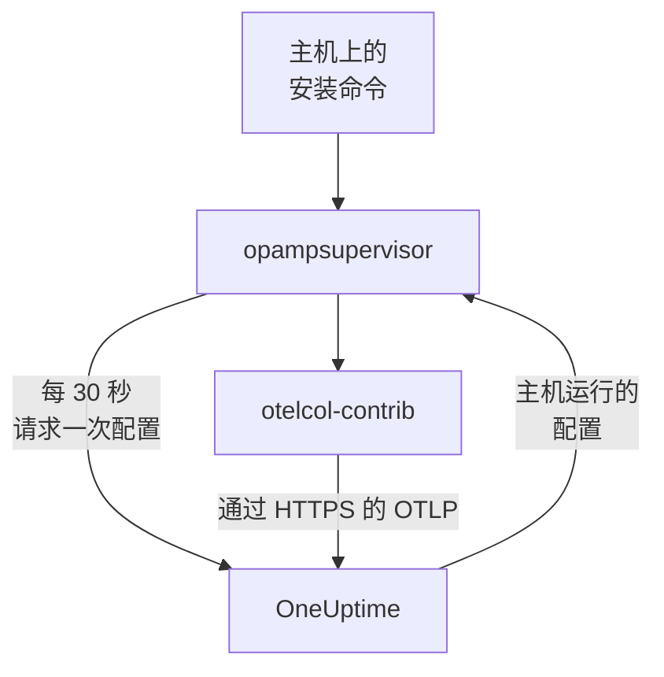

# 主机

用一条命令把 Linux、Windows 或 macOS 机器添加到 OneUptime。该命令在主机上安装 OpenTelemetry Collector，OneUptime 向收集器发送配置并保持其为最新：无需编写 `config.yaml`，也无需把它复制到每台主机或保持一致。要更改主机收集的内容，只需编辑一次收集器配置，它适用的每台主机都会在一分钟内收到更改。

:::cards
- [添加主机](#添加主机): 在 Linux、Windows 或 macOS 上运行一条命令。
- [更改主机收集的内容](#更改主机收集的内容): 按系统和标签划分的收集器配置，保留每个版本。
- [检查主机的收集器](#检查主机的收集器): 它运行的配置、配置的版本，以及配置未能启动的原因。
- [配置可以做什么](#配置可以做什么): 读取主机，并且只发送到这个 OneUptime。
:::

## 工作原理

该命令从 OpenTelemetry Collector 的发布版本中安装两个程序，并用发布版本公布的 SHA-256 逐一校验：读取主机的收集器 `otelcol-contrib`，以及运行收集器、并让收集器保持使用 OneUptime 通过 OpAMP（OpenTelemetry Agent Management Protocol）发送的配置的 `opampsupervisor`。两者都以 `oneuptime-collector` 服务运行。



监管程序大约每 30 秒使用你的摄取密钥向 OneUptime 请求一次主机的配置，并报告主机运行的是哪个配置以及它是否已启动。监管程序首次连接时，主机就以机器名注册到 **主机** 中，随着指标和日志到达，它的页面会逐步填充。

每台主机运行一个配置，按以下顺序选出：

| 主机运行的配置 | 条件 |
| --- | --- |
| 在主机的 **收集器** 页面上为它选定的配置 | 有人选定了一个配置。 |
| **收集器配置** 中第一个适用于它的配置 | 配置面向主机的系统，并且如果配置指定了标签，主机带有其中之一时，该配置适用。 |
| 其系统的 OneUptime 默认配置 | 没有适用的配置。 |

OneUptime 默认配置在任何系统上都会读取 CPU、内存、磁盘、文件系统、网络和进程；在 Linux 上，如果主机有 journal 和 systemd 单元，还会读取它们；在 Windows 上读取 System、Application 和 Security 事件日志以及 Windows 服务；在 macOS 上读取 `/var/log` 中的安装日志和 Wi-Fi 日志。它会排除按设计就是满的文件系统，例如 snap 软件包和 macOS 的 `/dev`，因此它们永远不会让 High Filesystem Usage 模板一直触发。它随 OneUptime 的发布版本更新，因此使用默认配置的主机会获得 OneUptime 对它的改进。

## 开始之前

- 一个摄取密钥。**添加主机** 会为你创建一个，你也可以选择在 **项目设置 → 遥测与 APM → 摄取密钥** 下创建的密钥。
- 主机上的管理员权限：在 Linux 和 macOS 上使用 `sudo`，在 Windows 上使用以管理员身份运行的 PowerShell。
- 使用 systemd 的 Linux、Windows 10 或 Windows Server 2019 及更高版本，或者运行在 Apple 芯片或 Intel 上的 macOS。
- 从主机到你的 OneUptime URL 的出站 HTTPS，可以直连，也可以通过代理。

## 添加主机

:::steps
### 打开添加主机

打开 **产品 → 基础设施 → 主机**，然后选择 **添加主机**。选择主机运行的系统：Linux、Windows 或 macOS。Kubernetes 集群的节点则由 [Kubernetes Agent](/docs/telemetry/kubernetes-agent) 监控。

### 选择摄取密钥

选择一个密钥，或在对话框中创建一个。下面的命令会填入它。

### 在主机上运行命令

从对话框复制命令，在主机上运行。大约需要一分钟。下面是相同的命令，示例部分会换成你的 OneUptime URL 和密钥：

:::tabs
@tab Linux
```bash
curl -fsSL https://oneuptime.com/docs/static/scripts/host-collector/install.sh | sudo sh -s -- --url https://oneuptime.com --key YOUR_INGESTION_KEY
```
@tab macOS
```bash
curl -fsSL https://oneuptime.com/docs/static/scripts/host-collector/install.sh | sudo sh -s -- --url https://oneuptime.com --key YOUR_INGESTION_KEY
```
@tab Windows
```powershell
[Net.ServicePointManager]::SecurityProtocol = [Net.ServicePointManager]::SecurityProtocol -bor [Net.SecurityProtocolType]::Tls12; & ([scriptblock]::Create((Invoke-RestMethod -Uri 'https://oneuptime.com/docs/static/scripts/host-collector/install.ps1'))) -Url 'https://oneuptime.com' -Key 'YOUR_INGESTION_KEY'
```
:::

每个 OneUptime 都提供自己的安装程序，因此自托管的 OneUptime 会提供其自身发布版本的安装程序：把两处的 `https://oneuptime.com` 都替换为你的 URL。

### 等待主机

对话框的最后一步会在主机连接时提示你，并附上指向它的链接。在列表中，它会显示为 **正在启动**，直到第一批指标到达（通常在一分钟内），之后显示为已连接，其收集器为 **正在运行**。主机的 **拓扑** 页面将在其上运行的内容、调用它的内容以及它调用的内容绘制在一张地图上：请参阅 [拓扑](/docs/telemetry/topology#打开资源自己的地图)。
:::

## 为主机添加标签

在命令中加上标签，主机从连接的那一刻起就带有这些标签：

:::tabs
@tab Linux
```bash
curl -fsSL https://oneuptime.com/docs/static/scripts/host-collector/install.sh | sudo sh -s -- --url https://oneuptime.com --key YOUR_INGESTION_KEY --label env=production --label team=payments
```
@tab macOS
```bash
curl -fsSL https://oneuptime.com/docs/static/scripts/host-collector/install.sh | sudo sh -s -- --url https://oneuptime.com --key YOUR_INGESTION_KEY --label env=production --label team=payments
```
@tab Windows
```powershell
[Net.ServicePointManager]::SecurityProtocol = [Net.ServicePointManager]::SecurityProtocol -bor [Net.SecurityProtocolType]::Tls12; & ([scriptblock]::Create((Invoke-RestMethod -Uri 'https://oneuptime.com/docs/static/scripts/host-collector/install.ps1'))) -Url 'https://oneuptime.com' -Key 'YOUR_INGESTION_KEY' -Label 'env=production','team=payments'
```
:::

`env=production` 会成为标签 `env:production`。标签只会添加，不会被移除：用另一个标签再次运行命令，主机就会同时带有两个标签。你也可以在 **主机** 列表中或通过 **标签规则** 为主机添加标签。指定了标签的收集器配置只适用于带有其中之一的主机，因此同一条命令配上不同的标签，就能让每组主机使用各自的配置。

## 更改主机收集的内容

:::steps
### 创建收集器配置

打开 **产品 → 基础设施 → 主机 → 收集器配置**，然后选择 **创建收集器配置**。为它指定名称、它面向的主机的系统，如果只想覆盖其中一部分主机，再指定它们的标签。它的配置从该系统的 OneUptime 默认配置开始。

### 编辑它的 config.yaml

在配置的页面上选择 **编辑配置**，修改 YAML 并保存。OneUptime 会先检查它，对无法发送的配置予以拒绝并说明原因：参见 [配置可以做什么](#配置可以做什么)。

### 查看它送达主机

每次保存的更改都是一个新版本，它适用的主机会在一分钟内收到。配置的 **主机** 列表会显示每台主机、其收集器的状态以及它运行的版本。
:::

主机运行列表中第一个适用于它的配置：在 **收集器配置** 中拖动行即可更改顺序。把范围最窄的配置放在前面，例如面向 `env:production` Web 服务器的配置，把范围宽的配置放在后面，例如面向所有 Linux 主机的配置。列表下方的 **OneUptime 默认配置** 卡片显示没有适用配置时主机运行的内容。

### 版本与恢复

配置的 **版本** 列表保留每次保存的更改，最新的在前，并记录保存者和保存时间。选择 **查看** 阅读某个版本，选择 **恢复** 把它再次发送到主机：它会另存为一个新版本，并注明恢复的是哪个版本，因此列表始终能说明每台主机收到了什么。

### 为单台主机选择配置

在主机的 **收集器** 页面上选择 **更改配置**，然后只为这台主机选择一个配置。可选的配置包括面向该主机系统的配置和面向任意系统的配置。选择“自动”即可让主机重新按列表选择。所选配置被删除的主机会自动回到按列表选择。

### 配置无法启动时

监管程序在切换到新配置之前会先用收集器检查它，如果新配置无法启动，就回到最后一个正常工作的配置。主机在此期间一直在发送数据。主机的 **收集器** 页面会显示 **配置失败** 以及收集器给出的原因，例如收集器无权读取的日志文件，并且在配置更改之前，OneUptime 不会再次向该主机发送该配置。在主机上修复原因后，选择 **重试** 再发送一次。

## 配置可以做什么

OneUptime 发送的配置会在它适用的每台主机上运行，因此 OneUptime 每次保存时都会检查它，并拒绝违反规则的配置：

| 规则 | 原因 |
| --- | --- |
| 只能使用 OneUptime 列表中的 receivers、processors、exporters、extensions 和 connectors | 它读取主机和主机上的服务。运行程序或读取云或集群凭据的组件不在列表中。 |
| 数据只能通过 exporter `otlp_http` 离开主机，发往 `${env:ONEUPTIME_URL}/otlp`，并带上请求头 `x-oneuptime-token: ${env:ONEUPTIME_INGESTION_KEY}` | 每台主机都用安装时的密钥发送到这个 OneUptime。没有任何配置包含密钥。 |
| `${env:NAME}` 是它唯一可以使用的 `${...}` | `${file:...}` 或 `${https:...}` 会在每台主机上被读取，并可能被转发出去。 |
| 不允许运行程序或发送所读取文件的设置，例如 journald 的 `journalctl_path` | 配置只能读取主机，不能做更多事情。 |

尽管如此，配置仍可能是主机无法运行的配置，例如面向其他系统的 receiver，或者主机上不存在的日志文件。每台主机上的收集器会在切换前检查这一点，详见 [配置无法启动时](#配置无法启动时)。

## 检查主机的收集器

打开主机及其 **收集器** 页面。该页面显示收集器的状况、它运行的配置和 **为什么是此配置**、它运行的版本、它的 **最后报告** 和 **收集器版本**。**在主机上** 下列出了从主机上的 shell 检查它的命令：服务是否在运行、它的日志以及重启。

:::tabs
@tab Linux
```bash
sudo systemctl status oneuptime-collector
sudo journalctl -u oneuptime-collector -n 50
sudo systemctl restart oneuptime-collector
```
@tab macOS
```bash
sudo launchctl print system/com.oneuptime.collector
sudo tail -n 50 /usr/local/oneuptime-collector/log/collector.log
sudo launchctl kickstart -k system/com.oneuptime.collector
```
@tab Windows
```powershell
Get-Service oneuptime-collector
Get-WinEvent -FilterHashtable @{ LogName = 'Application'; ProviderName = 'oneuptime-collector' } -MaxEvents 50 | Format-List TimeCreated, Message
Restart-Service oneuptime-collector
```
:::

在 Linux 上，收集器以无特权用户 `oneuptime-collector` 运行，并属于 `systemd-journal` 和 `adm` 组，以便读取 journal 和 `/var/log` 中的日志。在 macOS 上，它像 launchd 守护进程一样以 root 运行；在 Windows 上以 LocalSystem 运行，以便读取每个事件日志和 Windows 服务。

## 手动设置的主机

按照 [主机 OpenTelemetry Collector](/docs/telemetry/host-otel-collector) 指南自行安装收集器的主机会继续照常上报，OneUptime 不会向其发送配置。要把它交给 OneUptime 管理，请打开该主机的 **收集器** 页面：那里的命令带有 `--replace-existing`，它会停止并禁用手动安装的收集器（`otelcol-contrib` 服务），这样主机就不会重复上报。主机会保留其名称、历史记录和标签。

## 安装选项

再次运行命令即可更改其中任何一项，或升级到更新的发布版本：它会替换之前安装的内容，并让主机在 OneUptime 中保持原样。

| Linux 和 macOS | Windows | 作用 |
| --- | --- | --- |
| `--url URL` | `-Url URL` | OneUptime 的地址。 |
| `--key KEY` | `-Key KEY` | 你项目的遥测摄取密钥。 |
| `--label KEY=VALUE` | `-Label KEY=VALUE` | 为主机添加标签。多个标签请重复该选项；在 Windows 上用逗号列出。 |
| `--env NAME=VALUE` | `-EnvVar NAME=VALUE` | 为读取 `${env:NAME}` 的配置向收集器提供环境变量。 |
| `--version VERSION` | `-Version VERSION` | 要安装的收集器发布版本，默认为 0.161.0。 |
| `--download-url URL` | `-DownloadUrl URL` | 从与 GitHub 目录结构相同的镜像下载发布版本。 |
| `--proxy URL` | `-Proxy URL` | 让下载和收集器的所有流量都通过 HTTP 代理。 |
| `--replace-existing` | `-ReplaceExisting` | 停止并禁用手动安装的收集器。 |
| `--uninstall` | `-Uninstall` | 删除收集器以及命令安装的所有内容。 |

## 卸载

:::tabs
@tab Linux
```bash
curl -fsSL https://oneuptime.com/docs/static/scripts/host-collector/install.sh | sudo sh -s -- --uninstall
```
@tab macOS
```bash
curl -fsSL https://oneuptime.com/docs/static/scripts/host-collector/install.sh | sudo sh -s -- --uninstall
```
@tab Windows
```powershell
& ([scriptblock]::Create((Invoke-RestMethod -Uri 'https://oneuptime.com/docs/static/scripts/host-collector/install.ps1'))) -Uninstall
```
:::

主机会连同其历史记录保留在 OneUptime 中：在 **主机** 列表中归档或删除它。

## 故障排除

:::details 命令提示 OneUptime 拒绝了密钥
HTTP `401`：密钥错误、已过期或已被删除。HTTP `422`：密钥已禁用、是浏览器密钥，或已绑定到单个服务。在 **添加主机** 中选择一个已启用的服务器密钥，然后再次运行命令：它会替换主机上的密钥。
:::

:::details 主机没有出现
检查主机能否通过 HTTPS 访问你的 OneUptime URL，然后用 [检查主机的收集器](#检查主机的收集器) 中对应系统的命令查看收集器的日志。
:::

:::details 主机报告其配置失败
主机的 **收集器** 页面会显示配置未能启动的原因。主机会继续运行最后一个正常工作的配置，并在配置更改或你选择 **重试** 时再次收到失败的配置。
:::

:::details 主机显示“未上报”
OneUptime 已超过 15 分钟没有收到主机监管程序的消息。请检查 `oneuptime-collector` 服务是否在运行，以及主机是否仍能访问 OneUptime。
:::

## 后续步骤

:::cards
- [主机 OpenTelemetry Collector](/docs/telemetry/host-otel-collector): 改为自行安装收集器并编写其配置。
- [主机监控器](/docs/monitor/host-monitor): 根据主机上报的内容发出告警。
- [摄取密钥](/docs/telemetry/ingestion-keys): 创建、限定和轮换主机发送时使用的密钥。
- [Kubernetes Agent](/docs/telemetry/kubernetes-agent): 监控集群的节点和工作负载。
:::
