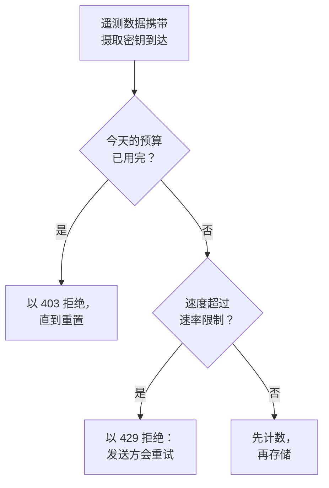

# 摄取预算

摄取预算限制一个项目一天内发送的遥测数据量，这样某个嘈杂的服务或失控的日志循环就无法占满你的存储。实例管理员为每个信号设置每日预算，可以针对所有项目，也可以针对单个项目；任何能够编辑摄取密钥的人，都可以为该密钥设置一个更小的自有预算。每个预算还可以设置每秒的速率限制。

:::cards
- [预算如何运作](#预算如何运作): 三个层级，在遥测数据到达时计数。
- [设置所有项目的默认预算](#设置所有项目的默认预算): 在 Admin Dashboard 的设置中。
- [为摄取密钥设置自有预算](#为摄取密钥设置自有预算): 项目预算中的一部分。
- [针对预算设置警报](#针对预算设置警报): 在预算用完之前，以及用完之时。
:::

## 预算如何运作

遥测数据在到达时计数：计入其项目对应信号的预算；如果其摄取密钥有自有预算，也计入该密钥的预算。每日预算一旦用完，该信号就会被拒绝，直到预算重置。



- **三个层级。** 实例的默认值适用于每个项目。实例管理员可以改为给某个项目设置它自己的预算，或者完全不设限制。密钥的预算只是对其项目预算的细分：它可以更小，但绝不能更大。
- **五种信号。** 日志、追踪、指标、性能剖析数据和安全事件各有自己的预算。会话回放有其自己的限制：请参阅 [会话回放](/docs/telemetry/session-replay)。
- **字节按解压后的大小计数。** 请求按其正文解压后的大小计数，因此压缩请求不会改变计入的量。一个 GB 为 1024³ 字节，一个 MB 为 1024² 字节。
- **计数的是到达的数据，而不是存储的数据。** 之后被 [丢弃过滤器](/docs/telemetry/drop-filters-and-scrub-rules) 移除的遥测数据仍会计数，因此预算显示的数值可能高于 [遥测用量](/docs/telemetry/usage) 页面，后者统计的是已存储的数据。
- **最后一个请求会被完整存储。** 在预算仍有余量时到达的请求会被完整存储，因此一个已用完的预算可能显示略高于 100%。
- **设置预算之前，不会限制任何内容。** 每个安装一开始都没有预算，没有预算的项目根本不会被计数。
- **更改会在一分钟内到达每台服务器。**
- **无法计数时，遥测数据仍会被接受。** 预算在 Valkey 中计数。在无法连接 Valkey 期间，OneUptime 会存储遥测数据而不对其计数，而不是拒绝它，预算页面也会说明这一点。

## 开始之前

- **实例和项目的预算需要 Admin Dashboard。** 在自托管安装上，只有实例管理员可以设置它们。项目的所有者和管理员可以看到项目的预算，但无法更改。
- **密钥的自有预算需要能够编辑摄取密钥的角色。** Project Owner 或 Project Admin，或者拥有 Edit Ingestion Key 权限的自定义角色。
- **查看预算需要能看到项目用量的角色。** 能看到 [遥测用量](/docs/telemetry/usage) 页面的角色，都能在该页面上看到项目的预算。

## 设置所有项目的默认预算

:::steps
### 打开摄取预算

在 Admin Dashboard 中，前往 **设置 → 遥测 → 摄取预算**。侧边菜单中的 **遥测** 默认是折叠的：点击它即可展开。

### 设置每日预算

在 **默认每日预算** 卡片上，点击 **编辑默认每日预算**，为每个要限制的信号输入 GB 数，例如 **日志（GB/天）**，然后点击 **保存更改**。信号留空则表示无限制。

### 按需设置速率限制

在 **默认速率限制** 卡片上，点击 **编辑默认速率限制**，为信号输入每秒的 MB 数，例如 **日志（MB/秒）**。速率限制可以防止一次突发流量在几分钟内用完一天的预算。
:::

**警告与重置** 卡片包含警告阈值和预算日的重置时间：请参阅 [警告与重置](#警告与重置)。

## 设置单个项目的预算

:::steps
### 打开项目

在 Admin Dashboard 中，前往 **项目**，点击该项目，然后点击其侧边菜单中的 **摄取预算**。页面打开时会显示该项目今天已用掉多少预算。

### 设置其每日预算

在 **此项目的每日预算** 卡片上，点击 **编辑每日预算**。为信号输入 GB 数以替代实例默认值，或输入 0 表示完全不限制。信号留空则保留实例默认值。

### 设置其速率限制

在 **此项目的速率限制** 卡片上，点击 **编辑速率限制**，并以同样的方式设置：输入每秒的 MB 数，输入 0 表示无限制，留空则使用实例默认值。
:::

项目成员可以在其 [遥测用量](/docs/telemetry/usage) 页面上以只读方式看到这些预算。

## 为摄取密钥设置自有预算

密钥的预算是其项目预算的一部分：用自己的密钥大量发送数据的发送方，会在该密钥的预算处被拦下，而项目的其他密钥仍可继续发送。

:::steps
### 打开密钥

前往 **项目设置 → 遥测与 APM → 摄取密钥**，然后点击该密钥。侧边菜单中的 **遥测与 APM** 默认是折叠的：点击它即可展开。

### 设置其预算

在 **摄取预算** 卡片上，点击 **编辑摄取预算**。在 **每日预算** 步骤中为每个要限制的信号输入每天的 GB 数，在 **速率限制** 步骤中输入每秒的 MB 数。信号留空则该密钥没有自有预算。

### 保存预算

点击 **保存更改**。密钥的预算不能超过其项目的预算：OneUptime 会拒绝这样的预算，并说明它最多可以是多少。
:::

- **两个预算都会计数。** 用该密钥发送的遥测数据会同时计入密钥的预算和项目的预算，先用完的那个会拒绝它。
- **调低的项目预算同样约束密钥。** 当项目的预算被调低到低于某个密钥的预算时，该密钥会受项目预算的约束。

## 发送方看到什么

| 情况 | 通过 HTTP | 通过 OTLP/gRPC | 发送方的处理 |
| --- | --- | --- | --- |
| 每日预算已用完 | `403` | `RESOURCE_EXHAUSTED` | 丢弃该批次：在重置之前重试也无济于事 |
| 超过速率限制 | `429` 加 `Retry-After` | `RESOURCE_EXHAUSTED` 加重试延迟 | 在延迟之后重试该批次 |

每次拒绝都会说明原因。通过 OTLP/HTTP 时，其正文是一个 `google.rpc.Status`，按请求发送时所用的格式采用 protobuf 或 JSON，因此发送方的日志会显示如下原因：

```text
This project's daily logs ingestion budget of 10 GB is used up, so OneUptime is not storing logs from this project until the budget resets at 2026-11-10 00:00 UTC.
```

- **其他 HTTP 发送方收到 JSON。** Fluent Bit、Fluentd、syslog 和其他 HTTP 端点会收到 `error`、`message` 和 `resetsAt`，遇到速率限制时还会收到 `retryAfterSeconds`。
- **MQTT 和云数据流无法得到通知。** 通过 MQTT 或从云提供商的数据流到达的遥测数据，在其预算用完后会被丢弃。速率限制不适用于它：它无法被重新发送。
- **拒绝会被计数。** 已用完的预算所拒绝或丢弃的数据计为已丢弃，速率限制拒绝的每个请求计为已限流：请参阅 [查看今天的用量和丢弃量](#查看今天的用量和丢弃量)。

## 警告与重置

- **警告。** 当每日预算超过警告阈值（除非实例管理员更改，否则为 80%）时，项目的所有者会收到一封电子邮件，各个探索器也会在该信号的数据上方显示横幅。预算用完时，他们还会再收到一封电子邮件。每个预算的每种电子邮件每天最多发送一次。
- **重置。** 除非实例管理员更改，否则每个预算日都在 00:00 UTC 重新开始。**警告与重置** 卡片设置 **警告阈值（%）**（1 到 99）、**重置时间**（格式为 HH:MM）和 **重置时区**：点击 **编辑警告与重置**。
- **夏令时。** 重置跟随该时区的时钟，因此时钟调整的那个预算日会缩短或延长一小时。若重置时间落在时钟跳过的时段内，重置会在跳变之后相应的时长发生。
- **更改重置会开始新的一天。** 更改重置时间或时区会立即开始一个新的预算日，此时尚未计入任何数据。

## 查看今天的用量和丢弃量

前往 **项目设置 → 遥测与 APM → 用量**。只要项目设置了预算或速率限制，页面最上方就会显示 **摄取预算** 卡片，拥有自有预算的密钥则列在 **摄取密钥预算** 卡片上：

| 列 | 显示内容 |
| --- | --- |
| **信号** | 该行对应的信号。 |
| **今日已用** | 自预算日开始以来计入的量，以及它占预算的比例。 |
| **每日预算** | 生效的预算及其设置位置：**实例默认值**、**为此项目设置** 或 **此密钥自有**。 |
| **速率限制** | 生效的速率限制。 |
| **已丢弃** | 因预算用完而被拒绝或丢弃的数据。 |
| **已限流** | 速率限制拒绝的请求数。 |
| **状态** | **在预算内**、**已超警告阈值** 或 **已用完**；只有速率限制的信号显示 **无每日预算**；无法读取计数时显示 **未知**。 |

- **在密钥的页面上**，**今日预算用量** 卡片显示该密钥已用掉多少自有预算。
- **在各个探索器中**，日志、追踪、指标、性能剖析和安全事件数据上方的横幅会在该信号的预算超过警告阈值或已用完时给出提示，并提供 **查看预算** 以打开用量页面。
- **在 Admin Dashboard 中**，项目的 **摄取预算** 页面显示相同的数字。

## 针对预算设置警报

OneUptime 每 5 分钟把每个预算当天的数字写成项目的指标，[指标监控](/docs/monitor/metrics-monitor) 可以像针对其他任何指标一样针对它们发出警报：

| 指标 | 单位 | 包含内容 |
| --- | --- | --- |
| `oneuptime.telemetry.budget.used.bytes` | `By` | 自预算日开始以来计入每日预算的字节数。 |
| `oneuptime.telemetry.budget.used.percent` | `%` | 同一数值，以每日预算的百分比表示。达到 100 或以上时，该信号会被拒绝，直到重置。 |
| `oneuptime.telemetry.budget.dropped.bytes` | `By` | 自预算日开始以来因预算用完而被拒绝或丢弃的字节数。 |
| `oneuptime.telemetry.budget.throttled.requests` | `{request}` | 自预算日开始以来速率限制拒绝的请求数。 |

每个数据点都带有以下属性：

| 属性 | 值 |
| --- | --- |
| `projectId` | 项目的 ID。 |
| `signal` | `logs`、`traces`、`metrics`、`profiles` 或 `security-events`。 |
| `scope` | `project`；对于密钥的自有预算为 `ingestion-key`。 |
| `ingestionKeyId` | 密钥的 ID，用于密钥的自有预算。 |
| `ingestionKeyName` | 写入数据点时密钥的名称，用于密钥的自有预算。 |

要在项目的日志预算用到 90% 时收到通知，请针对 `oneuptime.telemetry.budget.used.percent` 创建一个指标监控，按 `signal` 为 `logs`、`scope` 为 `project` 过滤，并在最大值高于 90 时发出警报：

- **用最大值聚合。** 在一个预算日内，每个数字只会增长。
- **使用 15 分钟或更长的窗口。** 每 5 分钟写入一个数据点，而不含任何数据点的窗口会解决警报。
- **预期会有空缺，而不是零。** 数值为 0 时，或无法读取计数期间，不会写入任何内容。
- **它们不产生任何费用。** 这些指标不计入任何预算，也不计为遥测用量，其保留时长与监控指标相同：除非实例管理员更改，否则为 30 天。以 `oneuptime.telemetry.budget.` 开头的指标名称为它们保留：你的应用以这样的名称发送的指标会被丢弃。

## 故障排除

:::details Collector 在导出时记录 403
项目或密钥针对该信号的每日预算已用完，在预算重置之前，Collector 会丢弃它无法发送的数据。请查看用量页面上的 **今日已用**。请让实例管理员提高项目的预算，或者减少发送量：丢弃过滤器在这里帮不上忙，因为它是在遥测数据计数之后才将其移除的。
:::

:::details Collector 记录 429 并重试
它的发送速度超过了速率限制所允许的速度。它会在 `Retry-After` 延迟之后重试，因此除非其队列已满，否则不会丢失任何数据。请提高速率限制，或让发送更加均匀。
:::

:::details 今日已用高于遥测用量页面显示的数值
预算在遥测数据到达时按解压后的大小计数，包括之后被丢弃过滤器移除的数据。用量页面统计的是已存储的数据，并且要到第二天才统计。
:::

:::details 预算显示无法读取今天的计数
OneUptime 无法连接到用于预算计数的 Valkey。在恢复连接之前，遥测数据会被存储而不计数，任何预算都不会生效。
:::

## 后续步骤

:::cards
- [遥测用量](/docs/telemetry/usage): 查看每个项目和服务发送了什么。
- [丢弃过滤器与清理规则](/docs/telemetry/drop-filters-and-scrub-rules): 停止存储你不需要的遥测数据。
- [摄取密钥](/docs/telemetry/ingestion-keys): 每个发送方一个密钥，这样每个发送方都可以有自己的预算。
- [指标监控](/docs/monitor/metrics-monitor): 针对预算指标设置警报。
:::
