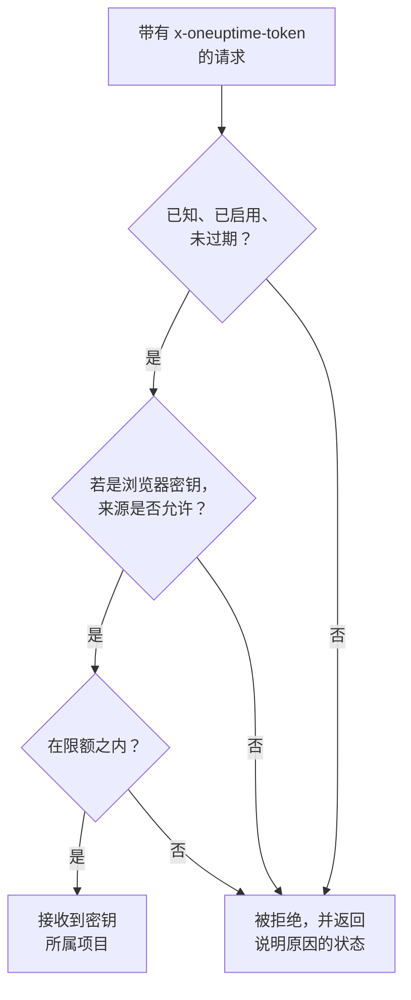

# 摄取密钥

摄取密钥把你的遥测连接到你的项目。应用、OpenTelemetry Collector 和代理会在每个请求中发送它，OneUptime 把它们的日志、追踪和指标归入该密钥所属的项目。本页介绍如何创建密钥、选择哪种类型，以及如何保护密钥。

:::cards
- [创建摄取密钥](#创建摄取密钥): 一个名称、一个类型和一个要复制的密钥值。
- [服务器还是浏览器](#服务器还是浏览器): 发送方需要哪种密钥。
- [锁定浏览器密钥](#锁定浏览器密钥): 来源、一个服务名称和一个限额。
- [轮换、停用或删除密钥](#轮换停用或删除密钥): 密钥泄露时该怎么做。
:::

## 如何检查密钥

每个请求都携带密钥值，通常放在 `x-oneuptime-token` 请求头中。OneUptime 查找该密钥，确认它仍然可以发送，然后才把数据接收到密钥所属的项目中。



- **密钥决定项目。** 你从不发送项目 ID：用某个密钥发送的数据会进入该密钥所属的项目。
- **更改会在一分钟内到达每台服务器。** 停用密钥、重置其密钥值，或更改其来源、过期时间或限额，大约一分钟内生效。
- **服务器密钥就是密码。** 任何拿到它的人都能向你的项目发送遥测。请把它保存在服务器的机密配置中，切勿放进源代码管理或网页。

## 服务器还是浏览器

根据密钥将要存放的位置选择类型。密钥创建后无法更改类型。

| | **服务器** | **浏览器** |
| --- | --- | --- |
| 用途 | 在你运营的机器上运行的应用、collector 和代理 | 网页，以及 React Native Session Replay |
| 发送内容 | 所有类型的遥测，发往所有端点 | 追踪、日志、指标和 Session Replay |
| 是否为机密 | 是：请把它保存在你的服务器上 | 否：任何查看页面的人都能读取它 |
| 来源 | 不检查 | 只接受列出的来源 |
| 每分钟请求数 | 无限制，除非你设置了限额 | 6,000，除非你设置了其他限额 |

在其他所有地方，OneUptime 都会拒绝浏览器密钥，例如通过 gRPC 和 MQTT、用于性能剖析数据、Syslog、Fluent Bit 和 Fluentd，以及上传 source map。要把发送方换成另一种类型，请创建该类型的密钥，把发送方切换到新密钥，然后删除旧密钥。

## 开始之前

- **能够管理摄取密钥的角色。** Project Owner 或 Project Admin，或者拥有 Create Telemetry Ingestion Key 权限的自定义角色。Telemetry 角色不包括摄取密钥。
- **在 OneUptime Cloud 上，需要付款方式。** 遥测按用量计费，因此 Free 套餐的项目需要先添加付款方式才能创建密钥。此时创建对话框最后会有一个显示价格的 **账单** 步骤。

## 创建摄取密钥

:::steps
### 打开摄取密钥

前往 **项目设置 → 遥测与 APM → 摄取密钥**。侧边菜单中的 **遥测与 APM** 默认是折叠的：点击它即可展开。列表会显示每个密钥的 **名称**、**类型**、**Last Used** 和 **描述**。

### 为密钥命名并选择类型

点击 **创建摄取密钥**。对话框一开始的名称是 **服务器密钥**，类型是 **服务器**。选择 **密钥类型**，并按将要使用它的程序重命名密钥，例如 `checkout-collector`。**描述** 位于 **高级** 下。

### 添加浏览器密钥的来源

**浏览器** 类型的密钥会在下一步 **浏览器设置** 中要求填写 **允许的来源**，并在 **高级** 下提供 **固定的服务名称**。请参阅 [锁定浏览器密钥](#锁定浏览器密钥)。

### 创建密钥并复制密钥值

点击 **创建摄取密钥**。密钥自己的页面会打开：复制它的 **密钥**，交给你的发送方。
:::

每个产品的 **设置指南** 都从 **选择摄取密钥** 开始，它会列出该指南可以使用的密钥，并可当场创建一个。之后指南中的代码片段都会带上这个密钥。

## 使用密钥发送遥测

发送方把密钥值放在 `x-oneuptime-token` 请求头中：

```text
x-oneuptime-token: YOUR_ONEUPTIME_INGESTION_KEY
```

- OpenTelemetry SDK 从 `OTEL_EXPORTER_OTLP_HEADERS` 读取它。请参阅 [OpenTelemetry 快速开始](/docs/telemetry/open-telemetry#快速开始)。
- 通过 OTLP/gRPC 时，它放在 `x-oneuptime-token` 元数据中。
- MQTT 设备把它作为密码发送。请参阅 [IoT 设备](/docs/telemetry/iot-devices)。
- OneUptime 也会从 `x-oneuptime-ingestion-key` 或 `x-oneuptime-service-token` 请求头读取密钥，一些较旧的配置会发送这些请求头。

## 锁定浏览器密钥

浏览器密钥位于你的页面中，任何人都能复制它。以下设置限制了副本能做的事。在密钥页面上通过 **编辑遥测 摄取 Key** 修改它们。

| 设置 | 作用 |
| --- | --- |
| **允许的来源** | 接受该密钥的唯一来源。来自其他任何来源的请求，或完全没有 `Origin` 请求头的请求，都会被拒绝。浏览器密钥必须至少保留一个来源。 |
| **固定的服务名称** | 把密钥通过 OTLP/HTTP 发送的所有内容都归入这一个服务，无论发送方设置了什么 `service.name`。这样，密钥的副本只能写入该服务。 |
| **Requests Per Minute Limit** | 该密钥每分钟可被接受的最大请求数，由所有访问者共享。留空时，浏览器密钥的限额为 6,000。 |
| **过期时间** | 过了这个日期，密钥就会被拒绝，已公开的副本也随之失效。 |

来源由协议、主机和可选的端口组成：`https://app.example.com` 不包括 `https://app.example.com:8443`。开头的一个 `*.` 涵盖所有子域名，但不包括域名本身。React Native Session Replay 发送一个精确的 `app://` 标识，不能使用通配符：

```json
[
  "https://app.example.com",
  "https://*.example.com",
  "app://com.example.mobile"
]
```

[服务目录](/docs/telemetry/services#服务如何进入目录) 说明了固定的名称如何决定服务。Kubernetes 代理的 Runner 和 AI 代理，以及基础设施 AI 代理，不会使用固定了名称的密钥注册：请给它们一个没有固定名称的服务器密钥。

## 轮换、停用或删除密钥

密钥的页面会显示它的 **状态**、隐藏在 **Click to reveal** 后面的 **密钥**，以及它的 **Last Used At**：OneUptime 最后一次接受用它发送的数据的时间。

| 目的 | 操作 | 发送方看到的结果 |
| --- | --- | --- |
| 立即停用密钥，之后还能恢复 | 点击 **编辑遥测 摄取 Key**，打开 **访问与限制** 并关闭 **已启用**。状态会显示 **Disabled — telemetry refused**。 | 重新启用之前返回 `422` |
| 替换泄露的密钥值 | 点击 **重置密钥** 并确认。密钥保留其设置，并获得一个新的密钥值。 | 发送新密钥值之前返回 `401` |
| 永久停用密钥 | 点击页面底部的 **删除遥测 摄取 Key**。 | `401` |

要在不丢失数据的情况下更换密钥值，请创建第二个密钥，把发送方迁移过去，等旧密钥的 **Last Used At** 不再变化后再删除它。**Last Used At** 每隔几分钟更新一次，而不是每个请求都更新。

## 故障排除

被拒绝的请求会收到一个状态和一句说明原因的话。

| 应答 | 含义 |
| --- | --- |
| `401` 加 `Missing ingestion token` | 请求中没有密钥。请在 `x-oneuptime-token` 中发送它。 |
| `401` 加 `Invalid ingestion token` | 没有密钥使用这个密钥值：它被输错、已重置或已删除。 |
| `401` 加 `This telemetry ingestion key expired.` | 它的 **过期时间** 已过。请设置更晚的日期，或使用另一个密钥。 |
| `402` 加 `Add a payment method` | 在 OneUptime Cloud 上，项目处于 Free 套餐，并且还没有付款方式。 |
| `422` 加 `This telemetry ingestion key has been disabled.` | 有人关闭了 **已启用**。 |
| `422` 加 `A browser ingestion key cannot be used for` | 浏览器密钥到达了只接受服务器密钥的端点。 |
| `422` 加 `did not send an Origin header` | 浏览器密钥是从浏览器之外发送的。请在那里使用服务器密钥。 |
| `422` 加 `is not allowed for this browser ingestion key` | 页面的来源不在 **允许的来源** 中。 |
| `422` 加 `is pinned to a single service` | 有人用设置了 **固定的服务名称** 的密钥注册代理。请使用没有固定名称的服务器密钥。 |
| `429` 加 `Too many telemetry requests for this ingestion key` | 密钥达到了它的 **Requests Per Minute Limit**。导出器会在 `Retry-After` 的时间之后重试。 |

关于 OTLP 导出器可能收到的其他应答，请参阅 [应答](/docs/telemetry/open-telemetry#响应)。

:::details 停用密钥一分钟后仍有数据到达
每台 OneUptime 服务器最多会把它所知道的密钥信息保留一分钟，因此更改大约一分钟内到达所有服务器。之后的请求会被拒绝。
:::

:::details 浏览器密钥在我的笔记本电脑上可用，但在生产环境中不可用
来源包括协议和端口。`http://localhost:3000` 和 `https://app.example.com` 是不同的来源：请把提供该页面的每个来源都列出来。
:::

:::details Last Used At 仍然显示从未
自从 OneUptime 开始记录该密钥的使用情况以来，没有任何东西用它发送过数据。请检查你的发送方是否持有这个密钥的密钥值，以及它们的请求是否到达 OneUptime。
:::

## 后续步骤

:::cards
- [OpenTelemetry](/docs/telemetry/open-telemetry): 用你的密钥发送追踪、指标和日志。
- [服务目录](/docs/telemetry/services): 查看你的遥测所归入的服务。
- [数据保留](/docs/telemetry/data-retention): 决定数据保留多长时间。
- [丢弃过滤器与清理规则](/docs/telemetry/drop-filters-and-scrub-rules): 在存储之前丢弃或掩码数据。
:::
