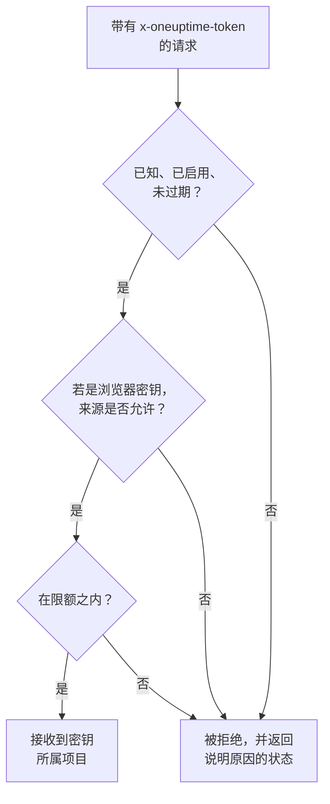

# 摄取密钥

摄取密钥把你的遥测连接到你的项目。应用、OpenTelemetry Collector 和代理会在每个请求中发送它，OneUptime 把它们的日志、追踪和指标归入该密钥所属的项目。本页介绍如何创建密钥、选择哪种类型，以及如何保护密钥。如需区分摄取密钥和 API 密钥，请参阅 [该用哪一个？](/docs/introduction/which-one#摄取密钥还是-api-密钥)。

:::cards
- [创建摄取密钥](#创建摄取密钥): 一个名称、一个类型和一个要复制的密钥值。
- [服务器、浏览器还是移动端](#服务器浏览器还是移动端): 发送方需要哪种密钥。
- [锁定浏览器密钥](#锁定浏览器密钥): 来源、一个服务名称和一个限额。
- [轮换、停用或删除密钥](#轮换停用或删除密钥): 密钥泄露时该怎么做。
:::

## 如何检查密钥

每个请求都携带密钥值，通常放在 `x-oneuptime-token` 请求头中。OneUptime 查找该密钥，确认它仍然可以发送，然后才把数据接收到密钥所属的项目中。



- **密钥决定项目。** 你从不发送项目 ID：用某个密钥发送的数据会进入该密钥所属的项目。
- **更改会在几秒内到达每台服务器。** 停用密钥、重置其密钥值，或更改其来源、过期时间或限额，几秒内在每台服务器上生效。
- **密钥可以有自己的预算。** 每个信号的每日预算和每秒速率，都在其项目的预算之内：请参阅 [摄取预算](/docs/telemetry/ingestion-budgets)。
- **服务器密钥就是密码。** 任何拿到它的人都能向你的项目发送遥测。请把它保存在服务器的机密配置中，切勿放进源代码管理、网页或移动应用。

## 服务器、浏览器还是移动端

根据密钥将要存放的位置选择类型。密钥创建后无法更改类型。

| | **服务器** | **浏览器** | **移动端** |
| --- | --- | --- | --- |
| 用途 | 在你运营的机器上运行的应用、collector 和代理 | 网页 | 一个 iOS、Android 或 React Native 应用 |
| 发送内容 | 所有类型的遥测，发往所有端点 | 追踪、日志、指标、Session Replay 和 [Sentry 事件](/docs/telemetry/compatible-endpoints#sentry-sdk) | 该应用的追踪、日志和指标，通过 OTLP/HTTP，以及它的 Session Replay |
| 是否为机密 | 是：请把它保存在你的服务器上 | 否：任何查看页面的人都能读取它 | 否：任何拥有该应用的人都能复制它 |
| 来源 | 不检查 | 只接受列出的来源 | 来自网页的请求会被拒绝 |
| 每分钟请求数 | 无限制，除非你设置了限额 | 6,000，除非你设置了其他限额 | 6,000，除非你设置了其他限额 |

在其他所有地方，OneUptime 都会拒绝浏览器密钥，例如通过 gRPC 和 MQTT、用于性能剖析数据、Syslog、Fluent Bit 和 Fluentd，以及上传 source map；移动端密钥则除了通过 HTTP 发送的 OTLP 追踪、日志和指标以及其应用的 Session Replay 之外一律被拒绝。要把发送方换成另一种类型，请创建该类型的密钥，把发送方切换到新密钥，然后删除旧密钥。

## 开始之前

- **能够管理摄取密钥的角色。** 项目所有者或项目管理员，或者拥有 Create Ingestion Key 权限的自定义角色。Telemetry 角色不包括摄取密钥。
- **在 OneUptime Cloud 上，需要付款方式。** 遥测按用量计费，因此 Free 套餐的项目需要先添加付款方式才能创建密钥。此时创建对话框最后会有一个显示价格的 **账单** 步骤。

## 创建摄取密钥

:::steps
### 打开摄取密钥

前往 **项目设置 → 遥测与 APM → 摄取密钥**。侧边菜单中的 **遥测与 APM** 默认是折叠的：点击它即可展开。列表会显示每个密钥的 **名称**、**类型**、**上次使用** 和 **描述**。

### 为密钥命名并选择类型

点击 **创建摄取密钥**。对话框一开始的名称是 **服务器密钥**，类型是 **服务器**。选择 **密钥类型**，并按将要使用它的程序重命名密钥，例如 `checkout-collector`。**描述** 位于 **高级** 下。

### 添加浏览器密钥的来源或移动端密钥的应用

**浏览器** 类型的密钥会在下一步 **浏览器设置** 中要求填写 **允许的来源**，并在 **高级** 下提供 **固定的服务名称**。请参阅 [锁定浏览器密钥](#锁定浏览器密钥)。 **移动端** 类型的密钥则在第一页就要求填写 **固定的服务名称**：即随其发布的应用的 `service.name`。

### 创建密钥并复制密钥值

点击 **创建摄取密钥**。密钥自己的页面会打开：复制它的 **密钥**，交给你的发送方。
:::

每个产品的 **设置指南** 都从 **选择摄取密钥** 开始，它会列出该指南可以使用的密钥，并可当场创建一个。之后指南中的代码片段都会带上这个密钥。

## 使用密钥发送遥测

发送方把密钥值放在 `x-oneuptime-token` 请求头中：

```text
x-oneuptime-token: YOUR_ONEUPTIME_INGESTION_KEY
```

- OpenTelemetry SDK 从 `OTEL_EXPORTER_OTLP_HEADERS` 读取它。请参阅 [OpenTelemetry 快速开始](/docs/telemetry/open-telemetry#快速开始)。
- 通过 OTLP/gRPC 时，它放在 `x-oneuptime-token` 元数据中。
- MQTT 设备把它作为密码发送。请参阅 [IoT 设备](/docs/telemetry/iot-devices)。
- OneUptime 也会从 `x-oneuptime-ingestion-key` 或 `x-oneuptime-service-token` 请求头读取密钥，一些较旧的配置会发送这些请求头。

## 锁定浏览器密钥

浏览器密钥位于你的页面中，任何人都能复制它。它发送的所有内容都会作为浏览器 RUM 应用存储，绝不会作为主机、集群、云资源、数据库或后端服务存储：对于发送方设置的资源，密钥只保留页面对自身的描述，例如 `service.*`、`browser.*` 和 `user_agent.*` 属性以及 `oneuptime.label.*` 标签。以下设置限制了副本能做的事。在密钥页面上通过 **编辑摄取密钥** 修改它们。

| 设置 | 作用 |
| --- | --- |
| **允许的来源** | 接受该密钥的唯一来源。来自其他任何来源的请求，或完全没有 `Origin` 请求头的请求，都会被拒绝。浏览器密钥必须至少保留一个来源。 |
| **固定的服务名称** | 把密钥通过 OTLP/HTTP 发送的所有内容都归入这一个应用，无论发送方设置了什么 `service.name`。这样，密钥的副本只能写入该应用。 |
| **每分钟请求数上限** | 该密钥每分钟可被接受的最大请求数，由所有访问者共享。留空时，浏览器密钥的限额为 6,000。 |
| **过期时间** | 过了这个日期，密钥就会被拒绝，已公开的副本也随之失效。 |

来源由协议、主机和可选的端口组成：`https://app.example.com` 不包括 `https://app.example.com:8443`。开头的一个 `*.` 涵盖所有子域名，但不包括域名本身。使用浏览器密钥的 React Native Session Replay 会发送一个精确的 `app://` 标识，不能使用通配符：

```json
[
  "https://app.example.com",
  "https://*.example.com",
  "app://com.example.mobile"
]
```

[服务](/docs/telemetry/services#服务如何进入目录) 说明了固定的名称如何决定服务。Kubernetes 代理的 Runner 和 AI 代理，以及基础设施 AI 代理，不会使用固定了名称的密钥注册：请给它们一个没有固定名称的服务器密钥。

## 移动端密钥的限制

移动端密钥随你的应用一起发布，任何拥有该应用的人都能复制它。以下限制把每一份副本都限定在为其创建密钥的应用上：

- **它只以一个应用的身份写入。** 无论发送方声称是哪个服务或主机，它发送的所有内容都会归入其 **固定的服务名称**，作为移动端 RUM 应用程序。副本无法写入你的后端服务、主机或集群。
- **它只发送该应用的遥测。** 通过 HTTP 发送的 OTLP 追踪、日志和指标，以及来自应用 React Native 录制器的 Session Replay，以密钥的 **固定的服务名称** 作为其 `appIdentifier`。通过 gRPC 和 MQTT、用于其他应用的 Session Replay、性能剖析数据和 source map、发往任何其他端点，或来自任何网页的请求都会被拒绝。
- **它受速率限制。** 所有副本合计每分钟 6,000 个请求，除非你设置了它的 **每分钟请求数上限**。
- **你可以停用它。** 关闭 **已启用**，或设置 **过期时间**，每份副本都会在几秒内被拒绝。

它无法阻止的：拥有你应用的人仍可以在密钥的限额内为这一个应用发送编造的追踪、日志、指标和 Session Replay，直到你关闭密钥或它过期。请随每次发布轮换密钥，让旧副本随其版本一起失效。

## 轮换、停用或删除密钥

密钥的页面会显示它的 **状态**、隐藏在 **点击以显示** 后面的 **密钥**，以及它的 **上次使用时间**：OneUptime 最后一次接受用它发送的数据的时间。

| 目的 | 操作 | 发送方看到的结果 |
| --- | --- | --- |
| 立即停用密钥，之后还能恢复 | 点击 **编辑摄取密钥**，打开 **访问与限制** 并关闭 **已启用**。状态会显示 **Disabled — telemetry refused**。 | 重新启用之前返回 `422` |
| 替换泄露的密钥值 | 点击 **重置密钥** 并确认。密钥保留其设置，并获得一个新的密钥值。 | 发送新密钥值之前返回 `401` |
| 永久停用密钥 | 点击页面底部的 **删除摄取密钥**。 | `401` |

要在不丢失数据的情况下更换密钥值，请创建第二个密钥，把发送方迁移过去，等旧密钥的 **上次使用时间** 不再变化后再删除它。**上次使用时间** 每隔几分钟更新一次，而不是每个请求都更新。

## 故障排除

被拒绝的请求会收到一个状态和一句说明原因的话。

密钥页面也会计数： **被拒绝的遥测** 列出过去 30 天此密钥被拒绝的内容、原因、端点、请求数和时间。缺失或输错的密钥不属于任何项目，因此不会被统计。

| 应答 | 含义 |
| --- | --- |
| `401` 加 `Missing ingestion token` | 请求中没有密钥。请在 `x-oneuptime-token` 中发送它。 |
| `401` 加 `Invalid ingestion token` | 没有密钥使用这个密钥值：它被输错、已重置或已删除。 |
| `401` 加 `This telemetry ingestion key expired.` | 它的 **过期时间** 已过。请设置更晚的日期，或使用另一个密钥。 |
| `402` 加 `Add a payment method` | 在 OneUptime Cloud 上，项目处于 Free 套餐，并且还没有付款方式。 |
| `422` 加 `This telemetry ingestion key has been disabled.` | 有人关闭了 **已启用**。 |
| `422` 加 `A browser ingestion key cannot be used for` | 浏览器密钥到达了只接受服务器密钥的端点。 |
| `422` 加 `did not send an Origin header` | 浏览器密钥是从浏览器之外发送的。请在移动应用中使用移动端密钥，在其他地方使用服务器密钥。 |
| `422` 加 `A mobile ingestion key cannot be used for` | 移动端密钥到达了通过 HTTP 发送的 OTLP 追踪、日志和指标以及 Session Replay 以外的端点，例如 gRPC 或性能剖析数据。 |
| `422` 加 `A mobile ingestion key can send session replays only` | 移动端密钥发送了网页的录制，或其他应用的录制。请将密钥的 **固定的服务名称** 作为 React Native 录制器的 `appIdentifier`。 |
| `422` 加 `A mobile ingestion key cannot be used from a web page` | 移动端密钥是从浏览器发送的。请在网页中使用浏览器密钥。 |
| `422` 加 `is not allowed for this browser ingestion key` | 页面的来源不在 **允许的来源** 中。 |
| `422` 加 `is pinned to a single service` | 有人用设置了 **固定的服务名称** 的密钥注册代理。请使用没有固定名称的服务器密钥。 |
| `429` 加 `Too many telemetry requests for this ingestion key` | 密钥达到了它的 **每分钟请求数上限**。导出器会在 `Retry-After` 的时间之后重试。 |

关于 OTLP 导出器可能收到的其他应答，请参阅 [应答](/docs/telemetry/open-telemetry#响应)。

:::details 停用密钥后仍有数据到达
每台 OneUptime 服务器至少每秒检查一次密钥是否有更改，因此更改会在几秒内到达所有服务器，之后的请求会被拒绝。当某台服务器无法连接 OneUptime 的缓存时，它最多会在一分钟内沿用它所知道的密钥信息。用该密钥连接的 MQTT 客户端会在几秒内被断开。
:::

:::details 浏览器密钥在我的笔记本电脑上可用，但在生产环境中不可用
来源包括协议和端口。`http://localhost:3000` 和 `https://app.example.com` 是不同的来源：请把提供该页面的每个来源都列出来。
:::

:::details Last Used At 仍然显示从未
自从 OneUptime 开始记录该密钥的使用情况以来，没有任何东西用它发送过数据。请检查你的发送方是否持有这个密钥的密钥值，以及它们的请求是否到达 OneUptime。
:::

## 后续步骤

:::cards
- [OpenTelemetry](/docs/telemetry/open-telemetry): 用你的密钥发送追踪、指标和日志。
- [服务](/docs/telemetry/services): 查看你的遥测所归入的服务。
- [数据保留](/docs/telemetry/data-retention): 决定数据保留多长时间。
- [丢弃过滤器与清理规则](/docs/telemetry/drop-filters-and-scrub-rules): 在存储之前丢弃或掩码数据。
- [摄取预算](/docs/telemetry/ingestion-budgets): 限制每个密钥一天内最多可发送多少。
:::
