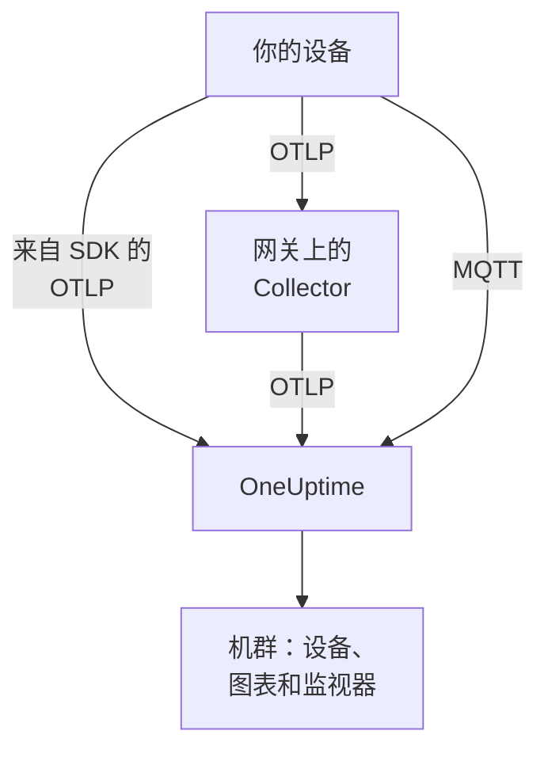

# IoT 设备

OneUptime 根据 IoT 设备（传感器、网关、控制器和边缘设备）发送的一小组 `iot_*` 指标来监视它们组成的机群。它把设备分组为机群，维护每个机群的设备清单，并绘制它们的电量、信号、温度、CPU、内存和可用性图表。设备上无需安装任何 OneUptime 代理：设备发送标准的 OpenTelemetry，或者发布到 OneUptime 的 MQTT 端点。[IoT 设备监控](/docs/monitor/iot-device-monitor) 会根据它们发送的数据发出警报。

:::cards
- [选择发送方式](#选择发送方式): OpenTelemetry SDK、网关上的 Collector 或 MQTT。
- [通过 MQTT 发送指标](#通过-mqtt-发送指标): 主题、每设备凭据和 Last Will。
- [指标约定](#指标约定): OneUptime 用于绘图和警报的 `iot_*` 名称。
- [故障排查](#故障排查): 缺少机群、缺少设备、离线切换。
:::

## 工作原理

每个读数都属于一个机群和一台设备。OneUptime 根据第一个读数创建机群，把每台新设备添加到机群的清单中，并在此后的每个读数到达时更新设备的最新值。通过 OpenTelemetry 和通过 MQTT 发送的读数会进入相同的机群、清单、图表和监视器。



## OneUptime 如何对 IoT 建模

- **机群**：一组设备，例如 `building-a-sensors` 或 `field-gateways`。它来自 `iot.fleet.name` 资源属性，在 OneUptime 中显示为遥测服务 `iot/<fleet>`。同时设置 `service.name=iot/<fleet>`，让日志和指标归入同一个服务。
- **设备**：机群中的一台设备，由每个数据点上的 `device.id` 属性命名。机群的清单以 `device.id` 为键。

| 属性 | 设置位置 | 必需 | 说明 |
| --- | --- | --- | --- |
| `iot.fleet.name` | 资源 | 是 | 设备所属的机群。它会成为 OneUptime 服务 `iot/<fleet>`。 |
| `device.id` | 每个数据点 | 是 | 设备的稳定 ID，在其机群中唯一。 |
| `iot.device.kind` | 每个数据点 | 否 | 设备类别，例如 `Device`、`Sensor` 或 `Gateway`。默认为 `Device`。 |
| `iot.device.type` | 每个数据点 | 否 | 用于筛选监视器的更细的类型或型号，例如 `temp-sensor`。 |
| `iot.device.firmware` | 每个数据点 | 否 | 设备报告的固件版本。 |

通过 MQTT 时，主题会替你设置机群和设备。

## 选择发送方式

| 方式 | 适用场景 | 需要 |
| --- | --- | --- |
| [OpenTelemetry SDK](#通过-opentelemetry-sdk-发送指标) | 设备运行 OpenTelemetry SDK，并且自己能访问 OneUptime。 | 设备上的摄取密钥。 |
| [OpenTelemetry Collector](#通过-opentelemetry-collector-发送指标) | 许多设备通过网关上报。 | 运行 Collector 的网关。 |
| [MQTT](#通过-mqtt-发送指标) | 设备已经使用 MQTT，或者应在断线的那一刻报告离线。 | 任何通过 WebSocket 连接的 MQTT 客户端。 |

## 开始之前

- 一个摄取密钥。在 **项目设置 → 遥测与 APM → 摄取密钥** 下创建一个并复制其值。设备会将其作为 `x-oneuptime-token` 标头发送，或作为 MQTT 密码发送。
- 从设备或网关到你的 OneUptime URL 的网络访问。
- 每组设备的机群名称，以及每台设备的稳定 ID。

## 通过 OpenTelemetry SDK 发送指标

:::steps
### 让 SDK 指向 OneUptime

在设备上设置标准的 OpenTelemetry 环境变量。把密钥、机群名称和设备 ID 替换为你自己的：

```bash
export OTEL_EXPORTER_OTLP_ENDPOINT=https://oneuptime.com/otlp
export OTEL_EXPORTER_OTLP_PROTOCOL=http/protobuf
export OTEL_EXPORTER_OTLP_HEADERS=x-oneuptime-token=YOUR_TELEMETRY_INGESTION_TOKEN
export OTEL_RESOURCE_ATTRIBUTES=iot.fleet.name=building-a-sensors,device.id=sensor-001,service.name=iot/building-a-sensors
```

保持 `iot.fleet.name` 不变：更改它会注册一个新的机群。

### 将读数记录为 IoT 指标

把每个读数作为使用某个 [约定名称](#指标约定) 的指标发出，并为每个数据点加上 `device.id` 属性：

| 指标 | 值 | 数据点属性 |
| --- | --- | --- |
| `iot_device_up` | `1` | `device.id=sensor-001` |
| `iot_battery_percent` | `87` | `device.id=sensor-001` |
| `iot_temperature_celsius` | `21.5` | `device.id=sensor-001` |

清单以数据点的 `device.id` 为键，而不是以资源的为键，因此除了在 `OTEL_RESOURCE_ATTRIBUTES` 中设置之外，还要在每个测量上设置它。
:::

然后 [检查机群是否出现](#检查机群是否出现)。

## 通过 OpenTelemetry Collector 发送指标

当许多设备通过网关上报时，请在网关上运行 OpenTelemetry Collector。它接收来自设备的 OTLP，为每个读数打上机群标识，并将其转发到 OneUptime。

:::steps
### 保存网关的配置

将以下内容保存为网关上的 `config.yaml`：

```yaml title="config.yaml"
receivers:
  otlp:
    protocols:
      grpc:
        endpoint: 0.0.0.0:4317
      http:
        endpoint: 0.0.0.0:4318

processors:
  batch:
    send_batch_size: 512
    timeout: 5s
  resource:
    attributes:
      - key: iot.fleet.name
        value: field-gateways
        action: upsert
      - key: service.name
        value: iot/field-gateways
        action: upsert

exporters:
  otlphttp:
    endpoint: "https://oneuptime.com/otlp"
    headers:
      "x-oneuptime-token": "YOUR_TELEMETRY_INGESTION_TOKEN"

service:
  pipelines:
    metrics:
      receivers: [otlp]
      processors: [resource, batch]
      exporters: [otlphttp]
```

- `otlp` 通过 gRPC（`4317`）和 HTTP（`4318`）接收来自设备的数据。也可以通过 Collector 支持的任何其他方式（MQTT 桥接、文件日志）接收读数，并让它们经过同一条管道发送。
- `resource` 为每个读数打上机群标识。请为每个网关设置 `iot.fleet.name` 以及与之匹配的 `service.name=iot/<fleet>`，使每个网关的设备落入各自的机群。
- 在每个数据点上保留 `device.id`，以及 `iot.device.kind`、`iot.device.type` 和 `iot.device.firmware` 中的任何一个，以便 OneUptime 区分机群中的设备。
- `otlphttp` 使用摄取密钥通过 HTTPS 发送到 OneUptime。默认的 protobuf 编码和 `encoding: json` 都会被接受。

### 在网关上运行 Collector

:::tabs
@tab Docker
在包含 `config.yaml` 的文件夹中运行它：

```bash
docker run -d \
  --name otel-collector \
  --restart unless-stopped \
  -p 4317:4317 \
  -p 4318:4318 \
  -v $(pwd)/config.yaml:/etc/otelcol-contrib/config.yaml:ro \
  otel/opentelemetry-collector-contrib:0.161.0 \
  --config /etc/otelcol-contrib/config.yaml
```
@tab otelcol-contrib
如果网关上已经有 `otelcol-contrib`，请让它指向该文件：

```bash
otelcol-contrib --config config.yaml
```
:::

然后设备将 OTLP 发送到网关，例如在每台设备的 SDK 中设置 `OTEL_EXPORTER_OTLP_ENDPOINT=http://<gateway-host>:4318`。
:::

然后 [检查机群是否出现](#检查机群是否出现)。

## 通过 MQTT 发送指标

OneUptime 有自己的 MQTT 端点，因此使用 MQTT 的设备可以直接向它发布读数，无需 SDK、Collector 或桥接。通过 MQTT 到达的数据与 OTLP 走同一条管道：会创建机群、更新清单，所有 IoT 监视器和警报模板的工作方式都相同。

### 端点

| 传输方式 | 地址 | 说明 |
| --- | --- | --- |
| 基于 WebSocket 的 MQTT | `wss://<your-host>/mqtt` | 适用于所有部署，经由常规的 HTTPS 端口。 |
| 基于 TCP 的 MQTT | `<app-host>:1883` | 仅限自托管，在你暴露它之前只在集群或 Compose 网络内部可用。端口为 `MQTT_INGEST_PORT`。 |

### 身份验证

- **使用摄取密钥**：将其作为 MQTT 密码发送。用户名会被忽略；如果你的客户端只有用户名字段，就把密钥填在那里。这适合代表许多设备发布数据的网关。
- **使用每设备凭据**：推荐用于直接连接的设备。打开机群的 **Device Registry** 页面并注册该设备，使用它作为 `device.id` 的 **Device ID**。设备的 **MQTT Username** 就是它的用户名，**MQTT Password (Secret)** 就是它的密码。

设备凭据只能在它自己的 `oneuptime/<fleet>/<device>/` 主题下发布。你可以撤销单台设备，而不影响机群中的其他设备：关闭它的 **已启用** 开关或删除它，已连接的设备会在大约一分钟内被断开。已注册的设备沉默后会以离线状态留在清单中，即使它在没有 Last Will 的情况下宕掉，Device Offline 警报模板也会为它触发。

OneUptime 在 CONNECT 阶段以返回码 4（bad username or password）拒绝错误的凭据，因此配置错误的设备会明确地失败。浏览器密钥在 MQTT 上会被拒绝。

### 主题和负载

在固定的 `oneuptime/` 前缀下发布。机群和设备段不得包含 `/`、`+` 或 `#`，不得以 `$` 开头，长度最多为 100 个字符。

| 主题 | 负载 |
| --- | --- |
| `oneuptime/<fleet>/<device>/telemetry` | 由读数组成的 JSON 对象：`{"metrics":{"iot_temperature_celsius":21.5}}`，或者一个其数值字段即为指标的扁平对象。 |
| `oneuptime/<fleet>/<device>/metrics/<metricName>` | 单个值：裸数字（`23.4`）或 `{"value":23.4}`。 |
| `oneuptime/<fleet>/<device>/status` | `online` 或 `offline`（也可以是 `1` 或 `0`、`true` 或 `false`、`up` 或 `down`）。它会设置 `iot_device_up`。 |

遥测负载还可以带有 `"attributes"`，即打到每个数据点上的字符串映射（可用于 `iot.device.kind`、`iot.device.type`、`iot.device.firmware` 或你自己的标签），以及 `"timestamp"`，格式为 ISO 8601 或 Unix 秒或毫秒。两者都是可选的：没有 `timestamp` 时，使用 OneUptime 收到读数的时间。

### 使用 Last Will 检测离线

在 `oneuptime/<fleet>/<device>/status` 上注册一个负载为 `offline` 的 MQTT Last Will。如果设备宕掉或从网络中掉线，OneUptime 会在其会话结束的那一刻为它发布 `iot_device_up = 0`，从而触发内置的 Device Offline 警报模板，并在清单中把该设备标记为宕机，无需轮询。连接后向同一主题发布 `online`，设备就会再次显示为在线。

### 示例

:::tabs
@tab mosquitto_pub
在自托管实例上，通过原始 TCP：

```bash
mosquitto_pub -h YOUR-ONEUPTIME-APP-HOST -p 1883 \
  -u oneuptime -P "YOUR_TELEMETRY_INGESTION_TOKEN" \
  -t "oneuptime/building-a-sensors/sensor-001/telemetry" \
  -m '{"metrics":{"iot_device_up":1,"iot_battery_percent":87,"iot_temperature_celsius":21.5},"attributes":{"iot.device.type":"temp-sensor","iot.device.firmware":"1.4.2"}}'
```
@tab Node.js
使用 `mqtt` 包，通过 WebSocket，连接 oneuptime.com 或任何自托管实例：

```javascript
const mqtt = require("mqtt");

const client = mqtt.connect("wss://oneuptime.com/mqtt", {
  username: "oneuptime", // ignored — the token below is what authenticates
  password: "YOUR_TELEMETRY_INGESTION_TOKEN",
  will: {
    topic: "oneuptime/building-a-sensors/sensor-001/status",
    payload: "offline",
  },
});

client.on("connect", () => {
  client.publish("oneuptime/building-a-sensors/sensor-001/status", "online");
  setInterval(() => {
    client.publish(
      "oneuptime/building-a-sensors/sensor-001/telemetry",
      JSON.stringify({
        metrics: {
          iot_device_up: 1,
          iot_battery_percent: readBattery(),
          iot_temperature_celsius: readTemperature(),
        },
      }),
    );
  }, 60 * 1000);
});
```
@tab Python
使用 `paho-mqtt`，通过 WebSocket：

```python
import json
import paho.mqtt.client as mqtt

client = mqtt.Client(transport="websockets")
client.username_pw_set("oneuptime", "YOUR_TELEMETRY_INGESTION_TOKEN")
client.tls_set()
client.will_set("oneuptime/building-a-sensors/sensor-001/status", "offline")
client.ws_set_options(path="/mqtt")
client.connect("oneuptime.com", 443)

client.publish("oneuptime/building-a-sensors/sensor-001/status", "online")
client.publish(
    "oneuptime/building-a-sensors/sensor-001/telemetry",
    json.dumps({"metrics": {"iot_device_up": 1, "iot_temperature_celsius": 21.5}}),
)
```
:::

### 限制和投递

- 该端点只接收读数：订阅会被拒绝（SUBACK 失败），保留消息也不会被保存。
- 摄取至少一次。使用 QoS 1 可让 OneUptime 确认每次发布；在确认丢失后，QoS 1 或 2 的重发可能会产生重复的数据点。
- 超过 128 KB 或包含超过 100 个指标的发布会被丢弃，而声明超过这一大小的数据包会导致连接关闭。
- 发布到这些主题之外的消息或负载格式错误的消息会被接受然后丢弃，因为 MQTT 3.1.1 没有针对单条消息的错误。OneUptime 会记录一条带有原因的警告（`MQTT: dropped publish to …`）。
- 在 WebSocket 端点上，请把 MQTT keepalive 保持在 5 分钟以内。入口会关闭空闲 300 秒的 WebSocket，这会触发 Last Will 和一次误报的 Device Offline 警报。客户端库的默认值（`mqtt` 和 `paho-mqtt` 为 60 秒）没有问题，而 TCP 端点没有这样的限制。

## 指标约定

OneUptime 识别以下 `iot_*` 指标名称。只发送对你的设备有意义的那些：缺少的指标不会绘制图表。每个数据点都带有设备的 `device.id`（通过 MQTT 时由主题指明设备）。

| 指标名称 | 含义 |
| --- | --- |
| `iot_device_up` | 可用性：`1` 表示在线且可达，`0` 表示宕机。IoT Device 监视器会读取它。 |
| `iot_device_info` | 仅用于标识。它带有 `device.id`、类别、类型和固件，因此设备在上报读数之前就会出现在清单中。 |
| `iot_battery_percent` | 电池电量，`0` 到 `100`（%）。 |
| `iot_signal_strength_dbm` | 以 dBm 表示的无线信号强度，例如 Wi-Fi、LoRa 或蜂窝网络的 RSSI。 |
| `iot_temperature_celsius` | 设备或传感器的温度，单位为 °C。 |
| `iot_cpu_usage_ratio` | 以 `0` 到 `1` 的比率表示的 CPU 使用率。OneUptime 会将其存储并显示为百分比。 |
| `iot_memory_usage_bytes` | 正在使用的内存，单位为字节。 |
| `iot_memory_size_bytes` | 设备上的内存总量，单位为字节。 |
| `iot_uptime_seconds` | 设备自上次启动以来的秒数。 |

## 检查机群是否出现

1. 检查设备、网关上的 Collector 或 MQTT 客户端是否在无错误地发送：在其日志中查找导出失败和 HTTP `401` 或 `422` 响应，或者以返回码 4 被拒绝的连接。
2. 打开 **产品 → 基础设施 → IoT → All Fleets**。在第一批读数到达后大约一分钟内，机群会以 `iot/<fleet>` 出现。
3. 打开机群的 **Devices** 页面。你发送过数据的每台设备都应列在其中，并显示其最新的电量、信号、温度、CPU、内存以及在线或宕机状态。
4. 打开机群的 **指标** 页面，即可绘制任何 `iot_*` 序列的图表。

## 自托管 OneUptime

让端点指向你自己的实例：

```bash
export OTEL_EXPORTER_OTLP_ENDPOINT=https://your-oneuptime-host.example.com/otlp
```

或者在 Collector 中：

```yaml
exporters:
  otlphttp:
    endpoint: https://your-oneuptime-host.example.com/otlp
    headers:
      "x-oneuptime-token": "YOUR_TELEMETRY_INGESTION_TOKEN"
```

对于 MQTT，连接到 `wss://your-oneuptime-host.example.com/mqtt`，或者为无法使用 WebSocket 的设备暴露 app 服务的原始 MQTT TCP 端口（`MQTT_INGEST_PORT`，默认为 `1883`）。在 app 服务上设置 `MQTT_INGEST_ENABLED=false` 可关闭两个 MQTT 监听器。如果实例只支持 HTTP，请使用 `http://`（MQTT 使用 `ws://`）及其端口。

## 故障排查

:::details 机群没有出现
1. 检查 `iot.fleet.name` 是否为资源属性（而不是数据点标签），以及 `service.name` 是否为 `iot/<fleet>`。
2. 检查端点是否为 `https://oneuptime.com/otlp`（或你的自托管 `…/otlp`），以及 `x-oneuptime-token` 标头是否携带有效的摄取密钥。
3. 通过 MQTT 时，检查主题是否严格遵循 `oneuptime/<fleet>/<device>/…`：创建机群的正是主题中的机群段。
:::

:::details 清单中缺少设备
1. 为每个数据点加上 `device.id` 标签：设备以它为键。通过 MQTT 时，它就是主题中的设备段。
2. 对于尚未上报读数的设备，发送 `iot_device_info`（或者通过 MQTT 发送一条 `status` 消息），使其出现在清单中。
3. 保持 `device.id` 的值不变：变化的 ID 会产生重复的设备。
:::

:::details 导出器返回 HTTP 401 或 422
`401` 表示摄取密钥缺失、错误或已过期；`422` 表示它已被禁用，或者是无法发送设备遥测的浏览器密钥。请在 **项目设置 → 遥测与 APM → 摄取密钥** 下创建一个新密钥，并更新 `x-oneuptime-token` 标头。
:::

:::details MQTT 连接被拒绝，提示 "bad username or password"
OneUptime 在 CONNECT 阶段以返回码 4 拒绝错误的凭据。请检查密码是否为未被禁用或过期的有效摄取密钥；对于已注册的设备，则检查是否为该凭据的密钥，并以其 **MQTT Username** 作为用户名。浏览器密钥在 MQTT 上会被拒绝。
:::

:::details 设备在运行时变为离线
在 WebSocket 端点上，入口会关闭空闲 300 秒的连接，这会触发 Last Will 和一次误报的 Device Offline 警报。请把 MQTT keepalive 保持在 5 分钟以内：客户端库默认的 60 秒没有问题。
:::

:::details 读数没有显示在机群的图表上
1. 使用 [指标约定](#指标约定) 中确切的 `iot_*` 名称：其他名称会被存储为通用指标，不会填充 IoT 图表。
2. 以 `0` 到 `1` 的比率发送 `iot_cpu_usage_ratio`；OneUptime 会将其显示为百分比。
3. 设备开始上报后，第一批数据点可能需要最多一分钟才会出现。
:::

## 后续步骤

:::cards
- [IoT 设备监控](/docs/monitor/iot-device-monitor): 当设备离线、电量不足或过热时发出警报。
- [OpenTelemetry](/docs/telemetry/open-telemetry): OneUptime 如何接收来自任何 SDK 或 Collector 的 OTLP。
- [主机 OpenTelemetry Collector](/docs/telemetry/host-otel-collector): 监视 Linux、macOS 或 Windows 网关本身。
:::
