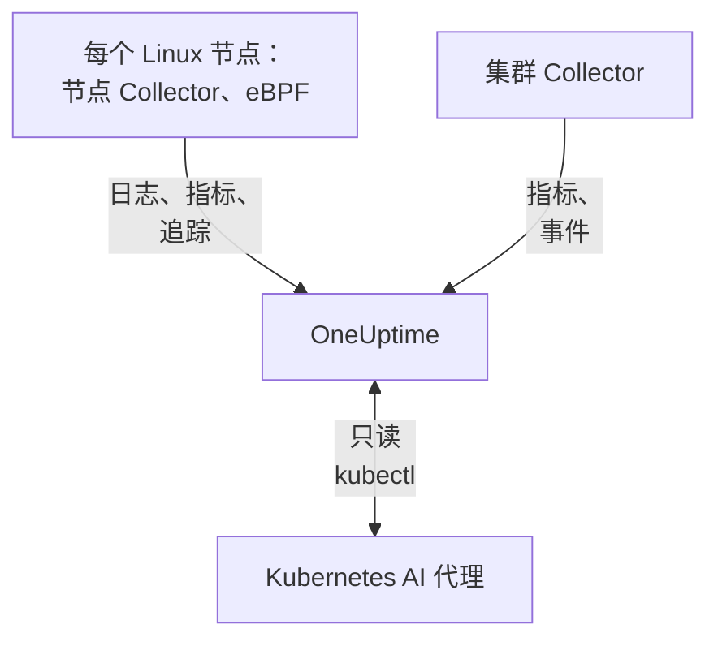

# Kubernetes 代理

OneUptime Kubernetes 代理是一个 Helm chart，它采集集群的指标、事件和 Pod 日志，并借助 eBPF 采集每个 Pod 的追踪、请求指标、服务图和网络流，无需修改代码，也无需 SDK。它还运行 [Kubernetes AI 代理](#kubernetes-ai-代理)，让 OneUptime AI 在调查事件或警报时运行只读的 `kubectl`。一条 `helm install` 即可部署；[Kubernetes 监控](/docs/monitor/kubernetes-monitor) 会根据它发送的数据发出警报。

:::cards
- [安装代理](#安装代理): 使用 Helm 的四个步骤。
- [配置选项](#配置选项): 过滤器、采样、控制平面、服务网格、成本和标签。
- [Kubernetes AI 代理](#kubernetes-ai-代理): 供 OneUptime AI 使用的只读 `kubectl`，以及在你允许时进行的修复。
- [减少发送量](#减少采集的数据量): 按影响大小排列的调节手段。
:::

## 工作原理

该 chart 在自己的命名空间中运行几个工作负载。每个工作负载都使用你提供的摄取密钥，通过 OTLP 把采集到的数据发送到你的 OneUptime URL，集群则以你在 `clusterName` 中指定的名称自行注册。



| 工作负载 | 类型 | 作用 | 运行条件 |
| --- | --- | --- | --- |
| 集群 Collector | Deployment | 来自 Kubernetes API 的集群指标、Kubernetes 事件，以及 Pod、节点和工作负载的规格。 | 始终 |
| 节点 Collector | DaemonSet | 来自 `/var/log/pods` 的 Pod 日志、kubelet 和 cAdvisor 指标，以及节点的操作系统指标。 | 除 EKS Fargate 外的所有环境 |
| eBPF 插桩（OBI） | DaemonSet | 来自每个 Pod 的 HTTP、gRPC、SQL 和 Redis 追踪与请求指标，以及服务地图。 | 默认运行，GKE Autopilot 和 EKS Fargate 除外 |
| Kubernetes AI 代理 | Deployment | OneUptime AI 调查事件或警报时使用的只读 `kubectl`。 | 默认运行 |
| 日志尾随器 | Deployment | 在节点 Collector 无法读取时，通过 Kubernetes API 获取 Pod 日志。 | 使用 `gke-autopilot` 和 `eks-fargate` 预设时 |
| 成本引擎和轮询器 | Deployments | 按命名空间、工作负载和 Pod 统计的支出。 | 设置 `cost.enabled=true` 时 |

所有代理镜像都只支持 Linux，因此所有工作负载都被固定在 Linux 节点上。

## 开始之前

- 一个运行 v1.23 或更高版本的 Kubernetes 集群，以及已配置为可访问它的 `kubectl`。
- Helm 3。升级使用 `--reset-then-reuse-values`，这需要 Helm 3.14 或更高版本。
- 一个摄取密钥。在 **项目设置 → 遥测与 APM → 摄取密钥** 下创建。代理会将其作为 `x-oneuptime-token` 标头发送，因此项目 API 密钥在这里不起作用。
- 集群的名称，在项目中唯一且保持不变，例如 `prod-us-east-1`：集群会以这个名称出现在 OneUptime 中。
- 从集群到你的 OneUptime URL 的出站 HTTPS。

## 安装代理

:::steps
### 添加 Helm 仓库

```bash
helm repo add oneuptime https://helm-chart.oneuptime.com
helm repo update
```

### 安装 chart

将 `YOUR_ONEUPTIME_URL`、`YOUR_ONEUPTIME_API_KEY`（摄取密钥）和集群名称替换为你的值，并选择对应你平台的选项卡（见 [选择预设](#选择预设)）。

:::tabs
@tab Standard
自管理集群、EKS on EC2、GKE Standard、AKS、minikube、kind 和 k3s：

```bash
helm install kubernetes-agent oneuptime/kubernetes-agent \
  --namespace oneuptime-agent \
  --create-namespace \
  --set oneuptime.url="YOUR_ONEUPTIME_URL" \
  --set oneuptime.apiKey="YOUR_ONEUPTIME_API_KEY" \
  --set clusterName="my-cluster" \
  --set aiAgent.enabled=true
```
@tab GKE Autopilot
```bash
helm install kubernetes-agent oneuptime/kubernetes-agent \
  --namespace oneuptime-agent \
  --create-namespace \
  --set oneuptime.url="YOUR_ONEUPTIME_URL" \
  --set oneuptime.apiKey="YOUR_ONEUPTIME_API_KEY" \
  --set clusterName="my-cluster" \
  --set aiAgent.enabled=true \
  --set preset=gke-autopilot
```
@tab EKS Fargate
```bash
helm install kubernetes-agent oneuptime/kubernetes-agent \
  --namespace oneuptime-agent \
  --create-namespace \
  --set oneuptime.url="YOUR_ONEUPTIME_URL" \
  --set oneuptime.apiKey="YOUR_ONEUPTIME_API_KEY" \
  --set clusterName="my-cluster" \
  --set aiAgent.enabled=true \
  --set preset=eks-fargate
```
:::

**AI 调查默认开启。** `aiAgent.enabled=true` 会在 Collector 旁边运行 [Kubernetes AI 代理](#kubernetes-ai-代理)：当此集群上出现事件或警报时，OneUptime AI 会使用只读的 `kubectl`（`get`、`describe`、`logs`、`events`、`top`）进行调查，不做任何更改。在你允许之前，修复保持关闭。要在不启用它的情况下安装，请改用 `--set aiAgent.enabled=false`。

### 检查 Pod 是否在运行

```bash
kubectl get pods -n oneuptime-agent
```

每个 Pod 应在一两分钟内进入 `Running`：

:::tabs
@tab Standard
集群 Collector、AI 代理，以及每个节点上的一个节点 Collector 和一个 eBPF Pod：

```text
NAME                                          READY   STATUS    RESTARTS   AGE
kubernetes-agent-xxxxxxxxxx-xxxxx             1/1     Running   0          1m
kubernetes-agent-ai-agent-xxxxxxxxxx-xxxxx    1/1     Running   0          1m
kubernetes-agent-ebpf-xxxxx                   1/1     Running   0          1m
kubernetes-agent-logs-xxxxx                   1/1     Running   0          1m
```
@tab GKE Autopilot
节点 Collector 仍会运行，在没有 `hostPath` 的情况下读取 kubelet 和 cAdvisor 指标，同时一个日志尾随器 Deployment 通过 Kubernetes API 读取 Pod 日志：

```text
NAME                                          READY   STATUS    RESTARTS   AGE
kubernetes-agent-xxxxxxxxxx-xxxxx             1/1     Running   0          1m
kubernetes-agent-ai-agent-xxxxxxxxxx-xxxxx    1/1     Running   0          1m
kubernetes-agent-logs-yyyyyyyyyy-yyyyy        1/1     Running   0          1m
kubernetes-agent-logs-xxxxx                   1/1     Running   0          1m
```
@tab EKS Fargate
三个 Deployment，没有 DaemonSet：Fargate 为每个 Pod 分配专属的微型虚拟机，并且从不调度 DaemonSet，因此那里没有节点指标：

```text
NAME                                          READY   STATUS    RESTARTS   AGE
kubernetes-agent-xxxxxxxxxx-xxxxx             1/1     Running   0          1m
kubernetes-agent-ai-agent-xxxxxxxxxx-xxxxx    1/1     Running   0          1m
kubernetes-agent-logs-yyyyyyyyyy-yyyyy        1/1     Running   0          1m
```
:::

### 在 OneUptime 中找到集群

打开 **产品 → 基础设施 → Kubernetes → 所有集群**。几分钟内，集群会以其 `clusterName` 出现，节点、Pod 和工作负载也会填充进来。Kubernetes AI 代理会在集群 **人工智能** 下的 **智能体** 页面上显示为已连接。
:::

## 选择预设

`preset` 选择适用于你平台的默认值：Pod 日志是通过 `hostPath` 从节点读取，还是通过 Kubernetes API 读取，以及哪些工作负载可以以特权模式运行。

| `preset` | 适用于 | Pod 日志 | 节点指标 |
| --- | --- | --- | --- |
| `standard`（默认） | 自管理集群、**EKS on EC2**、**GKE Standard**、**AKS**、minikube、kind、k3s | 节点 Collector 通过 `hostPath` 读取 `/var/log/pods`（开销最低） | Kubelet、cAdvisor 和节点的操作系统指标 |
| `gke-autopilot` | **GKE Autopilot** | 日志尾随器通过 Kubernetes API 读取（无 `hostPath`，无主机访问） | Kubelet 和 cAdvisor，不使用 `hostPath` |
| `eks-fargate` | **EKS Fargate** | 日志尾随器通过 Kubernetes API 读取（无 `hostPath`，无主机访问） | 无：Fargate 不运行 DaemonSet |

如果不确定，请从 `standard` 开始。如果安装因提及 `hostPath` 的 Pod Security 错误而失败，请使用 `preset=gke-autopilot`（在 Fargate 上为 `eks-fargate`）重新安装。GKE Autopilot 和 EKS Fargate 也会拒绝 eBPF 和性能剖析器所需的特权 Pod，因此这两个预设会把它们都排除在外。

## 采集的内容

| 类别 | 数据 |
| --- | --- |
| 节点指标 | CPU、内存、文件系统和网络使用情况 |
| Pod 指标 | CPU、内存、网络和重启次数 |
| 容器指标 | 每个容器的 CPU 和内存 |
| 集群指标 | 节点状况、可分配资源、Pod 数量 |
| Kubernetes 事件 | 警告、错误和调度事件 |
| Pod 日志 | 每个容器的 stdout 和 stderr（标准集群上通过 `hostPath`，Autopilot 和 Fargate 上通过 Kubernetes API） |
| 应用追踪（eBPF，默认开启） | 来自每个 Pod 的 HTTP、gRPC、SQL 和 Redis Span，无需 SDK 或修改代码 |
| HTTP RED 指标（eBPF） | 每个服务的 `http.server.request.duration`，以及请求和响应的正文大小 |
| 服务图（eBPF） | 调用方到被调用方的请求速率、延迟和错误边，用于绘制服务地图 |
| 网络流指标（eBPF） | Pod 之间的 TCP 和 UDP 字节与数据包计数器，附带 Kubernetes 元数据 |
| TCP 统计（eBPF） | 节点级的往返时间、连接失败和重传计数器 |
| 工作负载成本（需选择启用，`cost.enabled=true`） | 按命名空间、工作负载和 Pod 统计的支出（含空闲和效率），以及节点和卷的每小时成本：见 [Kubernetes 成本可观测性](/docs/telemetry/kubernetes-cost) |

## 配置选项

下面的每个选项都是一个 Helm 值。可在安装时设置，或对已安装的代理使用 `helm upgrade ... --reset-then-reuse-values --set <value>` 设置。

### 命名空间过滤

`namespaceFilters.rules` 将命名空间模式分别应用于四个作用域：

| 作用域 | 过滤位置 | 影响范围 |
| --- | --- | --- |
| `podLogs` | hostPath filelog 接收器或 API 日志尾随器 | 仅 Pod 的 stdout 和 stderr；Kubernetes 事件和审计日志不受影响 |
| `ebpfDiscovery` | OBI 的进程发现 | 来自匹配工作负载的 eBPF 追踪和 eBPF 指标 |
| `metrics` | 在 Collector 中，添加 Kubernetes 元数据之后 | 带命名空间的指标序列；不带命名空间的节点和集群序列会保留 |
| `traces` | 在 Collector 中，添加 Kubernetes 元数据之后 | eBPF Span 以及应用通过 OTLP 推送的 Span |

模式匹配整个命名空间名称，可以使用 `*`（`team-*`）。如果某个作用域有任何 `include` 规则，则该作用域只保留匹配的命名空间，并且 `exclude` 规则始终优先。默认规则只在 `podLogs` 和 `ebpfDiscovery` 中排除 `kube-system`。

要把 Pod 日志和 eBPF 发现限制在部分命名空间：

```bash
helm install kubernetes-agent oneuptime/kubernetes-agent \
  --namespace oneuptime-agent \
  --create-namespace \
  --set oneuptime.url="YOUR_ONEUPTIME_URL" \
  --set oneuptime.apiKey="YOUR_ONEUPTIME_API_KEY" \
  --set clusterName="my-cluster" \
  --set-json 'namespaceFilters.rules=[{"action":"include","namespaces":["default","production","staging"],"scopes":["podLogs","ebpfDiscovery"]}]'
```

要停止某个嘈杂命名空间的日志，同时保留它的 eBPF 追踪、服务地图和指标，请把排除范围限定在 `podLogs`：

```bash
  --set-json 'namespaceFilters.rules=[{"action":"exclude","namespaces":["kube-system"],"scopes":["podLogs","ebpfDiscovery"]},{"action":"exclude","namespaces":["noisy-*"],"scopes":["podLogs"]}]'
```

`podLogs` 和 `ebpfDiscovery` 规则在源头过滤：被排除的日志文件永远不会被打开，被排除的工作负载永远不会被插桩。`metrics` 和 `traces` 规则则在之后、在 Collector 中、命名空间附加到数据之后才生效。

#### 按命名空间过滤指标和追踪

要同时过滤带命名空间的指标或 Span，请把这些作用域添加到规则中：

```bash
  --set-json 'namespaceFilters.rules=[{"action":"exclude","namespaces":["kube-system","noisy-*"],"scopes":["podLogs","ebpfDiscovery","metrics","traces"]}]'
```

> [!NOTE]
> 节点级和集群级指标始终会保留。命名空间属于 Pod 而不属于节点，因此节点 CPU、节点内存和文件系统使用量等序列没有可匹配的内容，永远不会被丢弃：作用域为 `metrics` 的规则会削减每个 Pod 的序列，而不会隐藏出问题的节点。

Kubernetes 事件无法在代理端按命名空间过滤：它们来自 `k8sobjects` 接收器，没有 `k8s.namespace.name` 属性（命名空间在事件正文中），因此过滤器没有可匹配的内容。请改为在 OneUptime 中通过 **日志 → 设置 → 丢弃过滤器** 丢弃它们。

### 按日志严重性过滤

`filters.logs.minSeverity` 会在代理端、在发送任何内容之前，丢弃低于某个严重性的 Pod 日志记录：

```bash
  --set filters.logs.minSeverity=WARN
```

它接受 `TRACE`、`DEBUG`、`INFO`、`WARN`、`ERROR` 和 `FATAL`。`WARN` 保留 WARN、ERROR 和 FATAL，丢弃 INFO、DEBUG 和 TRACE；默认值（`""`）保留所有内容。它在两种日志模式下都生效（`daemonset` 模式下通过 Collector，`api` 模式下在日志尾随器内部），因此预设永远不会悄悄把它关掉。

容器运行时不记录严重性，因此代理会从日志文本本身读取严重性（`[ERROR]`、`WARN:`、`"level":"info"`、…）。没有可识别级别的行会如何处理取决于日志模式，因为两种模式掌握的信息不同：

| 模式 | 没有级别的行 | 原因 |
| --- | --- | --- |
| `daemonset` | `stderr` 计为 ERROR（保留），`stdout` 计为 INFO（被 WARN 阈值丢弃） | 容器运行时会记录每一行来自哪个流。 |
| `api` | 始终保留 | Kubernetes 的 `pods/log` API 把 stdout 和 stderr 合并为一个流，没有逐行标记，因此代理不去猜测，而是保留该行。 |

所以 `api` 模式有意比 `daemonset` 模式丢弃得更少：Python traceback 或 `npm ERR!` 不带严重性关键字，悄悄删除它们正是阈值应当避免的失败。在混合模式（`logs.windowsPods.enabled`）下，两行规则都按节点操作系统适用：Linux Pod 遵循 `daemonset`，Windows Pod 遵循 `api`。

两种模式在过滤之前都会把多行事件重新拼合，因此 Java 堆栈跟踪按其第一行判断，整体保留或整体丢弃。

> [!IMPORTANT]
> Kubernetes 事件和资源规格永远不会被它过滤。它们来自 Kubernetes API，没有自己的严重性，因此阈值会删除整个数据流，包括你最需要的 `FailedScheduling`、`BackOff` 和 `OOMKilling` 警告。它们数量少而价值高，所以代理总是发送它们；要精简它们，请在 OneUptime 中使用 **日志 → 设置 → 丢弃过滤器**。

### 按名称包含或排除指标

`filters.metrics` 决定哪些指标离开集群，作用于所有接收器。

丢弃几个嘈杂的指标（拒绝列表，通常是你想要的）：

```bash
  --set-json 'filters.metrics.exclude=["k8s.volume.available","k8s.volume.capacity"]'
```

只发送一组固定的指标（允许列表：其他所有指标都会被丢弃）：

```bash
  --set-json 'filters.metrics.include=["k8s.pod.cpu.utilization","k8s.pod.memory.usage"]'
```

按模式而不是确切名称匹配：

```bash
  --set filters.metrics.matchType=regexp \
  --set-json 'filters.metrics.exclude=["^container_network_"]'
```

| 键 | 含义 |
| --- | --- |
| `filters.metrics.exclude` | 要丢弃的指标名称。在 `include` 之后应用，因此排除总是优先。 |
| `filters.metrics.include` | 不为空时，只发送这些指标。 |
| `filters.metrics.matchType` | `strict`（确切名称，默认）或 `regexp`（RE2，不锚定）。 |

- `regexp` 不锚定：`system.cpu` 也会匹配 `system.cpu.time`。如果你指的正好是一个指标，请加上锚点（`^system\.cpu$`）。
- RE2 没有前瞻，因此 `^(?!container_)` 无法编译。要表达“除此之外的全部”，请使用 `include`，而不是否定模式。
- `include` 一次作用于所有接收器。漏掉某个指标的允许列表会悄悄移除基于它的监视器，所以除非你需要一个封闭集合，否则请优先使用 `exclude`。
- 列表请使用 `--set-json`（或 values 文件）：普通的 `--set` 会替换列表，而不是追加。

> [!WARNING]
> 在推广之前先测试模式。Collector 在启动时编译模式，因此无效的模式不会悄悄出错：Collector 会拒绝启动并陷入崩溃循环，连同它的指标一起拖垮该 Collector 的日志。Helm 无法编译 RE2，因此 `helm upgrade` 会毫无怨言地接受错误的模式。

### 追踪采样

上面的过滤器会移除一类遥测：一个命名空间、一个严重性、一个指标名称。采样则保留所有类别，转而稀释总体。将 `sampling.traces.percentage` 设置为要保留的追踪比例：

```bash
helm upgrade kubernetes-agent oneuptime/kubernetes-agent \
  --namespace oneuptime-agent --reset-then-reuse-values \
  --set sampling.traces.percentage=10
```

这样每十条追踪保留一条，其余九条在离开集群之前就在代理端被丢弃。

- **你得到的是完整的追踪，而不是碎片。** 判定基于追踪 ID 的哈希，而不是对每个 Span 掷硬币，因此一条追踪的所有 Span 会一起保留或一起丢弃，保留下来的追踪可以从头读到尾。
- **基于指标的监视器不受影响。** OBI 根据每个请求计算 eBPF RED 指标（请求速率、错误率、耗时），这些指标走的是不经过采样器的指标管道。设为 10% 时，你会得到十分之一的追踪，而速率、错误和延迟仍然精确。
- **基于 Span 的监视器会受影响。** OneUptime 根据 Span 本身统计的任何内容都会按比率缩小：见下面的警告。

| 键 | 含义 |
| --- | --- |
| `sampling.traces.percentage` | 要保留的追踪百分比，0 到 100。默认 `100`（全部保留）。 |
| `sampling.traces.hashSeed` | 追踪 ID 哈希的种子。默认 `22`。 |

- `0` 不保留任何追踪。它是一个比率，不是开关：在 eBPF DaemonSet 继续运行并产生成本的同时，它会删除每一条追踪。如果不需要追踪，请使用 `ebpf.enabled=false`；如果不需要追踪但需要 RED 指标和服务地图，请保持 eBPF 开启并有意设置 `0`。
- 它只在 `ebpf.enabled` 开启时生效：否则没有追踪管道，该值不起任何作用。
- 它只对追踪采样。有意不提供 `sampling.logs` 或 `sampling.metrics`：见下面的说明。
- 小数需要 `--set-json`，并且有下限。`--set sampling.traces.percentage=0.5` 会失败，因为 Helm 把 `0.5` 读作字符串：请使用 `--set-json 'sampling.traces.percentage=0.5'` 或 values 文件。低于约 `0.0061` 时，比率会向下取整为零，表现与 `0` 完全相同，且不报错；`0.01`（万分之一）是能按其字面意义工作的最小值。
- 多个集群默认即可正常工作。两个代理只有在 `hashSeed` 和 `percentage` 都一致时才会保留同一条追踪，而两者在各处的默认值都相同，因此跨两个集群的追踪会完整保留。只有在需要让两个采样层彼此独立时才更改 `hashSeed`：使用相同的种子时，较低的比率保留的是较高比率所保留追踪的子集。
- Pod 日志永远不会被采样，因此在 `ebpf.logToTraceCorrelation: true` 时，每条日志记录仍带有追踪 ID，而这些追踪只有被保留的那部分存在。于是大约 (100 − `percentage`)% 的日志记录会链接到不存在的追踪；从追踪跳转到其日志不受影响。

> [!WARNING]
> 设置此项时，请重新调整基于 Span 的监视器。采样会减少到达 OneUptime 的 Span，因此任何对它们计数的东西都会计得更少：针对 `Span Count` 的 **追踪** 监视器和针对 `Exception Count` 的 **异常** 监视器只会看到昨天数据量的大约 `percentage`%。基于未采样流量调好的阈值会悄悄地不再被越过：监视器不会报错，只是变得沉默。请把这些阈值除以同样的系数；比率作用于整个集群，因此无法豁免任何服务。错误分组的退化比线性更糟：常见的异常仍会出现，但罕见的一次性异常更可能直接消失，而不是以十分之一的频率出现。

> [!NOTE]
> 为什么没有日志或指标采样：Collector 的采样器根本无法对指标采样。它可以对日志采样，但它的随机性来自追踪 ID，而 Pod 日志没有追踪 ID，因此每条日志记录的哈希都相同，日志采样率会根据种子要么保留全部、要么删除全部。与其提供一个会悄悄删除日志的设置，chart 选择不提供。要精简日志，请使用 [按日志严重性过滤](#按日志严重性过滤) 和 [命名空间过滤](#命名空间过滤)，它们对移除的内容都很精确。

### 禁用日志采集

如果你不需要 Pod 日志：

```bash
helm install kubernetes-agent oneuptime/kubernetes-agent \
  --namespace oneuptime-agent \
  --create-namespace \
  --set oneuptime.url="YOUR_ONEUPTIME_URL" \
  --set oneuptime.apiKey="YOUR_ONEUPTIME_API_KEY" \
  --set clusterName="my-cluster" \
  --set logs.enabled=false
```

你的指标不受影响：节点 Collector 会继续运行以采集 kubelet、cAdvisor 和主机指标，只是不再读取 Pod 日志。只有基于日志的警报会停止，其他一切照旧。

### 强制使用特定的日志采集模式

`logs.mode` 会覆盖预设的选择，并且总是优先于预设：

- `logs.mode=daemonset`：hostPath DaemonSet（开销最低；需要 `hostPath`）。
- `logs.mode=api`：Kubernetes API 日志尾随器 Deployment（适用于任何集群）。
- `logs.mode=disabled`：没有 Pod 日志。

模式只决定 Pod 日志从哪里来：无论哪种模式都会采集节点指标，因此 `api` 和 `disabled` 都会保留你的 kubelet、cAdvisor 和主机指标。例外取决于平台：EKS Fargate 完全无法调度 DaemonSet，因此没有节点 Collector，也没有节点、Pod 或容器指标。GKE Autopilot 会运行节点 Collector，但会阻止 `hostPath`，因此它采集 kubelet 和 cAdvisor 指标，但不采集读取主机 `/proc` 和 `/sys` 的 `hostmetrics` 指标（磁盘 I/O、inode、网卡错误）。

在带有 Windows 节点池的集群上，`daemonset` 模式只覆盖 Linux 节点，因为所有代理镜像都只支持 Linux。添加 `--set logs.windowsPods.enabled=true`，即可在其旁边运行 API 日志尾随器，只处理 Windows 节点上的 Pod：Linux Pod 继续在节点本地跟踪文件，两者永远不会重复发送同一行。这需要一个至少与 chart 一样新的 `kubernetes-log-tailer` 镜像：较旧的镜像会忽略这一限制，并把 Linux 日志发送两次。

### 启用控制平面监控

集群的 **控制平面** 页面绘制 etcd、API 服务器、调度器和控制器管理器的图表。当 `controlPlane.enabled` 为 `true` 时，代理会抓取这四者：

```bash
helm upgrade kubernetes-agent oneuptime/kubernetes-agent \
  --namespace oneuptime-agent \
  --reset-then-reuse-values \
  --set controlPlane.enabled=true
```

每个组件都在其自身列表中的地址上被抓取：`controlPlane.etcd.endpoints`、`controlPlane.apiServer.endpoints`、`controlPlane.scheduler.endpoints` 和 `controlPlane.controllerManager.endpoints`。抓取在代理的 Pod 中运行，而该 Pod 没有主机网络，因此默认值（`https://localhost:<port>/metrics`）指向的是该 Pod 本身：请把每个列表设置为该 Pod 能够访问的地址。在任何集群内部，API 服务器都会在 `https://kubernetes.default.svc:443/metrics` 上响应：

```bash
helm upgrade kubernetes-agent oneuptime/kubernetes-agent \
  --namespace oneuptime-agent \
  --reset-then-reuse-values \
  --set controlPlane.enabled=true \
  --set "controlPlane.apiServer.endpoints={https://kubernetes.default.svc:443/metrics}"
```

`controlPlane.enabled` 会一次性开启全部四项抓取。如果某个组件无法通过其端点访问（托管集群上的 etcd、调度器和控制器管理器，或者仍使用其 `localhost` 默认值时），它的抓取在每个间隔都会失败：Collector 会记录一个抓取错误并将目标报告为宕机，除此之外没有任何变化。

代理只通过 HTTPS 抓取，使用服务账号的令牌，不使用客户端证书。因此：

- **etcd** 需要一个不要求客户端证书的 HTTPS 指标地址。etcd 常用的指标端口都无法使用：`2381` 上的明文 HTTP（kubeadm 的 `--listen-metrics-urls`）会被当作 HTTPS 抓取而失败，而 `2379` 需要客户端证书。
- **调度器**（`10259`）和 **控制器管理器**（`10257`）提供 HTTPS 并接受令牌，但 kubeadm 在控制平面节点上把它们绑定到 `127.0.0.1`：它们需要一个代理的 Pod 能够访问的 `--bind-address`。

托管 Kubernetes 服务（EKS、GKE、AKS）不暴露 etcd、调度器或控制器管理器，因此这些选项卡在那里保持为空。在某个选项卡的指标到达之前，**控制平面** 页面会显示需要设置的内容来代替图表，并附上可复制的命令。

### 启用 CoreDNS 指标

**控制平面** 页面的 **CoreDNS** 选项卡绘制 DNS 查询、延迟、缓存和转发的图表。采集这些指标默认关闭：

```bash
helm upgrade kubernetes-agent oneuptime/kubernetes-agent \
  --namespace oneuptime-agent \
  --reset-then-reuse-values \
  --set coreDns.enabled=true
```

代理会抓取 `kube-system` 中带有 `k8s-app=kube-dns` 标签的 Pod 的 `9153` 端口，这正是 kubeadm 集群、EKS 和 AKS 上运行 CoreDNS 的方式。如果你的 CoreDNS 运行在别处，还要设置 `coreDns.namespace`、`coreDns.service`（`k8s-app` 标签）和 `coreDns.port`。GKE 运行的是 kube-dns（dnsmasq）或 Cloud DNS，而不是 CoreDNS，因此该选项卡在那里保持为空。

### 启用服务网格指标

集群的 **服务网格** 页面绘制 Istio 和 Linkerd 的图表。代理会抓取一个网格，即 `serviceMesh.provider` 指定的那个（`istio` 或 `linkerd`）：

```bash
helm upgrade kubernetes-agent oneuptime/kubernetes-agent \
  --namespace oneuptime-agent \
  --reset-then-reuse-values \
  --set serviceMesh.enabled=true \
  --set serviceMesh.provider=istio
```

对于 Istio，它读取每个 `istio-proxy` sidecar 的 Envoy 统计信息（端口 `15090`）；对于 Linkerd，读取每个 `linkerd-proxy` 的管理端口。两种网格的控制平面都不会被抓取：istiod（**Pilot** 卡片）以及 Linkerd 的 identity、destination 和 proxy-injector 组件（**控制平面** 卡片）在它们各自的管理端口上提供指标，因此这些卡片会显示这一说明来代替图表。

### 代理不采集的指标

有些图表显示的指标代理并不抓取：**控制平面** 页面上的 **kube-proxy**；**服务网格** 页面上的 **Cilium**（使用 Hubble）；以及 Istio 和 Linkerd 选项卡上网格自身的控制平面（**istiod**，以及 Linkerd 的 identity、destination 和 proxy-injector 组件）。当这些指标通过其他方式到达 OneUptime 时，这些图表就会填充，例如由你自己的 [OpenTelemetry Collector](/docs/telemetry/open-telemetry) 抓取它们，并把资源属性 `k8s.cluster.name` 设置为集群的名称（代理的 `clusterName`）。不使用 kube-proxy 运行的集群根本没有 kube-proxy 指标。

### 启用成本可观测性

在集群的 **Costs** 页面上查看每个命名空间、工作负载和 Pod 的成本，以及空闲容量和每个 request 的使用比例：

```bash
helm upgrade kubernetes-agent oneuptime/kubernetes-agent \
  --namespace oneuptime-agent \
  --reset-then-reuse-values \
  --set cost.enabled=true
```

仅此一项就是完整的安装：chart 内置了开源的 [OpenCost](https://opencost.io) 引擎（以及它所需的小型 Prometheus），无需凭据即可根据云厂商的公开价格为你的节点和卷定价。它会增加两个小 Pod，第一批成本会在第一个小时结束后出现。已经在运行 Kubecost 或 OpenCost？改为添加 `--set cost.engine.url=<its service URL>`，就不会内置任何东西。本地集群可以用 `cost.opencost.customPricing` 设置费率卡。包含本地定价和故障排查的完整指南见 [Kubernetes 成本可观测性](/docs/telemetry/kubernetes-cost)。

### 使用项目标签自动打标签

任何以 `oneuptime.label.` 开头的资源属性都会成为项目标签，附加到集群以及此代理报告的服务和主机上：`oneuptime.label.<dimension>=<value>` 即标签 `<dimension>:<value>`。在安装时使用 `--set oneuptime.labels.<key>=<value>` 传入标签：

```bash
helm install kubernetes-agent oneuptime/kubernetes-agent \
  --namespace oneuptime-agent \
  --create-namespace \
  --set oneuptime.url="YOUR_ONEUPTIME_URL" \
  --set oneuptime.apiKey="YOUR_ONEUPTIME_API_KEY" \
  --set clusterName="prod" \
  --set oneuptime.labels.team=payments \
  --set oneuptime.labels.env=production \
  --set oneuptime.labels.region=us-east-1
```

或者把它们放在 values 文件中：

```yaml title="values.yaml"
oneuptime:
  url: YOUR_ONEUPTIME_URL
  apiKey: YOUR_ONEUPTIME_API_KEY
  labels:
    team: payments
    env: production
    region: us-east-1
clusterName: prod
```

标签匹配不区分大小写，因此你手动创建的已有 `Production` 标签会被复用而不是重复创建，在 OneUptime 中添加的标签也永远不会被代理删除。

## 通过 eBPF 获取应用追踪和 HTTP 指标（默认开启）

该 chart 在每个节点上运行一个 [OpenTelemetry eBPF Instrumentation (OBI)](https://opentelemetry.io/docs/zero-code/obi/) DaemonSet。它把 eBPF 程序加载到内核中，捕获每种受支持运行时（Go、.NET、Java、Node.js、Python、Ruby、Rust）的 HTTP 和 HTTPS、gRPC、SQL 及 Redis 流量，无需 SDK，也无需 sidecar。随后，追踪和请求指标经由集群内的 Collector 发送到 OneUptime。

它需要带 BTF 的 Linux 内核 5.8 或更高版本（Debian 11+、Ubuntu 20.10+、Fedora 34+、RHEL 和 Stream 9+ 上默认具备），并且其 DaemonSet 以特权模式运行，因为加载 eBPF 程序需要这样做。

### eBPF 追踪是什么样子

eBPF 看到的是网络调用，而不是你的代码，因此一条追踪由服务处理的请求以及它在处理过程中发出的调用构成：

- **一个请求及其调用构成一条追踪。** 进入服务的请求是根 Span，名为 `<METHOD> <route>`，服务在处理它时发出的 HTTP、gRPC、SQL 和 Redis 调用是它的子 Span。（对于 Node.js，这依赖于 OBI 的 Node.js 代理，chart 通过 `ebpf.nodejs.enabled` 开启它。）并发请求通过同一个共享连接发出的调用（Redis 客户端中很常见）并不总能区分开来，因此其中一些不会被放入它们所属请求的追踪中。
- **对另一节点上服务的调用会开始一条新的追踪。** 除非有东西把追踪上下文传递过去：OpenTelemetry SDK，或下文介绍的需选择启用的上下文传播。当两端运行在同一节点上时，OBI 能看到两端并自行把它们关联起来。
- **不是由请求发起的工作是孤立的。** 轮询 Redis 的队列 worker 或 cron 任务，没有其调用可归属的请求。
- **数据库服务器通常是孤立的。** 数据库线协议不携带追踪上下文，因此除非调用方运行在同一节点上，否则 OBI 在数据库服务器内部为每条命令记录的 Span 都是只有一个 Span 的追踪。

这些孤立的数据库调用会以只有一个 Span、以裸命令命名（`set`、`evalsha`、`SELECT`）的追踪到达，在繁忙的集群上，它们可能占 OBI 捕获内容的大部分。默认情况下，代理会在它们离开集群之前将其丢弃：数据库服务器自身的 Span，它总是与调用方的 Span 重复（`ebpf.dropDatabaseServerSpans=true`），以及不属于任何追踪的应用调用（`ebpf.dropUnlinkedDatabaseCalls=true`）。请求追踪内的应用数据库调用会被保留，你的应用通过自身 SDK 发送的 Span 永远不会被改动，数据库指标仍会统计每一条命令。

有一个权衡：OneUptime 通过数据库客户端 Span 发现数据库，并把它们绘制在服务地图上。只有后台工作与之通信的数据库（worker 的队列、cron 任务的数据仓库）就不再能从追踪中被发现，并会在服务地图上显示为远程端点。它的指标不受影响。设置 `ebpf.dropUnlinkedDatabaseCalls=false` 可保留这些 Span。

后台工作的 HTTP 和 gRPC 调用（通过 HTTP 查询 ClickHouse 的 worker、续订其 Kubernetes 租约的控制器）同样会以只有一个 Span 的追踪到达（`POST /`、`PUT /apis/*/...`）。设置 `ebpf.dropUnlinkedClientCalls=true` 可把它们也丢弃，连同 OBI 未能放入所属请求追踪、看起来一样的调用；数据库、消息和 GenAI 调用（包括 MCP）永远不会因此被丢弃。它默认关闭，因为它会损失数据：当被调用的服务运行在同一节点上时，OBI 会把该服务处理的请求关联到这次调用之下，于是这次调用成为该追踪的根，丢弃它就会让追踪失去根。开启 `ebpf.contextPropagation` 时，这在任何节点上都会发生，对拥有自己 OpenTelemetry SDK 的服务也一样。服务地图也会读取这些调用：只有后台工作调用的依赖项此时只能根据 OBI 的服务图指标绘制，而在请求内也能看到的边只统计那些调用。服务的概览会统计其 Span，因此 Span 大多是这类调用的 worker 或探针会显示少得多的请求数，其错误率和 p95 延迟也基于剩下的 Span 计算。OBI 的客户端请求指标仍会统计每一次调用。

在自托管的 OneUptime 上，请先升级服务器，再升级代理：此 chart 运行的 eBPF 追踪器（OBI v0.14）为被调用服务命名以及报告消息代理自身 Span 的方式，是旧版 OneUptime 服务器无法读取的。

名称来自流量。HTTP Span 在 OBI 能读取时使用应用的路由模板，否则使用由 URL 生成的模式，其中类似 ID 的路径段被替换为 `*`；设置 `ebpf.routes.patterns` 可自行命名。OBI 能读取 Go（net/http、Gorilla mux、Gin）、Java（Spring、JAX-RS）、Node.js（Express、Fastify、Koa、NestJS、Next.js）、Python（Django、FastAPI、Flask）、Ruby（Rails）、.NET（ASP.NET Core 特性路由）和 PHP（Symfony、Laravel、Slim）应用的路由模板。`OrderService.charge` 这样的应用级名称只存在于代码中，需要 OpenTelemetry SDK。

如果某个应用已经通过 OpenTelemetry SDK 导出追踪，OBI 会察觉到并停止为它发送 eBPF 追踪，因此它不会被追踪两次（`ebpf.excludeOtelInstrumentedServices=true`，OBI 的默认值）。如果该 SDK 向另一个项目报告，而你也想在这个项目中获得该应用的 eBPF 追踪，请将其设置为 `false`。

### 禁用 eBPF 自动插桩

在以下情况下关闭 eBPF：

- 你在 **GKE Autopilot** 或 **EKS Fargate** 上安装：这些平台拒绝特权 Pod，因此 `preset=gke-autopilot` 和 `preset=eks-fargate` 已经为你排除了 eBPF，连同性能剖析器。
- 节点运行的内核早于 5.8，且没有 BTF 向后移植。
- 你已经在每个应用中通过 OpenTelemetry SDK 发送追踪，也不需要 eBPF 指标。（如果只是追踪，则无需关闭：如上所述，OBI 会对它发现自行导出追踪的应用停止发送 eBPF 追踪。）

```bash
helm install kubernetes-agent oneuptime/kubernetes-agent \
  --namespace oneuptime-agent \
  --create-namespace \
  --set oneuptime.url="YOUR_ONEUPTIME_URL" \
  --set oneuptime.apiKey="YOUR_ONEUPTIME_API_KEY" \
  --set clusterName="my-cluster" \
  --set ebpf.enabled=false
```

### 单独开关各个信号族

除了一个之外，其余默认都开启。用 `--set ebpf.features.<name>=false` 关闭任意一个：

| `ebpf.features.*` | 默认 | 增加的内容 |
| --- | --- | --- |
| `httpMetrics` | 开 | 每个服务的 HTTP 和 gRPC RED 指标（请求速率、延迟、错误） |
| `spanMetrics` | 开 | Span 调用次数和耗时（`traces.span.metrics.*`） |
| `serviceGraph` | 开 | 调用方到被调用方的边指标，用于绘制服务地图 |
| `networkMetrics` | 开 | Pod 之间的 TCP 和 UDP 流计数器 |
| `networkInterZoneMetrics` | 关 | 网络指标的跨可用区变体（基数翻倍） |
| `tcpStats` | 开 | 节点级的 TCP 往返时间、连接失败和重传计数器 |

跨服务的追踪上下文传播默认关闭：OBI 注入 W3C `traceparent`，使从 Pod A 到 Pod B 的请求在任何地方都没有 SDK 的情况下显示为一条追踪。使用 `--set ebpf.contextPropagation=true` 选择启用。它所需的内核不超出代理其余部分的要求，也没有哪个内核版本会让它失效。

它之所以默认关闭，是因为注入标头意味着改写已在传输中的流量：明文 HTTP 请求在内核中被原地扩展，而 TLS 和原始 TCP 则通过 Traffic Control 钩子追加一个 TCP 选项。如果连接的字节记账没有被精确修正，数据流就会错位；已报告的症状是，经过 nginx 等 L7 代理的传输在响应超过约 64KB 后在正文中途挂起，而小请求仍能正常工作。不要因为内核版本较旧就排除这种可能：在 5.17 以下的内核上，OBI 会退回到有界扫描程序，并以同样的方式改写流量。追踪、RED 指标和服务地图都不依赖它；要跨服务关联，OpenTelemetry SDK 会在用户空间传播 `traceparent`，无需改写内核中的流量，是更安全的选择。

## Kubernetes AI 代理

当此集群上出现事件或警报时，OneUptime AI 会进行调查。chart 中的 **Kubernetes AI 代理** 为它提供一个终端：它像值班工程师那样运行只读的 `kubectl`（describe 出故障的 Pod、读取其事件、查看崩溃容器的日志、检查节点容量），并在事件页面上引用它运行的每一条命令。

该代理 **默认开启** 且 **只读**：一个小型 Deployment（`kubernetes-agent-ai-agent`，Pod 标签 `component=ai-agent`，镜像 `oneuptime/kubernetes-ai-agent`），其 ServiceAccount 只能读取。它使用与 Collector 相同的 `oneuptime.apiKey` 和 `clusterName` 自行注册，因此无需在仪表板中进行任何设置：集群的 **AI 代理** 页面（Kubernetes → 集群 → 人工智能 → 智能体）会在一分钟内显示其为已连接，该状态旁边 **⋯** 菜单中的 **测试连接** 会通过它运行 `kubectl version` 和 `kubectl auth can-i --list`。AI 用它做过的一切都在集群的 **AI 日志** 页面（人工智能 → 日志）上，而关于该集群值得了解的内容——反复出现的问题及其原因、导致其中大多数问题的节点或工作负载、AI 修复了什么——则在 **AI Insights** 页面（人工智能 → Insights）上。该代理内置一个固定版本的 kubectl（v1.36.4）。它不是 Runner，也永远不会出现在 Runbooks → Runners 下：OneUptime 从不向它提供凭据，从不在它上面运行 runbook，它也永远不会被接受为自动修复规则的命令 Runner。

对于在 AI 代理出现之前安装的代理，请先刷新 chart 索引，然后升级（在自托管的 OneUptime 上，请先升级 OneUptime——见 [升级代理](#升级代理)）：

```bash
helm repo update
helm upgrade kubernetes-agent oneuptime/kubernetes-agent \
  --namespace oneuptime-agent --reset-then-reuse-values \
  --set aiAgent.enabled=true
```

如果你安装代理时使用的发布名称和命名空间不同，请使用你的（`helm list -A | grep kubernetes-agent` 会列出它们）。如果不运行 `helm repo update`，Helm 可能会解析到你当初安装时的 chart，该 chart 不认识 `aiAgent`，会以 `Additional property aiAgent is not allowed` 失败。发布的 chart 版本跟随 OneUptime 版本，因此如果 `helm show values oneuptime/kubernetes-agent | grep aiAgent` 什么也没输出，说明你的索引仍是旧的。要在不运行 AI 代理的情况下运行 chart，请传入 `--set aiAgent.enabled=false`。

### AI 可以执行的操作

OneUptime AI 在集群上可以执行的操作通过 chart 中的两个值设置，集群的 AI 代理页面会在 **AI 可以执行的操作** 下显示它们，但无法在那里更改：

- `aiAgent.investigation` — `true`：AI 在调查集群上的事件或警报时运行只读的 `kubectl`。`false`：它仍会调查，但只使用 OneUptime 已有的数据。
- `aiAgent.fixes` — `off`、`ask-for-approval`、`automatic` 或 `bypass-approval`（见下文）。除 `off` 外的每个级别都会授予 AI 代理写入权限；`off` 不授予任何权限，代理随后会自行拒绝每一次写入。

AI 代理会把这两个值报告给 OneUptime，OneUptime 将其应用到集群，并拒绝在其他任何地方（AI 代理页面、API 或 Terraform）所做的更改。该页面上的 **更改** 会显示你所选选项对应的命令。两者在 `values.yaml` 中都未设置：两者都未设置的发布会让代理使用它自己的默认值（调查开启、修复关闭），而 OneUptime 只会把这些默认值应用到没有人在其 AI 代理页面上选择过设置的集群——有人在那里选择的设置会保持原样，页面会显示如何把它们迁移到 chart 中。

### 让 AI 修复它发现的问题

在你用 `aiAgent.fixes` 开启之前，修复一直处于关闭状态——这是一个单独的可选步骤，它还会授予 AI 代理写入权限。推荐的方式是只在 AI 可以修复的命名空间中授予权限，并关闭节点操作：

```bash
helm repo update
helm upgrade kubernetes-agent oneuptime/kubernetes-agent \
  --namespace oneuptime-agent --reset-then-reuse-values \
  --set aiAgent.enabled=true \
  --set aiAgent.investigation=true \
  --set aiAgent.fixes=ask-for-approval \
  --set "aiAgent.remediation.namespaces={web,api}" \
  --set aiAgent.remediation.nodeOperations=false
```

或者在整个集群范围内授予：

```bash
helm repo update
helm upgrade kubernetes-agent oneuptime/kubernetes-agent \
  --namespace oneuptime-agent --reset-then-reuse-values \
  --set aiAgent.enabled=true \
  --set aiAgent.investigation=true \
  --set aiAgent.fixes=ask-for-approval \
  --set-json 'aiAgent.remediation.namespaces=[]'
```

你列出的每个命名空间都必须已经存在：chart 会在每个命名空间中创建一个 RoleBinding，但从不创建命名空间，因此缺少任何一个都会让整个升级失败——连同 Collector 的升级——并报 `namespaces "api" not found`。请先创建它，或把它从列表中去掉；在删除命名空间之前，也要先把它从列表中去掉。升级时省略该标志会保留已存储的列表；`--set-json 'aiAgent.remediation.namespaces=[]'`（Helm 3.10+）会恢复为整个集群范围——不要用 `={}`，Helm 会把它读作一个空名称。在 `--reuse-values` 下，`--set aiAgent.remediation.namespaces=null` 不会重置已存储的列表：Helm 会保留已存储的列表。`aiAgent.remediation.nodeOperations=false` 让修复不触及节点；将其设置为 `true` 可允许 AI 对节点执行 cordon、uncordon、drain 和 taint。

`aiAgent.fixes` 选择修复的运行方式；要再次关闭修复，请使用 `--set aiAgent.fixes=off` 升级，这也会移除写入权限：

- **ask-for-approval** — OneUptime AI 编写确切的 `kubectl` 计划，由人在事件上一键批准；
- **automatic** — 安全的更改会自动运行；风险更高的更改永远不会自动运行。当一轮只能找到风险更高的修复时，它会在结束时提出这些修复以供一键批准；当它也运行了一个安全的修复时，只有在验证表明该安全修复没有让信号恢复时，才会提出风险更高的修复（即会请求批准的后续轮次）；
- **bypass-approval** — AI 不会询问：策略允许的每一项更改都会自动运行，包括后续轮次；但在每小时熔断器触发、另一轮无人值守的 OneUptime AI 仍在更改或验证同一集群，或者它紧接在一个回滚未完成的修复之后时，该轮会请求批准。

无论哪种模式，在 kube-system、kube-public 或 kube-node-lease 中的写入总是需要人来批准，对节点的 `drain`、`taint` 和 `patch` 也是如此（drain 会驱逐每个命名空间中的 Pod，包括代理自己的，而 `NoExecute` taint 也会这样，无论它是通过 `kubectl taint` 还是节点 `patch` 设置的）；自定义资源按其命名空间判断，即使它的名称与内置类型相同；并且 AI 代理永远不会更改它自己命名空间中的任何内容、`aiAgent.remediation.namespaces` 之外的任何内容，或在 `aiAgent.remediation.nodeOperations=false` 时更改节点上的任何内容。OneUptime 会从 AI 代理报告的内容中读取这一范围，并在提出或批准此类修复时就予以拒绝，而不仅仅是在代理中拒绝。在两种无人值守模式下，当每小时熔断器触发，或另一轮无人值守的运行已经占用了该集群时，该轮会提出其计划以供批准，而不是直接运行。关于每种模式可以运行什么，以及命令策略会直接拒绝什么，请参阅 [AI SRE — 集群访问](/docs/ai/ai-sre)。

**写入权限意味着什么。** 在一个命名空间中对工作负载、Pod 和 CronJob 的 patch/update，以及对 Job 的 create，等同于在该命名空间中以任何 ServiceAccount 运行任何镜像并读取其 Secret——Pod 模板可以指定任何镜像、ServiceAccount 和 Secret 卷。因此，chart 的 RBAC 限定的是 AI 代理可以在 *哪里* 写入，而不是写入能做什么：命令策略会拒绝 Pod 模板的安全补丁、替换 Pod 规格或整个 `containers` 列表的补丁、`set serviceaccount`、`create … --image`、`expose --overrides`（它可以创建 Job 或任何其他类型的对象，而不是 Service），以及不是 JSON 的补丁正文。它不会拒绝 `set image` 或对镜像字段的补丁：这是一种风险更高的更改——新镜像以工作负载自己的 ServiceAccount 运行，并带有其 Secret——除非集群跳过批准或其允许列表包含该命令，否则需要人来批准。当 `aiAgent.remediation.namespaces` 为空时，写入角色会绑定到整个集群范围，RBAC 无法把它挡在 kube-system、kube-public、kube-node-lease 或代理自己的命名空间之外；在那里由策略和 AI 代理守住底线。列出命名空间后，chart 只在这些命名空间中绑定它，在其他任何地方的写入都会在提出或批准时被拒绝，并在 AI 代理中再次被拒绝。

### AI 代理的值

`aiAgent.remediation.*` 和 `aiAgent.extraEnv` 在 `values.yaml` 中没有设置，因此存储在旧的 `aiAccess` 键下的值会一直生效，直到你设置它们为止（见 [升级代理](#升级代理)）。表中为它们给出的默认值只在 `aiAgent` 键和 `aiAccess` 键都未设置时才适用。`aiAgent.investigation` 和 `aiAgent.fixes` 也没有设置，因此在集群的 AI 代理页面上选择的 AI 设置会一直保留，直到你设置其中之一。

| 值 | 默认 | 作用 |
| --- | --- | --- |
| `aiAgent.enabled` | `true` | 以只读 RBAC（整个集群范围）运行 Kubernetes AI 代理。`false` 会移除它。 |
| `aiAgent.investigation` | 未设置（`true`） | OneUptime AI 在调查时是否运行只读的 `kubectl`。集群的 AI 代理页面会以只读方式显示它。 |
| `aiAgent.fixes` | 未设置（`off`） | `off`、`ask-for-approval`、`automatic` 或 `bypass-approval`。除 `off` 外的每个级别都会授予下面的写入动词。集群的 AI 代理页面会以只读方式显示它。 |
| `aiAgent.remediation.enabled` | `false` | 已被 `aiAgent.fixes` 取代，仅在后者未设置时读取。同样授予 OneUptime AI 的修复所用的写入动词：对 Deployments、StatefulSets、DaemonSets、ReplicaSets（及其 scale 子资源）、Jobs、CronJobs、Pods 和 HPA 的 patch/update；对 Jobs 和 HPA 的 create；仅对 Pods 和 Jobs 的 delete。它从不授予 Secrets、`exec`、`attach`、`port-forward`、CRD 或 RBAC 写入权限，因此对任何其他类型的更改——删除 Deployment、给 Service 或 ConfigMap 打标签——即使获得批准也会以 `Forbidden` 失败。 |
| `aiAgent.remediation.namespaces` | `[]` | 只在这些命名空间中绑定写入角色，每个命名空间一个 RoleBinding；在其他任何地方的写入都会在提出或批准时被拒绝，并被 AI 代理拒绝。每个命名空间都必须已经存在，否则升级会失败。为空时绑定到整个集群范围；`--set-json 'aiAgent.remediation.namespaces=[]'` 会重置已存储的列表（在 `--reuse-values` 下，`--set aiAgent.remediation.namespaces=null` 不会重置已存储的列表）。不能列出代理自己的命名空间。 |
| `aiAgent.remediation.nodeOperations` | `true` | 配合 `remediation.enabled`，还会在整个集群范围内授予 cordon/uncordon/taint（对节点的 patch）和 drain（Pod 驱逐）。设置为 `false` 可让修复不触及节点：没有节点 RBAC，节点操作会在提出或批准时被拒绝，AI 代理也会拒绝它们（`ONEUPTIME_KUBECTL_ALLOW_NODE_OPERATIONS=false`）。 |
| `aiAgent.image.repository` | `oneuptime/kubernetes-ai-agent` | 代理镜像。如果节点无法从 Docker Hub 拉取，请将其指向你的镜像仓库。 |
| `aiAgent.image.tag` | `release` | `release` 随每个 OneUptime 版本变化；要固定，请指定一个版本。 |
| `aiAgent.image.pullPolicy` | `release` 为 `Always`，固定标签为 `IfNotPresent` | 留空即使用该默认值，这样节点上缓存的代理永远不会在升级后继续存在。 |
| `aiAgent.imagePullSecrets` | `[]` | 私有仓库或镜像仓库的拉取密钥，格式为 `[{name: <secret>}]`。 |
| `aiAgent.resources` | requests `50m` / `64Mi`，limits `500m` / `256Mi` | 代理在命令之间处于空闲状态。 |
| `aiAgent.extraEnv` | `[]` | 代理容器的额外 `EnvVar` 对象——例如在出口代理之后使用的 `HTTPS_PROXY` / `NO_PROXY`，代理会遵循它们。chart 自己设置的名称（例如 `ONEUPTIME_KUBECTL_ALLOW_WRITES`、`ONEUPTIME_KUBECTL_WRITE_NAMESPACES`、`ONEUPTIME_KUBECTL_ALLOW_NODE_OPERATIONS` 或 `ONEUPTIME_KUBERNETES_CLUSTER_NAME`）会导致渲染失败，而不是悄悄替换 chart 的值。 |

### 如果 AI 代理没有连接

如果几分钟后 AI 代理页面仍显示代理未连接，请查看它的日志：

```bash
kubectl logs -n oneuptime-agent -l component=ai-agent --tail=100
```

- **"This OneUptime server does not have the Kubernetes AI agent API"** — chart 比你的 OneUptime 服务器更新。请升级 OneUptime，或安装与你的服务器匹配的 chart 版本（`--version <your OneUptime version>`）。代理每 5 分钟重试一次。
- **会自行解除的拒绝** — 之前的代理 Pod 仍在上报（没有正常关闭就被替换的 Pod），或者旧的集群内 Runner 在升级期间仍在关闭。代理会在服务器指定的等待时间之后重试。
- **需要你处理的拒绝** — `clusterName` 为空或过长，或者项目已达到 AI 代理的上限；日志会指明需要更改什么。如果代理始终无法连接，且其日志显示 `Another Kubernetes AI agent for cluster "<name>" is online`，说明两个安装共用了同一个 `clusterName`（AI 代理页面也会对此发出警告）：已经连接的那个只要在运行就会一直占用它，因此请为每个集群提供自己的 `clusterName`，或移除多余的发布。带有 **Pinned Service Name** 的摄取密钥无法注册代理——请给 chart 一个不带它的密钥。

AI 代理页面上代理状态旁边 **⋯** 菜单中的 **重置代理**，会在你确认后让服务器忘记该代理的密钥（Project Owner、Project Admin 或拥有 **Edit Auto Remediation Rule** 权限者可以执行）；Pod 会在几分钟内自行重新连接。代理的就绪状态不依赖 OneUptime，因此配置错误的 AI 代理永远不会让 `helm upgrade --wait` 失败——只有无法拉取镜像的 Pod 才会。

## 升级代理

当代理比你的 OneUptime 旧时，集群 **集群详情** 中的 **代理版本** 旁边会出现警告标志。选择该标志即可看到这条命令。

```bash
helm repo update
helm upgrade kubernetes-agent oneuptime/kubernetes-agent \
  --namespace oneuptime-agent \
  --reset-then-reuse-values
```

`--reset-then-reuse-values`（Helm 3.14+）会保留你设置的值（预设、集群名称、过滤器），其他所有值都取自新的 chart；任何新的 `--set` 覆盖都在其基础上传入。在 Helm 3.13 或更早版本上，请改为带上你设置的值进行升级：

```bash
helm repo update
helm get values kubernetes-agent --namespace oneuptime-agent -o yaml > values.yaml && \
  helm upgrade kubernetes-agent oneuptime/kubernetes-agent \
  --namespace oneuptime-agent -f values.yaml
```

不要使用 `--reuse-values`：它还会保留你升级前那个 chart 的默认值，因此新 chart 的默认值（包括其 eBPF 镜像）永远不会生效。当某个发布使用的是旧 chart 的默认值时，Helm 在安装或升级后打印的说明末尾会出现一条警告以及修复它的命令。

如果升级以 `namespaces "<name>" not found` 失败，说明 `aiAgent.remediation.namespaces`（或较旧的 `aiAccess.remediation.namespaces`）列出了一个不存在（或已不再存在）的命名空间：chart 会在每个列出的命名空间中放置一个 RoleBinding，但从不创建命名空间。请创建该命名空间，或用去掉该命名空间的列表进行升级（`--set "aiAgent.remediation.namespaces={web}"`），或使用 `--set-json 'aiAgent.remediation.namespaces=[]'` 恢复为整个集群范围的绑定。在 `--reuse-values` 下，`--set aiAgent.remediation.namespaces=null` 不会重置已存储的列表，因此会以同样的错误失败。

> **eBPF Span 指标有了新名称。** `ebpf.features.spanMetrics` 现在发送 `traces.span.metrics.calls` 和 `traces.span.metrics.duration`（秒），而不是 `traces_spanmetrics_calls_total` 和 `traces_spanmetrics_latency`：同样的序列，使用 OBI 保留的名称（它已弃用旧名称）。基于旧名称的仪表板、图表或指标监视器在升级后不会再收到新数据，也不会报错——请把它迁移到新名称，并更新任何引用旧名称的 `filters.metrics` 条目。

### 升级到 Kubernetes AI 代理

chart 现在默认运行 [Kubernetes AI 代理](#kubernetes-ai-代理)。它取代了早期版本中由 `aiAccess.enabled=true` 安装的集群内 Runner（`component=ai-runner`）。升级之前：

- **自托管 OneUptime：请先升级 OneUptime 服务器。** AI 代理需要一个旧服务器所没有的 API。面对旧服务器，它会记录 "This OneUptime server does not have the Kubernetes AI agent API" 并每 5 分钟重试一次——而升级已经移除了旧的集群内 Runner，因此在服务器升级之前，OneUptime AI 无法使用 kubectl。如果你暂时无法升级服务器，请安装与其匹配的 chart 版本（`--version <your OneUptime version>`）。
- **升级会新增一个拉取 `docker.io/oneuptime/kubernetes-ai-agent` 的 Pod。** 如果你的节点通过镜像仓库或镜像允许列表拉取，并且你使用 `--wait` 或 `--atomic`、Terraform 或 Flux（两者默认都会等待）进行升级，请先镜像该镜像并设置 `aiAgent.image.repository`（对于私有仓库还需设置 `aiAgent.imagePullSecrets`）——或者传入 `--set aiAgent.enabled=false`。否则该 Pod 永远不会就绪，升级会超时，而 `--atomic` 会回滚整个发布，包括 Collector。

你的 `aiAccess` 设置会沿用：

- 写入权限（`aiAccess.enabled` 加上 `aiAccess.remediation.enabled`）、`aiAccess.remediation.namespaces`、`aiAccess.remediation.nodeOperations` 和 `aiAccess.extraEnv` 会一直生效，直到你设置对应的 `aiAgent.*` 值，后者始终优先。使用 `--set aiAgent.fixes=off` 撤销写入权限，使用 `--set-json 'aiAgent.remediation.namespaces=[]'` 恢复为整个集群范围，使用 `--set-json 'aiAgent.extraEnv=[]'` 清除已存储的代理服务器设置。
- `aiAccess.enabled=false` 不会关闭 AI 代理；`--set aiAgent.enabled=false` 才会。
- `aiAccess.image` 和 `aiAccess.resources` 不会沿用：AI 代理是一个不同的镜像，有它自己的 `aiAgent.image` 和 `aiAgent.resources`。
- 在 OneUptime 中，每个集群都会保留其 AI 设置，但升级服务器时会做两项更改：如果有人解绑或删除了某个集群的 Runner（集群内 Runner 或任何其他 Runner），该集群启动时 **使用 kubectl 调查** 和修复都处于关闭状态（请在其 AI 代理页面上重新开启）；而对于项目从未开启 **Enable AI Command Execution** 的集群，**自动** 或 **跳过批准** 会变为 **请求批准**——那个开关过去会拦住这些修复，而通过 AI 代理进行的修复已不再需要它。

要回退，请使用 `helm rollback kubernetes-agent <revision> --namespace oneuptime-agent`（`helm history` 会列出修订版本），而不是 `helm upgrade --version <older version>`：旧 chart 的 schema 会拒绝存储在发布中的 `aiAgent` 值。在升级后一周内，回滚会带回集群内 Runner，并且一旦 AI 代理停止，它会自行重新连接。超过这个期限，OneUptime 可能已经移除了旧的 Runner（集群的 **Feed** 会显示具体时间）。此时回滚后的 Runner 会连接，但不会被使用，直到你用 API 或 Terraform 再次把它绑定到集群（集群的 **AI Access Runner**；Project Owner、Project Admin 或拥有 **Edit Auto Remediation Rule** 权限者可以执行），或者再次升级 chart。

Kubernetes AI 代理与 OneUptime 12 中已停用的 AI Agent 无关。

## 卸载代理

```bash
helm uninstall kubernetes-agent --namespace oneuptime-agent
kubectl delete namespace oneuptime-agent
```

集群会连同它发送过的数据一起保留在 OneUptime 中，并显示为已断开。如果不再需要，请通过其菜单中的 **删除集群** 将其删除。

## 减少采集的数据量

代理开箱即用的配置以覆盖面为优先：它从整个集群发送指标、Pod 日志和 eBPF 追踪，因此每个仪表板和监视器从第一天起就能工作。在大型或繁忙的集群上，这可能超出你的需要，表现为摄取量增加（在 OneUptime Cloud 上还表现为成本增加）。这里的内容都不是必需的，但如果某个集群发送的数据超出你的需要，这些就是需要更改的设置，大致按影响大小排列。每一项都是 Helm 值：在 `helm upgrade --reset-then-reuse-values` 上用 `--set` 应用它，并用同样的方式撤销。

### 数据量从何而来

| 信号 | 最大的驱动因素 | 降低方法 |
| --- | --- | --- |
| Pod 日志 | 整个集群中每个容器的每一行 | `namespaceFilters`、`filters.logs.minSeverity`、`logs.enabled`、`logs.mode` |
| eBPF 追踪和 Span 指标 | 每个被插桩的进程的每个请求对应一条追踪 | `sampling.traces.percentage`、`ebpf.enabled`、`ebpf.features.*`、`ebpf.autoTargetExe`、`ebpf.excludeExePaths` |
| 指标数据点 | 代理的抓取频率乘以 Pod 和容器的数量 | `collectionInterval`、`hostMetrics.collectionInterval`、`cadvisor.scrapeInterval` |
| 指标基数 | 不同序列的数量（每个容器、每个 PVC……） | `filters.metrics.exclude`、带有 `metrics` 作用域的 `namespaceFilters.rules`、`cadvisor.metricsAllowlist`、`kubeletstats.volumeMetrics` |
| 需选择启用的附加功能 | 性能剖析、审计日志、控制平面、跨可用区指标 | 保持关闭，即其默认状态 |

削减数据量有三种方式，值得弄清楚你使用的是哪一种：

- **在接收器处**：数据根本不会被采集。Pod 日志上的 `namespaceFilters`、`cadvisor.metricsAllowlist`、更长的 `collectionInterval`。它没有运行成本，还能同时节省 CPU、出口流量和摄取量，所以只要它能满足你的需求，就优先使用它。
- **在过滤处理器处**：数据被采集后，在发送之前被丢弃。`filters.logs.minSeverity`、`filters.metrics.*`，以及作用域为 `metrics` 或 `traces` 的 `namespaceFilters.rules`。会多占用一点 Collector 的 CPU，但它跨所有接收器生效，并且能表达接收器无法表达的条件。
- **在采样器处**：数据被采集后，保留其中有代表性的一部分。`sampling.traces.percentage`。另外两种方式会移除一整类遥测；采样则保留所有类别并加以稀释，因此保留下来的数据仍然完整且有代表性。

这三种方式都不可逆：你丢弃的东西永远不会到达 OneUptime，而这三种方式都可能让监视器变得沉默。前两种通过移除监视器所监视的对象让其沉默。采样的影响范围更窄：eBPF RED 指标在采样器之前计算，因此指标监视器保持精确，但统计 Span 的监视器（针对 `Span Count` 的 **追踪**、针对 `Exception Count` 的 **异常**）看到的数量会按比例减少，需要重新调整阈值。如果想以后再决定，请在 OneUptime 中丢弃数据（**日志 → 设置 → 丢弃过滤器**、**指标 → 设置 → 管道规则**）：这仍会产生出口流量成本，但无需重新部署即可更改。

### 先削减 Pod 日志

容器日志几乎总是摄取量中占比最大的部分：集群中每个容器的每一行都是一条记录。

- 只想要部分命名空间的日志？使用 `podLogs` 包含规则。匹配发生在源头，因此被过滤掉的命名空间永远不会被读取，eBPF 遥测也不受影响：

```bash
helm upgrade kubernetes-agent oneuptime/kubernetes-agent \
  --namespace oneuptime-agent --reset-then-reuse-values \
  --set-json 'namespaceFilters.rules=[{"action":"include","namespaces":["default","production"],"scopes":["podLogs"]}]'
```

- 要保留除一组嘈杂命名空间之外的所有命名空间，请使用带有 `"namespaces":["noisy-*"]` 和 `"scopes":["podLogs"]` 的排除规则。
- 只关心警告和错误？`filters.logs.minSeverity` 会在代理端丢弃其余日志。在日志量大的集群上，这往往是单项最大的削减，因为 INFO 和 DEBUG 占了应用写入内容的大部分（严重性如何读取，见 [按日志严重性过滤](#按日志严重性过滤)）：

```bash
helm upgrade kubernetes-agent oneuptime/kubernetes-agent \
  --namespace oneuptime-agent --reset-then-reuse-values \
  --set filters.logs.minSeverity=WARN
```

- 完全不需要在 OneUptime 中查看 Pod 日志？关闭它们：

```bash
helm upgrade kubernetes-agent oneuptime/kubernetes-agent \
  --namespace oneuptime-agent --reset-then-reuse-values \
  --set logs.enabled=false
```

这只会停止 Pod 日志。节点、Pod 和容器指标会继续传送，基于它们的监视器（OOM kill、CPU 限流、PVC 磁盘不足）也会继续工作：节点 Collector 仍然保留，只是不再读取 `/var/log/pods`。`logs.mode: api` 和 `logs.mode: disabled` 也是如此。

### 精简 eBPF 自动插桩

eBPF 无需修改代码就能为你提供追踪、RED 指标、服务地图和网络流指标，但它也是第二大的数据来源：每个请求一个 Span，每个服务还有好几个指标族。

- 已经通过 OpenTelemetry SDK 发送追踪，或者不想要自动追踪？关闭 eBPF：

```bash
helm upgrade kubernetes-agent oneuptime/kubernetes-agent \
  --namespace oneuptime-agent --reset-then-reuse-values \
  --set ebpf.enabled=false
```

- 保留追踪，丢弃较重的指标族。[信号族表格](#单独开关各个信号族) 列出了每个 `ebpf.features.*` 标志；网络指标和 Span 指标是最大的，关闭它们仍会保留追踪、HTTP RED 指标和服务地图：

```bash
helm upgrade kubernetes-agent oneuptime/kubernetes-agent \
  --namespace oneuptime-agent --reset-then-reuse-values \
  --set ebpf.features.networkMetrics=false \
  --set ebpf.features.tcpStats=false \
  --set ebpf.features.spanMetrics=false
```

- 让 `ebpf.features.networkInterZoneMetrics` 保持关闭（即其默认值）：它会让网络流序列翻倍。
- 只对你关心的运行时插桩。默认情况下，OBI 会附加到它识别的每个进程（`ebpf.autoTargetExe: "*"`）；收窄它，或者把二进制文件加入跳过列表（chart 值中的 `ebpf.excludeExePaths`），以减少代理产生的服务和追踪。`--set` 会按逗号拆分，因此请转义两个模式之间的逗号：

```bash
helm upgrade kubernetes-agent oneuptime/kubernetes-agent \
  --namespace oneuptime-agent --reset-then-reuse-values \
  --set 'ebpf.autoTargetExe=*/python\,*/java'
```

### 降低抓取频率

指标数据量与代理的抓取频率成正比。把间隔加倍，该指标的数据点大约会减半，覆盖面相同，只是分辨率更粗。如果 30 秒的分辨率超出你的需要，改为 60 或 120 秒是一项幅度大且安全的削减：

```bash
helm upgrade kubernetes-agent oneuptime/kubernetes-agent \
  --namespace oneuptime-agent --reset-then-reuse-values \
  --set collectionInterval=60s \
  --set hostMetrics.collectionInterval=60s \
  --set cadvisor.scrapeInterval=60s
```

- `collectionInterval`（默认 `30s`）驱动节点、Pod 和容器指标（`kubeletstats`）以及集群状态指标（`k8s_cluster`）：指标数据量的大部分都来自这里。
- `hostMetrics.collectionInterval` 和 `cadvisor.scrapeInterval` 涵盖节点的操作系统指标以及限流和 OOM 计数器。
- `resourceSpecs.interval`（默认 `300s`）设置读取完整资源规格（标签、注解、状态）的频率：如果规格变化不需要很快显示，就调大它。
- 可选的抓取器有各自的间隔：`kubeStateMetrics.scrapeInterval`、`serviceMesh.*.scrapeInterval`、`coreDns.scrapeInterval`、`csi.scrapeInterval`。

### 控制指标基数

基数，即不同序列的数量，与频率同样重要，因为每个序列都会单独存储和计费。

- cAdvisor 有意采用允许列表。cAdvisor 接收器（默认开启）可以发出数百个指标；chart 只转发监视器使用的少数几个（`cadvisor.metricsAllowlist`）。请保持列表简短：每个条目都按容器保存，因此多一个指标就会乘以集群的容器数量。kube-state-metrics 默认关闭；如果你开启它（`kubeStateMetrics.enabled=true`），它的 `kubeStateMetrics.metricsAllowlist` 也以同样的方式工作。
- 每个 PVC 的卷指标（`kubeletstats.volumeMetrics.enabled`，默认开启）会为每个 Pod 的每个 PVC 发出一个序列：对大多数集群来说没问题，但在拥有数千个 PVC 的有状态工作负载（Kafka、数据库）上会很多。如果你不监视 PVC 磁盘空间，请在那里用 `--set kubeletstats.volumeMetrics.enabled=false` 关闭它们。
- 饱和度指标（`kubeletstats.utilizationMetrics.enabled`，默认开启）会增加 8 个派生的“占 request 或 limit 的 %”指标族。它们不需要额外的抓取，但如果你不使用针对 limit 的 CPU 和内存监视器，请用 `--set kubeletstats.utilizationMetrics.enabled=false` 丢弃它们。
- 对于接收器允许列表无法表达的内容，用作用于所有接收器的 `filters.metrics.exclude` 按名称丢弃指标（见 [按名称包含或排除指标](#按名称包含或排除指标)）：

```bash
helm upgrade kubernetes-agent oneuptime/kubernetes-agent \
  --namespace oneuptime-agent --reset-then-reuse-values \
  --set filters.metrics.matchType=regexp \
  --set-json 'filters.metrics.exclude=["^container_network_"]'
```

- 用作用域为 `metrics` 的排除规则丢弃整个命名空间的指标。每个 Pod 和每个容器的序列会被过滤，而不带命名空间的节点和集群序列始终保留：

```bash
helm upgrade kubernetes-agent oneuptime/kubernetes-agent \
  --namespace oneuptime-agent --reset-then-reuse-values \
  --set-json 'namespaceFilters.rules=[{"action":"exclude","namespaces":["noisy-*"],"scopes":["metrics"]}]'
```

### 让较重的可选功能保持关闭

这些功能默认关闭，因为它们会增加负载。只有在你使用它们提供的功能时才开启，如果只是试用，请再关闭：

| 值 | 增加的内容 |
| --- | --- |
| `profiling.enabled` | 一个持续的 CPU 性能剖析 DaemonSet，比 eBPF 追踪更重 |
| `auditLogs.enabled` | 每个 Kubernetes API 请求都作为一条日志记录（数据量大） |
| `controlPlane.enabled` | etcd、API 服务器、调度器和控制器管理器指标 |
| `kubeStateMetrics.enabled` | CrashLoop、ImagePull 和调度原因指标（增加一个 kube-state-metrics Deployment 和一项抓取） |
| `ebpf.features.networkInterZoneMetrics` | 网络流序列翻倍 |
| `serviceMesh.enabled` / `csi.enabled` / `coreDns.enabled` | 更多 Prometheus 抓取任务 |
| `cost.enabled` | 工作负载成本（内置 OpenCost 和一个小型 Prometheus；每小时成本行和严格限定允许列表的指标抓取；摄取量适中，多两个 Pod） |

### 对追踪采样而不是丢弃

上面的每项设置都是通过放弃某些东西来换取数据量的减少：你不再监视的命名空间、不再保留的严重性、不再采集的指标族。采样是个例外，在繁忙的集群上，它往往以最小的损失带来最大的削减：

```bash
helm upgrade kubernetes-agent oneuptime/kubernetes-agent \
  --namespace oneuptime-agent --reset-then-reuse-values \
  --set sampling.traces.percentage=10
```

这会让追踪数据量减少 90%，而你保留的追踪是完整的，RED 指标也保持精确。你放弃的主要是示例追踪：当监视器触发时，你能打开的追踪只有原来的十分之一。在每秒处理数千个相同请求的集群上，这通常是划算的交换；在安静的集群上则不然，因为你可能没有出故障的那种罕见请求的示例。请先检查统计 Span 的监视器（见 [追踪采样](#追踪采样)），而当你想完全停止对某些东西插桩时，请优先关闭 eBPF 功能。

### 精简的起点

为了在每个监视器仍然工作的前提下减少发送量，这个配置文件保持完整的指标覆盖，同时削减推高数据量的两样东西：日志行和 eBPF Span：

```yaml title="lean-values.yaml"
# lean-values.yaml
oneuptime:
  url: YOUR_ONEUPTIME_URL
  apiKey: YOUR_ONEUPTIME_API_KEY
clusterName: my-cluster

# Halve the metric data points. Coarser resolution, same coverage.
collectionInterval: 60s
hostMetrics:
  collectionInterval: 60s
cadvisor:
  scrapeInterval: 60s

# Keep pod logs, but only ship the ones worth alerting on. (Metrics do
# not depend on this — the node collector runs either way.)
logs:
  enabled: true
  mode: daemonset

filters:
  logs:
    minSeverity: WARN # drop INFO / DEBUG / TRACE at the agent

namespaceFilters:
  rules:
    - action: exclude
      namespaces: [kube-system]
      scopes: [podLogs, ebpfDiscovery]
    - action: exclude
      namespaces: [noisy-*]
      scopes: [podLogs]

ebpf:
  enabled: true
  features:
    networkMetrics: false # the heaviest eBPF families
    tcpStats: false
    spanMetrics: false
```

```bash
helm upgrade --install kubernetes-agent oneuptime/kubernetes-agent \
  --namespace oneuptime-agent --create-namespace \
  -f lean-values.yaml
```

按需进一步收紧：把 `minSeverity` 提高到 `ERROR`，把 `metrics` 加入命名空间规则的作用域，或者如果你已经通过 OpenTelemetry SDK 发送追踪，就设置 `ebpf.enabled=false`。

> [!CAUTION]
> 注意你削减的内容。有些监视器依赖特定的信号：关闭 `cadvisor` 会移除 OOM kill 和 CPU 限流监视器，关闭 `kubeletstats.volumeMetrics` 会移除 PVC 磁盘不足监视器，关闭日志会移除基于日志的警报。`sampling.traces.percentage` 不会移除任何监视器，但会按比例缩小基于 Span 的监视器（针对 `Span Count` 的 **追踪**、针对 `Exception Count` 的 **异常**），因此请重新调整它们的阈值。削减你不会据此采取行动的信号，而不是监视器正在监视的信号。

### 衡量效果

遥测用量按天统计，因此请在一两天内于 **项目设置 → 使用历史** 下查看趋势：它不会在你应用更改的那一刻就发生变化。一次只更改一项设置（先关闭日志，再调大间隔，再精简 eBPF），这样你就能分辨每一项的效果，而不是一下子把所有东西都调低，结果失去了你依赖的监视器。

## 故障排查

先运行诊断脚本。它会检查 Pod 的健康状况，解码并验证摄取密钥，检查集群能否访问 OneUptime，并询问 OneUptime 是否接受你的密钥，然后输出一个指明最可能原因的结论：

```bash
curl -fsSL https://raw.githubusercontent.com/OneUptime/oneuptime/master/HelmChart/Public/kubernetes-agent/troubleshoot.sh \
  | bash -s -- -n oneuptime-agent
```

它只读取集群的状态并运行几个探测，不会更改任何东西。为了获得最准确的出口测试，请先使用 `--set debug.enabled=true` 安装：这会给代理的 Pod 添加一个小型网络工具 sidecar，让脚本测试 Collector 自己的出站路径。

:::details 安装因 "hostPath volumes are not allowed" 或 Pod Security 错误而失败
你的集群拒绝 `hostPath`，就像 GKE Autopilot 和 EKS Fargate 那样。请切换到 API 模式的预设。它还会排除 eBPF 和性能剖析器，因为它们需要这些平台拒绝的特权 Pod：

```bash
helm repo update
helm upgrade kubernetes-agent oneuptime/kubernetes-agent \
  --namespace oneuptime-agent \
  --reset-then-reuse-values \
  --set preset=gke-autopilot   # or eks-fargate
```
:::

:::details 集群显示为已断开
集群的连接状态取决于到达的遥测：如果大约 15 分钟没有数据到达，集群就会显示为已断开。因此，“已断开”和“没有指标”几乎总是同一个原因：OneUptime 没有接受代理的遥测。

最常见的原因（尤其是在重新安装之后）是摄取密钥错误或已被撤销。OneUptime 会拒绝这样的密钥：OTLP 端点对缺失、未知或过期的密钥返回 HTTP `401`，对已禁用的密钥或浏览器密钥返回 `422`。两者都不会重试，因此 Collector 会丢弃每个批次，并为每个批次记录一条 `Exporting failed. Dropping data.` 错误，而 Pod 仍保持 Running 和 Ready，这让这一行很容易被忽略。

1. 检查代理的 Pod 是否在运行：`kubectl get pods -n oneuptime-agent`
2. 查看指标 Collector 的日志：`kubectl logs -n oneuptime-agent -l component=metrics-collector -c otel-collector`（报告 `HTTP Status Code 401` 或 `422` 的 `Exporting failed` 行表示密钥被拒绝）
3. 询问 OneUptime 是否接受你的密钥（`200` 表示有效，`401` 表示未知或已撤销）：

```bash
curl -i -H "x-oneuptime-token: <YOUR_API_KEY>" https://oneuptime.com/otlp/v1/validate
```

4. 如果返回 `401`，说明你发布中的密钥错误或已被撤销。从 **项目设置 → 遥测与 APM → 摄取密钥** 复制一个有效的密钥并部署它：

```bash
helm upgrade kubernetes-agent oneuptime/kubernetes-agent \
  --namespace oneuptime-agent --reset-then-reuse-values \
  --set oneuptime.apiKey=<LIVE_KEY>
```

5. 检查 `oneuptime.url` 是否正确，以及集群能否通过网络访问它。
6. 如果你在重新安装时更改了 `clusterName`，代理会显示为一个新集群，而旧集群会保持已断开：这是预期行为，旧集群已经过时。
:::

:::details 没有出现指标
1. 首先排除摄取密钥被拒绝的情况：这是最常见的原因，而且从代理一侧很难看出来。请参阅上面的 *集群显示为已断开*，或运行诊断脚本。
2. 检查集群的 **集群名称 (clusterName)** 是否与你传入的 `clusterName` 一致。它位于集群 **设置** 页面的 **集群详情** 中；要更正，请选择 **编辑详情** 并展开 **更多字段**。
3. 检查 RBAC 权限：`kubectl get clusterrolebinding | grep kubernetes-agent`
4. 在 Collector 的日志中查找导出错误。
:::

:::details 没有出现 Pod 日志（API 模式）
1. 检查日志尾随器 Pod 是否为 Ready：`kubectl get pods -n oneuptime-agent -l component=log-collector`
2. 检查它的 `/healthz`：日志尾随器在端口 `13133` 上响应，返回其活动流的数量和最近一次导出错误。
3. 查看它的日志：`kubectl logs -n oneuptime-agent deployment/kubernetes-agent-logs`
4. 在非常大的集群上，单个副本可能成为瓶颈：在 `namespaceFilters.rules` 中使用作用域为 `podLogs` 的包含规则，把命名空间拆分到多个发布中。
:::

:::details eBPF Pod 崩溃循环或无法启动
查看它们的日志：

```bash
kubectl logs -n oneuptime-agent -l component=ebpf-instrument --tail=200
```

- **内核太旧，或者没有 BTF。** OBI 需要带 BTF 的 Linux 5.8 或更高版本；在节点上运行 `uname -r`。如果无法升级，请用 `--set ebpf.enabled=false` 关闭 eBPF。
- **特权 Pod 被拒绝。** 在 GKE Autopilot 和 EKS Fargate 上，它们的预设已经排除了 eBPF；在其他受限的集群上，请关闭 eBPF。
- **主机上没有挂载 `debugfs` 或 `tracefs`。** `tcpStats` 族会附加到需要它们的内核跟踪点。chart 通过 `hostPath` 挂载两者；如果你的主机没有它们，请用 `--set ebpf.features.tcpStats=false` 只关闭这一族。
:::

:::details 没有出现应用追踪
1. 检查 eBPF DaemonSet 是否健康：`kubectl get pods -n oneuptime-agent -l component=ebpf-instrument`
2. 开启 OBI 的追踪打印，检查它是否捕获到流量：设置 `--set ebpf.printTraces=true --set ebpf.logLevel=debug`，然后查看 `kubectl logs -n oneuptime-agent -l component=ebpf-instrument --tail=200`。
3. 如果 OBI 打印出了 Span，但仪表板上没有显示，问题就出在从 Collector 到 OneUptime 的导出：请查看指标 Collector 的日志。
:::

## 后续步骤

:::cards
- [Kubernetes 监控](/docs/monitor/kubernetes-monitor): 针对崩溃循环、OOM kill、CPU 限流和磁盘已满发出警报。
- [Kubernetes 成本可观测性](/docs/telemetry/kubernetes-cost): 查看每个工作负载的成本，以及应缩减哪些 request。
- [数据库](/docs/telemetry/databases): 集群中的数据库工作负载会被发现，并拥有自己的页面。
- [主机 OpenTelemetry Collector](/docs/telemetry/host-otel-collector): 监视 Kubernetes 之外的 Linux、macOS 和 Windows 机器。
:::
