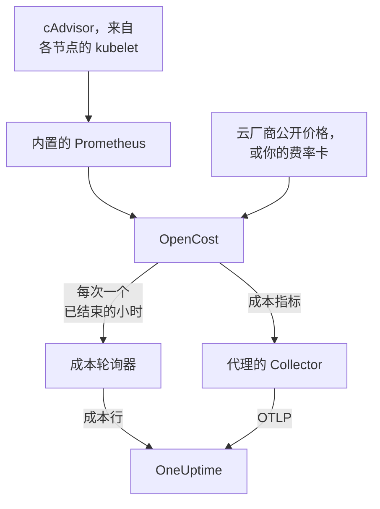

# Kubernetes 成本可观测性

查看每个 Kubernetes 工作负载的成本——按命名空间、工作负载和 Pod 统计的支出、空闲容量，以及每个 request 被实际使用了多少——就在 [Kubernetes 代理](/docs/telemetry/kubernetes-agent) 已经采集的指标、日志和追踪旁边。它默认开启，无需任何云凭据：集群的概览会显示集群的成本，它的 **成本** 页面会告诉你应缩减哪些 request，而成本指标也可以像其他任何指标一样绘制成图表并设置警报。

:::cards
- [开启它](#开启成本可观测性): 默认开启；未开启的地方只需一条 `helm upgrade`。
- [针对成本发出警报](#针对成本发出警报): 按集群、命名空间和工作负载统计的成本，以指标形式提供。
- [你自己的引擎](#已经在运行-kubecost-或-opencost): 找到并读取你已经在运行的 Kubecost 或 OpenCost。
- [资源规格调整](#资源规格调整): request 建议，以及它们是如何得出的。
- [故障排查](#故障排查): 页面为空、缺少建议。
:::

## 工作原理

成本监控开启时（默认即开启，`cost.enabled: auto`），chart 会在代理旁边运行四样东西：



1. **OpenCost**：开源成本引擎（Apache-2.0，CNCF；也是 Kubecost 所基于的 [cost-model](https://github.com/kubecost/cost-model)）。它监视集群，为你的节点、卷和负载均衡器定价，并算出每个工作负载的成本。
2. **一个小型 Prometheus**：OpenCost 需要它来保存用量和价格历史。它运行一个副本，保留 7 天的历史，并且只抓取两个目标：每个节点 kubelet 上的 cAdvisor（在 `eks-fargate` 预设上，由于没有 Pod 能访问 kubelet，改为通过 API 服务器节点代理访问；只保留 OpenCost 读取的序列），以及 OpenCost 本身（它会发出自己的资源 request 指标，因此不涉及 kube-state-metrics）。它从不暴露到集群之外，其数据也从不离开集群。
3. **成本轮询器**（`cost.agent`）。每个小时结束后，它读取一次 OpenCost 的 Allocation API，并为每个工作负载向 OneUptime 发送一行成本：CPU、内存、GPU、卷、网络、负载均衡器和空闲，以及效率。每个小时只发送一次；服务器会跳过它已经有的小时，因此重启不会把支出计算两次。OneUptime 还会根据这些行写入 [成本指标](#针对成本发出警报)。
4. **一项成本指标抓取**（`cost.metrics`）。代理的 Collector 会抓取 OpenCost 的价格指标，即每个节点、卷和负载均衡器每小时的成本，并与集群的其余指标一起发送。

OpenCost 根据云厂商的公开价格（AWS、Google Cloud、Azure）为节点定价，无需任何凭据。在其他环境中，它使用自己的默认费率，你自己的 [费率卡](#本地部署和裸金属定价) 会取代这些费率。

这三个 Pod 总共请求约 150m CPU 和 450Mi 内存。在 `gke-autopilot` 和 `eks-fargate` 预设下，成本监控默认关闭：这两个平台按每个 Pod 的 request 计费，因此成本 Pod 会增加它们所衡量的账单；而且 OpenCost 按节点定价，而这两个平台都不是这样计费的。

## 开启成本可观测性

新安装无需任何操作：成本监控默认开启。对于在默认开启之前安装的代理，请升级它；在使用 `gke-autopilot` 或 `eks-fargate` 预设时，也可以这样开启它：

:::steps
### 升级代理

```bash
helm upgrade kubernetes-agent oneuptime/kubernetes-agent \
  --namespace oneuptime-agent \
  --reset-then-reuse-values \
  --set cost.enabled=true
```

这就是一次完整的安装：额外三个小 Pod，即 OpenCost、它的 Prometheus 和成本代理。如果你以其他发布名称或命名空间安装了代理，请使用你的（`helm list -A | grep kubernetes-agent` 会列出它们）。要关闭成本监控，以同样的方式设置 `--set cost.enabled=false`。

### 等待第一个小时结束

第一批成本会在第一个完整的小时结束后出现，而且 OpenCost 启动后需要几分钟来为它的第一个小时定价。

### 打开成本页面

- **产品 → 基础设施 → Kubernetes → 成本** 显示项目中所有集群的支出。
- 在某个集群上，概览显示其过去 24 小时的支出、按月推算的支出、空闲支出、效率，以及成本最高的命名空间和工作负载。
- 在某个集群上，**成本** 显示其支出趋势、按 CPU、内存和存储拆分的 **Spend by Namespace**、**Spend by Workload**、空闲支出、效率，以及 **Right-Sizing** 卡片。
:::

成本指标（`node_total_hourly_cost`、`pv_hourly_cost` 等）都是普通指标：它们出现在指标浏览器中、自定义仪表板上和指标监视器中。要使用现成的仪表板，请转到 **产品 → 仪表板**，选择 **创建仪表板**，然后挑选 **Kubernetes Cost Dashboard**：其中包含节点每小时成本趋势、CPU 和内存单价，以及卷和负载均衡器的支出。

在这些数字下方，概览和 **成本** 页面会说明价格从何而来：云厂商的公开价格、你的费率卡，或 OpenCost 的默认费率，无论由哪个引擎为集群定价，Kubecost 3 也包括在内。读取你的云账单的 Kubecost 会在每个小时结束约两天后，按该账单对其价格进行对账，OneUptime 会纳入每个已对账的小时，因此这行说明会指出这些数字对账到了什么时候。效率在各处都是同一个数字，效率指标也不例外：它表示所请求的 CPU 和内存中有多少被实际使用，每个容器的每个小时都按其 CPU 和内存的成本加权，因此一个什么都不用的廉价任务无法拉低一个利用充分的集群，而且空闲容量不计算在内。

## 已经在运行 Kubecost 或 OpenCost？

成本代理会找到它，并读取它而不是内置的 OpenCost，因此集群会按你的设置来定价：你的费率卡，或 Kubecost 所接入的云账单。它在启动时以及之后每小时，通过 Kubernetes API 在所有命名空间中查找这些引擎自己的 chart 所创建的 Service（Kubecost 的 `cost-analyzer` 或 `frontend`、OpenCost 的 chart 所创建的 Service，以及 OpenCost 的清单文件所创建的 `opencost` Service），并优先选择 Kubecost。它会跳过没有响应、需要登录或返回多个集群数据的引擎，转而读取内置的引擎。随后，Collector 也会为 Kubernetes Cost Dashboard 抓取你的引擎的价格指标，因此仪表板和成本页面显示的价格相同，而资源规格调整会从你的引擎所读取的 Prometheus 中读取内存峰值。

随后，集群的概览会显示你的引擎名称，并说明不需要内置的 OpenCost。停止运行它：

```bash
helm upgrade kubernetes-agent oneuptime/kubernetes-agent \
  --namespace oneuptime-agent \
  --reset-then-reuse-values \
  --set cost.engine.url=auto
```

使用 `cost.engine.url=auto` 时不会内置任何东西，无论你的引擎运行在哪里，代理都会读取它；如果没有安装任何引擎，就不会为任何东西定价。该 chart 本身无法查找引擎：在 `helm template`、Argo CD 或试运行下，Helm 的 `lookup` 什么也看不到。要在你自己的引擎旁边保留内置的 OpenCost，请设置 `cost.engine.preferExisting=false`；要指定读取哪个引擎，请将 `cost.engine.url` 设置为它的 Service URL：

| 引擎 | 常用的服务 URL |
| --- | --- |
| OpenCost | `http://opencost.opencost.svc.cluster.local:9003` |
| Kubecost 2 | `http://kubecost-cost-analyzer.kubecost.svc.cluster.local:9090` |
| Kubecost 3 | `http://kubecost-frontend.kubecost.svc.cluster.local:9090` |

Allocation API 路径会被自动找到（Kubecost 为 `/model/allocation`，OpenCost 为 `/allocation/compute` 或 `/allocation`）。只有在安装方式不寻常时才需要设置 `cost.engine.allocationPath`。用于内存建议的、你的引擎所读取的 Prometheus 也会被自动找到，但 Kubecost 3 不读取任何 Prometheus：此时请设置 `cost.engine.prometheusUrl`（见 [建议背后的数据](#建议背后的数据)）。价格指标也以同样的方式找到，因此指定引擎的哪个 Service 都可以：代理依次尝试引擎的 `/metrics`、Kubecost 2 前端或 OpenCost 的 UI 转给引擎的 `/model/metrics`、Kubecost 3 的 FinOps 代理，Collector 会抓取第一个带有价格序列的地址。要自己指定，请设置 `cost.metrics.endpoint`。

## 本地部署和裸金属定价

节点没有公有云公开价格的集群可以设置费率卡。没有费率卡时，OpenCost 会按其默认费率为这些节点（本地部署、裸金属、kind、k3s）定价，这可能与你的硬件实际成本相去甚远，集群的概览和 **成本** 页面会指出这一点；在它能识别的云上，节点保留其公开价格，费率卡只为公开价格中缺少的部分定价。设置费率卡后，OpenCost 会根据这些数字为每种资源定价，单位均为美元每资源小时：

```yaml title="values.yaml"
cost:
  enabled: true
  opencost:
    customPricing:
      enabled: true
      cpuPerCoreHour: "0.031611"       # ~$23 per core-month
      ramPerGiBHour: "0.004237"        # ~$3 per GiB-month
      storagePerGBHour: "0.00005479452" # ~$0.04 per GB-month
      gpuPerHour: "0.95"
```

这些是 OpenCost 自己的默认费率：请填入你自己的数字，否则 **成本** 页面仍会显示该集群按 OpenCost 的默认费率定价。

## 值得了解的设置

全部是可选的；chart 的 `values.yaml` 中有完整列表：

```yaml title="values.yaml"
cost:
  enabled: auto           # on, except with the gke-autopilot and eks-fargate presets
  agent:
    windowSeconds: 3600   # allocation window length (hourly = native)
    includeIdle: true     # ship the engine's __idle__ allocation
    currency: USD         # currency code shown in the UI (informational)
  prometheus:
    retention: 7d         # bundled TSDB history; right-sizing reads peaks back over days
    persistence:
      enabled: false      # set true for a small PVC; emptyDir otherwise
  metrics:
    enabled: true         # cost metrics for dashboards / Metric Explorer
    scrapeInterval: 60s
```

## 资源规格调整

集群 **成本** 页面上的 **Right-Sizing** 卡片，会为每个有足够历史数据的容器推荐 CPU 和内存 request，并按每项更改每月能节省多少进行排序。

建议值是观测到的需求加上 25% 的余量，并取整为可以直接粘贴到清单文件中的值（CPU 以 10m 为单位，内存以 16Mi 为单位）：

- CPU 根据每小时平均用量的第 95 百分位数确定：足够高以覆盖真实负载，又足够低，不会因为一次尖峰就让 request 在整整一个月内都偏大。
- 内存根据工作集的峰值确定，而从不使用平均值（见 [建议背后的数据](#建议背后的数据)）。

只推荐 request，不推荐 limit。request 是调度器预留的量，也是计算账单的依据，因此它才是影响成本的数字。limit 是关于行为异常的容器应被限流还是被终止的决定，这是用量数据无法替你做出的。

每个容器都会与其当前的 request 进行比较：

| 判定 | 含义 |
| --- | --- |
| 过度配置（Over-provisioned） | 它预留的明显多于它使用的。节省就来自这里。 |
| 配置不足（Under-provisioned） | 它预留的少于它使用的，因此会被限流或面临 OOM kill 的风险。修复它需要花钱，卡片会将其显示为增加。 |
| 未设置 request | 没有可以缩减的东西，但调度器无法安全地放置该容器，而且在资源紧张时它会最先被驱逐。 |

与建议值相差在 15% 以内的容器被视为规格合适，不会列出：没有人应该为了把 request 削减 3% 而去编辑清单文件。

有两道防护让建议保持可靠。一个工作负载至少需要 24 小时的成本窗口才会被评估规格，因为一个四小时的窗口可能恰好碰上夜间批处理任务处于空闲状态，从而建议把它缩减到零。此外，节省额是根据你正在查看的窗口长度来推算的，而不是根据行数，因此 Deployment 的节省额不会乘以其副本数。该估算假设支出与引擎分配的量成比例，即 `max(request, usage)`；对于过度配置的容器，这个值就是 request，因此节省额是精确的。

### 建议背后的数据

除了支出之外，轮询器还会采集建议所需的数据：每个容器的 CPU 和内存 request、limit 以及用量。

内存还需要另一个数据源。Allocation API 只报告每个窗口的平均值，而每小时平均值会掩盖导致容器被 OOM kill 的突发，因此据此确定内存规格是危险的。所以轮询器改为从 Prometheus 读取每个容器的内存峰值，并按 `(namespace, pod, container)` 进行关联：

- 使用内置引擎（默认）时，它使用 chart 自带的 Prometheus。无需任何设置。
- 使用你自己的引擎时，它使用该引擎所读取的 Prometheus，由代理自动找到：OpenCost 的 `PROMETHEUS_SERVER_ENDPOINT`，或 Kubecost 2 自带的 Prometheus，前提是它能返回此集群的 cAdvisor 序列。Kubecost 3 不读取任何 Prometheus，因此只要 chart 运行着内置的 Prometheus，就由它来代替。
- 否则，或者要自己选择一个时，把 `cost.engine.prometheusUrl` 指向一个抓取 cAdvisor 的 Prometheus；如果它在多个抓取任务下抓取 cAdvisor，且要读取的任务名称不是 `kubernetes-nodes-cadvisor`，还要设置 `cost.engine.prometheusCadvisorJob`。没有 Prometheus 时，CPU 建议仍可根据已存储的每小时平均值正常工作，而内存建议会被省略，而不是靠猜测得出。

Prometheus 中断永远不会停止支出的采集：峰值只是附加信息，该小时会在没有峰值的情况下发送。CPU 有意不使用 Prometheus：CPU request 过大只会导致限流，而内存 request 过小则会让容器被终止，因此每小时平均值用于 CPU 是安全的；而且在整个集群中查询每个容器的 CPU 速率负载很重，足以压垮一个小型 Prometheus。

## 针对成本发出警报

OneUptime 会根据每个小时的成本行写入四个指标，它们已经定价，并按其含义命名，因此可以绘制成本图表、把成本放到仪表板上，并在 [Kubernetes 监视器](/docs/monitor/kubernetes-monitor) 或 [指标监视器](/docs/monitor/metrics-monitor) 中针对成本发出警报：

| 指标 | 含义 | 属性 |
| --- | --- | --- |
| `oneuptime.kubernetes.cost.total` | 集群每个小时的成本，包括空闲容量 | `k8s.cluster.name` |
| `oneuptime.kubernetes.cost.idle` | 其中没有被任何工作负载使用的部分：空闲容量和未分配容量 | `k8s.cluster.name` |
| `oneuptime.kubernetes.cost.workload` | 每个工作负载每个小时的成本；按命名空间求和，即为该命名空间的成本 | `k8s.cluster.name`、`k8s.namespace.name`，以及以工作负载类型命名的工作负载名称属性，例如 `k8s.deployment.name` |
| `oneuptime.kubernetes.cost.efficiency` | 每个工作负载使用了其所请求的 CPU 和内存中的多少，以百分比表示，按成本加权 | 工作负载的属性，同上 |

每个数据点是一个小时的成本，以代理的货币（默认为 USD）计，时间戳为该小时的开始时间，并在该小时结束约一小时后写入：在若干小时的时间窗口内对数据点求和即可，一天的数据点加起来就是当天的成本。它们来自集群已经发送的数据，因此不会作为摄取的指标计费，并且与集群的其他指标保留同样长的时间。

Kubernetes 监视器为它们提供了三个模板：Cluster Daily Cost Over Budget、Namespace Daily Cost Over Budget 和 High Idle Spend，每个模板都带有一个需要你按自己的情况设置的预算。OpenCost 的价格指标也是普通指标：指标监视器可以在平均 `node_total_hourly_cost` 超出预算时，或者在集群中出现某个本不应存在的卷类的 `pv_hourly_cost` 时发出警报。

## 数据模型和保留

成本行存储在 ClickHouse 中，每个集群、窗口、命名空间、控制器、Pod 和容器各一行。它们遵循集群的遥测保留设置：集群的 `retainTelemetryDataForDays`，未设置时则使用项目的数据保留设置。空闲容量和未分配容量会作为普通行存储在 `__idle__` 和 `__unallocated__` 命名空间下，因此可以像工作负载支出一样进行分组和过滤。

## 故障排查

:::details Costs 页面为空
在 `gke-autopilot` 和 `eks-fargate` 预设下，成本监控默认关闭：请用 `--set cost.enabled=true` 开启它。否则，请查看成本轮询器的日志：`kubectl logs -n oneuptime-agent deploy/kubernetes-agent-cost`。（当发布名称不包含 `kubernetes-agent` 时，Deployment 名称为 `<release>-kubernetes-agent-cost`；`kubectl get deploy -n oneuptime-agent` 会列出它们。）`HTTP 401` 表示 OneUptime 拒绝了摄取密钥。`did not answer any known allocation path` 表示引擎尚未就绪（内置的 OpenCost 需要几分钟为其最初几个小时定价），或者 `cost.engine.url` 有误。
:::

:::details 内置的 OpenCost 未就绪
查看它的日志：`kubectl logs -n oneuptime-agent deploy/kubernetes-agent-opencost`。日志会说明它检测到了哪个云厂商，以及它的价格数据是否已加载。
:::

:::details 概览显示不需要内置的 OpenCost
集群运行着自己的 Kubecost 或 OpenCost，而成本代理读取的是它，因此 chart 内置的 OpenCost 不为任何东西定价。使用 `--set cost.engine.url=auto` 升级即可停止运行它及其 Prometheus，或者设置 `cost.engine.preferExisting=false`，改为读取内置的引擎。当内存建议来自内置的 Prometheus 时（例如 Kubecost 3 不读取任何 Prometheus），提示会说明这一点：请在同一次升级中用 `cost.engine.prometheusUrl` 指定另一个，或者保留内置的引擎。成本代理从不自行停止它：它不向你的集群写入任何内容，而且在你的引擎没有响应时，内置的引擎是它的后备。
:::

:::details 成本代理没有读取你的引擎
它的日志会说明它读取的是哪个引擎，以及为什么跳过了其他引擎：`kubectl logs -n oneuptime-agent deploy/kubernetes-agent-cost`。它会跳过没有响应的引擎（例如命名空间之间有 NetworkPolicy）、需要登录的引擎，或返回多个集群数据的引擎，比如联邦了其他集群的 Kubecost。请用 `cost.engine.url` 指定要读取的引擎。
:::

:::details OpenCost 日志显示 mkdir /var/configs: permission denied
较旧的 chart 在运行 OpenCost 时没有可写的配置目录，因此 `Error downloading default pricing data` 会让其 Allocation API 无法响应、轮询器停滞，而 Pod 仍保持 `Running`，`/healthz` 仍显示正常，节点成本指标也仍在发布。当前的 chart 已修复此问题：运行 `helm repo update`，然后使用 `--reset-then-reuse-values` 升级。成本行会在下一次轮询时出现。
:::

:::details Kubernetes Cost Dashboard 没有数据
该模板读取被抓取的成本指标：请检查 `cost.metrics.enabled` 是否为 `true`。成本代理会找到它所读取的引擎（内置的引擎或你的引擎）提供这些指标的位置，它的日志会说明位置或它尝试过的地址：`kubectl logs -n oneuptime-agent deploy/kubernetes-agent-cost`。要自己指定，请设置 `cost.metrics.endpoint`。
:::

:::details Right-Sizing 卡片为空
要么时间范围短于一条建议所需的 24 小时（请扩大范围），要么每个容器都已在其推荐 request 的 15% 以内，卡片会说明这一点。
:::

:::details 内存建议显示为 -，但 CPU 建议正常
没有内存峰值到达 OneUptime，因此内存规格没有被确定，而不是根据平均值猜测。使用你自己的引擎时，成本代理的日志会说明它读取的是哪个 Prometheus，或者为什么一个也没找到：请用 `cost.engine.prometheusUrl` 指定一个（Kubecost 3 不读取任何 Prometheus）。卡片会说明这影响了多少个容器。
:::

:::details 数字与引擎自身的 UI 不一致
OneUptime 发送完整的、已结束的小时，按引擎在这些小时结束时所定的价格，并计入其对账调整：当前小时的支出会在该小时结束后出现。读取你的云账单的 Kubecost 会在约两天后按该账单对每个小时进行对账：OneUptime 会在该小时之后 36 小时、47 小时和 4 天再次读取它，并纳入变化的部分。Kubecost 默认将每小时的数字保留 49 小时，因此在此之后才对账的小时会保留 OneUptime 最后读取的数字：要纳入每一次对账，请将它们保留 4 天（Kubecost 2 为 `kubecostAggregator.etlHourlyStoreDurationHours: 96`，Kubecost 3 为 `aggregator.retention1h: 96`）。
:::

:::details 内置的 Prometheus 重启过
使用默认的 `emptyDir` 存储时，重启会丢失几个小时的用量历史，因此这些小时的成本可能会偏小。如果这对你很重要，请设置 `cost.prometheus.persistence.enabled=true`。
:::

## 后续步骤

:::cards
- [Kubernetes 代理](/docs/telemetry/kubernetes-agent): 安装代理，以及它采集的其他所有内容。
- [指标监控](/docs/monitor/metrics-monitor): 当支出超出预算时发出警报。
- [Kubernetes 监控](/docs/monitor/kubernetes-monitor): 同时针对集群的健康状况发出警报。
:::
