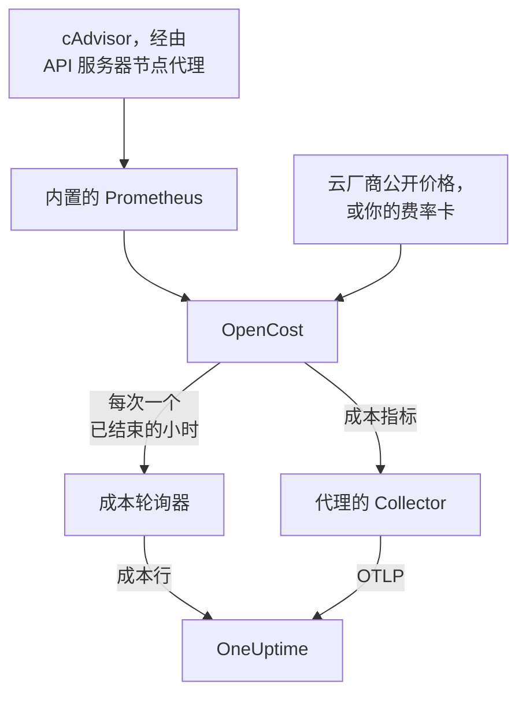

# Kubernetes 成本可观测性

查看每个 Kubernetes 工作负载的成本——按命名空间、工作负载和 Pod 统计的支出、空闲容量，以及每个 request 被实际使用了多少——就在 [Kubernetes 代理](/docs/telemetry/kubernetes-agent) 已经采集的指标、日志和追踪旁边。一个 Helm 值即可开启，无需任何云凭据，随后集群的 **Costs** 页面会告诉你应缩减哪些 request。

:::cards
- [开启它](#开启成本可观测性): 一条 `helm upgrade`。
- [使用你自己的引擎](#已经在运行-kubecost-或-opencost): 让代理指向 Kubecost 或 OpenCost。
- [资源规格调整](#资源规格调整): request 建议，以及它们是如何得出的。
- [故障排查](#故障排查): 页面为空、缺少建议。
:::

## 工作原理

设置 `cost.enabled=true` 后，chart 会在代理旁边运行四样东西：



1. **OpenCost**：开源成本引擎（Apache-2.0，CNCF；也是 Kubecost 所基于的 [cost-model](https://github.com/kubecost/cost-model)）。它监视集群，为你的节点、卷和负载均衡器定价，并算出每个工作负载的成本。
2. **一个小型 Prometheus**：OpenCost 需要它来保存用量和价格历史。它运行一个副本，保留 7 天的历史，并且只抓取两个目标：通过 API 服务器节点代理访问的 cAdvisor，以及 OpenCost 本身（它会发出自己的资源 request 指标，因此不涉及 kube-state-metrics）。它从不暴露到集群之外，其数据也从不离开集群。
3. **成本轮询器**（`cost.agent`）。每个小时结束后，它读取一次 OpenCost 的 Allocation API，并为每个工作负载向 OneUptime 发送一行成本：CPU、内存、GPU、卷、网络、负载均衡器和空闲，以及效率。每个小时只发送一次；服务器会跳过它已经有的小时，因此重启不会把支出计算两次。
4. **一项成本指标抓取**（`cost.metrics`）。代理的 Collector 会抓取 OpenCost 的成本指标，并与集群的其余指标一起发送。

OpenCost 根据云厂商的公开价格（AWS、Google Cloud、Azure）为节点定价，无需任何凭据。没有云公开价格的集群可改为设置 [费率卡](#本地部署和裸金属定价)。

## 开启成本可观测性

:::steps
### 使用 cost.enabled 升级代理

```bash
helm upgrade kubernetes-agent oneuptime/kubernetes-agent \
  --namespace oneuptime-agent \
  --reset-then-reuse-values \
  --set cost.enabled=true
```

这就是一次完整的安装：额外两个小 Pod，即 OpenCost 和它的 Prometheus。如果你以其他发布名称或命名空间安装了代理，请使用你的（`helm list -A | grep kubernetes-agent` 会列出它们）。

### 等待第一个小时结束

第一批成本会在第一个完整的小时结束后出现，而且 OpenCost 启动后需要几分钟来为它的第一个小时定价。

### 打开 Costs 页面

- **产品 → 基础设施 → Kubernetes → Costs** 显示项目中所有集群的支出。
- 在某个集群上，**Costs** 显示其支出趋势、按 CPU、内存和存储拆分的 **Spend by Namespace**、**Spend by Workload**、空闲支出、效率，以及 **Right-Sizing** 卡片。
:::

成本指标（`node_total_hourly_cost`、`pv_hourly_cost` 等）都是普通指标：它们出现在指标浏览器中、自定义仪表板上和指标监视器中。要使用现成的仪表板，请转到 **产品 → 仪表板**，选择 **创建仪表板**，然后挑选 **Kubernetes Cost Dashboard**：其中包含节点每小时成本趋势、CPU 和内存单价，以及卷和负载均衡器的支出。

## 已经在运行 Kubecost 或 OpenCost？

改为让代理指向你的引擎，就不会内置任何东西：

```bash
helm upgrade kubernetes-agent oneuptime/kubernetes-agent \
  --namespace oneuptime-agent \
  --reset-then-reuse-values \
  --set cost.enabled=true \
  --set cost.engine.url=http://kubecost-cost-analyzer.kubecost.svc.cluster.local:9090
```

| 引擎 | 常用的服务 URL |
| --- | --- |
| OpenCost | `http://opencost.opencost.svc.cluster.local:9003` |
| Kubecost | `http://kubecost-cost-analyzer.kubecost.svc.cluster.local:9090` |

Allocation API 路径会被自动找到（Kubecost 为 `/model/allocation`，OpenCost 为 `/allocation/compute` 或 `/allocation`）。只有在安装方式不寻常时才需要设置 `cost.engine.allocationPath`。要获得内存建议，还需设置 `cost.engine.prometheusUrl`（见 [建议背后的数据](#建议背后的数据)）。

## 本地部署和裸金属定价

节点没有公有云公开价格的集群可以设置费率卡。随后 OpenCost 会根据这些数字为每种资源定价，单位均为美元每资源小时：

```yaml title="values.yaml"
cost:
  enabled: true
  opencost:
    customPricing:
      enabled: true
      cpuPerCoreHour: "0.031611"       # ~$23 per core-month
      ramPerGiBHour: "0.004237"        # ~$3 per GiB-month
      storagePerGBHour: "0.00005479452" # ~$0.04 per GB-month
      gpuPerHour: "0.95"
```

## 值得了解的设置

全部是可选的；chart 的 `values.yaml` 中有完整列表：

```yaml title="values.yaml"
cost:
  agent:
    windowSeconds: 3600   # allocation window length (hourly = native)
    includeIdle: true     # ship the engine's __idle__ allocation
    currency: USD         # currency code shown in the UI (informational)
  prometheus:
    retention: 7d         # bundled TSDB history; right-sizing reads peaks back over days
    persistence:
      enabled: false      # set true for a small PVC; emptyDir otherwise
  metrics:
    enabled: true         # cost metrics for dashboards / Metric Explorer
    scrapeInterval: 60s
```

## 资源规格调整

集群 **Costs** 页面上的 **Right-Sizing** 卡片，会为每个有足够历史数据的容器推荐 CPU 和内存 request，并按每项更改每月能节省多少进行排序。

建议值是观测到的需求加上 25% 的余量，并取整为可以直接粘贴到清单文件中的值（CPU 以 10m 为单位，内存以 16Mi 为单位）：

- CPU 根据每小时平均用量的第 95 百分位数确定：足够高以覆盖真实负载，又足够低，不会因为一次尖峰就让 request 在整整一个月内都偏大。
- 内存根据工作集的峰值确定，而从不使用平均值（见 [建议背后的数据](#建议背后的数据)）。

只推荐 request，不推荐 limit。request 是调度器预留的量，也是计算账单的依据，因此它才是影响成本的数字。limit 是关于行为异常的容器应被限流还是被终止的决定，这是用量数据无法替你做出的。

每个容器都会与其当前的 request 进行比较：

| 判定 | 含义 |
| --- | --- |
| 过度配置（Over-provisioned） | 它预留的明显多于它使用的。节省就来自这里。 |
| 配置不足（Under-provisioned） | 它预留的少于它使用的，因此会被限流或面临 OOM kill 的风险。修复它需要花钱，卡片会将其显示为增加。 |
| 未设置 request | 没有可以缩减的东西，但调度器无法安全地放置该容器，而且在资源紧张时它会最先被驱逐。 |

与建议值相差在 15% 以内的容器被视为规格合适，不会列出：没有人应该为了把 request 削减 3% 而去编辑清单文件。

有两道防护让建议保持可靠。一个工作负载至少需要 24 小时的成本窗口才会被评估规格，因为一个四小时的窗口可能恰好碰上夜间批处理任务处于空闲状态，从而建议把它缩减到零。此外，节省额是根据你正在查看的窗口长度来推算的，而不是根据行数，因此 Deployment 的节省额不会乘以其副本数。该估算假设支出与引擎分配的量成比例，即 `max(request, usage)`；对于过度配置的容器，这个值就是 request，因此节省额是精确的。

### 建议背后的数据

除了支出之外，轮询器还会采集建议所需的数据：每个容器的 CPU 和内存 request、limit 以及用量。

内存还需要另一个数据源。Allocation API 只报告每个窗口的平均值，而每小时平均值会掩盖导致容器被 OOM kill 的突发，因此据此确定内存规格是危险的。所以轮询器改为从 Prometheus 读取每个容器的内存峰值，并按 `(namespace, pod, container)` 进行关联：

- 使用内置引擎（默认）时，它使用 chart 自带的 Prometheus。无需任何设置。
- 使用你自己的引擎（`cost.engine.url`）时，把 `cost.engine.prometheusUrl` 指向一个抓取 cAdvisor 的 Prometheus，如果其抓取任务的名称不是 `kubernetes-nodes-cadvisor`，还要设置 `cost.engine.prometheusCadvisorJob`。
- 没有 Prometheus 时，CPU 建议仍可根据已存储的每小时平均值正常工作，而内存建议会被省略，而不是靠猜测得出。

Prometheus 中断永远不会停止支出的采集：峰值只是附加信息，该小时会在没有峰值的情况下发送。CPU 有意不使用 Prometheus：CPU request 过大只会导致限流，而内存 request 过小则会让容器被终止，因此每小时平均值用于 CPU 是安全的；而且在整个集群中查询每个容器的 CPU 速率负载很重，足以压垮一个小型 Prometheus。

## 针对成本发出警报

成本指标都是普通指标，因此 [指标监视器](/docs/monitor/metrics-monitor) 可以像对待其他任何指标一样对它们发出警报：例如，当平均 `node_total_hourly_cost` 超出预算时，或者当集群中出现某个本不应存在的卷类的 `pv_hourly_cost` 时。

## 数据模型和保留

成本行存储在 ClickHouse 中，每个集群、窗口、命名空间、控制器、Pod 和容器各一行。它们遵循集群的遥测保留设置：集群的 `retainTelemetryDataForDays`，未设置时则使用项目的数据保留设置。空闲容量和未分配容量会作为普通行存储在 `__idle__` 和 `__unallocated__` 命名空间下，因此可以像工作负载支出一样进行分组和过滤。

## 故障排查

:::details Costs 页面为空
查看成本轮询器的日志：`kubectl logs -n oneuptime-agent deploy/kubernetes-agent-cost`。（当发布名称不包含 `kubernetes-agent` 时，Deployment 名称为 `<release>-kubernetes-agent-cost`；`kubectl get deploy -n oneuptime-agent` 会列出它们。）`HTTP 401` 表示 OneUptime 拒绝了摄取密钥。`did not answer any known allocation path` 表示引擎尚未就绪（内置的 OpenCost 需要几分钟为其最初几个小时定价），或者 `cost.engine.url` 有误。
:::

:::details 内置的 OpenCost 未就绪
查看它的日志：`kubectl logs -n oneuptime-agent deploy/kubernetes-agent-opencost`。日志会说明它检测到了哪个云厂商，以及它的价格数据是否已加载。
:::

:::details OpenCost 日志显示 mkdir /var/configs: permission denied
较旧的 chart 在运行 OpenCost 时没有可写的配置目录，因此 `Error downloading default pricing data` 会让其 Allocation API 无法响应、轮询器停滞，而 Pod 仍保持 `Running`，`/healthz` 仍显示正常，节点成本指标也仍在发布。当前的 chart 已修复此问题：运行 `helm repo update`，然后使用 `--reset-then-reuse-values` 升级。成本行会在下一次轮询时出现。
:::

:::details Kubernetes Cost Dashboard 没有数据
该模板读取被抓取的成本指标：请检查 `cost.metrics.enabled` 是否为 `true`。
:::

:::details Right-Sizing 卡片为空
要么时间范围短于一条建议所需的 24 小时（请扩大范围），要么每个容器都已在其推荐 request 的 15% 以内，卡片会说明这一点。
:::

:::details 内存建议显示为 -，但 CPU 建议正常
没有内存峰值到达 OneUptime，因此内存规格没有被确定，而不是根据平均值猜测。使用你自己的引擎时，请设置 `cost.engine.prometheusUrl`。卡片会说明这影响了多少个容器。
:::

:::details 数字与引擎自身的 UI 不一致
OneUptime 会把引擎的对账调整计入每个成本组成部分，并发送完整的、已结束的小时：当前小时的支出会在该小时结束后出现。
:::

:::details 内置的 Prometheus 重启过
使用默认的 `emptyDir` 存储时，重启会丢失几个小时的用量历史，因此这些小时的成本可能会偏小。如果这对你很重要，请设置 `cost.prometheus.persistence.enabled=true`。
:::

## 后续步骤

:::cards
- [Kubernetes 代理](/docs/telemetry/kubernetes-agent): 安装代理，以及它采集的其他所有内容。
- [指标监控](/docs/monitor/metrics-monitor): 当支出超出预算时发出警报。
- [Kubernetes 监控](/docs/monitor/kubernetes-monitor): 同时针对集群的健康状况发出警报。
:::
