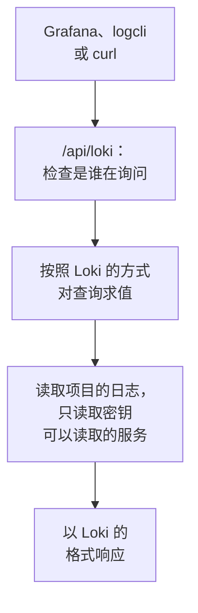

# 用 LogQL 查询日志

LogQL 是 Grafana Loki 的查询语言。OneUptime 会针对项目的日志响应 Loki 的查询 API，因此 Grafana 的 Loki 数据源、logcli 或任何 Loki 客户端都能读取这些日志，你为 Loki 编写的仪表板和保存的查询也能继续使用。

:::cards
- [连接 Grafana](#连接-grafana): 把 OneUptime 添加为 Loki 数据源。
- [日志的标签](#日志的标签): 流选择器匹配什么。
- [支持的 LogQL 功能](#支持的-logql-功能): 日志查询、解析器和指标查询。
- [限制](#限制): 查询可以读取多少内容，以及多久一次。
:::

## 工作原理

Grafana 像询问 Loki 一样询问 OneUptime。OneUptime 会检查 API 密钥能否读取项目的日志，只读取它可以读取的服务，并按照 Loki 的方式对查询求值。



## 开始之前

- **有日志到达。** 用 [OpenTelemetry](/docs/telemetry/open-telemetry) 发送，或者从 Promtail、Grafana Alloy、Fluent Bit 或 Vector 通过 [Loki 的推送 API](/docs/telemetry/compatible-endpoints) 发送。
- **可以读取日志的项目 API 密钥**，需具有项目所有者、项目管理员、项目成员、查看者、遥测管理员、遥测成员或遥测查看者角色，或者 Read Logs 权限。仅限部分服务的密钥只能读取这些服务的日志。参见 [创建 API 密钥](/docs/api-reference/api-reference#创建-api-密钥)。在 OneUptime Cloud 上，API 密钥需要 **Growth** 套餐。
- **不能使用摄取密钥。** 摄取密钥只用于发送遥测数据，不能读取任何内容，因此 Grafana 无法用它登录。

## 连接 Grafana

:::steps
### 创建 API 密钥

在 OneUptime 中，打开 **项目设置 → 高级 → API 密钥**，然后点击 **创建API 密钥**。为密钥分配一个可以读取遥测的角色，或者 Read Logs 权限。

### 添加 Loki 数据源

在 Grafana 中，打开 **Connections → Data sources → Add data source**，然后选择 **Loki**。

### 输入 URL

把 **URL** 设置为你的 OneUptime 地址加上 `/api/loki`。在 OneUptime Cloud 上，就是 `https://oneuptime.com/api/loki`。

### 发送 API 密钥

在 **HTTP headers** 下，添加请求头 `Authorization`，值为 `Bearer`，后跟一个空格和你的 API 密钥。也可以使用基本认证：用户名任意，密码填写 API 密钥。

### 保存并测试

点击 **Save & test**。Grafana 会运行一个查询，并提示数据源工作正常。
:::

之后，Explore、日志行上方的日志量、标签浏览器和仪表板都会像读取 Loki 一样读取 OneUptime。logcli 和其他任何 Loki 客户端的用法都相同。使用 curl：

```bash title="Query OneUptime's Loki API"
curl -G -H "Authorization: Bearer $ONEUPTIME_API_KEY" \
  "https://oneuptime.com/api/loki/loki/api/v1/query_range" \
  --data-urlencode 'query={service_name="checkout"} |= "error"'
```

## 日志的标签

流选择器匹配日志的属性，名称与 Loki 3 为 OpenTelemetry 日志起的名称相同：

| 在 OneUptime 中 | 在 LogQL 中 |
| --- | --- |
| 资源属性 `service.name` | 标签 `service_name` |
| 资源属性 `k8s.pod.name` | 标签 `k8s_pod_name` |
| 属性 `http.method` | 标签 `http_method` |
| Loki 客户端发送的标签，例如 `job` | 标签 `job` |
| 日志的严重级别 | 标签 `detected_level`：`trace`、`debug`、`info`、`warn`、`error`、`fatal` 或 `unknown` |

- **每个属性都是标签。** 日志查询按标签组合返回流，每种组合一个流，因此属性不同的日志属于不同的流，这与 Loki 3 对带有结构化元数据的日志的响应方式相同。
- **日志自身的属性优先**，当它的资源也有同名属性时。
- **选择器要指定一个值**，与 Loki 的要求相同：至少有一个匹配条件是不带该标签的日志无法满足的，例如 `{service_name="checkout"}` 或 `{service_name=~"check.+"}`。

可以从以下查询开始：

```text title="LogQL"
# The checkout service's lines that say error
{service_name="checkout"} |= "error"

# Requests slower than 250ms, read from JSON lines
{service_name="checkout"} | json | duration > 250ms

# Error logs per second, by service
sum by (service_name) (rate({detected_level="error"} [5m]))
```

## 支持的 LogQL 功能

- **日志查询**：使用 `=`、`!=`、`=~` 和 `!~` 的流选择器；可带 `or` 的行过滤器 `|=`、`!=`、`|~` 和 `!~`；`json` 和 `logfmt` 解析器；针对文本、数字、时长和大小的标签过滤器，可带 `and`、`or` 和 `__error__`；使用 `{{.label}}` 的 `line_format`；`drop`、`keep` 和 `decolorize`。
- **指标查询**：`count_over_time`、`rate`、`bytes_over_time`、`bytes_rate` 和 `absent_over_time`；针对用 `unwrap`（可带 `duration()` 或 `bytes()`）取出的标签的 `rate`、`sum_over_time`、`avg_over_time`、`min_over_time`、`max_over_time`、`first_over_time`、`last_over_time`、`stddev_over_time`、`stdvar_over_time` 和 `quantile_over_time`；以及 `offset`。
- **在它们之外**：带 `by` 或 `without` 的 `sum`、`avg`、`min`、`max`、`count`、`stddev`、`stdvar`、`topk` 和 `bottomk`；算术运算、比较（可带 `bool`）、`and`、`or` 和 `unless`，以及 `on`、`ignoring`、`group_left` 和 `group_right`；`sort`、`sort_desc`、`label_replace` 和 `vector()`。

`pattern`、`regexp` 和 `unpack` 解析器、`label_format`、带命名字段的 `json`、`ip()` 过滤器，以及超出 `{{.label}}` 的 `line_format` 模板暂不支持。使用它们的查询会被拒绝，并在消息中指出名称。

## API

API 在 `/api/loki` 下以 `GET` 或 `POST` 响应 Loki HTTP API 的路由：

| 路由 | 返回的内容 |
| --- | --- |
| `/loki/api/v1/query_range` | 日志查询从 `start` 到 `end` 的行，或在每个 `step` 上的指标查询。 |
| `/loki/api/v1/query` | 某一时刻（`time`，默认是现在）的指标查询。 |
| `/loki/api/v1/labels` | `query` 选中的日志或所有日志的标签名称。 |
| `/loki/api/v1/label/<name>/values` | 一个标签的值。 |
| `/loki/api/v1/series` | `match[]` 选中的日志的标签组合。 |

时间可以是自 1970 年以来的纳秒数、Unix 秒数或 RFC 3339，未另行指定时，范围是 `end` 之前的一小时。日志查询返回 `limit` 行，默认 100 行，除非指定 `direction=forward`，否则最新的排在前面。响应采用 Loki 的格式，错误与 Loki 一样是纯文本。`/loki/api/v1/status/buildinfo` 以 Loki 3 服务器的身份响应。

## 限制

每个查询都有上限，因此包含大量面板的仪表板也无法让 OneUptime 过载：

| 限制 | 值 |
| --- | --- |
| 日志查询返回的行 | 5,000 |
| 解析器之后的过滤器丢弃部分日志时，日志查询读取的日志 | 20,000 |
| ClickHouse 无法计数时，指标查询自行读取的日志 | 100,000 |
| 指标查询返回的序列 | 500 |
| 范围查询中单个序列的数据点 | 11,000 |
| 一次读取返回的日志 | 64 MB |
| 一次读取可用的时间 | 30 秒 |
| 一个项目每分钟可以发送的查询 | 1,200 |

管道只有行过滤器的指标查询，例如 `sum(count_over_time({service_name="checkout"} |= "error" [5m]))`，会在日志所在的地方计数，因此完全不读取日志行。

## 故障排除

:::details Grafana 提示数据源无法工作
检查 URL 是否以 `/api/loki` 结尾，以及 `Authorization` 请求头是否包含 `Bearer`、一个空格和 API 密钥。摄取密钥，或没有可读取日志的角色的 API 密钥，会被拒绝：在 **项目设置 → 高级 → API 密钥** 中为密钥分配这样的角色。
:::

:::details "queries require at least one regexp or equality matcher that does not have an empty-compatible value"
选择器在没有指定值的情况下匹配日志，例如 `{service_name=~".*"}`。请添加一个指定值的匹配条件，例如 `{service_name="checkout"}`。
:::

:::details "This project sent more queries this minute than OneUptime answers."
该项目的仪表板和客户端在这一分钟内向 API 发送了超过 1,200 个查询。面板会在下一分钟重新加载；请降低仪表板的刷新频率，以免超出上限。
:::

## 后续步骤

:::cards
- [日志浏览器](/docs/telemetry/logs-explorer): 无需编写查询即可搜索和过滤日志。
- [PromQL](/docs/telemetry/promql): 用 PromQL 查询指标，也可以通过 Grafana 的 Prometheus 数据源查询。
- [日志监控](/docs/monitor/logs-monitor): 针对日志的数量和内容发出警报。
:::
