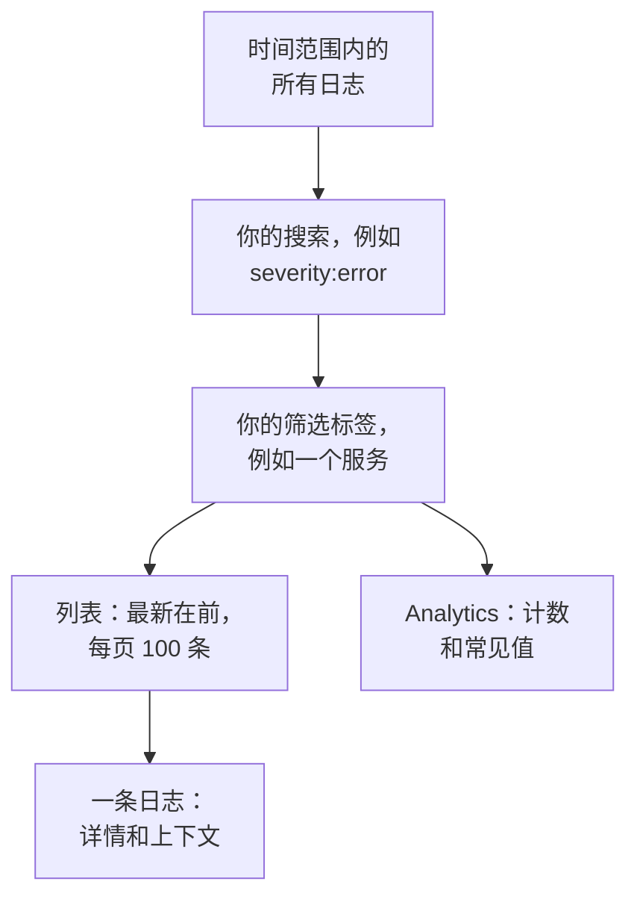

# 日志浏览器

日志浏览器是你搜索和阅读服务、主机和代理发送到 OneUptime 的日志的地方。把数百万行缩小到真正重要的几行，实时跟随新到达的日志，用图表展示它们，并保存团队经常回来查看的视图。

:::cards
- [查找日志行](#查找日志行): 一个时间范围、一次搜索和几个过滤条件。
- [阅读日志](#阅读日志): 它的属性、它的追踪以及它周围的行。
- [实时跟随日志](#实时跟随日志): 每 10 秒出现新行。
- [保存视图](#保存视图): 为所有人保留搜索、过滤条件和列。
- [日志洞察](#日志洞察): 主要错误、严重程度分布，以及谁在记录什么。
- [用 AI 查找并修复错误日志、缺失日志和噪声日志](#用-ai-查找并修复错误日志缺失日志和噪声日志): 修复错误、补上未记录的日志并减少噪声日志行的拉取请求。
:::

## 浏览器如何缩小日志范围

**查看者** 标签页上的一切都作用于同一组日志：时间范围内、与你的搜索和每个筛选标签都匹配的日志。改变其中任何一项，列表、数量图表和侧栏中的计数都会一起变化。

浏览器有五个标签页：

| 标签页 | 用途 |
| --- | --- |
| **查看者** | 搜索、过滤和阅读日志。打开时显示最近一小时的日志，最新在前，每页 100 条。 |
| **洞察** | 服务在某个时间范围内记录了什么，以及哪里出了问题。 |
| **人工智能** | OneUptime 在你的日志中发现的错误日志、缺失的日志记录和噪声日志，以及 OneUptime AI 对它们做了什么。参见 [用 AI 查找并修复错误日志、缺失日志和噪声日志](#用-ai-查找并修复错误日志缺失日志和噪声日志)。 |
| **设置指南** | 如何使用你的某个 [摄取密钥](/docs/telemetry/ingestion-keys)，通过 OpenTelemetry、Fluent Bit 或 Fluentd 发送日志。 |
| **设置** | 日志到达时会发生什么：**管道**、**丢弃过滤器**、**清理规则** 和 **记录规则**。 |

## 开始之前

- **正在到达的日志。** 通过 [OpenTelemetry](/docs/telemetry/open-telemetry)、[Fluent Bit](/docs/telemetry/fluentbit)、[Fluentd](/docs/telemetry/fluentd) 或 [Syslog](/docs/telemetry/syslog) 发送。**设置指南** 标签页会显示适合你的语言或采集器的配置。
- **可以读取遥测的角色。** Project Owner、Project Admin、Project Member、Viewer、Telemetry Admin、Telemetry Member 或 Telemetry Viewer，或者拥有 Read Telemetry Service Log 权限的自定义角色。角色的范围决定你能看到谁的日志：参见 [遥测](/docs/permissions/index#遥测)。

## 查找日志行

:::steps
### 打开查看者

前往 **产品 → 可观测性 → 日志**。**查看者** 按最新在前列出最近一小时的日志，并显示它们的 **时间**、**服务**、**严重程度** 和 **消息**。

### 选择时间范围

在时间选择器中选择一个范围，或者在列表上方的数量图表上拖动，放大某个峰值。双击图表即可缩小回去。参见 [放大时间范围](/docs/telemetry/charts-and-time-ranges)。

### 搜索

在搜索框中输入查询并按 Enter，例如 `severity:error service:checkout timeout`。单独的词会搜索消息，`@key:value` 会搜索某个属性。参见 [搜索语法](/docs/telemetry/search-syntax#日志)。

### 用过滤条件缩小范围

点击 **过滤器** 侧栏中的某个值，把它添加为筛选标签：一个严重程度、一个服务，或者发送日志的主机、集群或其他资源。每个值都会显示有多少条日志带有它。在手机上，点击 **过滤器** 打开侧栏。

### 打开日志

点击一行。它的详情会在列表旁边打开。
:::

你的搜索、筛选标签和时间范围都保存在页面地址中，因此刷新、书签或分享出去的链接都会打开相同的日志。

## 阅读日志

详情面板有两个标签页：

| 标签页 | 显示内容 |
| --- | --- |
| **详情** | **日志正文**，有的话还有它的 **跟踪 ID**、**跨度 ID** 和 **会话**，以及它的 **属性**，可以列表或 JSON 形式查看。 |
| **Context** | 这条日志在相邻日志中的位置。**Nearby (service + time)** 显示同一服务中它前后各五行，**This trace** 显示其追踪中最多 100 条日志。 |

- 点击跟踪 ID，即可在 [跟踪浏览器](/docs/telemetry/traces-explorer) 中打开整个请求。
- 指向一个属性并点击它的过滤图标，即可搜索该值，也可以复制它。你还可以把所有属性一次性复制为 JSON。
- **This trace** 只对在追踪内写入的日志出现。

## 实时跟随日志

点击列表上方的 **实时**。浏览器会跳到按最新在前排序的第一页，并每 10 秒检查一次新日志，因此日志行会随着服务写入而出现。

当你更改搜索、过滤条件或时间范围，或转到结果的其他页面时，实时模式会自动关闭：它只显示最新的日志。再次点击 **实时** 即可恢复。

## 选择列并导出

- **列** 选择列表显示的内容。**时间**、**服务**、**严重程度** 和 **消息** 排在最前；你可以添加 **跟踪 ID**、**跨度 ID** 或任意属性，上下移动列，或用 **重置** 恢复默认。
- **导出** 下载你正在查看的这一页日志。**导出为 CSV** 写出你显示的列；**导出为 JSON** 写出每条日志的所有字段及其全部属性。
- 将指针移到标题行上，拖动列名末端的线即可加宽或收窄该列；双击这条线可让列适应其内容。列表会在此浏览器中记住你的列宽；标题行末端的 **重置列宽** 会让每一列恢复原本的宽度。

## 保存视图

保存的视图会以一个名称保留搜索、筛选标签、时间范围、列、排序和每页条数。

:::steps
### 设置视图

搜索、过滤，并选择你想保留的列。

### 保存它

打开 **已保存的视图** 并点击 **+ 保存当前视图**。输入 **名称**；如果希望任何人打开日志时都打开这个视图，请勾选 **设为默认**；然后点击 **保存视图**。

### 使用它

从 **已保存的视图** 中选择视图即可应用它，选择 **清除视图** 则回到没有过滤条件的最近一小时。指向列表中的视图可以 **编辑** 或 **删除** 它；在它被应用时，还可以用你的更改 **更新** 它。
:::

保存的视图属于项目，因此项目中的每个人都看到同一个列表。像最近一小时这样的滚动范围会保持滚动：视图显示的是你打开它之前的一小时，而不是你保存它时的那一小时。项目还没有默认视图时，下一个保存的视图会成为默认视图，并且一个项目同一时间只有一个默认视图。

## 用图表展示日志

把列表切换到 **Analytics**，就可以统计日志而不是逐条阅读。选择时间序列、排行列表或表格；统计所有日志，或某个字段的唯一值；按严重程度、服务、追踪、span 或任意属性分组，然后再按第二个字段分组。排行列表或表格显示前 5、10、25 或 50 个分组。

点击 **列表** 回到日志行本身。

## 打开相关的追踪和指标

**已保存的视图** 旁边的 **追踪** 和 **指标** 按钮会针对同一时间窗口打开 [跟踪浏览器](/docs/telemetry/traces-explorer) 或 [指标浏览器](/docs/telemetry/metrics-explorer)，并尽可能带上该浏览器能使用的过滤条件。指向按钮即可看到它无法带过去的内容。

## 日志洞察

**洞察** 标签页显示服务在某个时间范围内记录了什么，以及哪里出了问题。用时间选择器旁边的下拉菜单把它限定到部分服务、主机或集群。

| 面板 | 显示内容 |
| --- | --- |
| 摘要卡片 | **日志总数**、**错误**、**Distinct errors** 和 **Reporting sources**。 |
| **Severity distribution** | 日志按严重程度的分布。 |
| **Top errors** | 以 Error 或 Fatal 严重程度记录的不同消息，出现最多的在前。 |
| **Sources reporting logs** | 每个服务、主机或其他来源的日志量和错误信号。 |

选择一个主要错误，可以查看它周围发生了什么：它何时发生、各次出现的共同点、它在哪里发生、带有它的追踪，以及它最近的日志行。**Open matching logs** 会在 **查看者** 中打开这些日志，**用 AI 解释** 会打开 [询问 AI](/docs/ai/ask-ai)，把错误及其证据作为可编辑的提示词。

## 用 AI 查找并修复错误日志、缺失日志和噪声日志

OneUptime 每小时在每个服务最近一小时的日志中查找反复记录的错误、没有记录的失败以及刷满日志的行，并将发现连同证据记录为 AI 洞察。随后 OneUptime AI 会调查每一条，并打开一个修复它的拉取请求。绝不会自动合并：每个拉取请求都由你的团队审查。

OneUptime 会记录三类发现：

| 发现 | OneUptime 何时记录 | 拉取请求 |
| --- | --- | --- |
| **错误日志** | 某个服务在这一小时内以 Error 或 Fatal 记录同一条消息 20 次或更多，且该消息有自己的词语、不带异常。带着异常或包含堆栈跟踪记录的消息会改在 [异常跟踪](/docs/telemetry/exceptions) 中跟踪。 | 修复该错误被记录的原因，或以它应有的级别记录它。 |
| **缺失的日志记录** | 某个操作的跨度在这一小时内至少有 20 个失败，占其 5% 或更多，同时该服务至少有 100 条日志带有追踪 ID，而该操作最近 20 个失败的请求都没有写下任何日志行。或者某个服务在这一小时内发送了 500 条或更多日志和 100 个或更多跨度，而带有追踪 ID 的日志不到 1%。 | 在失败发生的地方记录该失败，或让该服务的日志带上追踪 ID。 |
| **噪声日志** | 一条以低于 Error 的级别记录的消息，占某个服务这一小时内日志行的 25% 或更多，约 10,000 行或更多。 | 减少记录该行：改为 Debug、每批记录一次，或完全不记录。 |

一条发现会把消息保存为模式：数字和 ID 等逐行变化的部分会被遮盖。拉取请求以这个模式来请求，绝不使用按原样记录的日志行；OneUptime AI 也被要求绝不记录机密或个人数据，也不把日志行复制到拉取请求中。

只有在找到出错的代码后，OneUptime AI 才会自行为错误日志打开拉取请求。来自其他地方的错误，例如某个依赖宕机，不会得到拉取请求，除非有人通过 **用 AI 修复** 请求一个。

### 开启

**日志 → 人工智能 → 设置** 中有 **查找并修复错误日志、缺失日志和噪声日志** 开关，新项目默认开启。当 **启用 AI** 关闭时，仍会发现错误日志、缺失日志和噪声日志，但 OneUptime AI 不会对它们做任何事。要打开拉取请求，OneUptime AI 需要在 [代码](/docs/ai/ai-agent) 中连接的存储库：页面会先说明缺少什么。每个存储库的代码都在该存储库于“代码”中选择的 Runner 上修改。

OneUptime AI 每天（UTC）最多自行打开 5 个拉取请求，这一上限由它修复的所有遥测数据共享，每条发现一个，且绝不超过存储库对打开的 AI 拉取请求的上限。

### AI 规则

没有规则时，OneUptime AI 会立即调查它在你的日志中发现的每个问题，并为每个它能修复的问题打开拉取请求。**更多设置** 下的 **AI 规则** 会分三步缩小范围：

| 步骤 | 决定什么 |
| --- | --- |
| **匹配** | 哪些服务：所选的服务、带有特定标签的服务，或名称匹配某个模式的服务。 |
| **调查** | **立即**，或 **仅在等待后仍被发现时**：在等待期间消失的问题不会被调查。 |
| **修复** | **不修复**、**修复前先询问** 或 **无需询问直接修复**。先询问时，拉取请求交给人来打开：这条发现会提供 **用 AI 修复**。 |

在 **更多字段** 中，规则会选择 OneUptime AI 可为其使用的代码存储库、MCP 服务器和 LLM 提供商。若未选择任何项，它可以使用全部，并使用项目的默认 LLM 提供商。

### 查看它做了什么

- **日志 → 人工智能 → 洞察** 列出 OneUptime 发现的内容，每条发现都附有证据和 **在日志中打开**，它会在 **查看者** 中打开这条发现所涉及的、发现当时那一小时的日志行。不写日志行的失败没有可打开的日志行：改由 **在追踪中打开** 打开它失败的 span。对于错误日志，**创建监视器** 会设置一个统计该消息日志行数的日志监视器。
- **日志 → 人工智能 → 活动** 按最新优先列出每次调查和每个拉取请求，以及各自的状态。已完成的调查还会说明 OneUptime AI 发现了什么，例如错误的原因在代码之外，这就是该错误日志没有自动得到拉取请求的原因。
- 在“代码”中，任务会说明是 OneUptime 启动的，并附有指向其发现的链接，拉取请求则会说明打开它的原因。

## 日志到达时会发生什么

**设置** 标签页包含 OneUptime 在存储每条日志之前应用的规则。它们作用于之后到达的日志，而不是已存储的日志。每条日志保留多长时间，也是在它到达时决定的：请参阅 [数据保留](/docs/telemetry/data-retention)。

| 规则 | 作用 |
| --- | --- |
| **丢弃过滤器** | 丢弃你不想保留的日志，或者只保留其中的一部分样本。参见 [丢弃或采样记录](/docs/telemetry/drop-filters-and-scrub-rules#丢弃或采样记录)。 |
| **清理规则** | 遮盖敏感数据，例如电子邮件地址和卡号。参见 [清理敏感数据](/docs/telemetry/drop-filters-and-scrub-rules#清理敏感数据)。 |
| **管道** | 从消息中解析出字段、修正严重程度、重命名属性。参见 [日志管道](/docs/telemetry/log-pipelines)。 |
| **记录规则** | 把匹配的日志转换为指标。参见 [日志记录规则](/docs/telemetry/log-recording-rules)。 |

## 键盘快捷键

在查看者中按 `?` 即可查看这些快捷键。

| 按键 | 作用 |
| --- | --- |
| `j` / `k` | 移到下一条或上一条日志。 |
| Enter | 打开或关闭所选日志。 |
| Esc | 关闭详情面板。 |
| `/` | 跳到搜索框。 |
| ⌘ + Enter 或 Ctrl + Enter | 应用搜索。 |
| `?` | 显示或隐藏快捷键。 |

## 故障排除

:::details 没有日志出现
先扩大时间范围：查看者打开时只显示最近一小时。如果列表仍然为空，请把你的配置与 **设置指南** 对照，并检查你的角色范围是否涵盖发送日志的服务。
:::

:::details 搜索提示超时
运行超过 45 秒的搜索会被停止。选择更短的时间范围，或添加一个精确值（例如某个服务），让 OneUptime 能够使用它的索引。参见 [搜索语法](/docs/telemetry/search-syntax#须知)。
:::

:::details Live 总是自动关闭
实时模式只跟随最新的日志，因此更改搜索、过滤条件、时间范围或页面都会关闭它。设置好过滤条件后，再次点击 **实时**。
:::

## 后续步骤

:::cards
- [搜索语法](/docs/telemetry/search-syntax): 搜索框能理解的所有过滤条件。
- [日志监控](/docs/monitor/logs-monitor): 当你搜索的日志出现时收到警报。
- [日志管道](/docs/telemetry/log-pipelines): 把日志行的一部分变成可用于过滤的属性。
- [跟踪浏览器](/docs/telemetry/traces-explorer): 跨服务跟随一条日志所属的请求。
:::
