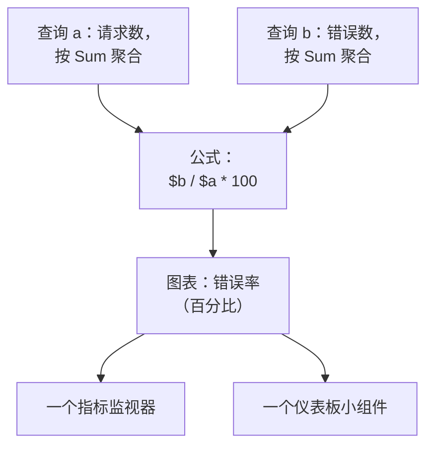

# 指标浏览器

指标是你的服务和基础设施随时间报告的数字：请求数、延迟、CPU、队列深度。指标浏览器列出你的项目收到的每个指标，为其中任何一个绘制图表，用公式组合它们，并把图表变成监视器或仪表板小组件。

:::cards
- [查找指标](#查找指标): 搜索指标名称列表。
- [为指标绘制图表](#为指标绘制图表): 聚合、过滤和分组一个查询。
- [用公式组合查询](#用公式组合查询): 错误率和其他比率。
- [使用你绘制的图表](#使用你绘制的图表): 监视器、仪表板小组件或链接。
:::

## 浏览器的工作原理

浏览器有两层。**查看者** 标签页列出你的项目收到的指标。点击其中一个，指标浏览器就会以针对它的查询打开：一个指标、如何聚合它，以及如何过滤和分组它。每个查询都是一个变量，即 `a`、`b` 等，公式可以使用它们。

浏览器有四个标签页：

| 标签页 | 用途 |
| --- | --- |
| **查看者** | 指标列表，每个指标都带有一个小图表和最新值。打开时显示最近一小时。 |
| **洞察** | 哪些服务报告指标，以及报告了多少。 |
| **设置指南** | 如何使用你的某个摄取密钥，通过 OpenTelemetry 发送指标。 |
| **设置** | **管道规则** 和 **记录规则**：指标到达时会发生什么。 |

## 开始之前

- **正在到达的指标。** 通过 [OpenTelemetry](/docs/telemetry/open-telemetry) 发送，或者从代理发送，例如 [主机 OpenTelemetry Collector](/docs/telemetry/host-otel-collector) 或 [Kubernetes 代理](/docs/telemetry/kubernetes-agent)。
- **可以读取遥测的角色。** Project Owner、Project Admin、Project Member、Viewer、Telemetry Admin、Telemetry Member 或 Telemetry Viewer，或者拥有 Read Telemetry Service Metrics 权限的自定义角色。它能读取哪些指标，参见 [遥测](/docs/permissions/index#遥测)。

## 查找指标

前往 **产品 → 可观测性 → 指标**。**查看者** 按名称列出你的项目收到的每个指标，每个都带有该时间范围的小图表和最新值。

- 用单独的词或 `name:` 搜索名称，例如 `name:http.server` 会找到 `http.server.request.duration`。参见 [搜索语法](/docs/telemetry/search-syntax#指标)。
- 在侧栏中按 **服务** 过滤，只查看某一个服务报告的指标。
- 点击一个指标，即可在指标浏览器中为它绘制图表。

## 为指标绘制图表

:::steps
### 打开指标

在 **查看者** 中点击该指标。浏览器会以一个查询 `a` 打开，沿用列表的时间范围和过滤条件。

### 选择聚合方式

在 **Aggregate by** 下，选择如何合并图表中每个点内的值：默认的 Avg、Sum、Min、Max、Count，或一个百分位数 P50、P75、P90、P95 或 P99。直方图指标（例如请求持续时间）的百分位数根据它的桶计算得出。

### 过滤和分组

打开 **Filters & grouping**。**Filter by attributes** 只保留属性匹配的数据点，例如某一个 `http.route`；**Group by** 为你所选属性的每个值画一条线，例如每台主机一条线。

### 调整图表

打开 **Display Settings**，选择 **Chart type**（折线、面积或柱状），设置要画在图表上的 **Warning Threshold** 和 **Critical Threshold**，或者打开 **Convert to per-second rate**。
:::

> [!TIP]
> 只增不减的计数器（例如 `system.disk.io`）以速率查看最清楚。打开 **Convert to per-second rate**，显示它变化的快慢，而不是它的累计总数；浏览器发现这样的计数器时会建议你这样做。

每个查询都画在自己的图表上。要把一个查询画在与上一个查询相同的图表上，请在它的 **Display Settings** 中打开 **Overlay with previous query**。

## 用公式组合查询

:::steps
### 添加查询

为你需要的每个指标点击 **添加指标**。新查询依次是 `b`、`c` 等。

### 添加公式

点击 **添加公式**，用查询的变量、运算符 `+`、`-`、`*`、`/`、`%` 和 `^` 以及括号编写 **公式**。要得到百分比形式的错误率，请写 `$b / $a * 100`。
:::

变量可以带或不带 `$`，大小写均可。如果公式引用了你没有定义的查询，它会提示这一点，而不是绘制图表。

## 围绕图表继续探索

图表上方的按钮作用于你正在查看的时间范围：

| 按钮 | 作用 |
| --- | --- |
| **日志** | 以此时间范围和你的过滤条件打开 [日志浏览器](/docs/telemetry/logs-explorer)。 |
| **追踪** | 以此时间范围和你的过滤条件打开 [跟踪浏览器](/docs/telemetry/traces-explorer)。 |
| **调查** | 打开一个侧面板，显示此时间范围内的日志、追踪和异常。 |
| **事件** | 在图表上标出此时间范围内的事件和警报。 |
| **Compare** | 在每个图表上用虚线画出上一个周期，让你看出发生了什么变化。 |

在图表上拖动可以放大某个时刻，双击可以缩小回去：参见 [放大时间范围](/docs/telemetry/charts-and-time-ranges)。

## 使用你绘制的图表

- **操作 → 从此视图创建监视器** 会打开一个新的指标监视器，并预先填好这些查询和公式。参见 [指标监控](/docs/monitor/metrics-monitor)。
- **操作 → Add to dashboard** 会把图表添加到你选择的仪表板。你需要有编辑该仪表板的权限。
- **复制链接** 复制指向这个视图的链接：查询、公式和时间范围都完全一致。
- **Saved Views** 以一个名称为项目中的每个人保留该视图。**查看者** 有自己的保存视图，用于它的搜索和过滤条件。保存的视图与 [日志浏览器](/docs/telemetry/logs-explorer#保存视图) 中的用法相同。

## 指标洞察

**洞察** 标签页统计某个时间范围内的指标：**活跃指标**、**报告服务** 以及每个服务的平均数。它把指标分成若干类别，并列出报告这些指标的服务。

## 指标到达时会发生什么

**指标 → 设置 → 管道规则** 会在指标存储之前、到达之时更改它们。规则按列表顺序运行，你可以拖动来调整顺序；针对单个服务的规则先于针对所有服务的规则运行。

| 规则类型 | 作用 |
| --- | --- |
| 过滤器（允许列表） | 只保留匹配的数据点，丢弃其余的。 |
| 丢弃 | 丢弃匹配的数据点。 |
| 重命名指标 | 重命名指标。 |
| 重命名属性 | 在匹配的数据点上重命名属性的键。 |
| 添加属性 | 为匹配的数据点添加一个属性。 |
| 移除属性 | 移除一个属性，例如取值太多而没有用处的属性。 |
| 脱敏属性 | 用占位符替换属性的值。 |
| 样本 | 保留匹配数据点中的一定百分比。 |

**指标 → 设置 → 记录规则** 每分钟根据其他指标计算出新的指标。记录规则的工作方式参见 [日志记录规则](/docs/telemetry/log-recording-rules)。

## 故障排除

:::details 计数器的图表只升不降
这是一个累积计数器。在查询的 **Display Settings** 中打开 **Convert to per-second rate**。
:::

:::details 列表提示找不到指标
先清除你的搜索和筛选标签。如果列表仍然为空，说明还没有指标到达 OneUptime：请把你的配置与 **设置指南** 对照。
:::

:::details 某个服务的指标不见了
在 **查看者** 中按该 **服务** 过滤，并扩大时间范围。如果仍然看不到，可能是你的角色范围不包括该服务：参见 [遥测](/docs/permissions/index#遥测)。
:::

## 后续步骤

:::cards
- [指标监控](/docs/monitor/metrics-monitor): 当指标越过阈值时收到警报。
- [创建仪表板](/docs/dashboards/authoring): 把你的图表并排放在一起。
- [搜索语法](/docs/telemetry/search-syntax): 搜索框能理解的所有过滤条件。
:::
