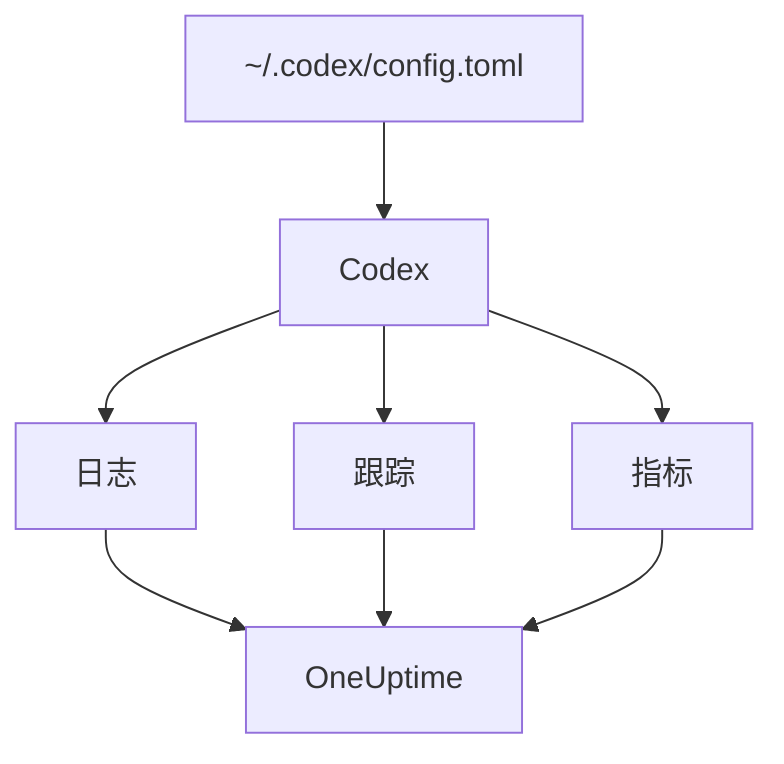

# OpenAI Codex

Codex CLI 内置三个 OpenTelemetry 导出器，分别用于日志、跟踪和指标。在 `~/.codex/config.toml` 中把它们指向 OneUptime，Codex 的每一轮都会带着 token 和成本到达，中间不需要任何包装器或代理。

:::cards
- [配置 Codex](#配置-codex): 一个 `[otel]` 块，每种信号一个完整 URL。
- [把用量归属到人](#把-codex-用量归属到人): Codex 在 span 和指标上不指明任何人，因此需要你来设置。
- [token 和成本](#token-和成本): OneUptime 读取哪种信号，以及显示什么。
- [故障排除](#故障排除): 什么都没有到达时要检查什么。
:::

## 工作原理

每个导出器把一种信号发送到它自己的 URL。跟踪和日志在你配置之前是关闭的；指标则不是。



> [!WARNING]
> 除非你更改这一点，否则 Codex 会把指标发送给 OpenAI。在发布版本中，`metrics_exporter` 默认为 `statsig`，会把指标发送到 `https://ab.chatgpt.com/otlp/v1/metrics`。像下面这样把 `metrics_exporter` 设为 OTLP 导出器，或设为 `none`，就能停止发送。在 `[analytics]` 中设置 `enabled = false` 也能停止 Statsig 默认行为，但你配置的 OTLP 指标导出器仍会继续工作。

## 开始之前

1. 在 **项目设置 → 遥测与 APM → 摄取密钥** 下创建一个遥测摄取密钥。
2. 你的 OTLP 端点是 `https://oneuptime.com/otlp`；如果你自托管 OneUptime，则是 `https://YOUR-ONEUPTIME-HOST/otlp`。
3. 每次导出都会在 `x-oneuptime-token` 请求头中发送密钥。

## 配置 Codex

:::steps
### 添加 otel 块

把以下内容放入 `~/.codex/config.toml`。它会开启全部三种信号，同时替换掉 Statsig 默认设置：

```toml title="~/.codex/config.toml"
[otel]
environment = "prod"
log_user_prompt = false

[otel.exporter.otlp-http]
endpoint = "https://oneuptime.com/otlp/v1/logs"
protocol = "binary"
headers = { "x-oneuptime-token" = "YOUR_INGESTION_TOKEN" }

[otel.trace_exporter.otlp-http]
endpoint = "https://oneuptime.com/otlp/v1/traces"
protocol = "binary"
headers = { "x-oneuptime-token" = "YOUR_INGESTION_TOKEN" }

[otel.metrics_exporter.otlp-http]
endpoint = "https://oneuptime.com/otlp/v1/metrics"
protocol = "binary"
headers = { "x-oneuptime-token" = "YOUR_INGESTION_TOKEN" }

[otel.span_attributes]
"user.id" = "dev@example.com"
"user.email" = "dev@example.com"
"team" = "platform"
```

### 为每个导出器提供完整 URL

Codex 会按原样使用每个 `endpoint`：它不像大多数 SDK 那样追加 `/v1/logs`、`/v1/traces` 或 `/v1/metrics`。如果三个导出器都只设置为 `https://oneuptime.com/otlp`，就什么也发送不出去，而且不会报错。

### 运行一轮

启动一个交互式 `codex` 会话，问一个小问题，让这一轮结束。然后在 OneUptime 中打开 **日志** ：Codex 的事件，例如 `codex.conversation_starts`、`codex.api_request` 和 `codex.turn_cost`，会出现在那里。
:::

> [!IMPORTANT]
> Codex 会忽略 `[otel]` 下它不认识的键，而且不给出警告。它的键使用下划线命名（`trace_exporter`、`metrics_exporter`、`span_attributes`），但导出器名称和 TLS 字段使用连字符命名（`otlp-http`、`ca-certificate`）。写成 `trace-exporter` 会直接关闭跟踪，且不报任何错误。

## 配置键

| 键 | 默认值 | 作用 |
| --- | --- | --- |
| `environment` | `"dev"` | 设置资源属性 `env` |
| `log_user_prompt` | `false` | 在 `codex.user_prompt` 上发送提示词文本；否则显示为 `[REDACTED]` |
| `log_agent_responses` | `false` | 把代理的最终回答发送到日志导出器 |
| `exporter` | `none` | 日志导出器 |
| `trace_exporter` | `none` | 跟踪导出器 |
| `metrics_exporter` | `statsig` | 指标导出器：请务必设置 |
| `span_attributes` | — | 添加到每个导出的 span 上的属性 |
| `tracestate` | — | W3C `tracestate` 成员 |
| `tool_result` | `{ max_bytes = 2048 }` | 日志记录保留多少工具结果，以 UTF-8 字节计 |

导出器可以是 `none`、`statsig`、`otlp-http` 或 `otlp-grpc`。`otlp-http` 接受 `endpoint`、`headers`、`protocol`（`"binary"` 或 `"json"`，OneUptime 两者都接受）和 `tls`（`ca-certificate`、`client-certificate`、`client-private-key`）；`otlp-grpc` 接受相同的内容，但没有 `protocol`。

## 把 Codex 用量归属到人

Codex 只在一个地方指明开发者：

- **日志记录** 带有 `user.account_id` 和 `user.email`。
- **span** 不带：Codex 有意把两者都排除在跟踪之外。
- **指标** 也不带：它们带有 `auth_mode`、`session_source`、`originator`、`service_name`、`model` 和 `app.version`，但没有人员。

OneUptime 从 span 和指标数据点读取人员，从不从日志记录读取。因此请在 `[otel.span_attributes]` 中自行为每个 span 标注身份：

```toml title="~/.codex/config.toml"
[otel.span_attributes]
"user.id" = "dev@example.com"
"user.email" = "dev@example.com"
"team" = "platform"
"cost_center" = "eng-123"
```

`user.id` 是 OneUptime 优先使用的键，`user.email` 用于填充邮箱列。Codex 没有资源属性，因此请在这里一并设置团队键（`team.id`、`team`、`cost_center`、`department`）。这个块位于每位开发者自己的配置文件中：请通过你的 dotfiles 或 MDM 配置文件按开发者分发。如果使用一个只有一个身份的共享文件，所有人的支出都会记到一个人头上。

## token 和成本

| 信号 | Codex 发送什么 | OneUptime 如何处理 |
| --- | --- | --- |
| 跟踪 | `gen_ai.usage.input_tokens`、`gen_ai.usage.output_tokens` 和缓存 token，但没有模型 | 按人员统计 token；无法为其计价 |
| 指标 | 按 `token_type` 划分的 `codex.turn.token_usage`，以及以百万分之一美元计的 `codex.turn.cost_microusd` | 把成本换算为 USD；只在 span 没有报告的地方读取指标 |
| 日志 | 带有 `usage.estimated_usd` 和人员的 `codex.turn_cost` | 存储在 **日志** 浏览器中；不与支出关联 |

使用上面的配置时， **用量** 标签页上的结果如下：

- token 来自 span，按人员划分，`codex.turn.token_usage` 不会再叠加上去：两者从不相加（ [原因](/docs/telemetry/ai-llm-observability#span-优先指标补充) ）。
- Codex 的 span 不指明模型，因此 OneUptime 无法为其计价，它们的成本为 0。于是成本总数会从 `codex.turn.cost_microusd` 中取 Codex 的成本，并为你换算为 USD。
- **员工** 、 **团队** 和 **模型** 表显示 span 的行：有按人员的 token，但没有按人员的成本。
- 没有跟踪时，改由指标填充这些表，只有成本，并且全部归入 **未归属** ，因为 Codex 的指标不指明任何人。

最精确的每轮成本（并带有人员信息）是日志记录 `codex.turn_cost`。OneUptime 目前还不会把日志记录与支出关联，但请保持日志导出器开启：等到支持时，历史数据已经在那里了。

## 在 CI 中以及作为 MCP 服务器使用 Codex

`codex`、`codex exec` 和 `codex mcp-server` 都从同一个 `[otel]` 块构建遥测，并使用全部三个导出器。`codex exec` 的运行带有 `originator` `codex_exec`，`codex mcp-server` 以 `codex_mcp_server` 的身份导出，因此你可以按这些值把 CI 和 MCP 运行与交互式会话区分开。

## 隐私

`log_user_prompt` 和 `log_agent_responses` 默认为 `false`：请保持关闭。`codex.user_prompt` 事件仍会到达，但提示词被替换为 `[REDACTED]`，因此你保留了这一轮、它的 token 和成本，却没有提示词文本。无论这些开关如何设置，人员（`user.email`、`user.account_id`）都在日志记录上。

如果为了调查而开启内容， **跟踪 → 设置** 下跟踪的 **清理规则** 和 **丢弃过滤器** 会在存储前将其屏蔽或丢弃。

## 使用 OpenAI API 代替 Codex

OpenAI 的平台 API 本身不发送 OpenTelemetry：每个 span 都来自对你自己客户端的插桩。有三种插桩可与 OneUptime 配合使用：

- **OpenTelemetry** ：适用于 Python 的 `opentelemetry-instrumentation-genai-openai`，它取代了 `opentelemetry-instrumentation-openai-v2`。是否记录消息由 `OTEL_INSTRUMENTATION_GENAI_CAPTURE_MESSAGE_CONTENT` 决定。
- **OpenLLMetry** （Traceloop）：`opentelemetry-instrumentation-openai`。
- **OpenInference** （Arize）：`openinference-instrumentation-openai`。

按照 [AI / LLM 可观测性](/docs/telemetry/ai-llm-observability) 中的说明，把其中任意一种指向 OneUptime。它们都不知道你的员工是谁：请自行设置 `user.id`。

**OpenAI Agents SDK** 把跟踪发送到 OpenAI 自己的端点，而不是通过 OTLP。请用 `opentelemetry-instrumentation-openai-agents-v2` 或 `openinference-instrumentation-openai-agents` 进行桥接，它们会把 SDK 的 span 交给 OTLP 导出器。

## 故障排除

:::details 什么都没有到达
先检查三个 `endpoint` 值：每个都必须以 `/v1/logs`、`/v1/traces` 或 `/v1/metrics` 结尾。然后检查 `x-oneuptime-token` 请求头：OneUptime 会拒绝错误的密钥。
:::

:::details 日志到达了，但跟踪始终没有到达
查找 `[otel]` 下拼写错误的键：Codex 会悄悄忽略它。最常见的是把 `trace_exporter` 写成了 `trace-exporter`。
:::

:::details Codex 的成本出现在总数中，但每个人都显示 $0
这是预期行为：Codex 的 span 带有 token 但没有模型，因此无法计价，而成本指标不指明任何人。请参阅 [token 和成本](#token-和成本)。
:::

:::details 所有人的支出都显示在一个人名下
每台机器上都是同一个 `[otel.span_attributes]` 身份。请为每位开发者设置各自的身份。
:::

## 后续步骤

:::cards
- [AI 编程助手](/docs/telemetry/ai-coding-assistants): 支出如何在所有编程助手之间归属。
- [AI / LLM 可观测性](/docs/telemetry/ai-llm-observability): 你自己的 AI 调用的对话、警报、成本和预算。
- [AI 网关](/docs/telemetry/ai-gateways): 一个为每次模型调用提供跟踪和计价的网关。
:::
