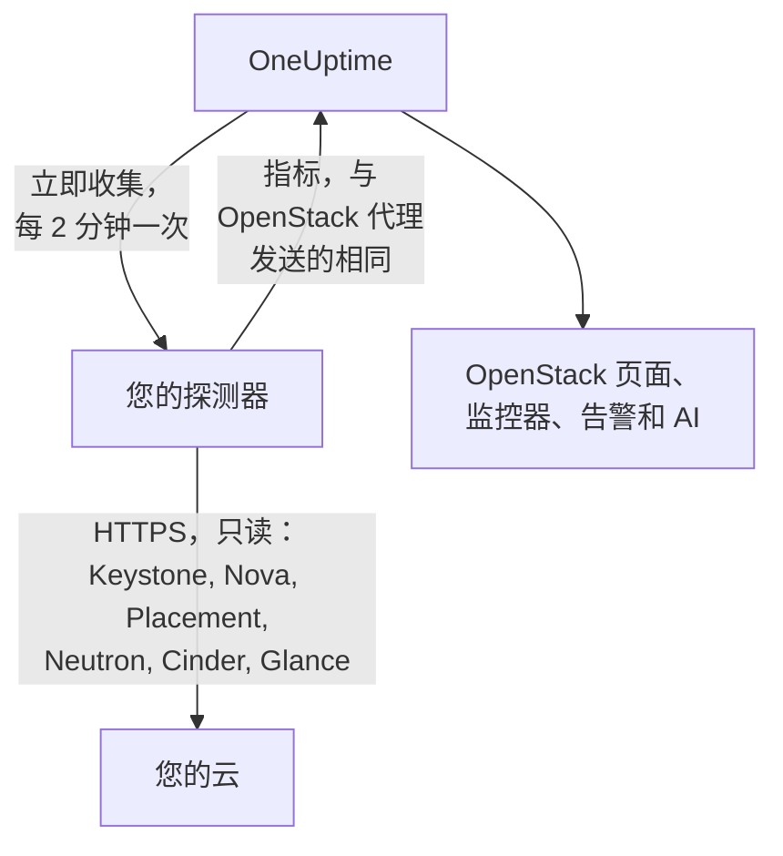

# 无需代理监控 OpenStack

无需安装任何东西即可监控 OpenStack 云：在 OneUptime 中输入 Keystone 的地址和应用凭据，选择能够访问该云的探测器，探测器就会收集与 [OpenStack 代理](/docs/telemetry/openstack)相同的数据。无需安装、升级或持续运行代理，也无需单独准备机器。

> [!IMPORTANT]
> 探测器只通过 HTTPS 与云通信。凭据及其令牌绝不会通过明文 HTTP 发送，而 DevStack 和 Kolla-Ansible 默认以明文 HTTP 提供 API。对于这类云，请为其 API 启用 TLS，或使用运行在云旁边的 [OpenStack 代理](/docs/telemetry/openstack)。连接测试发现明文 HTTP 地址时会给出提示。

:::cards
- [开始之前](#开始之前)：一个能访问 API 的探测器，以及一个凭据。
- [连接云](#连接云)：地址、凭据、测试和名称。
- [故障排查](#故障排查)：每条消息的含义及解决方法。
:::

## 工作原理



探测器每两分钟读取您所选每个区域的每项服务，并将结果发送到 OneUptime。数据的到达方式与 OpenStack 代理完全一致，因此每个 OpenStack 页面、[OpenStack 监控器](/docs/monitor/openstack-monitor)和告警模板对它的读取方式都相同。

每项服务都独立读取，并与其他服务同时进行。Neutron 失败或挂起只会丢失 Neutron 的序列，Nova 的数据照常到达，但有一点是 Nova 自身造成的：它会就列出的每个实例向 Neutron 查询。因此，在 Neutron 宕机期间，探测器会保留上次读取的实例，只查询发生变化的部分。如果某个实例已变化，或探测器刚刚启动，Nova 也无法回答该列表：Nova 会显示为失败，其他序列仍会到达，每个实例在其页面上保持上次的状态，直到 Neutron 恢复。

Heat、Magnum、Manila、Trove、Gnocchi、Designate、Swift 和 Barbican 会在 Keystone 的目录列出它们时读取。未运行这些服务的云不会为此付出任何开销，连接测试也不会提及它们，并且[不会显示它们的任何痕迹](/docs/telemetry/openstack#heat-和-magnum)。

在目录中包含 Octavia 的云上，探测器对负载均衡器、池、监听器和 amphora 各用一次列表请求读取，然后对每个池的成员以及每个状态为 `ACTIVE` 的负载均衡器和监听器的流量计数器各发一次请求。一个包含 3 个负载均衡器、1 个池和 1 个监听器的云，每次收集需要 9 次请求；测试台记录的真实 DevStack 恰好是这个数字。每次收集最多读取 25 个池的成员和 50 个计数器，优先读取最久未读的，其余的保持上次读取时的状态。Octavia 的计数器是累计值，因此探测器会保留每个计数器的上次读数，并绘制两次读数之间每秒的差值：图表从第二次收集开始，计数器下降（监听器被重建）时，该时间段不绘制任何内容。OVN 提供程序的每个计数器都报告 0，这是一条平线，并非故障。

读取 amphora 的每一项都需要 Octavia 的管理员规则。低于管理员的凭据只能看到自己项目的负载均衡器、池、监听器和成员，以及自己的计数器，看不到 amphora：“负载均衡器”页面会说明这一点，但不会发出警告。在没有负载均衡器的项目上，monitoring 角色什么也看不到。在此版本中，`load-balancer_global_observer` 的所有读取都会被拒绝。

对探测器而言，停止的 Octavia API 是 `up 0`，而代理的导出器无法表达这一点。

## 探测器还是代理？

| | 探测器（本页） | OpenStack 代理 |
|---|---|---|
| 您要运行什么 | 您已在运行的探测器，或新建一个 | 代理，运行在单独的机器上 |
| 凭据保存在哪里 | 在 OneUptime 中加密保存，只发送给探测器 | 在代理的 `clouds.yaml` 文件中 |
| 需要访问什么 | 通过 HTTPS 访问 Keystone 和各服务的 API | 访问 Keystone 和各服务的 API |
| 使用明文 HTTP 的 API | 不收集：令牌绝不会未加密发送 | 收集 |
| 最大的云 | 已针对模拟云（并非真实云）测试到 [200,000 个实例](/docs/telemetry/openstack-very-large-clouds)，最多分十次上传，每次 48 MiB | 尚未测试到任何规模：[它的抓取在](/docs/telemetry/openstack-very-large-clouds#通过代理)远未达到该规模时就已超时 |
| 服务日志和 AI 代理 | 不包含 | 包含 |
| 云所依赖的组件：RabbitMQ、MariaDB、Memcached、HAProxy、OVN、libvirt | 不包含：探测器读取的是云的 API | 包含，并列出其目标 |
| 来自 libvirt 或 Ceilometer 的每个实例的真实 CPU、内存和磁盘 | 不包含 | 包含，并列出其导出器 |
| 登录 Keystone | 每个令牌的有效期内一次，通常为一小时 | 每次抓取一次 |
| 单个项目上的普通 `reader` | 该项目的实例、卷和网络 | 该项目的卷和网络，没有实例 |

两者发送的序列相同，因此页面和监控器在两种方式下都能工作。探测器还会发送只有原生客户端才能读取的内容：实例的地址、任务状态和故障消息，其启动所用的镜像，运维人员是否强制将某个 Nova 服务设为停用，DHCP 代理服务哪些网络，哪个存储池保存某个卷，实例、卷或镜像最近一次更改的时间，以及每个卷快照和备份的状态。Cinder 只会向它视为管理员的凭据说明哪个存储池保存某个卷。在运行 [Heat 或 Magnum](/docs/telemetry/openstack#heat-和-magnum) 的云上，它还会发送堆栈或集群失败的原因，堆栈拥有哪些实例和卷，每个集群的项目、模板和 Kubernetes 版本，以及 Heat 的每个引擎和 Magnum 的每个 conductor 是否在运行。

如需服务日志、AI 代理、云所依赖的组件和每个实例的真实用量，如果云的 API 只支持明文 HTTP（DevStack 和 Kolla-Ansible 默认如此），或云过大而必须[从其数据库读取](/docs/telemetry/openstack-very-large-clouds#数据库路径)，请选择代理。其他情况请选择探测器：无需安装任何东西，而且它能读取更多 Nova 和 Cinder 提供的信息。[超大规模 OpenStack 云](/docs/telemetry/openstack-very-large-clouds)说明了两种方式在各种规模下的开销。

您可以随时在云的**设置**页面上从一种方式切换到另一种。

## 开始之前

- **一个能通过 HTTPS 访问 Keystone 和每项服务 API 的探测器。** 这通常是位于云网络中的[自定义探测器](/docs/probe/custom-probe)。Keystone 的目录指明了每项服务的应答地址，探测器会连接这些地址，因此每个地址都必须能从探测器访问，且都必须使用 HTTPS。在 OneUptime Cloud 上，共享探测器永远不会收到 OpenStack 凭据，因此请添加您自己的探测器。在自托管实例上，实例自带的探测器也可以收集。
- **一个凭据。** 最好使用应用凭据，因为它可以限制为只读并可设置过期。用户名和密码也可以使用，但可以执行其账户能做的一切。

OpenStack 没有全局只读角色，因此探测器能看到多少取决于凭据：

| 级别 | 需要什么 | 探测器读取什么 |
|---|---|---|
| 完整视图 | 在拥有独立项目、具有 `admin` 角色的账户上创建的应用凭据，并通过访问规则限制为只读 | 除 Keystone 的用户和组之外的一切，规则有意将其排除 |
| 仅基础设施 | 在一个自有且不含任何资源、配额为零的项目上的 `oneuptime_monitoring` 和 `reader` 角色，以及 OpenStack 代理附带的策略文件 | Hypervisor、Nova 的服务、Neutron 的代理、地址池、Placement、项目列表以及每个项目的实例。卷、网络和路由器仅在分配了该角色的地方读取。不包括 `cinder-volume` 和 `cinder-scheduler` 的状态或存储池：Cinder 自己的代码要求管理员 |
| 项目视图 | 单个项目上的普通 `reader` | 该项目的实例、卷和网络，没有基础设施 |

连接测试会说明凭据相当于其中哪一级，并在凭据所在项目自身包含资源时发出警告：在 Cinder 的 `enforce_new_defaults` 关闭（这是其默认值）时，项目上的任何角色（包括 `reader`）都可以创建该项目的卷。

> [!IMPORTANT]
> 受访问规则限制的应用凭据，会被任何其 `keystonemiddleware` 未设置 `service_type` 的服务以 `401` 拒绝。连接测试会针对每次读取说明这一点。请在每项服务的配置中设置它，然后重启服务。[创建凭据](/docs/telemetry/openstack#创建凭据)包含各服务的规则、策略文件和设置，[每个级别读取什么](/docs/telemetry/openstack#每个级别读取什么)则是真实云给出的答复。

## 连接云

:::steps
### 打开您的云
在 OneUptime 中，打开 **OpenStack → All Clouds**，然后点击 **连接云**。

### 输入地址和凭据
输入 `clouds.yaml` 或 `openrc` 文件中的 `auth_url`，例如 `https://keystone.example.com:5000/v3`，以及应用凭据的 ID 和密钥。选择能够访问该云的探测器。

### 测试连接
点击 **测试连接**。探测器会登录，在每个区域尝试一次收集所需的每项读取，然后登出。它会说明目录列出了哪些区域，凭据能读取什么，被拒绝了什么，缺少它会导致哪些页面没有数据，以及开通权限所需的那一行配置。某项读取失败不会中断测试。

### 信任云的证书
使用自有证书颁发机构的云，其证书不被探测器信任。此时测试会显示该证书以及出示该证书的主机。请将其指纹与 API 自身的指纹核对，然后点击 **信任此证书**。每项服务一个主机的云可能每项服务有一个证书，最多可以信任 32 个。

### 选择区域并连接
选择要读取的区域，为云命名，然后点击 **连接云**。云的页面随即打开。
:::

云的 **概览** 页显示一张 **数据收集** 卡片。在首次收集（会在一分钟内开始）之前，它显示 **检查中**，之后显示 **正在收集**，页面开始填充数据。当部分服务已读取而另一项未读取时，它会说明是哪一项。如果 15 分钟内没有探测器为该云工作，原因是探测器离线或版本过旧，则无论上次收集的结果如何，它都显示 **未在收集** 并给出说明。

云的 **设置** 页面上的 **数据收集** 卡片保存着您连接云时使用的内容：


## 通过 API 或 Terraform 连接云

云的连接设置是 API 中 [OpenStack Cloud 资源](/reference/open-stack-cloud)的普通字段，位于 `/api/openstack-cloud`，因此完全不用仪表板也可以连接云。使用 Terraform 时对应的是 `oneuptime_openstack_cloud`：

```hcl
resource "oneuptime_openstack_cloud" "prod_eu" {
  name                      = "prod-eu"
  collection_method         = "Probe"
  auth_url                  = "https://keystone.example.com:5000/v3"
  credential_kind           = "applicationCredential"
  application_credential_id = var.openstack_application_credential_id
  credential_secret         = var.openstack_application_credential_secret
  collection_probe_id       = oneuptime_probe.eu_west.id
  collection_regions        = jsonencode(["RegionOne"])

  # A cloud with its own certificate authority: the fingerprints it presents.
  trusted_certificate_fingerprints = jsonencode(["AB:CD:EF:..."])
}
```

如果使用用户名和密码，请将 `credential_kind` 设为 `password`，并设置 `keystone_username`、`project_name`，当它们不是 `Default` 时还要设置 `user_domain_name` 和 `project_domain_name`。`endpoint_interface`、`collection_interval_in_minutes` 和 `collection_options` 是表单折叠在 **更多字段** 下的内容。只有 `name` 是必填的，因为由代理发送的云没有这些字段。

`credential_secret` 是只写的，因此任何读取都不会返回它，Terraform 也不会将它写入计划和输出。[已保存凭据的规则](#已保存的凭据)在这里同样适用：更改地址、探测器或受信任的证书时，需要在同一请求中提供密钥。探测器报告的内容，例如 `collection_status`、`collection_error` 和 `presented_certificate`，可以读取，但不能设置。

## 它对您的云有什么开销

监控绝不能成为拖垮云的原因，因此每次收集在设计上都很温和：

- **一次登录，保持复用。** 令牌会一直使用到过期前五分钟。登录是出问题的 Keystone 最难承受的操作。
- **分页列表。** 每个列表都使用 `limit` 和 `marker`，每次读取一千行。
- **按变化读取实例。** 在每半小时一次的完整读取之间，探测器使用 `changes-since` 只向 Nova 询问自上次读取以来的变化。
- **Hypervisor 的清单只读一次。** 每当清单变化，Placement 就会推进提供者的 generation，一次列表调用即可得知全部提供者的这一信息，因此只有在 generation 变化时才会重新读取。
- **限定的负载。** 每项一次调用的内容，在每次收集超过 2,000 次调用后轮流进行，项目限额在超过 250 个项目后也是如此。本次未读取的内容会按上次读取的值发送，因此任何序列都不会出现空缺，负载也不会随云的规模无限增长。
- **只读取需要的字段。** Neutron 的列表会指明字段，安全组只请求其 ID。
- **绝不叠加。** 耗时超过间隔的收集会被跳过，而不会与下一次并行运行。
- **时间预算。** 一次收集拥有其间隔的十分之九，且最多十分钟。到时已读取的内容会发送，超时的服务会如实说明。
- **退避。** 收到 `429` 或 `Retry-After` 要求等待时，探测器会等待。返回 `429`、`503` 或毫无响应的服务会被搁置一分钟，然后两分钟、四分钟，最长半小时，在等待期间其序列持续显示它已宕机。
- **放慢速度。** 如果某次应答比该服务通常的应答慢三倍，且至少慢一秒，或不论通常情况如何都慢五秒，则该服务的下一次请求会被延后相同的时间。**数据收集** 卡片会说明何时发生了这种情况。
- **被拒绝的凭据等待最久。** 重复使用被拒绝的凭据会锁定账户，因此会先等待五分钟，再十分钟，最长一小时。您更正过的凭据会立即重试。

- **对大型云读取得更少。** 超过 5,000 个实例后，云只保留计数及其各组成部分，不再为每个实例或每个卷保留序列，除非您在其 **设置** 页面的 **每个实例的真实用量** 下另行选择。变化的内容、您选择保留的内容以及告警正在监视的内容仍会在每次收集时发送。其余内容轮流发送，**数据收集** 卡片会说明一轮需要多长时间。

按默认设置，每次收集时每个区域需要：对 Nova 7 次调用，对 Neutron 7 次，对 Cinder 5 次，对 Placement 1 次调用外加每个 Hypervisor 2 次，最多再 4 次用于向 Placement 询问[每种规格能容纳多少个](/docs/telemetry/openstack#容量)，大约每五分钟还有对 Keystone 的 5 次和对 Glance 的 1 次。Hypervisor 的清单只读取一次，只有在 Placement 表示其已更改时才会再次读取。超过一千行的列表每一千行需要一次调用。每个发生变化的实例会多对 Nova 调用一次，以读取它的经历，每次收集最多读取 25 个：安静的云不会产生任何调用。在 ML2/OVS 上，Neutron 对每个路由器多调用一次，以询问哪些 L3 代理持有它，并且每十分钟对每个 DHCP 代理调用一次（最多 20 个），以询问它服务哪些网络。DHCP 代理更多的云会轮流处理，超过摘要规模的云会省略这一项，响应缓慢的 Neutron 则完全不会被询问。使用 OVN 的云没有可询问的对象。[超大规模 OpenStack 云](/docs/telemetry/openstack-very-large-clouds#对控制平面的负载)说明了各种规模下这相当于每分钟多少请求。

运行 Manila 的云大约每五分钟对它调用 2 次，运行 Trove 的调用 1 次，Gnocchi 1 次，Barbican 3 次。Designate 为 2 次，每个状态不是 `ACTIVE` 的区域再加 1 次，每次收集最多 50 次。Swift 对凭据自身的项目为 1 次，具有 `ResellerAdmin` 时每个其他项目再加 1 次，每次收集最多 200 次。运行 Heat 或 Magnum 的云大约每五分钟对 Heat 调用 2 次，对 Magnum 调用 3 次。两者的列表都不完整：Magnum 的列表没有说明集群属于谁或为何失败，Heat 的列表没有说明堆栈拥有什么。因此，当集群或堆栈的状态发生变化时，探测器还会单独读取它，每次收集每种最多 25 个。数量更多的云会在接下来的几次收集中继续补全，保持不变的则绝不会被读取两次。

有三项默认关闭，需要在云的 **设置** 页面上 **数据收集** 卡片的 **默认之外读取的内容** 下开启，或在连接云时在 **更多字段** 下开启，因为每一项都会给您的云增加开销：

| 选项 | 您得到什么 | 开销 |
|---|---|---|
| 端口 | 每个端口一个序列，以及有多少端口没有地址或有多少负载均衡器已宕机 | 对您指定的每个网络或项目进行一次分页列表读取，如果未指定则读取所有端口。在大型云上，不限范围地列出端口可能使 Neutron 饱和 |
| 项目限额 | 每个项目的配额和限额 | 每个项目四次调用，每次收集最多 250 个项目 |
| Swift 的存储服务器 | 每台服务器是否应答、其复制情况，以及它们的 ring 是否都相同，需要将每台服务器的 `/recon` 端口以 `host:port` 形式指定。只有运行 Swift 的云才提供此项，在其首次收集读取到 Swift 后，会出现在 **设置** 页面上 | 每次收集中每台服务器 5 次调用。不会向它们发送任何凭据 |

## 证书

探测器从不跳过证书验证。每个连接都会完成完整的 TLS 握手，然后：

- 在没有信任任何证书时，API 的证书必须来自探测器所在机器信任的颁发机构，且与其应答的地址相符；
- 在信任了证书时，API 必须出示其中恰好之一，以其 SHA-256 指纹标识。其他任何证书都不会被接受，即使是公开受信任的证书也一样。

要核对指纹，请在探测器所在的机器上运行：

```bash
openssl s_client -connect keystone.example.com:5000 </dev/null | openssl x509 -noout -fingerprint -sha256
```

证书续期后，收集会停止并显示 **API 的证书已更改**，同时显示新证书。在您于云的 **概览** 或 **设置** 页面上信任它之前，不会发送任何数据。

## 已保存的凭据

密钥经过加密且只写：任何人都无法读回它，API 也从不返回它。它只会发送给收集该云的探测器，探测器将其保存在内存中。

已保存的凭据只会发送到输入它时所用的地址、探测器和证书。更改地址、探测器或受信任的证书时会再次要求输入密钥，因此任何能编辑云的人都无法将它发送到别处。信任探测器在已保存地址上发现的证书时会保留它，减少受信任的证书时也会保留。

目录与您输入的地址遵循相同的规则，因为令牌会发往目录所指的任何地方。无论目录列出的是回环、链路本地或云元数据地址，还是某个主机名解析到这些地址，探测器都不会连接，并且它连接的是自己检查过的地址，而不是片刻之后 DNS 给出的地址。它不会跟随重定向。

## 在代理和探测器之间切换

打开云的 **设置** 页面。其 **数据收集** 卡片对由代理发送数据的云提供 **使用探测器收集**，对由探测器收集的云提供 **使用 OpenStack 代理**。切换到代理会清除已保存的凭据。

> [!WARNING]
> 探测器首次收集成功后，请停止 OpenStack 代理。两者同时运行时，每个指标都会到达两次。

超过 [5,000 个实例](/docs/telemetry/openstack-very-large-clouds#摘要模式)后，探测器的首次收集了解整个云，但只发送其中一部分，因此新云的列表会在第一个周期内逐步填满，**数据收集** 卡片会说明何时全部就绪。

## 裸金属

在目录中包含 Ironic 的云上，探测器会读取其节点，并按名称逐个请求字段，因此收集时绝不会读取节点的 `driver_info`。它会补充代理的导出器所没有的内容：节点的驱动、其 conductor、其故障以及失败原因。Ironic 可能在大约一分钟内清空 `last_error`，因此页面会保留收集到的最后一个值，并说明时间。

探测器会先读取目录，因此能够报告 Ironic 的 API 已宕机，这是代理的导出器做不到的。没有 Ironic 的云不会被询问任何相关内容。

Ironic 只向项目显示其拥有的节点，并拒绝向它提供 conductor 列表。按 Ironic 的默认策略，只有系统范围的凭据才能读取这些内容，而探测器的凭据不能是系统范围的，因为它用同一个凭据读取 Nova 的列表。因此，除非云的策略为其角色授予 `baremetal:node:list_all` 和 `baremetal:conductor:get`，探测器只能看到其项目拥有的节点而看不到 conductor，页面也会说明这一点。[裸金属](/docs/telemetry/openstack#裸金属)有其余内容。

## 参考

| 设置 | 默认值 | 说明 |
|---|---|---|
| 收集频率 | 2 分钟 | 1 到 60 分钟。对大型云降低收集频率可减轻其负担。无论其余服务多久收集一次，Keystone 和 Glance 都大约每五分钟读取一次。 |
| 端点接口 | public | 使用目录中的哪种 URL：public、internal 或 admin。 |
| 同时收集数 | 每个探测器 4 个 | 慢于间隔的收集会被跳过，绝不叠加。 |
| 最大上传 | 48 MiB | 一次收集按需分多次上传，最多十次。超过 [5,000 个实例](/docs/telemetry/openstack-very-large-clouds#摘要模式)后，未变化的内容轮流发送。 |
| 对每项服务的请求 | 一次一个 | Placement 的按提供者调用一次四个。 |
| 等待一次应答 | 60 秒 | 遇到 `429` 或服务器错误时总共尝试三次。 |
| 连接测试 | 90 秒内开始 | 在时限内没有探测器接手，或运行超过 3 分钟的测试，会作为失败返回。一个项目中最多可以有五个测试同时等待或运行。 |

## 故障排查

:::details API 的证书不受信任
云出示了来自其自有颁发机构的证书。请将显示的指纹与 API 的证书核对，然后点击 **信任此证书**。
:::

:::details API 的证书已更改
证书已续期，或者有人正在中间截获。在您信任新证书之前，不会发送任何数据。请核对其指纹，然后信任它。
:::

:::details 认证 URL 无效
请输入通过 HTTPS 访问的 Keystone 地址，例如 `https://keystone.example.com:5000/v3`。使用明文 HTTP 的地址会在发送任何内容之前被拒绝。对于 API 只支持明文 HTTP 的云，请启用 TLS，或使用 [OpenStack 代理](/docs/telemetry/openstack)。
:::

:::details 目录中指明了明文 HTTP 端点
凭据的令牌绝不会未加密发送。请为该 API 启用 TLS，选择另一个端点接口，或对这个云使用 [OpenStack 代理](/docs/telemetry/openstack)。在其读取的每个 API 都使用 HTTPS 之前，连接测试会一直失败。在收集时，只有拥有该端点的服务会缺失：其他服务照常读取。
:::

:::details Keystone 拒绝了凭据
ID、密钥或密码有误，或者凭据已过期或被删除，或其账户失去了在该项目上的角色。请重新创建一个，并在云的 **设置** 页面上通过 **编辑连接** 输入。
:::

:::details 该账户在该项目上没有角色
用户名和密码登录成功，但不是在该项目上。请检查项目名称和两个域。应用凭据可以避免这个问题：它在创建时就已限定范围。
:::

:::details 该凭据无法读取监控所需的内容
测试会列出每项被拒绝的读取、缺少它会导致缺失的内容，以及开通权限的那一行配置。带有访问规则的凭据收到 `401`，意味着规则没有列出该路径，或该服务的 `keystonemiddleware` 未设置 `service_type` 且尚未重启。
:::

:::details 探测器得不到云的应答
探测器的网络无法访问该 API。请在防火墙中放行，或选择位于云网络中的探测器。每项服务的地址各不相同：消息会指明没有应答的那一个。
:::

:::details 该端口上没有任何服务应答
请检查地址和端口。Keystone 通常在 5000 端口提供服务，或在 443 端口后面带有 `/identity` 之类的路径。
:::

:::details 安全连接失败
该地址很可能指向了一个不支持 HTTPS 的端口。请检查它。如果云的 API 只支持明文 HTTP，请启用 TLS，或使用 OpenStack 代理。
:::

:::details OneUptime 不连接此地址
该地址或目录中指明的某个地址是回环、链路本地或云元数据地址，或解析到这些地址。请使用 API 在您网络中应答的地址。
:::

:::details 此地址不是 Keystone
请输入 `clouds.yaml` 或 `openrc` 文件中的 Identity 端点：即其 `auth_url`。
:::

:::details 目录中没有该区域
请从目录列出的区域中选择。连接测试会列出它们。
:::

:::details Keystone 出现故障
Keystone 返回了服务器错误。探测器会在登录之间等待更久，直到它恢复，而没有登录就什么也读取不了。请检查 Keystone 的服务及其背后的数据库。
:::

:::details 某项服务已停止或太忙而无法应答
它持续返回 `429` 或服务器错误，因此探测器会在两次收集之间等待更久，直到它恢复。请先检查它是否在运行，再检查其负载。降低收集频率对繁忙的服务有帮助。
:::

:::details 收集耗时过长
云的应答太慢，无法满足这个间隔。请降低收集频率，或检查其负载。
:::

:::details 探测器没有接手此任务
探测器处于离线状态，或运行的 OneUptime 版本早于 OpenStack 收集功能。请在 **探测器** 页面上确认它已连接，并更新它。收集逾期 15 分钟后，云的卡片也会说明这一点，无论其上次收集结果如何，探测器恢复后它会自动恢复正常。
:::

:::details 这个云太大，无法用探测器收集
它的指标超过了一次收集所能发送的量，而且这个云被设置为保留每个实例的序列。请在其 **设置** 页面的 **每个实例的真实用量** 下改为只保留计数，或使用 [OpenStack 代理](/docs/telemetry/openstack)。[摘要模式](/docs/telemetry/openstack-very-large-clouds#摘要模式)说明了这样做会放弃什么。
:::

## 后续步骤

:::cards
- [OpenStack 监控器](/docs/monitor/openstack-monitor)：对服务、Hypervisor、实例、网络和卷发出告警。
- [自定义探测器](/docs/probe/custom-probe)：在云的网络中运行探测器。
- [OpenStack 代理](/docs/telemetry/openstack)：改用代理收集云。
:::
