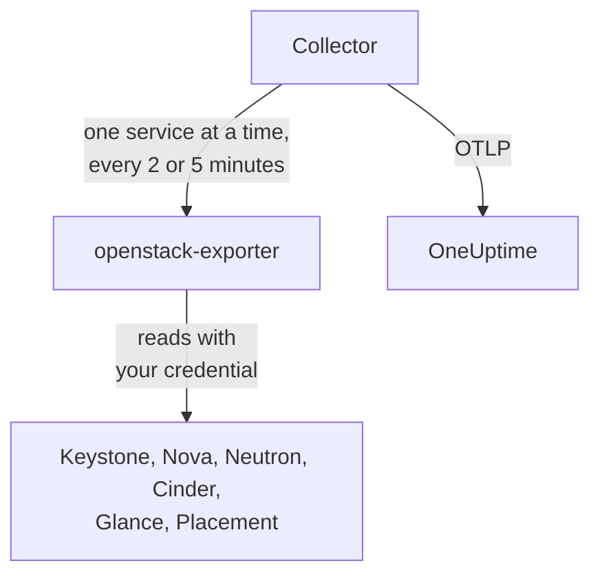

# OpenStack 代理

OneUptime OpenStack 代理用于监控 OpenStack 云：它的服务和代理、Hypervisor、实例、网络、路由器、卷、存储池、镜像和项目，覆盖每个区域。它使用你选定的凭据读取云的 API，并把发现的内容发送到 OneUptime，云会连同其区域、Hypervisor 和项目一起显示在 OneUptime 中。[OpenStack 监控器](/docs/monitor/openstack-monitor)会针对收到的数据发出警报，也可以使用[探针](/docs/telemetry/openstack-agentless)，无需安装任何东西即可收集一朵云。

:::cards
- [探针还是代理？](/docs/telemetry/openstack-agentless#探测器还是代理): 对于两种方式都可用的云，该如何选择。
- [选择它能看到多少](#选择代理能看到多少): OpenStack 没有全局只读角色，因此分为三个级别。
- [安装代理](#安装代理): 先准备凭据，然后使用安装脚本、Docker Compose，或者完全不使用 Docker。
- [它给你的云带来的开销](#它给你的云带来的开销): 每项设置会读取什么，以及如何更改。
- [容量](#容量): 每种规格还能再放下多少，以及每样东西还有多少天会满。
- [支出](#支出): 谁在使用什么，按你的价格或 CloudKitty 的计费折合是多少，以及哪些可以回收。
- [状态页面与通知项目](#状态页面与通知项目): 一步生成每个区域的页面，并且只通知受故障影响的项目。
- [服务日志](#服务日志): 经过解析，并可跨服务跟踪一个请求。
- [生命周期事件](#生命周期事件): 实例操作显示在动态和图表中，来源于通知或探针。
- [谁做了什么](#谁做了什么): 把审计记录导入安全事件。
- [追踪请求](#通过控制平面追踪请求): 一个已签名的请求，在整个控制平面中被跟踪。
- [从外部检查](#从外部检查云): 通过云外部的探针，检查是否真的有人能启动实例。
- [无互联网环境](#无互联网环境): 代理的四个镜像，以及如何把它们复制到你自己的镜像仓库。
- [按部署工具](/docs/telemetry/openstack-deployment-tools): Kolla-Ansible、OpenStack-Ansible、OpenStack-Helm、Atmosphere、Sunbeam、Red Hat 和 Mirantis。
- [故障排查](#故障排查): 一个诊断脚本，以及常见问题。
:::

## 工作原理

代理由两个固定版本的上游程序及其配置组成，运行在同一台机器上：[openstack-exporter](https://github.com/openstack-exporter/openstack-exporter) 读取云的 API 并将其转换为 `openstack_*` 序列，OpenTelemetry Collector 每次向它请求一个 OpenStack 服务，为每个序列标记其所属的云和区域，再发送到 OneUptime。除非你添加会读取日志的可选[日志配置档](#服务日志)，否则控制器或计算节点上不会运行任何东西。



云会凭借收到的第一批数据完成自我注册，名称就是代理在每个指标上标记的 `openstack.cloud.name`。一个代理监控一朵云：一个 Keystone，包含一个或多个区域。

## 开始之前

- Docker Engine 20.10 或更高版本并安装 Docker Compose v2 插件；如果不使用 Docker，则需要一台 Linux 机器（x86_64 或 arm64），systemd 235 或更高版本，glibc 2.34 或更高版本（RHEL 9、Ubuntu 22.04、Debian 12），以及 root 权限。
- 从该机器到 Keystone 以及每个服务公共端点的网络路由。
- `openstack` 命令行，由能够创建下面这个凭据的人使用。
- 一个摄取密钥。在 **项目设置 → 遥测与 APM → 摄取密钥** 下创建，并复制其值。
- 从该机器到你的 OneUptime URL 的出站 HTTPS。

### 在哪里运行代理

请在它所监控的云之外运行代理：一台位于独立硬件上的小型虚拟机、一台管理主机，或另一朵云。位于已经故障的云内部的代理会随之沉默，而沉默看起来就像一朵停止上报的健康的云。

## 选择代理能看到多少

OpenStack 没有全局只读角色，这是监控它最困难的一点：

- `reader` 的范围在除 Keystone 和 Ironic 之外的所有地方都限定于某个项目。
- Hypervisor、服务、代理、池和 Placement 默认需要 admin。
- 策略覆盖无法打开 Neutron 或 Cinder 中所有项目的列表，因为它们在自己的代码中按 admin 上下文限定这些范围。
- 在策略已经通过之后，Cinder 的服务和存储池会在 Cinder 自己的代码中对非 admin 的任何请求返回 `403`。任何覆盖也无法打开它们。
- Neutron 和 Cinder 对普通 reader 返回 `200`，但只包含该 reader 自己的项目。看起来成功了，实际上并没有。
- 在 Cinder 的 `enforce_new_defaults` 关闭时（这是 Cinder 自己的默认值），项目上的任何角色都可以创建该项目的卷，包括 `reader` 和 `oneuptime_monitoring`。在 Epoxy、Flamingo 和 Gazpacho 上，普通 reader 和真实项目上的该角色都创建了卷（`202`）。在 Hibiscus 上两者都被拒绝（`403`），因为 DevStack 只在那里开启 `enforce_new_defaults`。真实项目上的只读角色并不是只读的。

因此共有三个级别，每个级别都有代价。如果可以，请从第一级开始。

| 级别 | 需要什么 | 能看到什么 | 缺少什么 |
| --- | --- | --- | --- |
| **1. 完整视图** | 一个应用凭据，所属账户在其自己的项目上拥有 `admin`，通过访问规则限定为只读，并为每个服务设置 `service_type` | 代理进行的每一次读取，以及 `cinder-volume` 和 `cinder-scheduler` 的状态和存储池，这些只有该级别能看到 | 有意不包含 Keystone 的用户和组。它无法写入：每次写入都返回 `401` |
| **2. 仅基础设施** | 在一个不含任何内容且配额为零的自有项目上的 `oneuptime_monitoring` 和 `reader` 角色，以及代理附带的策略覆盖 | Keystone 的所有项目、域、服务和端点，Nova 的全部内容（包括每个项目的服务器），Placement 的全部内容，以及 Neutron 的代理和 IP 可用性 | Neutron 的网络、子网、路由器、浮动 IP 和端口，以及 Cinder 的卷和快照，都只属于它自己的项目，所以在空项目上只有共享的和外部的。没有 `cinder-volume` 或 `cinder-scheduler` 状态，也没有存储池。它无法写入：每次写入返回 `403`，或因配额返回 `409` 和 `413` |
| **3. 项目视图** | 真实项目上的普通 `reader`，适用于监控由他人运行的云中属于自己那部分的团队 | 来自 Cinder 和 Neutron 的该项目的卷、网络和路由器 | 所有基础设施：没有 Hypervisor、服务、代理、池或容量。通过代理也看不到实例，因为 exporter 的全项目读取会被拒绝。而且在很多云上，`reader` 在那里可以写入 |

**Block Storage Service Down**、**Storage Pool Warning** 和 **Storage Pool Critical** 模板需要第 1 级。**Compute Service Down**、**Network Agent Down** 以及 Placement 和 Hypervisor 模板需要第 1 级或第 2 级，而在第 3 级下读取不到任何实例。

### 每个级别读取什么

以下是五朵真实的云给出的回答，版本包括 Epoxy、Flamingo、Gazpacho（OVN 和 OVS）以及 Hibiscus。每个单元格都是根据这些记录写成的。

| 读取 | 级别 1：完整视图 | 级别 2：仅基础设施 | 级别 3：项目视图 |
| --- | --- | --- | --- |
| Keystone：项目 | 全部 | 全部 | 被拒绝 |
| Keystone：域 | 全部 | 全部 | 被拒绝 |
| Keystone：区域 | 全部 | 任何人可见的内容 | 任何人可见的内容 |
| Keystone：服务 | 全部 | 全部 | 被拒绝 |
| Keystone：端点 | 全部 | 全部 | 被拒绝 |
| Nova：服务器，所有项目 | 全部 | 全部 | 被拒绝 |
| Nova：服务 | 全部 | 全部 | 被拒绝 |
| Nova：Hypervisor | 全部 | 全部 | 被拒绝 |
| Nova：聚合 | 全部 | 全部 | 被拒绝 |
| Nova：可用区，详情 | 全部 | 全部 | 被拒绝 |
| Nova：规格 | 全部 | 任何人可见的内容 | 任何人可见的内容 |
| Nova：每个项目的用量 | 全部 | 全部 | 被拒绝 |
| Placement：资源提供者 | 全部 | 全部 | 被拒绝 |
| Neutron：代理 | 全部 | 全部 | 无 |
| Neutron：网络 | 全部 | 仅自己的项目 | 仅自己的项目 |
| Neutron：子网 | 全部 | 仅自己的项目 | 仅自己的项目 |
| Neutron：路由器 | 全部 | 仅自己的项目 | 仅自己的项目 |
| Neutron：浮动 IP | 全部 | 仅自己的项目 | 仅自己的项目 |
| Neutron：IP 可用性 | 全部 | 全部 | 无 |
| Neutron：安全组 | 全部 | 409，属预期 | 仅自己的项目 |
| Neutron：端口 | 全部 | 仅自己的项目 | 仅自己的项目 |
| Neutron：配额 | 全部 | 被拒绝 | 被拒绝 |
| Cinder：卷，所有项目 | 全部 | 仅自己的项目 | 仅自己的项目 |
| Cinder：服务 | 全部 | 被拒绝 | 被拒绝 |
| Cinder：池 | 全部 | 被拒绝 | 被拒绝 |
| Cinder：快照，所有项目 | 全部 | 仅自己的项目 | 仅自己的项目 |
| Cinder：备份，所有项目 | 全部 | 无记录 | 无记录 |
| Cinder：卷类型 | 全部 | 任何人可见的内容 | 任何人可见的内容 |
| Glance：镜像 | 全部 | 任何人可见的内容 | 任何人可见的内容 |

- **全部**：与 admin 看到的行相同。
- **仅自己的项目**：该项目的行，以及任何共享的或外部的内容。在不含任何内容的项目上，就只有共享的和外部的。
- **被拒绝**：返回 `401` 或 `403`。
- **任何人可见的内容**：在只有公共规格、卷类型和镜像的云上，每个凭据都看到了每一行。位于其他项目中的私有项需要第 1 级。
- **无**：返回 `200` 但没有行，即使该项目也有网络。看起来成功了，实际上并没有。
- **无记录**：返回 `200` 且没有行，而 admin 看到的也没有，所以无从比较。
- **409，属预期**：Neutron 在列出安全组时会尝试创建该项目的默认安全组，而零配额不允许这样做，所以它返回 `409 Quota exceeded`。这是无害的，无需修复。

这里没有 Octavia、Ironic、Heat、Magnum、Manila、Designate、Barbican、Swift、Trove 和 Gnocchi，因为这些云并不运行它们。如果某朵云运行了它们，[诊断脚本](#故障排查)也会去询问，它会用你真实的凭据读取每条路径，并说明该凭据能看到什么。

代理的 exporter 在各个级别下按服务获得的序列数如下。这些数量取决于云在被询问时所持有的内容，所以只应在彼此之间比较，不要与你自己的云比较：

| Exporter 服务 | Admin | 级别 1：完整视图 | 级别 2：仅基础设施 | 级别 3：项目视图 |
| --- | --- | --- | --- | --- |
| identity | 14 | 13 | 13 | 4 |
| compute | 33 | 33 | 33 | 15 |
| placement | 25 | 25 | 25 | 1 |
| network | 36 到 40 | 36 到 40 | 24 到 26 | 14 |
| volume | 33 | 33 到 41 | 23 | 29 到 37 |
| image | 4 | 4 | 4 | 4 |

## 安装代理

每个 OneUptime 都会提供与自身版本对应的代理安装脚本和文件：下面的命令从 `https://oneuptime.com` 下载它们，所以如果是自托管的 OneUptime，请将其替换为你的 URL。安装脚本会先保存为 `install.sh`，这样你可以在运行之前阅读它。

:::steps
### 创建凭据

选择你选定的级别。每个级别都会创建一个应用凭据，并输出一个 `id` 和一个 `secret`：secret 只显示一次。请给它设置过期时间，并且绝不要使用 `--unrestricted`，它会让该凭据能够创建更多凭据。

:::tabs
@tab Level 1: Full view
以 admin 身份，为代理创建一个项目和一个账户：

```bash
openstack project create --domain default oneuptime-monitoring
openstack user create --domain default --password-prompt oneuptime-monitoring
openstack role add --project oneuptime-monitoring --user oneuptime-monitoring admin
```

然后，以该账户登录到该项目，创建凭据。这些规则就是代理所使用的确切 `GET` 路径，并已根据你的云调整：

```bash
curl -fsSLO https://oneuptime.com/install/openstack-agent/access/application-credential-access-rules.json
curl -fsSLO https://oneuptime.com/install/openstack-agent/access/access-rules-for-cloud.py
openstack catalog list -f json | python3 access-rules-for-cloud.py \
  application-credential-access-rules.json > access-rules-for-this-cloud.json
openstack application credential create oneuptime-agent \
  --role admin \
  --access-rules "$(cat access-rules-for-this-cloud.json)" \
  --expiration 2027-11-01T00:00:00
```

访问规则是与服务所看到的路径进行匹配的。位于路径前缀之后的服务，如 `https://cloud.example/compute/v2.1`，看到的是 `/compute/v2.1/servers`，并且会以 `401` 拒绝随附的 `/v2.1/servers` 规则。`access-rules-for-cloud.py` 会把每条规则按其服务的前缀（从你的目录中读取）再添加一次。

exporter 的两项读取需要一些手动很容易漏掉的规则。它会先读取 Octavia 的根路径，而在 Apache 之后，服务看到的是 `/load-balancer//`，带有两个斜杠。一旦被拒绝，exporter 会返回一个空的 `200`，于是云看起来像是没有运行 Octavia。另外它会以末尾带斜杠的方式列出 Swift 的账户，而 `/v1/*` 无法匹配这种路径。一旦被拒绝，`openstack_object_store_up` 就会读到 `0`。调整后的规则包含这两者。凭据的规则无法更改，所以如果你的凭据是用旧版本的规则创建的，请重新创建一个。

访问规则还要求在每个服务上为 keystonemiddleware 设置 `service_type`，并重启该服务。没有它，服务会以 `401` 拒绝该凭据：

```ini title="nova.conf"
[keystone_authtoken]
service_type = compute
```

| 配置文件 | `service_type` |
| --- | --- |
| `nova.conf` | `compute` |
| `neutron.conf` | `network` |
| `cinder.conf` | `block-storage`。规则还包含 `volume` 和 `volumev3`，适用于按那种方式配置的 Cinder |
| `glance-api.conf` | `image` |
| `placement.conf` | `placement` |
| `octavia.conf` | `load-balancer` |
| `ironic.conf` | `baremetal` |
| `heat.conf` | `orchestration` |
| `magnum.conf` | `container-infra` |
| `manila.conf` | `sharev2`。规则还包含 `shared-file-system`，适用于按那种方式配置的 Manila |
| `designate.conf` | `dns` |
| `barbican.conf` | `key-manager` |
| `trove.conf` | `database` |
| `gnocchi.conf` | `metric` |
| `cloudkitty.conf` | `rating` |
| `proxy-server.conf`，位于 `[filter:authtoken]` 下 | `object-store`，并在其旁边设置 `include_service_catalog = True`。keystonemiddleware 会对照令牌的目录检查规则，所以如果设为 `False`（DevStack 就是这样设置的），Swift 会以 `500` 响应该凭据 |

只有你的云所运行的服务才需要添加一行。

对于云可能没有运行的服务，各个级别在真实云上得到的结果与上面的表格有四处不同：

- **Ironic** 对项目的凭据（包括 admin 的）只返回该项目所拥有的节点，并拒绝其 conductor。只有系统范围才能读取每个节点和 conductor，而代理的凭据属于某个项目。若要用它读取某个节点，请将其项目设为所有者：`openstack baremetal node set --owner`。
- **Swift** 只列出该凭据自身项目的容器，不包括其他项目的。除非凭据具有 `ResellerAdmin`，否则其他项目的账户会返回 `403`。
- **Barbican** 只对凭据自身的项目作出回应，并拒绝普通 reader。OneUptime 不读取任何 secret。
- **Gnocchi** 允许项目上的任何角色创建指标，所以在运行它的云上，级别 2 和级别 3 可以在那里写入。

Keystone 不需要任何设置。在规则调整完成、`service_type` 设置好并重启 API 之后，在我们记录的每个版本上，每次读取都返回 `200`，每次写入都返回 `401`。exporter 得到的内容与 admin 相同，只是有意不包含 Keystone 的用户和组。对于云可能没有运行的服务同样如此：在 DevStack 上的记录显示，对 exporter 读取的每个服务，级别 1 得到的序列与 admin 凭据相同，且每次写入都返回 `401`。

如果你不愿做这项更改，可以不带 `--access-rules` 创建同样的凭据：即普通的 admin 应用凭据。它可以正常工作，但也可以写入，所以诊断脚本会将其标记为这种凭据。
@tab Level 2: Infrastructure only
以 admin 身份，创建角色、一个不含任何内容且配额为零的项目，以及一个账户：

```bash
openstack role create oneuptime_monitoring
openstack project create --domain default --description "OneUptime monitoring: holds nothing" oneuptime-monitoring
openstack quota set --instances 0 --cores 0 --ram 0 --key-pairs 0 oneuptime-monitoring
openstack quota set --volumes 0 --gigabytes 0 --snapshots 0 --backups 0 --backup-gigabytes 0 oneuptime-monitoring
openstack quota set --networks 0 --subnets 0 --ports 0 --routers 0 --floating-ips 0 --secgroups 0 --secgroup-rules 0 oneuptime-monitoring
openstack user create --domain default --password-prompt oneuptime-monitoring
openstack role add --project oneuptime-monitoring --user oneuptime-monitoring oneuptime_monitoring
openstack role add --project oneuptime-monitoring --user oneuptime-monitoring reader
```

该项目有意不含任何内容且配额为零。在 Cinder 的 `enforce_new_defaults` 关闭的地方，项目上的任何角色都可以创建该项目的卷。没有可以触碰的东西，也没有可用来创建任何东西的配额，就没有什么可以写入：在我们记录的每个版本上，每次写入都返回 `403`，或因配额返回 `409` 和 `413`。

下载策略覆盖文件，并在每个控制器上，把每个文件合并到该服务配置中 `[oslo_policy] policy_file` 所指定的文件里（`nova.conf`、`neutron.conf` 等）。除非你的部署另有说明，否则就是 `/etc/nova/policy.yaml` 等等：DevStack 使用的是 `policy.json`。每条规则保留该服务的默认值并加上该角色，oslo.policy 会自行发现文件的更改，所以无需重启。

```bash
curl -fsSLO https://oneuptime.com/install/openstack-agent/access/policy/nova.yaml
curl -fsSLO https://oneuptime.com/install/openstack-agent/access/policy/neutron.yaml
curl -fsSLO https://oneuptime.com/install/openstack-agent/access/policy/keystone.yaml
curl -fsSLO https://oneuptime.com/install/openstack-agent/access/policy/placement.yaml
```

Cinder 没有对应的文件。它的 `os-services` 和 `scheduler-stats/get_pools` 对该角色返回 `403 User does not have admin privileges`，在我们记录的全部五个云上都是如此。这是因为 Cinder 自己的代码要求 admin 上下文，且发生在策略已经通过之后，所以任何覆盖都无法打开它们。

**若要撤销这些覆盖，请清空文件（`{}`），绝不要删除它。** 在 Flamingo (2025.2) 和 Epoxy (2025.1) 上，一旦 oslo.policy 已读取过的策略文件消失，它会在每次检查时报错，于是该服务的每个请求都会失败。如果该服务是 Keystone，它将停止验证令牌，整个云都会返回 `503`。如果这种情况已经发生，请重启该服务。

然后，以该账户登录到该项目，创建凭据：

```bash
openstack application credential create oneuptime-agent --expiration 2027-11-01T00:00:00
```

在 Cinder 的 `enforce_new_defaults` 关闭的云上，为了查看某个真实项目的卷和路由器而把该角色加到该项目上，也会让该账户能在那里写入。当凭据所在的项目中有内容时，诊断脚本会发出警告。
@tab Level 3: Project view
给一个账户授予该项目上的普通 `reader` 角色，然后以该账户登录到该项目，创建凭据：

```bash
openstack role add --project my-team --user my-monitoring-account reader
openstack application credential create oneuptime-agent --expiration 2027-11-01T00:00:00
```

代理会看到该项目在 Cinder 和 Neutron 中的行，但看不到任何基础设施。选择它之前需要了解三点：

- **通过代理完全看不到实例。** exporter 向 Nova 请求所有项目的服务器，Nova 会拒绝普通 reader，于是这次读取整体失败。只有不使用此代理、直接收集的 OneUptime 探针，才能列出某一个项目的实例。
- **它可能具有写入能力。** 在 Cinder 的 `enforce_new_defaults` 关闭的云上，普通 `reader` 也可以在其项目中创建卷。在 Epoxy、Flamingo 和 Gazpacho 上确实如此（`202`），而在 Hibiscus 上被拒绝（`403`），因为 DevStack 只在那里开启 `enforce_new_defaults`。Cinder 自己的默认值是关闭。
- **Placement 读起来像是没有响应。** 它发出的每个调用都被拒绝，而 exporter 报告这种情况的方式与报告 Placement 已停止的方式相同：`openstack_placement_up 0`，在我们记录的全部五个云上都是如此。页面可以根据该凭据还被关闭了哪些其他内容来判断，并会予以说明。但 [Placement API Down](/docs/monitor/openstack-monitor#预置警报模板) 模板做不到，所以在这个级别请不要启用它。
:::

### 安装并启动代理

:::tabs
@tab install.sh
下载安装脚本，并在将要托管代理的机器上运行它：

```bash
curl -fsSL https://oneuptime.com/install/openstack-agent -o install.sh
bash install.sh
```

脚本会询问你的 OneUptime URL、摄取密钥、云的固定名称、Keystone 认证 URL、区域名称、应用凭据（如果你不使用它，则是用户名和密码），以及云有自己的证书颁发机构时的私有 CA 文件。任何机密信息都不会回显，也不会出现在命令行上。在写入或启动任何内容之前，它会先用 Keystone 校验凭据，安装到 `/opt/oneuptime-openstack-agent`；如果你对 `/opt` 没有权限，则安装到你主目录下的 `oneuptime-openstack-agent`（只需要 `docker` 组），以 `0600` 权限写入 `.env` 和 `clouds.yaml`，并使用 Docker Compose 启动代理。每个回答也都可以作为环境变量提供，再次运行脚本时会复用它们而不会重新询问，[升级代理](#升级代理)就是这样做的。
@tab Docker Compose
从你的 OneUptime 下载 `docker-compose.yml` 和 `otel-collector-config.yaml` 到一个新文件夹中：

```bash
mkdir oneuptime-openstack-agent && cd oneuptime-openstack-agent
curl -fsSLO https://oneuptime.com/install/openstack-agent/docker-compose.yml
curl -fsSLO https://oneuptime.com/install/openstack-agent/otel-collector-config.yaml
```

在它们旁边创建一个 `clouds.yaml`，每个区域一个条目，并**以区域命名**，因为 exporter 的序列不会说明它们来自哪个区域，collector 会把条目的名称作为 `openstack.region.name` 标记在它们上面：

```yaml title="clouds.yaml"
clouds:
  RegionOne:
    region_name: RegionOne
    identity_api_version: 3
    auth_type: v3applicationcredential
    auth:
      auth_url: https://keystone.example.com:5000/v3
      application_credential_id: your-credential-id
      application_credential_secret: your-credential-secret
```

然后是一个 `.env` 文件：

```bash title=".env"
ONEUPTIME_URL=YOUR_ONEUPTIME_URL
ONEUPTIME_TELEMETRY_INGESTION_KEY=YOUR_TELEMETRY_INGESTION_TOKEN
OPENSTACK_CLOUD_NAME=my-cloud
OPENSTACK_EXPORTER_CLOUDS=[RegionOne,RegionTwo]
COMPOSE_PROFILES=openstack-exporter,openstack-ai-agent
```

`OPENSTACK_EXPORTER_CLOUDS` 在方括号中列出每个区域，`COMPOSE_PROFILES` 会启动随附的 exporter 和 [AI 代理](#ai-代理)。这两个文件都包含机密信息。exporter 以 uid 65532 运行，它必须是唯一能读取 `clouds.yaml` 的账户。启动代理：

```bash
chmod 600 .env
sudo chown 65532:65532 clouds.yaml
sudo chmod 600 clouds.yaml
docker compose up -d
```
@tab Without Docker
在 systemd 235 或更高版本、glibc 2.34 或更高版本的 Linux（x86_64 或 arm64）上，安装脚本会把同样这两个程序的上游发行版作为 systemd 服务运行。RHEL 8 及其相近发行版的 glibc 较旧，exporter 的发行版无法在其上运行：脚本会说明这一点并且不做任何更改，所以在那里请使用 Docker。

```bash
curl -fsSL https://oneuptime.com/install/openstack-agent -o install.sh
sudo bash install.sh --without-docker
```

问题相同，与 Keystone 的校验相同，文件也相同。每个发行版压缩包都必须符合 `install.sh` 中固定的 sha256，下载内容不匹配时，会在任何更改发生之前停止安装。collector 以一个用后即弃的非特权用户运行，永远看不到 OpenStack 凭据；exporter 以 `oneuptime-openstack` 系统用户运行，这是唯一能读取 `clouds.yaml` 的账户，且只监听 `127.0.0.1:9180`。

每朵云只运行一个代理：从 Docker 安装迁移时，请先运行 `docker compose down`，否则每个指标都会到达两次。
:::

已经在用 `--multi-cloud` 运行 openstack-exporter？把代理指向它，随附的那个就不会启动：`OPENSTACK_EXPORTER_ADDRESS=10.0.0.5:9180 bash install.sh`，或者在 `.env` 中不写 `COMPOSE_PROFILES`，而在那里设置 `OPENSTACK_EXPORTER_ADDRESS`。它的 `clouds.yaml` 需要为每个区域提供一个同名条目，并且它应该关闭随附的那个所关闭的内容：参见[它给你的云带来的开销](#它给你的云带来的开销)。请使用代理容器能够访问的地址：`localhost` 指的是容器本身。

Kolla-Ansible 的 exporter 不带 `--multi-cloud` 运行，所以它没有 `/probe`，并且固定在一个提供信息较少的版本上。[使用你已在运行的 exporter](/docs/telemetry/openstack-deployment-tools#使用您已在运行的导出器)说明了如何读取它，以及页面具体会缺少什么。[按部署工具的 OpenStack](/docs/telemetry/openstack-deployment-tools)提供了每种工具其余的步骤。

### 检查代理是否在运行

```bash
cd /opt/oneuptime-openstack-agent    # or the folder the script said it installed to
docker compose ps
docker logs oneuptime-openstack-agent
```

`docker compose ps` 会列出 collector（`oneuptime-openstack-agent`）、随附的 exporter（`oneuptime-openstack-exporter`）和 [AI 代理](#ai-代理)（`oneuptime-openstack-ai-agent`）。collector 启动后，其日志中应出现这一行：

```text
Everything is ready. Begin running and processing data.
```

不使用 Docker 时，请查看 `systemctl status oneuptime-openstack-agent oneuptime-openstack-exporter` 和 `journalctl -u oneuptime-openstack-agent`。

### 在 OneUptime 中找到这朵云

打开 **产品 → 基础设施 → OpenStack**。首次收集之后，云会以其 `OPENSTACK_CLOUD_NAME` 出现，通常在几分钟内。计算、网络、卷和 Placement 每 2 分钟读取一次，身份和镜像每 5 分钟读取一次。
:::

云的 **概览** 会告诉你它的数据是否已到达 OneUptime、首先需要关注什么，以及每个服务的状况：


**Hypervisor** 显示 Nova 和 Placement 在每台计算主机上承诺了什么：


**实例** 列出每个实例，包括以 Nova 自己的用语表示的状态、所属项目、规格和 Hypervisor：


## 环境变量

安装脚本会把这些变量写入 `/opt/oneuptime-openstack-agent/.env`；Docker Compose 安装则从 `docker-compose.yml` 旁边的 `.env` 读取它们。更改其中一个之后，请在该文件夹中运行 `docker compose up -d`，不使用 Docker 时则运行 `sudo systemctl restart oneuptime-openstack-agent`。只有 `clouds.yaml` 保存凭据。

| 变量 | 必需 | 说明 |
| --- | --- | --- |
| `ONEUPTIME_URL` | 是 | 你的 OneUptime URL，例如 `https://oneuptime.com` 或你自托管的实例。 |
| `ONEUPTIME_TELEMETRY_INGESTION_KEY` | 是 | 来自 **项目设置 → 遥测与 APM → 摄取密钥** 的摄取密钥。 |
| `OPENSTACK_CLOUD_NAME` | 是 | 云在 OneUptime 中的名称，作为 `openstack.cloud.name` 资源属性标记在每个指标上。请保持稳定：更改它会注册一朵新的云。默认为 `openstack`。 |
| `OPENSTACK_AUTH_URL` | 随附的 exporter | 对安装脚本的一个回答：Keystone 认证 URL。如果缺少 `/v3`，会自动补上。 |
| `OPENSTACK_EXPORTER_CLOUDS` | 是 | 区域，放在方括号中，例如 `[RegionOne,RegionTwo]`，每个都是一个 `clouds.yaml` 条目的名称。默认为 `[RegionOne]`。 |
| `OPENSTACK_EXPORTER_ADDRESS` | 否 | 你自己的 exporter 的 `host:port`，不带协议。使用随附的 exporter 时请省略。 |
| `OPENSTACK_CA_FILE` | 否 | 一个 PEM 文件，包含拥有自己证书颁发机构的云的 CA。安装脚本会在 `clouds.yaml` 旁边保留一份副本，名为 `ca.pem`。 |
| `OPENSTACK_EXPORTER_USER` | 否 | exporter 的容器所运行的 `uid:gid`，它必须拥有 `clouds.yaml`。默认为 `65532:65532`。 |
| `COMPOSE_PROFILES` | 随附的 exporter | `openstack-exporter` 启动随附的 exporter，`openstack-ai-agent` 启动 [AI 代理](#ai-代理)。 |
| `OPENSTACK_LIBVIRT_EXPORTER_TARGETS` | 否 | 通过 `prometheus-libvirt-exporter` 读取[真实用量](#真实用量)的计算节点，放在方括号中，例如 `[compute-01:9177,compute-02:9177]`。默认为无。 |
| `OPENSTACK_CEILOMETER_EXPORTER_TARGETS` | 否 | 通过 Ceilometer 自己的 exporter 做同样的事，例如 `[compute-01:9101]`。默认为无。 |
| `OPENSTACK_SINGLE_CLOUD_EXPORTER_TARGETS` | 否 | 一个不带 `--multi-cloud` 已在运行的 exporter，例如 Kolla-Ansible 的：`[10.0.0.254:9198]`。参见[使用你已在运行的 exporter](/docs/telemetry/openstack-deployment-tools#使用您已在运行的导出器)。 |
| `OPENSTACK_RABBITMQ_TARGETS` | 否 | 每个节点上的 RabbitMQ Prometheus 插件，用于[云所依赖的基础](#云所依赖的基础)：`[10.0.0.11:15692,10.0.0.12:15692]`。默认为无。 |
| `OPENSTACK_MARIADB_TARGETS` | 否 | 每个 MariaDB 节点旁边的 mysqld_exporter，通常在 `9104` 上。默认为无。 |
| `OPENSTACK_MEMCACHED_TARGETS` | 否 | 每个 Memcached 旁边的 memcached_exporter，通常在 `9150` 上。默认为无。 |
| `OPENSTACK_HAPROXY_TARGETS` | 否 | HAProxy 自己的 Prometheus exporter。默认为无。 |
| `OPENSTACK_NETWORK_EXPORTER_TARGETS` | 否 | 每个节点上用于 OVN 和 Open vSwitch 的 openstack-network-exporter，通常在 `1981` 上。默认为无。 |
| `OPENSTACK_LIBVIRT_HEALTH_TARGETS` | 否 | 每个计算节点上的 prometheus-libvirt-exporter，通常在 `9177` 上，用于判断 libvirt 是否有响应，不提供每个实例的数据。默认为无。 |
| `OPENSTACK_CONTROL_PLANE_REGION` | 否 | 上面某个未说明自身区域的目标所在的区域。目标可以自行说明：`RegionTwo@10.1.0.11:15692`。默认为第一个区域。 |
| `OPENSTACK_AGENT_SERVICES` | 否 | 此代理读取哪些服务，用于[在多个代理之间共享一朵云](/docs/telemetry/openstack-very-large-clouds#在多个收集器之间共享一个云)，例如 `compute\|placement`。默认为全部服务。 |
| `OPENSTACK_AGENT_MEMORY_LIMIT_MIB` | 否 | collector 可以占用的内存量。超大型云的抓取所需内存会超过默认的 `512`。 |
| `OPENSTACK_DATABASE_EXPORTER_TARGETS` | 否 | `openstack_database_exporter`，用于[数据库路径](/docs/telemetry/openstack-very-large-clouds#数据库路径)：`[openstack-database-exporter:9180]`。默认为无。该路径的其他设置列在那里。 |

安装脚本也会从环境中读取凭据，从而跳过它的提问：`OPENSTACK_APPLICATION_CREDENTIAL_ID` 和 `OPENSTACK_APPLICATION_CREDENTIAL_SECRET`，或者 `OPENSTACK_USERNAME`、`OPENSTACK_PASSWORD`、`OPENSTACK_PROJECT_NAME`、`OPENSTACK_USER_DOMAIN_NAME` 和 `OPENSTACK_PROJECT_DOMAIN_NAME`。它们使用自己的名称，而不是 openrc 文件所设置的 `OS_*`，因此管理员所加载的 openrc 绝不会在无人被询问的情况下变成代理的凭据。应用凭据比用户名和密码更好：它可以限定为只读，并且可以过期。

## 云所依赖的基础

大多数 OpenStack 故障都始于它的底层：RabbitMQ 挂了、Galera 失去仲裁、OVN 数据库没有 leader。代理可以每分钟读取这些组件本来就有的 exporter，在你指明它们之前此功能是关闭的。这里没有任何内容会写入它们，而且每个只保留少量序列。

在代理的 `.env` 中指明每一个，集群的每个成员都要写，然后运行 `docker compose up -d`：

```bash
OPENSTACK_RABBITMQ_TARGETS=[10.0.0.11:15692,10.0.0.12:15692,10.0.0.13:15692]
OPENSTACK_MARIADB_TARGETS=[10.0.0.11:9104,10.0.0.12:9104,10.0.0.13:9104]
OPENSTACK_MEMCACHED_TARGETS=[10.0.0.11:9150,10.0.0.12:9150]
OPENSTACK_HAPROXY_TARGETS=[10.0.0.11:9101,10.0.0.12:9101]
OPENSTACK_NETWORK_EXPORTER_TARGETS=[10.0.0.21:1981,10.0.0.22:1981,RegionTwo@10.1.0.21:1981]
OPENSTACK_LIBVIRT_HEALTH_TARGETS=[10.0.0.21:9177,10.0.0.22:9177]
OPENSTACK_CONTROL_PLANE_REGION=RegionOne
```

目标可以说明自己位于哪个区域，如该列表中的最后一个。没有说明的则属于 `OPENSTACK_CONTROL_PLANE_REGION`。在 Kolla-Ansible 上，其 Prometheus 已经知道所有这些目标，`control-plane-targets.py` 会为你输出这些行；其他工具上每个 exporter 在哪里，请参见[按部署工具的 OpenStack](/docs/telemetry/openstack-deployment-tools)。

每一项读取什么，以及代理对它的要求：

| 设置 | 读取 | 启用方式 |
| --- | --- | --- |
| `OPENSTACK_RABBITMQ_TARGETS` | RabbitMQ 自带的插件，`/metrics` 以及来自 `/metrics/detailed` 的每个队列 | 在每个节点上运行 `rabbitmq-plugins enable rabbitmq_prometheus` |
| `OPENSTACK_MARIADB_TARGETS` | 每个节点旁边的 mysqld_exporter。其默认设置已经会报告 Galera | 除 exporter 外无需其他设置 |
| `OPENSTACK_MEMCACHED_TARGETS` | 每个 Memcached 旁边的 memcached_exporter | 除 exporter 外无需其他设置 |
| `OPENSTACK_HAPROXY_TARGETS` | HAProxy 自带的 exporter | 在专属的 `frontend` 上设置 `http-request use-service prometheus-exporter` |
| `OPENSTACK_NETWORK_EXPORTER_TARGETS` | 每台运行 Open vSwitch 或 OVN 数据库的机器上的 openstack-network-exporter | 使用它的默认收集器。机器会报告它所运行的内容 |
| `OPENSTACK_LIBVIRT_HEALTH_TARGETS` | 每个计算节点上的 prometheus-libvirt-exporter，且只读取 libvirt 是否有响应 | 除 exporter 外无需其他设置 |

之后，云的 **控制平面** 卡片会为每一项显示一行，并为每个依赖项提供一个页面，每台机器一行。该卡片上的 **未监控** 表示你还没有指明它：它绝不会显示为健康。那里的问题会进入云的 **需要关注**。云的 **Suggest** 页面会提供[警报模板](/docs/monitor/openstack-monitor#云所依赖的底层组件)，而 `troubleshoot.sh` 会检查每个目标是否有响应，以及它是否就是你所说的那个组件。

如果你需要比云的健康状况所需更多的 RabbitMQ 或数据库信息，[队列](/docs/telemetry/queues)和[数据库](/docs/telemetry/databases)产品通过各自的代理读取它们，数据量比这里更多，并且有自己的规则。控制平面页面链接到它们。安装它们是另一回事，因为这些产品读取的是那些代理的序列，而不是这里的序列。

关于 openstack-network-exporter 0.3.0（记录这些内容时所用的版本），需要了解两点：

- **它只连接一次 Open vSwitch 的数据库。** Open vSwitch 重启之后，`ovs_build_info`、它的网桥、它的接口以及 ovn-controller 的所有序列都会一直缺失，直到 exporter 也重启，而 Open vSwitch 自己的序列会立即恢复。**Exporter Lost Open vSwitch's Database** 会在这种情况发生时发出提示。
- **它在一台机器上只读取一个 OVN 数据库的集群状态。** 如果一台机器同时有两个 socket（如 Kolla-Ansible 的机器），读取的是 Southbound。所以只有在机器上没有可读取的 Southbound 时，才会显示 Northbound 的 leader。

## 代理收集什么

collector 为每个 OpenStack 服务创建一个抓取任务，通过 exporter 的 `/probe?cloud=<region>&include_services=<service>`，所以 Nova 出故障时只会缺少 Nova 的序列：

| 抓取任务 | 间隔 | 超时 | 序列 |
| --- | --- | --- | --- |
| `oneuptime-openstack-compute` | 2 分钟 | 110 秒 | `openstack_nova_agent_state`, `openstack_nova_running_vms`, `openstack_nova_vcpus_used`, `openstack_nova_memory_used_bytes`, `openstack_nova_local_storage_used_bytes`, `openstack_nova_total_vms`, `openstack_nova_server_status`, `openstack_nova_flavors`, `openstack_nova_availability_zones` |
| `oneuptime-openstack-network` | 2 分钟 | 110 秒 | `openstack_neutron_agent_state`, `openstack_neutron_networks`, `openstack_neutron_subnets`, `openstack_neutron_routers`, `openstack_neutron_router`, `openstack_neutron_l3_agent_of_router`, `openstack_neutron_floating_ips`, `openstack_neutron_security_groups`, `openstack_neutron_network_ip_availabilities_total`, `openstack_neutron_network_ip_availabilities_used` |
| `oneuptime-openstack-volume` | 2 分钟 | 110 秒 | `openstack_cinder_agent_state`, `openstack_cinder_volumes`, `openstack_cinder_volume_gb`, `openstack_cinder_snapshots`, `openstack_cinder_pool_capacity_free_gb`, `openstack_cinder_pool_capacity_total_gb` |
| `oneuptime-openstack-placement` | 2 分钟 | 110 秒 | `openstack_placement_resource_total`, `openstack_placement_resource_usage`, `openstack_placement_resource_allocation_ratio`, `openstack_placement_resource_reserved` |
| `oneuptime-openstack-identity` | 5 分钟 | 120 秒 | `openstack_identity_projects`, `openstack_identity_project_info`, `openstack_identity_domains`, `openstack_identity_regions` |
| `oneuptime-openstack-image` | 5 分钟 | 120 秒 | `openstack_glance_images`, `openstack_glance_image_bytes`, `openstack_glance_image_created_at` |
| `oneuptime-openstack-load-balancer` | 5 分钟 | 120 秒 | `openstack_loadbalancer_total_loadbalancers`, `openstack_loadbalancer_loadbalancer_status`, `openstack_loadbalancer_total_amphorae`, `openstack_loadbalancer_amphora_status`, `openstack_loadbalancer_total_pools`, `openstack_loadbalancer_pool_status` |
| `oneuptime-openstack-baremetal` | 5 分钟 | 120 秒 | `openstack_ironic_node`, `openstack_ironic_node_updated_at`, `openstack_ironic_node_provision_updated_at` |
| `oneuptime-openstack-orchestration` | 5 分钟 | 120 秒 | `openstack_heat_stack_status`, `openstack_heat_stack_status_counter` |
| `oneuptime-openstack-container-infra` | 5 分钟 | 120 秒 | `openstack_container_infra_total_clusters`, `openstack_container_infra_cluster_masters`, `openstack_container_infra_cluster_nodes`, `openstack_container_infra_cluster_status` |
| `oneuptime-openstack-sharev2` | 5 分钟 | 120 秒 | `openstack_sharev2_shares_counter`, `openstack_sharev2_share_gb`, `openstack_sharev2_share_status`, `openstack_sharev2_share_status_counter` |
| `oneuptime-openstack-dns` | 5 分钟 | 120 秒 | `openstack_designate_zones`, `openstack_designate_zone_status`, `openstack_designate_recordsets`, `openstack_designate_recordsets_status` |
| `oneuptime-openstack-object-store` | 5 分钟 | 120 秒 | `openstack_object_store_objects`, `openstack_object_store_bytes` |
| `oneuptime-openstack-database` | 5 分钟 | 120 秒 | `openstack_trove_total_instances`, `openstack_trove_instance_status`, `openstack_trove_instance_volume_size_gb`, `openstack_trove_instance_volume_used_gb` |
| `oneuptime-openstack-gnocchi` | 5 分钟 | 120 秒 | `openstack_gnocchi_status_metricd_processors`, `openstack_gnocchi_status_metric_having_measures_to_process`, `openstack_gnocchi_status_measures_to_process` |

最后九个是云可能没有运行的服务。当被问及目录中没有的服务时，exporter 会登录 Keystone，记录一行日志（`No suitable endpoint could be found in the service catalog`），然后什么也不返回，这朵云中就不会出现该服务的任何痕迹。每个服务和区域每 5 分钟要登录一次，这就是它们全都是 5 分钟的原因。若只请求你所运行的服务，请设置 `OPENSTACK_AGENT_SERVICES`，例如 `identity|compute|placement|network|volume|image`。

每个服务还会报告 `openstack_<service>_up`，例如 `openstack_nova_up`。[OpenStack 监控器](/docs/monitor/openstack-monitor#收集的指标)列出了每个序列及其含义。每个序列都带有：

| 属性 | 含义 |
| --- | --- |
| `openstack.cloud.name` | 云的名称，一个资源属性 |
| `oneuptime.agent.version` | 代理文件的版本，一个资源属性：即这些文件所固定的 collector 版本，且每当文件在该 collector 上发生变化时，最后一个数字就会加一 |
| `openstack.region.name` | 区域，取自 `clouds.yaml` 条目的名称，位于每个数据点上 |
| `openstack_service` | 该任务的 OpenStack 服务（`compute`、`network` 等），位于每个数据点上 |

监控器的过滤器按相等匹配，所以如果你自定义配置，请保留 `transform/openstack-identity` 处理器，以及 `resource` 处理器中对 `service.name` 和 `service.instance.id` 的两个删除：没有这两个删除，数据会注册为一个幽灵 Service，而不是到达这朵云。

## 它给你的云带来的开销

监控绝不能成为让云宕机的原因，所以默认设置很温和。每次抓取都会重新登录 Keystone 并发出真实的 API 调用。[超大型 OpenStack 云](/docs/telemetry/openstack-very-large-clouds)给出了各种规模下的开销，以每分钟请求数和每天 GB 数计。

| 设置 | 默认值 | 开启或更改它会得到什么 | 代价 |
| --- | --- | --- | --- |
| 项目配额 | 关闭 | 每个项目已使用了各项配额的多少，显示在其页面和 **需要关注** 下，以及 Project Quota Nearly Reached 警报 | 每个项目每个区域每小时四次 API 调用（Nova 一次、Cinder 两次、Neutron 一次），由它们自己的 exporter 发出 |
| 慢速指标 | 关闭 | Nova 自己的配额列表和每台服务器的用量 | 每次抓取每个项目一次调用，因此会随项目数量增长 |
| 逐端口序列 | 关闭 | `openstack_neutron_port`, `openstack_neutron_ports`, `openstack_neutron_ports_no_ips`, `openstack_neutron_ports_lb_not_active` | 对每个端口的无范围列表。在大型云上它[可能使 Neutron 饱和并引发连锁故障](https://github.com/openstack-exporter/openstack-exporter/issues/540)，所以除非你确定端口数量很少，否则请保持关闭 |
| 云可能没有运行的服务 | 开启 | 负载均衡器、裸金属、堆栈、集群、共享、DNS、对象存储、数据库和 Gnocchi（云中有这些服务时） | 没有某个服务的云每 5 分钟要为它多登录一次。Designate 每次抓取每个区域要调用一次，因此会随区域数量增长 |
| 抓取间隔 | 2 分钟和 5 分钟 | 更新鲜的数据，或更低的负载 | 频率翻倍就是 API 调用翻倍。请让每个 `scrape_timeout` 小于其 `scrape_interval`，这样慢的抓取就不会叠在前一次之上 |

**项目配额：** 使用 `OPENSTACK_COLLECT_QUOTAS=true` 再次运行 `install.sh`。在 Docker Compose 安装上，请把 `openstack-quotas` 添加到 `.env` 中的 `COMPOSE_PROFILES`，并把 `OPENSTACK_QUOTA_CLOUDS` 设置为 `OPENSTACK_EXPORTER_CLOUDS` 的值。两种方式都会启动第二个 exporter `openstack-quota-exporter`，只读取这些内容，collector 每小时向它请求一次 `openstack_nova_limits_*`、`openstack_neutron_quota_*`、`openstack_cinder_limits_*` 和 `openstack_cinder_volume_type_quota_gigabytes`。它们变化缓慢，而无论哪个任务来请求，exporter 读取的内容都是一样的，所以要降低读取频率就需要它们专属的 exporter。你自己的 exporter 没有这种机制：代理会在每次抓取时读取它所提供的内容。

**慢速指标：** 对于你想要的内容，从 `docker-compose.yml` 中 exporter 的 `command` 里删除对应的 `--disable-metric` 行；不使用 Docker 时，则从 `oneuptime-openstack-exporter.service` 的 `ExecStart` 中删除。代价是每次抓取每个项目一次调用。

| 删除 | 以收集 |
| --- | --- |
| `--disable-metric=nova-quota_cores` | `openstack_nova_quota_*` |
| `--disable-metric=nova-server_local_gb` | `openstack_nova_server_local_gb`，每台服务器的用量。这是遍历每台服务器的一次用量报告，而不是每个项目一次调用，但在大型云上同样很慢 |

使此 exporter 不读取项目配额的三行（`--disable-metric=nova-limits_vcpus_max`、`--disable-metric=neutron-quota_network`、`--disable-metric=cinder-limits_volume_max_gb`）要保留。删除它们会导致每两分钟也读取一次这些内容。

每个标志指向的是读取其所在行其余内容的那个序列，这就是一行就能全部关闭它们的原因。不要改用 exporter 自带的 `--disable-slow-metrics`：它还会关闭 `openstack_glance_image_*`，而镜像页面正是用一次调用读取的这个镜像列表。除级别 1 外，Neutron 的配额列表在每个级别上都只有 admin 能看到，所以 `openstack_neutron_quota_*` 需要该级别。

**逐端口序列：** 在同一位置删除四行 `--disable-metric=neutron-port*`。

**间隔：** 在 `otel-collector-config.yaml` 中某个任务下更改 `scrape_interval` 和 `scrape_timeout`。

然后运行 `docker compose up -d --force-recreate`；不使用 Docker 时，则运行 `sudo systemctl daemon-reload` 并重启两个服务。升级会替换这些文件，并将你的副本保留为 `<file>.bak.<timestamp>`，所以之后请重新做一次你的修改。

另外还有三行要保留，因为你不会想念它们。`--disable-metric=neutron-subnets_total` 省去了许多重复地址池已经说明的内容的序列（`openstack_neutron_subnets_total`、`openstack_neutron_subnets_used`、`openstack_neutron_subnets_free`）。`--disable-metric=nova-security_groups` 省去了对 Nova 已不再有的路由的读取，这只会填满 exporter 的日志。`--disable-metric=gnocchi-total_metrics` 省去了为得到一个计数（`openstack_gnocchi_total_metrics`）而逐页读取 Gnocchi 中每个指标的操作：一个 Gnocchi 可能保存数百万个指标。

若要读取内部端点而不是公共端点，请在同一位置添加 `--endpoint-type=internal`。

上游有三个未解决的问题影响了这一切，该项目也在[寻找维护者](https://github.com/openstack-exporter/openstack-exporter/issues/443)：

- [Issue 660](https://github.com/openstack-exporter/openstack-exporter/issues/660)：一个出故障的服务会让整次抓取变空。所以每个服务有一个抓取任务。请不要合并它们。
- [Issue 540](https://github.com/openstack-exporter/openstack-exporter/issues/540)：无范围的端口列表可能使 Neutron 饱和。所以逐端口序列是关闭的，诊断脚本只请求一小页端口。
- [Issue 244](https://github.com/openstack-exporter/openstack-exporter/issues/244)：在较大的云上抓取会超时。所以间隔以分钟而不是秒为单位，且每个间隔下都有一个超时。如果大型云上某个服务的 `openstack_*_up` 缺失，请首先提高该任务的间隔和超时。

## 裸金属

如果你的云运行 Ironic，它会有一个 **裸金属** 部分，列出 Ironic 向该凭据显示的每个节点：它在 Ironic 状态机中的位置、电源状态、是否有人将其置于维护状态及原因、资源类，以及 Ironic 上次看到它变化的时间。没有 Ironic 的云不会有这个部分，没有相关警报，任何页面上也没有相关的行。

节点不是 Hypervisor，尽管 Nova 和 Placement 都以其 UUID 把它列为 Hypervisor，所以它不会被计为运行虚拟机的地方。每个资源类有多少节点可以承载实例，显示在裸金属页面上（针对 Ironic 向该凭据显示的节点），以及[容量](#容量)页面上（针对 Placement 持有的每个节点）。

需要有人处理的情况，与[警报模板](/docs/monitor/openstack-monitor#预置警报模板)中的各行对应：

| 读到 | 含义 |
| --- | --- |
| 失败状态，例如 `clean failed` 或 `deploy failed`，或 `error` | 在有人处理之前它会一直保持失败：Ironic 不会重试其中任何一种，也不一定会把节点置于维护状态 |
| 同一个过渡状态（例如 `wait call-back`）持续 2 小时 | Ironic 默认在等待 30 分钟后放弃，所以是别的原因在拖住它。长时间的磁盘擦除确实可能花这么久：页面读取的是 Ironic 自己的时间，擦除的心跳会不断更新它，而警报只读取状态这个词 |
| 处于维护状态 7 天 | 在此之前属于计划内，就像有人禁用的服务一样，所以在那之前不会提示它需要关注 |
| `active` 但电源关闭 | 其上运行的内容已经停止。如果其所有者停止了其上的实例，节点页面会说明这是计划内的。警报只读取一个序列，无法分辨 |

### 它看不到什么

以下每一项都在真实的 DevStack 上记录过，每个页面都会在相关之处说明：

- **Ironic 只向项目显示它所拥有的节点。** Placement 对所有人都有回答，所以当它持有一个 Ironic 未列出的节点时，页面会说明这份列表并非整朵云的全部。按 Ironic 的默认策略，只有系统范围的凭据，或其角色具有 `baremetal:node:list_all` 的凭据，才能读取每个节点。
- **exporter 不提供节点失败的原因。** 它只有维护原因，没有 `last_error`，而且 Ironic 可能在大约一分钟内就清空 `last_error`，而节点仍处于失败状态：清理失败时确实如此，而部署失败时则保留了。所以请立即用 `openstack baremetal node show <node> -c last_error` 查看，或查看 conductor 的日志。[探针](/docs/telemetry/openstack-agentless)会读取 `last_error` 并保留它看到的最后一个。
- **exporter 没有 conductor。** 只有探针才能读取它们，而除非 Ironic 的策略另有规定（`baremetal:conductor:get`），否则它会拒绝项目凭据读取该列表。
- **已停止的 Ironic 与没有 Ironic 读起来相同。** 当被问及一个已停止的 Ironic 时，exporter 会返回一个空的 200，就像对从未有过它的云一样。所以页面只会说没有收到 Ironic 的消息，而且节点保持上次读取的样子，绝不会说它宕机了。在云的其余部分上次不带它上报的两周之后，这些行会被移除，如果它恢复，这些行也会回来。

## 容量

“放得下这个吗？”是 OpenStack 运维人员被问到最多的问题，而 Nova 的空闲计数回答不了它：分配比、预留和碎片化都很重要，所以一朵云可能有数千个空闲 vCPU，却放不下一个大实例。云的 **容量** 页面会说明每种规格还能再放下多少，以及什么最先不足。它读取一份每两分钟计算一次的摘要，所以它加载的内容不会随主机数量增长。其规格表上的 **导出 CSV** 会下载页面上的全部内容。

页面上的一切都是分配量：已经承诺的内容，而不是繁忙的内容。空闲的实例也占着全部。

**容量是什么。** 对每个资源提供者和资源类，容量为 `(total - reserved) x allocation_ratio`，已分配量是 Placement 已承诺的量。这些会按可用区、聚合、区域和云汇总。`nova-compute` 已宕机的主机会一直报告它最后的数字，被禁用的主机不再接纳新内容，所以两者都不算空余空间。它们上面已有的内容仍然在那里，预测会把它计算在内。

**裸金属。** 一个节点整个只接纳一个实例，所以带有 Ironic 的云会有一个专属的表格，按资源类划分：有多少节点、有多少可以接纳实例、有多少在使用中，以及有多少被保留，因为 Nova 的 Ironic 驱动此刻无法使用它们。这些是 Placement 自己的数字，所以即使 Ironic 只向项目显示它自己拥有的节点，这些数字仍是整朵云的，而且它们不包含在上面的 vCPU 和内存中。探针会读取规格所要求的类，并据此计入这些数字。代理的 exporter 不提供这一信息，所以在代理上，裸金属规格按其 vCPU、内存和磁盘计入主机。

**还能再放下多少。** 每种规格是逐台主机计数的，因为一个实例需要它所要求的全部资源都在同一台主机上。计数旁边是假如所有空闲资源都在同一台主机上时的数量，借此区分一朵已满的云与一朵碎片化的云。没有任何主机即使为空也无法容纳的规格会显示 **对每台主机都过大**，并且绝不会为此发出警报。计数针对从镜像启动的实例：从卷启动的实例不要求根磁盘。

页面会说明每个计数的来源：

| | 通过探针 | 通过代理 |
| --- | --- | --- |
| **统计自** | `GET /allocation_candidates`，这是 Nova 调度器所请求的，[StackHPC 的 os-capacity](https://github.com/stackhpc/os-capacity) 也是如此。在轮到某个规格之前，使用清单数据补足 | exporter 已经发送的 Placement 序列：`openstack_placement_resource_{total,reserved,allocation_ratio,usage}` |
| **能看到特征和嵌套提供者** | 能。也会请求规格的额外规格，所以 `trait:` 和 `resources:` 都会计入 | 不能：exporter 的规格序列没有额外规格，所以需要某个特征的规格会计入每台主机，页面会说明这一点 |
| **主机的 `max_unit`** | Placement 自己的值 | 取主机的总量，这正是 Nova 所设置的 |

探针的请求很克制，因为这是唯一会让 Placement 做功的读取。它每次只询问一种规格形状，所以要求相同内容的规格算作一个问题，每次收集最多 4 个，轮流进行，无论有多少规格。所以一朵有 40 种规格、每 2 分钟收集一次的云，每分钟花费 2 次调用，轮一圈需要 20 分钟。每个回答最多限制 1,000 台主机，这是 Nova 自己的 `max_placement_results`：一次启动所需的工作量。来自这么长的回答的计数是下限，页面会显示 **至少**。它在第一次收集时不询问，在那次收集期间 Placement 较慢时不询问，凭据被拒绝后一小时内也不询问，因为根据清单得到的计数本来就有。应用凭据或 `oneuptime_monitoring` 角色需要允许 `/allocation_candidates`：它在 `access/application-credential-access-rules.json` 和 `access/policy/placement.yaml` 中。

**与主机的真实使用量对照。** 当[真实用量](#真实用量)到达 OneUptime 时，页面会把你设置的比例与主机一天内峰值时的真实使用量并列显示，并显示它们会达到 **Hypervisor CPU Saturated** 和 **Hypervisor Memory Pressure** 所画出的 90% 线时的比例。这是根据一种工作负载一天的数据得出的直线，所以它说明的是比例可以移动多远，而不是你应该移动它。在一个可用区超过一半的主机上报之前，它什么也不显示。

**何时占满。** 每个可用区的资源类、每个外部网络的 IPv4 地址和每个存储池都有预测：用一条直线穿过过去一周的已分配量，对照今天现有的量。新云在积累满一天数据之前会显示 **历史数据不足**。

**一个可用区能否承受失去一台主机。** 将可用区中已分配的量（包括失去的主机上的）与去掉最大一台之后其他主机能够承诺的量作比较，就像 VMware 的 Host failure 对集群所要求的那样。它比较的是数量，而不是每个实例会落在哪里，所以通过检查的可用区有疏散的空间，但并不承诺每个实例都能找到主机：规格表会显示哪些是碎片化的。只有一台主机的可用区没有可说的，有主机被人禁用的可用区也一样，因为那是计划内的工作。

**无法由任何实例解释的分配。** 当 Placement 在某台主机上持有的量超过其实例规格之和，并持续超过半小时，页面会指出该主机。这通常是[孤立的分配](https://docs.openstack.org/nova/latest/admin/troubleshooting/orphaned-allocations.html)，由中途失败的删除或迁移留下，它会悄悄吞掉容量。它比较的是 vCPU 和内存，因为从卷启动的实例不占用其规格的任何磁盘。对于上面有任何内容正在迁移的主机，或实例的规格已不在云中列出的情况，它什么也不说。要查看它们是什么，并在你确认每一个确实不属于任何实例或迁移之后将其移除：

```bash
nova-manage placement audit --verbose
nova-manage placement audit --verbose --delete
```

**警报。** **Flavor Can No Longer Be Placed**、**Capacity Forecast Under 14 Days** 和 **Reserved Headroom Gone** 读取 OneUptime 根据同一份摘要写入的序列。它们位于[监控器的模板](/docs/monitor/openstack-monitor#预置警报模板)中，也在云的 **Suggest** 页面上。

**成本。** 代理上没有任何成本。探针会增加上面所述的调用。OneUptime 每两分钟为每个可用区的资源类、外部网络和存储池大约写入 2 个序列，并为人们可以请求的每种规格写入一个，与其他指标一样计费。

## 支出

私有云仍然要花钱，运行它的人会被问到谁在使用什么，以及什么可以回收。云的 **支出** 页面可以回答这两个问题，且完全无需设置。它显示的是用于规划的用量和估算。OneUptime 不向任何人开具发票，这里没有任何金额是租户所欠的。

顶部是 **本月与上月对比**，然后是谁在增长，再是每个项目（从大到小），并带有 **导出 CSV**。其下是各个域，以及在哪种规格和卷类型上使用了多少。项目自己的页面会逐行列出它的当月用量，以及之前的月份。

### 用量如何计算

每 15 分钟，worker 会读取云清单中每个项目持有的内容，并按距上次读取的时间累加：按规格的 vCPU 小时和内存小时、按类型的卷 GB 小时、浮动 IP 小时，以及镜像和快照存储。不会读取或写入任何逐实例序列，所以它不占用指标存储，也不增加遥测账单，并且在[摘要模式](/docs/telemetry/openstack-very-large-clouds#摘要模式)下的云上工作方式相同。

这对数字意味着：

- **调整大小会把小时数从一种规格移到另一种规格，** 而删除则会使其停止累计。变化从第一次显示它的读取开始计算，所以每一次变化最多可能偏差 15 分钟。存活时间短于此的实例可能永远不会被看到。
- **某个部分会一直计入，直到清单放弃它，** 这最多是在它消失 15 分钟之后。在按轮次读取的大型云上，变化需要等到轮到它才会体现。
- **实例从被放置开始到被删除为止，一直占有其规格。** 已关机的实例仍会计入，单独成一行，因为 Nova 会在其主机上为它保留 vCPU 和内存。从未到达主机的实例不计入，被搁置并移出主机的实例也不计入。
- **处于错误状态或仍在创建中的卷或快照不计入，** 因为总体上它们背后没有空间。
- **OneUptime 没有读取的那些小时不会被猜测。** 超过一小时的间隔只计入其最后一小时，页面会说明有多少小时未被计入。
- **代理的 exporter 只报告有多少快照，不报告是哪些，** 所以快照存储只会在[未使用代理连接](/docs/telemetry/openstack-agentless)的云上计入。

### 价格

价格由你决定，而且是可选的。没有价格时，页面显示用量。在 **价格** 下，设置货币，以及 vCPU、每 GB 内存、每 GB 卷、浮动 IP、每 GB 镜像和每 GB 快照的每小时价格。**高级** 中有按规格设定的每实例小时价格（它将成为该规格的全部价格）、按卷类型设定的价格，以及一个排除已关机实例的开关。一个月约按 730 小时计算。

价格为零表示没有价格，而不是免费的云。没有价格的内容会被说明为没有价格，使用了未定价内容的项目会在页面上计数，所以已定价部分的总额绝不会被冒充为全部。当前的价格适用于所显示的每个周期的全部时间，包括上个月，所以更改价格不会被误读为项目用量发生了变化。现在更改的价格会在 15 分钟内显示。

### CloudKitty

如果云运行 [CloudKitty](https://github.com/openstack/cloudkitty)，则它的计费结果会逐项目取代计算结果，页面会说明用了哪一种。探针每小时询问一次，针对本月和上月，请求的是 `GET /v2/summary`，对于太旧而不支持它的 CloudKitty 则是 `GET /v1/report/summary`。这是每小时每 1,000 个项目最多两个请求，外加每次读取时请求其版本的一个请求。

- **只有[探针](/docs/telemetry/openstack-agentless)能读取它。** 代理的 exporter 没有 CloudKitty 的序列，所以通过代理连接的云会自行计算，并会说明这一点。
- **它看到的是凭据可以看到的内容。** CloudKitty 自己的策略会让 admin 的凭据看到每个项目（无论有无访问规则），而权限更低的凭据只能看到自己的项目。它没有计费的项目会继续根据你的价格计算。
- **每个区域的 CloudKitty 会累加。** 每个都在各自的时间读取，项目的数字是它们共同计费的结果。目录中列为多个区域共用的同一个 CloudKitty 只会被请求一次。
- **它的数字是这里唯一属于遥测的部分。** 它们以 `openstack_cloudkitty_rated` 到达 OneUptime，每个项目每月一个数据点，每小时一次：在 10,000 个项目时是每小时 20,000 个，与该规模云的其余部分相比几乎微不足道。
- **它不说明货币。** 如果你设置了价格表的货币，费率会以该货币显示，否则只显示数字。
- **如果它停止响应，** 每个项目已计的费用保持原样，页面会说明上次读取的时间。**Rating API Down** 会针对这种情况发出警报。
- **真实的 CloudKitty 已经回答过这些，** 在 `stable/2026.1` 上，后端是 InfluxDB，对 Ceilometer 写入 Gnocchi 的内容进行计费。这是它被读取过的唯一配置。在没有启用任何规则时，它给每个项目计费为 `0`，在尚未有任何计费时，它返回没有行。无论哪种情况，这些项目都会继续根据你的价格计算。

### 预算

预算说明一个项目或整朵云在一个月内可以花费多少，以你的价格所用的货币计。与[已连接云的预算](/docs/telemetry/cloud-costs)一样，当估算在一个月内第一次超过它的每个比例时（除非你另行设置，否则为 80% 和 100%），它会发出警报；如果保持目前持有的内容会在月末前超过它，也会发出一个警报。新的一个月从零开始，上个月的警报会被解决。预算只会发出警报：它不会停止任何东西。没有价格或 CloudKitty 时无从比较，所以它保持安静，其行会说明它尚未被检查。

### 哪些可以回收

云的 **建议** 页面每小时列出一次被闲置的内容、每项能释放什么，以及列出它的命令。OneUptime 绝不会移除任何东西，这每一项都是需要询问其所有者的问题。

| 内容 | 何时被点名 | 能释放什么 | 列出它们的命令 |
|---|---|---|---|
| 可以被清空的 Hypervisor | 其 vCPU 和内存已分配的比例不超过 20%，其上的所有内容都放得进其可用区和聚合中的其他主机，并且之后该可用区仍能承受失去一台主机 | 整台主机 | `openstack hypervisor list --long` |
| 长期关机的实例 | 已关机 30 天 | 它们的 vCPU、内存和本地磁盘 | `openstack server list --all-projects --status SHUTOFF --long` |
| 未连接任何东西的卷 | 处于可用状态 30 天，未连接任何东西，且不是 Cinder 自己的 `image-<id>` 卷（该命令也会列出这些卷） | 它们的存储 | `openstack volume list --all-projects --status available --long` |
| 旧的卷快照 | 创建于 90 天前。仅限探针 | 它们的存储 | `openstack volume snapshot list --all-projects --long` |
| 没有任何东西从中启动的镜像 | 私有或共享，已有 30 天，未受保护，且没有实例或卷来自它。仅限探针 | 它们的存储 | `openstack image list --long` |
| 没有任何东西在使用的浮动 IP | 未关联达 7 天 | 一个地址 | `openstack floating ip list --status DOWN --long` |

正在使用的内容绝不会被点名。某物保持某种状态有多久，在探针报告时取自云自己的时钟。通过代理时，则是 OneUptime 看到它保持该状态的时间，所以在你连接云的当天，没有什么是旧的。无法确定的规则会明说，而不是猜测：代理无法说明实例是从哪个镜像启动的，所以正在使用的镜像看起来会像是未使用，它也无法列出快照，所以这两条规则要等探针。主机是按已分配的量而不是繁忙程度来点名的，在有主机丢失或被禁用的可用区中绝不会被点名，并且主机按最空闲的优先选取，使被点名的主机都可以做到。它看不到特征，也看不到实例对主机的其他任何需求。

### 不同规模下的开销

无论实例变化多频繁，一次读取的开销都相同，而开销会随这里列出的内容增长。这些是在 Postgres 上测试的，语句数经过精确统计，最大规模的耗时被限制在预算之内。

| Hypervisor | 实例 | 项目 | 每次读取的语句数 | 保留的行数 | 页面读取什么 |
|---|---|---|---|---|---|
| 10 | 100 | 10 | 13 | 750 | 云的一行，一页项目 |
| 500 | 20,000 | 1,000 | 14 | 75,000 | 云的一行，一页项目 |
| 5,000 | 200,000 | 10,000 | 37 | 750,000 | 云的一行，一页项目 |

一旦云有了上个月，一次读取也会读取它，每 2,000 个项目一条语句。每小时的规则会读取五个最多 5,000 行的列表，并遍历每个实例的行一次，以判断哪些在使用。

在最大规模下，读取每个项目所持有的内容用时不到 5 秒，整次读取用时不到 30 秒，页面所读取的那一行小于 2 MB。保留的行数是每个项目 13 个月中每个月一行，加上最近 62 天中每天一行。它们与实例数量无关，也都不计为遥测。

## 真实用量

Nova 和 Placement 说明的是 Hypervisor 上承诺了什么，而不是什么在繁忙：空闲的实例也占着它的全部 vCPU。所以 OneUptime 中没有任何东西把这些数字称为用量。要看到真正繁忙的内容，请让代理指向你的云已在运行的下列任一来源。OpenTelemetry Collector 自己没有 libvirt 接收器。

| 来源 | 运行位置 | 如何启用 |
| --- | --- | --- |
| [`prometheus-libvirt-exporter`](https://github.com/inovex/prometheus-libvirt-exporter) | 每个计算节点上的 9177 端口。在 Prometheus 和 KVM 开启时 Kolla-Ansible 会运行它。 | 设置 `OPENSTACK_LIBVIRT_EXPORTER_TARGETS=[compute-01:9177,compute-02:9177]` |
| Ceilometer 自己的 exporter，自 2025.1 起 | 每个计算节点上的 9101 端口，位于其轮询代理旁边。 | 在 `ceilometer.conf` 的 `[polling]` 下，设置 `enable_prometheus_exporter = true`，将 `prometheus_listen_addresses` 设为代理可以访问的地址，并将 `batch_size` 设得高于单个节点上最多的实例数。然后设置 `OPENSTACK_CEILOMETER_EXPORTER_TARGETS=[compute-01:9101]` |

更改任一项之后，请运行 `docker compose up -d`。每个 exporter 只代表一个计算节点，所以请指明你想读取的每个节点。

Ceilometer 只会报告其 `polling.yaml` 所要求的内容，而它附带的文件漏掉了其中一些。请把这些计量项添加进去以获得完整情况：

| 计量项 | 缺少它时 |
| --- | --- |
| `vcpus` | 实例的 CPU 会改为对照其规格所说明的值来衡量。Epoxy 没有这样的计量项。 |
| `memory.resident` | 没有任何内容说明实例在其 Hypervisor 上占用了多少，所以没有 **Hypervisor Memory Pressure** |
| `disk.device.read.latency`, `disk.device.write.latency` | 没有磁盘延迟，所以没有 **Instance Disk Latency High** |

OneUptime 在它们到达时把两者转换成同一组序列，与原始序列并存：每个实例有 `openstack.instance.*`（以其 UUID 标识），以及 `openstack.hypervisor.instances.*`（表示 Hypervisor 上各实例的总和）。[OpenStack 监控器](/docs/monitor/openstack-monitor#收集的指标)列出了它们。所以无论云使用哪种来源，页面和警报的含义都相同：

| 读取内容 | libvirt | Ceilometer |
| --- | --- | --- |
| 使用中的 CPU | 两次读取之间经过了多少 CPU 时间，除以间隔时间 | 相同，来自以纳秒为单位的累计数值 |
| 等待中的 CPU，即客户机所说的 steal | `libvirt_domain_vcpu_delay_seconds_total` | `ceilometer_cpu_delay`，等某个版本提供之后才有。从 Epoxy 到 Hibiscus，目前还没有已发布的 Ceilometer 提供它，所以这些不显示读数 |
| 使用中的内存 | 客户机的 balloon 驱动所报告的：可用量减去可用余量 | `ceilometer_memory_usage`，计算方式相同。没有 balloon 驱动时两者都没有这个值，此时会省略而不是猜测 |
| Hypervisor 上的内存 | `libvirt_domain_memory_stats_rss_bytes` | `ceilometer_memory_resident`。它大于规格的大小，因为 QEMU 本身也在其中 |
| 磁盘和网络 | 每个磁盘和接口的速率，以及延迟（即请求耗时除以请求数） | 相同 |

无论读取多频繁，Ceilometer 的读数每个轮询周期（默认五分钟）才变化一次。速率是在读数发生变化的时刻之间计算的，所以不会读成 0、0、然后是真实值的五倍，未变化的读数也不会增加数据。看到的第一个值没有说明它是何时轮询的，所以第一个速率需要两次轮询。一旦某次轮询使某个实例的某些方面发生了变化，它保持原样的部分读为 0，而在没有任何变化的实例上，读数在 11 分钟后读为 0。倒退的计数器表示已经重启，例如实例重启或迁移之后，会从零开始计数。`libvirt_domain_info_memory_usage_bytes` 不被当作用量读取：它是 balloon 的大小，在空闲实例上就是其规格的内存。

已关机的实例在两种来源中都没有读数：libvirt 报告 CPU 时间为 0，Ceilometer 什么也不说，而两者都不代表实例什么也没做。配置驱动器是 CD-ROM，libvirt 的 exporter 会略过它，Ceilometer 则不会，所以使用 Ceilometer 时，带有配置驱动器的实例会多显示一个磁盘，通常是 `hda`，读数为空。

实例的页面会把 CPU、内存、磁盘和网络与其规格的大小并列显示，图表位于 **用量** 下。Hypervisor 的页面显示其实例的使用量，对照的是它在应用任何分配比之前所拥有的量，并列出最繁忙的实例及各自被分配的量，图表位于 **指标** 下。超过某条线时，它会指出是哪些实例造成的，以及哪些被迫等待。没有来源时，每个页面都会说明这一点以及需要添加什么。如果 OneUptime 的[主机代理](/docs/telemetry/hosts)运行在某个 Hypervisor 上，它的页面会从那里读取该机器自身的 CPU、内存、磁盘和网络，其中包括主机自己的进程，所以它可能超过该线，而它的实例并没有。

代理的故障排查脚本会读取你指明的每个 exporter，说明它知道多少个实例、Ceilometer 没有轮询哪些计量项，以及每项会让你损失什么。

有四个[警报模板](/docs/monitor/openstack-monitor#预置警报模板)读取这些数据：**Hypervisor CPU Saturated**、**Hypervisor Memory Pressure**、**Instance CPU Saturated** 和 **Instance Disk Latency High**。没有来源时它们保持安静。

### 开销

逐实例序列增长很快，所以是否保留它们是一个选择，位于云的 **设置** 中的 **每个实例的真实用量**：

| 选择 | 保留什么 |
| --- | --- |
| 自动，默认值 | 云有 500 个或更少实例时保留每个实例，超过之后一个也不保留 |
| 每个实例 | 无论规模多大，保留每个实例 |
| 仅限我选择的项目和聚合 | 这些项目的实例，以及位于这些聚合的 Hypervisor 上的实例 |
| 无 | 不保留任何实例的序列 |

未被保留的实例也会丢掉它的原始序列，所以这个选择会停止全部开销，而它仍会计入其 Hypervisor 的总量，无论你如何选择，每个 Hypervisor 都是五个序列。代理的抓取任务只保留 OneUptime 从每个 exporter 读取的内容。超过 5,000 个实例之后，同样的选择还会决定谁保留[其状态的序列](/docs/telemetry/openstack-very-large-clouds#摘要模式)。

一个实例的开销，以两个 vCPU、一个磁盘和一个网络接口为例：

| 来源 | 每个实例的序列数 | 每小时行数 | 每月行数，100 个实例 | 每月行数，1,000 个实例 |
| --- | --- | --- | --- | --- |
| `prometheus-libvirt-exporter`，每分钟读取 | 30 | 1,800 | 131,400,000 | 1,314,000,000 |
| Ceilometer 的 exporter，每分钟读取、每 5 分钟轮询 | 24 | 864 | 63,072,000 | 630,720,000 |

对任一来源，每多一个磁盘增加 12 个序列，每多一个接口增加 4 个。使用 libvirt 时，每多一个 vCPU 增加 1 个。代理的 collector 在转发它们的过程中把它们保存在内存中，所以大型云可能需要比默认 512 MiB 更多的内存。指南的计算器位于 **OpenStack → 文档** 下，可以按你的云的规模给这些开销估价。

## 项目和域

一朵云承载许多租户，所以 OneUptime 会记录每样东西属于谁。

- **项目** 列出每个项目及其域、它运行的内容、其中需要关注的事项，以及其各部分上未解决的事件和警报。项目自己的页面会完整说明这些，并指出其下任何宕机的主机。
- **域名** 说明每个域包含多少个项目。
- **项目所拥有内容的每个列表** 都可以缩小到一个项目，在有多个域的云上还可以缩小到一个域。两者都按 ID 进行，所以重命名项目或域不会破坏任何东西。

### 把项目的警报发送给它的团队

在项目的页面上，在 **谁会收到通知** 或 **由此引发的事项上的标签** 下添加一条规则。**域名** 对整个域也有同样的两项。从此以后，到达该项目或域的每个警报和事件都会获得这些所有者或标签。

这里的规则是一条带有项目或域 ID 的 **OpenStack 云所有者规则** 或 **OpenStack 云标签规则**，所以它也会出现在云的 **所有者规则** 或 **标签规则** 设置下，你可以在那里的 **一个项目或域** 下手动编写一条。带有任一 ID 的规则不会给云本身添加任何东西。云上的条件仍然适用，由 **域** 创建的规则会指明它的云，因为每朵云都有一个名为 `default` 的域。如果你重命名那朵云，请更新规则的名称条件。

云的某个部分上的警报或事件，会到达该部分上有内容的每个项目，无论有多少个。只有监控器才能说明它会到达哪里，所以这样的规则不会到达由人手动声明的事件。标签在警报打开时添加，所有者紧随其后。

早先作为一对警报规则和事件规则编写的规则，在描述中匹配 ``OpenStack project `<id>` `` or ``OpenStack domain `<id>` ``，仍然有效，也会列在这里。一条描述最多列出它所到达的 50 个项目，所以这样的一对规则会在那里止步。移除它并重新添加规则即可解除该限制。

### 配额

开启配额后，项目的页面会显示每一项已使用了多少：实例、核心、RAM、卷的 GB 数、网络、端口和浮动 IP。任何一项达到 90% 或超过的项目会出现在 **需要关注** 下。限制为 -1 表示没有限制，所以永远不会达到。它们每小时读取一次。超过三小时的读数仍会显示，但不再被判断，因为配额可能已被关闭。

它们默认关闭，原因在于其开销：参见[它给你的云带来的开销](#它给你的云带来的开销)。OpenStack 中项目可以持有多少个卷的配额不会显示，因为 exporter 只读取其 GB 数。

### 来自 Nova 元数据的标签

要把 Nova 元数据键显示为标签，请在 exporter 的命令中添加 `--nova.metadata-extra-labels=team`，更多的键在逗号后面依次添加。项目的页面会显示其实例所带的值。

## 拓扑与爆炸半径

云的 **拓扑** 页面按区域逐个绘制：可用区、Hypervisor 及其上的实例、存储池和卷、网络、路由器和浮动 IP，以及 API 和服务。每个部分按与 **需要关注** 相同的规则着色，所以 `nova-compute` 已停止的 Hypervisor 显示为红色，其下是它的实例。

当部分超过 5,000 个时，地图读取的是已失败的内容及其连带影响，而不是全部，它会在失败的主机上打开，并说明它省略了什么。**需要关注** 会把它缩小到其余的全部内容。[基础设施](/docs/telemetry/topology)会把云与你的主机和集群并排绘制。

当主机上的 `nova-compute` 停止时，该主机会变红，其下是它的实例，页面会统计未解决的事件和警报：


某个部分的爆炸半径是它连带影响的内容，按数量和项目统计：

| 当它失败时 | 它波及 |
| --- | --- |
| Hypervisor，或其 `nova-compute` | 它的实例 |
| 存储池 | 它的卷，以及这些卷所连接的实例 |
| L3 代理 | 没有其他代理能接手的路由器，以及它们的浮动 IP |
| 区域的 API | 该 API 在区域内服务的一切，涉及每个项目 |

部分自己的页面会显示它。该部分上的警报或事件会在其描述中说明，例如“2 个项目中的 3 个实例”，并附上它们的名称。

exporter 不会说明实例位于哪个网络，也不会说明卷位于哪个池，所以对于由代理收集的云，两者都不会绘制。地图会说明这一点，存储池的爆炸半径也会说明它无法判断，而不是回答没有。[探针](/docs/telemetry/openstack-agentless)则两者都能说明。此时，当 Cinder 把它的凭据视为 admin 时，地图会把卷连接到它的池，池的爆炸半径会统计它的卷以及这些卷所连接的实例。它还会把实例连接到它拥有地址的每个网络。Nova 只通过名称指明这些网络，而 Neutron 允许两个网络同名，所以地图会先在实例的项目中查找，然后是与其共享的，再然后是任何同名的，并且在两个同样可能时不绘制连接。仍然未知的内容会留在地图的提示中。

## 状态页面与通知项目

许多云是为他人运行的。当主机失败时，他们希望准确通知受其影响的项目，并发布各个区域的状况。这里的一切都由 OneUptime 已有的内容构建，它创建的每样东西仍可在原来的位置编辑。打开云的 **状态页面** 页面即可开始。

### 一步创建状态页面

**创建状态页面** 首先会逐个监控器显示它将创建什么，在你确认之前不会创建任何东西。每个区域是一个组，区域运行的每个服务是一行：计算、网络、块存储、镜像、身份和负载均衡，每一行由说明其是否工作的监控器支撑。云没有运行的服务就没有对应的行。

已经在监控某一行的监控器会原样使用，所以一次故障仍然只产生一个事件。在有多个区域的云上，你为整朵云创建的监控器不能作为某一个区域的行，因为其他地方的故障会使它变红。该行会获得一个专属的监控器，只说明该行的显示状态，而你的监控器继续负责产生事件。

在你另行指示之前，该页面是私有的。它是一个普通的状态页面：它的组、行以及谁能阅读它，都在它自己的页面上。

**创建目标** 为每一行创建一个目标，位于[服务水平目标](/docs/slo/introduction)中：最近 30 天的 99.9%，依据其监控器的正常运行时间，并且在开启了[从外部检查](#从外部检查云)的地方，也包括该检查的监控器。再次运行它时，它不会改动已经创建的那些。

### 事件会点名谁

云的某个部分上的事件会带上它的[爆炸半径](#拓扑与爆炸半径)，并通过[项目上的所有者规则](#把项目的警报发送给它的团队)，加上拥有受影响项目的团队。一个失败的 Hypervisor 会写成“7 个项目中的 42 个实例”，并列出它们的名称。

所有这些都位于事件描述中 **在此云中** 这一行之下，并且只供你的团队查看。状态页面及其订阅者只读取描述中到这一行为止的部分，所以一个客户的名称绝不会出现在另一个客户的页面上。

### 通知项目

**项目通知** 是一个电子邮件地址或 webhook，当影响该项目的某个部分发生事件或计划维护时，它会收到通知。可以在云的 **状态页面** 页面上或项目自己的页面上添加。

通知最初是关闭的。开启它总是通过它的预览进行，预览会显示它通知谁、涉及的项目，以及失败时会说什么。一旦更改地址，它又会关闭，因为那不再是你所看到的对象。

所通知的内容只与该项目有关：它在该部分上持有什么，用我们自己的话表述。通知绝不会说出主机的名称（OpenStack 自己就不向项目透露这一点），也绝不会说出任何其他项目的信息。来自你的云的每个字都被当作文本处理，所以名称古怪的项目不会对邮件客户端或读取 webhook 的程序造成任何影响，邮件也不会从外部加载任何内容。

| 行 | 通知谁 |
| --- | --- |
| 一台主机上有三个项目，其中一个开启了通知 | 只通知那一个，附上它在那里持有的内容 |
| 一个关闭了通知的项目 | 无人，事件的动态会说明这一点 |
| 波及 500 个项目的部分 | 每个开启了通知的项目，超出事件描述所列的 50 个之外 |
| 没有项目的实例 | 无人。它计入总数，预览会说明这一点 |
| 已被删除但留下了实例的项目 | 无人，无论其通知如何设置 |
| 已通知过的部分上的第二个事件 | 无人，直到两个事件都结束。然后只通知一次它已结束 |
| 在发出前一分钟被关闭的通知 | 无人，**已发送的内容** 会说明原因 |
| 被人禁用但没有维护事件的主机 | 无人。它会呼叫你的团队，而项目在那里运行的内容继续运行 |

每个通知最多发出一次。如果 worker 在发送过程中停止，该通知不会被再次发送，**已发送的内容** 会说明它可能已发出也可能没有。webhook 是一个 JSON 的 POST，带有不会变化的 `id`，只有表示未被接收的响应（`429` 或 `5xx`）才会重试。

### 项目自己的私有页面

在项目的页面上，**创建私有页面** 会为使用该项目的人创建一个私有状态页面：它所使用的每个服务、在其所在的每个区域各有一行。只有当故障波及该项目时，一行才会变红，公告则用与通知相同的措辞说明发生了什么。

在你把人添加到它的 **私人用户** 下之前，没有人能阅读它，而且一个项目页面上的会话读不到任何其他项目的页面。该页面只列出它自己的监控器，任何事件都不会发生在这些监控器上，所以无论通过页面还是通过它的 API，都读不到关于其他项目的任何内容。

### Hypervisor 或可用区上的计划工作

在 Hypervisor 或可用区的页面上，**安排维护** 会只针对它创建一个维护事件。它会先显示将通知谁。创建后，它的动态会指出它波及的项目，并通知所有要求获知这些项目消息的人。它生效期间，该主机或该可用区中的主机所发出的内容保持安静（包括状态页面的行上），而其他每个部分继续呼叫。

链接到云但没有指明主机或可用区的事件，针对的是整朵云。

在该主机的事件期间，`openstack compute service set --disable` 是预期之中的，Hypervisor 的页面也会这样说明。在事件之外，没有人说明原因，所以 **Compute Service Disabled** 模板会针对它发出呼叫。如果你想知道有主机被手动禁用，请添加该监控器。它会呼叫你，并且不通知任何项目，因为项目已经在那里运行的内容继续运行。因 libvirt 故障而自行禁用的 `nova-compute` 是一次故障、一个事件：**libvirt Service Down** 会说明这一点，而在它未解决期间，这一项保持安静。

## 与 OneUptime 其余部分的联动

事件很少只停留在 OpenStack 中。一个 Pod 之所以慢，是因为它所在节点的实例位于一个已满的 Hypervisor 上，而该 Hypervisor 的卷位于一个降级的 Ceph 池上。这些每一个都各自向 OneUptime 上报，下面是它们之间的关联。

不会凭猜测建立任何关联。匹配到两个部分的名称不会关联到任何一个，无论从哪一端读取：名为 `compute-01` 的主机，旁边有两个名为 `compute-01.east.example` 和 `compute-01.west.example` 的 Hypervisor，则两者都不关联；而可能对应两台主机的 Hypervisor 则没有主机。两朵云中相同的 UUID（例如恢复出来的副本）不会关联到任何一朵，除非其中一朵已归档。

| 内容 | 关联到 | 方式 |
| --- | --- | --- |
| 在计算节点上运行 OneUptime 代理的[主机](/docs/telemetry/hosts) | 它的 Hypervisor | 按名称，要求恰好有一台主机和一个 Hypervisor 匹配。短名称匹配完整名称，而不同域中的两个完整名称是两台机器 |
| 客户机内部的主机 | 它的实例 | 它的 `host.id` 是实例的 UUID，由 collector 的 `nova` 资源检测器报告。把它放在前面，使它优先于 `system`：`detectors: [nova, system, env]`。用 `nova: { resource_attributes: { host.name: { enabled: false } } }` 让 `host.name` 交给 `system`，否则主机的名称会变成实例的名称 |
| Kubernetes 节点 | 它的实例 | 它的 `spec.providerID`，即 `openstack:///<uuid>` 或 `openstack://<region>/<uuid>`，由 `openstack-cloud-controller-manager` 设置 |
| 服务 | 它所运行的实例或 Hypervisor | 其遥测所指明的主机，或其 Pod 所在的 Kubernetes 节点 |
| Cinder 存储池 | 它的 Ceph 集群 | 见下文 |

每个页面都链接到下一个：主机、Kubernetes 节点和服务会说明它们运行在哪里，实例会说明它还是什么，[基础设施](/docs/telemetry/topology)会把已关联主机的服务绘制在它们的实例之下。主机的关联只建立一次，之后不再改动。在能够建立之前，每五分钟检查一次，并且绝不会被覆盖。当不止一朵云可能是它时，请在主机设置页面的 **OpenStack 云** 下选择一朵。

**它所依赖的基础** 下的 RabbitMQ 和 MariaDB 页面通向[队列](/docs/telemetry/queues)和[数据库](/docs/telemetry/databases)，一旦它们自己的代理读取了数据，这些产品会更深入。

当 Hypervisor 失败时，它的爆炸半径会延伸到云之外，警报的描述和 OneUptime AI 读取的是同一个答案：它的实例、机器本身、其实例所对应的主机和 Kubernetes 节点、这些所在的集群，以及这些主机和节点上的服务。从某个缓慢的服务开始的调查可以一路向下追溯到它的 Hypervisor。

### 存储池与 Ceph

每个来源对池的描述决定了它如何关联：

| 来源 | 它说明什么 | 会发生什么 |
| --- | --- | --- |
| 完整视图级别的[探针](/docs/telemetry/openstack-agentless) | Cinder 的 RBD 驱动在 `location_info` 中指明了 Ceph 集群的 fsid 和池 | 当这里有一个 [Ceph 集群](/docs/telemetry/ceph)报告该 fsid 时，它会自动关联。Ceph 集群只有在其代理配置中设置了 `ceph.cluster.fsid` 时才会报告它 |
| 代理的 exporter | 池的名称、其后端的名称及其供应商，对 LVM 和 RBD 都显示为 `Open Source` | 没有任何内容说明它位于 Ceph 上。恰好在一个集群中有同名的 Ceph 池时，会提供它供人在池的页面上确认一次，除非另一个 Cinder 池也叫这个名字。没有这样的匹配时，可以选择一个集群，或者说明它不在 Ceph 上 |

一旦关联，池的页面会说明其集群的状况，`HEALTH_WARN` 或 `HEALTH_ERR` 会出现在云的 **需要关注** 中。没有人确认的建议不会引发任何事。别人给出的答案可以在池的页面上更改。只有完整视图的凭据才能看到池：参见[选择代理能看到多少](#选择代理能看到多少)。

## Heat 和 Magnum

如果你的云运行 Heat 或 Magnum，它们会自动出现：无需开启任何东西。两者都不运行的云不会显示它们的任何痕迹，没有菜单项，**服务** 上没有卡片，也没有可选的警报。说明这一点的是云自己的回答，绝不是某个设置：代理在每次收集时都会询问每一个，而 Keystone 目录中没有的服务会什么也不返回。

有 Heat 的云会在 **编排** 下获得 **堆栈**，有 Magnum 的云会获得 **Kubernetes集群**。每个都列出每个堆栈或集群及其以该服务自己的用语表示的状态，并各有一个页面。处于失败状态的堆栈或集群会按名称出现在 **需要关注** 中，进行中超过两小时的也一样，这是两个服务各自自行给出的时间的两倍。Magnum 用 Heat 堆栈构建集群，所以失败的集群与其失败的堆栈会按集群的名称合并为一行，每个页面都链接到另一个。

### 每种收集方式能看到什么

exporter 对这些服务的说明比读取它们的 API 要少，而且两个服务都只向 admin 显示整朵云。所以每个页面都会说明你的云的收集器看不到什么。

| 内容 | 代理，完整视图 | 探针，完整视图 | 更低权限 |
| --- | --- | --- | --- |
| 每个项目的堆栈及其状态 | 是 | 是 | 最多只有它自己项目的，其上没有项目信息，也没有错误提示这一点 |
| 堆栈属于谁 | 是 | 是 | 否 |
| 堆栈为何失败 | 否。请运行 `openstack stack failures list` | 是 | 否 |
| 每个项目的 Kubernetes 集群及其状态 | 是 | 是 | 看不到其他项目的，也没有错误提示这一点 |
| 集群属于谁 | 来自它的 Heat 堆栈 | 来自 Magnum | 否 |
| 集群为何失败、它的模板及其 Kubernetes 版本 | 否。请运行 `openstack coe cluster show` | 是 | 否 |
| **服务** 上的 Heat 引擎和 Magnum conductor | 否 | 是 | 否 |
| 堆栈拥有哪些实例和卷 | 否 | 是 | 最多只有它自己项目的 |

有两种故障读起来不同，两者都是真实的云的行为：

- **已停止的 `heat-engine`** 在任一收集器上都读作 **Orchestration API Down**。Heat 的 API 会向引擎请求它的列表，所以没有引擎时就无法回答，要等一分钟的 RPC 超时。引擎遗留在进行中状态的堆栈，在引擎恢复后可能仍保持进行中，两小时过后会读作 **Stack Stuck In Progress**。
- **已停止的 `magnum-conductor`** 在由代理收集的云上任何地方都不会显示，因为 Magnum 的 API 在没有它的情况下仍继续回答，而 exporter 不读取 conductor。它的集群只是不再变化。使用完整视图凭据的探针可以读取它们，这是看到这一点的唯一方法，或者运行 `openstack coe service list`。

堆栈拥有哪些实例和卷，需要对该堆栈再做一次读取，而代理的 exporter 不做这次读取。在由探针收集的云上，堆栈的页面会列出它们，实例或卷的页面和警报会指出所属堆栈。完整视图的凭据可以获得每个项目堆栈的回答。权限更低的凭据会被拒绝读取其他项目的堆栈，当没有读取过时，堆栈的页面会说明这一点。在由代理收集的云上，请运行 `openstack stack resource list`。

### 装有 Kubernetes 代理的集群

在 Magnum 构建的集群上安装 [Kubernetes 代理](/docs/telemetry/kubernetes-agent)，两者就会双向关联，无需设置任何东西：Magnum 集群的页面会指出 Kubernetes 集群，Kubernetes 集群的页面会指出 Magnum 集群及其所在的云。每个节点的页面已经说明它是哪个实例和哪个 Hypervisor。

构成关联的原因是节点的 `spec.providerID` 指明了实例，而这些实例的名称正是 Magnum 的 Heat 驱动给该集群堆栈的服务器起的名字：`<stack>-master-0`、`<stack>-node-0`。所以需要三样东西，缺少任何一样都没有关联，也没有错误：

- 集群上的 OpenStack 云提供者，它负责设置 `spec.providerID`，Magnum 默认会开启它。
- 一个能读取 Heat 的凭据，因为堆栈的名称来自那里。
- 用 Heat 驱动构建的集群。不构建 Heat 堆栈的驱动没有可供关联的依据。

关联绝不是猜测。以两个名称安装了两次的代理，或持有两个 Magnum 集群服务器的单个集群，都不会关联到任何一个。你手动加入集群的机器，或带有自己堆栈的节点组，两种情况都不会有任何说明。

Magnum 集群的服务器会在它自己的页面和任何相关警报中指出其集群，Hypervisor 的 **它会连带影响的内容** 会指出每个在其上有服务器的 Magnum 集群。

如果某个服务离开了 Keystone 的目录，那么在 exporter 开始对它什么也不返回约 15 分钟后，它的行会消失，前提是云的其余部分仍在响应。失败的收集，或无人能登录的 Keystone，不会移除任何东西。监控器为它打开的事件会保持打开，直到有人解决，因为沉默绝不会关闭事件。

## Manila

如果你的云运行 Manila，云会自动在 **存储** 下获得 **共享**，没有运行的则不会显示它的任何痕迹。每个共享都有以 Manila 自己的用语表示的状态、它能容纳的容量、协议以及所属者，并有自己的页面。处于错误状态的共享会按名称出现在 **需要关注** 中，仍在进行中超过一小时的也一样：Manila 对缓慢的后端没有自己的超时，所以在此之前，挂起的共享与缓慢的共享读起来是一样的。正在迁移或备份的共享不会被打扰，因为这些操作会持续到其数据复制完成为止。

| 内容 | 代理，完整视图 | 探针，完整视图 | 更低权限 |
| --- | --- | --- | --- |
| 每个项目的共享及其状态 | 是 | 是 | 最多只有它自己项目的，而监控角色什么都没有，也没有错误提示这一点 |
| 哪个后端持有共享，以及其访问规则是否生效 | 否。请运行 `openstack share show` | 是 | 否 |
| 共享为何失败 | 否。请运行 `openstack share message list` | 否。请运行同一命令 | 否 |
| 共享已使用多少 | 否：只有它的后端知道 | 否 | 否 |
| **服务** 上的 `manila-share`、`manila-scheduler` 和 `manila-data` | 否。请运行 `openstack share service list` | 是 | 否 |

Manila 的 API 在其他服务停止后仍会继续回答，所以在由代理收集的云上，已停止的 `manila-share` 不会在任何地方显示：它的共享只是不再变化，最终由 **Share Stuck** 来说明。使用完整视图凭据的探针可以读取它们，此时 **Manila Service Down** 会说明这一点。对于正常关闭的服务，Manila 显示 `stopped`，只有在其心跳已经过期、服务已死亡时才显示 `down`。

没有 Manila 的云不会为它产生任何开销：exporter 什么也不返回，也就不会产生行。如果 Manila 离开了 Keystone 的目录，它的行会在那之后约 15 分钟消失，与 [Heat 和 Magnum 的行为](#heat-和-magnum)相同。

## Octavia

如果你的云运行 Octavia，云会自动在 **网络** 下获得 **负载均衡器**，没有运行的则不会显示它的任何痕迹。每个负载均衡器都有以 Octavia 自己的用语表示的置备状态和运行状态、它的提供者（`amphora` 或 `ovn`）、虚拟 IP 以及所属者。池和 amphora 有自己的页面，amphora 会链接到它所运行的实例。

处于 `ERROR` 的负载均衡器、停在 `PENDING_UPDATE` 或 `PENDING_CREATE` 达一小时的负载均衡器、所有成员都未通过健康检查的池、处于 `ERROR` 的 amphora、有两个 master 的主备对，以及证书剩余不足 14 天的 amphora，都会按名称出现在 **需要关注** 中。amphora 的证书自构建之日起恰好有效 30 天（已记录），而 Octavia 的例行维护默认会在剩余 14 天时续期，所以如果把线设在 30 天，每个 amphora 在其整个生命周期内都会触发。

| 内容 | 代理，完整视图 | 更低权限 |
| --- | --- | --- |
| 每个项目的负载均衡器和池，以及两种状态 | 是 | 最多只有它自己项目的，而监控角色什么都没有 |
| Amphora、它们的角色、它们的实例及其证书 | 是 | 否：Octavia 只允许 admin 列出它们 |
| 监听器和成员 | 否：exporter 没有它们的序列。[探针](/docs/telemetry/openstack-agentless)可以读取 | 探针：只有它自己项目的 |
| 流量：连接数、字节数、请求错误 | 否：exporter 没有 `stats_*` 序列，只有 Octavia 的 API 能提供。探针会读取它，并绘制两次读数之间的速率 | 探针：只有它自己项目的 |
| **服务** 上 Octavia 自己的 worker | 否：代理读取的内容中没有任何东西列出它们 | 否 |

所有成员都未通过健康检查的池，其运行状态为 `ERROR`，而它及其负载均衡器的置备状态仍为 `ACTIVE`（已记录），所以只读取置备状态的页面不会显示任何异常。置备状态为 `ERROR` 的负载均衡器，其运行状态读作 `OFFLINE`。OVN 提供者对每个流量计数器报告 0，这并不是故障。

已停止的 Octavia API 会让 exporter 给出空的回答，而不是 `openstack_loadbalancer_up 0`，与没有 Octavia 的云相同。所以在由代理收集的云上，Load Balancers API Down 模板保持安静，页面会说明上次收到 Octavia 消息的时间。如果 Octavia 离开了 Keystone 的目录，它的行会在比 Heat 长得多的时间之后消失，因为空的回答无法区分是服务已离开还是已停止。

## Designate

运行 Designate 的云会自动在 **网络** 下获得 **DNS 区域**，没有运行的则不会显示它的任何痕迹。每个区域都有以 Designate 自己的用语表示的状态、它包含多少个 recordset 以及所属者，并有自己的页面，其中列出不处于 `ACTIVE` 的 recordset。只有这些才有行：一个区域可以包含任意数量的 recordset，问题在于其中哪些出了错。当某个 recordset 再次读作 `ACTIVE` 时，它会在清单的下一次扫描中从列表中消失。

处于 `ERROR` 的区域会按名称出现在 **需要关注** 中，`PENDING` 超过半小时的也一样。Designate 的 worker 会在这之前很早就自行放弃，所以停留在 `PENDING` 的内容没有任何东西在处理它。区域自己的 `SOA` 和 `NS` 会随它一起读作 `ERROR`，所以这一点只由区域说明一次。

| 内容 | 代理，完整视图 | 探针，完整视图 | 更低权限 |
| --- | --- | --- | --- |
| 每个项目的区域及其状态 | 是 | 是 | 什么都没有：见下文 |
| 不处于 `ACTIVE` 的 recordset | 是 | 是，每次收集最多 50 个区域 | 否 |
| 每个区域包含多少个 recordset | 是 | 只针对不处于 `ACTIVE` 的区域 | 否 |
| 区域为何失败 | 否：请查看 `designate-worker` 的日志 | 否 | 否 |
| Designate 的服务 | 否。请运行 `openstack dns service list` | 是 | 否 |

有两点与这里的其他所有服务读起来不同，两者都已记录：

- **已停止的 Designate API 什么也不会说。** exporter 先读取它的版本，得不到回答，于是返回一个空的 `200`，与没有 Designate 的云完全一样。所以 exporter 无法区分这两种情况，OneUptime 也不会声称能区分。曾经有过 Designate 的云，会在 20 分钟后在 **服务** 和 **需要关注** 中读作已经沉默。持续两周之后，它的行会消失，如果它恢复，行也会回来。在由代理收集的云上，没有任何警报能说明这一点。探针会自己读取 Keystone 的目录，所以 **DNS API Down** 可以。
- **`openstack_designate_up` 读作 0 表示被拒绝。** exporter 请求每个项目的区域，而只有 admin 才被允许。所以从未读取过它们的凭据会被告知这一点，而不是被告知 Designate 已宕机，并且不会提供 Designate 的警报。

已停止的 `designate-worker` 会让 Designate 的 API 继续回答，其自身的列表在一段时间内仍读作 `UP`，因为它依据的是心跳。更改会被接受但不会被执行，由 **DNS Zone Stuck Pending** 来说明这一点。

## Trove

运行 Trove 的云会自动获得 **数据库**，没有运行的则不会显示它的任何痕迹。每个数据库都有以 Trove 自己的用语表示的状态、它运行的内容、它的卷以及所属者，并有自己的页面。处于错误状态的数据库会按名称出现在 **需要关注** 中，仍在进行中超过一小时的，或使用量超过其卷 85% 的，也一样。

| 内容 | 代理，完整视图 | 探针，完整视图 | 更低权限 |
| --- | --- | --- | --- |
| 每个项目的数据库及其状态 | 是 | 是 | 完全没有：见下文 |
| 运行中的数据库的卷有多满 | 是 | 是 | 否 |
| 数据库为何失败，以及它当时在做什么 | 否。请运行 `openstack database instance show` | 是 | 否 |
| `trove-taskmanager` 和 `trove-conductor` | 否：Trove 没有它们的列表 | 否 | 否 |

exporter 读取 Trove 的 mgmt API，而只有 admin 才被允许。Trove 会拒绝任何权限更低的访问，而 exporter 读取到拒绝的方式与读取到 Trove 已停止完全相同：`openstack_trove_up` 读作 0，别的什么也不说。所以从未成功读取过 Trove 的凭据会被告知这一点，而不是被告知 Trove 已宕机，并且不会提供 Trove 的警报。探针读取同一份列表并能区分两者：Trove 作出了回答，所以它的 API 读作正常，而连接测试会说明被拒绝了。一旦读取过 Trove，0 就读作宕机，已经失去访问权限的凭据也会这样读。

已停止的 `trove-taskmanager` 不会在任何地方显示，因为 Trove 的列表在没有它的情况下也会回答，而且它没有 worker 列表：它正在处理的事情只是不再变化，由 **Database Instance Stuck** 来说明。Trove 会在那一小时之前很早就放弃某个 guest。

没有记录到数据库达到 `ACTIVE` 的情况，因为在每次测试运行中 Nova 都拒绝了该 guest，所以卷有多满的读数只在虚构的数字上检查过。未运行的实例读作已用 0，这被视为没有数据，而不是空的。

## Gnocchi

运行 Gnocchi 的云会自动在 **服务** 上获得它的 API，没有运行的则不会显示它的任何痕迹。Gnocchi 没有人会逐一打开的部分，所以它所报告的内容都放在该 API 自己的页面上：有多少度量值和指标在等待，以及它有多少个处理器。

没有处理器会出现在 **需要关注** 中，积压超过 10,000 个度量值也一样。在 `gnocchi-metricd` 停止时，Gnocchi 的 API 仍会继续回答并接收度量值（已记录），所以只有它的处理器能显示这一点。在此期间不会丢失任何数据，但无法读取更新的数据。

| 内容 | 代理，完整视图 | 探针，完整视图 | 更低权限 |
| --- | --- | --- | --- |
| 它的 API 是否回答 | 是 | 是 | 什么都没有：见下文 |
| 有多少度量值和指标在等待，以及它有多少个处理器 | 是 | 是 | 否 |

exporter 读取 Gnocchi 的状态，而只有 admin 才被允许。Gnocchi 会拒绝任何权限更低的访问，而 exporter 读取到拒绝的方式与读取到 Gnocchi 已停止完全相同：`openstack_gnocchi_up` 读作 0。所以从未成功读取过 Gnocchi 的凭据会被告知这一点，而不是被告知 Gnocchi 已宕机，并且不会提供它的警报。探针能区分两者：Gnocchi 作出了回答，所以它的 API 读作正常，而连接测试会说明被拒绝了。

**Gnocchi Backlog Growing** 读取一条穿过最近两小时的直线。繁忙的云的积压永远不会读作 0，所以一个很大但正在下降的积压是没问题的，而不在下降的才是它要说明的。我们的测试云最多只达到过 10 个度量值的积压，所以它的这条线只在虚构的数字上检查过。

## Swift

运行 Swift 的云会自动在 **存储** 下获得 **对象存储**，没有运行的则不会显示它的任何痕迹。它列出凭据自身项目的容器、每个容器容纳多少内容以及有多少个对象，每个容器都有自己的页面。

| 内容 | 代理，完整视图 | 探针，完整视图 | 探针，带 `ResellerAdmin` | 更低权限 |
| --- | --- | --- | --- | --- |
| 该凭据自身项目的容器，以及每个容器容纳多少内容 | 是，不带项目信息 | 是 | 是 | 什么都没有：见下文 |
| 它的代理是否回答 | 是 | 是 | 是 | 否 |
| 其他项目的容器 | 否 | 否 | 是，每次收集最多 200 个项目 | 否 |
| 已停止的对象、容器或账户服务器 | 否 | 否 | 否 | 否 |

Swift 会让每个项目的账户对其他项目的凭据不可见（已记录），所以没有 `ResellerAdmin` 时，这份列表永远不是整朵云的。无论哪种情况，exporter 都只请求它自己的账户。凭据具有该角色的探针会依次读取每个项目的账户，每个账户一次读取，并说明每个容器属于谁。

被 Swift 拒绝的凭据会让 `openstack_object_store_up` 读作 0，与代理已停止的情况一样。所以从未成功读取过 Swift 的凭据会被告知这一点，而不是被告知 Swift 已宕机，并且不会提供它的警报。探针能区分两者：Swift 作出了回答，所以它的 API 读作正常，而连接测试会说明被拒绝了。带有访问规则的应用凭据还需要在 `proxy-server.conf` 中设置 `include_service_catalog = True`。

已停止的对象服务器不会改变 exporter 所说明的任何内容（已记录）：Swift 的列表来自其账户和容器服务器，而它的代理继续回答。只有每台存储服务器通过自己的 `/recon` 报告的内容才能说明这一点，而这并不在 Keystone 的目录中。

所以探针会在你指明它们的地方读取：在 **数据收集** 卡片的 **默认之外读取的内容** 下，以 `host:port` 的形式列出每台存储服务器的 `/recon` 端口。每次收集每台服务器需要 5 次调用，并且不会向它们发送任何凭据。这样你就会得到 **Swift Storage Server Not Answering**、**Swift Rings Differ** 和 **Swift Replication Stale**，以及它们在 Swift 自己页面上汇总的结果。一次记录中只有一台服务器可读，所以环不一致的情形只在虚构的数字上检查过。复制陈旧的情形也一样，它在测试云上每隔几分钟就会完成一次。

**Object Container Growth Forecast** 读取一条穿过每个容器最近一周的直线，并向前预测一周。Swift 在这里没有说明云有多少空间，所以它设定的 1 TiB 这条线是用来提醒的，而不是会有东西在那里出问题的位置。请根据你的云进行调整。没有任何测试云积累了一周的增长，所以它只在虚构的数字上检查过。

## Barbican

exporter 没有 Barbican 的读取器：向它请求 `key-manager` 会返回 `400`（已记录）。所以由代理收集的云不会显示它的任何痕迹，无论是否运行了它，只有[探针](/docs/telemetry/openstack-agentless)才能说明一些情况。

探针会在 Keystone 的目录指明 Barbican 的地方读取它，并把它放在 **服务** 上：它的 API 是否回答，以及该凭据自身项目持有多少个 secret、order 和 container。Barbican 一次只对一个项目作出回答（admin 也一样），所以这些绝不是整朵云的。OneUptime 不读取任何 secret：列表只说明存在一个，并且它只请求用于获得总数的那一行。

Barbican 会拒绝普通 reader，这被如实读取：它的 API 作出了回答，所以读作正常，而计数则什么也说明不了。

## 服务日志

上文的代理从外部读取云的 API。实例构建失败的原因在别处：在 `nova-api`、`nova-conductor`、`nova-scheduler`、`nova-compute`、Neutron 和 Cinder 中，分布在多台机器上。可选的日志配置档会把这些日志行经过解析后发送到 OneUptime，并把一个堆栈跟踪作为一条记录。与代理不同，它运行在云自己的控制器和计算节点上，并且只读取。

:::cards
- [安装日志配置档](#安装日志配置档): 每台机器一条命令，或一个 chart 值。
- [跟踪一个请求](#跟踪一个请求): 从实例的页面到它的调度器日志行，只需两次点击。
- [日志警报](#日志警报): 每个运维人员都能从字面认出的那些故障。
- [它保留什么以及开销](#它保留什么以及开销): 它默认启用的过滤器，以及它们节省了什么。
- [机密信息](#日志中的机密信息): 哪些内容绝不会被存储，以及如何做到。
:::

### 安装日志配置档

云的服务在哪里记录日志，取决于它是用什么部署的：

| 部署方式 | 其服务在哪里记录日志 | 要运行什么 |
| --- | --- | --- |
| Kolla-Ansible | `/var/log/kolla` 中的文件，位于 `kolla_logs` Docker 卷中 | 在每个节点上运行 `install-logs.sh files`。一个只能读取这些文件而不能读取其他任何内容的容器 |
| OpenStack-Ansible | 日志 journal，其容器的日志会传递到主机 | 在每台主机上运行 `install-logs.sh journald`。一个属于 `systemd-journal` 组的 systemd 服务 |
| DevStack | 日志 journal，位于 `devstack@*` 单元下 | `install-logs.sh journald` |
| OpenStack-Helm、Atmosphere、Red Hat 的发行版 | Pod | [Kubernetes 代理](/docs/telemetry/kubernetes-agent)，并使用下面的 chart 值 |

```bash
curl -fsSLO https://oneuptime.com/install/openstack-agent/install-logs.sh
sudo bash install-logs.sh
```

不带参数时，脚本会检查这台机器，无法判断时会询问。它会询问你的 OneUptime URL、摄取密钥、云的名称（必须是云在 OneUptime 中的名称），以及这台机器所服务的区域。每个回答也都可以作为环境变量提供，所以对整批机器运行时不会有任何提问：`ONEUPTIME_URL`、`ONEUPTIME_TELEMETRY_INGESTION_KEY`、`OPENSTACK_CLOUD_NAME`、`OPENSTACK_REGION_NAME`、`OPENSTACK_NODE_NAME` 和 `OPENSTACK_LOGS_PROFILE`。再次运行它就是升级，并会保留所有回答。

| 变量 | 用途 |
| --- | --- |
| `OPENSTACK_REGION_NAME` | 这台机器所服务的区域，云的日志页面据此缩小范围。默认为 `RegionOne`。在此之前设置的机器没有区域，所以它的日志只会显示在 **所有区域** 下，直到你再次运行脚本 |
| `OPENSTACK_NODE_NAME` | 这台机器的名称，Hypervisor 和服务的页面据此读取日志。默认为机器自身的名称 |
| `OPENSTACK_LOGS_DIRECTORY` | Kolla-Ansible 的日志所在位置，如果不在它通常的 Docker 卷中 |
| `OPENSTACK_LOGS_TIMEZONE` | oslo.log 写入时间所用的时区。默认为 `UTC` |
| `OPENSTACK_LOGS_UNITS` | 要读取的 journal 单元，放在方括号中。默认为每个 OpenStack 服务的单元 |

files 配置档按名称读取 OpenStack 的服务，所以同一文件夹中的 RabbitMQ、MariaDB、HAProxy 和 libvirt 不会被读取。之后重启的 collector 会从它已读到的那一行继续。

在集群上，请在 Kubernetes 代理的 values 中指明云，以及其服务所运行的命名空间。这些命名空间中的 Pod 随后会将其堆栈跟踪合并，其日志会同时归入云和集群。这需要代理的 DaemonSet 日志模式：受限预设所用的日志追踪器不会读取它。

```yaml title="values.yaml"
logs:
  openStack:
    cloudName: my-cloud
    namespaces:
      - openstack
```

### 跟踪一个请求

OneUptime 读取的每一行都带有级别、服务、机器、请求、用户、项目和实例这些属性，无论服务是如何配置的：oslo.log 的默认格式、DevStack 的 journal 格式、`use_json` 和 `use_journal` 都会被读成同样的东西。所以：

- 实例的 **日志** 标签页会显示提到它的 UUID 的内容，首先是这些日志行所属的请求，失败的排在最前面。Hypervisor 的标签页显示来自那台机器的内容，服务的标签页显示它自己的内容。
- 任何带有请求 ID 的日志行都有 **跟踪请求**，它会在云的日志页面上打开该请求：按时间顺序列出跨每个服务、包含其 ID 或全局 ID 的每一行。

当调用它们的一方发送全局请求 ID 时，这些服务才会关联起来。Nova 会向 Neutron、Cinder 和 Glance 发送一个，而你自己写的东西可能没有。所以页面会说明哪些服务已关联，并列出那些在同一时刻写下其他请求日志行的服务，OneUptime 无法判断它们是否参与了。

### 日志警报

云的 **建议** 页面在其他[警报模板](/docs/monitor/openstack-monitor#服务日志反映的内容)旁边提供这些：

| 警报 | 触发条件 |
| --- | --- |
| **No Valid Host** | `No valid host was found` |
| **RabbitMQ Connection Lost** | `AMQP server on <host> is unreachable`，或 `MessagingTimeout` |
| **Database Connection Lost** | `DBConnectionError`，或 MySQL 的 `Lost connection` 和 `Can't connect` |
| **Too Many Errors from a Service** | 一台机器上的一个服务写入大量 `ERROR` 日志行 |
| **Token Validation Failing** | 服务提示 `Authorization failed for token`，或 Keystone 提示 `not a recognized Fernet token`：Fernet 密钥与其他控制器不同的控制器就是这个样子 |

### 它保留什么以及开销

云会写入大量没人阅读的内容。项目的 OpenStack 日志第一次到达时，它会获得这些[丢弃过滤器](/docs/telemetry/drop-filters-and-scrub-rules)，在那里可以统计、更改或关闭它们。关闭后它们会保持关闭，只要另外两个中仍有一个存在，你删除的那个也不会回来。如果三个都删除，下一批日志会把三个都带回来，所以请关闭你不想要的，而不要删除。

| 过滤器 | 它丢弃什么 | 它节省什么 | 它让你付出什么 |
| --- | --- | --- | --- |
| **OpenStack: DEBUG lines** | 每一条 `DEBUG` 日志行。云的机密信息曾经就在这里泄露 | 在 `debug = True` 时，云所写入的大部分内容：在我们的测试云上，跨三个版本，占日志行的 85% 到 87%，占字节的 70% 到 76%。在 `debug = False` 时没有任何影响 | 你开启 `debug` 想要阅读的细节。调试某个服务时请关闭它 |
| **OpenStack: health checks** | 负载均衡器对每个 API 请求 `/` 或 `/healthcheck`：每个控制器上每个 API 每隔几秒一行 | 每 2 秒检查一次时，每个控制器上每个 API 每天 43,200 行。按这些日志行在我们测试云上的 220 到 490 字节计算，每天 10 到 21 MB。这是根据一行的大小得出的算术结果：我们的测试云没有负载均衡器 | 没有任何人会阅读的内容。来自真人的同样日志行看起来是一样的 |
| **OpenStack: routine notifications** | `metrics.update`，以及每个 `*.exists` 和 `*.usage`。参见[生命周期事件](#生命周期事件) | 未测量：我们的记录太短，包含的不多。它随实例数量增长 | 没有任何说明有东西发生变化的内容。关闭此项可保留每条通知 |

这些过滤器只匹配 OneUptime 从云的日志中读取的内容，所以项目中的其他任何内容都不会受影响。

### 日志中的机密信息

OpenStack 的调试日志曾经泄露过令牌和密码，而日志中的 Fernet 令牌就等于一次登录。在云的日志行被存储之前，无论项目设置了什么规则，OneUptime 都会按形状去除 Fernet、JWS 和 PKI 令牌，去除任何被命名为机密的内容的值（`password`、`token`、`X-Auth-Token`、`adminPass` 等），去除 URL 中的密码（如 `transport_url`），以及私钥。过长而无法完整保留的日志行会先被截断，截断处所落入的机密信息也会一并去除。没有任何方式可以关闭这一点。有四条[清除规则](/docs/telemetry/drop-filters-and-scrub-rules)对项目的其他日志（例如未指明云的 Pod 日志）涵盖相同的形状。那些规则由你来更改。

oslo.log 自己会遮蔽很多内容，但并非全部：我们测试云上的 Cinder 以明文写入了 `connection_info`，包括 CHAP 密码。OneUptime 也会把它去除，不过任何能读取该服务自己日志的人仍然可以在那里读到它。

## 生命周期事件

“就在这之前发生了什么变化？”是任何事件中的第一个问题，而 OpenStack 通过它的通知来回答：实例被迁移、Hypervisor 被禁用、卷被分离。这些通知发往一个无人读取的消息总线，而在生产环境的 RabbitMQ 上接入消费者是运维人员理所当然拒绝的风险。所以 OneUptime 不要求任何消费者。oslo.messaging 的 `log` 驱动会把每条通知以 JSON 形式（密码已被遮蔽）写入该服务自己的日志，并由[日志配置档](#安装日志配置档)带走。

每一条都会变成：

- 该部分的 **动态** 以及云的动态上的一行。
- 该部分图表上的一个标记，以及 OneUptime AI 调查其上的事件时的一个嫌疑项。
- 某个部分状态改变的真实时间，而不是下一次收集注意到它的时间。
- 对于失败的情况，**Instance Action Failed** 和 **Scheduling Failed** 警报，每个都附带它给出的原因。

### 开启通知

每个服务使用同样的设置，Nova 多一项，因为它默认为 `unversioned`：

```ini title="nova.conf"
[oslo_messaging_notifications]
driver = log

[notifications]
notification_format = versioned
```

在 `neutron.conf`、`cinder.conf` 和 `glance-api.conf` 中也设置 `driver = log`。每个服务都需要重启才能读取它，具体做法取决于它是用什么部署的：

| 部署方式 | 配置位置 | 如何重启 |
| --- | --- | --- |
| Kolla-Ansible | 所有服务使用 `/etc/kolla/config/global.conf`，Nova 自己的使用 `/etc/kolla/config/nova.conf` | `kolla-ansible reconfigure -i <inventory> -t nova,neutron,cinder,glance` |
| OpenStack-Ansible | `user_variables.yml` 中的 `nova_nova_conf_overrides`、`neutron_neutron_conf_overrides`、`cinder_cinder_conf_overrides` 和 `glance_glance_api_conf_overrides` | `openstack-ansible openstack.osa.nova`，每个服务同理。较旧的版本把它的 playbook 命名为 `os-nova-install.yml` |
| OpenStack-Helm | chart 的 values 中的 `conf.nova.oslo_messaging_notifications.driver` 和 `conf.nova.notifications.notification_format`，每个服务的 chart 同理 | `helm upgrade`，它会重启配置已更改的 Pod |
| Red Hat 的发行版 | `OpenStackControlPlane` 资源中每个服务的 `customServiceConfig`。这来自 Red Hat 的文档：我们没有运行过 | 资源更改时由它的 operator 处理 |
| DevStack | `/etc` 中每个服务的文件。`iniset` 可以完成 | `sudo systemctl restart "devstack@n-*" "devstack@q-*" "devstack@c-*" "devstack@g-*"` |

同时把这些发送给 Ceilometer 的云可以指明两个驱动：`driver` 可以设置多次。如果该 Ceilometer 读取 Nova 较旧的格式，请使用 `notification_format = both`。OneUptime 读取每一对中带版本的那个，所以不会出现两次。

请保持 `notify_on_state_change` 不变。它只会添加 `instance.update` 日志行，这些是[过程中的步骤](#保留什么)，而 Nova 的其他事件已经说明了某个部分的状态何时改变。

### 不使用通知

配置不归你修改的云，仍然可以获得失败的操作。[探针](/docs/telemetry/openstack-agentless)会针对自上次查看以来发生变化的实例读取 `os-instance-actions`，并把每件事表述成 Nova 本来会发送的通知，附上 Nova 给出的原因。它对每个发生变化的实例花费一次调用，每次收集最多几次，安静的云则一次也没有。一旦云自己的通知到达，它就会保持安静，所以同一件事不会被说两次。

Nova 只按实例保存这些，没有任何记录发生变化时不会有东西把它调出来。失败的卷挂载可能让实例保持原样，所以探针看不到。通知则可以。

Nova 还可能在其操作上不留任何痕迹地作废一次构建：在我们的测试云上，在其计算主机上失败的构建让操作看起来一切正常，而原因在实例的 fault 中。所以处于 `ERROR` 的实例的最新操作被视为失败，并以该 fault 作为原因。

### 保留什么

事件分三个级别，就像[丢弃过滤器](#它保留什么以及开销)所读取的那样：

| 级别 | 内容 | 去向 |
| --- | --- | --- |
| 例行 | `metrics.update`、`*.exists` 和 `*.usage`，它们说明什么都没有发生 | 被丢弃，只需改一个设置即可保留。保留时，它们是日志，不会去往其他地方 |
| 轨迹 | 过程中的步骤：`*.start`、实例启动时更新的端口、`instance.update` | 日志，用于跟踪请求 |
| 变更 | 发生了某件事 | 日志、动态、图表标记和 OneUptime AI |

## 谁做了什么

安全团队需要知道谁在云中更改了什么：角色授予、登录失败和管理员操作。OpenStack 可以写下所有这些，并且它与上面的一切走同样的路径：写入日志，不经过总线。OneUptime 把它作为[安全事件](/docs/telemetry/security-events)的来源读取。

无论你开启哪一项，只要在 **安全事件 → 连接** 下开启了 **在日志中查找安全事件**，OneUptime 就会读取它。[每种工具的指南](/docs/telemetry/openstack-deployment-tools)说明了这些设置在该工具上的位置。

### 开启 Keystone 的审计记录

```ini title="keystone.conf"
[DEFAULT]
notification_format = cadf
notification_opt_out = identity.authenticate.pending

[oslo_messaging_notifications]
driver = log
```

请自己指定 `notification_opt_out`。Keystone 的文档说每次登录默认都被排除。在 Epoxy、Flamingo 和 Hibiscus 上，它自己的默认值会发送失败的登录，而排除成功的登录：24 次错误的登录发送了 24 条通知，无论该用户是否存在，而成功的登录一条也没有发送。只指定 `pending` 会为每次登录发送一行，无论失败与否。**OpenStack admin credential used from a new address** 读取的是成功的那些。若只发送失败的登录，请添加 `identity.authenticate.success`，此后该检测读取的是审计过滤器所看到的内容。

### 开启审计过滤器

Keystone 的通知涵盖身份。若要了解通过 Nova、Neutron、Cinder 和 Glance 谁做了什么，keystonemiddleware 的审计过滤器会记录每次调用。它放在服务的 paste 文件中，并带有来自 pyCADF 的映射文件，位于服务所运行的 Python 环境下的 `etc/pycadf` 中：

```ini title="api-paste.ini"
[filter:audit]
paste.filter_factory = keystonemiddleware.audit:filter_factory
audit_map_file = /path/to/venv/etc/pycadf/nova_api_audit_map.conf
```

```ini title="nova.conf"
[audit_middleware_notifications]
driver = log
```

在每条管道中，`audit` 紧接在 `authtoken` 及其后的 context 过滤器之后。不要放在末尾：Neutron 的 `extensions` 过滤器会直接回答它的路由器和安全组请求，位于它之后的过滤器永远看不到这些。

过滤器为每次调用写两行，而大多数调用是读取。读取除非被拒绝否则不会说明任何事，所以 OneUptime 保留更改了某些东西的操作，以及被拒绝的操作，后者正是有人在探测云时的样子。在过滤器的段中设置 `ignore_req_list = GET, HEAD` 也会把读取从日志中排除，被拒绝的读取也随之排除。

### 哪些内容会进入安全事件

| 内容 | 谁、做了什么、针对什么 |
| --- | --- |
| 一次登录，无论失败与否 | 谁、从哪个地址、对 Keystone |
| 授予或收回的角色 | 谁、哪个角色、授予谁、在哪个项目或域上 |
| 对 Keystone 记录的更改 | 谁、哪项更改，以及哪个项目、用户或应用凭据 |
| 通过审计过滤器的调用 | 谁、哪个操作、针对哪个部分，以及是否被拒绝 |
| 向全世界开放的安全组 | 谁、哪个组、哪个项目，以及它所开放的敏感端口 |
| 被设为公开的镜像 | 谁、哪个镜像，以及它原属于谁 |

Keystone 对系统范围上授予的角色不发送任何内容，所以这里看不到这类情况。用户加入组时，它只说明该组发生了变化，而不说明是谁加入的。对于不存在的用户的登录，会记录所输入的名称，而有人可能把密码误输进这个名称里。若要避免这一点，请为这些日志行中的 `user_name` 添加一条[清除规则](/docs/telemetry/drop-filters-and-scrub-rules)。

项目和部分会在 OneUptime 已知的情况下以云的清单中的名称来称呼，所以一个案例会读作 `project payments` 和 `instance web-1`，而不是它们的 ID。部分所属的项目以其行所记录的为准，无论接触它的令牌是为哪个项目签发的。Keystone 的用户不在清单中，因为代理所请求的访问有意把他们排除在外。一旦云的某个事件说出了某个用户的名字，该用户就会以名称显示，在此之前则以 ID 显示。角色以 ID 显示，因为没有任何事件说明它的名称。

云的页面会说明安全事件发现了与它有关的什么，案例会指出云的名称，每个部分的页面都有 **谁更改了此项**：在其状态上次发生变化前后，谁做了什么。它读取审计记录，没有审计记录时读取通知自带的操作者，两者都没有说明时则不会出现。

这六个[检测](/docs/telemetry/security-events)来自规则库：

| 检测 | 它说明什么 |
| --- | --- |
| **OpenStack failed logins burst** | 五分钟内来自同一地址的十次或更多次失败登录 |
| **OpenStack role granted on a protected project** | 在 `admin` 或 `service` 上授予角色。请把你自己的项目添加到该规则的列表中。它读取项目的名称，所以需要云的清单 |
| **OpenStack admin credential used from a new address** | `admin` 账户从它三十天内未使用过的地址被使用：一次登录、一次更改或一次通过审计过滤器的调用。在不传递客户端地址的负载均衡器之后，每个地址都是负载均衡器的 |
| **OpenStack application credential created** | 创建了一个。对于不受限制的凭据，Keystone 的通知读起来是一样的，所以这条会对每一个都触发，并会说明这一点。`openstack application credential show` 可以说明是哪种 |
| **OpenStack security group opened to the world** | `0.0.0.0/0`、`::/0` 或完全没有地址，入站，针对敏感端口或所有端口 |
| **OpenStack public image published** | 三十天内第一次被看到处于公开状态的镜像。对已知镜像的编辑保持安静，因为 Glance 说明的是镜像现在是什么，而不是它曾经是什么。所以在这三十天内被设为私有后又设为公开的镜像不会被说两次 |

### 绝不会被存储的内容

CADF 事件可能包含不应保留的内容：发起者的凭据包含令牌的一部分，无效密码的附件包含其哈希的一部分，API 请求则可能包含任何内容。OneUptime 只保留一份命名字段的列表，事件的其他内容一概不保留，所以新版本新增的内容会被排除在外，直到有人读过并将其添加进来。请求路径不保留查询字符串。请求和响应正文不保留：审计过滤器不写入它们，即使写入也不会被保留。审计记录遵循[安全事件](/docs/telemetry/security-events)自身的保留期，日志行在被读取之前会先经过项目的日志清除规则。

## 通过控制平面追踪请求

“为什么启动一个实例要花四分钟？”这个问题会跨越 Nova、Neutron、Keystone 和 Glance，而日志只能显示其中的片段。追踪则显示时间花在了哪里。OpenStack 实现追踪的方式是 [OSProfiler](https://docs.openstack.org/osprofiler/latest/)，OneUptime 在[追踪](/docs/telemetry/traces-explorer)中显示它所发送的内容，并与云的各个部分及其日志关联起来。

请明确你要开启的是什么：

- **在你要求之前它是关闭的，而且是按请求生效的。** 只有[用 HMAC 密钥签名](https://docs.openstack.org/osprofiler/latest/user/integration.html)（你的服务持有该密钥）的请求才会产生 span。没有签名的请求不会发送任何内容，所以这绝不是一个常开的数据流。
- **它的 [OTLP 驱动](https://github.com/openstack/osprofiler/blob/master/osprofiler/drivers/otlp.py)被 OpenStack 标记为实验性**，所以请先在能承受的云上试用。
- **它只能发送纯 HTTP**，这就是为什么每台机器上的 collector 会接收它的 span，并通过 TLS 转发到 OneUptime。
- **它要求每个服务中都有 `opentelemetry-sdk` 和 `opentelemetry-exporter-otlp`**，而任何部署工具的镜像中都没有。

> [!WARNING]
> 请使用低于 1.44 版本的 OpenTelemetry SDK。该版本在服务启动子进程时会使服务挂起（[它的缺陷](https://github.com/open-telemetry/opentelemetry-python/issues/5789)）。在我们的 2026.2 测试云上，其固定版本为 1.44.0，结果 Neutron 的 API 一直没有响应，cinder-volume 也停止工作。这里的命令请求的是低于 1.44 的版本，在同一朵云上这样做是有效的：使用 1.43.0 时，每个服务在开启驱动后都恢复了，Neutron 也出现在追踪中。2026.2 的约束文件指定的是 1.44.0，会拒绝它们：请在这一次安装中不使用该文件。

:::cards
- [追踪显示什么](#追踪显示什么): 在原生云上追踪什么、不追踪什么。
- [开启追踪](#开启追踪): collector、库和配置。
- [追踪请求](#追踪请求): 适用于你的云的命令，以及它的追踪在哪里。
- [追踪的开销](#追踪的开销): 统计了什么，以及没有人测量过什么。
:::

### 追踪显示什么

这里的一切都取自驱动在 DevStack（OpenStack 2025.2 和 2026.2）上为一次已签名的启动真实发送的内容，而不是来自它的文档。一个请求就是一条追踪，无论它跨越哪些服务，其追踪 ID 就是客户端输出的那个。每个服务都以你熟悉的名称显示，并与其页面关联。追踪还会与其请求所提到的对象关联：一次启动关联到它创建的实例、其镜像和网络。

| 服务 | 在原生云上 | 你可以做什么 |
| --- | --- | --- |
| `nova-api`, `nova-compute`, `neutron-server`, `keystone`, `glance-api`, `cinder-api`, `cinder-scheduler` | 出现在追踪中 | |
| Placement | 不发送任何内容。它保留着自己的不含 `[profiler_otlp]` 的配置，所以驱动在启动时就停止，其日志中出现 `no such option profiler_otlp` | 对它的代码做[一行修改](#placement一行修改)。开启 `trace_requests` 后，`nova-compute` 在没有它的情况下会显示自己对 Placement 的调用 |
| `nova-conductor`, `nova-scheduler` | 在 2025.2 上，当它们运行多个 worker 时不发送任何内容：它们创建了驱动，然后在 eventlet 上 fork，而 fork 出的 worker 创建的内容一个也没有到达。在 2026.2 上它们运行在线程上，并出现在追踪中 | 在 2025.2 上，[各用一个 worker](#nova-的-conductor-和-scheduler各用一个-worker) |
| `cinder-volume` | 不发送任何内容：它总是在 fork 出的 worker 中运行每个后端，2026.2 上也是如此 | 无需设置 |
| Neutron 的 RPC 服务器 | 不发送任何内容。它从不声明已启动 OSProfiler，而 Neutron 的 API 会 | 无需设置 |

所以在原生的 2025.2 云上，由上述服务调用的 span 到达时，其父 span 却永远不会到达。`nova-compute` 的 `build_and_run_instance` 是由 `nova-conductor` 调用的，所以 `nova-compute` 为一次启动所做的一切，都位于一个父 span 缺失的 span 之下。追踪的其余部分是完整的，它会在瀑布图上方显示 **不在此追踪中**，而这些服务的日志行仍然在[该请求的日志](#从追踪到它的日志)中。

在 2026.2 上，追踪还可能包含不属于其请求的内容，而漏掉属于的内容。那里 Nova 的 worker 会在其线程上保留已签名请求的上下文，所以 `nova-compute` 为挂载卷所做的部分，出现在它之前那次启动之下（比那次启动晚了一分多钟），而不是挂载操作之下。失败的启动的 conductor span 也是如此。请同时阅读追踪的时间和它的服务。

### 开启追踪

打开你的云的 **追踪** 页面。它针对部署你的云的任何工具提供了这些步骤，包含该工具的路径和变量。这些工具的指南都没有在该工具的真实部署上实际执行过：实际运行过的是 DevStack 上的同一份配置，每份指南都会这样说明。

:::steps
#### 在每台机器上运行 collector

在每个你想追踪其服务的控制器和计算节点上执行。它只监听这台机器，会移除调用所携带的内容，说明 span 来自哪朵云和哪台机器，并通过 TLS 转发其余部分。

```bash
curl -fsSLO https://oneuptime.com/install/openstack-agent/install-traces.sh
sudo -E bash install-traces.sh
```

#### 为每个服务提供库

安装到每个服务所运行的环境中。没有它们时，服务会在日志中说明这一点，并在不被追踪的情况下继续运行。在 2026.2 上，这一次安装请不要使用其约束文件，因为它指定的是 1.44.0。

```bash
pip install 'opentelemetry-sdk<1.44' 'opentelemetry-exporter-otlp<1.44'
```

#### 开启 OSProfiler

用 `openssl rand -hex 32` 生成一个密钥，并给每个服务同一个密钥。任何持有它的人都可以让任何请求被追踪，所以请像对待密码一样保管它。如果不设置 `hmac_keys`，OSProfiler 会使用字面值 `SECRET_KEY`。把下面的内容添加到 `nova.conf`、`neutron.conf`、`cinder.conf`、`glance-api.conf` 和 `keystone.conf` 中，并重启它们。

```ini
[profiler]
enabled = True
hmac_keys = <your key>
connection_string = otlp://127.0.0.1:4318
trace_sqlalchemy = False
```

#### 检查每个服务是否已启动它

每个服务自己的日志在启动时应包含这一行，并且不应出现 `Could not initialize driver`：

```text
osprofiler is enabled with connection string: otlp://127.0.0.1:4318
```
:::

### Placement，一行修改

没有这一步时，已签名的请求仍然会到达 Placement 并正常工作，只是 Placement 自己的那部分不在追踪中。有了它，一次启动就会跨越 Placement，包括 `allocation_candidates` 和实例的分配：这已在 2025.2 和 2026.2 上运行过。这是对你机器上 OpenStack 代码的修改，所以升级之后需要你自己保留。请使用 Placement 环境中的 Python 运行它，在 `placement.conf` 中添加同样的 `[profiler]` 段，然后重启它：

```bash
sed -i '/profiler\.set_defaults(config)/a\        config.register_opts(profiler._OTLP_OPTS, group="profiler_otlp")' "$(python3 -c 'import placement.wsgi as module; print(module.__file__)')"
```

### Nova 的 conductor 和 scheduler，各用一个 worker

在 2026.2 上它们运行在线程上，并会原样发送 span，所以这一步适用于 2025.2。各用一个 worker 时，它们运行在创建驱动的进程中。这已在 2025.2 上运行过：加上 Placement 的那一行后，一次启动的追踪中没有缺少父 span 的 span，从 `nova-api` 经过这两者到 `nova-compute`，失败的调度显示为一个失败的 span，`No valid host was found`。一个 worker 也就是这些进程各自拥有的全部容量，所以这适用于测试云，或者在安静的时段排查某些问题，而不适合在繁忙的云上运行。

```ini title="nova.conf"
[conductor]
workers = 1

[scheduler]
workers = 1
```

OpenStack-Helm 的 Nova chart 已经把两者设为 1，并通过 Pod 来扩展。

### 追踪请求


你的云的 **追踪** 页面上的 **追踪请求** 提供了适用于这朵云的命令。它们会在不回显的情况下询问你的密钥，这样可以避免它进入你 shell 的历史记录和机器的进程列表：

```bash
read -rs OS_PROFILE && export OS_PROFILE
openstack server list
openstack server create --wait --flavor <flavor> --image <image> --network <network> oneuptime-trace-test
openstack server delete --wait oneuptime-trace-test
unset OS_PROFILE
```

`openstack --os-profile <key> server create ...` 效果相同，只是密钥会留在你的历史记录中。无论是否追踪到了任何内容，每条命令都会输出 `Trace ID: ...`，把它粘贴到页面中即可打开该追踪。请等几秒钟，因为 span 是分批发送的。在 2025.2 上，API 的 span 可能要等到该 worker 的下一个请求：在我们的测试云上，已签名的 `server list` 之后 15 秒，`nova-api` 的 span 仍未到达，它们是随下一个请求一起到达的。

已签名的 `server list` 会跨越 `nova-api`、`keystone`、`neutron-server` 和 `glance-api`。已签名的启动会再加上 `nova-compute`，并与它所创建的实例关联。如果这些都在，就说明它在工作。

| 你看到的情况 | 含义 |
| --- | --- |
| 没有 `Trace ID` 行 | 客户端没有 OSProfiler，没有它就会忽略你的密钥。在你运行 `openstack` 的地方执行 `pip install osprofiler` |
| 有 `Trace ID`，但没有追踪 | 错误的密钥不是错误：请求只是不被追踪。请检查密钥、服务是否已重启、它的日志，以及 collector 是否对 `curl -i -X POST http://127.0.0.1:4318/v1/traces` 作出响应 |
| span 缺少父 span | 它是被一个不发送任何内容的服务调用的。参见[追踪显示什么](#追踪显示什么) |
| 重启后服务挂起或不响应 | 在它运行的地方执行 `pip list \| grep opentelemetry-sdk`。1.44 版本在它运行命令时就会使其挂起。请安装低于它的版本，或从该服务中移除 `[profiler]`。`py-spy dump --pid <worker>` 会显示它卡在 `TracerProvider._handle_fork`。如果它已经挂起，请在安装低于它的版本之后再次重启：在我们的测试云上，第一次重启仍没有响应，因为 Nova 的 API 在等待 Neutron 已挂起的 worker，而下一次就好了。挂起的进程也可能在重启后残留，所以请杀掉剩余的进程 |

你的追踪位于云的 **追踪** 页面上，实例、卷和网络的追踪位于它们的 **追踪** 标签页上，服务和 API 的追踪位于它们各自的页面上。请求所创建的实例是通过提到它的请求找到的：一次启动自己的 `POST` 无法提到它，而随后的请求可以。

### 控制平面

云的 **追踪** 页面根据你最新的追踪绘制控制平面：哪个服务调用了哪个服务、频率如何、花了多长时间。它只是这些请求所经过的路径，仅此而已，所以没有被任何已追踪请求触及的服务不会出现在其中，来自不发送任何内容的服务的调用也不会被绘制。

### 从追踪到它的日志

没有哪个 span 包含请求 ID，也没有哪条日志行包含追踪的 ID，因为 OSProfiler 和 oslo.log 互不相识。开启[日志配置档](#服务日志)后，追踪上方的卡片会根据二者的共同之处找到它的请求，并说明每一个有多大把握：

| 它所说的 | 含义 |
| --- | --- |
| 它的日志行提到了此追踪所触及的实例 | 与 ID 一样可靠：在真实的启动上，这会给出 Nova 自己的实例操作所给出的请求 ID |
| API 在同一时刻记录了同一个调用 | 可靠，除非有人在那一刻发出了同样的调用 |
| 只是同一时刻的相同服务 | 在安静的云上这就是那个请求，而在繁忙的云上可能不是 |

每一项都会打开[该请求](#跟踪一个请求)，跨越每个服务，其中包括那些不发送 span 的服务。

### 追踪的开销

在请求被签名之前没有任何开销。开启 OSProfiler 但没有签名时，一个请求只多花一次对请求头的失败检查。OpenStack 对已签名请求的开销[没有给出数字](https://docs.openstack.org/osprofiler/latest/user/integration.html)，我们也没有，因为没有人测量过。已签名的请求在它所经过的每个服务中都要做更多的工作，从每个服务通过 HTTP 发送每个 span，并在其上下文中通过消息总线携带你的密钥。请对你正在调查的请求签名，而不是对流量签名。

统计过的是在一台机器的 DevStack 上一次已签名的启动所发送的内容：

| 设置 | 在 2025.2 上：span 数，以及 collector 转发的内容 | 在 2026.2 上：span 数，以及 collector 转发的内容 |
| --- | --- | --- |
| 上面的默认设置 | 约 100 个，50 KB | 约 180 个，80 KB |
| `trace_requests = True` | 约 150 个，90 KB | 约 320 个，170 KB |
| `trace_sqlalchemy = True` | 约 900 个，1 MB | 约 1,000 个，1 MB |

在 2026.2 上 `nova-conductor` 也会发送，而且后续的工作也会落入追踪中，所以在这 180 个中，启动后 15 秒时约有 130 个已到达。

collector 停止时，已签名的启动仍然正常工作，只是它的 span 丢失了，所以追踪没有妨碍请求。

### span 包含什么

OSProfiler 的驱动会把被追踪的调用所收到的内容复制到它的 span 中，按 Python 打印的方式写出：实例的管理员密码和用户数据，以及卷的连接信息。collector 在这些内容离开机器之前会移除 `args`、`kwargs`、`result` 和 `db.params`，对于通过其他途径到达的 span，OneUptime 在其到达时移除它们。没有任何方式可以关闭这一点。来自 `trace_sqlalchemy` 的语句会保留其占位符，而不保留其值。

你的密钥不在其中。它确实会在服务自己的各个部分之间传递，在消息总线上每条消息的上下文中，在已签名的请求持续期间一直如此。

### 按计划的追踪

只有在请求被签名时才存在追踪，所以这里没有任何东西会自行追踪一朵云。[生命周期检查](#生命周期检查)在获得密钥时会对它自己的写入签名，每一步各是一条追踪，所以它所看到的缓慢启动有一条追踪。密钥是 OneUptime 唯一保存密钥的地方：加密、只写，且仅用于该检查。

## 从外部检查云

每个服务都可能报告健康，而没有人能启动实例，所以最真实的测试是从用户所在的地方做用户所做的事。探针从云的外部执行，因为在已故障的云内部做的检查什么也说明不了。请在[你自己的探针](/docs/probe/custom-probe)上运行这些检查，该探针应位于能像你的用户一样访问云的公共端点的地方。在 OneUptime Cloud 上，共享探针永远不会收到 OpenStack 凭据。

两者都在云的 **检查** 页面上。[OpenStack 监控器的模板](/docs/monitor/openstack-monitor#从外部检查)会把它们发现的内容转化为事件。

### API 检查

默认每分钟一次，且只读。Keystone 签发令牌，目录中的每个服务回答一次经过认证的单行读取，并读取每个端点的证书以确定其过期时间。目录中列出什么就请求什么，所以不需要维护任何列表。

探针已在收集的云只需点击一下：**开启 API 检查** 会使用同一个探针、地址和凭据。由代理收集的云在探针上没有这些，所以它会要求提供。任何能登录的凭据都可以，因为拒绝它的服务也已经作出了回答。

它每分钟为每个区域的每个服务花费一次登录和一次小规模读取，且不重试。Keystone 拒绝的凭据会在稍后再次请求，而不是每分钟一次，因为重复尝试正是账户被锁定的原因。

### 生命周期检查

默认每 30 分钟一次，且只有在你选择启用时才运行。它在一个仅供自己使用的项目中，用自己的凭据，创建一台服务器，等待其变为 `ACTIVE`，可选地附加一个浮动 IP 并对其执行 ping，可选地创建并挂载一个卷，然后删除所有内容。每一步的耗时都是一个序列，失败的运行会指出失败的步骤以及 Nova 或 Cinder 给出的故障。

:::warning
此检查会写入你的云。下面的一切都是为了把它限制在一个项目内，并且在每次运行之前都会检查。
:::

创建项目，并留出同时运行三次的余量，因为一次中途失败的运行遗留的内容会占用配额，直到清理程序将其移除：

```bash
openstack project create --domain default --description "OneUptime lifecycle check" oneuptime-checks
openstack quota set --instances 3 --cores 3 --ram 2048 --volumes 3 --gigabytes 3 \
  --floating-ips 3 --secgroups 6 --secgroup-rules 20 --ports 8 oneuptime-checks
openstack user create --domain default --password-prompt oneuptime-check
openstack role add --project oneuptime-checks --user oneuptime-check member
```

以该用户身份在该项目上，为项目提供一个可供启动的网络。路由器仅用于浮动 IP 部分：

```bash
openstack network create oneuptime-check-net
openstack subnet create --network oneuptime-check-net --subnet-range 192.168.250.0/24 oneuptime-check-subnet
openstack router create oneuptime-check-router
openstack router set --external-gateway public oneuptime-check-router
openstack router add subnet oneuptime-check-router oneuptime-check-subnet
```

然后仍以该用户身份创建其凭据：

```bash
openstack application credential create --role member oneuptime-check
```

在 **检查** 页面上，选择 **开启生命周期检查**，填写项目名称，并粘贴凭据的 ID 和 secret。规格、镜像和网络留空，每次运行会自行选择：如果有小型测试镜像就用它，选取能容纳它的最小规格，以及项目中唯一的网络。如果无法判断你指的是哪个，它会说明而不是猜测。

#### 它创建什么

所有内容的名称都是严格符合这种形式，位于检查的项目中，并且绝不会创建其他任何东西：

```text
oneuptime-check-<key>-<when>-<random>-<part>
```

`<key>` 是此检查的哈希的十二位十六进制字符，所以共用一个项目的两个检查绝不会触碰对方的内容。`<when>` 是运行开始的时间，UTC。`<part>` 说明它是什么：

| 部分 | 它是什么 | 何时 |
| --- | --- | --- |
| `server` | 一台服务器，使用能容纳它的最小规格 | 每次运行 |
| `sg` | 一个安全组，允许来自任何地方的 ICMP 入站 | 在浮动 IP 部分 |
| `fip` | 一个浮动 IP。浮动 IP 没有名称，所以这是它的描述 | 在浮动 IP 部分 |
| `volume` | 一个卷，除非另行指定，否则为 1 GiB | 在卷部分 |

Nova 还会创建服务器的端口，并在删除服务器时一并删除它。

#### 它可以触碰什么

它会删除一次运行刚创建的内容，以及清理程序找到的内容。只有当下列条件全部满足时，清理程序才会删除某样东西，仅仅看起来相似的东西都不会被删除：

- 它的名称严格符合上述形式，对应此检查的密钥及其所属的类型：`oneuptime-check-web`、名为 `...-server-old` 的副本，或以服务器名称命名的卷，都不会被触碰。
- 它不指向任何其他项目。
- 它比两个间隔更旧，无论依据其名称所说的还是服务所说的。仍在进行的运行比一个间隔更新。
- 对于卷，它没有连接到此检查未创建的任何东西。

每次运行都从清理程序开始，所以崩溃遗留的内容会在两个间隔加一次运行之内消失。在此之前，如果有以该检查命名的东西比一次运行可能花费的时间更新，运行会跳过自己，因为可能仍有一次运行在进行，而且在有运行时绝不会开始新的运行。

#### 它拒绝什么

在每次运行之前，以及每次写入之前，如果凭据可能触及超出其所给项目的范围，它就会拒绝继续。被拒绝的运行不会写入任何内容，页面会说明原因。

- 它的令牌没有限定到项目，或限定到了另一个项目。第一次运行之后项目的 ID 会被固定，所以同名的新项目也会被拒绝。
- 它的任何角色名称中包含 `admin` 或 `service`，或 Keystone 将其称为它的 admin 项目。
- 它是用 `--unrestricted` 创建的应用凭据，这样的凭据可以创建更多凭据。
- 它可以读取只有 admin 才能读取的内容：每个项目、每个 Hypervisor 或每个网络代理。角色可以叫任何名字，所以除了名称之外还会这样询问。

在这里应用凭据比密码更好，因为它不能被限定到任何其他项目。

#### 追踪缓慢的启动

在 **检查** 页面上保存你的 [OSProfiler](#通过控制平面追踪请求) 密钥，每一步的写入都会被签名，每一步各是一条追踪，所以缓慢的启动有一条只包含该次启动的追踪。等待不会被签名，因为已签名的请求在它所经过的每个服务中都要做更多的工作。密钥与凭据一样是加密且只写的：它会发给这个探针并进入每个签名，而不会从任何地方读回。

#### 关闭它

关闭该检查后，不会再开始新的运行。在以它命名的东西全部清除之前，探针会单独继续运行清理程序，这就是凭据要保留这么久的原因。之后 OneUptime 会忘记凭据和密钥，你就可以删除项目。在 OneUptime 中删除云会立即忘记它们，且不会清理任何东西，所以请先关闭检查，并等页面不再显示正在清理。如果凭据先没了，请按名称找出剩余的内容：

```bash
openstack server list --name '^oneuptime-check-'
openstack volume list --name 'oneuptime-check-'
```

### OpenStack 自带的追踪

在 2026.2 上，oslo.middleware 8.2.0 和 oslo.messaging 18.3.1 可以在不签名的情况下进行追踪，所以它们有朝一日可能成为一个常开的数据流。我们运行过它们，但 OneUptime 目前还不读取它们，因为按其现有的发行状态，它们不会跨服务跟踪请求：

- 单独使用 oslo.messaging 不会发送任何内容，并且每次调用都会记录 `has no attribute 'trace_exporter'`。
- 把 oslo.middleware 的过滤器添加到每个 API 的管道后，每次 API 调用都是一条独立的追踪。一次启动产生了 83 条追踪，没有一条跨越两个服务，因为没有任何东西会在对外的 HTTP 调用中传递追踪。Keystone 和 Placement 没有可添加它的管道。
- 这些 span 不包含请求 ID，而 RPC span 包含。

如果你开启它们，它们的 span 仍会通过 collector 以各自的名称到达这朵云的 **追踪** 页面。

## AI 代理

代理的 `docker-compose.yml` 也会运行 **OpenStack AI 代理**，即 `oneuptime-openstack-ai-agent`（镜像 `oneuptime/resource-ai-agent:release`）。当 OneUptime AI 调查这朵云上的事件或警报时，它会通过该代理运行只读的 `openstack` 命令——`openstack compute service list --host compute-01`、`openstack server list --all-projects --limit 50 --host compute-01`、`openstack server event list ID`、`openstack network agent list`、`openstack volume service list`——并引用它运行过的内容。代理中没有 `openstack` 二进制文件，也没有 shell：每条命令都会变成对能回答它的服务的一次 `GET`，使用代理自己的凭据。代理使用与 collector 上报的相同的 `OPENSTACK_CLOUD_NAME` 进行注册，所以它服务于这朵云。

- **AI 调查默认开启。** 代理连接之后，OneUptime AI 会借助它调查这朵云上的事件和警报，云的 **概览** 会显示代理的状态。若要停止，请在代理运行的地方设置 `ONEUPTIME_AI_INVESTIGATION=false`。**人工智能 → AI 代理** 中有代理的状态、**测试连接**、**重置代理** 和安装说明，**人工智能 → 洞察** 中是它所做的事，**人工智能 → 日志** 中是它运行过的命令。
- **在你另行指示之前，它只读取。** 修复功能默认关闭，需要你两次选择启用，并使用它自己的凭据：参见[修复](#修复)。Keystone 的用户、凭据和角色分配、控制台、客户机输出的内容以及 Barbican 的 secret 对它都是禁区，不能读取也不能更改。
- **凭据是硬性限制。** 它使用 `clouds.yaml` 中 exporter 所读取的那个凭据，所以它能看到的内容取决于你在[选择代理能看到多少](#选择代理能看到多少)中所选的级别。如果你用访问规则创建了该凭据，请根据当前的[规则](https://oneuptime.com/install/openstack-agent/access/application-credential-access-rules.json)创建新的：这些规则为代理增加了几条 `GET` 路径（实例的操作、单个网络、子网、路由器、浮动 IP、端口或镜像），而旧的规则对其他一切仍然有效。若要使用它自己的凭据，请设置 `ONEUPTIME_AI_OPENSTACK_APPLICATION_CREDENTIAL_ID`、`ONEUPTIME_AI_OPENSTACK_APPLICATION_CREDENTIAL_SECRET` 和 `OPENSTACK_AUTH_URL`；如果代理旁边没有 `clouds.yaml`（例如使用你自己的 exporter），则还要设置 `OPENSTACK_AI_CLOUDS_FILE=/dev/null`。
- **机密信息不会出现。** 实例的 `user_data`、其管理员密码、镜像的 `direct_url`、卷的 `provider_auth`，以及每个 AI 代理都会遮蔽的通用机密信息，在输出到达模型或日志之前就被移除。
- `install.sh` 会连同它自带的 exporter 一起启动它（`openstack-ai-agent` Compose 配置档）。使用你自己的 exporter 时，它旁边没有 `clouds.yaml`，所以它需要自己的凭据，并在你把该配置档添加到 `.env` 中的 `COMPOSE_PROFILES` 后启动。`install.sh --without-docker` 不会运行它：如果你想让 OneUptime AI 读取这朵云，请使用 Docker 安装。
- 它以 `clouds.yaml` 的所有者身份运行，没有任何能力，根文件系统为只读。如果你不使用 OneUptime AI，请从 `docker-compose.yml` 中删除 `oneuptime-openstack-ai-agent` 服务。重新运行 `install.sh` 会把它放回去，并将你编辑过的文件保留为 `docker-compose.yml.bak.<timestamp>`，所以在[升级](#升级代理)之后请再次删除它。

它可以运行什么以及如何排查故障：[基础设施 AI 代理](/docs/ai/infrastructure-ai-agents#openstack-云)。在你已开启的情况下，OneUptime AI 的调查也会读取这朵云的需要关注事项、爆炸半径、服务日志和生命周期事件。

### 修复

OneUptime AI 可以对云进行十种更改，也仅限十种。它从不删除任何东西，也从不触碰 Keystone、配额或安全组。

| 层级 | 更改 |
| --- | --- |
| 安全 | `openstack server start SERVER-ID`、`openstack server reboot --soft SERVER-ID`、`openstack compute service set --enable HOST nova-compute`、`openstack network agent set --enable AGENT-ID` |
| 风险较高 | `openstack server reboot --hard SERVER-ID`、`openstack server migrate SERVER-ID [--host HOST]`、`openstack server migrate live SERVER-ID [--host HOST]`、`openstack compute service set --disable --disable-reason "REASON" HOST nova-compute`、`openstack network agent set --disable AGENT-ID` |
| 始终询问人 | `openstack server evacuate SERVER-ID... [--host HOST]`，在每种模式下都是如此，无论允许列表怎么写。疏散在不询问的情况下可以触碰的实例数量为零：Nova 只有在主机宕机后才会接受疏散，所以每个能够运行的疏散针对的都是已死亡的 Hypervisor |
| 拒绝，无论谁批准 | 任何删除操作（`server delete`、`volume delete`、`project delete`……）、Keystone、配额、安全组中的任何操作、`--state` 和 `--down`，以及此表中没有的每条命令 |

每项更改只有一种写法，按该顺序：其他的标志顺序、缩写，或真实客户端也接受的标志，都会被拒绝。所以人批准的内容、允许列表条目所指定的内容和实际运行的内容是同样的文字。冷迁移 `server migrate` 会让实例停留在 `VERIFY_RESIZE`，直到有人确认，而 OneUptime AI 从不执行确认。

**修复默认关闭，需要你两次选择启用。** 在代理上，设置 `ONEUPTIME_AI_ALLOW_WRITES=true` 并提供用于更改的凭据。在云上，将 **AI 可以执行的操作** 设为关闭以外的选项，或在代理上设置 `ONEUPTIME_AI_FIXES`。与其他类型的资源不同，首次连接会让它们保持关闭。

**在人批准更改之前，** 代理会读取它将触碰的内容，卡片会说明涉及多少个实例和项目，以及具体是哪些。疏散的卡片还会说明主机处于什么状态，以及它还持有计划中未列出的什么内容。代理无法完整读取的疏散不会被提出。每个修复都是一个更改事件，出现在它所触碰的每个部分的动态上以及云的动态上，并注明批准者。

**更改可以落在哪里。** 两个设置都接受以逗号分隔的 `project:ID`、`host:NAME` 和 `instance:ID`，每个都可以包含 `*`。项目和实例按 ID 指定，因为名称可能被复用：以任何其他方式指定它们的条目，会让代理保持只读，直到修正为止。

- `ONEUPTIME_AI_PROTECTED_TARGETS` 是绝不会被触碰的内容。它胜过所有其他设置，包括指定同一对象的写入目标和人的批准。如果此代理运行在这朵云上，请把它所在的实例放在这里。
- `ONEUPTIME_AI_WRITE_TARGETS` 限制更改可以落在哪里。当任一设置中列出了主机时，不指定 `--host` 的迁移会被拒绝：调度器可能把它放在任何地方。

代理在更改实例之前，会用它的读取凭据读取该实例所在的项目和主机。它读取不到的，就不会去更改。

#### 用于更改的凭据

更改使用它们自己的凭据，绝不使用代理读取时使用的那个：代理拒绝在两处使用同一个凭据运行。

Nova 只会在 admin 上下文中（在其自己的代码里，策略通过之后）把另一个项目的实例交出来，所以没有更窄的角色能够重启别人项目中的实例。因此这个凭据的角色是 `admin`，而限制它的是围绕该角色的其他一切：

1. **它自己的账户，位于一个空项目上且没有配额。** 那里没有可以触碰的东西，也没有可用来创建任何东西的配额。

   ```bash
   openstack role create oneuptime_remediation
   openstack project create --domain default --description "OneUptime fixes: holds nothing" oneuptime-remediation
   openstack quota set --instances 0 --cores 0 --ram 0 --key-pairs 0 oneuptime-remediation
   openstack quota set --volumes 0 --gigabytes 0 --snapshots 0 --backups 0 --backup-gigabytes 0 oneuptime-remediation
   openstack quota set --networks 0 --subnets 0 --ports 0 --routers 0 --floating-ips 0 --secgroups 0 --secgroup-rules 0 oneuptime-remediation
   openstack user create --domain default --password-prompt oneuptime-remediation
   openstack role add --project oneuptime-remediation --user oneuptime-remediation admin
   openstack role add --project oneuptime-remediation --user oneuptime-remediation oneuptime_remediation
   ```

2. **访问规则：四条路径，仅此而已。** 以该账户登录到该项目，并根据你的云调整：

   ```bash
   curl -fsSLO https://oneuptime.com/install/openstack-agent/access/write-application-credential-access-rules.json
   curl -fsSLO https://oneuptime.com/install/openstack-agent/access/access-rules-for-cloud.py
   openstack catalog list -f json | python3 access-rules-for-cloud.py \
     write-application-credential-access-rules.json > write-access-rules-for-this-cloud.json
   openstack application credential create oneuptime-agent-fixes \
     --role admin --role oneuptime_remediation \
     --access-rules "$(cat write-access-rules-for-this-cloud.json)" \
     --expiration 2027-11-01T00:00:00
   ```

   访问规则要求在 Nova（`compute`）和 Neutron（`network`）上为 keystonemiddleware 设置 `service_type`，并重启各自的服务。

3. **一个策略文件，用于访问规则看不到的部分。** `POST /servers/{id}/action` 是同一条路径，既用于启动，也用于强制删除。`https://oneuptime.com/install/openstack-agent/access/policy/write-nova.yaml` 会从 `oneuptime_remediation` 角色身上去掉该路径上代理从不执行的每个操作，并保持其他所有人的默认值不变。这样，被盗的凭据只能启动、重启、迁移和疏散，别的什么都做不了。

然后把它的 ID 和 secret 写入代理的 `.env`，并运行 `docker compose up -d`：

```bash
ONEUPTIME_AI_ALLOW_WRITES=true
ONEUPTIME_AI_OPENSTACK_WRITE_APPLICATION_CREDENTIAL_ID=...
ONEUPTIME_AI_OPENSTACK_WRITE_APPLICATION_CREDENTIAL_SECRET=...
```

各种云部署方式把这两项设置放在哪里。只有第一行在真实的 DevStack 上运行过：在那里，这个凭据重新启用了一个真实的 `nova-compute`，Nova 接受了对一台已宕机主机上实例的疏散，而它尝试的其他一切都被拒绝了：读取和其他服务返回 401，对服务器的其他操作返回 403。其余各行只是各工具自己文档所说的内容，尚未在真实部署上执行过：

| 部署 | `service_type` | 策略文件 |
| --- | --- | --- |
| 手动、软件包或 DevStack | `/etc/nova/nova.conf` 和 `/etc/neutron/neutron.conf` 中的 `[keystone_authtoken] service_type`，然后重启它们的 API | 合并到 `/etc/nova/policy.yaml` |
| Kolla-Ansible | `/etc/kolla/config/nova.conf` 和 `/etc/kolla/config/neutron.conf` 中的同一个段，然后运行 `kolla-ansible reconfigure -t nova,neutron` | `/etc/kolla/config/nova/policy.yaml`，同样运行 `reconfigure` |
| OpenStack-Ansible | `user_variables.yml` 中的 `nova_nova_conf_overrides` 和 `neutron_neutron_conf_overrides`，然后运行各服务的 playbook | `user_variables.yml` 中的 `nova_policy_overrides` |
| OpenStack-Helm | 每个 chart 的 values 中的 `conf.nova.keystone_authtoken.service_type` 和 `conf.neutron.keystone_authtoken.service_type`，然后 `helm upgrade` | Nova 的 values 中的 `conf.policy` |
| Atmosphere | 相同的 values，通过 `openstack_helm_nova_values` 和 `openstack_helm_neutron_values` | `conf.policy`，通过 `openstack_helm_nova_values` |
| Canonical Sunbeam | charm 不提供，所以访问规则也不提供：这里使用下面的普通凭据 | charm 不提供 |
| Red Hat OpenStack on OpenShift | `OpenStackControlPlane` 中 Nova 和 Neutron 的 API 模板的 `customServiceConfig` | Nova 的 API 模板的 `defaultConfigOverwrite`，作为 `policy.yaml` |
| Mirantis MOSK | `OpenStackDeployment` 中 Nova 和 Neutron 的 `services` values | `OpenStackDeployment` 中的 `features.policies` |

不做任何这些更改的云，仍然可以在该账户上使用不带 `--access-rules` 的应用凭据。它可以工作，并且能做 admin 能做的一切，除了代理自己的策略之外别无阻挡。在决定谁可以读取代理的 `.env` 时，请记住这一点。

### 常见故障的运行手册

云的 **AI 代理** 页面为其中每一种故障都提供了一份运行手册，供你添加并改成你团队自己的：检查什么、用哪种读取来检查，以及它可能引出哪种修复、该修复属于哪个层级。每一份都是一系列手动步骤，供人逐项勾选。其中没有任何内容会自行运行，因为对云的更改要经过修复及其策略。

| 故障 | 它可能引出的修复 |
| --- | --- |
| Compute 服务宕机 | 安全：启用它。风险较高：禁用它。始终询问人：疏散它所承载的内容 |
| 实例卡住 | 安全：启动它，或软重启它。风险较高：硬重启它，或迁移它 |
| 卷卡住 | 手动：这里没有任何内容会更改卷，重置其状态需要由读过日志的人来做 |
| 路由器没有代理 | 安全：启用该代理。风险较高：禁用它 |
| RabbitMQ 分区 | 在机器上手动处理：RabbitMQ 位于 OpenStack 之下，OneUptime AI 的任何命令都触及不到它 |
| Galera 失去仲裁 | 在机器上手动处理，从 `wsrep_last_committed` 最高的节点开始 |

### 来自工作流的修复

工作流可以从 OpenStack 警报开始并提出修复：**Propose an OpenStack fix** 步骤接收警报或事件以及命令。它经过与 OneUptime AI 提出的修复相同的策略、相同的写入范围，以及对更改所触碰内容的相同读取，它不需要 AI 模型，并由人在警报上批准。无论云的修复模式如何，工作流都不能自己进行更改，也不能批准它所提出的内容。**Propose taking a failing OpenStack compute service out of scheduling** 模板是一个起点。

## 作为 systemd 服务运行

若要让代理随机器启动并在失败时重启，请安装它的 systemd 单元。它假定代理位于 `/opt/oneuptime-openstack-agent`，即安装脚本放置它的位置。不使用 Docker 的安装本身就是一个 systemd 服务。

```bash
sudo curl -fsSL https://oneuptime.com/install/openstack-agent/systemd/oneuptime-openstack-agent.service -o /etc/systemd/system/oneuptime-openstack-agent.service
sudo systemctl daemon-reload
sudo systemctl enable --now oneuptime-openstack-agent
```

## 升级代理

代理会把其文件的版本作为其 **代理版本** 上报：即这些文件所固定的 collector 版本，且每当文件在该 collector 上发生变化时，最后一个数字就会加一。当它比这个 OneUptime 版本所固定的版本更旧时，旁边会出现一个警告标志。选择它即可看到这些命令。

collector 镜像固定在 `docker-compose.yml` 中，其配置是它旁边的一个文件，所以仅仅拉取镜像不会让代理前进。请再次运行 `install.sh`（如果你不使用 Docker 安装，则加上 `sudo`）：它会复用你现有 `.env` 中的每个值以及 `clouds.yaml` 中的凭据（不会再次询问任何内容），用 Keystone 校验凭据，刷新代理的文件（你编辑过的文件会保留为 `<file>.bak.<timestamp>`），拉取镜像，并重新创建代理，使 collector 读取它的新配置。

```bash
curl -fsSL https://oneuptime.com/install/openstack-agent -o install.sh
bash install.sh
```

是用 Docker Compose 安装的吗？在代理的文件夹中，重新下载这两个文件（并重新做一遍你对它们做过的任何更改），然后拉取镜像并重新创建代理：

```bash
curl -fsSLO https://oneuptime.com/install/openstack-agent/docker-compose.yml
curl -fsSLO https://oneuptime.com/install/openstack-agent/otel-collector-config.yaml
docker compose pull
docker compose up -d --force-recreate
```

若要更改 `clouds.yaml` 中的内容，请把该文件挪到一边并再次运行脚本，它只会询问凭据。或者导出变化的内容，例如用 `OPENSTACK_EXPORTER_CLOUDS=RegionOne,RegionTwo` 添加一个区域。旧文件会保留为 `clouds.yaml.bak.<timestamp>`，其私密性与原来相同。它保存着旧凭据，所以在代理使用新凭据上报之后请将其删除。要替换凭据，请在删除第一个之前先创建第二个，这样代理就不会没有凭据可用。

## 卸载代理

```bash
cd /opt/oneuptime-openstack-agent
docker compose down
cd /
sudo rm -r /opt/oneuptime-openstack-agent
```

如果它安装在你的主目录中，请在这些命令中使用 `~/oneuptime-openstack-agent`，且不加 `sudo`。如果你[将它作为 systemd 服务运行](#作为-systemd-服务运行)，请先移除该单元：

```bash
sudo systemctl disable --now oneuptime-openstack-agent
sudo rm -f /etc/systemd/system/oneuptime-openstack-agent.service
sudo systemctl daemon-reload
```

不使用 Docker 时：

```bash
sudo systemctl disable --now oneuptime-openstack-agent oneuptime-openstack-exporter
sudo rm -f /etc/systemd/system/oneuptime-openstack-agent.service /etc/systemd/system/oneuptime-openstack-exporter.service
sudo systemctl daemon-reload
sudo rm -r /opt/oneuptime-openstack-agent
sudo userdel oneuptime-openstack
```

然后删除凭据：`openstack application credential delete oneuptime-agent`。如果你使用了策略覆盖，请把它们从每个服务的文件中移除，或清空该文件（`{}`）。绝不要删除该文件。

## 无互联网环境

位于隔离网络之后的代理需要从外部获得两样东西：安装脚本及其文件，由你自己的 OneUptime 提供；以及其 `docker-compose.yml` 所运行的镜像，由你复制到自己一侧的镜像仓库。代理只会向你的 OneUptime URL 发送数据，并读取你的云。

镜像固定在 `docker-compose.yml` 中，所以你镜像的内容恰好就是代理所运行的内容：

| 镜像 | 来源 | 用途 |
| --- | --- | --- |
| `otel/opentelemetry-collector-contrib:0.161.0` | Docker Hub | collector。始终需要，[日志](#服务日志)和[追踪](#通过控制平面追踪请求)配置档运行的是同一个 |
| `ghcr.io/openstack-exporter/openstack-exporter:2.0.0-alpha@sha256:2a864f41db28a1656a5034e8a17831fb37986e8856fd3f5361586a05f928950a` | GitHub Container Registry | 随附的 exporter，以及读取项目配额的那个。如果你[运行自己的 exporter](#安装并启动代理)，则不需要 |
| `oneuptime/resource-ai-agent:release` | Docker Hub | [AI 代理](#ai-代理)。如果你从 `docker-compose.yml` 中移除它的服务，则不需要。`release` 标签随每个 OneUptime 版本移动，所以升级时请再次复制它 |
| `ghcr.io/vexxhost/openstack-database-exporter:v1.2.0@sha256:cae2c794f14f84f697d802a60b866ce69a99ebcffade7dd5e6e0e46f44457508` | GitHub Container Registry | 仅用于[数据库路径](/docs/telemetry/openstack-very-large-clouds#数据库路径) |

指明摘要的那两个是按摘要复制的，所以保留摘要的镜像仓库持有相同的字节。在既能访问互联网又能访问你的镜像仓库的机器上，`crane copy` 会保留它（`skopeo copy --all --preserve-digests` 也可以）。或者用 `docker save` 把它们保存到文件，带过隔离网络，再在代理的机器上 `docker load`。

```bash
crane copy otel/opentelemetry-collector-contrib:0.161.0 registry.example.com/otel/opentelemetry-collector-contrib:0.161.0
crane copy ghcr.io/openstack-exporter/openstack-exporter:2.0.0-alpha@sha256:2a864f41db28a1656a5034e8a17831fb37986e8856fd3f5361586a05f928950a registry.example.com/openstack-exporter/openstack-exporter:2.0.0-alpha
crane copy oneuptime/resource-ai-agent:release registry.example.com/oneuptime/resource-ai-agent:release
```

然后，在代理的机器上，像往常一样从你自己的 OneUptime 运行[安装脚本](#安装并启动代理)。它会尝试拉取镜像，拉取不到时会说明，并使用机器上已有的镜像启动。如果有镜像仓库，请把 `docker-compose.yml` 中的每个 `image:` 改为你的副本，然后运行 `docker compose up -d`。`install.sh` 每次运行都会替换 `docker-compose.yml`，并把你编辑过的保留为 `docker-compose.yml.bak.<timestamp>`，所以在[升级](#升级代理)之后请重新做一次这个修改。

在隔离网络之后不要使用 `--without-docker`。它会从 GitHub 下载 collector 和 exporter 的发行版压缩包，且没有改为从镜像下载的选项。

OneUptime 自己的镜像以另一种方式越过隔离：[离线安装](/docs/installation/air-gapped)涵盖的是平台的镜像，而不是代理的。代理的镜像不在那个包中。

## 故障排查

:::details 请先运行诊断脚本
代理附带一个脚本 [`troubleshoot.sh`](https://oneuptime.com/install/openstack-agent/troubleshoot.sh)，它在代理所使用的网络路径上检查整条链路：容器或服务、`clouds.yaml`、exporter、DNS、TLS、Keystone、目录中的每个服务、云名称，以及 OneUptime 是否接受摄取密钥。OneUptime 会以 `401` 拒绝错误的密钥（对已禁用的密钥或浏览器密钥则为 `422`），而 collector 会丢弃每个被拒绝的批次，只留下一行很容易漏看的 `Exporting failed` 日志。

```bash
curl -fsSL https://oneuptime.com/install/openstack-agent/troubleshoot.sh -o troubleshoot.sh
sudo bash troubleshoot.sh    # add -d <dir> if you installed outside /opt/oneuptime-openstack-agent
```

它会用真实的凭据读取代理所需的每条路径，一次一小页，并把每条报告为 **可以读取全部**、**可能仅限自己的项目**、**被拒绝** 或 **未部署**，同时说明缺少它会使哪些页面和警报失效以及该怎么做。然后它会说明这些回答加起来对应哪个级别，在凭据自己的项目中有内容时发出警告，最后给出一个指明最可能原因的结论。
:::

:::details OneUptime 中没有出现任何云
1. 读取 collector 的日志：`docker logs oneuptime-openstack-agent`，不使用 Docker 时则用 `journalctl -u oneuptime-openstack-agent`。导出时出现 `401` 表示摄取密钥错误；连接被拒绝表示 `ONEUPTIME_URL` 错误。
2. 检查 exporter 是否有响应。随附的 exporter 不会在主机上发布其端口，所以请从它的网络内部询问：`docker run --rm --network container:oneuptime-openstack-exporter curlimages/curl -s "http://localhost:9180/probe?cloud=RegionOne&include_services=identity" | head` 应该输出 `openstack_identity_*` 行。
3. 给它一个抓取间隔的时间：compute 为 2 分钟，identity 为 5 分钟。
:::

:::details exporter 不断重启，或提示无法读取其配置
exporter 必须是 `clouds.yaml` 的所有者。它的镜像以 uid 65532 运行。以 root 运行时，`install.sh` 会把文件交给该用户；以其他任何人运行时，它会改为以该用户运行 exporter，并在 `OPENSTACK_EXPORTER_USER` 中说明这一点。请重新运行 `install.sh` 来纠正，或者在该变量未设置时运行 `sudo chown 65532:65532 clouds.yaml`。
:::

:::details 来自 Keystone 的 x509 或 TLS 错误
exporter 的镜像信任公共证书颁发机构，而不是你机器上的。请给它云自己的证书颁发机构：`OPENSTACK_CA_FILE=/path/to/ca.pem bash install.sh`。
:::

:::details 使用访问规则凭据时每次读取都返回 401
位于路径前缀之后的服务会拒绝随附的规则：请用 `access-rules-for-cloud.py` 根据你的云进行调整。每个服务还需要为 keystonemiddleware 设置 `service_type` 并重启。两者都在[创建凭据](#安装代理)下，级别 1 中。
:::

:::details Hypervisor 或服务为空
级别 3 的凭据无法读取它们，没有策略覆盖的角色也不行。请使用级别 1，或者把策略文件合并到 `[oslo_policy] policy_file` 所指定的文件中，使用级别 2。服务不读取的文件不会改变任何东西：诊断脚本会说明哪些读取被拒绝。
:::

:::details Cinder 的服务或存储池为空
只有级别 1 能看到 `cinder-volume` 和 `cinder-scheduler` 的状态以及存储池。Cinder 自己的代码对其他任何情况都返回 `403 User does not have admin privileges`，且发生在策略已经通过之后，所以任何覆盖都无法打开它们。
:::

:::details 安全组返回 409 Quota exceeded
这在级别 2 是预期的，而且无害。Neutron 在列出项目的安全组时会尝试创建其默认安全组，而配额为零的项目无法持有一个。无需修复。
:::

:::details 卷和路由器只显示一个项目
Neutron 和 Cinder 对 admin 以外的任何人都返回 `200` 且只包含其自己的项目，看起来像是成功了。要看到每个项目需要级别 1。真实项目上的角色会显示该项目，并且在很多云上还会让该账户可以在那里写入。
:::

:::details 级别 3 下没有实例
exporter 向 Nova 请求所有项目的服务器，Nova 会拒绝普通 reader，于是这次读取整体失败。请使用级别 1 或 2，或者使用可以列出一个项目的实例的[探针](/docs/telemetry/openstack-agentless)。
:::

:::details 某一个服务的数据缺失
这是设计在起作用：其他服务继续上报。诊断脚本会说明该服务是否有响应。然后请读取 exporter 的日志：`docker logs oneuptime-openstack-exporter`，不使用 Docker 时则用 `journalctl -u oneuptime-openstack-exporter`。用较旧版本规则创建的访问规则凭据会在 Swift 上以及路径之后的 Octavia 上造成这种情况，即使脚本自己的读取是通过的：请重新创建一个。
:::

:::details 移除策略文件后每个 OpenStack 服务都失败
在 Flamingo 和 Epoxy 上，一旦 oslo.policy 已读取过的策略文件消失，它会在每次检查时报错，而当该服务是 Keystone 时，整朵云都会返回 `503`。请重启该服务。要撤销覆盖，请清空文件（`{}`），绝不要删除它。
:::

:::details 云的服务日志没有到达
读取 collector 的日志：files 配置档用 `docker logs oneuptime-openstack-logs`，journal 配置档用 `journalctl -u oneuptime-openstack-logs`。`401` 表示摄取密钥错误。如果日志行到达时不属于任何云，说明 `OPENSTACK_CLOUD_NAME` 不是云在 OneUptime 中的名称：请使用正确的名称重新运行 `install-logs.sh`。
:::

:::details 日志行到达时没有级别、请求或服务
OneUptime 读取的是 oslo.log 自己的格式。更改了 `logging_context_format_string` 或 `logging_default_format_string` 的云写出的是别的格式，这些日志行会原样保留，不会从中读取任何内容。请把格式改回去，或者开启 `use_json`，无论格式怎么写，它读起来都一样。
:::

:::details 动态一直为空
每个服务都需要 `driver = log` 并重启，Nova 还需要 `notification_format = versioned`：参见[开启通知](#开启通知)。要检查某个服务，请在它的日志中搜索 `oslo.messaging.notification`。如果没有任何结果，请查看 `default_log_levels`：为 `oslo.messaging` 设置高于 `INFO` 的级别会使大部分通知静默。配置不归你修改的云可以使用[探针](#不使用通知)。
:::

## 后续步骤

:::cards
- [OpenStack 监控器](/docs/monitor/openstack-monitor): 针对服务、Hypervisor、实例、网络和存储池发出警报。
- [不使用代理的 OpenStack](/docs/telemetry/openstack-agentless): 通过探针收集一朵云，无需安装任何东西。
- [主机 OpenTelemetry Collector](/docs/telemetry/host-otel-collector): 每个控制器和 Hypervisor 的操作系统层面视图。
:::
