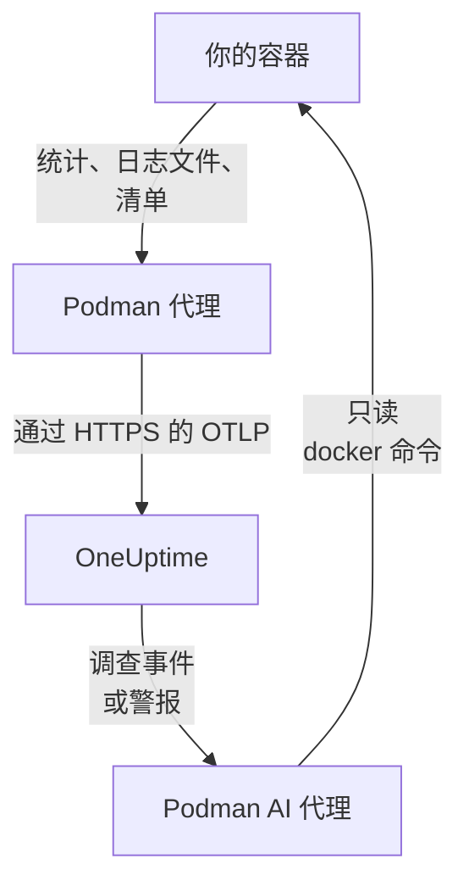

# Podman 代理

OneUptime Podman 代理是你在 Podman 主机上运行的一个容器。它读取主机上每个容器的统计信息和日志文件，并将其发送到 OneUptime，主机会连同其容器、指标和日志一起出现在那里。第二个容器 Podman AI 代理让 OneUptime AI 能够调查该主机。[Podman 监控](/docs/monitor/podman-monitor) 会根据代理发送的数据发出警报。

:::cards
- [安装代理](#安装代理): 两个容器，使用 `podman run` 或 Podman Compose。
- [代理采集的内容](#代理采集的内容): 每个容器的指标、日志和清单。
- [容器日志需要 k8s-file](#容器日志需要-k8s-file-日志驱动): 除非你切换，否则 Podman 会把日志写入 journald。
- [故障排查](#故障排查): 重启循环、缺少指标、缺少日志。
:::

## 工作原理

该代理是一个内置了 OneUptime 配置的 OpenTelemetry Collector。它通过 Podman 兼容 Docker 的 API 套接字每 30 秒读取一次每个容器的统计信息，并每 5 分钟列出一次所有容器、镜像、网络和卷。它跟踪容器的日志文件，并使用你提供的摄取密钥，通过 OTLP 将所有内容发送到你的 OneUptime URL。



主机会随其第一批数据，以你在 `PODMAN_HOST_NAME` 中指定的名称自行注册。AI 代理是可选的：不安装它，Collector 也照常工作。

## 开始之前

- Podman 4.0 或更高版本，以及主机上的 root 权限。
- 位于 `/run/podman/podman.sock` 的 Podman API 套接字。使用 `sudo systemctl enable --now podman.socket` 开启它。
- 一个摄取密钥。在 **项目设置 → 遥测与 APM → 摄取密钥** 下创建一个并复制其值。
- 从主机到你的 OneUptime URL 的出站 HTTPS。
- 对于容器日志，需要容器使用 `k8s-file` 日志驱动。以 root 运行的 Podman 默认把日志写入 `journald`，代理无法读取它。见 [容器日志需要 k8s-file 日志驱动](#容器日志需要-k8s-file-日志驱动)。

## 安装代理

:::steps
### 启动代理

将 `YOUR_ONEUPTIME_URL` 替换为你的 OneUptime URL，将 `YOUR_TELEMETRY_INGESTION_TOKEN` 替换为摄取密钥，将 `my-podman-host` 替换为此主机的名称，例如 `prod-podman-01`。主机会以这个名称出现在 OneUptime 中，所以请保持不变：新名称会注册一台新主机。

:::tabs
@tab Podman CLI
```bash
podman run -d \
  --name oneuptime-podman-agent \
  --user 0:0 \
  --restart unless-stopped \
  -v /run/podman/podman.sock:/run/podman/podman.sock:ro \
  -v /var/lib/containers/storage:/var/lib/containers/storage:ro \
  -e ONEUPTIME_URL="YOUR_ONEUPTIME_URL" \
  -e ONEUPTIME_SERVICE_TOKEN="YOUR_TELEMETRY_INGESTION_TOKEN" \
  -e PODMAN_HOST_NAME="my-podman-host" \
  oneuptime/podman-agent:release
```

然后使用相同的值在它旁边启动 [AI 代理](#ai-代理)。**AI 调查默认开启。** 当 OneUptime AI 调查此主机上的事件或警报时，它会通过 AI 代理、针对 Podman 兼容 Docker 的 API 运行只读的 `docker` 命令，并且除非你允许修复，否则不会更改任何东西。要在不启用 AI 调查的情况下安装，请跳过这条命令。

```bash
podman run -d \
  --name oneuptime-podman-ai-agent \
  --user 0:0 \
  --restart unless-stopped \
  --read-only --tmpfs /tmp \
  -v /run/podman/podman.sock:/run/podman/podman.sock:ro \
  -e ONEUPTIME_URL="YOUR_ONEUPTIME_URL" \
  -e ONEUPTIME_SERVICE_TOKEN="YOUR_TELEMETRY_INGESTION_TOKEN" \
  -e ONEUPTIME_AI_AGENT_RESOURCE_TYPE=podman \
  -e PODMAN_HOST_NAME="my-podman-host" \
  oneuptime/resource-ai-agent:release
```
@tab Podman Compose
将以下内容保存为主机上某个文件夹中的 `docker-compose.yml`。第二个服务是 [AI 代理](#ai-代理)：去掉它即可在不启用 AI 调查的情况下运行 Collector。

```yaml title="docker-compose.yml"
services:
  oneuptime-podman-agent:
    image: oneuptime/podman-agent:release
    container_name: oneuptime-podman-agent
    user: "0:0"
    restart: unless-stopped
    volumes:
      - /run/podman/podman.sock:/run/podman/podman.sock:ro
      - /var/lib/containers/storage:/var/lib/containers/storage:ro
    environment:
      - ONEUPTIME_URL=YOUR_ONEUPTIME_URL
      - ONEUPTIME_SERVICE_TOKEN=YOUR_TELEMETRY_INGESTION_TOKEN
      - PODMAN_HOST_NAME=my-podman-host
    logging:
      driver: json-file
      options:
        max-size: "10m"
        max-file: "3"
  oneuptime-podman-ai-agent:
    image: oneuptime/resource-ai-agent:release
    container_name: oneuptime-podman-ai-agent
    user: "0:0"
    restart: unless-stopped
    read_only: true
    tmpfs:
      - /tmp
    volumes:
      - /run/podman/podman.sock:/run/podman/podman.sock:ro
    environment:
      - ONEUPTIME_URL=YOUR_ONEUPTIME_URL
      - ONEUPTIME_SERVICE_TOKEN=YOUR_TELEMETRY_INGESTION_TOKEN
      - ONEUPTIME_AI_AGENT_RESOURCE_TYPE=podman
      - PODMAN_HOST_NAME=my-podman-host
```

在该文件夹中启动它：

```bash
podman compose up -d
```
:::

### 检查代理是否在运行

```bash
podman ps --filter name=oneuptime-podman-agent
podman logs -f oneuptime-podman-agent
```

Collector 启动后，日志中应出现这一行：

```text
Everything is ready. Begin running and processing data.
```

### 在 OneUptime 中找到主机

打开 **产品 → 基础设施 → Podman → 所有主机**。大约一分钟内，主机会以其 `PODMAN_HOST_NAME` 出现，并带有其容器、指标和日志。AI 代理会在主机的 **AI 代理** 页面上以及其 **概览** 底部显示为已连接。
:::

## 环境变量

| 变量 | 必需 | 说明 |
| --- | --- | --- |
| `ONEUPTIME_URL` | 是 | 你的 OneUptime URL，例如 `https://oneuptime.com` 或你的自托管实例。如果实例只支持 HTTP，请使用 `http://` 及其端口。 |
| `ONEUPTIME_SERVICE_TOKEN` | 是 | 来自 **项目设置 → 遥测与 APM → 摄取密钥** 的摄取密钥。 |
| `PODMAN_HOST_NAME` | 否 | 主机在 OneUptime 中的名称。默认为 `podman-host`，因此请为每台主机设置自己的名称。 |
| `DOCKER_API_VERSION` | 否 | 代理与 Podman 套接字通信时使用的 Docker API 版本。默认为 `1.44`。如果套接字报告的上限更旧，请调低它，或者将其设为空值以进行协商（见 [故障排查](#故障排查)）。 |

要更改某个值，请移除代理并重新运行其命令（Podman CLI），或者编辑 `docker-compose.yml` 并运行 `podman compose up -d`（Podman Compose）。

## 代理采集的内容

| 数据 | 内容 |
| --- | --- |
| 容器指标 | 每个容器每 30 秒一次：CPU（用量、百分比、限流）、内存（用量、限制、百分比）、网络和块 I/O、运行时长、重启次数和进程数。 |
| 容器日志 | 每个容器的 stdout 和 stderr，来自 `k8s-file` 日志驱动写入的 `ctr.log` 文件。 |
| 清单 | 处于任何状态的每个容器，以及每个镜像、网络和卷，每 5 分钟一次。 |

每个容器的指标和日志都归入一个以该容器命名的服务下。每条日志行的严重性取自它所写明的级别，例如 `[ERROR]`、`level=warn` 或 `{"level":"info"}`；没有写明级别的行则采用其所在流的严重性：stderr 为 `ERROR`，stdout 为 `INFO`。以空白或右括号开头的行会并入前一行，因此堆栈跟踪会作为一条记录到达。代理自身的日志不会被采集。

[Podman 监控](/docs/monitor/podman-monitor#收集的指标) 列出了每个指标及其含义。

## 容器日志需要 k8s-file 日志驱动

代理跟踪 `/var/lib/containers/storage/overlay-containers/*/userdata/ctr.log`，即 Podman 的 `k8s-file` 日志驱动写入的文件（在 Podman 中，`json-file` 是同一个驱动）。以 root 运行的 Podman 默认驱动是 `journald`，它不会留下可读取的文件，`syslog` 这样的远程驱动也是如此。这类容器的指标仍会到达，但日志不会。

检查某个容器的日志驱动，以及 Podman 的默认驱动：

```bash
podman inspect <container> --format '{{.HostConfig.LogConfig.Type}}'
podman info --format '{{.Host.LogDriver}}'
```

使用 `k8s-file` 运行容器，或者把某个 Compose 服务切换为它：

```bash
podman run --log-driver k8s-file --log-opt max-size=100m ... <image>
```

```yaml
services:
  my-app:
    image: my-app:latest
    logging:
      driver: "k8s-file"
      options:
        max-size: "100m"
```

或者在 `containers.conf` 中将其设为之后创建的所有容器的默认驱动（以 root 运行时为 `/etc/containers/containers.conf`，无 root 运行时为 `~/.config/containers/containers.conf`）：

```toml title="containers.conf"
[containers]
log_driver = "k8s-file"
log_size_max = 104857600
```

然后重新创建容器。容器会一直使用创建时的日志驱动，因此仅重启它是不够的。

## 升级代理

当代理比你的 OneUptime 旧时，主机 **概览** 上的 **代理版本** 旁边会出现警告标志。选择该标志即可看到这些命令。

:::tabs
@tab Podman CLI
```bash
podman pull oneuptime/podman-agent:release
podman pull oneuptime/resource-ai-agent:release
podman rm -f oneuptime-podman-agent oneuptime-podman-ai-agent
```

然后再次运行 [启动代理](#启动代理) 中的两条 `podman run` 命令。
@tab Podman Compose
```bash
podman compose pull
podman compose up -d
```
:::

`release` 标签始终指向最新的发布版本。要固定版本，请使用 `oneuptime/podman-agent:<version>`，例如 `oneuptime/podman-agent:10.0.31`。同一个镜像也以 `ghcr.io/oneuptime/podman-agent:release` 发布在 GitHub Container Registry 上。

## 卸载代理

:::tabs
@tab Podman CLI
```bash
podman rm -f oneuptime-podman-agent
podman rm -f oneuptime-podman-ai-agent
```
@tab Podman Compose
```bash
podman compose down
```
:::

主机会连同它发送过的数据一起保留在 OneUptime 中。如果不再需要，请通过其菜单中的 **删除主机** 将其删除。

## AI 代理

上面的命令和 Compose 文件、Podman 代理的 `install.sh`，以及其 [PodmanAgent 目录](https://github.com/OneUptime/oneuptime/tree/master/agents/PodmanAgent) 中的 `docker-compose.yml`，都会运行 **Podman AI 代理**：第二个容器 `oneuptime-podman-ai-agent`（镜像 `oneuptime/resource-ai-agent:release`），它在 OneUptime AI 调查此主机上的事件或警报时，运行 OneUptime AI 要求的只读命令——通过 Podman 兼容 Docker 的 API，使用 `docker` CLI：`docker ps -a`、`docker logs --tail 200 web`、`docker container inspect web`——并且只有在你允许时才会应用修复，例如重启指定的容器。它读取与 Collector 相同的 `ONEUPTIME_URL`、`ONEUPTIME_SERVICE_TOKEN` 和 `PODMAN_HOST_NAME`，因此它服务的正是这台主机，并会出现在 OneUptime 中该主机的 **AI 代理** 页面上。

- **AI 调查默认开启。** 代理连接后，OneUptime AI 会用它来调查该主机上的事件和警报，主机的 **概览** 会显示代理的状态。要停止，请在代理运行的位置设置 `ONEUPTIME_AI_INVESTIGATION=false`（AI 代理页面上 **AI 可以执行的操作** 下的 **更改** 会显示方法），或者不安装代理。
- 除非你以 `ONEUPTIME_AI_ALLOW_WRITES=true` 启动它，否则它是只读的；`ONEUPTIME_AI_WRITE_TARGETS`（例如 `web-*,api-*`）限制修复可以触及哪些容器。启动时还要带上 `ONEUPTIME_AI_FIXES`，以指定修复的运行方式——`ask-for-approval`（由人逐一批准）、`automatic` 或 `bypass-approval`——AI 代理页面会以只读方式显示它（[由代理设置的 AI 可以执行的操作](/docs/ai/infrastructure-ai-agents#what-ai-may-do-set-by-the-agent)）。
- 它需要与 Collector 相同的套接字，并以 root 身份运行、挂载该套接字，因为该套接字归 root 所有——而对于以 root 运行的 Podman，无论是否为 `:ro`，能够使用该套接字的人就相当于这台主机上的 root。代理的命令策略就是边界：它从不运行 `exec`、`run`、`rm` 或 `prune`，也从不更改它自己、Collector 或 `ONEUPTIME_AI_PROTECTED_TARGETS`（容器名称通配符）中的任何内容。
- `install.sh --no-ai-agent` 会跳过它；`podman rm -f oneuptime-podman-ai-agent` 会移除它。升级方式与 Collector 相同：`podman pull oneuptime/resource-ai-agent:release`，移除它，然后再次启动。

它可以运行什么、修复如何工作以及如何排查问题，请参阅 [Infrastructure AI Agents](/docs/ai/infrastructure-ai-agents#docker-and-podman-hosts)。

## 故障排查

:::details 代理因 "client version is too new" 而不断重启
代理的日志显示：

```text
Error: cannot start pipelines: failed to start "docker_stats" receiver:
Error response from daemon: client version 1.44 is too new.
Maximum supported API version is 1.41
```

强制限定客户端最高版本的 Docker API 服务器会拒绝更新的客户端，因此接收器永远无法启动，Collector 也随之退出。检查 Podman 套接字报告的 API 版本：

```bash
curl -s -o /dev/null -D - --unix-socket /run/podman/podman.sock http://localhost/_ping | grep -i '^api-version'
```

然后在 `podman run` 中添加 `-e DOCKER_API_VERSION=1.41`（或你得到的值），或者在 Compose 中设置 `DOCKER_API_VERSION`。较新的服务器仍然支持较旧的 API 版本，因此该设置在升级后依然有效。

不想查这个数字？把 `DOCKER_API_VERSION` 设为空字符串。代理随后会与套接字协商版本（一次 `HEAD /_ping`，然后使用套接字报告的上限），而不是固定某个版本：

```bash
podman run -d ... -e DOCKER_API_VERSION= ...
```
:::

:::details Podman 套接字权限被拒绝，或没有套接字
代理必须以 root 身份运行才能读取 `/run/podman/podman.sock`。请检查你的 `podman run` 命令中是否有 `--user 0:0`，或者 Compose 中是否有 `user: "0:0"`，以及套接字是否已开启：`sudo systemctl enable --now podman.socket`。无 root 的 Podman 的套接字则位于 `/run/user/<uid>/podman/podman.sock`（`systemctl --user enable --now podman.socket`）：请挂载该路径来代替 `/run/podman/podman.sock`。
:::

:::details 主机显示为已断开
1. 检查代理是否在运行：`podman ps --filter name=oneuptime-podman-agent`
2. 在它的日志中查找错误：`podman logs oneuptime-podman-agent 2>&1 | grep -i error`
3. 检查 `ONEUPTIME_URL` 和 `ONEUPTIME_SERVICE_TOKEN`：密钥必须是有效且未被禁用的摄取密钥。
4. 检查主机能否通过网络访问你的 OneUptime URL。
:::

:::details 没有出现指标
1. 检查 Podman 套接字是否已挂载到代理中。它的镜像没有 shell，因此请从一个共享其挂载的临时容器中查看：`podman run --rm --volumes-from oneuptime-podman-agent alpine:3.19 ls -la /run/podman/podman.sock`
2. 在它的日志中查找导出错误：`podman logs oneuptime-podman-agent 2>&1 | tail -100`
3. 检查摄取密钥是否有效且未过期。
:::

:::details 指标能到达，但没有容器日志
你的容器很可能使用的是 Podman 的默认日志驱动 `journald`。检查代理监视的是哪些文件，以及某个容器使用的是哪个驱动：

```bash
podman logs oneuptime-podman-agent 2>&1 | grep -E "Started watching file|no files match"
podman inspect <container> --format '{{.HostConfig.LogConfig.Type}}'
```

如果代理报告 `no files match the configured criteria`，请按照 [容器日志需要 k8s-file 日志驱动](#容器日志需要-k8s-file-日志驱动) 中所示，把容器切换为 `k8s-file` 并重新创建它们。
:::

:::details 日志出现在另一台主机下，或主机名为 podman-host
主机的名称来自 `PODMAN_HOST_NAME`。不带它启动的代理会报告 `podman-host`，因此以这种方式设置的每台主机看起来都像同一台；之后再更改名称，OneUptime 会注册第二台主机，新数据随后会归入它。请在每台主机上把 `PODMAN_HOST_NAME` 设置为它自己的名称，并重新创建代理。要检查代理报告的名称：

```bash
podman inspect oneuptime-podman-agent --format '{{range .Config.Env}}{{println .}}{{end}}' | grep PODMAN_HOST_NAME
```
:::

## 后续步骤

:::cards
- [Podman 监控](/docs/monitor/podman-monitor): 针对容器的 CPU、内存和重启发出警报。
- [数据库](/docs/telemetry/databases): 主机上的数据库容器会被发现，并拥有自己的页面。
- [Kubernetes 代理](/docs/telemetry/kubernetes-agent): 改为监视 Kubernetes 集群。
- [主机 OpenTelemetry Collector](/docs/telemetry/host-otel-collector): 监视机器本身：CPU、磁盘、进程和日志。
:::
