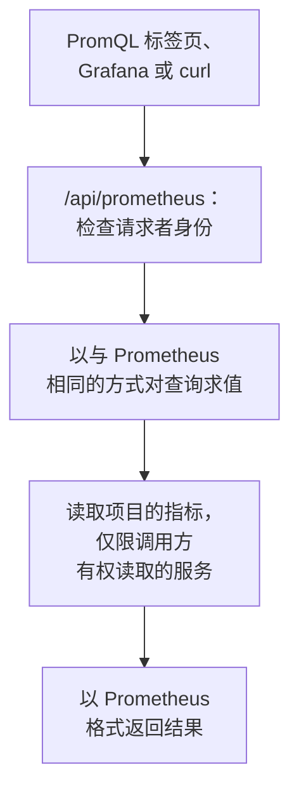

# 使用 PromQL 查询指标

PromQL 是 Prometheus 的查询语言，也是大多数为指标绘制图表的人早已熟悉的语言。OneUptime 用它读取你的项目的指标：既可以在指标的 **PromQL** 标签页中使用，也可以通过兼容 Prometheus 的 API 使用，Grafana 或任何支持 Prometheus 数据源的工具都可以指向这个 API。

:::cards
- [编写查询](#编写查询): 在指标页面运行 PromQL，以图表或表格查看结果。
- [指标的命名方式](#指标的命名方式): OpenTelemetry 的名称和属性在 PromQL 中如何读取。
- [连接 Grafana](#连接-grafana): 将 OneUptime 添加为 Prometheus 数据源。
- [限制](#限制): 一个查询可以读取多少数据，以及可以运行多长时间。
:::

## 工作原理

PromQL 标签页和 Grafana 请求的是同一个 API。OneUptime 会检查调用方是否有权读取项目的指标，只读取调用方有权读取的服务，并以与 Prometheus 相同的方式对查询求值。



## 开始之前

- **正在到达的指标。** 通过 [OpenTelemetry](/docs/telemetry/open-telemetry) 发送，或者从代理发送，例如 [主机 OpenTelemetry Collector](/docs/telemetry/host-otel-collector)。
- **可以读取指标的角色。** Project Owner、Project Admin、Project Member、Viewer、Telemetry Admin、Telemetry Member 或 Telemetry Viewer，或者拥有 Read Metrics 权限的自定义角色。仅限部分服务的角色只能读取这些服务的指标。
- **用于 Grafana 或脚本：项目 API 密钥**，需具有上述角色之一或 Read Metrics 权限。参见 [创建 API 密钥](/docs/api-reference/api-reference#创建-api-密钥)。在 OneUptime Cloud 上，API 密钥需要 **Growth** 套餐。

## 编写查询

:::steps
### 打开 PromQL

打开 **指标**，然后点击 **PromQL** 标签页。

### 输入查询

在编辑器中输入查询，从 **示例** 中选择一个，或者从 **添加指标名称** 开始，它会按 PromQL 的命名列出你的项目的指标。

### 运行查询

点击 **运行查询**，或按 Ctrl+Enter（在 Mac 上按 ⌘+Enter）。**图表** 在整个时间范围内绘制查询结果；**表格** 显示每个序列在时间范围结束时的值。
:::

可以从以下几个查询开始：

```text title="PromQL"
# Requests per second, by service
sum by (job) (rate(http_requests_total[5m]))

# The 95th percentile of a latency histogram
histogram_quantile(0.95, sum by (le) (rate(http_server_request_duration_bucket[5m])))

# The five hosts using the most memory
topk(5, system_memory_usage)
```

对于无法运行的查询，编辑器会指出哪里出了问题、问题出在什么位置：比如对于 `rate(http_requests_total)`，编辑器会提示该函数需要 `[5m]` 这样的范围。

## 指标的命名方式

OneUptime 以 OpenTelemetry 的方式存储指标。PromQL 按照 Prometheus 自身的 OpenTelemetry 支持给它们起的名称来读取它们，因此为 Prometheus 编写的查询在这里同样可用：

| 在 OneUptime 中 | 在 PromQL 中 |
| --- | --- |
| 仪表 `system.cpu.utilization` | `system_cpu_utilization` |
| 计数器 `http.requests` | `http_requests` 或 `http_requests_total` |
| 直方图 `http.server.request.duration` | `http_server_request_duration_bucket`（带 `le`）、`_count` 和 `_sum` |
| 摘要 `rpc.latency` | `rpc_latency`（带 `quantile`）、`_count` 和 `_sum` |
| 属性 `http.route` | 标签 `http_route` |
| 资源属性 `service.name` | 标签 `resource_service_name`，以及 `job` |
| 资源属性 `service.instance.id` | 标签 `resource_service_instance_id`，以及 `instance` |

- **指标名称和标签名称中的点和连字符会变成下划线。** 要按存储时的原样指定指标或标签，请像 Prometheus 3 那样给名称加上引号：`{"http.server.request.duration", "http.route"="/checkout"}`。
- **Delta 计数器会从查询时间范围的起点开始累加**，因此 `rate()` 和 `increase()` 会像读取其他任何计数器一样读取它们。
- **指数直方图** 有 `_count` 和 `_sum`，但没有桶。

## 连接 Grafana

:::steps
### 创建 API 密钥

在 OneUptime 中，打开 **项目设置 → 高级 → API 密钥**，然后点击 **创建API 密钥**。为密钥分配一个可以读取遥测的角色，或者 Read Metrics 权限。

### 添加 Prometheus 数据源

在 Grafana 中，打开 **Connections → Data sources → Add data source**，然后选择 **Prometheus**。

### 输入服务器 URL

把 **Prometheus server URL** 设置为你的 OneUptime 地址加上 `/api/prometheus`。在 OneUptime Cloud 上，就是 `https://oneuptime.com/api/prometheus`。**PromQL** 标签页会显示你自己服务器的地址，并附带一个复制按钮。

### 发送 API 密钥

在 **HTTP headers** 下，添加请求头 `Authorization`，值为 `Bearer`，后跟一个空格和你的 API 密钥。也可以使用基本认证：用户名任意，密码填写 API 密钥。

### 保存并测试

点击 **Save & test**。Grafana 会运行一个查询，并提示数据源工作正常。
:::

其他任何 Prometheus 客户端的用法都相同。使用 curl：

```bash title="Query OneUptime's Prometheus API"
curl -H "Authorization: Bearer $ONEUPTIME_API_KEY" \
  "https://oneuptime.com/api/prometheus/api/v1/query?query=up"
```

## API

该 API 在 `/api/prometheus` 下响应 Prometheus HTTP API 的各个路由，支持 `GET` 或 `POST`：

| 路由 | 返回内容 |
| --- | --- |
| `/api/v1/query` | 某一时刻的查询（`time`，默认为当前时间）。 |
| `/api/v1/query_range` | 从 `start` 到 `end` 每隔 `step` 的查询。 |
| `/api/v1/series` | `match[]` 选中的序列。 |
| `/api/v1/labels` | `match[]` 选中的序列或所有指标的标签名称。 |
| `/api/v1/label/<name>/values` | 某个标签的值。`__name__` 会列出指标名称。 |
| `/api/v1/metadata` | 每个指标的类型、帮助信息和单位。 |

时间使用 Unix 秒数或 RFC 3339，时长使用秒数或 `15s` 这样的时长，响应采用 Prometheus 的格式。`/api/v1/status/buildinfo` 以 Prometheus 3 服务器的身份响应；规则和警报为空，因为 OneUptime 通过 [监视器](/docs/monitor/metrics-monitor) 发出警报。

## 支持的 PromQL 功能

- **选择器**：支持所有匹配器（`=`、`!=`、`=~`、`!~`）、范围、`offset`、`@`（以及 `start()` 和 `end()`）和子查询。
- **运算符**：算术运算、比较运算（含 `bool`）、`and`、`or`、`unless`，以及使用 `on`、`ignoring`、`group_left` 和 `group_right` 的向量匹配。
- **聚合**：`sum`、`avg`、`min`、`max`、`count`、`group`、`stddev`、`stdvar`、`topk`、`bottomk`、`quantile` 和 `count_values`，可搭配 `by` 或 `without`。
- **函数**：`rate`、`irate`、`increase`、`delta`、`idelta`、`deriv`、`predict_linear`、`histogram_quantile`、所有 `*_over_time` 函数、`changes`、`resets`、`absent`、`label_replace`、`label_join`、`sort`、`clamp`、`round`、数学和日期函数等。

Prometheus 的原生直方图函数（例如 `histogram_count()`）不可用：OneUptime 以带桶的形式存储直方图，由 `histogram_quantile()` 以及 `_count` 和 `_sum` 序列读取。

## 限制

每个查询都有上限，因此包含许多面板的仪表板也不会让 OneUptime 过载：

| 限制 | 值 |
| --- | --- |
| 范围查询中单个序列的数据点 | 11,000 |
| 单个查询可读取并保留的样本 | 5,000,000 |
| 单个选择器可读取的指标数据点 | 1,000,000 |
| 一次读取的最长时间 | 30 秒 |
| 求值的最长时间 | 30 秒 |
| 选择器回溯查找序列最新样本的时长 | 5 分钟 |
| 子查询未指定步长时的默认步长 | 1 分钟 |

## 故障排除

:::details Grafana 提示数据源无法工作
检查 URL 是否以 `/api/prometheus` 结尾，以及 `Authorization` 请求头是否包含 `Bearer`、一个空格和 API 密钥。没有可读取指标的角色的密钥会被拒绝：在 **项目设置 → 高级 → API 密钥** 中为它分配一个角色。
:::

:::details 指标浏览器中的指标查不到任何结果
它的 PromQL 名称在存储名称中有点的地方使用下划线，而直方图要通过 `_bucket`、`_count` 或 `_sum` 读取。PromQL 标签页上的 **添加指标名称** 会按 PromQL 的写法列出每个名称。
:::

:::details "The query reads more than 1,000,000 metric points"
查询请求的数据超过了一次读取所能容纳的量。请添加标签匹配器、缩短时间范围，或使用更大的步长。
:::

## 后续步骤

:::cards
- [指标浏览器](/docs/telemetry/metrics-explorer): 无需编写查询即可为指标绘制图表。
- [指标监控](/docs/monitor/metrics-monitor): 当指标越过阈值时发出警报。
- [外部数据源](/docs/dashboards/data-sources): 在仪表板上为外部 Prometheus 绘制图表。
:::
