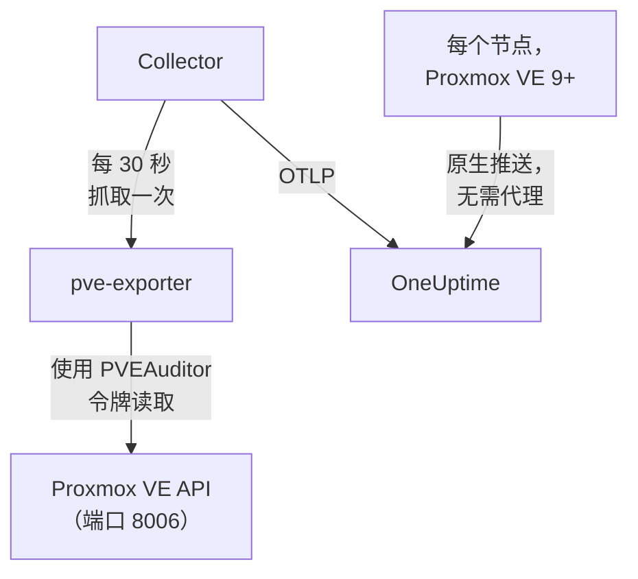

# Proxmox 代理

OneUptime Proxmox 代理监视 Proxmox VE 集群：它的节点、QEMU 虚拟机、LXC 容器、存储、HA 状态、备份覆盖情况和复制。它使用只读令牌通过 Proxmox VE API 读取集群，并把发现的内容发送到 OneUptime，集群会连同其节点、客户机和存储一起出现在那里。在 Proxmox VE 9 及更高版本上，节点也可以自行推送指标，无需安装任何东西。[Proxmox 监控](/docs/monitor/proxmox-monitor) 会根据到达的数据发出警报。

:::cards
- [选择连接方式](#选择连接方式): 代理，或 Proxmox VE 9 自己的推送。
- [安装代理](#安装代理): 一个 API 令牌，然后是安装脚本或 Docker Compose。
- [原生推送](#免安装的替代方案proxmox-ve-9-原生-opentelemetry-推送): Proxmox VE 9 自行发送其指标。
- [故障排查](#故障排查): 一个诊断脚本，以及常见问题。
:::

## 工作原理

该代理是你在一台机器上用 Docker Compose 运行的一组容器：[prometheus-pve-exporter](https://github.com/prometheus-pve/prometheus-pve-exporter) 在端口 8006 上读取 Proxmox VE API，OpenTelemetry Collector 每 30 秒抓取一次该导出器并为每个指标打上你的集群名称，而 Proxmox AI 代理让 OneUptime AI 在调查时能够读取集群。Proxmox VE 9 的原生推送则把每个节点的指标直接发送到 OneUptime。



集群会随其第一批数据，以代理作为 `proxmox.cluster.name` 打到每个指标上的名称自行注册。

## 选择连接方式

| | 代理 | 原生推送 |
| --- | --- | --- |
| Proxmox VE | 任何受支持的版本 | 9.0 或更高版本 |
| 需要安装 | 一台机器上的 Docker Compose | 无：在 Proxmox Web UI 中添加一个指标服务器 |
| 节点、客户机和存储 | 是 | 是 |
| HA 状态、开机启动、备份覆盖情况和复制 | 是 | 否 |
| Proxmox AI 代理 | 是 | 否 |

**HA Resource in Error State**、**Guest Down**、**Guest Not Backed Up** 和 **Replication Failing** 模板需要代理。一个集群请只使用其中一种方式：同时运行两者会把每个资源报告两次。

## 开始之前

- Docker Engine 20.10 或更高版本以及 Docker Compose v2 插件，安装在一台能通过端口 8006 访问 Proxmox VE API 的机器上。
- 任意 Proxmox VE 节点上的 root shell，或 Proxmox Web UI，用于创建 API 令牌。
- 一个摄取密钥。在 **项目设置 → 遥测与 APM → 摄取密钥** 下创建一个并复制其值。
- 从该机器到你的 OneUptime URL 的出站 HTTPS。

### 在哪里运行代理

代理通过网络查询 Proxmox VE API，因此它不必运行在集群节点上，也不应该这样做：请在能够挺过节点故障的机器上运行它（独立硬件上的小型监控虚拟机、管理主机），或者让 `PVE_HOST` 指向虚拟 IP 或轮询 DNS 名称，而不是某一个节点的地址。如果代理的 API 目标正是刚刚宕掉的节点，你的监控也会随之失效。唯一的例外是可选的 journald 日志管道，它必须运行在 Proxmox VE 节点上（见 [发送 Proxmox 服务日志](#可选发送-proxmox-服务日志)）。

## 安装代理

:::steps
### 创建只读 API 令牌

代理使用具有 **PVEAuditor** 角色的 API 令牌读取集群，该角色只能读取，不能做其他任何事。

:::tabs
@tab Shell
在任意 Proxmox VE 节点上以 root 身份运行：

```bash
pveum user add monitoring@pam
pveum acl modify / --roles PVEAuditor --users monitoring@pam
pveum user token add monitoring@pam oneuptime --privsep 1
pveum acl modify / --roles PVEAuditor --tokens 'monitoring@pam!oneuptime'
```

只有当 `monitoring@pam` 已存在时，第一条命令才会失败，而且无害：API 令牌带有自己的密钥，因此该用户不需要密码或系统账户。`pveum user token add` 只会打印一次令牌密钥；令牌 ID 为 `monitoring@pam!oneuptime`。
@tab Proxmox web UI
1. 转到 *Datacenter → Permissions → API Tokens* 并点击 **Add**。
2. 选择（或创建）一个用户，给令牌一个类似 `oneuptime` 的 ID，并保持 **Privilege Separation** 为勾选状态。
3. 复制令牌 ID（`user@realm!tokenname`）和密钥：密钥只显示一次。
4. 在 *Datacenter → Permissions* 下，在路径 `/` 上添加 **PVEAuditor** 角色两次：一次作为令牌的 **API Token Permission**，一次作为其用户的 **User Permission**。
:::

角色既要授予令牌，也要授予用户，因为权限分离的令牌只能获得其用户同样拥有的权限。它必须位于根路径 `/` 上，因为导出器会读取每个节点、客户机和存储对象：更窄的路径会隐藏集群的其余部分，并以 `401`/`403 Permission check failed (/, Sys.Audit)` 失败。

### 安装并启动代理

:::tabs
@tab install.sh
下载安装脚本，并在将要托管代理的机器上运行它：

```bash
curl -sSL https://raw.githubusercontent.com/OneUptime/oneuptime/master/agents/ProxmoxAgent/install.sh -o install.sh
bash install.sh
```

该脚本会询问你的 OneUptime URL、摄取密钥、集群名称、Proxmox VE API 主机、是否运行内置导出器，以及令牌 ID 和密钥——还会询问是否允许 [AI 代理](#ai-代理) 应用修复，如果允许，再询问它自己的令牌以及它绝不能更改的客户机。它会安装到 `/opt/oneuptime-proxmox-agent`，写入一个权限为 `0600` 的 `.env` 文件，并使用 Docker Compose 启动代理。再次运行该脚本会复用该 `.env` 中的所有内容而不再提问，这就是你 [升级代理](#升级代理) 的方式。
@tab Docker Compose
从 [ProxmoxAgent 目录](https://github.com/OneUptime/oneuptime/tree/master/agents/ProxmoxAgent) 下载 `docker-compose.yml` 和 `otel-collector-config.yaml` 到一个新文件夹中：

```bash
mkdir oneuptime-proxmox-agent && cd oneuptime-proxmox-agent
curl -fsSLO https://raw.githubusercontent.com/OneUptime/oneuptime/master/agents/ProxmoxAgent/docker-compose.yml
curl -fsSLO https://raw.githubusercontent.com/OneUptime/oneuptime/master/agents/ProxmoxAgent/otel-collector-config.yaml
```

在它们旁边创建一个 `.env` 文件。它包含令牌密钥，因此请用 `chmod 600 .env` 保持其私密：

```bash title=".env"
ONEUPTIME_URL=YOUR_ONEUPTIME_URL
ONEUPTIME_TELEMETRY_INGESTION_KEY=YOUR_TELEMETRY_INGESTION_TOKEN
PROXMOX_CLUSTER_NAME=my-proxmox-cluster
PVE_HOST=192.168.1.10
PVE_API_TOKEN_ID=monitoring@pam!oneuptime
PVE_API_TOKEN_SECRET=your-token-secret
COMPOSE_PROFILES=pve-exporter
```

`COMPOSE_PROFILES=pve-exporter` 还会启动内置的导出器。启动代理：

```bash
docker compose up -d
```
:::

已经在运行 prometheus-pve-exporter？在脚本询问是否运行内置导出器时回答 **n**，或者从 `.env` 中删除 `COMPOSE_PROFILES`，然后让代理指向你的导出器（`host:port`，不带协议，必须是代理容器能够访问的地址：`localhost` 指的是容器本身）。如果你使用 [AI 代理](#ai-代理)，请保留 `PVE_API_TOKEN_ID` 和 `PVE_API_TOKEN_SECRET`，它会用该令牌调用 API：

```bash
PVE_EXPORTER_URL=your-exporter-host:9221
```

### 检查代理是否在运行

```bash
docker compose ps
docker logs -f oneuptime-proxmox-agent
```

`docker compose ps` 会列出 Collector（`oneuptime-proxmox-agent`）、内置导出器（`oneuptime-pve-exporter`，除非你使用自己的导出器）和 AI 代理（`oneuptime-proxmox-ai-agent`）。Collector 启动后，其日志中应出现这一行：

```text
Everything is ready. Begin running and processing data.
```

### 在 OneUptime 中找到集群

打开 **产品 → 基础设施 → Proxmox → 所有集群**。在第一次抓取后大约一分钟，集群会以其 `PROXMOX_CLUSTER_NAME` 出现，并带有其节点、客户机和存储。
:::

## 环境变量

安装脚本会把这些写入 `/opt/oneuptime-proxmox-agent/.env`；Docker Compose 安装则从 `docker-compose.yml` 旁边的 `.env` 中读取它们。更改其中任何一个之后，请在该文件夹中运行 `docker compose up -d`。

| 变量 | 必需 | 说明 |
| --- | --- | --- |
| `ONEUPTIME_URL` | 是 | 你的 OneUptime URL，例如 `https://oneuptime.com` 或你的自托管实例。如果实例只支持 HTTP，请使用 `http://` 及其端口。 |
| `ONEUPTIME_TELEMETRY_INGESTION_KEY` | 是 | 来自 **项目设置 → 遥测与 APM → 摄取密钥** 的摄取密钥。 |
| `PROXMOX_CLUSTER_NAME` | 是 | 集群在 OneUptime 中的名称，作为 `proxmox.cluster.name` 资源属性打到每个指标上。请保持不变：之后更改它会注册另一个集群。默认为 `proxmox-cluster`。 |
| `PVE_HOST` | 是 | 导出器和 AI 代理查询的 Proxmox VE API 主机（集群中的任意节点），例如 `192.168.1.10`。 |
| `PVE_EXPORTER_URL` | 否 | prometheus-pve-exporter 的地址（`host:port`，不带协议）。默认为内置导出器 `pve-exporter:9221`。 |
| `PVE_API_TOKEN_ID` | 内置导出器或 AI 代理 | 完整的 Proxmox API 令牌 ID，例如 `monitoring@pam!oneuptime`。除非 AI 代理有自己的令牌（`ONEUPTIME_AI_PVE_API_TOKEN_ID` / `ONEUPTIME_AI_PVE_API_TOKEN_SECRET`），否则它会用这个令牌读取 API。 |
| `PVE_API_TOKEN_SECRET` | 内置导出器或 AI 代理 | Proxmox API 令牌密钥。 |
| `PVE_VERIFY_SSL` | 否 | 验证 Proxmox API 的 TLS 证书（导出器和 AI 代理）。默认为 `false`，因为 Proxmox 自带的是自签名证书。 |
| `COMPOSE_PROFILES` | 否 | 设置为 `pve-exporter` 可启动内置的导出器容器。 |

## 代理采集的内容

Collector 每 30 秒抓取一次导出器，同时开启其集群和节点收集器，这也涵盖了导出器默认开启的 `backup-info`（集群级）和 `replication`（节点级）收集器。每个序列都带有一个标识资源的 `id` 标签：`node/<name>`、`qemu/<vmid>`、`lxc/<vmid>` 或 `storage/<node>/<storage>`。

| 类别 | 指标 |
| --- | --- |
| 可用性 | `pve_up`、`pve_uptime_seconds` |
| 节点 | `pve_node_info`、`pve_cpu_usage_ratio`、`pve_cpu_usage_limit`、`pve_memory_usage_bytes`、`pve_memory_size_bytes` |
| 客户机（VM 或 LXC） | `pve_guest_info`，以及 `qemu/*` 和 `lxc/*` ID 上的 CPU、内存和网络序列（`pve_network_receive_bytes`、`pve_network_transmit_bytes`） |
| 存储 | `pve_disk_usage_bytes`、`pve_disk_size_bytes`、`pve_storage_info` |
| HA | `pve_ha_state` |
| 备份覆盖情况 | `pve_not_backed_up_total`（没有任何备份任务覆盖的客户机；单个集群级序列，没有 `id` 标签）和 `pve_not_backed_up_info`（每个未被覆盖的客户机一个序列，带有其 `id`）。被覆盖是指至少有一个任务选择了该客户机：备份最近是否运行过或是否成功，导出器并不提供。 |
| 复制 | 每个存储复制任务的 `pve_replication_failed_syncs`、`pve_replication_duration_seconds`、`pve_replication_last_sync_timestamp_seconds`、`pve_replication_last_try_timestamp_seconds`、`pve_replication_next_sync_timestamp_seconds`、`pve_replication_info`。它们的 `id` 标签是任务 ID（例如 `100-0`），而不是资源。 |

监视器条件和属性过滤器按相等而不是按前缀匹配，因此 Collector 的 `transform/pve-identity` 处理器还会把 `id` 拆分为三个属性。内置的 Proxmox 警报模板会按这些属性过滤，所以如果你自定义配置，请保留这个处理器：

| 属性 | 取值 | 对于 `qemu/100` |
| --- | --- | --- |
| `pve.scope` | `node`、`guest`、`storage`、`cluster`（`qemu` 和 `lxc` 都是 `guest`） | `guest` |
| `pve.type` | `node`、`qemu`、`lxc`、`storage` | `qemu` |
| `pve.id` | `id` 中第一个 `/` 之后的所有内容（`pve1`、`100`、`pve1/local`） | `100` |

原始的 `id` 标签保持不变。

## 可选——发送 Proxmox 服务日志

默认情况下，代理只发送指标，因此集群的 **日志** 页面保持为空。Proxmox VE 服务以八个单元记录到 systemd journal：`pveproxy`、`pvedaemon`、`pve-firewall`、`pve-ha-crm`、`pve-ha-lrm`、`pvescheduler`、`pvestatd` 和 `qmeventd`。随附的 `otel-collector-config.yaml` 中有一个被注释掉的 `journald` 接收器，正好针对这些单元，并连接到一条同样被注释掉的 `logs` 管道，该管道会打上 `proxmox.cluster.name`，使日志归入你的集群。

:::steps
### 在节点上运行代理

journal 是按主机划分的，因此远程代理无法读取它。这是唯一一种与 [在哪里运行代理](#在哪里运行代理) 相悖的配置：为了让指标代理留在集群之外，请改为在节点上运行第二个只采集日志的 Collector（复制配置，然后删除 `prometheus` 接收器和 `metrics` 管道）。

### 开启接收器

取消注释 `otel-collector-config.yaml` 中的 `journald` 接收器和 `logs` 管道，以及 `docker-compose.yml` 中的 journal 卷，使容器能够读取主机的 journal：

```yaml
- /var/log/journal:/var/log/journal:ro
- /etc/machine-id:/etc/machine-id:ro
```

### 替换 Collector 镜像

标准的 `otel/opentelemetry-collector-contrib` 镜像是以 `FROM scratch` 构建的：它没有 journald 接收器所运行的 `journalctl`，而且以一个无法读取 journal 的用户运行。请构建下面这个包装镜像，并把 `docker-compose.yml` 中的 `image:` 指向它：

```dockerfile title="Dockerfile"
FROM otel/opentelemetry-collector-contrib:0.161.0 AS otelcol
FROM debian:stable-slim
RUN apt-get update \
    && apt-get install -y --no-install-recommends systemd \
    && rm -rf /var/lib/apt/lists/*
COPY --from=otelcol /otelcol-contrib /otelcol-contrib
ENTRYPOINT ["/otelcol-contrib"]
CMD ["--config", "/etc/otelcol-contrib/config.yaml"]
```

`systemd` 软件包只是为了提供 `journalctl`，而这个镜像以 root 身份运行，root 才能读取 journal。或者不使用 Docker 采集日志，而是在节点本身上运行 `otelcol-contrib` 发行版的 `.deb`，那里已经有 `journalctl`。
:::

每个节点只发送它自己的 journal：要获得每个节点的服务日志，请在每个节点上运行只采集日志的 Collector。

### 不使用自定义镜像的备选方案：对 /var/log/syslog 使用 filelog

要保留标准镜像，请改为跟踪 syslog。在节点上安装 rsyslog（`apt install rsyslog`；Debian 12 以及 Proxmox VE 8 及更高版本不再自带它），把 `/var/log` 目录挂载到容器中（`- /var/log:/var/log:ro`；挂载目录而不是文件，这样日志轮转就不会卡在一个过时的文件上），并用 `filelog` 接收器代替 journald 接收器：

```yaml
receivers:
  filelog:
    include:
      - /var/log/syslog
    start_at: end
```

你会失去按单元过滤的能力（syslog 包含所有内容，而不仅仅是这八个服务），而且标准镜像的用户必须能够读取该文件。把它接入同一条被注释掉的 `logs` 管道（`receivers: [filelog]`）。

## 免安装的替代方案：Proxmox VE 9+ 原生 OpenTelemetry 推送

Proxmox VE 9.0 及更高版本自带一个 OpenTelemetry 指标服务器，可以把节点、客户机和存储指标推送到任何 OTLP/HTTP 端点，无需安装代理或导出器。在 Proxmox Web UI 中，转到 *Datacenter → Metric Server → Add → OpenTelemetry* 并填写：

| 字段 | 值 |
| --- | --- |
| Server | 你的 OneUptime 主机，例如 `oneuptime.com`，或你的自托管主机 |
| Port | `443` |
| Protocol | `https` |
| Path | `/otlp/v1/metrics` |
| Headers | `{"x-oneuptime-token": "YOUR_TELEMETRY_INGESTION_TOKEN"}` |

只需添加一次：集群的每个节点都会推送自己的指标。OneUptime 会识别这种推送，并把它转换为与代理发送的相同的 `pve_*` 序列，因此：

- 集群会以你的 Proxmox 集群名称自行注册（独立节点则以其节点名称注册），而你在 *Resource Attributes* 下设置的 `proxmox.cluster.name` 会继续被优先使用；
- 节点、客户机和存储页面、概览图表、指标目录以及 CPU、内存和存储警报模板的工作方式与使用代理时相同；
- 原始的 `proxmox_node_*`、`proxmox_vm_*` 和 `proxmox_storage_*` 序列会保留在 [指标浏览器](/docs/monitor/metrics-monitor) 中，供你查看 Proxmox VE 报告的其他任何内容（平均负载、交换空间、压力停滞、每个网卡的流量）。

### 节点停止报告时

每个节点只推送它自己的状态，因此宕机的节点无法自己报告这一点。仍然存活的节点会替它报告：

- 在其最后一次报告大约 2 分钟后，该节点会在节点页面上显示为 **离线**。节点自身页面上的 **最后一次出现** 会保留它自己最后一次报告的时间。
- 大约 5 分钟后，会为它触发 **Node Offline**。**Cluster Quorum at Risk** 也会把它计为离线；由于该模板需要一个完整的 5 分钟报告窗口，它会在节点沉默大约 7–9 分钟后触发。
- 随着下一次报告，它会再次变为 **Online**，其警报也会恢复。

这里的离线表示节点停止了报告，而不一定表示它已宕机。节点正常运行，但其 `pvestatd` 挂起或被终止、集群文件系统（`pmxcfs`）宕机，或者到 OneUptime 的网络被切断，都会以同样的方式报告。

它无法覆盖的情况：

- 独立主机，或者整个集群同时沉默：没有任何节点留下来报告，因此不会触发任何按节点的警报。集群会改为变成 **已断开**，就像代理停止时一样。
- 沉默超过 7 天的节点不再被报告：其警报会解除，它也会从节点页面上消失。自托管的 OneUptime 可以用 `PVE_SILENT_NODE_RETENTION_HOURS` 更改这 7 天。
- 你从集群中移除的节点看起来与宕机的节点一样。请在其页面上使用 **Remove Node**：它会消失，其警报也会解除。否则它会保持离线状态最多 7 天。
- 节点的客户机和存储：只有节点本身会保留为离线。它的虚拟机、容器和存储会在其最后一次报告大约 15 分钟后从各自的页面上消失，而被 HA 在另一个节点上重启的客户机会重新出现在那个节点下。

在 OneUptime 摄取中断之后，新近沉默的节点只有在其他某个节点再次推送 2 分钟后才会被报告，因此中断本身永远不会为每个节点都发出呼叫。已经处于离线状态的节点会在短暂的中断期间保持离线，并保留其警报；中断超过 5 分钟后，一旦其他节点推送了 2 分钟，它就会再次被报告。

在 [指标浏览器](/docs/monitor/metrics-monitor) 中，这些报告是标记为 `oneuptime.proxmox.inferred` = `not-reporting` 的 `pve_up` = 0 数据点，因此你总能把它们与节点关于自身的报告区分开来。

### 原生推送无法做到的事

原生推送只发送每个节点对自身的了解，因此代理采集的部分内容在原生推送中没有对应项：

| 需要代理 | 原因 |
| --- | --- |
| HA 状态 | 不推送：**HA Resource in Error State** 模板需要代理。 |
| 开机启动标志 | 不推送：只为设置了开机启动的客户机发出呼叫的 **Guest Down** 需要代理。 |
| 备份覆盖情况和复制 | 不推送：**Guest Not Backed Up** 和 **Replication Failing** 需要代理。 |

如果你需要这些，请改为运行代理，并移除指标服务器：同时运行两者会把每个资源报告两次。

## 作为 systemd 服务运行

要让代理随机器启动，并在失败时重新启动，请安装它的 systemd 单元。它假定代理位于 `/opt/oneuptime-proxmox-agent`，即安装脚本放置它的位置：

```bash
sudo cp systemd/oneuptime-proxmox-agent.service /etc/systemd/system/
sudo systemctl daemon-reload
sudo systemctl enable --now oneuptime-proxmox-agent
```

## 升级代理

代理会把其文件所固定的 Collector 版本报告为它的 **代理版本**。当它比此 OneUptime 发布所固定的版本旧时，集群 **概览** 上它的旁边会出现警告标志。选择该标志即可看到这些命令。在其文件开始报告版本之前安装的代理，在以这种方式升级之前不会显示版本。

Collector 镜像固定在 `docker-compose.yml` 中，其配置是旁边的一个文件，因此仅拉取镜像并不能让代理升级。请再次运行 `install.sh`：它会复用你现有 `.env` 中的每个值（不会再询问任何内容），刷新 `docker-compose.yml` 和 `otel-collector-config.yaml`（你编辑过的文件会保留为 `<file>.bak.<timestamp>`），拉取镜像并重新创建代理，使 Collector 读取新的配置。

```bash
curl -sSL https://raw.githubusercontent.com/OneUptime/oneuptime/master/agents/ProxmoxAgent/install.sh -o install.sh
bash install.sh
```

改用 Docker Compose 安装的？在代理的文件夹中重新下载这两个文件（并重新做一遍你对它们所做的任何修改），然后拉取镜像并重新创建代理：

```bash
curl -fsSLO https://raw.githubusercontent.com/OneUptime/oneuptime/master/agents/ProxmoxAgent/docker-compose.yml
curl -fsSLO https://raw.githubusercontent.com/OneUptime/oneuptime/master/agents/ProxmoxAgent/otel-collector-config.yaml
docker compose pull
docker compose up -d --force-recreate
```

## 卸载代理

```bash
cd /opt/oneuptime-proxmox-agent
docker compose down
```

然后，如果不再需要，请在 *Datacenter → Permissions → API Tokens* 下删除 API 令牌。

## AI 代理

代理的 `docker-compose.yml` 还会运行 **Proxmox AI 代理** `oneuptime-proxmox-ai-agent`（镜像 `oneuptime/resource-ai-agent:release`）。当 OneUptime AI 调查此集群上的事件或警报时，它会通过该代理运行只读的 `pvesh` 命令——`pvesh get /cluster/status`、`pvesh get /nodes/pve1/qemu/101/status/current`、`pvesh get /nodes/pve1/tasks --errors 1 --limit 20`——并且只有在你允许时才会应用修复，例如启动或重启客户机。其中并没有 `pvesh` 二进制文件：每条命令都会变成对 `PVE_HOST` 上 Proxmox VE API 的恰好一次调用，使用同一个 `.env` 中的令牌。它像 Collector 一样以名为 `PROXMOX_CLUSTER_NAME` 的集群注册，并会出现在 OneUptime 中该集群的 **AI 代理** 页面上。

- **AI 调查默认开启。** 代理连接后，OneUptime AI 会用它来调查该集群上的事件和警报，集群的 **概览** 会显示代理的状态。要停止，请在代理运行的位置设置 `ONEUPTIME_AI_INVESTIGATION=false`（AI 代理页面上 **AI 可以执行的操作** 下的 **更改** 会显示方法），或者不安装代理。
- API 令牌是硬性限制。调查使用 Collector 的 PVEAuditor 令牌（`PVE_API_TOKEN_ID` / `PVE_API_TOKEN_SECRET`），它只能读取，不能做其他任何事；如果你运行自己的导出器而 `.env` 中没有令牌，请添加一个。修复需要一个属于 AI 代理自己、可以控制客户机电源的令牌（`VM.PowerMgmt`，例如在 `/vms` 或某一个资源池上的 `PVEVMUser` 角色），设置为 `ONEUPTIME_AI_PVE_API_TOKEN_ID` / `ONEUPTIME_AI_PVE_API_TOKEN_SECRET`。
- 除非你设置 `ONEUPTIME_AI_ALLOW_WRITES=true`，否则它是只读的；`ONEUPTIME_AI_WRITE_TARGETS`（VMID，例如 `100,101`，以及节点服务的 `<node>/<service>`）限制修复可以触及的内容。如果代理运行在此集群的某个客户机中，请把该客户机的 VMID 放入 `ONEUPTIME_AI_PROTECTED_TARGETS`。同一个 `.env` 中的 `ONEUPTIME_AI_FIXES` 决定修复如何运行——`ask-for-approval`（由人逐一批准）、`automatic` 或 `bypass-approval`——AI 代理页面会以只读方式显示它（[由代理设置的 AI 可以执行的操作](/docs/ai/infrastructure-ai-agents#what-ai-may-do-set-by-the-agent)）。
- 与导出器一样，除非你设置 `PVE_VERIFY_SSL=true`，或把 `PVE_CA_FILE` 指向集群的 CA（`/etc/pve/pve-root-ca.pem`，挂载到容器中），否则它不会验证 API 的自签名证书。
- 它以 UID 1000 运行，没有任何 capability，根文件系统为只读，并且从不读取 `/access`、打开控制台或更改配置。如果你不使用 OneUptime AI，请从 `docker-compose.yml` 中删除 `oneuptime-proxmox-ai-agent` 服务。

它可以运行什么、修复如何工作以及如何排查问题，请参阅 [Infrastructure AI Agents](/docs/ai/infrastructure-ai-agents#proxmox-clusters)。代理的 README 中有为修复令牌准备的确切 `pveum` 命令。

## 故障排查

:::details 先运行诊断脚本
代理附带一个脚本 [`troubleshoot.sh`](https://github.com/OneUptime/oneuptime/blob/master/agents/ProxmoxAgent/troubleshoot.sh)，它会检查整条链路：容器运行时、导出器抓取、打到每个指标上的集群名称、令牌的格式、Collector 自身的指标，以及 OneUptime 是否接受摄取密钥。最后一项检查最重要。OneUptime 会以 `401` 拒绝错误的密钥（已禁用的密钥或浏览器密钥为 `422`），而 Collector 会把两者都视为永久性错误：它丢弃该批次并记录一条 `Exporting failed` 错误，而容器仍保持健康，这很容易被忽略。该脚本从代理的网络内部请求 `GET <url>/otlp/v1/validate`，直接得到 `200`（有效）或 `401`（无效），并在较旧的服务器上回退到 `POST /fluentd/v1/logs`。

```bash
curl -sSL https://raw.githubusercontent.com/OneUptime/oneuptime/master/agents/ProxmoxAgent/troubleshoot.sh -o troubleshoot.sh
bash troubleshoot.sh    # add -d <dir> if you installed outside /opt/oneuptime-proxmox-agent
```

它最后会输出一个指明最可能原因的结论。
:::

:::details OneUptime 中没有出现集群
1. 查看 Collector 的日志：`docker logs oneuptime-proxmox-agent`。导出时出现 `401` 表示摄取密钥错误；连接被拒绝表示 `ONEUPTIME_URL` 错误。
2. 检查导出器是否响应。内置导出器不会在主机上发布其端口，因此请从其网络内部发出请求：`docker run --rm --network container:oneuptime-pve-exporter curlimages/curl -s "http://localhost:9221/pve?target=YOUR_PVE_HOST" | head` 应输出 `pve_*` 行。对于你自己的导出器，请直接请求它的 `host:9221`。
3. 检查是否设置了 `PROXMOX_CLUSTER_NAME`：集群是通过其 `proxmox.cluster.name` 资源属性找到的。
:::

:::details 导出器返回 401 或 595 错误
API 令牌错误或缺少权限。请检查令牌 ID 的格式（`user@realm!tokenname`）、密钥，以及令牌及其用户在路径 `/` 上是否都具有 **PVEAuditor** 角色。导出器自己的日志会显示 API 的响应：`docker logs oneuptime-pve-exporter`。
:::

:::details 只有节点指标，没有客户机指标
客户机序列（`qemu/*` 和 `lxc/*` ID）来自导出器的集群收集器，随附的配置通过抓取参数 `cluster=1` 开启它。如果你自定义了 `otel-collector-config.yaml`，请把 `cluster: ["1"]` 参数加回去。
:::

:::details 指标落在错误的集群下
OneUptime 按 `proxmox.cluster.name` 注册 Proxmox 集群，而代理从 `PROXMOX_CLUSTER_NAME` 获取它。在第一批数据之后更改它，会创建第二个集群，而不是重命名第一个。
:::

:::details 使用原生推送时，节点显示为离线
它停止了报告：宕机的节点、挂起的 `pvestatd`、停止的 `pmxcfs` 或到 OneUptime 的网络被切断，看起来都一样。它的下一次报告会让它恢复。如果你把该节点从集群中移除了，请在其页面上使用 **Remove Node**；否则它会保持离线状态最多 7 天。见 [节点停止报告时](#节点停止报告时)。
:::

:::details 使用原生推送时，Guest Down、HA 或备份警报从不触发
原生推送不会发送 HA 状态、开机启动、备份覆盖情况或复制。如需这些，请 [安装代理](#安装代理)，并移除指标服务器：同时运行两者会把每个资源报告两次。
:::

## 后续步骤

:::cards
- [Proxmox 监控](/docs/monitor/proxmox-monitor): 针对节点、客户机、存储、HA、备份和复制发出警报。
- [Ceph 代理](/docs/telemetry/ceph): 监视 Proxmox 集群底层的 Ceph 存储。
- [Infrastructure AI Agents](/docs/ai/infrastructure-ai-agents): Proxmox AI 代理可以运行什么，以及修复如何工作。
- [主机 OpenTelemetry Collector](/docs/telemetry/host-otel-collector): 每个节点的操作系统级视图。
:::
