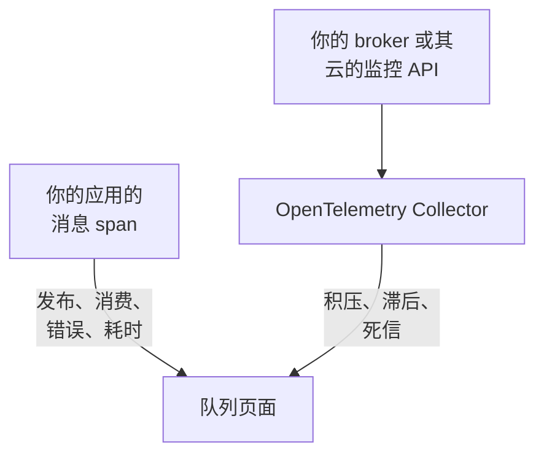

# 队列

**Queues** 为你的应用使用的每个消息队列、主题和订阅提供独立的页面：哪些服务向它发布、哪些服务从它消费、有多少消息经过、有多少失败、处理耗时多长、它的追踪和指标；而一旦 broker 自身的指标到达 OneUptime，还有它的积压、消费者滞后、死信和限流。与其他所有资源一样，队列也有标签、所有者、标签和所有者规则以及归档。在 **产品 → 资源 → 队列** 下打开它们。

:::cards
- [为应用插桩](#为应用插桩): 你的 OpenTelemetry 插桩已经发送的消息 span。
- [Broker 健康指标](#broker-健康指标): 来自你的 broker 的积压、滞后和死信，逐个系统说明。
- [警报](#警报): 现成的模板，以及延迟到达或计数类的指标。
- [故障排查](#故障排查): 没有被创建的队列，或一直为空的 broker 健康状况。
:::

## 工作原理

它对每种 broker 的工作方式都相同：Apache Kafka、RabbitMQ、Apache ActiveMQ 和其他 JMS broker、Amazon SQS 和 SNS、Google Cloud Pub/Sub、Azure Service Bus、Event Hubs 和 Event Grid、Apache Pulsar、Apache RocketMQ、NATS 和 BullMQ（见 [支持的消息系统](#支持的消息系统)），以及你的 span 在 `messaging.system` 中指明的任何其他 broker。大多数队列会从两个来源自动出现：

| 来源 | 需要你提供什么 | 为队列页面添加什么 |
| --- | --- | --- |
| **应用追踪** | 已插桩的应用（OpenTelemetry），见 [为应用插桩](#为应用插桩) | 发布和消费的消息、错误和处理时间、两侧的服务，以及追踪本身 |
| **Broker 指标**（一个 OpenTelemetry Collector） | 针对你的 broker 的 Collector 接收器或抓取，见 [Broker 健康指标](#broker-健康指标) | **Broker 健康状况**：积压、消费者滞后、死信、最旧消息的时长、限流以及 broker 自身的消息速率 |



追踪告诉 OneUptime 队列存在以及应用如何使用它，但不会告诉它队列有多满。这来自 broker 本身或其云提供商的监控 API；对于 [BullMQ](#bullmq)，由于它把作业保存在 Redis 中、没有可以查询的 broker，则来自应用报告的仪表。

你也可以手动添加队列：在 **Queues → 创建Queue** 中填写它的消息系统和目标名称，对于 Azure Service Bus 和 Event Hubs 还要填写命名空间。表单在第一步 **消息系统** 中询问这些内容，然后询问可选的名称和描述，标签位于 **更多字段**（**队列信息**）下。只有当你的应用通过模拟器或自定义域名访问某个队列时，才把命名空间留空：它们的 span 不会指明命名空间，Azure Monitor 的指标也永远不会到达这样的队列（见 [限制](#限制)）。

## 开始使用

:::steps
### 发送应用的追踪

为发布和消费的应用插桩，并把它们的追踪发送到 OneUptime（见 [为应用插桩](#为应用插桩)）。不需要任何 OneUptime 特有的设置：你的插桩已经生成的消息 span 会指明队列。

### 发送 broker 的指标

在 [Broker 健康指标](#broker-健康指标) 下找到你的消息系统，并用你的摄取密钥运行它的 Collector 配置。每个队列的 **文档** 选项卡都有该队列的配置，可直接复制。

### 打开队列

打开 **产品 → 资源 → 队列**。发现每 10 分钟运行一次：一旦某个队列在 15 分钟内收到至少 3 个 span，或某个 broker 指标指明了它，它就会出现。
:::

## 支持的消息系统

OneUptime 按名称识别下列消息系统。它会把插桩写入 `messaging.system` 的值不区分大小写地规范化为第二列中的值（如有 OpenTelemetry 公认值，则为该值），因此 `AmazonSQS`、`aws.sqs` 和 `aws_sqs` 是同一个系统。`nats` 和 `bullmq` 不是 OpenTelemetry 公认值：`nats` 是 Java 代理的 NATS 插桩报告的值，`bullmq` 是为 BullMQ 设置的值（见 [BullMQ](#bullmq)）。

OneUptime 不认识的系统同样可用：格式正确的值（`ibmmq`、`solace`、`mqtt`：小写字母、数字、`.`、`_` 和 `-`，最多 64 个字符）会按原样保留，因此该 broker 的队列会被发现并以该名称显示；只有 broker 自身的指标需要此表中的系统。`spring_integration` 会被忽略：Spring Integration 的通道是一个进程内的方法调用，而不是 broker。

**Broker 指标** 列说明系统的健康指标从哪里来：collector-contrib 接收器、Prometheus 端点（`:port/path`，用 Collector 的 `prometheus` 接收器抓取）、云提供商的监控 API，或在 Collector 之外通过 OTLP 推送指标的程序。每个系统都链接到下文的设置，而每个队列的 **文档** 选项卡会把它变成该队列的配置。

| 系统 | `messaging.system` | 也接受 | Broker 指标 |
| --- | --- | --- | --- |
| [Amazon SNS](#amazon-sns) | `aws.sns` | `aws_sns`, `amazonsns`, `sns` | `aws_cloudwatch` 或 `awsfirehose` 接收器（云监控） |
| [Amazon SQS](#amazon-sqs) | `aws_sqs` | `aws.sqs`, `amazonsqs`, `sqs` | `aws_cloudwatch` 或 `awsfirehose` 接收器（云监控） |
| [Apache ActiveMQ](#apache-activemq) | `activemq` | `artemis`, `activemq_artemis` | OpenTelemetry JMX Scraper（通过 OTLP 推送） |
| [Apache Kafka](#apache-kafka) | `kafka` | — | `kafka_metrics` 接收器 |
| [Apache Pulsar](#apache-pulsar) | `pulsar` | `apache_pulsar` | Prometheus（Pulsar broker）, `:8080/metrics/` |
| [Apache RocketMQ](#apache-rocketmq) | `rocketmq` | — | Prometheus（RocketMQ broker）, `:5557/metrics` |
| [Azure Event Grid](#azure-event-grid) | `eventgrid` | `azure_eventgrid`, `azure.eventgrid`, `microsoft.eventgrid` | `azure_monitor` 接收器（云监控） |
| [Azure Event Hubs](#azure-event-hubs) | `eventhubs` | `azure_eventhubs`, `azure.eventhubs`, `microsoft.eventhub` | `azure_monitor` 接收器（云监控） |
| [Azure Service Bus](#azure-service-bus) | `servicebus` | `azure_servicebus`, `azure.servicebus`, `microsoft.servicebus` | `azure_monitor` 接收器（云监控） |
| [BullMQ](#bullmq) | `bullmq` | — | 无内置 |
| [Google Cloud Pub/Sub](#google-cloud-pubsub) | `gcp_pubsub` | `gcp.pubsub`, `pubsub`, `google_pubsub` | `googlecloudmonitoring` 接收器（云监控） |
| [JMS](#jms) | `jms` | — | 无内置 |
| [NATS](#nats) | `nats` | `jetstream` | Prometheus (prometheus-nats-exporter), `:7777/metrics` |
| [RabbitMQ](#rabbitmq) | `rabbitmq` | — | `rabbitmq` 接收器 |

一个队列是一个系统的一个目标。对于 **Azure Service Bus** 和 **Azure Event Hubs**，命名空间也是其中的一部分，因为两个命名空间可以各有一个名为 `orders` 的队列。**JMS** 和 **Apache ActiveMQ** 共享队列：Java 应用通过 JMS API 访问 ActiveMQ，无论 broker 是什么，其 span 都显示 `jms`，而 broker 自身的指标只能显示 `activemq`，因此两者落到同一个队列上（见 [两次观测何时算同一个队列](#两次观测何时算同一个队列)）。

## 如何发现队列

每个队列都会记录它是由追踪、broker 指标还是人创建的。之后凡是指明同一个队列的内容都会补充到它上面，而不会再创建一个（见 [两次观测何时算同一个队列](#两次观测何时算同一个队列)）。

### 从应用追踪

OneUptime 每 10 分钟汇总你的应用在过去 15 分钟内发送的、带有 `messaging.system`、`messaging.destination.name`、`messaging.destination`、`message_bus.destination`、`az.namespace`、`azure.resource_provider.namespace`、`aws.sqs.queue.url`、`aws.queue_url` 或 `aws.sns.topic.arn` 中任意一个的 span。除 SERVER span 外的所有 span 都计入：PRODUCER、CONSUMER、CLIENT 和 INTERNAL span，以及追踪管道的 **跨度类型重映射器** 赋予了其他类型（例如 Unspecified）或去掉了类型的 span；SERVER span 永远不会指明队列。

broker 自身的 span 也是 SERVER span。[Kubernetes 代理](/docs/telemetry/kubernetes-agent#ebpf-追踪是什么样子) 的 eBPF 追踪器会记录 Kafka、MQTT 或 NATS broker 在每次交换中的一方（它接收的消息、它投递的消息），并把其中大多数作为 PRODUCER 或 CONSUMER 发送；OneUptime 把它们存储为 SERVER，因此 broker 不会被列为它所承载主题的生产者或消费者。把消息转发给订阅者的 MQTT broker 会写出与客户端相同的 PUBLISH，追踪器对两者的报告也一样，因此对于 MQTT 和 NATS 的发布，OneUptime 依据连接另一端的端口来判断：端口从 32768 起（操作系统为发起连接的客户端选择端口的范围；Linux 的默认范围从这里开始；Windows 和 macOS 使用 49152–65535）就是订阅者的端口，该 span 属于 broker。因此，向自身监听 32768 及以上端口（例如随机发布的 Docker 端口）的 MQTT 或 NATS broker 发布消息的应用，不会被列为其主题的生产者，而只有这类应用使用的主题可能完全无法从追踪器的 span 中发现。对于从低于 32768 的端口（缩小的端口范围，或被 NAT 改写的端口）连接 broker 的订阅者，broker 仍会被列为投递给它的主题的生产者。

OpenTelemetry 中的所有消息属性仍标记为开发中，因此同一项目中的应用会用最多五代名称报告相同的内容。OneUptime 从最新的开始全部读取，并且从不解析 span 名称，因为其格式在语义约定 1.27 中改变过，而且由供应商自由选择：

- **系统**：`messaging.system`，按 [支持的消息系统](#支持的消息系统) 中的方式规范化。没有它时，使用 Azure SDK 的 `az.namespace` 或 `azure.resource_provider.namespace`（`Microsoft.ServiceBus`、`Microsoft.EventHub`）、较旧的 Azure SDK `component` 键、调用 SQS 或 SNS 的 AWS SDK span（`rpc.system` = `aws-api`；Java 代理的 SNS span 不带 `messaging.system`），或 SQS 队列 URL 或 SNS 主题 ARN 键。
- **目标**：span 带有的 `messaging.destination.template`、`messaging.destination.name`、`messaging.source.template`、`messaging.source.name`、`messaging.destination` 和 `message_bus.destination` 中的第一个。这些都没有的 span 会退而使用其系统自己的键：SQS 队列 URL（`aws.sqs.queue.url`、`aws.queue_url`，或 `messaging.url`、`server.address` 或 `net.peer.name` 中的队列 URL）、SNS 主题 ARN（`aws.sns.topic.arn`），以及 RabbitMQ 的路由键（`messaging.rabbitmq.destination.routing_key` 或 `messaging.rabbitmq.routing_key`），当消息经过默认交换器时，它就是队列的名称。
- **方向**：先看 `messaging.operation.type`，然后看 span 类型（PRODUCER 发布，CONSUMER 消费），然后是较旧的 `messaging.operation`，然后是 `messaging.operation.name`，对于 SQS 和 SNS 还有 `rpc.method` 中的 AWS SDK 操作（`SendMessage`、`ReceiveMessage`、…）。span 类型优先于较旧的键，因为一些插桩曾经把它们填错：Python 的 confluent-kafka 曾在其生产者 span 上写入 `receive`。

一旦某个队列的 span 在一次运行所查看的 15 分钟窗口内达到至少 3 个（`MESSAGE_QUEUE_MIN_SPANS`），就会从追踪 **创建** 它，这样一次性脚本不会创建队列；并且只在项目未超出其 [自动创建额度](#自动创建额度) 时才会创建。不会创建队列的 span 仍会计入已存在的队列。

每个消息 span 在摄取时也会被标记上它的队列，因此队列的 **追踪** 选项卡会显示指明它的每个 span，包括在队列创建之前发送的 span。

### 从 broker 指标

[Broker 健康指标](#broker-健康指标) 列表中的 broker 指标会在 broker 自己的属性中指明它的队列（Kafka 的 `topic`、RabbitMQ 的 `rabbitmq.queue.name`、Azure Monitor 的 `EntityName` 维度、CloudWatch 的 `QueueName`），OneUptime 在摄取时将其与该队列匹配。broker 指标不带 `messaging.system`：每个指标按其名称（`kafka.consumer_group.lag_sum`）识别；当两个系统共用一个名称时（Azure Monitor 对 Service Bus 和 Event Hubs 的指标使用相同的名称），则按数据点携带的资源类型识别。

如果队列尚不存在，下一次发现运行会创建它：在 [自动创建额度](#自动创建额度) 之内，一个 broker 指标就足够了。因此，没有任何已插桩应用接触的队列，只要它的 broker 报告了它，仍然会出现。

云监控 API（CloudWatch、Azure Monitor 和 Cloud Monitoring）会在所测量时间的几分钟后才发布每个数值，并以该时间存储。因此每次运行读取的是它们过去一小时的指标，而不是读取 span 和其他指标所用的过去 15 分钟：延迟到达的数据点仍会记为看到了它的队列，或创建该队列。

### 从消息客户端指标

已插桩的客户端也可以报告指标：OpenTelemetry 的消息客户端指标 `messaging.client.sent.messages`、`messaging.client.consumed.messages`、`messaging.client.operation.duration` 和 `messaging.process.duration`，它们的旧名称 `messaging.publish.duration`、`messaging.receive.duration`、`messaging.publish.messages`、`messaging.receive.messages`、`messaging.process.messages` 和 `messaging.client.published.messages`，以及 Azure SDK for Java 的 `messaging.servicebus.messages.sent`、`messaging.servicebus.receiver.lag`、`messaging.servicebus.settlement.request.duration` 和 `messaging.servicebus.settlement.sequence_number`。每个数据点都像 span 一样指明它的系统和目标（Azure SDK 的 Service Bus 指标不指明系统，因此由其名称代替），并在摄取时与该队列匹配，因此会显示在队列的 **指标** 选项卡上。你自己的、在每个数据点上（而不是在资源上，那里的值不会被读取）带有 `messaging.system` 和 `messaging.destination.name` 的指标也一样，例如队列深度仪表（见 [BullMQ](#bullmq)）。

消息客户端指标从不创建队列：创建队列的是追踪、broker 指标或人。指明某个已存在队列的客户端指标会像它的 span 一样让该队列的 **最近出现** 保持最新。你自己的指标两者都不做：它只显示在队列的 **指标** 选项卡上。

### 两次观测何时算同一个队列

队列的身份是它的 **系统** 和 **目标**，比较时不区分大小写：`Orders` 和 `orders` 是同一个队列，以最先看到的名称显示。对于 Azure Service Bus 和 Event Hubs，身份还包括 **命名空间**：

- 在 span 上，是 SDK 所连接主机的第一个 DNS 标签，依次取自 `server.address`、`net.peer.name`、`peer.address` 或 `network.peer.address`，前提是该主机是命名空间主机：`<namespace>.servicebus.windows.net`，或主权云的 `.servicebus.usgovcloudapi.net`、`.servicebus.chinacloudapi.cn` 或 `.servicebus.cloudapi.de`。Event Hubs 与 Service Bus 共用域名；
- 在 Azure Monitor 指标上，是它所报告的命名空间的 `name`。

除此之外没有任何内容属于身份，因此以下这些都不会拆分队列：broker 的地址（Kafka 客户端很少报告它，而 Azure 命名空间会在许多地址上响应）、消费者组或订阅（一个主题的消费者不是单独的队列）、分区，以及死信子队列。其中，队列只保留 broker 的地址，用于显示。

**JMS 和 ActiveMQ 属于同一系列。** 无论背后是哪个 broker，每个 JMS span 都显示 `jms`，而 broker 自身的指标（[OpenTelemetry JMX Scraper](#apache-activemq)）只能显示 `activemq`，因此 OneUptime 按 JMS 系列识别 ActiveMQ 队列：`orders` 的 span 和 broker 指标落到同一个队列上。在 broker 的指标到达之前，它显示为 JMS，此后显示为 Apache ActiveMQ，绝不会反过来。你手动创建为 Apache ActiveMQ 的队列就是同一个队列。

### 如何读取目标名称

插桩会用多种方式指明同一个队列，OneUptime 会把它们报告的内容归约为队列自己的名称：

| 系统 | 报告形式 | 队列 |
| --- | --- | --- |
| Amazon SQS | `https://sqs.us-east-1.amazonaws.com/123456789012/orders`，队列 URL（Go 的 `otelaws` 把它放在 `server.address` 中） | `orders` |
| Amazon SNS | `arn:aws:sns:us-east-1:123456789012:order-events`，主题 ARN | `order-events` |
| Google Cloud Pub/Sub | `projects/shop/topics/orders`，资源名称 | `orders` |
| Azure Service Bus | `orders/Subscriptions/billing`，主题的订阅 `billing` 的实体路径 | `orders` |
| Azure Service Bus | `orders/$DeadLetterQueue`，队列的死信子队列的实体路径 | `orders` |
| Azure Event Hubs | `telemetry/ConsumerGroups/$Default/Partitions/3`，消费者组 `$Default` 的接收方实体路径 | `telemetry` |
| Apache Pulsar | `orders-partition-3`，短名称主题的一个分区 | `persistent://public/default/orders` |
| Apache Pulsar | `acme/shop/orders`，不带域的主题 | `persistent://acme/shop/orders` |
| JMS | `queue://orders`，带目标类型前缀 | `orders` |
| RabbitMQ | `shop:new-order:orders`，消费者上的交换器、路由键和队列（语义约定 1.30 及更高版本） | `orders` |
| RabbitMQ | `amq.default`，默认交换器，路由键为 `orders` | `orders` |
| RabbitMQ | `,orders`，aio-pika 经由默认交换器的 `{exchange},{routing key}` | `orders` |
| RabbitMQ | `shop,new-order`，aio-pika 的 `{exchange},{routing key}` | `shop` |

Pulsar 分区会折叠到它的主题中，不带域的名称会按照 Pulsar 自己的方式补全（短名称补全到 `public/default` 命名空间），因此 Java 代理的名称能与 broker 的完全限定指标标签对上。RabbitMQ span 通常指明消息经过的交换器，发布端和消费端都是如此；默认交换器（`amq.default`、`<default>` 或空名称）代表它的路由键，也就是队列的名称。语义约定 1.30 用 `:` 连接交换器、路由键和队列（Java 代理的可选名称），OneUptime 从消费者的连接名称中取队列，从发布者的连接名称中取交换器。aio-pika 在发布端用逗号连接交换器和路由键，OneUptime 也用同样的方式拆分。

### 忽略的内容

OneUptime 宁可不创建队列：否则，按请求或按消费者临时生成的名称会为每条消息创建一个无人拥有的队列。以下内容永远不会成为队列：

- **SERVER span**，以及 `messaging.system` 为 `spring_integration` 的 span。
- **标记为临时或匿名的目标**：`messaging.destination.temporary`、`messaging.destination.anonymous`、`messaging.source.temporary` 或 `messaging.source.anonymous` 设为 `true`。较旧的 `messaging.temp_destination` 不可信：Python 的 pika 和 aio-pika 插桩在每次发布时都会设置它。
- **插桩用来代替名称的占位符**：`(temporary)`、`(anonymous)`、`<generated>`、`unknown`（跨多个主题的 Kafka 批次）、`aws:sqs`（Java 代理的 Lambda SQS 事件）、Azure Monitor 的 `-NamespaceOnlyMetric-`，以及被 OneUptime 自身的数据清洗整体替换的值（`[REDACTED]`）。
- **生成的目标和回复目标**：RabbitMQ 中 `amq.gen-JzTY20BRgKO-HjmUJj0wLg` 这类由服务器命名的队列、Spring 的 `spring.gen-…` 队列、没有组的消费者的 Spring Cloud Stream `<destination>.anonymous.<id>` 队列，以及 direct reply-to（`amq.rabbitmq.reply-to…`）；JMS 临时目标（`temp-queue://…`、`temp-topic://…`）和 TIBCO 的 `$TMP$…`；ActiveMQ 的 advisory 主题（`ActiveMQ.Advisory.…`）；NATS 收件箱（`_INBOX.…`）和 JetStream 确认 subject（`$JS.ACK.…`）；Pulsar 的系统主题（`__change_events`、`__transaction_…`，以及 `/__` 段之下的任何内容）；还有只是一个 UUID 的目标。
- **SNS 短信和移动推送**：电话号码（`+15555550123`，或 botocore 的 `phone_number:**`）或平台端点 ARN（`arn:aws:sns:us-east-1:123456789012:endpoint/GCM/shop-app/1234`）是设备，不是主题。
- **不可能是单个队列的名称**：批次中的目标列表（`["orders","payments"]`）、含有控制字符的名称，以及超过 255 个字符的名称。

**UUID 会被模板化。** 目标中的每个 UUID 都会被替换为 `{uuid}`，因此 `reply-7f1c2a9e-4b1d-4c3e-9f1a-2b3c4d5e6f70` 这类按请求生成的名称会成为一个队列 `reply-{uuid}`，而不是各自成为一个队列。

### 自动创建额度

只有当项目中活跃的、未归档的已发现队列少于 500 个时，追踪和 broker 指标才会自行创建队列（`MESSAGE_QUEUE_AUTO_CREATE_BUDGET`，见 [自托管调优](#自托管调优)）。手动创建的队列从不计入，也从不被阻止；已归档的队列不计入，因此 [自动归档](#生命周期和归档) 会释放额度；已存在的队列会继续被匹配和更新。

### 生命周期和归档

- **最近出现** 是发现最后一次在追踪、消息客户端指标或 broker 指标中看到该队列的时间。
- **归档以移除。** 删除已发现的队列只能让它消失到再次被看到为止：下一次被看到时，它会作为新队列回来。要永久移除，请 **归档** 它。已归档的队列保留其身份，因此任何指明它的内容都会继续挂在已归档的队列上，而不会创建新队列。
- **自动归档。** 已发现的队列如果 7 天（`MESSAGE_QUEUE_AUTO_ARCHIVE_DAYS`）未被看到，就会被自动归档，除非有人重命名过它、为它写过描述、为它加过标签或指定过所有者。由标签或所有者规则自行附加的标签和所有者不算。
- **恢复。** 自动归档的队列在再次被看到时会自动恢复。你手动创建的队列，以及由人归档的队列，永远不会被发现归档或恢复。由人恢复的队列即使没有任何内容看到它，也会保持恢复状态 30 天（如果归档窗口更长，则为归档窗口），从下一次被看到起，7 天规则再次生效。

## 为应用插桩

队列来自你的 OpenTelemetry 插桩已经生成的消息 span；不需要任何 OneUptime 特有的设置。按照 [OpenTelemetry](/docs/telemetry/open-telemetry) 中的说明把追踪发送到 OneUptime，然后查看你所用语言的列表。

:::tabs
@tab Java
OpenTelemetry Java 代理无需更改代码即可追踪 Kafka、RabbitMQ、JMS（ActiveMQ、Artemis、IBM MQ 以及其他所有 JMS broker）、Amazon SQS 和 SNS、Pulsar、RocketMQ 和 NATS 客户端。OneUptime 既读取它默认发出的属性名称，也读取它在设置 `OTEL_SEMCONV_STABILITY_OPT_IN=messaging` 时发出的较新名称（代理 2.31.0 及更高版本）。无论背后是哪个 broker，JMS span 都显示 `jms`（见 [JMS](#jms)）。

- **Azure Service Bus 和 Event Hubs**：Azure SDK for Java 会追踪自身，Java 代理会把这些追踪连接到 OpenTelemetry。
- **Google Cloud Pub/Sub**：一旦客户端的 `Publisher` 和 `Subscriber` 构建器获得 OpenTelemetry 实例和追踪开关（`setOpenTelemetry(GlobalOpenTelemetry.get())` 和 `setEnableOpenTelemetryTracing(true)`），客户端就会追踪自身。单独调用其中任何一个都不会追踪任何内容。
@tab .NET
- **Azure Service Bus 和 Event Hubs**（`Azure.Messaging.ServiceBus`、`Azure.Messaging.EventHubs`）：它们的 OpenTelemetry span 在 Azure SDK 中是实验性的。用环境变量 `AZURE_EXPERIMENTAL_ENABLE_ACTIVITY_SOURCE=true`（或下面的 `Azure.Experimental.EnableActivitySource` 开关）开启它们，并订阅 `Azure.*` 源。
- **RabbitMQ.Client** 7 会追踪自身：订阅 `RabbitMQ.Client.*`。
- **MassTransit** 会追踪自身：订阅 `MassTransit`（它的 span 缺少哪些内容，见 [限制](#限制)）。
- **Confluent.Kafka**：`OpenTelemetry.Instrumentation.ConfluentKafka` 包。
- **Amazon SQS 和 SNS**：`OpenTelemetry.Instrumentation.AWS` 包，配合 `.AddAWSInstrumentation(opt => opt.SemanticConventionVersion = SemanticConventionVersion.Latest)`。它的默认属性集（`V1_28_0`）只用 URL 指明 SQS 队列（`aws.queue_url`，OneUptime 会读取它），而完全不指明 SNS 主题。

```csharp
// Before any Azure client is created; or set AZURE_EXPERIMENTAL_ENABLE_ACTIVITY_SOURCE=true.
AppContext.SetSwitch("Azure.Experimental.EnableActivitySource", true);

builder.Services.AddOpenTelemetry()
    .WithTracing(tracing => tracing
        .AddSource("Azure.*")
        .AddSource("RabbitMQ.Client.*")
        .AddSource("MassTransit")
        .AddOtlpExporter());
```
@tab Node.js
- `@opentelemetry/auto-instrumentations-node` 会追踪 `amqplib`（RabbitMQ）、`kafkajs` 和 AWS SDK（SQS 和 SNS）。
- **Azure Service Bus 和 Event Hubs**：注册 `@azure/opentelemetry-instrumentation-azure-sdk` 中的 `createAzureSdkInstrumentation()`。
- **Google Cloud Pub/Sub**：`new PubSub({ enableOpenTelemetryTracing: true })`。
- **BullMQ**：见 [BullMQ](#bullmq)，它自己的遥测需要添加两个属性。
@tab Python
- Kafka：`opentelemetry-instrumentation-kafka-python`、`opentelemetry-instrumentation-confluent-kafka` 或 `opentelemetry-instrumentation-aiokafka`。RabbitMQ：`opentelemetry-instrumentation-pika` 或 `opentelemetry-instrumentation-aio-pika`。SQS 和 SNS：`opentelemetry-instrumentation-botocore`，或用于 SQS 的 `opentelemetry-instrumentation-boto3sqs`。`opentelemetry-bootstrap -a install` 会挑选你已安装的库所需的那些。
- **Azure Service Bus 和 Event Hubs**：安装 `azure-core-tracing-opentelemetry`，并设置 `settings.tracing_implementation = "opentelemetry"`（来自 `azure.core.settings`）。
- **Google Cloud Pub/Sub**：`PublisherOptions(enable_open_telemetry_tracing=True)` 和 `SubscriberOptions(enable_open_telemetry_tracing=True)`。
- Celery 的 span 不带 `messaging.system`，也不指明 broker，因此不会创建队列。
@tab Go
- **Amazon SQS 和 SNS**：`otelaws`（`go.opentelemetry.io/contrib/instrumentation/github.com/aws/aws-sdk-go-v2/otelaws`），通过 `otelaws.AppendMiddlewares(&cfg.APIOptions)` 添加。它的 SQS span 在 `server.address` 中携带队列 URL，OneUptime 会把它读作队列。
- **Google Cloud Pub/Sub**：`pubsub.ClientConfig{EnableOpenTelemetryTracing: true}`。
- **Kafka**（使用 `segmentio/kafka-go`）：OpenTelemetry Go 自动插桩（`go.opentelemetry.io/auto`，eBPF，适用于 Linux）无需更改代码即可追踪它的生产者和消费者。
- OpenTelemetry 的 Go contrib 库没有 Kafka、RabbitMQ 或 NATS 插桩。对于其他客户端，请使用客户端库自身的 OpenTelemetry 支持，或者在包裹发送和处理程序的 span 上设置 `messaging.system`、`messaging.destination.name` 和 span 类型。
:::

## Broker 健康指标

broker 知道任何应用都看不到的东西：有多少消息在等待、每个消费者组落后多少、什么进入了死信队列。下面的每一节都有一个系统的 Collector 配置：一份完整的 OpenTelemetry Collector 配置，以发送到 OneUptime 的 OTLP 导出器结尾。把遥测摄取密钥（**项目设置 → 遥测与 APM → 摄取密钥**）填入 `x-oneuptime-token`，如果你自托管，把 `https://oneuptime.com` 替换为你自己的主机，并用 `otel/opentelemetry-collector-contrib` 0.161.0 或更高版本运行它（这里的每份配置都已在 0.161.0 上验证）。较新的 Collector 会在日志中提示 `otlphttp` 已弃用、应改用 `otlp_http`；这两个名称是同一个导出器。要收集多个系统，把它们的接收器合并到一个 Collector 中。

每个队列的 **Broker 健康状况** 部分会绘制其系统所列出的指标（仪表绘制其值，每周期计数按间隔求和，计数器绘制为每秒速率），并按每个指标的需要合并队列的序列（RabbitMQ 队列的就绪消息和未确认消息相加；落后最多的消费者组即为滞后）。Collector 发送的所有内容也都在 **指标** 浏览器中。在队列还没有收到任何列出的指标时，该部分会显示该系统的指标来自哪里，并链接到本页的相应小节。

### Amazon SNS

用 Collector 的 `aws_cloudwatch` 接收器读取主题的 CloudWatch 指标，或者通过 CloudWatch Metric Stream 和 Amazon Data Firehose 把它们流式传输到 Collector 的 `awsfirehose` 接收器。

`aws_cloudwatch` 接收器轮询 CloudWatch 的 `GetMetricData` API，每个接收器一个命名空间，因此 SNS 需要在 [Amazon SQS](#amazon-sqs) 的实例旁边有自己的实例。它使用 AWS SDK 的默认凭证（环境、共享配置文件或实例角色），这些凭证需要 `cloudwatch:ListMetrics` 和 `cloudwatch:GetMetricData`：

```yaml
receivers:
  aws_cloudwatch/sns:
    region: us-east-1
    metrics:
      collection_interval: 5m
      period: 1m
      delay: 10m
      discovery:
        filters:
          namespace: AWS/SNS
        limit: 500

processors:
  batch: {}

exporters:
  otlphttp:
    endpoint: https://oneuptime.com/otlp
    headers:
      x-oneuptime-token: YOUR_TELEMETRY_INGESTION_TOKEN

service:
  pipelines:
    metrics:
      receivers: [aws_cloudwatch/sns]
      processors: [batch]
      exporters: [otlphttp]
```

与 [Amazon SQS](#amazon-sqs) 一样，不要设置 `stats`。一个 Metric Stream 会同时承载 SNS 和 SQS：在 [Amazon SQS](#amazon-sqs) 的设置中把 `AWS/SNS` 添加到流的命名空间中。

主题从两端得到的名称相同：span 报告它的 ARN 或名称，OneUptime 保留 ARN 中最后一个 `:` 之后的名称。

| 指标 | 显示为 | 类型 |
| --- | --- | --- |
| `amazonaws.com/aws/sns/numberofmessagespublished` (JSON 流: `numberofmessagespublished`) | Messages published | 每周期计数 |
| `amazonaws.com/aws/sns/numberofnotificationsdelivered` (JSON 流: `numberofnotificationsdelivered`) | Notifications delivered | 每周期计数 |
| `amazonaws.com/aws/sns/numberofnotificationsfailed` (JSON 流: `numberofnotificationsfailed`) | Notifications failed | 每周期计数 |
| `amazonaws.com/aws/sns/numberofnotificationsredriventodlq` (JSON 流: `numberofnotificationsredriventodlq`) | Redriven to dead-letter queue | 每周期计数 |

### Amazon SQS

用 Collector 的 `aws_cloudwatch` 接收器读取队列的 CloudWatch 指标，或者通过 CloudWatch Metric Stream 和 Amazon Data Firehose 把它们流式传输到 Collector 的 `awsfirehose` 接收器。

**轮询 CloudWatch** 在 AWS 端只需要凭证。接收器使用 AWS SDK 的默认凭证（环境、共享配置文件或实例角色），这些凭证需要 `cloudwatch:ListMetrics` 和 `cloudwatch:GetMetricData`：

```yaml
receivers:
  aws_cloudwatch/sqs:
    region: us-east-1
    metrics:
      collection_interval: 5m
      period: 1m
      delay: 10m
      discovery:
        filters:
          namespace: AWS/SQS
        # Metrics per scrape: about nine per queue. Must be set.
        limit: 500

processors:
  batch: {}

exporters:
  otlphttp:
    endpoint: https://oneuptime.com/otlp
    headers:
      x-oneuptime-token: YOUR_TELEMETRY_INGESTION_TOKEN

service:
  pipelines:
    metrics:
      receivers: [aws_cloudwatch/sqs]
      processors: [batch]
      exporters: [otlphttp]
```

- **不要设置 `stats`。** 不设置时，每个指标按每个周期一份摘要到达，这正是 OneUptime 读取的内容；设置后，每个统计量都会成为单独的序列，图表会把它们混在一起。
- 必须设置 `discovery.limit`，它限制每次抓取读取的指标数：每个队列大约九个。每个指标每次抓取会产生四个 `GetMetricData` 子查询，AWS 会对其计费。
- `delay` 等待 CloudWatch 发布一个周期（这需要几分钟），因此在此配置下，队列的 broker 指标会延迟 11 到 17 分钟到达：基于它们的监视器需要更长的窗口（见 [警报](#警报) 下的 **延迟到达的指标**）。
- 一个接收器读取一个区域和一个命名空间：每个区域添加一个实例。

**流式传输** 会在 CloudWatch 发布指标时推送它们。为 `AWS/SQS`（和 `AWS/SNS`）命名空间创建输出格式为 **OpenTelemetry 1.0** 的 CloudWatch Metric Stream，投递到目标为 HTTP 端点的 Amazon Data Firehose 流：即你的 Collector，并带有访问密钥。Firehose 只投递到 443 端口上的 `https://`，因此 Collector 需要证书和公开的 443 端口（例如在负载均衡器之后）：

```yaml
extensions:
  awscloudwatchmetricstreams_encoding:
    format: opentelemetry1.0

receivers:
  awsfirehose:
    # Firehose delivers to HTTPS on port 443 only: expose this port as 443,
    # for example behind a load balancer.
    endpoint: 0.0.0.0:4433
    encoding: awscloudwatchmetricstreams_encoding
    access_key: ${env:FIREHOSE_ACCESS_KEY}
    tls:
      cert_file: /etc/otelcol/tls/server.crt
      key_file: /etc/otelcol/tls/server.key

processors:
  batch: {}

exporters:
  otlphttp:
    endpoint: https://oneuptime.com/otlp
    headers:
      x-oneuptime-token: YOUR_TELEMETRY_INGESTION_TOKEN

service:
  extensions: [awscloudwatchmetricstreams_encoding]
  pipelines:
    metrics:
      receivers: [awsfirehose]
      processors: [batch]
      exporters: [otlphttp]
```

输出格式为 **JSON** 的流（`format: json`）同样可用：它以原始名称发送每个指标，OneUptime 通过流标记的 `service.name`（`SQS`、`SNS`）区分 SQS 的指标和 SNS 的指标。

死信队列是带有自己指标的普通 SQS 队列，因此在 OneUptime 中它是一个单独的队列。队列只按名称区分，不按账户或区域区分（见 [限制](#限制)）。

| 指标 | 显示为 | 类型 |
| --- | --- | --- |
| `amazonaws.com/aws/sqs/approximatenumberofmessagesvisible` (JSON 流: `approximatenumberofmessagesvisible`) | Messages visible | 仪表 |
| `amazonaws.com/aws/sqs/approximateageofoldestmessage` (JSON 流: `approximateageofoldestmessage`) | Oldest message age | 仪表 |
| `amazonaws.com/aws/sqs/approximatenumberofmessagesnotvisible` (JSON 流: `approximatenumberofmessagesnotvisible`) | Messages in flight | 仪表 |
| `amazonaws.com/aws/sqs/numberofmessagessent` (JSON 流: `numberofmessagessent`) | Messages sent | 每周期计数 |
| `amazonaws.com/aws/sqs/numberofmessagesreceived` (JSON 流: `numberofmessagesreceived`) | Messages received | 每周期计数 |
| `amazonaws.com/aws/sqs/numberofmessagesdeleted` (JSON 流: `numberofmessagesdeleted`) | Messages deleted | 每周期计数 |

### Apache ActiveMQ

Collector 没有 JMX 接收器，因此请在 ActiveMQ Classic broker 旁边以 `OTEL_JMX_TARGET_SYSTEM=activemq` 运行 OpenTelemetry JMX Scraper；它通过 OTLP 推送 broker 的目标指标。

1. 让 broker 接受 JMX 连接。使用 `apache/activemq-classic` 镜像或 `bin/activemq` 脚本时，在启动前设置 `ACTIVEMQ_SUNJMX_START`。此示例关闭了身份验证：把端口留在私有网络中，或者用密码文件开启 `jmxremote.authenticate`，并为抓取器提供 `OTEL_JMX_USERNAME` 和 `OTEL_JMX_PASSWORD`。

```bash
ACTIVEMQ_SUNJMX_START="-Dcom.sun.management.jmxremote.port=1099 -Dcom.sun.management.jmxremote.rmi.port=1099 -Dcom.sun.management.jmxremote.authenticate=false -Dcom.sun.management.jmxremote.ssl=false -Djava.rmi.server.hostname=activemq"
```

2. 在能访问该端口的地方用 Java 运行时运行抓取器。它直接发送到 OneUptime；如果要改为经过你自己的 Collector，把 `OTEL_EXPORTER_OTLP_ENDPOINT` 指向该 Collector 的 OTLP 接收器。

```bash
curl -fsSLo opentelemetry-jmx-scraper.jar https://github.com/open-telemetry/opentelemetry-java-contrib/releases/latest/download/opentelemetry-jmx-scraper.jar

export OTEL_JMX_SERVICE_URL=service:jmx:rmi:///jndi/rmi://activemq:1099/jmxrmi
export OTEL_JMX_TARGET_SYSTEM=activemq
export OTEL_JMX_TARGET_SOURCE=instrumentation
export OTEL_METRIC_EXPORT_INTERVAL=30000
export OTEL_SERVICE_NAME=activemq-prod
export OTEL_EXPORTER_OTLP_PROTOCOL=http/protobuf
export OTEL_EXPORTER_OTLP_ENDPOINT=https://oneuptime.com/otlp
export OTEL_EXPORTER_OTLP_HEADERS=x-oneuptime-token=YOUR_TELEMETRY_INGESTION_TOKEN
java -jar opentelemetry-jmx-scraper.jar
```

`OTEL_JMX_TARGET_SOURCE=instrumentation` 保留抓取器自 1.53.0-alpha 起使用的指标名称（`activemq.message.queue.size`，目标在 `messaging.destination.name` 中）。OneUptime 也会读取较旧抓取器的名称以及 `OTEL_JMX_TARGET_SOURCE=legacy` 的名称（`activemq.message.current`，目标在 `destination` 中）。

broker 的指标会并入其 JMS 客户端的 span 所创建的队列，从那以后该队列显示为 Apache ActiveMQ（见 [两次观测何时算同一个队列](#两次观测何时算同一个队列)）。抓取器会报告每个目标：OneUptime 忽略 advisory 主题，而死信队列（`ActiveMQ.DLQ`，或使用单独死信策略时的 `DLQ.<destination>`）是单独的队列。ActiveMQ Artemis 的 MBean 不同，这些规则不会读取：Artemis 队列仍来自其 JMS span，但没有 broker 健康状况。

| 指标 | 显示为 | 类型 |
| --- | --- | --- |
| `activemq.message.queue.size` | Queue size | 仪表 |
| `activemq.message.current` | Queue size (legacy names) | 仪表 |
| `activemq.message.enqueued` | Enqueued | 计数器，按每秒绘制 |
| `activemq.message.dequeued` | Dequeued | 计数器，按每秒绘制 |
| `activemq.message.expired` | Expired | 计数器，按每秒绘制 |
| `activemq.consumer.count` | Consumers | 仪表 |
| `activemq.message.enqueue.average_duration` | Average time in queue | 仪表 |
| `activemq.message.wait_time.avg` | Average time in queue (legacy names) | 仪表 |

### Apache Kafka

Collector 的 `kafka_metrics` 接收器从 broker 读取消费者组滞后和分区偏移量；请启用它的 `topics` 和 `consumers` 抓取器。

```yaml
receivers:
  kafka_metrics:
    brokers: ["kafka-1:9092", "kafka-2:9092"]
    # topics: each partition's log-end offset; consumers: each group's
    # committed offsets and lag. brokers: the broker count.
    scrapers: [brokers, topics, consumers]
    collection_interval: 30s
    # auth:
    #   sasl:
    #     mechanism: SCRAM-SHA-512
    #     username: ${env:KAFKA_USERNAME}
    #     password: ${env:KAFKA_PASSWORD}
    # tls:
    #   ca_file: /etc/kafka/ca.pem

processors:
  batch: {}

exporters:
  otlphttp:
    endpoint: https://oneuptime.com/otlp
    headers:
      x-oneuptime-token: YOUR_TELEMETRY_INGESTION_TOKEN

service:
  pipelines:
    metrics:
      receivers: [kafka_metrics]
      processors: [batch]
      exporters: [otlphttp]
```

对于使用 SASL 或 TLS 的集群，取消 `auth` 和 `tls` 的注释。接收器在 `topic` 中指明每个主题，指标正是借此找到主题的队列。它只在消费者组已提交过偏移量的主题上报告该组的滞后和已提交偏移量，并跳过名称以 `_` 开头的主题，也就是 Kafka 的内部主题（`topic_match` 默认为 `^[^_].*$`）。

| 指标 | 显示为 | 类型 |
| --- | --- | --- |
| `kafka.consumer_group.lag_sum` | Consumer lag | 仪表 |
| `kafka.consumer_group.lag` | Partition lag | 仪表 |
| `kafka.consumer_group.offset_sum` | Consumed | 计数器，按每秒绘制 |
| `kafka.partition.current_offset` | Produced | 计数器，按每秒绘制 |

### Apache Pulsar

每个 broker 都在其 Web 服务端口上提供主题和订阅指标；请抓取每个 broker，因为一个 broker 只报告它当前拥有的主题。

```yaml
receivers:
  prometheus:
    config:
      scrape_configs:
        - job_name: pulsar-broker
          scrape_interval: 30s
          metrics_path: /metrics/
          # Every broker: each one reports only the topics it owns.
          static_configs:
            - targets: ["pulsar-broker-0:8080", "pulsar-broker-1:8080"]
          # Keeps the families the queue page charts; remove it to keep all.
          metric_relabel_configs:
            - source_labels: [__name__]
              regex: "pulsar_(msg_backlog|subscription_back_log|storage_backlog_age_seconds|in_messages_total|out_messages_total)"
              action: keep

processors:
  batch: {}

exporters:
  otlphttp:
    endpoint: https://oneuptime.com/otlp
    headers:
      x-oneuptime-token: YOUR_TELEMETRY_INGESTION_TOKEN

service:
  pipelines:
    metrics:
      receivers: [prometheus]
      processors: [batch]
      exporters: [otlphttp]
```

- 主题和订阅序列需要 `broker.conf` 中的 `exposeTopicLevelMetricsInPrometheus=true`，这是默认值。
- Pulsar 用主题的全名（`persistent://public/default/orders`）标记每个序列，用分区的名称（`persistent://public/default/orders-partition-3`）标记分区的序列：分区会累加到它们的主题中。
- 积压按条目计算，Pulsar 把一批消息算作一个条目。
- 当 `exposeConsumerLevelMetricsInPrometheus=true` 时，Pulsar 会按消费者重复 `pulsar_out_messages_total`；这些按消费者的序列不进入图表，因此不会有消息被计算两次。
- 在 broker 无法判断时，`pulsar_storage_backlog_age_seconds` 显示 `-1`。
- Pulsar 3.3 及更高版本的原生 OpenTelemetry 指标（实验性，默认关闭）使用其他名称，不会绘制图表。

| 指标 | 显示为 | 类型 |
| --- | --- | --- |
| `pulsar_msg_backlog` | Backlog | 仪表 |
| `pulsar_subscription_back_log` | Subscription backlog | 仪表 |
| `pulsar_storage_backlog_age_seconds` | Backlog age | 仪表 |
| `pulsar_in_messages_total` | Messages in | 计数器，按每秒绘制 |
| `pulsar_out_messages_total` | Messages out | 计数器，按每秒绘制 |

### Apache RocketMQ

在 broker 的 `broker.conf` 中设置 `metricsExporterType=PROM`，让 broker 提供它的滞后和吞吐量指标。

```text
metricsExporterType=PROM
metricsPromExporterPort=5557
metricsPromExporterHost=0.0.0.0
```

然后抓取每个 broker：

```yaml
receivers:
  prometheus:
    config:
      scrape_configs:
        - job_name: rocketmq-broker
          scrape_interval: 30s
          metrics_path: /metrics
          static_configs:
            - targets: ["rocketmq-broker-a:5557", "rocketmq-broker-b:5557"]

processors:
  batch: {}

exporters:
  otlphttp:
    endpoint: https://oneuptime.com/otlp
    headers:
      x-oneuptime-token: YOUR_TELEMETRY_INGESTION_TOKEN

service:
  pipelines:
    metrics:
      receivers: [prometheus]
      processors: [batch]
      exporters: [otlphttp]
```

这是 RocketMQ 5 的内置导出器。RocketMQ 4 没有它；它使用的独立 `rocketmq-exporter` 报告的是其他指标名称，不会绘制图表。消费者组的死信主题（`%DLQ%<group>`）是单独的队列。

| 指标 | 显示为 | 类型 |
| --- | --- | --- |
| `rocketmq_consumer_lag_messages` | Consumer lag | 仪表 |
| `rocketmq_consumer_ready_messages` | Ready messages | 仪表 |
| `rocketmq_send_to_dlq_messages_total` | Sent to dead-letter queue | 计数器，按每秒绘制 |
| `rocketmq_messages_in_total` | Messages in | 计数器，按每秒绘制 |

### Azure Event Grid

Azure Monitor 有主题的投递和死信指标，由 Collector 的 `azure_monitor` 接收器读取；它们尚未在队列页面上绘制图表，请在指标中查看。

接收器通过 `azure_auth` 扩展登录。在订阅上为服务主体授予 **Monitoring Reader** 角色：

```yaml
extensions:
  azure_auth:
    service_principal:
      tenant_id: ${env:AZURE_TENANT_ID}
      client_id: ${env:AZURE_CLIENT_ID}
      client_secret: ${env:AZURE_CLIENT_SECRET}

receivers:
  azure_monitor/eventgrid:
    subscription_ids: ["${env:AZURE_SUBSCRIPTION_ID}"]
    auth:
      authenticator: azure_auth
    collection_interval: 60s
    services:
      - Microsoft.EventGrid/topics
      - Microsoft.EventGrid/systemTopics
      - Microsoft.EventGrid/domains
    maximum_number_of_records_per_resource: 1000

processors:
  batch: {}

exporters:
  otlphttp:
    endpoint: https://oneuptime.com/otlp
    headers:
      x-oneuptime-token: YOUR_TELEMETRY_INGESTION_TOKEN

service:
  extensions: [azure_auth]
  pipelines:
    metrics:
      receivers: [azure_monitor/eventgrid]
      processors: [batch]
      exporters: [otlphttp]
```

OneUptime 不会在队列页面上绘制 Event Grid 的指标：Azure Monitor 按 Event Grid 资源和事件订阅报告它们，而不是以指明你的某个队列的形式报告。它们会进入 **指标** 浏览器：`azure_publishsuccesscount_total`、`azure_deliverysuccesscount_total`、`azure_deadletteredcount_total` 等。对于 Event Grid 命名空间，把 `Microsoft.EventGrid/namespaces` 添加到 `services` 中。

### Azure Event Hubs

用 Collector 的 `azure_monitor` 接收器从 Azure Monitor 读取命名空间的指标，它按 EntityName 维度把指标拆分到每个事件中心。

接收器通过 `azure_auth` 扩展登录。在订阅上为服务主体授予 **Monitoring Reader** 角色：

```yaml
extensions:
  azure_auth:
    service_principal:
      tenant_id: ${env:AZURE_TENANT_ID}
      client_id: ${env:AZURE_CLIENT_ID}
      client_secret: ${env:AZURE_CLIENT_SECRET}

receivers:
  azure_monitor/eventhubs:
    subscription_ids: ["${env:AZURE_SUBSCRIPTION_ID}"]
    auth:
      authenticator: azure_auth
    collection_interval: 60s
    services: [Microsoft.EventHub/namespaces]
    maximum_number_of_records_per_resource: 1000
    metrics:
      "Microsoft.EventHub/namespaces":
        IncomingMessages: [Total]
        OutgoingMessages: [Total]
        ServerErrors: [Total]
        UserErrors: [Total]
        QuotaExceededErrors: [Total]
        ThrottledRequests: [Total]

processors:
  batch: {}

exporters:
  otlphttp:
    endpoint: https://oneuptime.com/otlp
    headers:
      x-oneuptime-token: YOUR_TELEMETRY_INGESTION_TOKEN

service:
  extensions: [azure_auth]
  pipelines:
    metrics:
      receivers: [azure_monitor/eventhubs]
      processors: [batch]
      exporters: [otlphttp]
```

指标通过命名空间（`name`）和事件中心（`EntityName`）找到它们的事件中心；这个命名空间就是 span 报告为 `<namespace>.servicebus.windows.net` 的那个。`maximum_number_of_records_per_resource` 是 Azure 每个指标和命名空间返回的序列数，除非你调高，否则为 10：请让它大于你的事件中心数量，否则其余的不会被报告。保持 `use_batch_api` 关闭（默认即关闭）：自 Collector 0.155.0 起，批量 API 对 Event Hubs 命名空间一直失败。

Azure Monitor 没有 Event Hubs 的消费者滞后指标：它的 `ConsumerLag` 只存在于 Premium 和 Dedicated 层级的应用指标日志中，而此接收器不读取这些日志。

| 指标 | 显示为 | 类型 |
| --- | --- | --- |
| `azure_incomingmessages_total` | Incoming messages | 每周期计数 |
| `azure_outgoingmessages_total` | Outgoing messages | 每周期计数 |
| `azure_servererrors_total` | Server errors | 每周期计数 |
| `azure_usererrors_total` | User errors | 每周期计数 |
| `azure_quotaexceedederrors_total` | Quota exceeded errors | 每周期计数 |
| `azure_throttledrequests_total` | Throttled requests | 每周期计数 |

### Azure Service Bus

用 Collector 的 `azure_monitor` 接收器从 Azure Monitor 读取命名空间的指标，它按 EntityName 维度把指标拆分到每个队列和主题。

接收器通过 `azure_auth` 扩展登录。在订阅上为服务主体授予 **Monitoring Reader** 角色：

```yaml
extensions:
  azure_auth:
    service_principal:
      tenant_id: ${env:AZURE_TENANT_ID}
      client_id: ${env:AZURE_CLIENT_ID}
      client_secret: ${env:AZURE_CLIENT_SECRET}

receivers:
  azure_monitor/servicebus:
    subscription_ids: ["${env:AZURE_SUBSCRIPTION_ID}"]
    auth:
      authenticator: azure_auth
    collection_interval: 60s
    services: [Microsoft.ServiceBus/namespaces]
    # Series Azure returns per metric and namespace (default 10): keep it
    # above your number of queues and topics.
    maximum_number_of_records_per_resource: 1000
    metrics:
      "Microsoft.ServiceBus/namespaces":
        ActiveMessages: [Average]
        DeadletteredMessages: [Average]
        IncomingMessages: [Total]
        OutgoingMessages: [Total]
        CompleteMessage: [Total]
        AbandonMessage: [Total]
        ServerErrors: [Total]
        UserErrors: [Total]
        ThrottledRequests: [Total]

processors:
  batch: {}

exporters:
  otlphttp:
    endpoint: https://oneuptime.com/otlp
    headers:
      x-oneuptime-token: YOUR_TELEMETRY_INGESTION_TOKEN

service:
  extensions: [azure_auth]
  pipelines:
    metrics:
      receivers: [azure_monitor/servicebus]
      processors: [batch]
      exporters: [otlphttp]
```

- 指标通过命名空间（`name`）和实体（`EntityName`）找到它们的队列或主题；SDK 的 span 把同一个命名空间指明为 `<namespace>.servicebus.windows.net`。针对 `orders/Subscriptions/billing` 或 `orders/$DeadLetterQueue` 的 span 与指标一样属于 `orders`。
- `maximum_number_of_records_per_resource` 是 Azure 每个指标和命名空间返回的序列数，除非你调高，否则为 10：请让它大于你的队列和主题数量（错误指标还会把每个实体按结果进一步拆分），否则其余的不会被报告。
- Azure Monitor 不按主题订阅拆分：一个主题的计数涵盖它的所有订阅。
- `metrics` 列表恰好收集队列页面绘制的内容，每个指标使用它所绘制的唯一聚合方式；添加一个指标（`ScheduledMessages`、`Size`、…）即可同时收集它。
- 接收器每天列出一次你的命名空间，因此新命名空间最多可能需要 24 小时才会出现。

| 指标 | 显示为 | 类型 |
| --- | --- | --- |
| `azure_activemessages_average` | Active messages | 仪表 |
| `azure_deadletteredmessages_average` | Dead-lettered messages | 仪表 |
| `azure_incomingmessages_total` | Incoming messages | 每周期计数 |
| `azure_outgoingmessages_total` | Outgoing messages | 每周期计数 |
| `azure_completemessage_total` | Completed messages | 每周期计数 |
| `azure_abandonmessage_total` | Abandoned messages | 每周期计数 |
| `azure_servererrors_total` | Server errors | 每周期计数 |
| `azure_usererrors_total` | User errors | 每周期计数 |
| `azure_throttledrequests_total` | Throttled requests | 每周期计数 |

### BullMQ

BullMQ 把作业保存在 Redis 中，没有可抓取的 broker；请在应用中把队列深度作为携带 `messaging.system` 和 `messaging.destination.name` 的指标报告，就像 OneUptime 自己的 worker 用 `queue.size` 所做的那样。

BullMQ 自己的遥测（它的 `telemetry` 选项，由 `bullmq-otel` 包实现）在 `bullmq.queue.name` 中指明队列，并且不设置 `messaging.system`，因此单靠它不会创建队列。在你的应用所发送到的 Collector 中，一个 `transform` 处理器会在添加和处理作业的 span 以及 BullMQ 自己的指标上添加 OneUptime 读取的两个键：

```yaml
receivers:
  otlp:
    protocols:
      grpc:
        endpoint: 0.0.0.0:4317
      http:
        endpoint: 0.0.0.0:4318

processors:
  # BullMQ names the queue in bullmq.queue.name and sets no
  # messaging.system: copy it into the keys OneUptime reads, on the spans
  # that publish (add) and process jobs, and on BullMQ's own metrics.
  transform/bullmq:
    error_mode: ignore
    trace_statements:
      - set(span.attributes["messaging.system"], "bullmq") where span.attributes["bullmq.queue.name"] != nil and span.attributes["messaging.system"] == nil and (span.kind == SPAN_KIND_PRODUCER or span.kind == SPAN_KIND_CONSUMER)
      - set(span.attributes["messaging.destination.name"], span.attributes["bullmq.queue.name"]) where span.attributes["messaging.system"] == "bullmq" and span.attributes["messaging.destination.name"] == nil
    metric_statements:
      - set(datapoint.attributes["messaging.system"], "bullmq") where datapoint.attributes["bullmq.queue.name"] != nil and datapoint.attributes["messaging.system"] == nil
      - set(datapoint.attributes["messaging.destination.name"], datapoint.attributes["bullmq.queue.name"]) where datapoint.attributes["messaging.system"] == "bullmq" and datapoint.attributes["messaging.destination.name"] == nil
  batch: {}

exporters:
  otlphttp:
    endpoint: https://oneuptime.com/otlp
    headers:
      x-oneuptime-token: YOUR_TELEMETRY_INGESTION_TOKEN

service:
  pipelines:
    traces:
      receivers: [otlp]
      processors: [transform/bullmq, batch]
      exporters: [otlphttp]
    metrics:
      receivers: [otlp]
      processors: [transform/bullmq, batch]
      exporters: [otlphttp]
```

只有添加作业的 PRODUCER span 和处理作业的 CONSUMER span 会被打上标记：BullMQ 的内部 span（获取下一个作业、延长锁）也指明队列，但它们不是消息。对于队列深度，请在应用中观测作业计数；自身就携带这两个键的仪表不需要转换：

```ts
import { metrics } from "@opentelemetry/api";
import { Queue } from "bullmq";

const queue = new Queue("orders", { connection: { host: "redis" } });

metrics
  .getMeter("bullmq-queues")
  .createObservableGauge("queue.size", { unit: "{job}" })
  .addCallback(async (result) => {
    const counts = await queue.getJobCounts("waiting", "active", "delayed", "failed");
    for (const [state, count] of Object.entries(counts)) {
      result.observe(count, {
        "messaging.system": "bullmq",
        "messaging.destination.name": queue.name,
        state,
      });
    }
  });
```

它会显示在队列的 **指标** 选项卡上。OneUptime 没有可以在 **Broker 健康状况** 下绘制的 BullMQ 自有指标。

### Google Cloud Pub/Sub

用 Collector 的 `googlecloudmonitoring` 接收器从 Cloud Monitoring 读取主题和订阅的指标，并在 `metrics_list` 下列出每个指标类型。

接收器使用应用默认凭据（`GOOGLE_APPLICATION_CREDENTIALS`，或运行 Collector 的服务账号）登录，这些凭据需要项目上的 **Monitoring Viewer** 角色：

```yaml
receivers:
  googlecloudmonitoring:
    project_id: my-gcp-project
    collection_interval: 2m
    # Only the metric types listed here are read.
    metrics_list:
      - metric_name: pubsub.googleapis.com/subscription/num_undelivered_messages
      - metric_name: pubsub.googleapis.com/subscription/oldest_unacked_message_age
      - metric_name: pubsub.googleapis.com/subscription/dead_letter_message_count
      - metric_name: pubsub.googleapis.com/subscription/ack_message_count
      - metric_name: pubsub.googleapis.com/topic/send_request_count

processors:
  batch: {}

exporters:
  otlphttp:
    endpoint: https://oneuptime.com/otlp
    headers:
      x-oneuptime-token: YOUR_TELEMETRY_INGESTION_TOKEN

service:
  pipelines:
    metrics:
      receivers: [googlecloudmonitoring]
      processors: [batch]
      exporters: [otlphttp]
```

- `metrics_list` 中缺少的指标类型永远不会被读取，而且该列表在 Collector 启动时读取：更改后请重启 Collector。
- `collection_interval` 至少为一分钟。Cloud Monitoring 发布 Pub/Sub 指标会延迟两到四分钟。
- 订阅指标附加到订阅的队列（`subscription_id`），主题指标附加到主题的队列（`topic_id`），客户端库的 span 也是这样指明它们的（见 [限制](#限制)）。

| 指标 | 显示为 | 类型 |
| --- | --- | --- |
| `pubsub.googleapis.com/subscription/num_undelivered_messages` | Undelivered messages | 仪表 |
| `pubsub.googleapis.com/subscription/oldest_unacked_message_age` | Oldest unacked message age | 仪表 |
| `pubsub.googleapis.com/subscription/dead_letter_message_count` | Dead-lettered messages | 每周期计数 |
| `pubsub.googleapis.com/subscription/ack_message_count` | Acknowledged messages | 每周期计数 |
| `pubsub.googleapis.com/topic/send_request_count` | Publish requests | 每周期计数 |

### JMS

JMS 是一种 API，它的 span 不会指明背后的 broker；当 broker 是 Apache ActiveMQ 时，针对它运行 OpenTelemetry JMX Scraper，其指标会并入同一个队列，该队列随后显示为 ActiveMQ 队列，而 IBM MQ 等其他 JMS broker 没有现成的指标途径。

JMS 应用的队列无论 broker 是什么，都会从其 span 出现：抓取器见 [Apache ActiveMQ](#apache-activemq)。对于任何其他 broker，在每个数据点上把 `messaging.system` 设为 `jms`、把 `messaging.destination.name` 设为队列名称来发送它的指标：这样它们会附加到与 span 相同的队列上，并显示在该队列的 **指标** 选项卡上。

### NATS

针对服务器的监控端口以 `-jsz=all` 运行 prometheus-nats-exporter。它的 JetStream 指标按流和消费者划分，而不是按 subject 划分，因此不会附加到 subject 级别的队列上。

用 `-m 8222`（或在其配置中设置 `http_port: 8222`）开启服务器的监控端口，然后运行导出器：

```bash
prometheus-nats-exporter -varz -jsz=all http://nats:8222
```

再抓取它：

```yaml
receivers:
  prometheus:
    config:
      scrape_configs:
        - job_name: nats
          scrape_interval: 30s
          metrics_path: /metrics
          static_configs:
            - targets: ["nats-exporter:7777"]

processors:
  batch: {}

exporters:
  otlphttp:
    endpoint: https://oneuptime.com/otlp
    headers:
      x-oneuptime-token: YOUR_TELEMETRY_INGESTION_TOKEN

service:
  pipelines:
    metrics:
      receivers: [prometheus]
      processors: [batch]
      exporters: [otlphttp]
```

NATS 队列是由 Java 代理的 span 指明的 subject（`orders.created`），而 JetStream 的流和消费者并不对应单个 subject，因此 OneUptime 不会在队列页面上绘制其中任何一个。它们会进入 **指标** 浏览器：`jetstream_consumer_num_pending`、`jetstream_consumer_num_ack_pending`、`jetstream_stream_total_messages` 等。

### RabbitMQ

Collector 的 `rabbitmq` 接收器以带有 `monitoring` 标签、可访问每个虚拟主机的用户身份，从管理插件的 HTTP API 读取每个队列的深度、消费者和消息速率。

启用管理插件并创建该用户。仅有 `monitoring` 标签并不能让它看到任何队列：管理 API 只向用户列出它有权访问的虚拟主机中的队列，因此请为它授予要监控的每个虚拟主机的访问权限。空模式可以授予该访问权限，而不授予任何配置、发布或消费的权限：

```bash
rabbitmq-plugins enable rabbitmq_management
rabbitmqctl add_user otel 'a-strong-password'
rabbitmqctl set_user_tags otel monitoring
# Once per virtual host to monitor; "/" is the default one.
rabbitmqctl set_permissions -p / otel "" "" ""
```

```yaml
receivers:
  rabbitmq:
    endpoint: http://rabbitmq:15672
    username: ${env:RABBITMQ_USERNAME}
    password: ${env:RABBITMQ_PASSWORD}
    collection_interval: 30s

processors:
  batch: {}

exporters:
  otlphttp:
    endpoint: https://oneuptime.com/otlp
    headers:
      x-oneuptime-token: YOUR_TELEMETRY_INGESTION_TOKEN

service:
  pipelines:
    metrics:
      receivers: [rabbitmq]
      processors: [batch]
      exporters: [otlphttp]
```

- 接收器以 RabbitMQ 中的名称报告每个队列。大多数插桩的 span 指明的则是交换器，发布者和消费者都是如此，因此它们在 OneUptime 中会落到一个单独的队列上。对于经由默认交换器发送的消息，以及由 Java 代理以 `OTEL_SEMCONV_STABILITY_OPT_IN=messaging` 追踪的消费者，span 会指明队列本身（见 [限制](#限制)）。
- 没有某个虚拟主机的访问权限时，接收器看不到它的任何队列：它不会为这些队列发送任何内容，也不会记录错误。
- 已发布、已投递、已确认和已丢弃消息的计数器只有在队列出现过相应活动后才会出现：在此之前，接收器什么都不发送，连 0 也不发送。

| 指标 | 显示为 | 类型 |
| --- | --- | --- |
| `rabbitmq.message.current` | Queue depth | 仪表 |
| `rabbitmq.message.published` | Published | 计数器，按每秒绘制 |
| `rabbitmq.message.delivered` | Delivered | 计数器，按每秒绘制 |
| `rabbitmq.message.acknowledged` | Acknowledged | 计数器，按每秒绘制 |
| `rabbitmq.message.dropped` | Dropped | 计数器，按每秒绘制 |
| `rabbitmq.consumer.count` | Consumers | 仪表 |

## 警报

队列通过基于其 broker 指标的 **指标** 监视器进行监控（见 [指标监控](/docs/monitor/metrics-monitor)）。

**从队列页面。** **Broker 健康状况** 中的每个仪表和每个每周期计数都有 **Create monitor**：它会打开一个基于该指标的新指标监视器，按在该指标中指明此队列的确切属性值进行过滤，并在指标衡量的是明显有坏方向的东西时设置初始阈值：积压、死信、消费者滞后、最旧消息的时长、限流或错误。其中有四个开始时没有阈值，因为对它们设置固定阈值会产生误导：Kafka 的分区滞后（`kafka.consumer_group.lag`），它的消费者组滞后已经涵盖了它；ActiveMQ 的消息在队列中的平均时间（`activemq.message.enqueue.average_duration`、`activemq.message.wait_time.avg`），这是自 broker 启动以来的平均值，在停滞结束后仍会长时间保持很高；以及 Pulsar 的积压时长（`pulsar_storage_backlog_age_seconds`），在 broker 无法判断时显示 `-1`。计数器没有监视器：它们的图表显示的是速率，而监视器没有速率函数。

**计数器。** RabbitMQ、Apache ActiveMQ 和 Apache RocketMQ 的计数器以累计和的形式到达 Collector，`cumulative_to_delta` 处理器（较旧的 Collector 中为 `cumulativetodelta`）会把它们转换为监视器可以据此发出警报的增量。请转换一个使用自己名称的副本，绝不要转换计数器本身：队列页面把这些计数器分别当作累计总数读取，并绘制其增长速度，因此被转换为增量的计数器在 **Broker 健康状况** 下和 **指标** 选项卡上会画出无意义的图表：稳定的流量会显示为每秒 0 条消息。Apache Kafka 的偏移量（`kafka.consumer_group.offset_sum`、`kafka.partition.current_offset`）以及 Apache Pulsar 的 `pulsar_in_messages_total` 和 `pulsar_out_messages_total` 以仪表形式到达，`cumulative_to_delta` 不会处理它们：对于这些系统，请改为基于滞后和积压仪表发出警报。

带有 `rabbitmq.message.published` 副本、用于警报的 [RabbitMQ](#rabbitmq) 配置：

```yaml
receivers:
  rabbitmq:
    endpoint: http://rabbitmq:15672
    username: ${env:RABBITMQ_USERNAME}
    password: ${env:RABBITMQ_PASSWORD}
    collection_interval: 30s

processors:
  # A copy of each counter to alert on, under a name of its own: the queue
  # page keeps charting the original.
  transform/alerting:
    error_mode: ignore
    metric_statements:
      - copy_metric(name="rabbitmq.message.published.delta") where metric.name == "rabbitmq.message.published"
  # Turns only the copies into deltas. `drop` keeps back each copy's first
  # point after a start, which would otherwise be the counter's whole total.
  cumulative_to_delta/alerting:
    initial_value: drop
    include:
      metrics:
        - rabbitmq.message.published.delta
      match_type: strict
  batch: {}

exporters:
  otlphttp:
    endpoint: https://oneuptime.com/otlp
    headers:
      x-oneuptime-token: YOUR_TELEMETRY_INGESTION_TOKEN

service:
  pipelines:
    metrics:
      receivers: [rabbitmq]
      processors: [transform/alerting, cumulative_to_delta/alerting, batch]
      exporters: [otlphttp]
```

`rabbitmq.message.published.delta` 的每个点都是自上一次抓取以来发布的消息数，因此一个基于它、按 `resource.rabbitmq.queue.name` 过滤并在其窗口内求和的指标监视器，统计的就是该窗口内发布的数量：15 分钟内低于 1，就说明没有人在发布。每次 Collector 启动后，处理器都没有更早的值可供从队列的第一个点中减去，默认情况下会原样发送该点：也就是计数器的整个累计总数，仿佛队列曾经有过的每条消息都在一次抓取中发布。`initial_value: drop` 会扣下这个点，因此队列的副本从报告其计数器的第二次抓取开始。用同样的方式复制另一个计数器，每个计数器各用一条 `copy_metric` 语句和一个 `include` 条目。此时 ActiveMQ 的 JMX Scraper 必须通过这样的 Collector 发送，发送到 `otlp` 接收器而不是 `rabbitmq`；RocketMQ 的计数器在其 `prometheus` 接收器的管道中使用同样的两个处理器。

**手动创建时**，按在该指标中指明队列的属性过滤；对于一个系统的所有队列，这些属性都相同：

| 何时警报 | 指标 | 过滤条件 | 聚合 |
| --- | --- | --- | --- |
| Kafka 消费者组落后 | `kafka.consumer_group.lag_sum` | `topic` = `orders` | Max |
| SQS 队列最旧的消息变旧 | `amazonaws.com/aws/sqs/approximateageofoldestmessage` | `Dimensions.QueueName` = `orders` | Max |
| 消息进入 Service Bus 死信队列 | `azure_deadletteredmessages_average` | `name` = `shop-prod`, `metadata_entityname` = `orders` | Max |
| Pub/Sub 订阅的积压增长 | `pubsub.googleapis.com/subscription/num_undelivered_messages` | `resource.subscription_id` = `orders-billing` | Max |
| 没有人消费某个 RabbitMQ 队列 | `rabbitmq.consumer.count` | `resource.rabbitmq.queue.name` = `orders` | Min |

要用一个监视器监控某个系统的所有队列，请按该属性分组，而不是按它过滤：这样每个队列会各自发出警报（见 [按序列告警](/docs/monitor/metrics-monitor#按序列告警group-by)）。RabbitMQ 队列的深度（`rabbitmq.message.current`）以两个序列到达：`state` = `ready` 和 `state` = `unacknowledged`。**Create monitor** 构建的监视器会像队列页面一样把它们相加：每个状态一个查询，即 `a_ready` 和 `a_unacknowledged`，以及公式 `a_ready + a_unacknowledged`，其初始阈值作用于该公式的别名 `a`。手动构建的监视器也应如此，并把条件设在公式上。

**延迟到达的指标。** 云监控 API 会在事后几分钟才发布它们的数值：使用本页的配置，`aws_cloudwatch` 接收器的最新数据点是 11 到 17 分钟之前的，而使用接收器默认的五分钟 `period` 时最多为 25 分钟；`googlecloudmonitoring` 接收器的最多为 9 分钟。因此，基于 SQS、SNS 或 Pub/Sub 指标的监视器需要比这更长的窗口，否则它看不到数据，永远不会触发；**Create monitor** 会以 30 分钟和 15 分钟的窗口创建这些监视器。

## 限制

- **两个集群或账户中同名的目标是同一个队列。** Kafka 主题、RabbitMQ 队列或 SQS 队列只按名称识别：span 很少指明它们的集群（Java 代理、kafkajs 和 Confluent 的 .NET 客户端都不报告 broker 地址），因此若把集群纳入身份，反而会按插桩把每个主题拆开。两个都有名为 `orders` 的主题的集群，或两个都有名为 `orders` 的队列的 AWS 账户或区域，在一个项目中共享同一个队列。Azure Service Bus 和 Event Hubs 是例外：它们的命名空间是身份的一部分。
- **Event Hubs 上的 Kafka 客户端就是 Kafka。** 连接到 Event Hubs 的 Kafka 端点的 Kafka 客户端会报告 `kafka`，因此它的主题是一个 Kafka 队列，与事件中心自己的 Azure Event Hubs 队列及其 Azure Monitor 指标是分开的。
- **没有命名空间主机的 Service Bus span 会被单独识别。** 命名空间来自 SDK 所连接的主机。发送到 Service Bus 模拟器或通过自定义域名发送的 span 不指明命名空间，因此它们的队列与 Azure Monitor 指标所附加的队列不是同一个。
- **RabbitMQ span 通常指明交换器；broker 的指标指明队列。** 大多数插桩（默认情况下的 Java 代理、Node.js 的 amqplib、Python 的 pika 和 aio-pika、.NET 的 RabbitMQ.Client）在发布端和消费端都会指明消息经过的交换器。它们的 span 落到以交换器命名的队列上，而 `rabbitmq` 接收器的指标落到队列本身上。两者会在以下情况下汇合：经由默认交换器发送的消息（其路由键就是队列名称），以及由 Java 代理 2.31.0 或更高版本以 `OTEL_SEMCONV_STABILITY_OPT_IN=messaging` 追踪的消费者，它们的 span 会指明交换器、路由键和队列（`shop:new-order:orders`），OneUptime 从中取出队列。MassTransit 为每种消息类型指明一个交换器（`Namespace:Type`），并整体保留，而它的接收 span 不设置 `messaging.system`，因此不会创建队列，也不会显示为队列的消费者。
- **Pub/Sub 发布者指明主题；订阅者指明订阅。** 每个 Google 客户端库都在发布端报告主题、在消费端报告订阅，因此一个主题和它的每个订阅都是单独的队列：发布 span 和主题指标在一个队列上，消费 span 和订阅指标在其他队列上。
- **Pulsar 的按消费者序列不进入图表**，因此投递到订阅的消息不会被计算两次。
- **Azure Storage Queues 没有按队列的指标。** Azure Monitor 只报告整个存储账户的消息数，每小时一次，因此它们没有 broker 健康状况。
- **RocketMQ 的重试主题和系统主题不会从 broker 指标中过滤掉。** RocketMQ 用 `is_retry` 或 `is_system` 标记的序列与其他序列一样计算。

## 自托管调优

自托管安装可以通过 OneUptime 应用上的以下环境变量调整发现过程：

| 变量 | 默认值 | 控制的内容 |
| --- | --- | --- |
| `MESSAGE_QUEUE_MIN_SPANS` | `3` | 在每次 10 分钟运行所查看的 15 分钟窗口内，一个目标需要多少个 span，追踪才会为它创建队列 |
| `MESSAGE_QUEUE_AUTO_CREATE_BUDGET` | `500` | 在追踪和 broker 指标停止创建新队列之前，一个项目可以拥有的活跃、未归档的已发现队列数。手动创建的队列不受限制；`0` 关闭自动创建 |
| `MESSAGE_QUEUE_AUTO_ARCHIVE_DAYS` | `7` | 未被改动过的已发现队列在多少天未被看到后归档（最少 1） |

## 故障排查

### 我的应用使用的队列没有被创建

- 它的 span 没有指明 OneUptime 能识别的消息系统：Celery 的 span、BullMQ 自己的遥测（见 [BullMQ](#bullmq)）或自行编写的客户端。请添加 `messaging.system` 和 `messaging.destination.name`，并为 span 设置 PRODUCER 或 CONSUMER 类型。
- 它的名称是 OneUptime 忽略的名称之一（见 [忽略的内容](#忽略的内容)），或者只有 SERVER span 指明它。
- 过去 15 分钟内到达的它的 span 少于 3 个，或者项目已达到其 [自动创建额度](#自动创建额度)。

如果它的 span 确实指明了它，请用相同的系统和目标手动创建它（**Queues → 创建Queue**）：它的 **追踪** 选项卡会用已存储的 span 填充。

### Broker 健康状况一直为空

- 检查 Collector 的日志。OneUptime 会以 `401` 拒绝错误的摄取密钥（对于已禁用的密钥或浏览器密钥为 `422`），Collector 会为它丢弃的每个批次记录 `Exporting failed`。
- 指标指明队列的方式与 span 不同。RabbitMQ span 通常指明交换器，而 broker 的指标描述的是队列；Pub/Sub 主题有主题指标，它的订阅有订阅指标；没有命名空间主机的 Service Bus 和 Event Hubs span 与 Azure Monitor 的指标位于不同的队列上（见 [限制](#限制)）。
- 接收器没有报告它。Kafka 只在消费者组提交偏移量之后才报告该组的滞后；RabbitMQ 只报告其用户有权访问的虚拟主机的队列，对其余队列不记录错误（见 [RabbitMQ](#rabbitmq)）；RabbitMQ 的计数器在第一次活动时才出现；除非调高 `maximum_number_of_records_per_resource`，否则 Azure Monitor 每个指标和命名空间返回 10 个队列；Cloud Monitoring 只读取 `metrics_list` 中的类型。
- 它延迟了。`aws_cloudwatch` 会等待 `delay`（10 分钟）让 CloudWatch 发布，因此它的数据点会延迟 11 到 17 分钟到达，而 Pub/Sub 的指标会延迟几分钟到达。
- 该系统没有绘制图表的指标：Azure Event Grid、NATS、ActiveMQ 以外的 JMS broker 以及 BullMQ（见各自的小节）。它们的指标在 **指标** 浏览器中。

### 一个目标出现两个队列

- 两个系统都指明了它：Event Hubs 的 Kafka 端点上的 Kafka 客户端报告 `kafka`，Event Hubs SDK 报告 `eventhubs`。
- 某次 Service Bus 或 Event Hubs 观测没有命名空间：模拟器或自定义域名。
- RabbitMQ span 通常指明交换器，而 broker 的指标指明队列：除非交换器和队列同名，否则在 OneUptime 中会是两个队列（见 [限制](#限制)）。

归档你不需要的那个：已归档的队列会保持归档状态，指明它的内容也不再会创建新队列。

### 每个请求都产生一个新队列

按请求或按消费者命名、且 OneUptime 无法识别的目标（数字后缀、哈希）会为每个名称创建一个队列。UUID 已经会被折叠（见 [忽略的内容](#忽略的内容)）。请在插桩中把这类目标标记为 `messaging.destination.temporary=true`，或者给它们一个稳定的名称，然后归档已经创建的队列。

## 后续步骤

:::cards
- [指标监控](/docs/monitor/metrics-monitor): 针对队列的积压、滞后或死信发出警报。
- [OpenTelemetry](/docs/telemetry/open-telemetry): 发送应用的追踪，让它们的队列出现。
- [无服务器函数](/docs/telemetry/serverless-functions#azure-functions): 由 Service Bus 或 Event Hubs 触发的 Azure Functions。
:::
