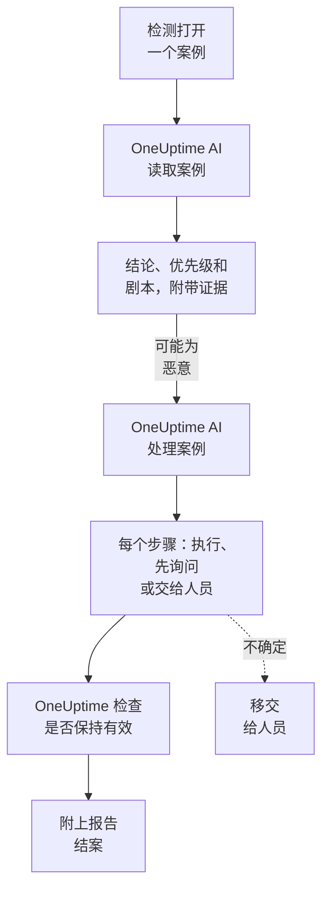

# 安全中的 OneUptime AI

OneUptime AI 会像分析师那样阅读每个安全案例：案例的检测、事件、实体和威胁情报，以及它周围的主机和人员。它会说明发生了什么、看起来是否真实，建议一个优先级和一个剧本，并为每一个结论引用背后的证据。在你允许时，它随后会端到端地处理案例：接手案例、遏制威胁、检查它所做的是否保持有效、让代码得到修复，并附上报告关闭案例。每类步骤是自主执行、先询问人员还是交给人员，由你设置；它的每个步骤都通过人们使用的同一个剧本引擎执行，因此每个步骤都会作为 OneUptime AI 的操作出现在案例的时间线上，并且可以撤销。它还能根据一句话起草检测规则，并在 Ask AI 中回答你关于安全数据的问题。

:::cards
- [研判一个案例](#研判一个案例): OneUptime AI 读取什么、得出什么结论，以及它从不做什么。
- [自动研判新案例](#自动研判新案例): 检测打开的每个案例，在打开时就会被研判。
- [端到端处理案例](#端到端处理案例): 遏制、检查、修复并关闭，由人员批准你选定的步骤。
- [OneUptime AI 可以在案例上做什么](#oneuptime-ai-可以在案例上做什么): 每类步骤可设为关闭、先询问或自主执行。
- [何时将案例移交给人员](#何时将案例移交给人员): 它为何停止，以及谁会收到通知。
- [根据研判运行剧本](#根据研判运行剧本): 对被判读为 可能为恶意 的案例采取行动。
- [起草检测规则](#起草检测规则): 描述要捕获的内容，然后阅读 Sigma 规则。
- [安全页面上的 Ask AI](#安全页面上的-ask-ai): 用日常语言询问案例和事件。
:::

## 工作原理

研判只读取数据。处理案例则会采取行动，但只在你允许的范围内，并且一旦不确定就会把案例移交给人员。两者都使用项目自己的 AI：**启用 AI**、项目的 LLM 提供商、AI 积分和每日 AI 限额。

## 开始之前

- 在 **项目设置 → 人工智能 → AI 功能** 中打开 **启用 AI**。关闭时，安全功能中不会显示任何 OneUptime AI 的内容，也不会运行任何东西。
- 在 **项目设置 → 人工智能 → LLM 提供商** 中有一个 OneUptime AI 可以使用的 LLM 提供商。OneUptime Cloud 已经提供了一个。
- 要开始研判，需要一个能处理安全案例的角色：项目所有者、项目管理员、安全管理员或安全成员。安全查看者可以阅读每次研判，但不能开始研判。请参阅 [角色](/docs/permissions/reference#角色)。

## 研判一个案例

打开一个案例：**OneUptime AI** 卡片位于页面顶部。

| 卡片显示 | 含义 |
| --- | --- |
| **尚未研判** | 还没有运行过研判。点击 **AI 研判** 开始一次。 |
| **正在研判这个案例** | OneUptime AI 正在读取案例。每项检查在运行时都会显示出来。 |
| 一个结论，例如 **可能为恶意** | 研判已完成。点击 **重新研判** 从头重新读取案例。 |
| **研判未完成** | 运行已停止。点击 **重试** 开始新的一次。 |

安全查看者看到的是同一张卡片：**AI 研判** 和 **重试** 保持灰色，旁边有一行说明谁可以开始研判；**重新研判** 和 **设置优先级** 不会提供。

研判会读取：

- 案例本身：标题、优先级、状态、实体和 ATT&CK 映射；
- 案例的检测，最新的在前，并附上每个检测的一个示例事件；
- 关于案例中用户、主机和地址的安全事件与威胁情报；
- 案例中用户、主机和地址的风险，以及本周增加风险的来源；
- OneUptime 中与案例的主机和地址相匹配的主机，以及它们的负责人；
- 案例声明的事件、备注、受保护的实体，以及已启用的剧本。

它还能像事件调查那样读取 OneUptime 的其他部分：日志、链路追踪、指标、主机，以及项目 MCP 服务器的只读工具。

能看到该案例的每个人都会读到它的研判，因此研判只读取他们所有人都能读取的内容。只按所有者或标签读取某类记录的团队、自定义角色或 API 密钥，只有在该 API 密钥或团队中的某人能读取安全案例或审计日志时才会计入。对于他们中没有任何一个只按所有者或标签读取的记录类型，会全部读取；在有人这样读取时，被所有者或标签划分出去的主机、集群、服务或其他记录不会读取，也永远不会被提及或计数。谁能读取安全案例是在每次研判运行时确定的，因此在某人获得该访问权限之前写下的研判，可能会提及对其划分出去的记录。案例本身总会读取，它声明的事件也会读取，除非该事件是私有的。私有事件和警报永远不会读取。

### 它得出什么结论

| 结论 | 含义 | 建议的关闭结论 |
| --- | --- | --- |
| 可能为恶意 | 证据指向恶意或未经授权的活动 | True Positive |
| 可能为良性 | 活动看起来真实但符合预期，例如管理任务或你的团队执行的扫描 | Benign Positive |
| 可能为误报 | 检测似乎误读了正常活动 | False Positive |
| 无法判定 | 证据不足以判断，需要有人查看 | 无 |

这个结论属于 OneUptime AI，从来不是案例的结论：**关闭案例** 会从它建议的结论开始，由人来选择。在结论下方，卡片会显示：

- **建议的优先级**，当案例的优先级不同时，还会显示 **设置优先级**。
- **建议的 Playbook**，以及 **运行 Playbook**，它会以你的身份运行剧本，并经过所需的每一项审批。当该 Playbook 已在此案例上运行时，其运行状态（例如 **等待审批** ）会代替 **运行 Playbook** 显示：该运行位于案例的 **剧本** 中，再运行一次会再次请求同样的审批。
- 报告：发生了什么、结论有多确定、下一步做什么，每个论断后面都有一个类似 C1 的引用。
- **已检查的证据**：研判运行过的每个查询。点击引用会打开对应的查询，展开一个查询会用你的权限、在研判读取的时间范围内重新运行它。
- **询问这个案例**，它会针对这个案例打开 Ask AI。

每个案例列表都会在每个案例标题旁边显示这个结论，并可以用 **AI 研判结论** 按它筛选。

### 它从不做什么

研判不会改变案例的任何内容：状态、优先级、负责人、结论和备注都不会变。它不会运行任何剧本，也不会遏制任何人。它建议的剧本只有在有人运行时，或通过下面介绍的触发器才会运行。对案例采取行动的是处理案例的 OneUptime AI，这是一项单独的设置：请参阅 [端到端处理案例](#端到端处理案例)。

### 为操纵 AI 而写的文本

事件、警报和实体的值来自项目外部，攻击者可以写入它们。OneUptime AI 把它们全部当作数据来读，从不当作指令。当案例数据中的某部分读起来像是给 AI 的指令时，卡片会首先说明这一点，可能为良性 或 可能为误报 的结论会变为 无法判定，这次研判不会启动任何剧本，而且 OneUptime AI 不会处理这个案例：它会把案例移交给人员。

## 自动研判新案例

打开 **产品 → 安全事件 → 人工智能 → 设置**，然后打开 **研判新案例**：之后检测打开的每个案例都会在打开时被研判。开关一切换就会保存。项目所有者和项目管理员可以更改它。

新项目默认打开此选项；之前创建的项目会保持关闭，直到有人打开它。手动打开的案例，以及 **发送测试攻击** 的测试攻击案例，会在有人点击 **AI 研判** 时被研判。

## 端到端处理案例

在同一页面上，打开 **端到端处理案例**：之后 OneUptime AI 会接手每个研判为可能恶意的案例，并在你于 **OneUptime AI 可以在案例上做什么** 中允许的范围内处理它。新项目默认打开此选项；之前创建的项目会保持关闭，直到有人打开它。项目所有者和项目管理员可以更改它。

打开时，人员也可以在单个案例上启动它：案例 **OneUptime AI** 卡片上的 **AI 响应** 会处理被 OneUptime AI 研判判读为 可能为恶意、可能为良性 或 可能为误报 的案例。对于研判为 无法判定、数据读起来像给 AI 的指令，或处于你的最高优先级的案例，不提供此按钮：这些案例归人员处理。它需要一个能处理安全案例的角色。

### 它做什么

OneUptime AI 按最紧急优先的顺序执行案例的 **响应计划**：**确认是否属实**、**遏制威胁**、**修复导致其发生的问题** 和 **关闭案例**。每个步骤是执行、询问人员还是交给人员，取决于 **OneUptime AI 可以在案例上做什么** 中该类步骤所在的行。

| 步骤 | OneUptime AI 做什么 |
| --- | --- |
| 接手案例 | 接手案例，并把优先级提升到研判建议的级别。它从不降低优先级；被它提升到你的最高优先级的案例会交给人员 |
| 排除误报 | 只有当 OneUptime 自己的事实毫无疑问时才标记为完成：该地址不是你的，并且没有人从它登录。否则就把这一步交给人员 |
| 封禁地址 | 通过你的 [封禁列表](/docs/telemetry/security-cases#封禁列表) 封禁 24 小时，然后等待 OneUptime 检查封禁是否有效。如果没有任何地方执行你的封禁列表，就把这一步交给人员 |
| 暂停用户、遏制主机 | 通过你的身份提供商或 EDR，运行你某个剧本中执行此操作的步骤。没有这样的剧本时，就把这一步交给人员 |
| 声明事件 | 总是先询问：事件会呼叫人员 |
| 将案例移至“已遏制” | 在 OneUptime 验证了每个遏制威胁的步骤之后 |
| 修复攻击到达的路由 | 让“用 AI 修复”创建拉取请求，由人员合并。OneUptime 在生产环境中验证修复后会关闭案例；修复只是看起来完成时会询问人员；修复不生效时会继续处理案例 |
| 开启 MFA、审查账户的更改 | 交给人员：没有产品会告诉 OneUptime 它们是否有效 |
| 关闭案例 | 在其他每个步骤都完成且案例的检测已安静 24 小时后，以 True Positive 关闭，并附上 [结案报告](#结案报告) |

案例的检测规则自己添加的步骤，以及 OneUptime 无法执行的任何操作（例如在你的 DNS 过滤器上封禁域名），都会交给人员，并说明原因。

OneUptime AI 执行的每个步骤都会经过剧本引擎，作为案例 **剧本** 页面上的单步运行，触发器为 **OneUptime AI**。因此它和任何人运行的步骤一样，会等待审批、不碰受保护的实体、显示在案例的时间线上、记录在审计日志中，并且可以撤销，时间线也会注明这是 OneUptime AI 的操作。它要询问的步骤会等待人员审批：在案例上、在其 **剧本** 页面上，或在 Slack 或 Microsoft Teams 中一键完成。

### 它在案例上的记录

在研判下方，**OneUptime AI** 卡片会在 **案例处理** 下显示 OneUptime AI 如何处理这个案例：

| 卡片显示 | 含义 |
| --- | --- |
| **OneUptime AI 未在处理这个案例** | **AI 响应** 会接手它。 |
| **正在处理这个案例** | OneUptime AI 正在执行计划。**接管** 会让它停止，案例交由你负责。 |
| **等待人员处理** | 它已请人批准一个步骤，有人答复后就会继续。 |
| **已移交给人员** | 它已停止，并说明原因。 |
| **案例已关闭** | 案例由它或人员关闭。它的 **结案报告** 位于其步骤上方。 |

其下列出它执行、询问或留下的每个步骤，最新的在前，每个都附有原因：**已自主完成：你的设置允许这样做。**、**你的设置要求此操作等待人员批准。**、**OneUptime 无法执行此步骤，因此由人员完成。** 它询问过的步骤带有 **批准** 和 **Decline**；它执行过的步骤会链接到其运行，可在那里撤销。OneUptime 检查的步骤会说明检查发现了什么；它以前在同一规则的案例上执行过的步骤会说明其保持有效的频率：“在 15 个类似案例中有 14 个保持有效。”

### 被判读为良性或误报的案例

对研判判读为 可能为良性 或 可能为误报 的案例点击 **AI 响应**，会在 **关闭案例** 允许时，将其以 Benign Positive 或 False Positive 关闭。关闭后，OneUptime AI 会在 **关闭案例** 同样允许时解除案例造成的封禁，并为案例的规则提议一个针对触发它的值的例外。例外始终等待人员处理：**批准** 会以你的身份添加它。

## OneUptime AI 可以在案例上做什么

在 **产品 → 安全事件 → 人工智能 → 设置** 的 **OneUptime AI 可以在案例上做什么** 下，每类步骤都有自己的一行，选择后立即保存：

- **关闭**：OneUptime AI 将此交给人员处理，并在案例上注明。
- **先询问**：它会附上证据询问人员，并在有人批准后执行。
- **自主执行**：它不经询问就执行，并在案例的时间线上注明。

| 行 | 涵盖 | 新项目的初始设置 |
| --- | --- | --- |
| **处理案例** | 接手案例、提升其优先级、凭证据将步骤标记为完成、将其移至“已遏制” | 自主执行 |
| **封禁地址** | 在你的边缘封禁案例的地址 24 小时 | 先询问 |
| **遏制账户** | 暂停案例的用户或结束其会话 | 先询问 |
| **遏制主机** | 遏制或隔离案例的主机 | 先询问 |
| **修复代码** | 让“用 AI 修复”为攻击到达的路由创建拉取请求 | 自主执行 |
| **关闭案例** | 附上结案报告关闭案例，并在案例以无害结论关闭后解除案例的封禁 | 先询问 |

这些设置在 **端到端处理案例** 打开时生效；关闭时，卡片会说明这一点。项目所有者和项目管理员可以更改它们。

将 **封禁地址**、**遏制账户** 或 **遏制主机** 设为 **自主执行** 需要安全管理员的权限，项目所有者和项目管理员也拥有该权限；OneUptime 会记录是谁、在何时设置的，就像对关闭了审批的剧本步骤那样。**封禁地址** 会先询问：**确认并开启** 是安全管理员的确认，之后该行会显示确认的时间。在安全管理员确认之前，OneUptime AI 在封禁前都会先询问。

无论这些行如何设置，OneUptime AI 都会：

- 从不对受保护的用户、主机或地址执行操作：它会把案例移交给人员；
- 在你的所有案例中每小时最多自主执行 10 个操作，之后把下一个案例移交给人员；
- 封禁最多 24 小时；
- 从不合并代码：每个拉取请求都由人员合并；
- 在声明事件或添加规则例外之前总是先询问；
- 一个案例同一时间只进行一次运行，服务器重启也绝不会丢失正在执行操作的运行。

## 何时将案例移交给人员

OneUptime AI 从不悄无声息地退出。出现以下情况时，它会把案例移交给人员，并在卡片和时间线上说明原因：

- 案例的部分数据读起来像给 AI 的指令；
- 案例处于你的最高优先级；
- 它下一步的操作对象受保护；
- 它在一小时内自主执行操作的次数已达上限；
- 项目或安全案例已关闭 AI、没有 LLM 提供商，或项目的 AI 积分已用完或已达到每日 AI 限额；
- 它的研判无法判断案例是否真实；
- 它执行的步骤不再有效、它启动的步骤未完成，或有人拒绝或撤销了它执行的步骤；
- 它无法判断下一步该做什么，或案例上剩下的事都需要人员来做。

负责该案例的人员会立即收到通知；如果没有人负责，则由接收该优先级案例通知的人员收到：即 **用户设置 → 通知设置** 下的 **OneUptime AI 将安全案例移交给了人员**。安全案例的工作区通知规则会以 **OneUptime AI 移交给人员的案例** 将其发布到自己的 Slack 或 Microsoft Teams 频道。**接管** 移交案例时不会通知任何人，因为按下它的人已经负责该案例。

**AI 响应** 会请 OneUptime AI 从案例当前的状态重新处理案例。

## 结案报告

当 OneUptime AI 关闭案例或请人员关闭时，它会根据案例中的内容而不是研判的措辞撰写结案报告：发生了什么、影响、做了什么、修复了什么以及需要关注什么。该报告就是案例的关闭说明，它会出现在时间线上，卡片会在 **结案报告** 下显示它。当 **关闭案例** 设为 **先询问** 时，案例会等待人员批准关闭，并可先阅读报告。

## 如何衡量

**产品 → 安全事件 → 概览** 会在 OneUptime AI 处理过或询问过至少一个案例后，显示它在最近 30 天如何处理案例：**已由 OneUptime AI 解决**（在它处理的案例中）；**使用 AI 的遏制时间** 和 **使用 AI 的关闭时间**，各自与不使用 AI 的时间并列；以及 **已请求的审批**、人员答复的速度，以及人员撤销了它的多少个步骤。

## 根据研判运行剧本

**触发器** 为 **研判为可能恶意** 的剧本，会在研判把案例判读为 可能为恶意 时，在该案例上运行一次。**适用案例的最低优先级**、**仅限来自以下的检测** 和 **仅限这些检测规则** 会像对任何触发器一样缩小它的范围，它的遏制步骤也会像往常一样等待审批。以下情况它不会运行：

- 研判发现了为操纵 AI 而写的文本之后；
- 在同一个案例上第二次运行，无论这个案例被研判多少次；
- 测试攻击的案例，除非剧本的每一步都留在 OneUptime 之内。

只有在项目的 AI 打开时，新剧本才会提供这个触发器。

## 起草检测规则

在 **检测规则** 上，于 **Sigma 规则（YAML）** 字段下方点击 **AI 起草**，并写下规则要捕获的内容，例如一个 IP 地址在五分钟内有十次登录失败。**起草规则** 会把一条 Sigma 规则放进该字段，并像检查已保存的规则一样检查它。阅读它，按需修改，然后照常保存：在你保存之前，什么都不会被保存。如果字段中已经有一条规则，按钮会显示为 **用 AI 重新起草**，草稿会替换那条规则。

起草需要一个能创建检测规则的角色。

## 安全页面上的 Ask AI

**询问 AI** 知道你在哪个安全页面上。在案例上，它会先读取案例，并提供 **是真实攻击吗？** 这样的问题。在其他安全事件页面上，用日常语言提出的问题会搜索你的安全事件。它还可以把值与威胁情报进行比对，查看某个用户、主机或地址有多活跃，并列出适合某个案例的剧本。

Ask AI 可以给案例添加备注，并在案例上运行剧本，都以你的身份进行，并且每次之前都会先询问。它运行的剧本会像其他剧本一样等待审批。

当案例声明了一个事件时，该事件的 AI 调查也会读取这个案例：检测到了什么、与谁有关，以及 OneUptime AI 的研判。

## 费用和限额

研判是 OneUptime AI 的工作，和事件调查一样。在 OneUptime Cloud 上，它从项目的 AI 积分中支付，并计入项目自己的每日 AI 限额（**项目设置 → 人工智能 → AI 功能** 下的 **每日限制**）。事件和警报的每日限额不适用。一个案例同一时间只有一次研判，AI 日志（**项目设置 → 人工智能 → AI 日志**）会列出它的调用。

当项目的 AI 积分用完或达到每日 AI 限额时，新案例不会被研判：卡片会说明原因，在添加积分或限额重置之后，**AI 研判** 又可以使用。处理案例的 OneUptime AI 读取的是案例自己的计划和检查，而不是询问 LLM，并且会在同样的限额处停止：它会把案例移交给人员，并说明原因。

## 故障排除

:::details 新案例没有被研判
检查 **启用 AI** 是否已打开，以及 **产品 → 安全事件 → 人工智能 → 设置** 下的 **研判新案例** 是否已打开。手动打开的案例和测试攻击的案例，只有在有人请求时才会被研判。打开案例：如果有什么阻止了研判，卡片会说明是什么，以及在哪里修复。
:::

:::details OneUptime AI 没有处理某个案例
检查 **产品 → 安全事件 → 人工智能 → 设置** 下的 **端到端处理案例** 是否已打开。只有当研判将案例判读为 可能为恶意 时，它才会自行接手案例。打开案例：在 **案例处理** 下，卡片会说明它为何没有处理该案例，**AI 响应** 会请它处理。
:::

:::details 虽然“封禁地址”设为“自主执行”，它仍在封禁前询问
**封禁地址** 的 **自主执行** 在安全管理员确认后才生效：该行会显示确认的时间，或显示尚无人确认。受保护的地址或你自己的地址永远不会被封禁：OneUptime AI 会把案例移交给人员。在没有任何地方执行你的封禁列表时，它会把这一步交给人员。
:::

:::details 卡片显示项目的 AI 积分已用完，或已达到每日 AI 限额
项目所有者或拥有 Manage Billing 的人可以在 **项目设置 → 人工智能 → AI 积分** 中添加积分，或在 **项目设置 → 人工智能 → AI 功能** 中提高或取消限额。然后在案例上点击 **AI 研判**。
:::

:::details 卡片显示案例中的文本读起来像给 AI 的指令
案例数据中的一部分，例如某个事件的消息或某个用户名，是为了操纵 AI 而写的。OneUptime AI 把它当作数据来读，并把决定留给了你：在关闭案例之前，请自己阅读检测和证据。
:::

:::details 带 AI 触发器的剧本没有运行
检查剧本是否已启用、研判是否把案例判读为 可能为恶意，以及它的 **适用案例的最低优先级**、**仅限来自以下的检测** 和 **仅限这些检测规则** 设置是否符合这个案例。它在每个案例上只运行一次，而且在研判发现了为操纵 AI 而写的文本之后不会运行。
:::

## 后续步骤

:::cards
- [安全案例与剧本](/docs/telemetry/security-cases): 处理案例、带着结论关闭案例，并构建剧本。
- [AI SRE](/docs/ai/ai-sre): OneUptime AI 如何调查事件和警报，以及它的限额。
- [询问 AI](/docs/ai/ask-ai): 用日常语言询问关于你的项目的问题。
- [LLM 提供商](/docs/ai/llm-provider): 选择 OneUptime AI 使用的模型。
:::
