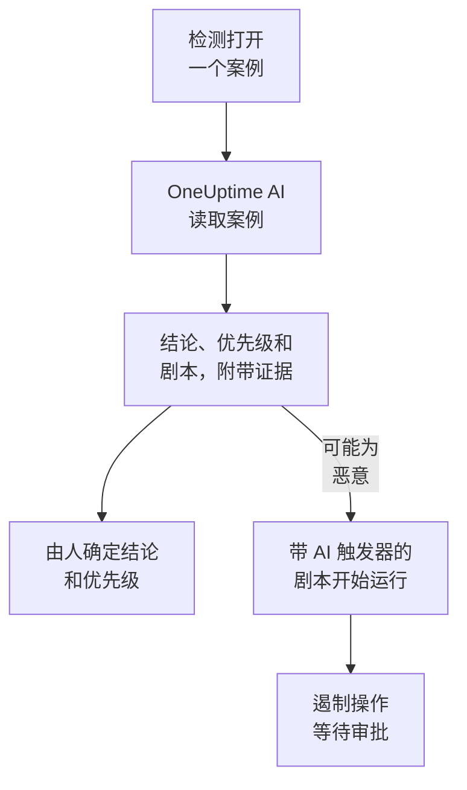

# 安全中的 OneUptime AI

OneUptime AI 会像分析师那样阅读每个安全案例：案例的检测、事件、实体和威胁情报，以及它周围的主机和人员。它会说明发生了什么、看起来是否真实，建议一个优先级和一个剧本，并为每一个结论引用背后的证据。它自己不会改变任何东西：由人来确定结论和优先级，并运行剧本。它还能根据一句话起草检测规则，并在 Ask AI 中回答你关于安全数据的问题。

:::cards
- [研判一个案例](#研判一个案例): OneUptime AI 读取什么、得出什么结论，以及它从不做什么。
- [自动研判新案例](#自动研判新案例): 检测打开的每个案例，在打开时就会被研判。
- [根据研判运行剧本](#根据研判运行剧本): 对被判读为 可能为恶意 的案例采取行动。
- [起草检测规则](#起草检测规则): 描述要捕获的内容，然后阅读 Sigma 规则。
- [安全页面上的 Ask AI](#安全页面上的-ask-ai): 用日常语言询问案例和事件。
:::

## 工作原理

研判只读取数据。它使用项目自己的 AI：**启用 AI**、项目的 LLM 提供商、AI 积分和每日 AI 限额。

## 开始之前

- 在 **项目设置 → 人工智能 → AI Features** 中打开 **启用 AI**。关闭时，安全功能中不会显示任何 OneUptime AI 的内容，也不会运行任何东西。
- 在 **项目设置 → 人工智能 → LLM 提供商** 中有一个 OneUptime AI 可以使用的 LLM 提供商。OneUptime Cloud 已经提供了一个。
- 要开始研判，需要一个能处理安全案例的角色：Project Owner、Project Admin、Security Admin 或 Security Member。Security Viewer 可以阅读每次研判，但不能开始研判。请参阅 [角色](/docs/permissions/reference#角色)。

## 研判一个案例

打开一个案例：**OneUptime AI** 卡片位于页面顶部。

| 卡片显示 | 含义 |
| --- | --- |
| **尚未研判** | 还没有运行过研判。点击 **AI 研判** 开始一次。 |
| **正在研判这个案例** | OneUptime AI 正在读取案例。每项检查在运行时都会显示出来。 |
| 一个结论，例如 **可能为恶意** | 研判已完成。点击 **重新研判** 从头重新读取案例。 |
| **研判未完成** | 运行已停止。点击 **重试** 开始新的一次。 |

研判会读取：

- 案例本身：标题、优先级、状态、实体和 ATT&CK 映射；
- 案例的检测，最新的在前，并附上每个检测的一个示例事件；
- 关于案例中用户、主机和地址的安全事件与威胁情报；
- 案例中用户、主机和地址的风险，以及本周增加风险的来源；
- OneUptime 中与案例的主机和地址相匹配的主机，以及它们的负责人；
- 案例声明的事件、备注、受保护的实体，以及已启用的剧本。

它还能像事件调查那样读取 OneUptime 的其他部分：日志、链路追踪、指标、主机，以及项目 MCP 服务器的只读工具。

### 它得出什么结论

| 结论 | 含义 | 建议的关闭结论 |
| --- | --- | --- |
| 可能为恶意 | 证据指向恶意或未经授权的活动 | True Positive |
| 可能为良性 | 活动看起来真实但符合预期，例如管理任务或你的团队执行的扫描 | Benign Positive |
| 可能为误报 | 检测似乎误读了正常活动 | False Positive |
| 无法判定 | 证据不足以判断，需要有人查看 | 无 |

这个结论属于 OneUptime AI，从来不是案例的结论：**Close Case** 会从它建议的结论开始，由人来选择。在结论下方，卡片会显示：

- **建议的优先级**，当案例的优先级不同时，还会显示 **设置优先级**。
- **建议的 Playbook**，以及 **运行 Playbook**，它会以你的身份运行剧本，并经过所需的每一项审批。
- 报告：发生了什么、结论有多确定、下一步做什么，每个论断后面都有一个类似 C1 的引用。
- **Evidence checked**：研判运行过的每个查询。点击引用会打开对应的查询，展开一个查询会用你的权限、在研判读取的时间范围内重新运行它。
- **询问这个案例**，它会针对这个案例打开 Ask AI。

每个案例列表都会在每个案例标题旁边显示这个结论，并可以用 **AI 研判结论** 按它筛选。

### 它从不做什么

研判不会改变案例的任何内容：状态、优先级、负责人、结论和备注都不会变。它不会运行任何剧本，也不会遏制任何人。它建议的剧本只有在有人运行时，或通过下面介绍的触发器才会运行。

### 为操纵 AI 而写的文本

事件、告警和实体的值来自项目外部，攻击者可以写入它们。OneUptime AI 把它们全部当作数据来读，从不当作指令。当案例数据中的某部分读起来像是给 AI 的指令时，卡片会首先说明这一点，可能为良性 或 可能为误报 的结论会变为 无法判定，而且这次研判不会启动任何剧本。

## 自动研判新案例

打开 **产品 → Security Events → 人工智能 → 设置**，然后打开 **研判新案例**：之后检测打开的每个案例都会在打开时被研判。开关一切换就会保存。Project Owner 和 Project Admin 可以更改它。

新项目默认打开此选项；之前创建的项目会保持关闭，直到有人打开它。手动打开的案例，以及 **发送测试攻击** 的测试攻击案例，会在有人点击 **AI 研判** 时被研判。

## 根据研判运行剧本

**触发器** 为 **研判为可能恶意** 的剧本，会在研判把案例判读为 可能为恶意 时，在该案例上运行一次。**For Cases At Least**、**Only For Detections From** 和 **Only For These Detection Rules** 会像对任何触发器一样缩小它的范围，它的遏制步骤也会像往常一样等待审批。以下情况它不会运行：

- 研判发现了为操纵 AI 而写的文本之后；
- 在同一个案例上第二次运行，无论这个案例被研判多少次；
- 测试攻击的案例，除非剧本的每一步都留在 OneUptime 之内。

只有在项目的 AI 打开时，新剧本才会提供这个触发器。

## 起草检测规则

在 **Detection Rules** 上，于 **Sigma Rule (YAML)** 字段下方点击 **Draft with AI**，并写下规则要捕获的内容，例如一个 IP 地址在五分钟内有十次登录失败。**起草规则** 会把一条 Sigma 规则放进该字段，并像检查已保存的规则一样检查它。阅读它，按需修改，然后照常保存：在你保存之前，什么都不会被保存。如果字段中已经有一条规则，按钮会显示为 **用 AI 重新起草**，草稿会替换那条规则。

起草需要一个能创建检测规则的角色。

## 安全页面上的 Ask AI

**Ask AI** 知道你在哪个安全页面上。在案例上，它会先读取案例，并提供 **是真实攻击吗？** 这样的问题。在其他安全事件页面上，用日常语言提出的问题会搜索你的安全事件。它还可以把值与威胁情报进行比对，查看某个用户、主机或地址有多活跃，并列出适合某个案例的剧本。

Ask AI 可以给案例添加备注，并在案例上运行剧本，都以你的身份进行，并且每次之前都会先询问。它运行的剧本会像其他剧本一样等待审批。

当案例声明了一个事件时，该事件的 AI 调查也会读取这个案例：检测到了什么、与谁有关，以及 OneUptime AI 的研判。

## 费用和限额

研判是 OneUptime AI 的工作，和事件调查一样。在 OneUptime Cloud 上，它从项目的 AI 积分中支付，并计入项目自己的每日 AI 限额（**项目设置 → 人工智能 → AI Features** 下的 **每日限制**）。事件和告警的每日限额不适用。一个案例同一时间只有一次研判，AI 日志（**项目设置 → 人工智能 → AI 日志**）会列出它的调用。

当项目的 AI 积分用完或达到每日 AI 限额时，新案例不会被研判：卡片会说明原因，在添加积分或限额重置之后，**AI 研判** 又可以使用。

## 故障排除

:::details 新案例没有被研判
检查 **启用 AI** 是否已打开，以及 **产品 → Security Events → 人工智能 → 设置** 下的 **研判新案例** 是否已打开。手动打开的案例和测试攻击的案例，只有在有人请求时才会被研判。打开案例：如果有什么阻止了研判，卡片会说明是什么，以及在哪里修复。
:::

:::details 卡片显示项目的 AI 积分已用完，或已达到每日 AI 限额
项目所有者或拥有 Manage Billing 的人可以在 **项目设置 → 人工智能 → AI 积分** 中添加积分，或在 **项目设置 → 人工智能 → AI Features** 中提高或取消限额。然后在案例上点击 **AI 研判**。
:::

:::details 卡片显示案例中的文本读起来像给 AI 的指令
案例数据中的一部分，例如某个事件的消息或某个用户名，是为了操纵 AI 而写的。OneUptime AI 把它当作数据来读，并把决定留给了你：在关闭案例之前，请自己阅读检测和证据。
:::

:::details 带 AI 触发器的剧本没有运行
检查剧本是否已启用、研判是否把案例判读为 可能为恶意，以及它的 **For Cases At Least**、**Only For Detections From** 和 **Only For These Detection Rules** 设置是否符合这个案例。它在每个案例上只运行一次，而且在研判发现了为操纵 AI 而写的文本之后不会运行。
:::

## 后续步骤

:::cards
- [安全案例与剧本](/docs/telemetry/security-cases): 处理案例、带着结论关闭案例，并构建剧本。
- [AI SRE](/docs/ai/ai-sre): OneUptime AI 如何调查事件和告警，以及它的限额。
- [询问 AI](/docs/ai/ask-ai): 用日常语言询问关于你的项目的问题。
- [LLM 提供商](/docs/ai/llm-provider): 选择 OneUptime AI 使用的模型。
:::
