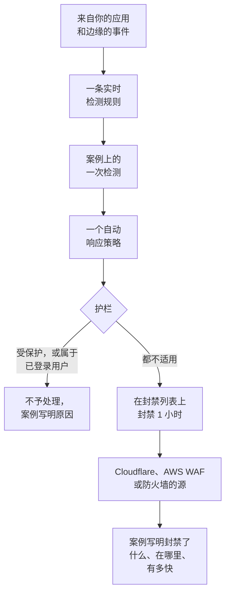

# 自动响应

自动响应策略会在检测产生的那一刻，在任何人分诊案例之前，对发起攻击的地址进行质询或封禁：探测你应用的扫描器，以及逐个尝试密码的机器人，会在首个请求后几分钟内被挡下。每个项目都带有三个现成策略，每个都保持关闭，直到你开启它，并且每个都从为期一周的试运行开始，试运行只记录它本会采取的操作。护栏让策略可以放心地保持开启：它从不处理你自己的地址或你的已登录用户使用的地址，并且当攻击规模超出它应独自处理的范围时，它会停止并呼叫一个人。

:::cards
- [开启策略](#开启策略): 先进行一周试运行，再点一下。
- [护栏](#护栏): 策略从不做的事，以及它何时停止。
- [封禁用时](#封禁用时): 每个策略封禁的速度，显示在它的卡片和案例上。
- [你自己的策略](#你自己的策略): 作用于你选择的技术、规则或威胁情报。
:::

## 工作原理

策略会在检测记录到案例上的那一刻作出处理，也就是规则触发后的几秒钟。它的封禁会像剧本步骤 **封禁地址** 一样进入你的 [封禁列表](/docs/telemetry/security-cases#封禁列表)，并以策略名称作为创建者：执行你的封禁列表的目标会保持它，它会显示在案例的时间线和审计日志中，并且会自行过期。它不需要任何人批准：开启策略的人已经批准了它的封禁。

## 开始之前

- 一个执行你的封禁列表的目标：Cloudflare、AWS WAF，或读取 [封禁列表源](/docs/telemetry/blocklist-feeds) 的防火墙或代理。只要没有任何目标执行它，页面就会提示，策略的封禁在任何地方都不生效。
- 策略的规则读取的事件：你的应用的访问日志或追踪，或者你的边缘事件（例如 Cloudflare 的防火墙事件），以及你的登录记录。请参阅 [安全事件](/docs/telemetry/security-events)。
- 可以开启策略的角色：安全管理员、项目管理员或项目所有者。安全成员和安全查看者可以看到策略及其所做的事。请参阅 [角色](/docs/permissions/reference#角色)。

## 现成策略

| 策略 | 作用于 | 操作 | 首次封禁 |
| --- | --- | --- | --- |
| **扫描器** | Web 扫描和漏洞利用尝试（ATT&CK T1595、T1190）：SQL 注入、路径遍历和 Log4Shell 尝试，以及来自同一地址的大量 Cloudflare 托管规则命中，前提是该地址的所有请求都被拒绝 | 质询 | 1 小时 |
| **密码猜测** | 暴力破解和密码喷洒（ATT&CK T1110）：来自同一地址的登录失败，以及同一地址在登录失败后又登录成功 | 封禁 | 1 小时 |
| **已知恶意地址** | 任何与你的 [威胁情报](/docs/telemetry/threat-intelligence) 所列地址相关的检测 | 封禁 | 24 小时 |

真人能通过质询，脚本和机器人则不能。扫描器只在某个地址的请求都没有到达你的应用时才质询它：请求已经通过的地址，是需要人来处理的案例。

开启扫描器或密码猜测（无论是试运行还是正式开启）后，它所作用的 **规则库** 规则会以实时方式运行，项目中没有的规则会被添加：实时规则在事件到达几秒后触发，而按计划运行的规则会晚几分钟读取。有人关闭的规则保持关闭。一个项目最多实时运行 50 条规则：超出后，规则保留在原计划上，策略卡片会在旁边显示 **按计划运行**。

## 开启策略

:::steps
### 打开自动响应

打开 **产品 → 安全事件 → 剧本 → 自动响应**。每个策略都有自己的卡片：它做什么、显示 **关闭**、**试运行**、**试运行已结束** 或 **开启** 的标签，以及它的开关。

### 开始试运行

切换策略的开关。在 7 天内，它只记录本会采取的操作，不影响任何流量：案例中会写 "Trial run: the Scanners policy would have challenged 35.205.11.131 for 1 hour." 卡片会统计到目前为止的地址数，以及护栏放过了哪些地址。

### 开启它

一周结束后，卡片会说明策略本会做什么，例如 "7 天内它会质询 1,283 个地址。没有地址有已登录用户，也没有地址属于你。要开启吗？"，你的安全负责人也会通过电子邮件收到同样的内容。点击 **开启**：从那时起，策略开始处理。
:::

要在不经过一周试运行的情况下开启策略，请打开卡片上的 **更多设置**，然后点击 **不经试运行直接开启**。它的护栏依然有效。再次切换开关即可关闭策略；在完成一整周试运行后再次开启时，它会立即处理。

## 护栏

- **从不处理你自己的地址或受保护的地址。** **受保护的实体** 中的条目，以及 OneUptime 自动保护的一切：你的主机、云资源和探测器、不在互联网上的地址范围，以及你的应用前面的边缘。请参阅 [封禁列表](/docs/telemetry/security-cases#封禁列表)。
- **从不处理已登录用户在最近 30 天内用过的地址。** 办公室的网络、客户的代理或某人的家：OneUptime 会在你的身份提供商的登录记录中，以及你的应用为已登录用户处理的请求（追踪或日志中带有用户 ID 的请求）中查找该地址。如果它无法核实某个地址，比如这些事件无法读取，或者你的脱敏规则以它无法匹配的方式隐藏了地址，就会把该地址交给人来处理。
- **对再次出现的地址封禁更久。** 首次封禁持续 1 小时，30 天内再次被封禁的地址依次为 24 小时和 7 天。已知恶意地址从 24 小时开始。
- **每小时最多 50 次自动封禁。** 超出后，你的策略会停止封禁并呼叫你的安全负责人：如此规模的攻击需要人来处理。在此期间，页面会显示提示。
- **有疑问时撤销。** 如果在策略封禁的地址上看到已登录用户，策略会解除封禁并通知你的安全负责人。

你的安全负责人是项目的安全管理员；如果没有，则是项目所有者。护栏放过的每个地址都会连同原因记录在它的案例中。

## 目标无法质询时

Cloudflare 和 AWS WAF 可以质询。读取封禁列表源的防火墙不能质询，因此在那里，策略的质询会变成相同时长的封禁，策略卡片和案例都会说明，例如 "FortiGate feed cannot challenge, so it blocks the address there for the same time." 你自己设置的质询永远不会变成封禁。

## 封禁用时

封禁用时从地址的首个请求（其检测中最早的事件）开始，到封禁在你的边缘生效为止。每个策略的卡片会按天显示最近 30 天的第 50 和第 95 百分位数。被自动响应封禁的案例会在其 **概览** 的 **遏制用时** 下注明，例如 "首个请求后 41秒 自动封禁"，它的时间线会写明封禁了什么、在哪里、有多快："OneUptime challenged 35.205.11.131 at Cloudflare for 1 hour (Scanners policy), 41 seconds after its first request." 案例 **响应计划** 中该地址的步骤即告完成，旁边有 **解除**。

## 你自己的策略

点击现成策略下方的 **创建策略**。你自己的策略需要一个 **名称** 以及它作用的对象：

| 字段 | 作用 |
| --- | --- |
| **ATT&CK 技术** | 检测必须带有的技术，用逗号分隔，例如 `T1110, T1190`。技术包含其子技术。 |
| **操作** | 位于 **更多字段**：**封禁** 或 **质询**。 |
| **首次封禁时长** | 位于 **更多字段**：1 小时、24 小时或 7 天。再次出现的地址会被封禁更久。 |
| **检测规则** | 位于 **更多字段**：或由这些规则之一产生的检测。 |
| **仅限威胁情报所列的地址** | 位于 **更多字段**：只作用于威胁情报所列的地址。单独使用时，作用于与这类地址相关的任何检测。 |
| **仅限所有请求都被拒绝期间** | 位于 **更多字段**：只在该地址的请求都没有到达你的应用时才处理。 |

你自己的策略初始为关闭，像现成策略一样先进行一周试运行，并具有相同的护栏。**编辑策略** 和 **删除策略** 位于它的卡片上；删除后，它的封禁会留在你的封禁列表中，直到过期。

## 故障排除

:::details 策略已开启，但没有封禁某个地址
查看案例的时间线：放过某个地址的策略会写明原因，例如已登录用户用过该地址。请确认有目标在执行你的封禁列表，并且策略卡片上的规则显示 **实时**。
:::

:::details 页面提示本小时的自动封禁已用完
你的策略在最近一小时内进行了 50 次自动封禁，并呼叫了你的安全负责人。随着这一小时的封禁变旧，它们会重新开始。查看这次攻击的案例，如果攻击来自同一网络，请在 **封禁列表** 中封禁一个地址范围。
:::

## 后续步骤

:::cards
- [安全案例和剧本](/docs/telemetry/security-cases): 处理你的策略所作用的案例，并手动封禁。
- [封禁列表源](/docs/telemetry/blocklist-feeds): 在防火墙或代理上执行你的封禁列表。
- [威胁情报](/docs/telemetry/threat-intelligence): 已知恶意地址所作用的源。
:::
