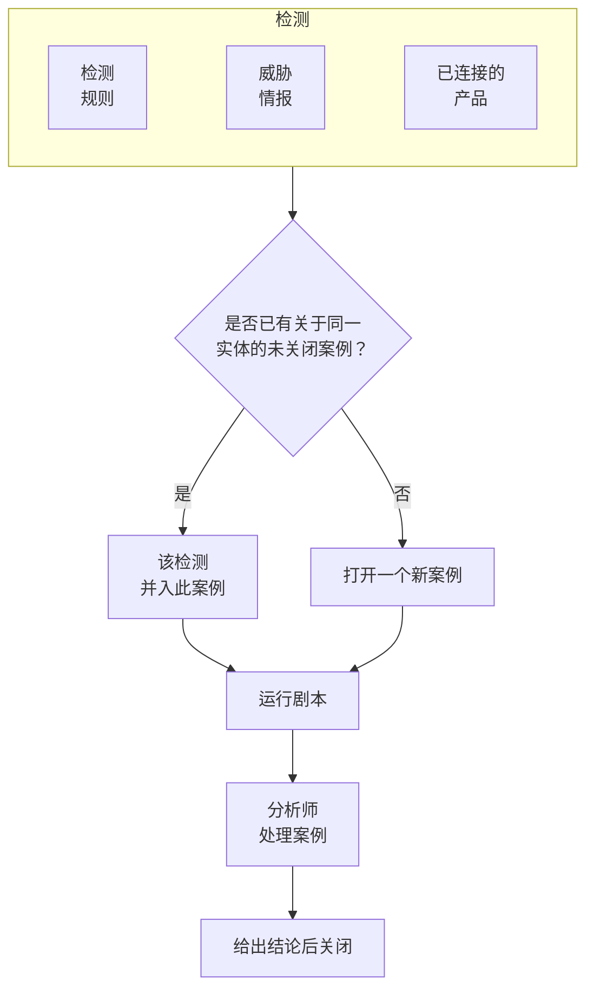

# 安全案例与剧本(SOAR)

Security Events 会把检测规则、威胁情报和已连接的安全产品发现的问题转化为案例：每件值得调查的事对应一个案例，关于同一用户、主机或地址的所有检测都会归入其中。分析师在队列中处理案例，剧本则自动或一键对案例做出响应。

:::cards
- [案例从何而来](#案例从何而来): 检测规则、威胁情报、已连接的产品、实体风险和人员。
- [处理案例](#处理案例): 分配案例、调查相关实体，并在给出结论后关闭。
- [案例优先级和状态](#案例优先级和状态): 重命名、改颜色、调整顺序，并添加你自己的。
- [通知](#通知): 新案例、分配以及等待审批的步骤会通知谁。
- [剧本](#剧本): 在案例上运行的步骤，关键步骤需要审批。
- [概览](#概览): 当下需要有人处理的事项，以及案例的处理速度。
:::

## 工作原理

打开 **产品 → Security Events → 安全案例 → 未结案例** 查看队列。**分配给我**、**无人认领**、**已关闭案例** 和 **全部案例** 是旁边各自独立的页面，分别列出其名称所指的案例。

## 开始之前

案例和剧本遵循三个 Security 角色的权限。Project Owner 和 Project Admin 可以执行所有操作。

| 角色 | 能做什么 |
| --- | --- |
| Security Admin | 一切操作，包括删除案例和设置剧本 |
| Security Member | 打开、分配、修改和关闭案例，撰写备注，运行剧本，以及批准或拒绝剧本的步骤 |
| Security Viewer | 读取案例、检测、备注、剧本及其运行记录 |

其中每一项权限也都可以单独授予，从创建案例到批准剧本的步骤都是如此；请参阅 [权限参考](/docs/permissions/reference)。

## 案例从何而来

| 来源 | 何时打开案例 | 停用方式 |
| --- | --- | --- |
| 检测规则 | 规则匹配时 | 规则的 **匹配时** 步骤中的 **匹配时打开案例** |
| 威胁情报 | 某个事件提到已知指标时 | 情报源的 **匹配时** 步骤中的 **匹配时打开案例** |
| 已连接的产品 | 导入的产品自身警报达到或高于连接的阈值时 | 在连接的 **轮询** 步骤中，把 **Open Cases From** 设为 **从未** |
| 实体风险 | 用户、主机或地址的风险达到项目阈值时 | **设置 → 风险评分** 中的 **风险案例** |
| 人员 | 有人从 **安全案例** 中打开案例，或在事件面板中使用 **打开案例** 时 | 无 |

所有来源默认都会打开案例，但实体风险例外：在它出现之前创建的项目需要先打开 **风险案例**（[实体风险](/docs/telemetry/security-entity-risk)）。除非你选择其他级别，否则连接会为 **高及以上** 的警报打开案例；低于该级别的警报仍会作为事件导入。

### 检测如何分组

每个检测都关于某个实体：即其规则分组所依据的值，例如暴力破解规则中的 IP 地址，或威胁情报匹配所提到的指标。没有实体的检测会单独存在，不与其他检测合并。

- 如果已有关于该实体的未关闭案例，检测就会并入其中。案例的实体和 ATT&CK 映射随之扩充，其优先级会提升到该检测的优先级，但绝不会降低。
- 如果没有这样的案例，就会打开一个新案例，以该检测命名，优先级与该检测相同。
- 再次触发的检测会在它所在的行上累加计数，而不是新增一行。

案例的优先级由检测的严重程度决定，取项目中该级别的内置优先级，无论你把它改成什么名字：

| 严重程度 | 优先级 |
| --- | --- |
| Critical 或 Fatal | Critical |
| High | High |
| Medium、Unknown 或 Other | Medium |
| Low | Low |
| Informational | Informational |

## 处理案例

新项目的案例会依次经历四种状态，你可以重命名它们并添加自己的状态（参见 [案例优先级和状态](#案例优先级和状态)）。案例可以跳过某个状态，例如直接从 New 关闭的误报，也可以被重新打开。

| 状态 | 含义 |
| --- | --- |
| New | 还没有人查看过 |
| Investigating | 有人正在查明发生了什么 |
| Contained | 威胁已无法再造成危害，但仍有清理工作要做 |
| Closed | 已处理完毕，并对其性质给出了结论 |

案例和事件一样有自己的侧边菜单，案例的每个部分都有自己的页面：

| 侧边菜单部分 | 页面 |
| --- | --- |
| **概览** | **概览**、**时间线** |
| **调查** | **经过**、**检测**、**实体**、**关联信号**、**剧本** |
| **备注** | **私人备注** |
| **高级** | **审计日志**、**删除案例**——点击 **高级** 之前保持折叠 |

每个页面顶部都保留案例的页眉：编号、优先级、状态和标题，**分配给我**、**运行剧本**、**声明事件** 和 **关闭案例** 按钮，以及它们旁边 ⋯ 菜单中的 **设置优先级**、**分配给其他人**、**更改状态**、**编辑案例** 和 **删除案例**。因此可以在案例的任何页面上处理它，而指向案例的链接仍会打开它的 **概览**。

- **概览**：案例的描述、标签和状态步骤，由谁负责、因何打开，以及它的数字：有多少条检测、已打开多久，以及确认和遏制分别用了多长时间。
- **OneUptime AI**（位于 **概览**）：OneUptime AI 对案例的研判、它建议的优先级和剧本，以及背后的证据。请参阅 [安全中的 OneUptime AI](/docs/telemetry/security-ai)。
- **影响**（位于 **概览**）：案例使哪些对象面临风险：OneUptime 是否看到其记录被从互联网访问、它们的所有者，以及它们最近发生了什么变更。展开后可以查看每条记录调用了什么、被什么调用，监视它的监控和状态页，以及案例中的地址与哪些机器通信过。
- **MITRE ATT&CK**（位于 **概览**）：案例的检测所映射的战术和技术，每一项都链接到 attack.mitre.org 上的对应页面。
- **时间线**：案例上发生过的一切，以及操作人。
- **经过**：在整个 OneUptime 中按顺序发生了什么：每次检测及其背后的安全事件、请求到达了哪一步、抛出的异常、案例涉及的记录上的变更、在这些记录上引发的事件和告警，以及团队采取的行动。扫描器的大量探测合为一行，每一行都能打开它提到的内容，例如请求的追踪或异常。
- **检测**：触发后打开或并入该案例的检测、触发次数，以及最新的匹配事件。
- **实体**：案例涉及的用户、主机和地址，以及它们最近 7 天在你所有安全事件中的活动。每个实体都可以在 **关联分析** 中打开。
- **关联信号**：案例所指的主机、集群、服务和成员（按 OneUptime 所知），以及其检测前后各自发生的情况：它们的日志、追踪和指标，其上未解决的内容和发生的变更。请参阅[关联信号](/docs/telemetry/security-connected-signals)。
- **剧本**：每个剧本在该案例上逐步做了什么，以及等待审批的步骤。有运行在等待时，菜单会在 **剧本** 旁显示等待的数量。
- **私人备注**：团队就该案例写下的内容。
- **审计日志**：对案例的每一次更改，以及更改人。请参阅 [审计日志](/docs/configuration/audit-logs)。
- **删除案例**：永久删除案例及其检测、备注、时间线和剧本运行记录。如需保留记录，请改为给出结论后结案。

### 在队列中处理案例

无需打开案例即可处理它。在队列的列表中，案例所在行的 ⋯ 菜单里有 **分配给我**、**分配给其他人**、**更改状态** 和 **更改优先级**。要同时处理多个案例，请选中它们，然后在 **批量操作** 中使用相同的操作：它会说明哪些案例已更改、哪些保持不变以及原因。

- 要把案例交给其他人，请使用 **分配给其他人**，并选择一个人或一个团队。团队的案例会留在 **无人认领** 中，直到团队中有人认领。
- 关闭案例的状态会像 **关闭案例** 一样要求填写结论和结案备注。
- 已关闭的案例不会分配给任何人。要再次处理它，请用 **更改状态** 重新打开。

### 关闭案例

**关闭案例** 会要求填写结论和一条可选的结案备注：

| 结论 | 含义 |
| --- | --- |
| True Positive | 确实发生了恶意或未经授权的活动 |
| Benign Positive | 活动真实存在但符合预期，例如渗透测试或管理任务 |
| False Positive | 检测有误：规则或数据误读了正常活动 |
| Undetermined | 没有足够的信息来判断 |

概览页面会统计这些结论。如果某条规则的案例总是以 False Positive 关闭，这条规则就需要调优了。

从 Google SecOps 警报打开的案例，如果其连接打开了 **案例关闭时关闭其警报**，也会在 Google SecOps 中关闭这些警报，并附上结论和关闭说明：参见 [Google SecOps](/docs/integrations/google-secops#案例关闭时关闭其警报)。

### 声明事件

**声明事件** 会以你选择的严重程度为该案例打开一个 OneUptime 事件（incident），并在两者之间建立双向链接：事件的描述中会写明该案例，案例的页眉会链接到该事件。之后由值班、状态页面和事后分析接手。此操作需要一个既能处理案例、又能创建事件的角色。

## 案例优先级和状态

每个项目都有自己的案例优先级和状态，位于 **产品 → Security Events → 设置 → 案例优先级** 和 **案例状态**。可以重命名、改颜色、拖动调整顺序，也可以添加自己的，例如一个“Triage”状态，或一个高于 **严重** 的“Emergency”优先级。新名称会立即出现在所有地方：队列、案例页面和概览、通知、Slack 和 Microsoft Teams，以及剧本消息中。

其中一些是内置的，因为 OneUptime 会读取它们的含义。它们可以重命名和改颜色，但不能删除或归档，并且保持各自的顺序：

| 内置 | OneUptime 用它做什么 |
| --- | --- |
| 新建状态 | 新案例从这个状态开始 |
| 已确认状态 | 到达它时记录案例的确认时间，**重新打开** 会把已关闭的案例移回这里 |
| 已遏制状态 | 到达它时记录案例的遏制时间 |
| 已关闭状态 | **关闭案例** 会把案例移到这里，并附上结论 |
| 严重、High、Medium、Low 和信息优先级 | 检测会以其严重程度对应的优先级打开案例，有人手动打开的案例从 Medium 开始 |

- 状态的位置决定了其中的案例被视为什么，**视为** 列会显示出来：从已确认状态往下视为已确认，从已遏制状态往下视为已遏制，从已关闭状态往下视为已关闭。你添加的状态会放在已关闭状态的正上方；把案例移到会关闭它的状态时，会先要求给出结论。
- 优先级的排名就是它的紧急程度，最紧急的在最前：**适用案例的最低优先级**、通知选项以及 Slack 和 Microsoft Teams 规则都按这个顺序读取。你添加的优先级会放在最后，**检测严重程度** 列显示哪些检测会以哪个内置优先级打开案例。

要停用你自己的某个状态或优先级，请在它所在行使用 **归档**。之后没有人能再选择它，API、Terraform 和 MCP 也会拒绝它，但已经使用它的案例会保留它，你也仍然可以按它筛选。已归档的值列在表格下方折叠的 **已归档的案例状态** 或 **已归档的案例优先级** 部分，在那里用 **取消归档** 即可恢复。只要还有案例使用该值，或有剧本从该优先级起运行，**删除** 就会被拒绝。

## 通知

OneUptime 会就案例上的三件事通知相关人员。无需任何人做任何设置：一个只点击了 **开启推荐设置** 的项目，也会通过电子邮件和推送收到其 High 和 Critical 案例的通知。

| 通知 | 通知谁 | 默认方式 |
| --- | --- | --- |
| 新的安全案例 | 所有能查看项目案例的人：当案例以他们所选的优先级或更高优先级打开，或提升到该优先级或更高时 | 电子邮件和推送，针对 High 和 Critical 案例 |
| 分配给我的安全案例 | 案例被分配给的人，以及案例被分配给的团队的成员 | 电子邮件和推送 |
| 等待我审批的剧本步骤 | 案例相关人员中能够批准该步骤的人：案例被分配给的人及其团队的成员。如果他们都无法批准，则通知项目中所有能够批准的人 | 电子邮件和推送 |

- 只有能查看案例的人才会收到相关通知：Project Owner、Project Admin，以及 Security Admin、Security Member 和 Security Viewer 角色。仅限于某些标签的角色，只会收到带有这些标签的案例的通知。
- 没有人会因为自己做的事而收到通知：手动打开案例、分配案例或启动运行的人不会收到相应通知。
- 每个人对一个案例只会收到一次通知。一个以 Medium 打开、之后提升到 Critical 的案例，会在提升时通知选择了 High 或 Critical 的人，而不会再次通知选择了 Medium 的人，因为他们在案例打开时已经收到过通知。
- 通过 **发送测试攻击** 发起的测试攻击会打开一个不通知任何人的案例。
- Critical 案例和等待审批的步骤会立即发送，绝不会被压在 [邮件汇总](/docs/emails/notification-rollup) 中延后发送。
- 案例的 **时间线** 会显示通知了谁以及何时通知。

### 选择你收到的通知

每个人都可以在 **用户设置 → 通知设置 → 安全** 下自行选择：每种通知的渠道（电子邮件、短信、电话、推送、Telegram、Slack、Microsoft Teams 或 Webhook），以及在 **新的安全案例** 下选择会通知自己的优先级：

| 选项 | 通知哪些优先级的案例 |
| --- | --- |
| 仅严重 | Critical |
| 高及以上 | Critical 和 High（默认） |
| 中及以上 | Critical、High 和 Medium |
| 低及以上 | 除 Informational 以外的所有优先级 |
| 所有案例 | 所有优先级 |

这些选项随项目的案例优先级而定，并使用它们自己的名称：上面是新项目的选项。

安全案例不会发送 WhatsApp 消息。推送通知会在 OneUptime On-Call 应用（1.7.0 或更高版本）中打开该案例，你可以在其中批准或拒绝等待审批的剧本步骤、接手案例并关闭它。其中的链接会在浏览器中打开该案例。

### 发布到 Slack 和 Microsoft Teams 频道

要发布到频道，请在 **产品 → Security Events → 工作区 → Slack**（或 **Microsoft Teams**）下添加一条规则。两者都未连接时，该区域只有一项：**连接 Slack 或 Teams**。规则会指定要发布到的频道（在 Microsoft Teams 中还包括聊天），并且可以按需指定它针对哪些案例：

| 条件 | 匹配内容 |
| --- | --- |
| 安全案例优先级 | 项目的某个案例优先级，例如严重或 High |
| 安全案例标题、安全案例描述 | 案例标题或描述中包含的文本，或其开头、结尾的文本 |
| 安全案例状态 | 项目的某个案例状态，例如新增或已关闭 |
| 安全案例来源 | Detection Rule、Threat Intel、Connected Product、实体风险 或 Manual |
| 安全案例标签 | 案例的标签 |

这三种通知都会发布到案例当时所匹配的每条规则的频道。一条 **安全案例优先级** 包含 **严重** 和 **高** 中任意一项的规则，会在 High 和 Critical 案例打开时发布它们，并在 Medium 案例提升到 High 时发布它。安全案例永远不会拥有专属频道。

## 剧本

剧本是在案例上运行的一系列步骤。请在 **产品 → Security Events → 剧本** 下从模板或空白创建剧本，然后在它的页面上添加步骤。没有剧本的项目会看到模板，而不是空列表；有了剧本之后，列表上的 **从模板创建** 会打开这些模板，项目已有的模板会标为 **已添加**。

### 剧本何时运行

| 触发方式 | 运行时机 |
| --- | --- |
| Case Opened | 案例打开时运行一次 |
| Detection Added | 每当有新的检测并入未关闭的案例时 |
| 研判为可能恶意 | 当 OneUptime AI 的研判把案例判读为 可能为恶意 时，运行一次 |
| Manual | 仅当有人从案例中运行它时 |

任何已启用的剧本也可以通过案例上的 **运行剧本** 手动运行。自动运行的剧本可以用以下设置缩小范围：

- **适用案例的最低优先级**：只针对该优先级或更高优先级的案例。
- **仅限来自以下的检测**：只在案例背后的检测来自该来源时运行。
- **仅限这些检测规则**：只在该检测来自这些规则之一时运行。

已停用的剧本既不会自动运行，也不能手动运行。

### 步骤

| 类别 | 步骤 | 作用 |
| --- | --- | --- |
| 案例 | Assign the case | 把案例分配给某个人、某个团队或两者 |
| 案例 | Set the priority | 提高或降低案例的优先级 |
| 案例 | Set the status | 把案例移到项目的另一个状态；如果该状态会关闭案例，则附上你选择的结论 |
| 案例 | Add a note | 在案例上写一条备注，例如给分析师的检查清单 |
| 案例 | Add labels | 为案例添加标签 |
| 调查 | Check entities against threat intel | 在你的威胁情报中查找每个实体，匹配时可以提高优先级 |
| 调查 | Look up entity activity | 统计每个实体在最近一段时间内的安全事件，并记录到案例上 |
| 调查 | Preserve the evidence | 保留案例背后请求的会话回放，并把它们的追踪和异常记录到案例上 |
| 通知 | Email people | 通过电子邮件向用户和团队发送案例摘要及其链接 |
| 通知 | Post to Slack | 把案例摘要发布到某个 Slack 频道 |
| 通知 | Post to Microsoft Teams | 把案例摘要发布到某个 Microsoft Teams 频道 |
| 通知 | Post a status page announcement | 把你撰写的公告发布到你选择的状态页 |
| 升级 | Page on-call | 运行一个值班策略 |
| 升级 | Declare an incident | 打开一个与案例关联的 OneUptime 事件 |
| 遏制 | Suspend the user in Okta | 在 Okta 中暂停案例涉及的用户 |
| 遏制 | End the user's Okta sessions | 让案例涉及的用户退出 Okta 登录，并吊销其令牌 |
| 遏制 | Contain the host in CrowdStrike | 通过 CrowdStrike Falcon 对案例涉及的主机进行网络遏制 |
| 遏制 | Isolate the device in Microsoft Defender | 通过 Microsoft Defender for Endpoint 隔离案例涉及的主机 |
| 遏制 | Unsuspend the user in Okta | 在 Okta 中取消暂停案例涉及的用户 |
| 遏制 | Lift containment in CrowdStrike | 解除 CrowdStrike Falcon 对案例涉及的主机施加的网络遏制 |
| 遏制 | Release the device in Microsoft Defender | 在 Microsoft Defender for Endpoint 中将案例涉及的主机解除隔离 |
| 自动化 | Send a webhook | 把案例以 JSON 格式 POST 到某个 URL |
| 自动化 | Run a workflow | 以案例作为输入，启动一个 OneUptime 工作流 |
| 自动化 | Run a runbook | 以案例作为输入，启动你的某个 OneUptime 运行手册 |
| 自动化 | Fix the code with AI | 请 OneUptime AI 提交一个拉取请求，修复案例的请求所引发的异常 |

一个剧本最多有 25 个步骤。它们按顺序运行，每个步骤在前一个完成后才开始。每个步骤还可以设置：

- **需要批准**：在运行到该步骤之前暂停，直到有人在案例上批准它。切断某人访问的四个步骤始终如此，除非 Security Admin 将其关闭。**Run a runbook** 和 **Post a status page announcement** 默认开启批准，因为前者会在你的系统上执行命令，后者会面向你的客户发布内容；添加该步骤的人可以将其关闭。
- **仅在威胁情报匹配时**：除非本次运行中之前的 **用威胁情报检查实体** 步骤发现了已知指标，否则跳过该步骤。
- **失败时继续**：即使该步骤失败，也继续运行下一个步骤。关闭此项时，失败的步骤会停止本次运行。

### 通过 OneUptime 响应

以下四个步骤通过 OneUptime 的其他部分执行，而不是通过已连接的产品：

- **Run a runbook** 以案例作为输入，启动你的某个[运行手册](/docs/runbooks/index)，Bash 步骤会把这些输入读作环境变量（参见[调用 Webhook](/docs/runbooks/triggers#调用-webhook)）。`ONEUPTIME_INPUT_IP`、`ONEUPTIME_INPUT_USER` 和 `ONEUPTIME_INPUT_HOST` 是案例所涉及的地址、用户和主机，按与遏制类步骤相同的规则选出，案例不涉及其中任何一个时为空。`ONEUPTIME_INPUT_IPS`、`ONEUPTIME_INPUT_USERS` 和 `ONEUPTIME_INPUT_HOSTS` 以 JSON 列出案例提到的所有对象，`ONEUPTIME_INPUT_CASE_NUMBER`、`ONEUPTIME_INPUT_CASE_TITLE` 和 `ONEUPTIME_INPUT_CASE_URL` 说明是哪个案例。受保护的用户或主机永远不会在其中。运行手册的运行记录会注明它是由 **Security playbook** 为该案例启动的。
- **Preserve the evidence** 将案例背后请求的会话回放保留到其保留期之后，并在案例上写一条备注，链接每个请求的追踪、每个回放和每个异常。日志和追踪的保存时间不能超过项目保留遥测数据的时间，因此请在此之前导出你需要的内容。
- **Post a status page announcement** 按你撰写的原样，把你写的内容发布到你选择的状态页上。不会添加案例中的任何内容。只有开启 **通知订阅者** 时，才会通知这些状态页的订阅者。
- **Fix the code with AI** 针对案例的请求所引发的每个异常（最多三个），请 OneUptime AI 提交一个修复它的拉取请求。该步骤需要开启 OneUptime AI、一个包含代码并通过 GitHub App 连接的代码仓库，以及一个运行器。缺少这些时，该步骤会被跳过并说明缺少什么。

### 遏制

遏制类步骤通过与该产品的 [安全事件连接](/docs/telemetry/security-events#连接安全产品) 执行操作，这个连接需要的不只是读取权限：

| 步骤 | 连接 | 所需权限 |
| --- | --- | --- |
| Suspend the user in Okta、End the user's Okta sessions、Unsuspend the user in Okta | Okta System Log | 一个有权管理用户的 API 令牌 |
| Contain the host in CrowdStrike、Lift containment in CrowdStrike | CrowdStrike Falcon | 一个具有 Hosts 写入范围的 API 客户端 |
| Isolate the device in Microsoft Defender、Release the device in Microsoft Defender | Microsoft Defender XDR | 一个具有 Machine.Isolate 权限的应用 |

遏制类步骤只作用于案例涉及的用户或主机，绝不会作用于案例提到的所有用户或主机：

- 案例中某个检测分组所依据的值，例如“不可能的旅行”规则分组所依据的账户，或已连接产品的警报中提到的主机。
- 案例中被你的威胁情报列为指标的用户或主机。

按地址分组的案例，例如针对你的 VPN 的暴力破解，并不涉及以上任何一种：它的遏制类步骤会被跳过，它尝试过的账户和它攻击的网关都不会被触及。一个步骤最多作用于 10 个用户或主机。它会按名称在产品中查找每一个，并在运行上说明对每一个做了什么：已完成、早已完成、未找到、被拒绝或受保护。

#### 受保护的实体

菜单中 **剧本** 下的 **受保护的实体** 列出任何剧本都不会遏制的用户和主机，例如紧急访问账户、域控制器和 VPN 网关。值的匹配不区分大小写，`*` 代表任意字符序列：`svc-*` 会保护所有服务账户。步骤会把受保护的用户或主机报告为受保护，并且不会触及它。这个列表由 Security Admin 维护。

#### 审批

切断某人访问的四个步骤会等待审批。只有 Security Admin 可以为其中某个步骤关闭 **需要批准**，OneUptime 会记录是谁关闭的。审批时会在 **作用对象** 下列出该步骤将要作用的用户或主机，每一个都已勾选：取消勾选该步骤不应触及的那些。受保护的用户或主机不会列为可选项。发起运行的人不能批准它的步骤：要由其他人批准，不过发起人仍然可以拒绝该步骤。

#### 撤销

撤销类步骤和它们所撤销的步骤一样，作用于案例涉及的用户或主机。运行停止后，被遏制的用户或主机在其步骤上还会有一个专属按钮：**解除暂停**、**解除遏制** 或 **释放**。已结束的 Okta 会话无法撤销。每次撤销都会记录在案例的时间线上和项目的审计日志中。

### 消息

备注、电子邮件、Slack 帖子和 Teams 帖子都可以使用案例的值：

| 占位符 | 替换为 |
| --- | --- |
| `{{case.number}}` | 案例编号，例如 CASE-42 |
| `{{case.title}}` | 案例标题 |
| `{{case.priority}}` | 案例的优先级，使用你项目中的名称，例如 High |
| `{{case.status}}` | 案例的状态，使用你项目中的名称，例如 Investigating |
| `{{case.assignee}}` | 案例分配给了谁 |
| `{{case.url}}` | 指向 OneUptime 中该案例的链接 |
| `{{case.entities}}` | 案例涉及的用户、主机和地址 |
| `{{case.detections}}` | 案例包含的检测数量 |

没有自定义消息的电子邮件或帖子会发送案例摘要。

### 运行与审批

每次运行都会逐步列在其案例上，以及 **产品 → Security Events → 剧本 → 剧本运行记录** 下：

| 运行状态 | 含义 |
| --- | --- |
| Queued | 等待工作进程 |
| Running | 正在运行其步骤 |
| Waiting for Approval | 停在一个需要审批的步骤之前 |
| Succeeded | 每个步骤都已运行或被跳过 |
| Failed | 某个步骤失败，运行已停止 |
| Cancelled | 有人取消了它，或拒绝了某个步骤 |

等待审批的步骤会在运行上显示 **批准** 和 **拒绝**，并可附上一条可选的评论。批准后，运行从该步骤继续；拒绝则会结束运行。审批决定、决定人及其评论都会记录在该步骤上、案例的时间线上以及项目的审计日志中。菜单中 **剧本** 下的 **待审批** 列出等待决定的运行并显示其数量；**剧本运行记录** 列出所有运行。在 **剧本运行记录**、剧本的页面和案例的 **剧本** 上，每次运行都是一行，说明它进行到了哪里，或停在了哪个步骤；**显示步骤** 会展开它的步骤。等待审批的运行和案例最新的运行会自动展开。

如果某次运行失去了工作进程的响应（例如在重启之后），它会被重新接手：排队中的运行会在 2 分钟后重新排队，30 分钟没有任何动静的运行会被判定为失败。

## 概览

**产品 → Security Events → 概览** 是打开该产品时进入的页面：

- 分配给你的未关闭案例、尚无人接手的未关闭案例，以及等待审批的剧本步骤；每个数字都会打开列出它们的页面。
- **平均确认时间**、**平均遏制时间** 和 **平均关闭时间**，基于最近 30 天内打开的案例：分别是从案例打开到有人接手（分配给某个人，或将其移到视为已确认的状态）、到视为已遏制的状态、到视为已关闭的状态所用的时间。仍在等待中的案例不计入平均值。
- 30 天内每天打开的案例数（按优先级划分），以及 14 天内每天产生的检测数（按来源划分）。
- 按优先级和状态划分的未关闭案例、被最多检测结果提及的实体、触发最多的检测、案例背后的 ATT&CK 战术，以及最近 30 天的结论。

在这些内容上方，一个横条显示安全的设置情况：来源、检测、案例和剧本，各自带有数字。还没有完成设置的项目会在那里看到 **开启推荐设置** 和 **发送测试攻击**；请参阅 [安全入门](/docs/telemetry/security-getting-started)。没有任何需要处理的内容时，页面显示 **一切正常**，有可以展示的数据时才会显示图表。

## 查找威胁

- **实体** 按最近一天、一周或一个月内被检测结果提及的次数，对用户、主机、地址和哈希进行排名，并可在 30 天的事件中查找任意值。选择一个实体即可在 **关联分析** 中打开它。
- **规则库** 提供现成的检测规则，覆盖身份、端点、云、网络、Web 和 Kubernetes 威胁。每条规则都是针对所有已连接来源规范化后的字段编写的 Sigma 规则。列表中一条规则占一行，显示它能发现什么、它标记的 MITRE ATT&CK 战术和技术、它读取的事件以及过去 7 天内是否收到过这类事件（**正在接收** 或 **未接收**），还有它的严重性。可以按类别、规则读取的数据以及是否已添加来筛选列表，也可以按名称、ATT&CK 技术或严重性搜索；页面地址会保留这些筛选条件。选择一条规则即可查看详情：如何开始发送它读取的事件、它如何运行，以及它的 Sigma 规则。**添加** 会把它创建为你自己的检测规则，处于启用状态，并且打开的是案例而不是警报；之后可以像其他规则一样在 **检测规则** 下修改它。标记为 **推荐** 的规则会在 OneUptime 已有的数据中发现威胁，一个按钮即可添加您还没有的那些规则。
- **ATT&CK 覆盖范围** 列出 MITRE ATT&CK 的各个战术，并为每个战术显示已启用规则覆盖了其中多少个技术，以及 **规则库** 中的规则还能多覆盖多少个技术。打开一个战术即可查看它的技术，或切换到 **矩阵** 查看整个矩阵。选择一个技术即可查看覆盖它的规则库规则，并打开显示这些规则的 **规则库**。

## 自动化

- **工作流**：案例或备注在创建、更新或删除时可以启动工作流。**运行工作流** 步骤会启动一个以 Webhook 为触发器的工作流。
- **API**：与 OneUptime 的其他部分一样，案例、备注、检测、剧本、运行、受保护的实体以及案例优先级和状态也都有 REST API，位于 `/security-case`、`/security-case-note`、`/security-detection`、`/security-playbook`、`/security-playbook-run`、`/security-protected-entity`、`/security-case-priority` 和 `/security-case-status` 下。请参阅 [API 参考](/docs/api-reference/api-reference)。
- AI 代理：MCP 服务器提供了用于案例、备注、检测、剧本以及案例优先级和状态的工具。请参阅 [MCP 服务器](/docs/ai/mcp-server)。
- Terraform：`oneuptime_security_case_priority` 和 `oneuptime_security_case_status` 资源把项目的优先级和状态作为代码管理。

## 故障排除

:::details 规则匹配了，但没有打开案例
检查规则 **匹配时** 步骤中的 **匹配时打开案例**。如果检测涉及的实体已有未关闭的案例，该检测会并入那个案例，而不会另开一个：请在那个未关闭案例的 **检测** 下查找它。
:::

:::details 案例没有通知到任何人
查看案例的 **时间线**，其中会显示通知了谁。**新的安全案例** 通知会发送给案例达到其所选优先级的人，因此 Medium 案例不会通知任何保留默认设置 **高及以上** 的人。请检查应收到通知的人能否查看安全案例（拥有某个 Security 角色，或是 Project Owner 或 Project Admin），以及他们在 **用户设置 → 通知设置 → 安全** 下是否开启了该通知。
:::

:::details 剧本没有运行
检查剧本是否已启用、它的 **触发器** 设置是否合适（Case Opened 只在案例打开时运行一次），以及案例是否满足它的 **适用案例的最低优先级**、**仅限来自以下的检测** 和 **仅限这些检测规则** 设置。手动打开的案例没有检测，因此限定了来源或规则的剧本不会在它上面运行。
:::

:::details 遏制类步骤失败
在案例上打开这次运行：该步骤会针对每个用户或主机说明产品是拒绝了操作、没有找到它，还是无法连接。请检查连接的凭据是否有权做出该更改，并使用连接所在行中的 **测试连接**。
:::

:::details 遏制类步骤被跳过
案例不涉及任何用户或主机，例如只涉及一个地址，或者它涉及的每个用户或主机都受保护。在案例上打开这次运行：该步骤会说明是哪一种情况。
:::

:::details 无法删除或归档某个状态或优先级
内置的值可以重命名和改颜色，但永远不能删除或归档：它的 **归档** 被锁定，并显示原因。你自己的值在还有案例使用它，或有剧本从它起运行时，无法删除：请先把这些案例移到另一个值，或者将它归档。
:::

## 后续步骤

:::cards
- [安全事件](/docs/telemetry/security-events): 发送事件、编写检测规则并连接安全产品。
- [威胁情报](/docs/telemetry/threat-intelligence): 将你的事件与 STIX/TAXII 源进行比对。
- [安全中的 OneUptime AI](/docs/telemetry/security-ai): 用 AI 研判案例、起草检测规则，并询问安全问题。
- [权限参考](/docs/permissions/reference): Security 角色以及每个角色能做什么。
:::
