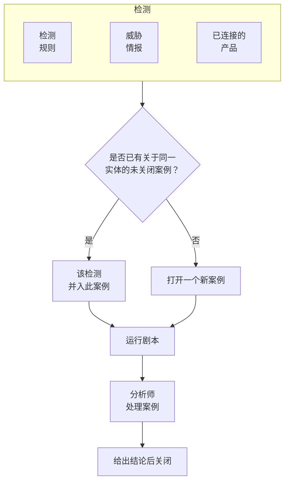

# 安全案例与剧本(SOAR)

安全事件 会把检测规则、威胁情报和已连接的安全产品发现的问题转化为案例：每件值得调查的事对应一个案例，关于同一用户、主机或地址的所有检测都会归入其中。分析师在队列中处理案例，剧本则自动或一键对案例做出响应。

:::cards
- [案例从何而来](#案例从何而来): 检测规则、威胁情报、已连接的产品、实体风险和人员。
- [处理案例](#处理案例): 分配案例、调查相关实体，并在给出结论后关闭。
- [案例优先级和状态](#案例优先级和状态): 重命名、改颜色、调整顺序，并添加你自己的。
- [响应目标](#响应目标): 每个优先级的案例必须多快被接手并遏制。
- [通知](#通知): 新案例、分配、响应目标、任务以及等待审批的步骤会通知谁。
- [剧本](#剧本): 在案例上运行的步骤，关键步骤需要审批。
- [概览](#概览): 当下需要有人处理的事项，以及案例的处理速度。
:::

## 工作原理

打开 **产品 → 安全事件 → 安全案例 → 未结案例** 查看队列。**分配给我**、**无人认领**、**已关闭案例** 和 **全部案例** 是旁边各自独立的页面，分别列出其名称所指的案例。

## 开始之前

案例和剧本遵循三个 Security 角色的权限。项目所有者和项目管理员可以执行所有操作。

| 角色 | 能做什么 |
| --- | --- |
| 安全管理员 | 一切操作，包括删除案例、移除证据和设置剧本 |
| 安全成员 | 打开、分配、修改和关闭案例，撰写备注，处理任务，添加证据，运行剧本，以及批准或拒绝剧本的步骤 |
| 安全查看者 | 读取案例、检测、备注、任务、证据、剧本及其运行记录 |

其中每一项权限也都可以单独授予，从创建案例到批准剧本的步骤都是如此；请参阅 [权限参考](/docs/permissions/reference)。

## 案例从何而来

| 来源 | 何时打开案例 | 停用方式 |
| --- | --- | --- |
| 检测规则 | 规则匹配时 | 规则的 **匹配时** 步骤中的 **匹配时打开案例** |
| 威胁情报 | 某个事件提到已知指标时 | 情报源的 **匹配时** 步骤中的 **匹配时打开案例** |
| 已连接的产品 | 导入的产品自身警报达到或高于连接的阈值时 | 在连接的 **轮询** 步骤中，把 **打开案例的起始严重程度** 设为 **从未** |
| 日志中的安全产品 | 防火墙、IDS 或终端产品写入日志的威胁达到或高于你的日志的阈值时 | 在 **你的日志** 上，把 **从以下级别开启案例** 设为 **从未** |
| 实体风险 | 用户、主机或地址的风险达到项目阈值时 | **设置 → 风险评分** 中的 **风险案例** |
| 人员 | 有人从 **安全案例** 中打开案例，或在事件面板中使用 **打开案例** 时 | 无 |

所有来源默认都会打开案例，但实体风险例外：在它出现之前创建的项目需要先打开 **风险案例**（[实体风险](/docs/telemetry/security-entity-risk)）。除非你选择其他级别，否则连接会为 **高及以上** 的警报打开案例；低于该级别的警报仍会作为事件导入。**你的日志** 对日志中的威胁也是如此。

### 检测如何分组

每个检测都关于某个实体：即其规则分组所依据的值，例如暴力破解规则中的 IP 地址，或威胁情报匹配所提到的指标。没有实体的检测会单独存在，不与其他检测合并。

- 如果已有关于该实体的未关闭案例，检测就会并入其中。案例的实体和 ATT&CK 映射随之扩充，其优先级会提升到该检测的优先级，但绝不会降低。
- 如果没有这样的案例，就会打开一个新案例，以该检测命名，优先级与该检测相同。
- 再次触发的检测会在它所在的行上累加计数，而不是新增一行。

案例的优先级由检测的严重程度决定，取项目中该级别的内置优先级，无论你把它改成什么名字：

| 严重程度 | 优先级 |
| --- | --- |
| Critical 或 Fatal | Critical |
| High | High |
| Medium、Unknown 或 Other | Medium |
| Low | Low |
| Informational | Informational |

## 处理案例

新项目的案例会依次经历四种状态，你可以重命名它们并添加自己的状态（参见 [案例优先级和状态](#案例优先级和状态)）。案例可以跳过某个状态，例如直接从 New 关闭的误报，也可以被重新打开。

| 状态 | 含义 |
| --- | --- |
| New | 还没有人查看过 |
| Investigating | 有人正在查明发生了什么 |
| Contained | 威胁已无法再造成危害，但仍有清理工作要做 |
| Closed | 已处理完毕，并对其性质给出了结论 |

案例和事件一样有自己的侧边菜单，案例的每个部分都有自己的页面：

| 侧边菜单部分 | 页面 |
| --- | --- |
| **概览** | **概览**、**时间线** |
| **调查** | **经过**、**检测**、**实体**、**关联信号**、**证据**、**任务**、**剧本** |
| **备注** | **私人备注** |
| **高级** | **自定义字段**、**审计日志**、**删除案例**——点击 **高级** 之前保持折叠 |

每个页面顶部都保留案例的页眉：编号、优先级、状态和标题，**分配给我**、**运行剧本**、**声明事件** 和 **关闭案例** 按钮，以及它们旁边 ⋯ 菜单中的 **设置优先级**、**分配给其他人**、**更改状态**、**编辑案例** 和 **删除案例**。因此可以在案例的任何页面上处理它，而指向案例的链接仍会打开它的 **概览**。当案例的优先级设有响应目标时，标题栏还会显示下一个目标的截止时间（[响应目标](#响应目标)）。

- **概览**：案例的描述、标签和状态步骤，由谁负责、因何打开，以及它的数字：有多少条检测、已打开多久，以及确认和遏制分别用了多长时间。在 **确认用时** 和 **遏制用时** 下方，会显示案例相对于其响应目标的情况。
- **此案例为何被打开**（位于 **概览**）：打开该案例的检测及其规则如何触发（阈值、分组依据和计数所用的时间窗口），它匹配到了多少事件、这些事件来自什么、发生在哪段时间，规则查找的内容，以及请求到达了哪一步。在 **匹配到的内容** 下列出事件本身，最早的排在最前：每个事件都会突出显示规则查找的内容，并显示其请求到达了哪一步、它所来自的日志行或产品，一键即可打开它的 **追踪**、**日志** 和 **异常**；它所来自的日志行会在日志浏览器中打开，并定位到该行。点击某个事件即可查看它的全部内容，以及从中读出该事件的日志行。事件所在行或其面板中的 **保留在此案例中** 会把该事件保存到案例的 **证据** 中，并注明匹配到它的检测；案例已保存的事件会注明这一点，并在那里打开它。检测在触发时最多保存它匹配到的 25 个事件并列出这些事件，即使它们已超过保留期也是如此；你的角色只能看到其中来自它能读取的来源的事件。同时为许多分组触发的规则（关联规则也是如此）会为每个分组保存事件：总共最多 1,000 个，因此每个分组至少保存 10 个，再次触发时最多 25 个。对于在检测开始保存事件之前产生的检测，规则的匹配项是在规则触发的时间窗口内、该检测的分组中满足规则自身条件的事件；威胁情报匹配会列出带有其指标的事件，已连接产品的警报则列出产品发送的原始事件。**接下来查看** 会打开关于该检测所涉及的地址或用户的一切、提及它的事件和日志行、其日志行所来自的服务的日志，以及其请求的追踪（均限定在该检测的时间窗口内），还有案例的 **经过** 和 **关联信号**。案例的其他检测折叠在 **此案例中的其他检测** 下。
- **响应计划**（位于 **概览**）：现在要对案例做的事，最紧急的排在最前，分列在 **确认是否属实**、**遏制威胁**、**修复导致其发生的问题** 和 **关闭案例** 之下。每个步骤都针对此案例，依据的是它的地址、用户和主机、其请求到达了哪一步、其规则说明它还可能在哪些情况下触发、其检测所映射的 ATT&CK 战术和技术，以及项目已有的剧本。检测规则自带的步骤，即在其表单的 **响应步骤** 下写好的步骤，会排在计划中它们所属部分的最前面；规则库中的规则也自带步骤。OneUptime 能执行的步骤带有对应的按钮：**分配给我**、**添加例外**（已预先填入规则和地址）、**运行剧本**（针对暂停账户或遏制主机的剧本，或 OneUptime AI 建议的剧本）、**声明事件**、**标记为已遏制** 和 **关闭案例**。公网地址的步骤会在某个目标执行你的封禁列表后一键封禁该地址，即 **封禁 24 小时**（参见 [从案例封禁地址](#从案例封禁地址)）。OneUptime 无法执行的步骤，例如在你的 DNS 过滤器上阻止某个域名，会显示 **在 OneUptime 之外**，并且一键即可把该值复制到剪贴板。步骤完成后将其勾选：它会作为一项已完成的任务保存在案例的 **任务** 中，并记录完成人和完成时间。由案例本身判定的步骤会自动勾选：案例已分配、已声明事件、已运行剧本、案例已遏制或已关闭。遏制威胁的步骤全部完成后，计划会提供 **标记为已遏制**，它会记录案例的遏制用时。如果 OneUptime AI 已研判该案例，它的结论会排在计划最前面，它建议的步骤则折叠在计划自己的步骤下方。大多数步骤由 OneUptime 自行检查，并在每个步骤旁边说明它发现了什么：参见 [OneUptime 如何检查一个步骤](#oneuptime-如何检查一个步骤)。
- **OneUptime AI**（位于 **概览**）：OneUptime AI 对案例的研判、它建议的优先级和剧本，以及背后的证据。请参阅 [安全中的 OneUptime AI](/docs/telemetry/security-ai)。
- **影响**（位于 **概览**）：案例使哪些对象面临风险：OneUptime 是否看到其记录被从互联网访问、它们的所有者、它们最近发生了什么变更，以及面临风险的数据——案例提到的或其用户和角色可以访问的含敏感数据的数据存储（参见 [数据安全集成](/docs/data-security/integrations#安全运营)）。展开后可以查看每条记录调用了什么、被什么调用，监视它的监控和状态页，以及案例中的地址与哪些机器通信过。
- **MITRE ATT&CK**（位于 **概览**）：案例的检测所映射的战术和技术，每一项都链接到 attack.mitre.org 上的对应页面。
- **时间线**：案例上发生过的一切，以及操作人。
- **经过**：在整个 OneUptime 中按顺序发生了什么：每次检测及其背后的安全事件、请求到达了哪一步、抛出的异常、案例涉及的记录上的变更、在这些记录上引发的事件和警报，以及团队采取的行动。扫描器的大量探测合为一行，每一行都能打开它提到的内容，例如请求的追踪或异常。
- **检测**：触发后打开或并入该案例的检测、触发次数，以及最新的匹配事件。
- **实体**：案例涉及的用户、主机和地址，以及它们最近 7 天在你所有安全事件中的活动。每个实体都可以在 **关联分析** 中打开。
- **关联信号**：案例所指的主机、集群、服务和成员（按 OneUptime 所知），以及其检测前后各自发生的情况：它们的日志、追踪和指标，其上未解决的内容和发生的变更。请参阅[关联信号](/docs/telemetry/security-connected-signals)。
- **证据**：保存在案例中的文件、链接和安全事件，每项都记录添加人和添加时间。**添加文件** 上传不超过 10 MB 的文件，并记录所上传内容的 SHA-256，这样之后下载的人可以核对它是否就是所保存的内容；**添加链接** 指向保存在其他地方的证据。只有安全管理员才能移除证据，案例的 **时间线** 会记录添加和移除了什么。安全事件可在 **事件** 或 [狩猎](/docs/telemetry/security-events#狩猎) 页面上通过 **添加到案例**，或在检测匹配到的事件上通过 **保留在此案例中**，按原样保存到这里，**查看事件** 可以打开它。剧本的 **Preserve the evidence** 步骤也会把案例检测背后的事件保存到这里。
- **任务**：案例中需要做什么、由谁在做，以及是否已完成。用一行添加任务，把它交给某人，完成后勾选。接手任务的人会收到通知（自己领取的除外），菜单还会在 **任务** 旁显示未完成任务的数量。剧本的 **添加任务** 步骤也会添加任务，并略过案例已有的任务。
- **剧本**：每个剧本在该案例上逐步做了什么，以及等待审批的步骤。有运行在等待时，菜单会在 **剧本** 旁显示等待的数量。
- **私人备注**：团队就该案例写下的内容。编辑器的 **模板** 菜单会把项目的某个备注模板放进备注。
- **自定义字段**：项目自己的字段，为此案例填写，用 **编辑字段** 修改。项目一有字段， **概览** 的最后一张卡片也会显示它们。参见[自定义字段、备注模板和编号规则](#自定义字段备注模板和编号规则)。
- **审计日志**：对案例的每一次更改，以及更改人。请参阅 [审计日志](/docs/configuration/audit-logs)。
- **删除案例**：永久删除案例及其检测、备注、时间线和剧本运行记录。如需保留记录，请改为给出结论后结案。

### OneUptime 如何检查一个步骤

勾选只说明有人做了某个步骤。OneUptime 还会根据实际发生的情况，自行检查案例 **响应计划** 中的步骤：案例打开期间每分钟检查一次，并在步骤被勾选、任务发生变化或剧本遏制了某个对象时立即检查。在它检查过的每个步骤旁边，计划会说明它发现了什么：

| 步骤旁边显示 | 含义 |
| --- | --- |
| **已由 OneUptime 检查** | OneUptime 看到步骤已完成，并且仍然有效。不需要任何人勾选 |
| **看起来已完成** | OneUptime 看到的情况与步骤已完成相符，但不能证明。**确认** 会以你的名义勾选它 |
| **尚未完成** | OneUptime 看到步骤仍有待完成 |
| **OneUptime 无法判断** | OneUptime 没有可以用来检查该步骤的依据，并通过 **如何让 OneUptime 检查此项** 说明原因 |
| **不再有效** | 步骤曾经完成，但已不再起作用，例如被封禁的地址再次通过 |
| **目前不需要** | 还没有发生需要该步骤的情况 |

OneUptime 的发现旁边的 **判断依据** 会展开其余内容：它还看到了什么、指向追踪或它读取的产品的链接，以及它检查的时间。计划的进度会计入 OneUptime 自行检查过的步骤，例如“已完成 4/9，其中 3 个由 OneUptime 检查”。

| 步骤 | OneUptime 读取的内容 |
| --- | --- |
| 封禁该地址 | 是否有目标持有你的 [封禁列表](#封禁列表) 中该地址的封禁并已回读确认，以及来自该地址的请求是否仍在到达你的应用，依据其追踪和访问日志。目标持有的封禁会被核验通过；没有任何地方执行的封禁则不会。在没有封禁的情况下变得安静的地址看起来已完成：它可能已被封禁，也可能只是停止了发送 |
| 检查没有其他请求通过 | 自案例第一次检测以来，来自该地址的每个请求是如何结束的。当你的应用拒绝了所有请求时，该步骤即已检查 |
| 暂停该账户 | Okta、Microsoft Entra ID 或 Google Workspace 中的账户：已暂停，或已禁用且其会话在案例打开后已结束 |
| 让主机断开网络 | CrowdStrike Falcon 或 Microsoft Defender for Endpoint 中的主机：已遏制或已隔离 |
| 宣布事件 | 案例打开期间，是否有请求通过了你的应用的检查，或者请求到达的服务的监视器是否宕机。在此之前，该步骤目前不需要 |
| 排除误报 | 不读取任何内容：只有你能排除。该步骤会列出 OneUptime 对该地址所知的信息：你的某条记录是否拥有它、列出它的威胁情报源，以及过去 30 天内使用过它的已登录用户 |
| 修复攻击所针对的路由 | 你的应用的追踪和日志中针对该路由的攻击请求，以其背后的服务发布变更为界，分为之前和之后：变更可以是剧本的 **Fix the code with AI** 打开的拉取请求，也可以是该服务的任何部署或新版本。此后只要有足够多的同类攻击被拒绝，或者之前到达过数据库的攻击不再到达数据库，该步骤即已检查。如果此后没有攻击，它会说明修复以来没有尝试，并看起来已完成 |
| 重置密码 | Okta 或 Microsoft Entra ID 中的账户：在案例打开后，其密码已更改，其会话已结束。Google Workspace 不提供密码的更改时间，因此 OneUptime 无法判断 |
| 确保账户使用 MFA | 攻击针对的每个账户在 Okta、Microsoft Entra ID 或 Google Workspace 中的状态：有效的因素、MFA 方法或 2 步验证。每个账户都开启了 MFA 时，该步骤看起来已完成：没有产品会说明登录失败时是否锁定账户，因此由你来确认 |

- 在 OneUptime 之外完成的步骤同样算数。在你自己的防火墙上封禁该地址，OneUptime 会看到它的请求停止；在 Okta 中暂停该账户，OneUptime 会读取到这一结果。
- 你仍然可以自己勾选步骤，即使是 OneUptime 没有看到已完成的步骤。OneUptime 检查过的步骤不需要勾选。
- 当一个已完成的步骤不再有效时，计划会在顶部说明，案例的 **时间线** 会记录 OneUptime 看到的情况，负责该案例的人会收到通知：参见 [通知](#通知)。
- 当你的应用没有向 OneUptime 发送追踪或日志、其追踪没有说明每个请求来自哪个地址，或者追踪中记录的是你的应用前面的 Cloudflare 或负载均衡器的地址而不是访客的地址时，OneUptime 无法看到某个地址的请求。请在你的应用的服务器跨度上设置客户端地址（`client.address`）：在 Cloudflare 之后从 `CF-Connecting-IP` 设置，在负载均衡器之后从 `X-Forwarded-For` 设置。
- OneUptime 通过项目与持有账户和主机的产品之间的连接读取它们，也就是 [通过 OneUptime 响应](#通过-oneuptime-响应) 使用的连接。没有连接时，它无法判断。
- 没有响应的产品或失败的读取，永远不会被算作未完成的步骤：步骤会说明 OneUptime 暂时无法检查它，OneUptime 会在几分钟后重试。
- 只有攻击本身被拒绝后，路由的修复才算已检查：仅有部署并不是修复。OneUptime 会一直等待，直到修复发布后被拒绝的攻击足够多：按照之前的通过率，如果什么都没有改变，几乎可以肯定（95%）至少会有一个通过，并且不少于 3 个。该步骤会说明它在等待多少个，并在修复发布后监视该路由 7 天，例如“正在监视 /api/search，直到 11月27日”。如果之前几乎没有攻击通过，这些攻击就无法表明修复有效，该步骤会保持 **看起来已完成**，由你来确认。
- OneUptime 看到服务的部署，就能看到修复已发布：把部署发送到 OneUptime，或者在你的应用的遥测中报告 `service.version`（参见 [部署与变更](/docs/telemetry/change-events)）。**Fix the code with AI** 打开的拉取请求会保留在案例上，其部署会按其提交进行匹配。在你的边缘（例如 Cloudflare）被拦截的请求从未到达你的应用，因此无法说明修复的情况。
- 在 Microsoft Entra ID 中读取账户的 MFA，除了 [遏制](#遏制) 列出的权限之外，还需要 UserAuthenticationMethod.Read.All 应用程序权限。

**产品 → 安全事件 → 设置 → 案例状态** 中的 **验证后将案例标记为已遏制**，会在遏制案例的每个步骤都处于 **已由 OneUptime 检查** 或 **目前不需要** 时，将案例转为已遏制。其遏制用时会被记录，案例的 **时间线** 会说明 OneUptime 已验证遏制威胁的每个步骤。只是看起来已完成的步骤或一个勾选，永远不会单独推进案例。该设置在每个项目中都默认开启，项目所有者或项目管理员可以将其关闭：关闭后，案例会保持当前状态，直到有人将其标记为已遏制。

所有能查看案例的人都能看到 OneUptime 的发现。没有人编辑它：不同意的人可以自己勾选步骤，这需要一个能够处理案例任务的角色。

### 从案例封禁地址

案例涉及的公网地址在 **响应计划** 中有自己的步骤。当有目标执行你的封禁列表时，例如 Cloudflare、AWS WAF 或读取列表的防火墙，该步骤会指明它，例如“在 Cloudflare 上封禁 35.205.11.131。” **封禁 24 小时** 会在那里封禁该地址，旁边的菜单中有 **改为质询**、**封禁 7 天** 和 **封禁直至解除**，只有安全管理员、项目管理员或项目所有者可以选择它们。人可以通过质询，脚本和 API 客户端则不能。在案例的 **实体** 页面上，地址的 **封禁…** 也能做到这一点，并会询问封禁多长时间。

- 封禁与剧本的封禁一样经过剧本引擎：它会记录在案例的 **剧本** 页面、其 **时间线** 和审计日志中。它会等待其他人的批准，除非你是安全管理员、项目管理员或项目所有者。
- 对于案例请求仅声称的地址、你自己的地址或受保护的地址，以及已被封禁覆盖的地址，它会被拒绝并说明原因。
- 一旦目标持有该封禁，该步骤即完成，并说明在哪里、自何时起、由谁以及到何时为止，附带 **解除**。在没有目标持有它期间，该步骤会说明这一点，且不算完成。
- 在没有任何地方执行你的封禁列表期间，该步骤会说明如何连接 Cloudflare、AWS WAF 或防火墙，**封禁方法** 会展示如何在 Cloudflare 仪表板、AWS CLI、nginx 和 nftables 中封禁该地址。
- 将案例以 **误报** 或 **良性阳性** 关闭时，会提议解除它所做的封禁，这些封禁已勾选，并逐一列出名称。

### 在队列中处理案例

无需打开案例即可处理它。在队列的列表中，案例所在行的 ⋯ 菜单里有 **分配给我**、**分配给其他人**、**更改状态** 和 **更改优先级**。要同时处理多个案例，请选中它们，然后在 **批量操作** 中使用相同的操作：它会说明哪些案例已更改、哪些保持不变以及原因。

- 要把案例交给其他人，请使用 **分配给其他人**，并选择一个人或一个团队。团队的案例会留在 **无人认领** 中，直到团队中有人认领。
- 关闭案例的状态会像 **关闭案例** 一样要求填写结论和结案备注。
- 已关闭的案例不会分配给任何人。要再次处理它，请用 **更改状态** 重新打开。

### 关闭案例

**关闭案例** 会要求填写结论和一条可选的结案备注：

| 结论 | 含义 |
| --- | --- |
| True Positive | 确实发生了恶意或未经授权的活动 |
| Benign Positive | 活动真实存在但符合预期，例如渗透测试或管理任务 |
| False Positive | 检测有误：规则或数据误读了正常活动 |
| Undetermined | 没有足够的信息来判断 |

概览页面会统计这些结论。如果某条规则的案例总是以 False Positive 关闭，这条规则就需要调优了。

案例中仍有未完成的任务时，**关闭案例** 对话框会显示数量。

从 Google SecOps 警报打开的案例，如果其连接打开了 **案例关闭时关闭其警报**，也会在 Google SecOps 中关闭这些警报，并附上结论和关闭说明：参见 [Google SecOps](/docs/integrations/google-secops#案例关闭时关闭其警报)。

### 声明事件

**声明事件** 会以你选择的严重程度为该案例打开一个 OneUptime 事件（incident），并在两者之间建立双向链接：事件的描述中会写明该案例，案例的页眉会链接到该事件。之后由值班、状态页面和事后分析接手。此操作需要一个既能处理案例、又能创建事件的角色。

## 案例优先级和状态

每个项目都有自己的案例优先级和状态，位于 **产品 → 安全事件 → 设置 → 案例优先级** 和 **案例状态**。可以重命名、改颜色、拖动调整顺序，也可以添加自己的，例如一个“Triage”状态，或一个高于 **严重** 的“Emergency”优先级。新名称会立即出现在所有地方：队列、案例页面和概览、通知、Slack、Microsoft Teams 和 Mattermost，以及剧本消息中。

其中一些是内置的，因为 OneUptime 会读取它们的含义。它们可以重命名和改颜色，但不能删除或归档，并且保持各自的顺序：

| 内置 | OneUptime 用它做什么 |
| --- | --- |
| 新建状态 | 新案例从这个状态开始 |
| 已确认状态 | 到达它时记录案例的确认时间，**重新打开** 会把已关闭的案例移回这里 |
| 已遏制状态 | 到达它时记录案例的遏制时间 |
| 已关闭状态 | **关闭案例** 会把案例移到这里，并附上结论 |
| 严重、High、Medium、Low 和信息优先级 | 检测会以其严重程度对应的优先级打开案例，有人手动打开的案例从 Medium 开始 |

- 状态的位置决定了其中的案例被视为什么，**视为** 列会显示出来：从已确认状态往下视为已确认，从已遏制状态往下视为已遏制，从已关闭状态往下视为已关闭。你添加的状态会放在已关闭状态的正上方；把案例移到会关闭它的状态时，会先要求给出结论。
- 优先级的排名就是它的紧急程度，最紧急的在最前：**适用案例的最低优先级**、通知选项以及 Slack、Microsoft Teams 和 Mattermost 规则都按这个顺序读取。你添加的优先级会放在最后，**检测严重程度** 列显示哪些检测会以哪个内置优先级打开案例。

要停用你自己的某个状态或优先级，请在它所在行使用 **归档**。之后没有人能再选择它，API、Terraform 和 MCP 也会拒绝它，但已经使用它的案例会保留它，你也仍然可以按它筛选。已归档的值列在表格下方折叠的 **已归档的案例状态** 或 **已归档的案例优先级** 部分，在那里用 **取消归档** 即可恢复。只要还有案例使用该值，或有剧本从该优先级起运行，**删除** 就会被拒绝。

## 响应目标

响应目标规定了案例必须以多快的速度处理：**确认时限** 是新案例可以等待多久才有人接手，**遏制时限** 是被遏制或关闭可以用多长时间。每个案例优先级都有自己的目标，位于 **产品 → 安全事件 → 设置 → 响应目标**：在优先级所在行点击 **编辑** 可设置这两个目标，单位为分钟、小时或天，最长一年，留空表示不设目标。新项目的优先级从以下目标开始：

| 优先级 | 确认时限 | 遏制时限 |
| --- | --- | --- |
| Critical | 15 分钟 | 4 小时 |
| High | 1 小时 | 1 天 |
| Medium | 12 小时 | 3 天 |
| Low | 1 天 | 7 天 |
| Informational | 无目标 | 无目标 |

在有响应目标之前创建的项目，在有人设置之前没有任何目标。

- 案例的截止时间在案例打开时根据其优先级的目标确定。之后修改的目标适用于此后打开的案例。
- 有人接手案例时，案例即被确认：分配给某人，或转到算作已确认的状态。到达算作已遏制的状态或被关闭时，案例即被遏制。
- 案例的优先级变化时，已达成或已错过的目标保持不变。优先级升高会让截止时间提前：新目标从变更时起计算，除非原截止时间更早。优先级降低会让截止时间推后，但绝不会提前：新目标从案例打开时起计算。没有目标的优先级会保留被升级案例的截止时间，并清除被降级案例的截止时间。
- 从未被遏制就已关闭的案例重新打开后，会得到一个从重新打开时起计算的新遏制截止时间。
- 进入目标的最后五分之一时，案例即将错过该目标：负责该案例的人会收到通知，目标错过时会再收到一次。请参阅 [通知](#通知)。

目标显示的位置：

- 案例标题栏会显示下一个目标及剩余时间，或已超期多久：时间充足时为灰色，最后五分之一为琥珀色，错过后为红色。
- 在案例的 **概览** 中，**确认用时** 和 **遏制用时** 下方：案例相对于每个目标的情况，或超出了多少。
- 在队列的列表中：每个案例优先级下方的一行，以及可以打开并用于排序的 **截止** 列。打开该列时，优先级下方的那一行不再显示。只有当项目的某个优先级设有目标时，列表才会显示它们。

## 自定义字段、备注模板和编号规则

另外三项设置让案例属于你的项目，位于 **产品 → 安全事件 → 设置**：

- **自定义字段**：团队在每个案例中填写的字段，例如案例涉及的业务部门，或它在其他工具中的工单。字段可以保存文本、数字、日期、是或否、列表中的选项或文件。案例在 **高级** 下的 **自定义字段** 页面列出每个字段及案例的值， **编辑字段** 用于修改。在队列的列表中，每个字段都是一列，可以在 **列** 中打开。
- **备注模板**：团队一个案例接一个案例撰写备注时使用的现成文本，例如遏制检查清单或给下一班的交接。在案例的 **私人备注** 中，编辑器的 **模板** 菜单会把模板放进备注，发布前可以编辑， **管理模板** 会打开列表。
- **编号规则**：案例编号前的文本（除非你自己设置，否则是 `CASE-`，如 `CASE-42`），以及下一个案例将获得的编号。从其他工具迁移过来？从该工具的最后一个案例编号之后开始，这样一个编号就不会指向两个案例。新的前缀或起始编号只适用于新的案例，起始编号必须大于目前已用的最大编号。

安全管理员管理自定义字段和备注模板，安全成员填写案例的字段；在 OneUptime Cloud 上需要 Growth 或更高的套餐。编号规则由项目所有者或项目管理员设置，与事件和警报相同。

## 通知

OneUptime 会就案例上的六件事通知相关人员。无需任何人做任何设置：一个只点击了 **开启推荐设置** 的项目，也会通过电子邮件和推送收到其 High 和 Critical 案例的通知。

| 通知 | 通知谁 | 默认方式 |
| --- | --- | --- |
| 新的安全案例 | 所有能查看项目案例的人：当案例以他们所选的优先级或更高优先级打开，或提升到该优先级或更高时 | 电子邮件和推送，针对 High 和 Critical 案例 |
| 分配给我的安全案例 | 案例被分配给的人，以及案例被分配给的团队的成员 | 电子邮件和推送 |
| 等待我审批的剧本步骤 | 案例相关人员中能够批准该步骤的人：案例被分配给的人及其团队的成员。如果他们都无法批准，则通知项目中所有能够批准的人 | 电子邮件和推送 |
| 安全案例响应目标 | 负责该案例的人：案例被分配给的人及其团队的成员。如果无人负责，则通知会收到该优先级新案例通知的人 | 电子邮件和推送 |
| 分配给我的安全案例任务 | 被交给案例任务的人，自己领取的除外 | 电子邮件和推送 |
| 安全案例步骤不再有效 | 负责该案例的人，当 OneUptime 看到已完成的某个步骤不再有效时：案例被分配给的人及其团队的成员。如果无人负责，则通知会收到该优先级新案例通知的人 | 电子邮件和推送 |

- 只有能查看案例的人才会收到相关通知：项目所有者、项目管理员，以及安全管理员、安全成员和安全查看者角色。仅限于某些标签的角色，只会收到带有这些标签的案例的通知。
- 没有人会因为自己做的事而收到通知：手动打开案例、分配案例或启动运行的人不会收到相应通知。
- 每个人对一个案例只会收到一次通知。一个以 Medium 打开、之后提升到 Critical 的案例，会在提升时通知选择了 High 或 Critical 的人，而不会再次通知选择了 Medium 的人，因为他们在案例打开时已经收到过通知。
- 通过 **发送测试攻击** 发起的测试攻击会打开一个不通知任何人的案例。
- Critical 案例和等待审批的步骤会立即发送，绝不会被压在 [邮件汇总](/docs/emails/notification-rollup) 中延后发送。即将错过或已错过的响应目标，以及不再有效的步骤，也是如此。
- 案例的 **时间线** 会显示通知了谁以及何时通知。

### 选择你收到的通知

每个人都可以在 **用户设置 → 通知设置 → 安全** 下自行选择：每种通知的渠道（电子邮件、短信、电话、推送、Telegram、Slack、Microsoft Teams、Mattermost 或 Webhook），以及在 **新的安全案例** 下选择会通知自己的优先级：

| 选项 | 通知哪些优先级的案例 |
| --- | --- |
| 仅严重 | Critical |
| 高及以上 | Critical 和 High（默认） |
| 中及以上 | Critical、High 和 Medium |
| 低及以上 | 除 Informational 以外的所有优先级 |
| 所有案例 | 所有优先级 |

这些选项随项目的案例优先级而定，并使用它们自己的名称：上面是新项目的选项。

安全案例不会发送 WhatsApp 消息。推送通知会在 OneUptime On-Call 应用（1.7.0 或更高版本）中打开该案例，你可以在其中批准或拒绝等待审批的剧本步骤、接手案例并关闭它。其中的链接会在浏览器中打开该案例。关于等待你审批的步骤的推送通知，会直接打开那项审批及其证据；如果在此期间已有人做出决定，案例会说明是谁、在何时决定，以及该步骤的结果。

等待你审批的步骤会以一条可直接审批的消息送到 Slack 或 Microsoft Teams，它的电子邮件会说明该步骤将做什么以及原因：请参阅 [在 Slack 和 Microsoft Teams 中审批](#在-slack-和-microsoft-teams-中审批)。

### 发布到 Slack、Microsoft Teams 和 Mattermost 频道

要发布到频道，请在 **产品 → 安全事件 → 工作区 → Slack**（或 **Microsoft Teams**、**Mattermost**）下添加一条规则。三者都未连接时，该区域只有一项：**连接工作区**。规则会指定要发布到的频道（在 Microsoft Teams 中还包括聊天），并且可以按需指定它针对哪些案例：

| 条件 | 匹配内容 |
| --- | --- |
| 安全案例优先级 | 项目的某个案例优先级，例如严重或 High |
| 安全案例标题、安全案例描述 | 案例标题或描述中包含的文本，或其开头、结尾的文本 |
| 安全案例状态 | 项目的某个案例状态，例如新增或已关闭 |
| 安全案例来源 | Detection Rule、Threat Intel、Connected Product、实体风险、数据安全或 Manual |
| 安全案例标签 | 案例的标签 |

除任务通知外，每种通知都会发布到案例当时所匹配的每条规则的频道。一条 **安全案例优先级** 包含 **严重** 和 **高** 中任意一项的规则，会在 High 和 Critical 案例打开时发布它们，并在 Medium 案例提升到 High 时发布它。安全案例永远不会拥有专属频道。

规则的 **更新** 步骤选择它发布这些通知中的哪些： **选择更新** 下有 **新案例和优先级提升** 、 **分配** 、 **审批请求** 和 **响应目标** 各一个勾选框。 **仅关键更新** 发布除分配外的所有通知，适合只需了解有人必须处理之事的频道。在此步骤之前保存的规则以及新规则会发布所有通知。

## 剧本

剧本是在案例上运行的一系列步骤。请在 **产品 → 安全事件 → 剧本** 下从模板或空白创建剧本，然后在它的页面上添加步骤。没有剧本的项目会看到模板，而不是空列表；有了剧本之后，列表上的 **从模板创建** 会打开这些模板，项目已有的模板会标为 **已添加**。

### 剧本何时运行

| 触发方式 | 运行时机 |
| --- | --- |
| Case Opened | 案例打开时运行一次 |
| Detection Added | 每当有新的检测并入未关闭的案例时 |
| 研判为可能恶意 | 当 OneUptime AI 的研判把案例判读为 可能为恶意 时，运行一次 |
| Manual | 仅当有人从案例中运行它时 |

任何已启用的剧本也可以通过案例上的 **运行剧本** 手动运行。自动运行的剧本可以用以下设置缩小范围：

- **适用案例的最低优先级**：只针对该优先级或更高优先级的案例。
- **仅限来自以下的检测**：只在案例背后的检测来自该来源时运行。
- **仅限这些检测规则**：只在该检测来自这些规则之一时运行。

已停用的剧本既不会自动运行，也不能手动运行。

### 步骤

| 类别 | 步骤 | 作用 |
| --- | --- | --- |
| 案例 | Assign the case | 把案例分配给某个人、某个团队或两者 |
| 案例 | Set the priority | 提高或降低案例的优先级 |
| 案例 | Set the status | 把案例移到项目的另一个状态；如果该状态会关闭案例，则附上你选择的结论 |
| 案例 | Add a note | 在案例上写一条备注，例如给分析师的背景信息 |
| 案例 | Add labels | 为案例添加标签 |
| 案例 | Add tasks | 向案例的清单添加任务，交给某个人，或留给处理案例的人 |
| 调查 | Check entities against threat intel | 在你的威胁情报中查找每个实体，匹配时可以提高优先级 |
| 调查 | Look up entity activity | 统计每个实体在最近一段时间内的安全事件，并记录到案例上 |
| 调查 | Preserve the evidence | 保留案例检测背后的事件及其请求的会话回放，并把它们的追踪和异常记录到案例上 |
| 通知 | Email people | 通过电子邮件向用户和团队发送案例摘要及其链接 |
| 通知 | Notify data store owners | 通过电子邮件向案例涉及的每个数据存储的所有者发送案例链接 |
| 通知 | Post to Slack | 把案例摘要发布到某个 Slack 频道 |
| 通知 | Post to Microsoft Teams | 把案例摘要发布到某个 Microsoft Teams 频道 |
| 通知 | Post a status page announcement | 把你撰写的公告发布到你选择的状态页 |
| 升级 | Page on-call | 运行一个值班策略 |
| 升级 | Declare an incident | 打开一个与案例关联的 OneUptime 事件 |
| 遏制 | Suspend the user in Okta | 在 Okta 中暂停案例涉及的用户 |
| 遏制 | End the user's Okta sessions | 让案例涉及的用户退出 Okta 登录，并吊销其令牌 |
| 遏制 | Contain the host in CrowdStrike | 通过 CrowdStrike Falcon 对案例涉及的主机进行网络遏制 |
| 遏制 | Isolate the device in Microsoft Defender | 通过 Microsoft Defender for Endpoint 隔离案例涉及的主机 |
| 遏制 | Disable the user in Microsoft Entra ID | 在 Microsoft Entra ID 中禁用案例涉及的用户的账户 |
| 遏制 | Sign the user out of Microsoft Entra ID | 将案例涉及的用户从所有位置注销 Microsoft Entra ID，并吊销其刷新令牌 |
| 遏制 | Suspend the user in Google Workspace | 在 Google Workspace 中暂停案例涉及的用户 |
| 遏制 | Sign the user out of Google Workspace | 在每个浏览器和设备上将案例涉及的用户从 Google Workspace 注销 |
| 遏制 | Unsuspend the user in Okta | 在 Okta 中取消暂停案例涉及的用户 |
| 遏制 | Lift containment in CrowdStrike | 解除 CrowdStrike Falcon 对案例涉及的主机施加的网络遏制 |
| 遏制 | Release the device in Microsoft Defender | 在 Microsoft Defender for Endpoint 中将案例涉及的主机解除隔离 |
| 遏制 | Enable the user in Microsoft Entra ID | 在 Microsoft Entra ID 中重新启用案例涉及的用户的账户 |
| 遏制 | Unsuspend the user in Google Workspace | 在 Google Workspace 中解除暂停案例涉及的用户 |
| 遏制 | 阻止对数据存储的公开访问 | 通过其云连接，阻止对案例涉及的每个存储桶或存储账户的公开访问 |
| 遏制 | 撤销数据存储共享 | 通过其云连接，停止在你的账户之外共享案例涉及的每个数据库的快照 |
| 遏制 | 封禁地址 | 在执行你的封禁列表的每个目标上封禁或质询案例涉及的地址 |
| 遏制 | 解除地址的封禁 | 解除案例涉及的地址的封禁 |
| 自动化 | Send a webhook | 把案例以 JSON 格式 POST 到某个 URL |
| 自动化 | Run a workflow | 以案例作为输入，启动一个 OneUptime 工作流 |
| 自动化 | Run a runbook | 以案例作为输入，启动你的某个 OneUptime 运行手册 |
| 自动化 | Fix the code with AI | 请 OneUptime AI 提交一个拉取请求，修复案例的请求所引发的异常 |
| 流程控制 | 停止运行 | 在此处结束运行并视为完成：之后的步骤不会运行 |

一个剧本最多有 25 个步骤。它们按顺序运行，每个步骤在前一个完成后才开始。每个步骤还可以设置：

- **需要批准**：在运行到该步骤之前暂停，直到有人在案例上批准它。切断某人访问的九个步骤始终如此，除非安全管理员将其关闭。**Run a runbook**、**Post a status page announcement** 和两个数据存储步骤默认开启批准，因为它们会在你的系统上执行命令、面向你的客户发布内容或更改云的设置；添加该步骤的人可以将其关闭。
- **运行此步骤**：**始终** 运行，或仅在前面的步骤得出结果后运行，例如 **用威胁情报检查实体** 发现已知恶意实体时；参见 [按步骤的结果分支](#按步骤的结果分支)。
- **失败时继续**：即使该步骤失败，也继续运行下一个步骤。关闭此项时，失败的步骤会停止本次运行。它和 **运行此步骤** 一起位于 **更多字段** 中。

### 按步骤的结果分支

**运行此步骤** 让一个步骤等待前面某个步骤的结束方式。前面的每个步骤都提供它的结果：

| 前面的步骤 | 它的结果 |
| --- | --- |
| 用威胁情报检查实体 | 发现已知恶意实体，或未发现已知恶意项 |
| 查询实体活动 | 发现活动，或未发现活动 |
| 任何其他步骤 | 成功；开启了 **失败时继续** 时，还有失败 |

等待同一步骤相反结果的两个步骤就是一个 if 和一个 else：只有威胁情报知道某个用户时才暂停该用户，否则添加一个任务，与该用户确认这次登录。被等待的步骤以其他方式结束时，等待它的步骤会被跳过，运行会在它下方说明原因；等待一个被跳过步骤的步骤也是如此。步骤的卡片会说明它在等待什么；另一个步骤所等待的步骤，在那个步骤改为以其他方式运行之前，既不能移到它下方，也不能删除。**升级已知恶意指标** 模板只在威胁情报匹配时才提高案例的优先级和状态；用旧的威胁情报开关保存的步骤会把它保留为 **仅当前面的威胁情报检查发现已知恶意实体时**。

一个步骤最多可以等待五个结果：在 **运行此步骤** 中逐一选择，**运行条件** 会询问如何解读它们：**全部发生时** 或 **任意一个发生时**。例如，仅当威胁情报知道某个用户且找到了其活动时才暂停该用户，或在两次查询中任意一次有发现时呼叫值班人员。等待全部结果的步骤不能等待同一个步骤的两个结果（例如发现和未发现），因为没有哪次运行会同时有这两个结果。

### 停止运行

**流程控制** 下的 **停止运行** 会在当前位置结束运行并视为完成：之后的步骤会被跳过，并各自说明运行在哪里停止，运行本身为成功。配合 **运行此步骤**，它只在某个结果之后停止：威胁情报未发现已知恶意项时停止，否则让下面的遏制步骤运行。你在 **停止原因** 中填写的内容，会在运行于此处停止时显示在案例的时间线上。它没有需要批准的内容，也从不失败，因此既没有 **需要批准**，也没有 **失败时继续**，也没有步骤可以等待它。始终运行的停止步骤会结束每一次运行，因此只能作为最后一个步骤。

### 通过 OneUptime 响应

以下四个步骤通过 OneUptime 的其他部分执行，而不是通过已连接的产品：

- **Run a runbook** 以案例作为输入，启动你的某个[运行手册](/docs/runbooks/index)，Bash 步骤会把这些输入读作环境变量（参见[调用 Webhook](/docs/runbooks/triggers#调用-webhook)）。`ONEUPTIME_INPUT_IP`、`ONEUPTIME_INPUT_USER` 和 `ONEUPTIME_INPUT_HOST` 是案例所涉及的地址、用户和主机，按与遏制类步骤相同的规则选出，案例不涉及其中任何一个时为空。`ONEUPTIME_INPUT_IPS`、`ONEUPTIME_INPUT_USERS` 和 `ONEUPTIME_INPUT_HOSTS` 以 JSON 列出案例提到的所有对象，`ONEUPTIME_INPUT_CASE_NUMBER`、`ONEUPTIME_INPUT_CASE_TITLE` 和 `ONEUPTIME_INPUT_CASE_URL` 说明是哪个案例。受保护的用户或主机永远不会在其中。运行手册的运行记录会注明它是由 **Security playbook** 为该案例启动的。
- **Preserve the evidence** 把案例每个检测的最新事件按原样保存到案例的 **证据** 页面，最多 100 个，将案例背后请求的会话回放保留到其保留期之后，并在案例上写一条备注，链接每个请求的追踪、每个回放和每个异常。日志和追踪的保存时间不能超过项目保留遥测数据的时间，因此请在此之前导出你需要的内容。
- **Post a status page announcement** 按你撰写的原样，把你写的内容发布到你选择的状态页上。不会添加案例中的任何内容。只有开启 **通知订阅者** 时，才会通知这些状态页的订阅者。
- **Fix the code with AI** 针对案例的请求所引发的每个异常（最多三个），请 OneUptime AI 提交一个修复它的拉取请求。该步骤需要开启 OneUptime AI、一个包含代码并通过 GitHub App 连接的代码仓库，以及一个运行器。缺少这些时，该步骤会被跳过并说明缺少什么。每个拉取请求都会保留在案例上，响应计划的修复步骤会读取它是否已发布并拒绝了攻击：参见 [OneUptime 如何检查一个步骤](#oneuptime-如何检查一个步骤)。

### 遏制

遏制类步骤通过一个需要的不只是读取权限的连接执行操作：与该产品的 [安全事件连接](/docs/telemetry/security-events#连接安全产品)，或数据存储的 [云连接](/docs/telemetry/cloud-accounts)：

| 步骤 | 连接 | 所需权限 |
| --- | --- | --- |
| Suspend the user in Okta、End the user's Okta sessions、Unsuspend the user in Okta | Okta System Log | 一个有权管理用户的 API 令牌 |
| Contain the host in CrowdStrike、Lift containment in CrowdStrike | CrowdStrike Falcon | 一个具有 Hosts 写入范围的 API 客户端 |
| Isolate the device in Microsoft Defender、Release the device in Microsoft Defender | Microsoft Defender XDR | 一个具有 Machine.Isolate 权限的应用 |
| Disable the user in Microsoft Entra ID, Sign the user out of Microsoft Entra ID, Enable the user in Microsoft Entra ID | Microsoft Entra ID | 具有 User.Read.All、User.EnableDisableAccount.All 和 User.RevokeSessions.All 应用程序权限的应用 |
| Suspend the user in Google Workspace, Sign the user out of Google Workspace, Unsuspend the user in Google Workspace | Google Workspace | 具有 admin.directory.user 和 admin.directory.user.security 范围的全网域授权，以管理该用户的管理员身份执行 |
| 阻止对数据存储的公开访问、撤销数据存储共享 | 数据存储的云连接 | 已开启 **数据安全响应**，并重新运行其设置命令 |

用户或主机类步骤只作用于案例涉及的用户或主机，绝不会作用于案例提到的所有用户或主机：

- 案例中某个检测分组所依据的值，例如“不可能的旅行”规则分组所依据的账户，或已连接产品的警报中提到的主机。
- 案例中被你的威胁情报列为指标的用户或主机。

按地址分组的案例，例如针对你的 VPN 的暴力破解，并不涉及以上任何一种：它的遏制类步骤会被跳过，它尝试过的账户和它攻击的网关都不会被触及。一个步骤最多作用于 10 个用户或主机。它会按名称在产品中查找每一个，并在运行上说明对每一个做了什么：已完成、早已完成、未找到、被拒绝或受保护。Microsoft Entra ID 按登录名或邮件地址查找用户，并且只允许同时具有 Privileged Authentication Administrator 角色的应用更改管理员的账户；Google Workspace 按主地址或别名查找用户。

**封禁地址** 和 **解除地址的封禁** 通过你的 [封禁列表](#封禁列表) 起作用，由其目标执行，因此不需要自己的连接。它们作用于检测据以分组该案例、或你的威胁情报已知的案例公网地址，最多 10 个，绝不作用于其请求仅声称的地址。你自己的地址，例如主机或负载均衡器的地址，受到保护并保持不变，同时会说明它是什么。剧本的封禁会过期：24 小时后过期，除非该步骤指定 1 小时、7 天或 30 天。没有任何地方执行的封禁会使该步骤失败：“Not enforced anywhere: connect Cloudflare, AWS WAF or a firewall.”

两个数据存储步骤作用于案例涉及的数据存储，最多 10 个：案例所并入的数据安全问题的数据存储，以及检测据以对案例分组的任何数据存储。它们不会触及标记为 **有意公开** 的数据存储，只更改数据存储的共享方式而绝不更改其数据，并在运行上说明对每个数据存储做了什么（参见 [消除暴露](/docs/data-security/integrations#消除暴露)）。

#### 受保护的实体

菜单中 **剧本** 下的 **受保护的实体** 列出任何剧本都不会遏制、封禁列表也永远不会封禁的用户、主机和 IP 地址，例如紧急访问账户、域控制器、VPN 网关和办公室地址。值的匹配不区分大小写，`*` 代表任意字符序列：`svc-*` 会保护所有服务账户。地址条目是一个地址或范围，例如 `203.0.113.0/24`，它会保护其中的每个地址。步骤会把受保护的用户或主机报告为受保护，并且不会触及它。这个列表由安全管理员维护。

#### 审批

切断某人访问的九个步骤会等待审批。只有安全管理员可以为其中某个步骤关闭 **需要批准**，OneUptime 会记录是谁关闭的。审批时会在 **作用对象** 下列出该步骤将要作用的用户或主机，每一个都已勾选：取消勾选该步骤不应触及的那些。受保护的用户或主机不会列为可选项。发起运行的人不能批准它的步骤：要由其他人批准，不过发起人仍然可以拒绝该步骤。

#### 在 Slack 和 Microsoft Teams 中审批

等待审批的步骤是一条带有 **批准**、**拒绝** 和 **打开案例** 按钮的消息；当它作用于多个用户或主机时，你也可以只批准其中一部分。这条消息会发送到每条 **更新** 中发布 **审批请求** 的安全案例规则的频道和聊天，并以账户的语言发送给每位为 **等待我审批的剧本步骤** 选择了 Slack 或 Microsoft Teams 的审批人。消息会说明该步骤将做什么、通过哪个连接，它作用于哪些用户或主机以及原因，它不会触碰的受保护对象，是谁或什么提出的请求，案例背后的证据（案例背后的请求走到了哪一步、威胁情报知道什么、它作用的对象都不受保护），以及能否撤销。请求审批的电子邮件也会说明这些；其中的按钮只会打开案例上的审批，从不做任何决定，因为邮件扫描程序会访问链接。

- 只批准一部分时，会列出该步骤将作用的用户或主机，全部已勾选：取消勾选它应保持不动的对象。至少保留一个，否则请改为拒绝该步骤。
- 按下按钮即以你的身份做出决定，通过你连接到 OneUptime 的 Slack 或 Microsoft Teams 账户。如果尚未连接，系统会请你先连接，然后再按一次。你需要一个能运行剧本的角色，并且能查看该案例；启动运行的人不能批准它，但可以拒绝。被拒绝时会说明原因：在 Slack 中只有你能看到。
- OneUptime 会核实每次按下都来自 Slack 或 Microsoft Teams，并且只决定一次：重复的、重新发送的或在关于另一步骤的消息上的按下不会做出任何决定，而在别人已决定后按下会说明是谁、在何时决定的。
- 一旦有人在 Slack、Microsoft Teams、案例或应用中做出决定，消息的每个副本都会说明是谁、在何时批准或拒绝，接着说明步骤的结果以及每个用户或主机的情况，并且除 **打开案例** 外不再有其他按钮。该决定会记录在案例的时间线上，注明来自 Slack 或 Microsoft Teams，并记录在项目的审计日志中。

Mattermost 收到的审批是不带按钮的文本。

#### 撤销

撤销类步骤和它们所撤销的步骤一样，作用于案例涉及的用户或主机。运行停止后，被遏制的用户或主机在其步骤上还会有一个专属按钮：**解除暂停**、**解除遏制**、**释放**、**启用** 或 **解除**。注销无法撤销。每次撤销都会记录在案例的时间线上和项目的审计日志中。在 OneUptime On-Call 应用中，案例会列出其剧本遏制的对象，每个都可以在那里撤销。

### 封禁列表

菜单中 **剧本** 下的 **封禁列表** 列出你的项目封禁的 IP 地址和范围：原因、截止时间、所属案例，以及是谁或什么添加了它。**封禁地址** 会将地址或范围封禁 24 小时，除非你选择 1 小时、7 天或 30 天。只有安全管理员、项目管理员或项目所有者可以将封禁保留到有人解除为止，或封禁比 /24 更宽的范围（IPv6 为 /48），而任何人都不能封禁比 /8 更宽的范围（IPv6 为 /16）。**解除** 可以在一行或同时在多行上结束封禁，**延长** 则会推迟其结束时间。

你的项目自身的地址永远不会被封禁：**受保护的实体** 中的条目、你的主机、Kubernetes 节点、云资源、网络设备和端点、你的地址名称和探测器、OneUptime Cloud 的探测器、不在互联网上的范围，以及你的应用前端的边缘网络。会触及其中之一的封禁会被拒绝，并说明该地址是什么；**受保护的实体** 会在 **自动保护** 下列出它们。当 OneUptime 无法判断某个地址是否属于你时，不会封禁它。

**生效于** 显示封禁生效的每个位置，以及封禁在那里是否持续生效。 防火墙或代理通过读取[封禁列表源](/docs/telemetry/blocklist-feeds)来执行封禁列表，这是一个它每隔几分钟获取一次的秘密 URL。为 AWS 云连接开启后，AWS WAF 也会在你选择的 Web ACL 中执行封禁（[在 AWS WAF 中封禁地址](/docs/telemetry/cloud-aws-waf-blocklist)）。在没有任何地方执行封禁列表期间，页面会说明这一点，封禁会被记录，但不会封禁任何内容。每次封禁、解除和过期都会记录在项目的审计日志中；如果封禁有对应的案例，也会记录在该案例的时间线上。案例地址的封禁也会显示在其 **响应计划** 中，可在那里用 **解除** 结束它；在 **攻击活动** 的某一行上使用 **封禁地址**，会封禁该攻击活动的地址。

### 消息

备注、电子邮件、Slack 帖子和 Teams 帖子都可以使用案例的值：

| 占位符 | 替换为 |
| --- | --- |
| `{{case.number}}` | 案例编号，例如 CASE-42 |
| `{{case.title}}` | 案例标题 |
| `{{case.priority}}` | 案例的优先级，使用你项目中的名称，例如 High |
| `{{case.status}}` | 案例的状态，使用你项目中的名称，例如 Investigating |
| `{{case.assignee}}` | 案例分配给了谁 |
| `{{case.url}}` | 指向 OneUptime 中该案例的链接 |
| `{{case.entities}}` | 案例涉及的用户、主机和地址 |
| `{{case.detections}}` | 案例包含的检测数量 |

没有自定义消息的电子邮件或帖子会发送案例摘要。

### 运行与审批

每次运行都会逐步列在其案例上，以及 **产品 → 安全事件 → 剧本 → 剧本运行记录** 下：

| 运行状态 | 含义 |
| --- | --- |
| Queued | 等待工作进程 |
| Running | 正在运行其步骤 |
| Waiting for Approval | 停在一个需要审批的步骤之前 |
| Succeeded | 每个步骤都已运行或被跳过，或者由 **停止运行** 步骤结束了运行 |
| Failed | 某个步骤失败，运行已停止 |
| Cancelled | 有人取消了它，或拒绝了某个步骤 |

等待审批的步骤会在运行上显示 **批准** 和 **拒绝**，并可附上一条可选的评论。批准后，运行从该步骤继续；拒绝则会结束运行。审批决定、决定人及其评论都会记录在该步骤上、案例的时间线上以及项目的审计日志中。菜单中 **剧本** 下的 **待审批** 列出等待决定的运行并显示其数量；**剧本运行记录** 列出所有运行。在 **剧本运行记录**、剧本的页面和案例的 **剧本** 上，每次运行都是一行，说明它进行到了哪里，或停在了哪个步骤；**显示步骤** 会展开它的步骤。等待审批的运行和案例最新的运行会自动展开。

如果某次运行失去了工作进程的响应（例如在重启之后），它会被重新接手：排队中的运行会在 2 分钟后重新排队，30 分钟没有任何动静的运行会被判定为失败。

## 概览

**产品 → 安全事件 → 概览** 是打开该产品时进入的页面：

- 分配给你的未关闭案例、尚无人接手的未关闭案例，以及等待审批的剧本步骤；每个数字都会打开列出它们的页面。
- **平均确认时间**、**平均遏制时间** 和 **平均关闭时间**，基于最近 30 天内打开的案例：分别是从案例打开到有人接手（分配给某个人，或将其移到视为已确认的状态）、到视为已遏制的状态、到视为已关闭的状态所用的时间。仍在等待中的案例不计入平均值。
- 30 天内每天打开的案例数（按优先级划分），以及 14 天内每天产生的检测数（按来源划分）。
- 按优先级和状态划分的未关闭案例、按风险分数排名最高的实体、触发最多的检测、案例背后的 ATT&CK 战术，以及最近 30 天的结论。

在这些内容上方，一个横条显示安全的设置情况：来源、检测、案例和剧本，各自带有数字。还没有完成设置的项目会在那里看到 **开启推荐设置** 和 **发送测试攻击**；请参阅 [安全入门](/docs/telemetry/security-getting-started)。没有任何需要处理的内容时，页面显示 **一切正常**，有可以展示的数据时才会显示图表。

## 查找威胁

- **实体风险** 按风险分数对用户、主机和地址排名，风险最高的在前；概览中的 **风险最高的实体** 显示的是同一列表的前几位。选择一个实体即可查看它为何有风险。列表下方的 **查找实体** 可在 30 天的事件中查找任意值，包括域名或文件哈希，并在 **关联分析** 中打开它。
- **规则库** 提供现成的检测规则，覆盖身份、端点、云、网络、Web 和 Kubernetes 威胁。每条规则都是针对所有已连接来源规范化后的字段编写的 Sigma 规则。列表中一条规则占一行，显示它能发现什么、它标记的 MITRE ATT&CK 战术和技术、它读取的事件以及过去 7 天内是否收到过这类事件（**正在接收** 或 **未接收**），还有它的严重性。可以按类别、规则读取的数据以及是否已添加来筛选列表，也可以按名称、ATT&CK 技术或严重性搜索；页面地址会保留这些筛选条件。选择一条规则即可查看详情：如何开始发送它读取的事件、它如何运行，以及它的 Sigma 规则。**添加** 会把它创建为你自己的检测规则，处于启用状态，并且打开的是案例而不是警报；之后可以像其他规则一样在 **检测规则** 下修改它。标记为 **推荐** 的规则会在 OneUptime 已有的数据中发现威胁，一个按钮即可添加您还没有的那些规则。
- **ATT&CK 覆盖范围** 列出 MITRE ATT&CK 的各个战术，并为每个战术显示已启用规则覆盖了其中多少个技术，以及 **规则库** 中的规则还能多覆盖多少个技术。打开一个战术即可查看它的技术，或切换到 **矩阵** 查看整个矩阵。选择一个技术即可查看覆盖它的规则库规则，并打开显示这些规则的 **规则库**。

## 自动化

- **工作流**：案例或备注在创建、更新或删除时可以启动工作流。**运行工作流** 步骤会启动一个以 Webhook 为触发器的工作流。
- **API**：与 OneUptime 的其他部分一样，案例、备注、任务、证据、检测、剧本、运行、受保护的实体、封禁以及案例优先级和状态也都有 REST API，位于 `/security-case`、`/security-case-note`、`/security-case-task`、`/security-case-evidence`、`/security-detection`、`/security-playbook`、`/security-playbook-run`、`/security-protected-entity`、`/security-block`、`/security-case-priority` 和 `/security-case-status` 下。请参阅 [API 参考](/docs/api-reference/api-reference)。
- AI 代理：MCP 服务器提供了用于案例、备注、任务、证据、检测、剧本以及案例优先级和状态的工具。请参阅 [MCP 服务器](/docs/ai/mcp-server)。
- Terraform：`oneuptime_security_case_priority` 和 `oneuptime_security_case_status` 资源把项目的优先级和状态作为代码管理。

## 故障排除

:::details 规则匹配了，但没有打开案例
检查规则 **匹配时** 步骤中的 **匹配时打开案例**。如果检测涉及的实体已有未关闭的案例，该检测会并入那个案例，而不会另开一个：请在那个未关闭案例的 **检测** 下查找它。
:::

:::details 案例没有通知到任何人
查看案例的 **时间线**，其中会显示通知了谁。**新的安全案例** 通知会发送给案例达到其所选优先级的人，因此 Medium 案例不会通知任何保留默认设置 **高及以上** 的人。请检查应收到通知的人能否查看安全案例（拥有某个 Security 角色，或是项目所有者或项目管理员），以及他们在 **用户设置 → 通知设置 → 安全** 下是否开启了该通知。
:::

:::details 案例没有显示截止时间
它的优先级没有响应目标，或者在案例打开后才设置了目标：案例的截止时间在打开时确定。测试攻击的案例没有截止时间。请参阅 [响应目标](#响应目标)。
:::

:::details 步骤显示“OneUptime 无法判断”
原因就显示在步骤旁边。最常见的情况是：你的应用没有向 OneUptime 发送追踪或日志，其追踪没有包含客户端地址，或者项目没有连接到持有该账户或主机的产品。参见 [OneUptime 如何检查一个步骤](#oneuptime-如何检查一个步骤)。
:::

:::details 剧本没有运行
检查剧本是否已启用、它的 **触发器** 设置是否合适（Case Opened 只在案例打开时运行一次），以及案例是否满足它的 **适用案例的最低优先级**、**仅限来自以下的检测** 和 **仅限这些检测规则** 设置。手动打开的案例没有检测，因此限定了来源或规则的剧本不会在它上面运行。
:::

:::details 遏制类步骤失败
在案例上打开这次运行：该步骤会针对每个用户或主机说明产品是拒绝了操作、没有找到它，还是无法连接。请检查连接的凭据是否有权做出该更改，并使用连接所在行中的 **测试连接**。
:::

:::details 遏制类步骤被跳过
案例不涉及任何用户或主机，例如只涉及一个地址，或者它涉及的每个用户或主机都受保护。在案例上打开这次运行：该步骤会说明是哪一种情况。
:::

:::details 只在另一个步骤之后运行的步骤被跳过了
它等待的步骤以其他方式结束了，或者自身被跳过了：例如该步骤等待已知恶意实体，而那个步骤未发现已知恶意项。在案例上打开这次运行：被跳过的步骤会说明它等待的是哪个步骤的什么结果。要更改它，请编辑该步骤并打开 **更多字段**。
:::

:::details 运行在最后几个步骤之前就结束了
有一个 **停止运行** 步骤运行了：它等待的结果出现了，或者它始终运行。在案例上打开这次运行：之后的步骤会说明运行在哪里停止；如果你为停止步骤填写了原因，它会说明原因。要更改它何时停止，请编辑该步骤并打开 **更多字段**。
:::

:::details 无法删除或归档某个状态或优先级
内置的值可以重命名和改颜色，但永远不能删除或归档：它的 **归档** 被锁定，并显示原因。你自己的值在还有案例使用它，或有剧本从它起运行时，无法删除：请先把这些案例移到另一个值，或者将它归档。
:::

## 后续步骤

:::cards
- [安全事件](/docs/telemetry/security-events): 发送事件、编写检测规则并连接安全产品。
- [威胁情报](/docs/telemetry/threat-intelligence): 将你的事件与 STIX/TAXII 源进行比对。
- [安全中的 OneUptime AI](/docs/telemetry/security-ai): 用 AI 研判案例、起草检测规则，并询问安全问题。
- [权限参考](/docs/permissions/reference): Security 角色以及每个角色能做什么。
:::
