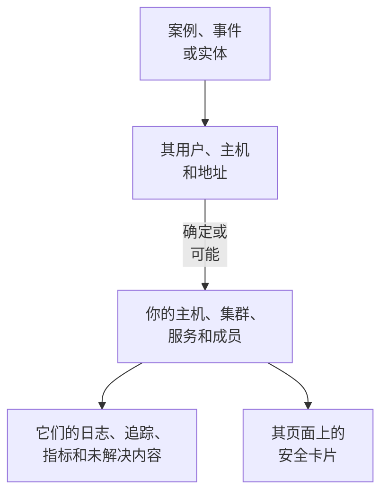

# 关联信号

安全案例会说明它涉及哪些用户、主机和地址。关联信号会说明其中哪些 OneUptime 已经知道（你的主机、容器主机、Kubernetes 集群、网络设备、云资源、无服务器函数、服务、检查它们的监视器和成员），以及案例前后每一个上发生了什么：它的日志、追踪和指标、其上未解决的事件和警报、监控它的监视器，以及它发生的变更。它还会在你的日志和追踪本身中搜索它们：Web 服务器访问日志中攻击者的地址、应用程序错误中泄露的电子邮件。反过来，主机、集群、云资源、服务、监视器或成员的页面会说明 Security Events 发现了它的哪些情况。

:::cards
- [在哪里看到](#在哪里看到): 案例的页面、事件的标签页、实体的页面，以及它们所指对象的页面。
- [值如何匹配](#值如何匹配): 什么算作同一条记录，什么只是可能。
- [每条记录显示什么](#每条记录显示什么): 案例前后的信号，以及其上未解决的内容。
- [在你的日志和追踪中](#在你的日志和追踪中): 它指向的地址、域名或电子邮件出现在你的日志行和跨度中的位置。
- [谁能看到什么](#谁能看到什么): 每条记录都以读者自己的角色读取。
:::

## 工作原理

OneUptime 会在项目的记录中查找每个值，说明每个匹配有多确定，并显示案例前后每条记录上发生了什么。

## 开始之前

- 有安全事件流入，并且项目中有它们可以指向的主机、Kubernetes 集群、云资源、服务、监视器或成员。请参阅[安全入门](/docs/telemetry/security-getting-started)。
- 能读取安全事件的角色，以及能读取你想查看的那类记录的角色。

## 在哪里看到

- **关联信号**：每个安全案例的一个页面。在 **产品 → 安全事件 → 安全案例 → 未结案例** 下打开一个案例，然后在其菜单中打开 **实体** 之后的 **关联信号**。
- **已连接**：每个安全事件的一个标签页。在 **产品 → 安全事件 → 事件** 下打开一个事件。它列出该事件所指的对象，范围是事件前后一小时。
- 实体的页面，位于 **产品 → 安全事件 → 实体风险** 下：在其最近一次安全事件前后，OneUptime 在哪里知道该用户、主机或地址。
- 每个主机、Docker 主机、Podman 主机、Kubernetes 集群、网络设备、云资源、无服务器函数、服务、监视器、成员和清单项目的页面上的 **安全** 卡片：指向它的未结安全案例、最近 7 天内有多少安全事件和发现指向它、其中最严重的一个，以及它的风险。**在 Security Events 中打开** 会在那里打开它。监视器的卡片说的是它检查的主机和地址。
- 事件页面上的 **安全** 卡片：当某个安全案例声明了该事件（**声明来源**），或未结案例指向它影响的主机或集群时（**指向其影响对象的未结案例**）。

## 值如何匹配

案例或事件所指的每个用户、主机和地址都会在项目的记录中查找：

| 案例或事件所指的内容 | 匹配到 | 确定程度 |
| --- | --- | --- |
| 与主机、容器主机、集群或网络设备上报的名称相同的主机名或域名，或云资源响应的名称 | 该记录 | 确定 |
| 同一名称，但未说明它是主机 | 该记录 | 可能 |
| 记录名称的简称或全称，例如 `web-1` 和 `web-1.acme.internal` | 该记录 | 可能 |
| 只有一个主机或网络设备拥有、或只有一个云资源在其上响应的公网 IP 地址 | 该记录 | 确定 |
| 私有 IP 地址，或多条记录拥有的 IP 地址 | 拥有它的每条记录 | 可能 |
| 云资源自己的 ID：AWS ARN、Azure 资源 ID 或 Google Cloud 资源名称 | 该云资源 | 确定 |
| 监视器检查的主机、公网 IP 地址或 URL 的主机 | 该监视器 | 确定 |
| 监视器检查的私有 IP 地址 | 该监视器 | 可能 |
| 成员的邮箱 | 该成员 | 确定 |
| 对于从你的日志中读取的事件，日志行发送时所属的记录 | 该主机、集群、云资源、无服务器函数或服务 | 确定 |
| 单纯的用户名、文件哈希或进程 | 无：没有记录以它们为键 | - |

- 可能的匹配会在名称旁显示 **可能匹配**，并说明原因。它从不计入该记录的页面，案例声明的事件也从不关联到它。
- 查找过但不是项目记录的内容列在 **没有匹配的记录** 下。当某个值可能属于的那类记录无法读取时，该值从不列在那里。
- 一个案例最多列出 10 条记录，确定的排在前面。

## 每条记录显示什么

- 它的信号，每个都按该记录和案例的时间段打开：**日志**、**追踪** 和 **指标**、服务的 **异常**、集群的 **Kubernetes 事件**、记录的 **拓扑**，以及清单中有其项目时的 **清单** 项目。
- 现在其上未解决的事件和警报，以及监控它的监视器，每个都可打开其页面。监视器会在名称旁显示其状态，它的 **日志** 是它每次检查时看到的内容。
- 成员的值班计划，其正在值班的计划旁显示 **正在值班**，以及其所在的团队。
- 该时间段内它发生的变更：服务的部署、集群的发布和主机的修复。

| 位置 | 时间段 |
| --- | --- |
| 案例 | 从首次检测前 30 分钟到最后一次检测后 30 分钟，最多为其最后 24 小时 |
| 事件 | 事件前后各 30 分钟 |
| 实体的页面 | 其最近一次安全事件前后各 30 分钟 |
| 记录的 **安全** 卡片 | 最近 7 天 |

## 在你的日志和追踪中

在记录下方，关联信号会在同一时间窗口内的日志和追踪中，搜索它指向的、只可能有一种含义的值：IP 地址（`127.0.0.1` 以及每台机器都有的其他地址除外）、完整的主机名或域名、电子邮件、URL、云资源 ID 和文件哈希。单独的主机名、单独的用户名和进程从不搜索：日志行可能因任何原因包含它们。最多搜索 10 个值。

| 位置 | 何时指向某个值 |
| --- | --- |
| 日志行的消息 | 不论大小写，包含完整的值：`10.0.0.1` 算在 `from 10.0.0.1:52144` 中，从不算在 `10.0.0.12` 或 `110.0.0.1` 中 |
| 日志行或跨度的属性 | 它的值与该值完全相同：按原样书写、小写或大写，或简写形式的 IPv6 地址 |

- 每个找到的值都会显示有多少日志行和跨度指向它、它在其中的位置（**在消息中** 或按键显示的属性，每一项都会在这些行或跨度和该时间窗口上打开 **日志** 或 **追踪**），以及发送它们的记录，最多的排在前面。
- 资源属性（例如 `resource.host.name`）只说明是哪条记录发送了某一行，从不计入。
- 搜索过但两者都没有指向的值列在 **不在你的日志或追踪中** 下。
- 搜索使用你自己的角色：你的角色无法读取的日志或追踪会注明且不会搜索；暂时无法搜索的会注明这一点，并提供 **重试**。超过 15 秒的搜索会被停止，并注明这一点。

## 谁能看到什么

- 关联信号和记录的 **安全** 卡片需要能读取安全事件的角色：Security Admin、Security Member、Security Viewer、Project Owner 或 Project Admin。其他人在任何页面上都看不到安全数据。请参阅[角色](/docs/permissions/reference#角色)。
- 事件的 **安全** 卡片需要能读取安全案例的角色。
- 每条记录都以你自己的角色读取，记录上的内容也是如此：无法读取值班计划的角色看不到成员的值班计划。你的角色无法读取的那类记录会被省略，页面会说明这一点；此刻无法读取的那类记录也会说明，并提供 **重试**。
- 只有在使用 Security Events 的项目中（最近 7 天内收到过安全事件的项目），记录的页面才会显示其 **安全** 卡片。

## 案例声明的事件

案例上的 **声明事件**，或声明事件的剧本步骤，会把事件关联到该案例确定连接的主机、Docker 和 Podman 主机、Kubernetes 集群、网络设备、云资源和服务。呼叫值班人员的剧本步骤会以同样的方式关联它打开的警报；检测规则或威胁情报匹配打开的每个警报和事件，会关联到该匹配确定指出的对象，而 Data Security 打开的则关联到它所涉及的数据存储。事件会显示在它们的页面上，其所有者的规则也会适用于它，事件的动态会写明该案例以及它关联到的内容。可能的匹配从不关联，监视器也不会：监视器上的事件可能改变它的状态，并显示在它的状态页面上。

## OneUptime AI

OneUptime AI 对案例的分诊会读取它的关联信号：案例所指的主机、服务、监视器和成员上未解决的内容和发生的变更、成员的值班计划和团队，以及它的值出现在你的日志和追踪中的位置。事件的调查会读取声明它的安全案例，以及指向其影响对象的未结案例。请参阅[安全中的 OneUptime AI](/docs/telemetry/security-ai)。

## 故障排除

:::details 案例所指的主机没有列出
检查案例是否以主机自报的名称指向该主机，或指向只有该主机拥有的公网地址。简称（例如 `web-1.acme.internal` 的 `web-1`）会作为可能匹配列出，而单纯的用户名、文件哈希或进程根本不会被查找。URL 只会在检查其主机的监视器中查找。
:::

:::details 案例指向的地址不在它的日志和追踪中
只搜索案例的时间窗口，并且只搜索你的角色能读取的日志和追踪。消息只有包含完整地址时才指向该地址：`10.0.0.12` 是另一个地址，尽管日志浏览器的消息搜索也会找到它。属性只有在其值与该地址完全相同时才指向它，资源属性则从不。
:::

:::details 正确的主机被列为可能匹配
可能的匹配从不计入或关联，这样两台机器共用的名称就不会让你误以为它说的是另一台。请让你的日志和检测以主机上报的名称来指向它。
:::

:::details 主机的页面没有安全卡片
该卡片只在最近 7 天内收到过安全事件的项目中，向能读取安全事件的角色显示。在这段时间内没有任何内容指向的主机，会显示一行说明。
:::

:::details 监视器的页面没有安全卡片
该卡片会为检查主机、地址或 URL 的监视器显示：网站、API、Ping、端口、SSL 证书、DNS 或域名监视器。心跳、脚本或你的遥测数据监视器不检查任何主机，因此没有该卡片。
:::

:::details 页面说你的角色无法查看某类记录
每条记录都以你自己的角色读取。请向 Project Owner 或 Project Admin 申请能读取该类记录的角色。
:::

## 后续步骤

:::cards
- [安全案例与剧本](/docs/telemetry/security-cases): 处理案例，并据此声明事件。
- [安全事件(SIEM)](/docs/telemetry/security-events): 案例背后的事件，以及读取它们的日志。
- [实体风险（基于风险的告警）](/docs/telemetry/security-entity-risk): 实体的页面、它的风险，以及它在 OneUptime 中的位置。
- [安全中的 OneUptime AI](/docs/telemetry/security-ai): 分诊如何读取案例所指的内容。
:::
