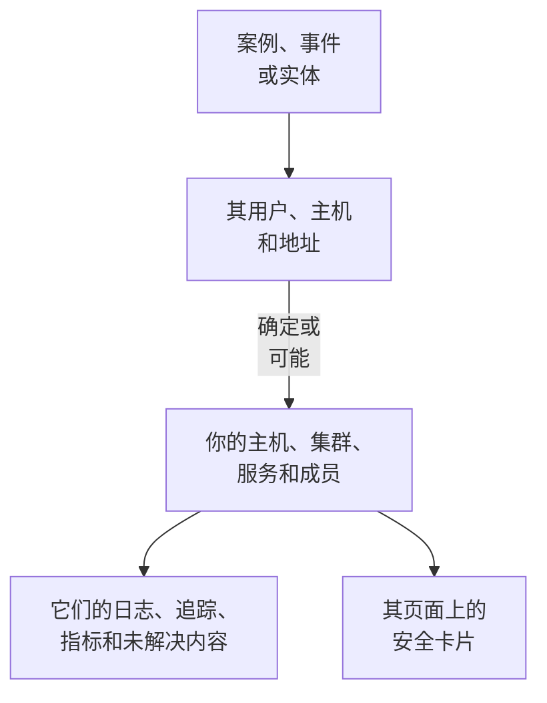

# 关联信号

安全案例会说明它涉及哪些用户、主机和地址。关联信号会说明其中哪些 OneUptime 已经知道（你的主机、容器主机、Kubernetes 集群、网络设备、服务和成员），以及案例前后每一个上发生了什么：它的日志、追踪和指标、其上未解决的事件和警报、监控它的监视器，以及它发生的变更。反过来，主机、集群、服务或成员的页面会说明 Security Events 发现了它的哪些情况。

:::cards
- [在哪里看到](#在哪里看到): 案例的页面、事件的标签页、实体的页面，以及它们所指对象的页面。
- [值如何匹配](#值如何匹配): 什么算作同一条记录，什么只是可能。
- [每条记录显示什么](#每条记录显示什么): 案例前后的信号，以及其上未解决的内容。
- [谁能看到什么](#谁能看到什么): 每条记录都以读者自己的角色读取。
:::

## 工作原理

OneUptime 会在项目的记录中查找每个值，说明每个匹配有多确定，并显示案例前后每条记录上发生了什么。

## 开始之前

- 有安全事件流入，并且项目中有它们可以指向的主机、Kubernetes 集群、服务或成员。请参阅[安全入门](/docs/telemetry/security-getting-started)。
- 能读取安全事件的角色，以及能读取你想查看的那类记录的角色。

## 在哪里看到

- **关联信号**：每个安全案例的一个页面。在 **产品 → Security Events → 安全案例 → 未结案例** 下打开一个案例，然后在其菜单中打开 **实体** 之后的 **关联信号**。
- **已连接**：每个安全事件的一个标签页。在 **产品 → Security Events → 事件** 下打开一个事件。它列出该事件所指的对象，范围是事件前后一小时。
- 实体的页面，位于 **产品 → Security Events → 实体风险** 下：在其最近一次安全事件前后，OneUptime 在哪里知道该用户、主机或地址。
- 每个主机、Docker 主机、Podman 主机、Kubernetes 集群、网络设备、服务、成员和清单项目的页面上的 **安全** 卡片：指向它的未结安全案例、最近 7 天内有多少安全事件和发现指向它、其中最严重的一个，以及它的风险。**在 Security Events 中打开** 会在那里打开它。
- 事件页面上的 **安全** 卡片：当某个安全案例声明了该事件（**声明来源**），或未结案例指向它影响的主机或集群时（**指向其影响对象的未结案例**）。

## 值如何匹配

案例或事件所指的每个用户、主机和地址都会在项目的记录中查找：

| 案例或事件所指的内容 | 匹配到 | 确定程度 |
| --- | --- | --- |
| 与主机、容器主机、集群或网络设备上报的名称相同的主机名或域名 | 该记录 | 确定 |
| 同一名称，但未说明它是主机 | 该记录 | 可能 |
| 记录名称的简称或全称，例如 `web-1` 和 `web-1.acme.internal` | 该记录 | 可能 |
| 只有一条记录拥有的公网 IP 地址 | 该记录 | 确定 |
| 私有 IP 地址，或多条记录拥有的 IP 地址 | 拥有它的每条记录 | 可能 |
| 成员的邮箱 | 该成员 | 确定 |
| 对于从你的日志中读取的事件，日志行发送时所属的记录 | 该主机、集群或服务 | 确定 |
| 单纯的用户名、URL、文件哈希或进程 | 无：没有记录以它们为键 | - |

- 可能的匹配会在名称旁显示 **可能匹配**，并说明原因。它从不计入该记录的页面，案例声明的事件也从不关联到它。
- 查找过但不是项目记录的内容列在 **不在 OneUptime 中** 下。当某个值可能属于的那类记录无法读取时，该值从不列在那里。
- 一个案例最多列出 10 条记录，确定的排在前面。

## 每条记录显示什么

- 它的信号，每个都按该记录和案例的时间段打开：**日志**、**追踪** 和 **指标**、服务的 **异常**、集群的 **Kubernetes 事件**、记录的 **拓扑**，以及清单中有其项目时的 **清单** 项目。
- 现在其上未解决的事件和警报，以及监控它的监视器，每个都可打开其页面。
- 该时间段内它发生的变更：服务的部署、集群的发布和主机的修复。

| 位置 | 时间段 |
| --- | --- |
| 案例 | 从首次检测前 30 分钟到最后一次检测后 30 分钟，最多为其最后 24 小时 |
| 事件 | 事件前后各 30 分钟 |
| 实体的页面 | 其最近一次安全事件前后各 30 分钟 |
| 记录的 **安全** 卡片 | 最近 7 天 |

## 谁能看到什么

- 关联信号和记录的 **安全** 卡片需要能读取安全事件的角色：Security Admin、Security Member、Security Viewer、Project Owner 或 Project Admin。其他人在任何页面上都看不到安全数据。请参阅[角色](/docs/permissions/reference#角色)。
- 事件的 **安全** 卡片需要能读取安全案例的角色。
- 每条记录都以你自己的角色读取。你的角色无法读取的那类记录会被省略，页面会说明这一点；此刻无法读取的那类记录也会说明，并提供 **重试**。
- 只有在使用 Security Events 的项目中（最近 7 天内收到过安全事件的项目），记录的页面才会显示其 **安全** 卡片。

## 案例声明的事件

案例上的 **声明事件**，或声明事件的剧本步骤，会把事件关联到该案例确定连接的主机、Docker 和 Podman 主机、Kubernetes 集群和服务。事件会显示在它们的页面上，其所有者的规则也会适用于它，事件的动态会写明该案例以及它关联到的内容。可能的匹配从不关联。

## OneUptime AI

OneUptime AI 对案例的分诊会读取它的关联信号：案例所指的主机、服务和成员上未解决的内容和发生的变更。事件的调查会读取声明它的安全案例，以及指向其影响对象的未结案例。请参阅[安全中的 OneUptime AI](/docs/telemetry/security-ai)。

## 故障排除

:::details 案例所指的主机没有列出
检查案例是否以主机自报的名称指向该主机，或指向只有该主机拥有的公网地址。简称（例如 `web-1.acme.internal` 的 `web-1`）会作为可能匹配列出，而单纯的用户名、URL、文件哈希或进程根本不会被查找。
:::

:::details 正确的主机被列为可能匹配
可能的匹配从不计入或关联，这样两台机器共用的名称就不会让你误以为它说的是另一台。请让你的日志和检测以主机上报的名称来指向它。
:::

:::details 主机的页面没有安全卡片
该卡片只在最近 7 天内收到过安全事件的项目中，向能读取安全事件的角色显示。在这段时间内没有任何内容指向的主机，会显示一行说明。
:::

:::details 页面说你的角色无法查看某类记录
每条记录都以你自己的角色读取。请向 Project Owner 或 Project Admin 申请能读取该类记录的角色。
:::

## 后续步骤

:::cards
- [安全案例与剧本](/docs/telemetry/security-cases): 处理案例，并据此声明事件。
- [安全事件(SIEM)](/docs/telemetry/security-events): 案例背后的事件，以及读取它们的日志。
- [实体风险（基于风险的告警）](/docs/telemetry/security-entity-risk): 实体的页面、它的风险，以及它在 OneUptime 中的位置。
- [安全中的 OneUptime AI](/docs/telemetry/security-ai): 分诊如何读取案例所指的内容。
:::
