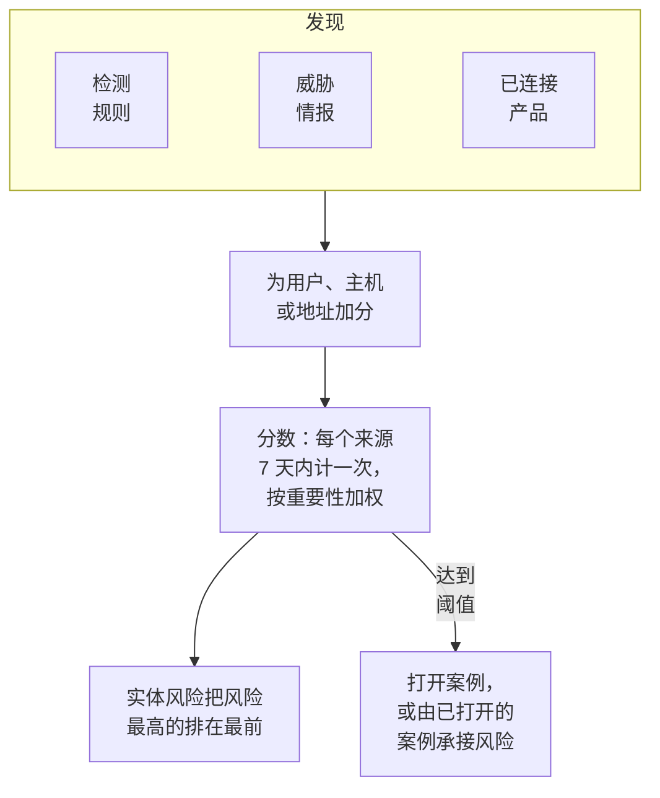

# 实体风险（基于风险的告警）

单个发现很少能说明太多。一连串登录失败、主机上的第一次 sudo、来自新国家的登录，各自都值得看一眼；同一个账户在一周内三者都出现，就值得开一个案例。实体风险会把你的检测规则、威胁情报、已连接产品和数据安全对每个用户、主机、IP 地址和数据存储的发现累加起来，把风险最高的排在最前，并在某个实体的风险达到项目阈值时针对它打开案例。

:::cards
- [分数如何计算](#分数如何计算): 按严重程度计分，每个来源每周只计一次。
- [风险级别与案例](#风险级别与案例): 分数如何解读，以及何时打开案例。
- [实体重要性](#实体重要性): 越重要的计得越多，越不重要的计得越少。
- [实体的页面](#实体的页面): 它为何有风险、它的一个月，以及与它相关的案例。
- [检测规则的风险分](#检测规则的风险分): 规则在分数中自己的权重。
:::

## 工作原理

打开 **产品 → Security Events → 实体风险**：当前有风险的每个用户、主机、IP 地址和数据存储，风险最高的在前，附带其级别、重要程度、由什么发现以及何时发现。每个实体都在自己的页面中打开。概览中的 **风险最高的实体** 显示此列表的前几位，其下方的 **查找实体** 可在 30 天的事件中查找任意值，包括域名或文件哈希。

## 开始之前

- 有安全事件流入，并且有检测规则、威胁情报或已连接产品能在其中发现问题。请参阅[安全入门](/docs/telemetry/security-getting-started)。
- 按指向某人的字段分组的检测规则：**分组字段**，例如 `principalUser`、`principalHost` 或 `principalIp`，或关联规则分组所用的字段。不按任何字段分组的规则不会增加风险。
- 要更改 **风险评分**：开关和阈值需要 Project Owner 或 Project Admin，实体列表需要可以创建检测规则的角色。Security Viewer 可以查看全部内容。请参阅[角色](/docs/permissions/reference#角色)。

## 分数如何计算

每个发现都会给它所涉及的用户、主机、IP 地址或数据存储加上风险分：

| 发现的严重程度 | 增加 |
| --- | --- |
| 低 | 10 分 |
| 中 | 25 分 |
| 高 | 50 分 |
| 严重 | 75 分 |

- 信息级发现不加分，严重程度未知的发现按中计算。
- 检测规则的分数计入它分组所用的值。威胁情报匹配计入指标所指的 IP 地址。已连接产品的告警计入它所指的用户和主机，否则计入其 IP 地址。数据安全的问题计入发现它的数据存储。
- 每个来源只计一次。检测规则、威胁情报源、已连接产品的规则或数据安全的检查，无论触发多少次，7 天内都只计一次，按其增加的最大值计算：一条嘈杂的规则永远不会让实体看起来比三条不同的规则更糟。
- 7 天内没有任何发现的来源不再计入，分数随之下降。分数每 15 分钟检查一次，因此即使没有新发现，分数也会按时下降。

实体的分数是其来源的总和，再按其重要性加权。**发送测试攻击** 的测试攻击，以及有人手动打开的案例，都不会增加风险。

## 风险级别与案例

每个分数都会对照项目的阈值（除非你更改，否则为 100）解读为一个级别：

| 风险分数 | 解读为 | 会发生什么 |
| --- | --- | --- |
| 1 至 49 | 低 | 列在实体风险中 |
| 50 至 99 | 中 | 列在实体风险中 |
| 100 至 199 | 高 | 打开一个高级别案例 |
| 200 及以上 | 严重 | 打开一个严重级别案例 |

当实体的风险达到阈值时，会针对它产生一个来源为实体风险的检测。该检测会加入关于该实体的已打开案例，或打开一个以它命名的案例，例如 `High risk — k.morgan@acme-commerce.example`，并列出为风险加分最多的来源（最多 10 个），以及其分数、触发次数和最近一次触发时间。

一旦针对实体的风险打开了案例，之前的发现就不会再次计入：只有之后的新来源再次累计达到阈值时，才会打开另一个案例。已作为处理完毕关闭的案例，不会因相同的发现而重新打开。

在 **产品 → Security Events → 设置 → 风险评分 → 风险阈值** 中更改阈值：10 到 10000 的整数。中级从其一半开始，严重从其两倍开始，所有页面都一样。

### 开启或关闭风险案例

**设置 → 风险评分** 中的 **风险案例** 决定风险是否打开案例，切换后立即保存。新项目默认开启。在实体风险推出之前创建的项目会保持关闭，直到有人开启，**实体风险** 会在列表上方说明这一点。无论如何，风险都会被评分和列出。

## 实体重要性

有些实体比其他实体更重要：域控制器、高管的账户、支付服务器。有些则没那么重要，例如扫描行为在预期之内的漏洞扫描器。在 **设置 → 风险评分 → 实体重要性** 中用 **添加实体** 列出它们：

| 重要性 | 风险的计算方式 |
| --- | --- |
| 低 | ×0.5 |
| 未列出 | ×1 |
| 高 | ×1.5 |
| 极高 | ×2 |

条目可以是一个值或一个 `*` 模式，不区分大小写：`dc-*` 表示每个域控制器，`*@contractors.example` 表示每个外包人员。**类型** 可将其限定为用户、主机、IP 地址或数据存储；留空则匹配全部。当多个条目都指向同一实体时，以最具体的为准：完整的值优先于模式，较长的模式优先于较短的模式。更改会在几分钟内反映到每个实体的分数上。数据安全会自行列出它认定为敏感的数据存储：机密的为高，受限的为极高；你修改过的条目归你所有，数据安全不再改动它。

## 实体的页面

在 **实体风险** 的某一行点击 **查看**，或在案例的 **实体** 页面点击实体旁的风险：

| 部分 | 显示内容 |
| --- | --- |
| 页头 | 它的类型和重要性、分数和级别，以及分数的计算方式 |
| **活动** | 它在过去 7 天内的安全事件和发现 |
| **增加其风险的来源** | 每个来源、其严重程度、增加的分数、触发次数和最近一次触发时间 |
| **过去 30 天的风险** | 它每天结束时的分数，按级别着色 |
| **相关案例** | 针对它打开的安全案例，最新的在前 |

**在关联分析中打开** 会绘制其事件的关系图，**搜索其事件** 会打开该周的 **事件**。**重置风险** 会清除它的分数和来源，例如在计划的测试之后：之后的发现从零开始计算，它的案例不受影响。重置需要可以删除安全数据的角色，并会被[审计日志](/docs/configuration/audit-logs)记录。

OneUptime AI 在对案例进行分诊时，会读取案例中实体的风险。请参阅[安全中的 OneUptime AI](/docs/telemetry/security-ai)。

## 检测规则的风险分

检测规则会加上其级别对应的分数，级别来自其 Sigma `level`。要赋予它自己的权重，请打开规则的表单，进入 **匹配时**，打开 **更多字段**，并将 **风险分** 设置为 0（不增加风险）到 100 之间。留空则使用其级别对应的分数。

## 故障排除

:::details 某个实体没有出现在实体风险中
请检查过去 7 天内是否有检测规则、威胁情报源或已连接产品发现了与它相关的内容，以及规则是否按指向它的字段分组。信息级发现不加分，7 天内没有任何发现的来源不再计入。
:::

:::details 实体的风险达到了阈值，但没有打开案例
请检查 **设置 → 风险评分** 中的 **风险案例** 是否已开启。如果之前已针对该实体的风险打开过案例，那么只有之后的新来源才会计入下一个案例。
:::

:::details 某条规则反复触发，实体的分数却没有上升
这正是计算方式：一个来源在 7 天内只计一次，按其增加的最大值计算。降低嘈杂规则的 **风险分**，或将发现在预期之内的实体标记为低重要性。
:::

:::details 分数与其来源的总和不符
它的重要性对分数进行了加权。实体的页面会显示其来源的总和与权重，例如来源合计 100 × 2 = 200。
:::

## 后续步骤

:::cards
- [安全案例与剧本](/docs/telemetry/security-cases): 处理风险打开的案例，并以结论关闭它们。
- [安全事件(SIEM)](/docs/telemetry/security-events): 检测规则、关联分析，以及每个发现背后的事件。
- [威胁情报(STIX/TAXII)](/docs/telemetry/threat-intelligence): 为地址的风险加分的匹配。
- [安全中的 OneUptime AI](/docs/telemetry/security-ai): 分诊如何读取案例中实体的风险。
:::
