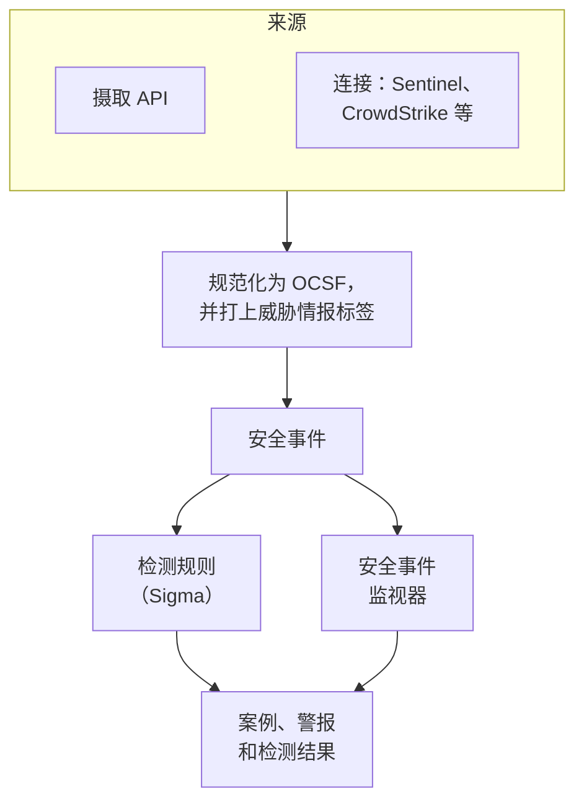
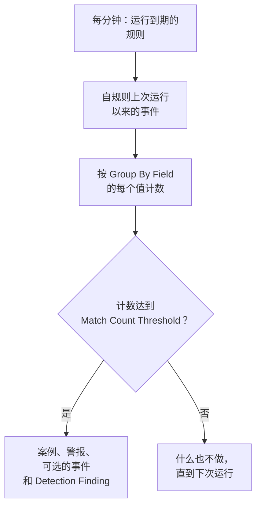

# 安全事件(SIEM)

OneUptime 把安全事件与你的日志、跟踪和指标保存在一起，并且无论它们以什么格式到达，都统一成同一种结构：[OCSF](https://schema.ocsf.io/)（Open Cybersecurity Schema Framework）。你可以从任何来源发送事件、搜索它们，并用 Sigma 检测规则、威胁情报和监视器找出重要的事件。它们发现的问题会成为需要处理的 [案例](/docs/telemetry/security-cases)，并由剧本做出响应。

:::cards
- [发送事件](#发送安全事件): 一个 HTTPS POST、一个 Fluent Bit 输出，或与安全产品的连接。
- [搜索和关联分析](#浏览安全事件): 事件浏览器和关联分析图。
- [狩猎](#狩猎): 按计划运行、发现内容时通知相关人员的已保存搜索。
- [检测规则](#检测规则): 会打开案例和警报的 Sigma 规则。
- [监视器](#安全事件监视器): 滚动时间窗口内的计数，以及会恢复的状态。
:::

## 工作原理



在 **可观测性** 下打开 **产品 → Security Events**。它的菜单为安全的每个部分设了一个分区，其中每一项都有自己的页面：

| 页面 | 分区 | 用途 |
| --- | --- | --- |
| **概览** | 概览 | 安全的设置情况、现在需要有人处理的内容，以及案例处理的速度 |
| **未结案例** | 安全案例 | 队列：每个尚未关闭的案例，按所涉及的对象分组 |
| **分配给我** | 安全案例 | 分配给你的未结案例 |
| **无人认领** | 安全案例 | 还没有人认领的未结案例 |
| **已关闭案例** | 安全案例 | 已给出结论并关闭的案例，最近的在前 |
| **全部案例** | 安全案例 | 每个案例，无论未结还是已关闭 |
| **事件** | 事件 | 搜索和过滤每个事件，并打开某个事件查看它的所有字段 |
| **狩猎** | 事件 | 从事件保存的搜索，一键再次打开，或按计划运行，发现内容时通知相关人员 |
| **Campaigns** | 事件 | 每个发送过攻击请求的地址，以及它的请求中是否有任何一个通过 |
| **实体风险** | 事件 | 按本周发现评分的每个用户、主机和地址，风险最高的在前 |
| **关联分析** | 事件 | 共享同一主机、用户或 IP 地址的事件构成的图 |
| **检测规则** | Detections | 按计划运行并打开案例的 Sigma 规则 |
| **规则例外** | Detections | 规则特意跳过的内容，例如扫描器或计划内的测试，每一条都记着是谁添加的、为什么添加 |
| **监视列表** | Detections | 规则所比对的列表，例如 VIP 用户、关键主机、已知恶意文件哈希，以及管理员可以从哪些地址登录 |
| **规则库** | Detections | 可直接添加的现成检测规则，每条都显示它读取的事件以及这些事件是否到达，推荐的规则带有标记 |
| **威胁情报** | Detections | 已知恶意指标的 STIX/TAXII 源 |
| **ATT&CK 覆盖范围** | Detections | 你的规则覆盖的 MITRE ATT&CK 技术 |
| **剧本** | Playbooks | 在案例上自动或手动运行的步骤 |
| **待审批** | Playbooks | 等待有人批准或拒绝的剧本步骤 |
| **剧本运行记录** | Playbooks | 每个剧本逐步做了什么 |
| **受保护的实体** | Playbooks | 任何剧本都不会遏制的用户和主机 |
| **设置** | 人工智能 | OneUptime AI 是否研判每个新案例 |
| **连接** | Connections | 您的日志、OneUptime 轮询的安全产品，以及它发送到的 SIEM |
| **设置指南** | Connections | 发送事件的代码片段，已填好你的摄取密钥 |
| **案例优先级** | 设置 | 案例有多紧急：项目自己的优先级，最紧急的在前 |
| **响应目标** | 设置 | 每个优先级的案例必须多快被接手并遏制 |
| **案例状态** | 设置 | 案例经历的各个步骤，以及每个步骤中的案例被视为什么 |
| **风险评分** | 设置 | 实体风险是否打开案例、在多高风险时打开，以及每个实体的重要程度 |

只需设置一次的 **检测**、**人工智能**、**连接** 和 **设置** 会保持折叠，直到你打开它们。刚开始使用安全功能？[安全入门](/docs/telemetry/security-getting-started) 两次点击即可完成设置。

## 开始之前

只有 Project Owner 和 Project Admin 角色，以及三个 Security 角色可以读取安全数据；其他角色在 Security Events 中什么也看不到。请参阅 [角色](/docs/permissions/reference#角色)。

| 角色 | 能做什么 |
| --- | --- |
| Security Admin | 一切：事件、案例、剧本、检测规则、威胁情报源和连接 |
| Security Member | 读取事件和威胁情报，处理案例，运行剧本并批准其步骤，以及创建、修改和删除检测规则和情报源。不能设置剧本或连接，也不能删除安全数据。 |
| Security Viewer | 读取事件、案例、剧本、规则、情报源、指标和连接 |

## 发送安全事件

:::steps
### 创建摄取密钥

打开 **项目设置 → 遥测与 APM → 摄取密钥** ，点击 **创建摄取密钥** 。安全事件与其他遥测数据使用相同的密钥。

### 发送你的事件

把 JSON 发送到 `/security-events/v1/ingest`，并在 `x-oneuptime-token` 中携带密钥：

:::tabs
@tab OCSF
```bash
curl -X POST "https://oneuptime.com/security-events/v1/ingest?format=ocsf" \
  -H "Content-Type: application/json" \
  -H "x-oneuptime-token: YOUR_INGESTION_TOKEN" \
  -H "x-oneuptime-service-name: my-security-source" \
  -d '{ "events": [ { "class_uid": 3002, "severity_id": 4, "status": "Failure", "message": "Failed logon for alice", "actor": { "user": { "name": "alice" } }, "src_endpoint": { "ip": "203.0.113.7", "hostname": "laptop-alice" } } ] }'
```
@tab Google UDM
```bash
curl -X POST "https://oneuptime.com/security-events/v1/ingest?format=udm" \
  -H "Content-Type: application/json" \
  -H "x-oneuptime-token: YOUR_INGESTION_TOKEN" \
  -d '{ "events": [ { "metadata": { "event_type": "USER_LOGIN" }, "principal": { "hostname": "laptop-alice", "user": { "userid": "alice" }, "ip": ["203.0.113.7"] }, "security_result": [{ "severity": "HIGH", "action": ["BLOCK"] }] } ] }'
```
@tab Generic JSON
```bash
curl -X POST "https://oneuptime.com/security-events/v1/ingest" \
  -H "Content-Type: application/json" \
  -H "x-oneuptime-token: YOUR_INGESTION_TOKEN" \
  -d '{ "events": [ { "severity": "high", "event_type": "ssh_brute_force", "message": "12 failed SSH logins in 60s", "username": "root", "hostname": "web-01", "src_ip": "203.0.113.7" } ] }'
```
:::

事件进入队列后，端点会返回 `200`。像这些示例一样不带时间的事件，会放在它到达的那一刻。

### 在事件中找到它们

打开 **产品 → Security Events → 事件** 。几秒钟内事件就会出现，严重程度、类别、用户、主机和 IP 地址都已填好。
:::

### 格式

| `format` | 读取的内容 | 也接受 |
| --- | --- | --- |
| `ocsf` | OCSF 事件 JSON（`class_uid`、`severity_id` 等） | 无 |
| `udm` | Google SecOps（Chronicle）UDM 事件（`metadata.event_type` 等） | `chronicle`、`google-secops` |
| `google-secops-alert` | Google SecOps 检测和警报：SOAR Webhook 和检测流 | `secops-alert`、`detection` |
| `generic` | 任何其他 JSON，按常见字段名读取 | 无 |

可以用 `?format=`、`x-oneuptime-security-event-format` 标头，或顶层的 `"format"` 字段指定格式。不指定时，每个事件的格式会单独判断，所以一个 Webhook 可以混合发送检测和原始事件。

- 正文可以是一个事件、一个事件数组，或 `{ "events": [...] }`。
- `x-oneuptime-service-name` 标头指定事件所属的遥测服务。没有它时，事件属于以第一个事件的产品或供应商命名的服务，或属于 `Security Events`。
- 不会因为无法映射而丢弃任何内容：来源的每个字段都会进入事件的属性。

### 通用 JSON 字段

通用事件按常见字段名读取：

| 事件的字段 | 从以下第一个存在的字段读取 |
| --- | --- |
| `message` | `message`、`msg`、`summary`、`description`、`title` |
| `severityName` | `severity`、`severity_name`、`level`、`priority`、`risk_level` |
| `time` | `timestamp`、`time`、`@timestamp`、`event_time`、`created_at` |
| `principalUser` | `user`、`username`、`user_name`、`account`、`actor` |
| `principalHost` | `host`、`hostname`、`computer`、`device`、`machine` |
| `principalIp` | `source_ip`、`src_ip`、`client_ip`、`ip` |
| `targetIp` | `destination_ip`、`dest_ip`、`dst_ip`、`target_ip` |
| `className` | `event_type`、`category`、`type`、`action` |
| `ruleName` | `rule`、`rule_name`、`signature`、`detection` |
| `productName` | `product`、`product_name`、`source`、`log_source` |
| `processName` | `process_name`、`process.name`、`proc.name`、`comm` |
| `processPath` | `process_path`、`Image`、`NewProcessName`、`exe`、`process.executable` |
| `processCommandLine` | `command_line`、`CommandLine`、`cmdline`、`process.command_line`、`proc.cmdline`、`process` |
| `parentProcessName` | `parent_process_name`、`process.parent.name`、`proc.pname` |
| `parentProcessPath` | `parent_process_path`、`ParentImage`、`ParentProcessName`、`process.parent.executable` |
| `parentProcessCommandLine` | `parent_command_line`、`ParentCommandLine`、`process.parent.command_line`、`proc.pcmdline` |

表示严重程度的词会变成 OCSF 级别：`info` 读作 Informational，`warning` 读作 Low，`error` 读作 Medium，`alert` 读作 Critical，`emergency` 读作 Fatal。

### 用 Fluent Bit 转发

要发送你已经在收集的安全日志，例如 auditd、syslog 或 Falco，请给 Fluent Bit 添加一个 `http` 输出：

```ini title="fluent-bit.conf"
[OUTPUT]
    Name             http
    Match            security.*
    Host             oneuptime.com
    Port             443
    tls              On
    URI              /security-events/v1/ingest
    Format           json
    Json_date_key    timestamp
    Json_date_format iso8601
    Header           x-oneuptime-token YOUR_INGESTION_TOKEN
    Header           x-oneuptime-service-name my-security-source
    Retry_Limit      5
```

**连接** 下的 **设置指南** 页面提供这些代码片段，并已填好你自己的主机和密钥。

### 在日志中查找安全事件

**连接** 顶部的 **你的日志** 会把您已经发送到 OneUptime 的日志变成一个来源。开启 **在日志中查找安全事件** 后，项目的新日志每分钟都会被读取，其中的每次 SSH 或 Windows 登录、sudo 命令、云审计记录、安全产品的 CEF 或 LEEF 记录、Kubernetes 审计记录和 Web 攻击都会存储为安全事件。各类内容的范围请参阅 [安全入门](/docs/telemetry/security-getting-started#在日志中查找安全事件)。

每一类都以普通日志的形式到达 OneUptime：

| 类型 | 从哪里发送 |
| --- | --- |
| SSH 登录、sudo | Linux 机器的 journal 或认证日志，使用 [OpenTelemetry Collector](/docs/telemetry/host-otel-collector) 发送 |
| Windows 事件 | 机器上收集器的 `windowseventlog` 接收器，或把每个事件写成 JSON 的转发器，例如 NXLog 或 Winlogbeat |
| AWS CloudTrail | 投递到 CloudWatch Logs 的跟踪，由收集器的 `awscloudwatch` 接收器读取 |
| Google Cloud 审计日志 | 指向 Pub/Sub 的日志接收器（sink），由收集器的 `googlecloudpubsub` 接收器以 `encoding: raw_text` 读取 |
| Azure 活动和 Entra ID 日志 | 流式传输到 Event Hub 的诊断设置，由收集器的 `azureeventhub` 接收器以 `format: raw` 读取 |
| CEF、LEEF | 产品的 syslog，由 [rsyslog](/docs/telemetry/syslog) 转发 |
| Kubernetes 审计日志 | API 服务器的审计日志文件，由收集器的 `filelog` 接收器读取 |
| Web 攻击 | Web 服务器的访问日志，由收集器的 `filelog` 接收器读取 |

在 **你的日志** 上，每一类都会显示上次发现它的时间，**检查一行日志** 则会在任何日志到达之前，显示你粘贴的一行会变成什么。

### 连接安全产品

**连接** 会替你轮询安全产品，并把它的新记录作为安全事件导入。连接保存产品的设置和加密的凭据；工作进程按你设置的间隔轮询它，并跳过已经导入过的记录。

| 产品 | 导入内容 | 设置指南 |
| --- | --- | --- |
| Google SecOps (Chronicle) | 规则检测、精选检测和警报，作为 Detection Finding | [Google SecOps](/docs/integrations/google-secops) |
| Microsoft Sentinel | 事件（incident），作为 Incident Finding | [Microsoft Sentinel](/docs/integrations/microsoft-sentinel) |
| Microsoft Defender XDR | 警报，作为 Detection Finding | [Microsoft Defender XDR](/docs/integrations/microsoft-defender-xdr) |
| CrowdStrike Falcon | 警报，作为 Detection Finding | [CrowdStrike Falcon](/docs/integrations/crowdstrike-falcon) |
| Splunk Enterprise Security | Notable 事件或任意搜索，作为 Detection Finding | [Splunk Enterprise Security](/docs/integrations/splunk) |
| Elastic Security | 检测警报，作为 Detection Finding | [Elastic Security](/docs/integrations/elastic-security) |
| AWS Security Hub | Finding，作为 Detection Finding 和 Compliance Finding | [AWS Security Hub](/docs/integrations/aws-security-hub) |
| Okta System Log | 登录、MFA、账户和策略事件 | [Okta System Log](/docs/integrations/okta) |
| Microsoft Entra ID | 登录和目录更改，以及 Microsoft 365 审计日志中的邮件转发、共享和钓鱼判定 | [Microsoft Entra ID](/docs/integrations/microsoft-entra-id) |
| Google Workspace | 登录、Google 自身的检测、管理员更改和应用授权，以及云端硬盘中的共享 | [Google Workspace](/docs/integrations/google-workspace) |

- 产品自身的警报，只要级别达到或高于 **Open Cases From**（默认为 **高及以上**，你也可以选择其他级别或 **从未**），就会打开 [案例](/docs/telemetry/security-cases)，并按它们涉及的用户、主机或地址分组。
- 连接按产品创建记录的时间读取记录，而不是按记录所描述活动的时间。每小时运行一次的 SIEM 规则会在它匹配的事件之后很久才创建检测，这些检测仍然会被导入。
- 第一次轮询会回溯 24 小时，所以新连接会立刻显示最近的记录。
- 连接所在行中的 **测试连接** 会检查对产品的访问以及 OneUptime 自身的工作进程是否在运行，不会导入任何内容。**立即运行** 会立即轮询。

## 事件包含什么

每个事件都与类型化字段和来源负载一起存储：

| 分组 | 字段 |
| --- | --- |
| 分类 | `categoryName`、`className`、`activityName`、`statusName`，以及它们的 OCSF ID（`categoryUid`、`classUid`） |
| 严重程度 | `severityName`，取值为 Unknown、Informational、Low、Medium、High、Critical、Fatal 或 Other 之一，以及 `severityId` |
| 谁做的 | `principalUser`、`principalHost`、`principalIp`、`principalProcess` |
| 涉及了什么 | `targetUser`、`targetHost`、`targetIp`、`targetPort`、`targetResource` |
| 进程 | `processName`、`processPath` 和 `processCommandLine`：在进程活动事件中是被启动、打开、注入或结束的进程，其他事件中是执行操作的进程。`parentProcessName`、`parentProcessPath` 和 `parentProcessCommandLine`：启动它的进程 |
| 来源 | `productName`、`vendorName`、`ruleId`、`ruleName`、`eventUid` |
| 内容 | `message`、`mitreTactics`、`mitreTechniques` 和 `observables`：从事件中提取的每个用户、主机、IP 地址、域名和哈希 |
| 属性 | 完整的来源负载，展平为以点分隔的键 |

在 OneUptime 14.0.84 之前存储的事件，进程字段为空，只以 `principalProcess`（执行操作的进程）记录其进程。它们之后不会被补全：在保留期结束之前，它们保持存储时的内容。

## 浏览安全事件

**事件** 是一个与日志和跟踪浏览器类似的遥测浏览器：一个按严重程度显示时间窗口内事件的图表、一个分面侧栏、事件列表，以及一个显示所打开事件的每个字段和属性的面板。时间窗口、过滤器和搜索都保存在 URL 中，所以过滤后的视图可以分享，刷新后也不会丢失。

### 搜索

搜索栏使用与其他遥测浏览器相同的语法（参见 [搜索语法](/docs/telemetry/search-syntax)）：

| 语法 | 含义 | 示例 |
| --- | --- | --- |
| 自由文本 | 消息中包含它 | `failed logon` |
| `"quoted phrase"` | 这些词连在一起 | `"brute force"` |
| `<field>:<value>` | 类型化字段 | `severity:Critical` |
| `@<attribute>:<value>` | 来源属性 | `@threat.matched:true` |
| `-<filter>` | 排除这一项 | `-severity:Informational` |
| `<field>:(a OR b)` | 这些值中的任意一个 | `severity:(High OR Critical)` |
| `<field>:a*` | `*` 表示任意文本，`?` 表示一个字符 | `host:web-*` |
| `@<attribute>:*` | 存在该属性 | `@threat.indicator_id:*` |
| `@<attribute>:~text` | 属性包含该文本 | `@finding_info.title:~ransom` |

字段要么是简称（`severity`、`class`、`category`、`activity`、`status`、`vendor`、`product`、`rule`、`user`、`host`、`ip`、`targetuser`、`targethost`、`targetip`、`processname`、`commandline`、`parentprocessname`、`observable`、`tactic`、`technique`、`requestoutcome`、`trace`、`session`），要么是字段本身的名称，例如 `severityName` 或 `principalHost`。任何其他名称都会被读作来源属性。`observable:<value>` 会找出提到某个值的每个事件，无论该值出现在活动的哪一方。

### 分面

侧栏按 **来源**、**严重程度**、**Request Outcome**、**事件类别**、**类别**、**活动**、**状态**、**供应商**、**产品**、**检测规则**、**源用户**、**源主机**、**进程** 和 **父进程** 统计时间窗口内的事件。点击某个值只保留它的事件，点击旁边的减号则排除它们。再次点击即可撤销。图表和每个计数描述的正是列表中的事件。

### 之后发生了什么

从已追踪请求中写入的日志行读取的事件，会被一路跟进到该请求中。它的面板会说明请求走到了哪一步（**已拒绝**、**Reached App**、**Errored** 或 **Reached Database**）以及是谁发送的，并链接到它的追踪、异常、会话回放以及日志行本身。属于某次攻击的日志行、追踪和异常，也会在它们自己的页面上说明这一点。

### Campaigns

**Campaigns** 把每个发送过攻击请求的地址列为一行，包括攻击类型、工具、发送的请求，以及有多少请求通过。请求到达了你的应用的地址排在最前面。

### 关联分析

**关联分析** 围绕一个主机、用户或 IP 地址绘制事件：在你搜索的值周围显示它们的事件类别，并按最严重的严重程度标记，同一批事件中出现的其他值显示在外圈。点击某个类别可以列出它的事件，点击某个值可以接着按它进行关联分析。**事件** 中事件面板里的每个 observable 都可以直接在 **关联分析** 中打开。

## 狩猎

狩猎是对安全事件的一次搜索，以名称保存：包括搜索栏的文本、侧栏的过滤器，以及回溯的时间范围。你可以一键再次打开它，按计划运行它并在发现内容时通知相关人员，还可以把它找到的事件保存到案例中。

### 将搜索保存为狩猎

在 **事件** 中搜索和过滤，直到列表显示你要找的内容，然后打开工具栏上的 **狩猎** 并选择 **另存为狩猎**。为它命名，选择是否按计划运行，随后会打开它的页面。**事件 → 狩猎** 列出项目的所有狩猎，每个都显示其搜索、运行频率、通知对象以及上次运行发现的内容；那里的 **创建狩猎** 按你在 **事件** 中输入的方式接收搜索。一个项目最多可保存 200 个狩猎。

狩猎的页面就是它的搜索，在事件浏览器中打开。在那里更改搜索或过滤器后，狩猎的页眉会提供 **保存更改** 和 **放弃更改**。**编辑** 可以更改它的名称、搜索、回溯范围、计划和通知对象，**删除狩猎** 在它的菜单中。Security Member 及以上角色可以保存、更改和删除狩猎，Security Viewer 可以打开它们。

### 按计划运行狩猎

| 计划 | 运行方式 |
| --- | --- |
| **未计划** | 仅在你打开时 |
| **每小时**、**每 6 小时**、**每天**、**每周** | 按该频率自动运行 |

计划运行的狩猎会通知你在 **通知** 中选择的人员和团队：至少一个，总共最多 50 个。每次运行：

- 读取时间晚于上一次运行、截至两分钟前的事件，因此每个事件只会被搜索一次。第一次运行从设置计划或上次更改搜索的时刻开始读取；中断之后，一次运行最多补读比其间隔多一天的内容。
- 按照 **事件** 列出事件的方式，精确统计其搜索在该范围内找到的事件，并且只读取运行身份所属的人员可以读取的内容。
- 发现事件时，通知狩猎指定的人员以及其指定团队中的成员，前提是他们可以读取狩猎和安全事件。

运行不会打开案例，也不会触发警报：应打开案例的内容请写成 [检测规则](#检测规则)。搜索耗时过长或无法读取事件的运行，会在狩猎上说明原因，并在一小时内从停下的位置重试。

计划运行的狩猎以最后一次设置其计划、更改其搜索或通过 **编辑** 保存它的人员身份运行。API 密钥无法设置计划。当该人员离开项目或无法再读取安全事件时，狩猎会显示这一情况：打开 **编辑** 并保存，即可改为以你的身份运行。

### 谁会收到通知

通知 **狩猎发现了安全事件** 会写明狩猎及其搜索、运行发现的事件数量和读取的时间窗口，并链接到显示这些事件的狩猎页面；其中不包含任何事件本身的内容。每个人默认通过电子邮件和推送接收，并可在 **用户设置 → 通知设置** 中选择渠道。与其他例行邮件一样，它可能会被归入 [邮件汇总](/docs/emails/notification-rollup)。

### 将事件保存到案例

在 **事件** 或狩猎页面中选择事件，然后选择 **批量操作 → 添加到案例**；或者打开一个事件并选择 **添加到案例**。按编号或标题选择一个未结案例。一次最多可添加 100 个事件。

OneUptime 会以你的身份重新读取每个事件，并按原样保存在案例的 **证据** 页面上，因此即使事件的保留期结束，案例仍会显示它。你无法读取的事件不会被保存，案例中已保存的事件保持不变。从狩猎中找到的事件会注明该狩猎，**查看事件** 会按保存时的样子打开它。

狩猎拥有与 OneUptime 其他部分相同的 REST API，位于 `/security-hunt` 下，`POST /security-case-evidence/add-events` 用于将事件保存到案例。请参阅 [API 参考](/docs/api-reference/api-reference)。

## 检测规则

检测规则是一条 [Sigma](https://sigmahq.io/) 规则，一种描述可疑活动的开放 YAML 格式，OneUptime 会按计划对你的事件运行它。匹配时，它会打开或并入一个 [案例](/docs/telemetry/security-cases)，打开一个警报，可选地打开一个事件（incident），并把一个 Detection Finding 写回安全事件中。**规则库** 提供了可作为起点的现成规则。



### 创建规则

:::steps
1. 打开 **产品 → Security Events → 检测 → 检测规则** ，点击 **创建检测规则** 。
2. 在 **Sigma 规则** 中，把规则的 YAML 粘贴到 **Sigma 规则（YAML）** 中。保存时会解析它，所以错误会显示在表单中。
3. **名称** 会用规则的 `title` 填好：改写它即可给规则起别的名字。新规则会直接运行；**已启用** 在它的编辑表单中。
4. 在 **匹配时** 中保持 **匹配时打开案例** 打开，按规则的分组值把它的匹配归入案例。
5. 在 **警报和事件** 下选择匹配还会引发什么：**创建警报**（默认）、**声明事件**、**两者** 或 **都不**，以及可选的 **警报严重性** 或 **事件严重性**。
6. **更多字段** 中有 **描述**、**匹配时写入 Detection Finding**（打开）以及匹配的计数方式；参见 [评估设置](#评估设置)。
:::

第一条规则，匹配来自 `10.x.x.x` 之外的登录失败：

```yaml title="failed-logon-burst.yml"
title: Failed logon burst
description: Repeated authentication failures from one source.
level: high
tags:
  - attack.t1110
  - attack.ta0006
detection:
  selection:
    className: Authentication
    statusName: Failure
  filter_internal:
    principalIp|startswith: '10.'
  condition: selection and not filter_internal
```

### 规则能表达什么

OneUptime 运行 Sigma 的布尔核心：

- 选择项是字段映射（每个字段都必须匹配；值列表匹配其中任意一个），或关键字列表，在消息中的任何位置匹配。
- 条件用 `and`、`or`、`not` 和括号，或用 `1 of selection_*`、`all of selection_*`、`any of them` 和 `all of them` 组合选择项。
- 字段修饰符：`contains`、`startswith`、`endswith`、`all`、`re`、`cased`、`gt`、`gte`、`lt`、`lte`、`cidr`、`exists`、`windash` 和读取 [监视列表](#监视列表) 的 `expand`。除非你加上 `cased`，否则文本比较不区分大小写。
- 字段可以是类型化字段（`principalUser`）、它在 Sigma 中的常见写法（`CommandLine`、`src_ip`、`Hostname`），或任何属性键，按它在事件中的写法拼写（`threat.matched`）。
- `Image` 和 `CommandLine` 读取事件所涉及的进程，在进程启动事件中即被启动的进程（`processPath`、`processCommandLine`），`ParentImage` 和 `ParentCommandLine` 读取启动它的进程（`parentProcessPath`、`parentProcessCommandLine`）。`principalProcess` 是执行操作的进程，在进程启动中即父进程。
- `level` 设置严重程度：`informational`、`low`、`medium`、`high` 或 `critical`，缺省时为 `medium`。`tags` 中的 ATT&CK ID（`attack.t1110`、`attack.ta0006`）会填入检测结果的 MITRE 字段。

像 `| count() by principalIp > 5` 这样的聚合会在保存时被拒绝：请改用 [关联规则](#关联规则)，或 **分组字段** 和 **匹配次数阈值** 。`logsource` 只起说明作用，不会缩小任何范围：请把这种过滤放进选择项，例如 `className: Authentication`。`timeframe` 会被忽略，因为规则的间隔决定了它的时间窗口。

### 关联规则

[Sigma 关联](https://sigmahq.io/docs/meta/correlations.html) 在多个事件一起出现时触发，而不是在单个事件上。把它和它读取的规则一起粘贴到 **Sigma 规则（YAML）** 中，作为用 `---` 分隔的 YAML 文档，或者按 Sigma 的 `name` 或 `id` 指定项目中已有的规则。**规则库** 中有现成的规则，例如登录失败后紧跟一次成功登录。

| 类型 | 触发条件 | 显示为 |
| --- | --- | --- |
| `event_count` | 一个分组在 `timespan` 内达到一定数量的事件 | 事件数 |
| `value_count` | 一个分组在 `timespan` 内出现某字段一定数量的不同值 | 不同值 |
| `temporal` | 在 `timespan` 内同一分组的每条规则都匹配，顺序不限 | 同时发生的事件 |
| `temporal_ordered` | 在 `timespan` 内同一分组的规则按顺序匹配 | Sequence |
| `new_value` | 一个分组出现了它在 `timespan` 内没有出现过的字段值 | First seen |

```yaml title="failed-then-success.yml"
title: Failed sign-ins, then a success from the same address
level: high
correlation:
  type: temporal_ordered
  rules:
    - failed_sign_ins
    - successful_sign_in
  group-by:
    - principalIp
  timespan: 10m
---
title: Five failed sign-ins
name: failed_sign_ins
correlation:
  type: event_count
  rules:
    - failed_sign_in
  group-by:
    - principalIp
  timespan: 10m
  condition:
    gte: 5
---
title: Failed sign-in
name: failed_sign_in
detection:
  selection:
    className: Authentication
    statusName: Failure
  condition: selection
---
title: Successful sign-in
name: successful_sign_in
detection:
  selection:
    className: Authentication
    statusName: Success
  condition: selection
```

- 分组是 `group-by` 字段的值，例如一个地址。计数是滚动的：被两次运行分开的一阵突发，在其 `timespan` 内仍会被完整计数，该时间跨度最长 24 小时。
- `new_value` 是 OneUptime 自有的类型，因为 Sigma 没有“首次出现”关联：它会与最多 30 天的历史比较。`value_sum`、`value_avg`、`value_percentile` 和 `value_median` 会在保存时被拒绝。
- **检测规则** 的 **类型** 列会写出每条规则的种类，表单会用一句话说明规则在找什么。

### 评估设置

| 字段 | 作用 |
| --- | --- |
| **评估间隔（分钟）** | 规则运行的频率：整数分钟，1 到 1440。新规则的表单从 5 开始。 |
| **分组字段** | 可选。该字段值相同的匹配，例如 `principalHost`，会一起计数、一起告警、一起去重：每台主机一个警报，而不是成百上千个。 |
| **去重计数字段** | 可选。统计该字段的不同值的数量，而不是匹配的事件数。空值不计入。 |
| **匹配次数阈值** | 只有当一个分组在一次运行中的计数达到这个数时才会触发：1 到 1000000，设为 1 时任何匹配都会触发。 |

Group By 和 Distinct Count 使用与规则相同的字段名。有了它们，阈值的意思就是“同一个对象、在一次运行中、达到这么多”，无需再在上面叠加监视器：

| 目标 | Group By Field | Distinct Count Field | 阈值 |
| --- | --- | --- | --- |
| 对任何匹配发出警报 | 空 | 空 | 1 |
| 每台主机一个警报 | `principalHost` | 空 | 1 |
| 暴力破解：来自同一个 IP 的 5 次登录失败 | `principalIp` | 空 | 5 |
| 密码喷洒：同一个 IP 在 5 个不同账户上失败 | `principalIp` | `principalUser` | 5 |
| 端口扫描：同一个 IP 访问 20 个不同端口 | `principalIp` | `targetPort` | 20 |

### 规则何时运行

OneUptime 每分钟检查一次已启用、且自上次运行以来已过了间隔时间的规则。每次运行读取事件时间落在上次运行与两分钟前之间的事件，然后继续往前。这两分钟给仍在路上的事件留出余量，例如写入一分钟后才被读取的日志行：

- 时间窗口首尾相接，不会滚动。间隔为 10 分钟时，09:58 和 10:01 的失败可能落在不同的运行中、被分开计数，所以选择阈值时请留出余量。
- 出现空档之后，例如工作进程中断或规则被重新打开，下一次运行会覆盖整个空档，最多覆盖最近 24 小时。
- 在某次运行已经覆盖其时间之后、迟到超过两分钟的事件，会被存储并可以搜索，但那条规则永远不会读取它。
- 每个达到阈值的分组都会成为一个 Detection Finding，每次运行最多 10,000 个。警报、事件和案例只为计数最高的 100 个分组打开；其余分组共用一个关于该规则的案例，规则的 **最近错误** 会说明有多少分组匹配。

### 严重程度

规则的 `level` 就是它的检测结果的严重程度：`informational`、`low`、`medium`、`high` 和 `critical` 分别变为 Informational、Low、Medium、High 和 Critical。它的警报和事件会按以下顺序取用你项目中的某个严重程度：

1. 规则的 **警报严重性**（或 **事件严重性** ），如果已设置。
2. 与级别同名的严重程度，例如 High，不区分大小写。
3. 按等级：`critical` 和 `high` 规则取用你最严重的严重程度，其他规则取用最轻的。

> [!TIP]
> 按 Sigma 级别（Critical、High、Medium、Low、Informational）为你的警报严重程度命名，每条规则无需单独设置就会落到正确的严重程度上。

### 警报和检测结果

每个触发的分组都会打开一个标题为 `[Detection] <rule name> — <group value>` 的警报，没有 Group By Field 的规则则为 `[Detection] <rule name>`。警报打开期间，该分组的更多匹配不会再打开新的警报。规则只能看到匹配，无法判断攻击是否已经停止，所以它的警报会一直保持打开，直到有人解决。

Detection Finding 是来自产品 `OneUptime Detections`、类别为 `Detection Finding`（OCSF 类别 2004）的安全事件，带有规则的 MITRE 标签、位于 `observables` 首位的分组值，以及以下属性：

| 属性 | 值 |
| --- | --- |
| `oneuptime.detection.rule_id` | 触发的规则的 ID |
| `oneuptime.detection.rule_name` | 规则的名称 |
| `oneuptime.detection.match_count` | 该检测结果背后有多少个事件 |
| `oneuptime.detection.distinct_count` | 背后有多少个不同的值，适用于设置了 Distinct Count Field 的规则 |
| `oneuptime.detection.group_value` | 分组的值，适用于设置了 Group By Field 的规则 |
| `oneuptime.detection.sigma_id` | Sigma 规则自己的 `id` |

检测结果就是普通的事件：可以在 **事件** 中搜索它们，在 **关联分析** 中以它们为中心展开分析。要悄悄试用一条新规则，请在信任它之前关闭除检测结果以外的所有动作。

### 例外

例外是规则因为你已经预料到而跳过的内容，例如漏洞扫描器、夜间备份任务或计划内的渗透测试。它只让规则对这一项保持安静，而不会关闭规则，规则的其他匹配仍会触发。所有例外都列在 **产品 → Security Events → 检测 → 规则例外** 中：可以在那里用 **添加规则例外** 添加，也可以用规则所在行的 **添加例外** ，或用案例中某条检测所在行的 **添加例外** 添加，后者会以该检测的规则和它触发的对象作为起点。

| 规则跳过的内容 | 它匹配的内容 |
| --- | --- |
| **一个实体** | 事件中无论在哪里提到的用户、主机或 IP 地址：作为执行操作的一方（ `principalUser` 、 `principalHost` 、 `principalIp` ），作为被操作的一方（ `targetUser` 、 `targetHost` 、 `targetIp` ），或在它的 `observables` 中 |
| **一个值** | 一个字段的值，字段按规则中的名称指定： `processName` 、 `principalUser` ，或 `http.user_agent` 这样的属性键 |
| **一个时间窗口** | 从 **开始** 到 **结束** 之间的每个事件，两者最多相隔 30 天 |

- 值的匹配不区分大小写， `*` 代表任意一串字符： `svc-*` 会跳过每个服务账号， `*.lab.example.com` 会跳过某个域的每台主机。IP 地址可以是一个范围，例如 `10.20.0.0/16` 。只有 `*` 的值会被拒绝：要停止一条规则，请关闭它。
- 每个例外都在 **原因** 中说明原因，读这个列表的每个人都能看到，并且会记录是谁在什么时候添加的。实体或值可以设置 **过期时间** ，过期之后规则会重新看到它；时间窗口会自行结束。
- **状态** 说明每个例外所处的状态： **活动** 、尚未开始的时间窗口为 **即将开始** 、 **已过期** 或 **已结束** 。在 **检测规则** 中，规则名称下方的一行会统计它的生效中例外，规则所在行的 **查看例外** 会打开按该规则筛选的列表。
- 被跳过的事件会在规则计数之前被排除，因此它们永远不会计入 **匹配次数阈值** ，也不会打开任何案例、警报、事件或检测结果。例外适用于规则的每一次运行，包括关联规则，也适用于 **在过去的事件上运行** ，但绝不适用于测试攻击，因为测试攻击用来检查事件能否送达。
- 一条规则最多有 100 个例外。能编辑检测规则的人可以添加、修改和删除例外，每个 Security 角色都能读取它们，每次修改都会记入项目的审计日志。

### 监视列表

监视列表是团队只需维护一次、任何规则都能读取的列表，例如 VIP 用户、关键主机、已知恶意文件哈希，或管理员可以从哪些地址登录。所有列表都在 **产品 → Security Events → 检测 → 监视列表** 下：在那里用 **创建监视列表** 创建一个，填写名称并选择它包含的内容，或从 **从常用列表开始** 添加一个常用列表。列表页面显示它的值， **在规则中使用** 给出一个读取该列表的选择项，可复制到规则中。

规则用 `expand` 加上写在两个 `%` 之间的列表名称来读取列表。下面这条规则会在管理员从不在允许列表中的地址登录时触发：

```yaml title="admin-sign-in-from-outside.yml"
title: Admin sign-in from outside the allowed addresses
detection:
  admin_sign_in:
    className: Authentication
    principalUser|expand: '%admins%'
  allowed:
    principalIp|expand: '%admin_addresses%'
  condition: admin_sign_in and not allowed
level: high
```

- 列表包含用户、主机、IP 地址、文件哈希、域名、URL、进程或其他值，在创建时选定。值的匹配不区分大小写， `*` 代表任意一串字符： `svc-*` 匹配每个服务账号。IP 地址列表也接受范围，例如 `10.20.0.0/16` ，文件哈希列表接受 MD5、SHA-1、SHA-256 和 SHA-512 哈希。
- 用 **添加值** 逐个添加值，或用 **导入值** 一次添加许多值：粘贴它们，或选择一个 `.txt` 或 `.csv` 文件，每行一个值，逗号后可以跟一条备注。 **添加到列表** 保留列表中已有的值， **替换列表** 会移除导入内容中没有的值。
- IP 地址、文件哈希、域名或 URL 列表可以不自行维护值，而是跟随一个威胁情报源：此时它的值就是情报源中与列表类型相同的有效指标，并在读取情报源时保持更新。
- `expand` 需单独使用，因为如何匹配由列表的值决定。像 `observables` 这样包含多个值的字段，只要其中任意一个在列表中就匹配。 **读取它的规则** 列出读取每个列表的规则，规则表单中 YAML 下方也会列出该规则读取的列表。
- 规则按名称引用列表，不区分大小写。引用了项目中不存在的列表的规则会在保存时被拒绝；只要还有规则读取某个列表，就不能重命名或删除它。
- 对列表的更改会在每条读取它的规则下次运行时生效。关联规则和 **在过去的事件上运行** 也会读取列表。
- 一个列表最多包含 5,000 个值，其中带 `*` 的值最多 100 个、范围最多 100 个；一个项目最多有 200 个列表，更长的列表请跟随威胁情报源。能创建、编辑或删除检测规则的人，也能对列表做同样的操作；能编辑检测规则的人可以添加、修改和移除列表中的值。每个 Security 角色都能读取它们，每次修改都会记入项目的审计日志。

### 在过去的事件上运行

**在过去的事件上运行** 显示一条规则如果一直在运行会找到什么，而不会打开、发送或写入任何东西。它位于规则所在的行，针对已保存的规则；也位于规则表单的 **Sigma 规则（YAML）** 下方，针对表单中当前的规则，在你保存之前即可运行。可选择 **最近 24 小时** 、 **最近 7 天** 或 **最近 30 天** 。

- 规则按它的运行方式计数：按与 **评估间隔（分钟）** 等长的窗口计数，某个分组在一个窗口中的计数达到 **匹配次数阈值** 时就在该窗口触发。关联规则会在整个时段上读取，并列出它本会匹配的分组，每个分组附带发生了什么。
- 结果会说明规则本会触发多少次、每天多少次、针对多少用户、主机或地址，以及有多少事件匹配。触发最多的 50 个分组会被列出，每个分组附带它的事件和最后一次触发的时间。
- 已保存规则的例外会生效，结果会说明它们跳过了多少事件、阻止了多少次触发。本不会触发的规则会说明它有多接近：有多少事件匹配，以及没有任何分组在一个窗口内达到的阈值。
- 每天会触发超过 20 次的规则，触发次数超出了一个人能查看的范围，结果会指出这一点，并给出让它安静下来的方法。
- 它只读取你能读取的来源。运行超过 45 秒会被停止并说明原因：请选择更短的时段。

## 安全事件监视器

安全事件监视器在滚动时间窗口内统计与其过滤器匹配的事件，并对计数运行常规的监视器条件：它会改变监视器的状态、打开警报或事件，并呼叫值班人员。请在 **监控 → 创建监视器** 下创建，类型选择 **安全事件** ；它会和您的其他监视器一起列在那里。

它的表单显示 **Monitor events that include this text**、**Monitor Security Events for (time)**、**Event Severity** 和 **事件类别** 。**按遥测服务过滤** 和 **按属性过滤** 位于 **更多字段** 下，其标题会显示监视器正在使用哪些。它的条件检查 **Security Event Count** 。

| | 检测规则 | 安全事件监视器 |
| --- | --- | --- |
| 匹配依据 | 一条 Sigma 规则 | 针对严重程度、类别、消息、服务和属性的过滤器 |
| 时间窗口 | 首尾相接，每次运行一个 | 滚动：最近 5 秒到 24 小时 |
| 按分组计数 | 是，通过 **分组字段** | 否：所有匹配合计一个计数 |
| 打开的内容 | 警报、事件和检测结果 | 状态、警报和事件 |
| 会恢复 | 否：警报保持打开直到被解决 | 是：计数恢复时状态也随之恢复 |

请把检测本身写成规则，并带上它的阈值。当你需要滚动时间窗口、能自行恢复的状态、状态页面，或按条件使用不同的值班策略时，再使用监视器。

### 监视你的检测

检测结果就是事件，所以监视器可以监视规则本身：

- 风暴：在 `Detection Finding` 类别上建一个监视器，统计每个检测结果。一小时内有二十条不同的规则触发，是任何单条规则都看不到的信号。
- 频率变化：按某条规则的 `oneuptime.detection.rule_id` 过滤。一条每周触发一次的规则突然每小时触发五十次，需要不同的应对。
- 沉默：平时总能看到几个的检测结果降到零，通常意味着某个来源停止发送了。请使用检查计数是否低于某个数的条件。

规则所在行中的 **创建监视器** 操作会打开一个已经这样设置好的新监视器：`Detection Finding` 类别、规则的 ID（绝不用名称，因为重命名会改变名称），以及最近一小时。这样的监视器统计的是检测结果，每次运行每个分组一个，而不是它们背后的事件。若要在任何东西触发之前要求一定数量的事件，请使用规则的 **匹配次数阈值** 。

## 威胁情报

**威胁情报** 订阅已知恶意 IP 地址、域名、URL、电子邮件地址和文件哈希的 STIX/TAXII 源。提到其中之一的事件会在到达时被打上 `threat.*` 属性，规则和监视器可以按这些属性过滤；此外每分钟都会把最近的事件与情报源进行比对，像规则一样打开警报和检测结果。请参阅 [威胁情报](/docs/telemetry/threat-intelligence)。

## 保留和计费

与其他遥测数据一样，安全事件按摄取的 GB 计费，并按你的遥测保留期保存：即项目在 **项目设置 → 遥测与 APM → 数据保留** 下的 **默认保留期（天）** ，或在其所属遥测服务上设置的保留期。事件的保留期结束时，它会被删除。

## 故障排除

:::details 事件没有出现
检查 `x-oneuptime-token` 中的密钥和路径 `/security-events/v1/ingest`。然后检查 **事件** 中的时间窗口，除非你更改过，它是过去一天：事件按它自己的时间放置，所以时间戳较早的事件会落在窗口之外。
:::

:::details 规则从不匹配
检查它的 **状态** ： **已禁用** 的规则不会运行；显示 **运行失败** 时，可以通过它所在行的 **查看错误** 查看原因。打开一个你预期会匹配的事件，逐个字段与规则进行比较：普通值必须等于整个字段，所以匹配其中一部分时请使用 `contains` 或 `*`。属性按它在事件中的名称书写（写 `threat.matched`，而不是 `attributes.threat.matched`）。阈值大于 1 时，这些匹配必须落在同一次运行中。
:::

:::details 规则匹配了，但没有打开警报
**警报和事件** 设为 **声明事件** 或 **都不**，或者同一规则和分组值的警报仍处于打开状态，之后的匹配都会并入其中。项目至少需要一个警报严重程度，规则才能打开警报。
:::

:::details 规则打开的警报太多
**分组字段** 的每个值都会得到自己的警报：请按更粗的粒度分组、提高阈值，或者添加一个 Distinct Count Field。如果你关心的是频率而不是每一次匹配，请把 **警报和事件** 设为 **都不** ，并在规则的检测结果上设置一个监视器。
:::

:::details 规则在你预料之中的内容上触发
请为它添加例外，而不是关闭规则：案例中检测所在行的 **添加例外** 会以该规则和它触发的对象作为起点。如果要修改规则本身，YAML 下方的 **在过去的事件上运行** 会在你保存之前显示修改后的规则本会找到什么。
:::

:::details 例外没有跳过它应跳过的内容
在 **规则例外** 中检查它的 **状态** ：处于 **已过期** 状态的例外不会跳过任何内容，时间窗口只跳过它开始和结束之间的事件。实体会在执行操作的一方、被操作的一方以及事件的 `observables` 中查找；要跳过其他字段的值，请添加一个指定该字段的 **一个值** 例外。没有 `*` 时，值必须等于整个字段： `svc-*` 会跳过 `svc-backup` ，而 `svc-` 不会。
:::

:::details 读取监视列表的规则没有匹配
打开列表检查它的值：不带 `*` 的值必须与整个字段相同（不区分大小写），而跟随威胁情报源的列表只包含情报源中与其类型相同的有效指标。检查规则读取的是否是你的事件会填写的字段： **在规则中使用** 以这类列表通常所在的字段开头。对列表的更改会在规则下次运行时生效。
:::

:::details 无法重命名或删除监视列表
仍有规则按名称读取它，提示信息会列出这些规则。先在这些规则中修改名称或移除该列表，然后再重命名或删除它。
:::

:::details 在过去的事件上运行什么也没找到
它只读取你选择的时段和你能读取的来源。如果有事件匹配，但没有任何分组在一个窗口内达到 **匹配次数阈值** ，结果会说明匹配了多少：请降低阈值，或用更长的 **评估间隔（分钟）** 计数。
:::

## 后续步骤

:::cards
- [威胁情报](/docs/telemetry/threat-intelligence): 将你的事件与 STIX/TAXII 源进行比对。
- [安全案例与剧本](/docs/telemetry/security-cases): 处理规则发现的问题，并用剧本做出响应。
- [Google SecOps](/docs/integrations/google-secops): 导入 Chronicle 的检测和事件。
- [搜索语法](/docs/telemetry/search-syntax): 搜索栏能理解的一切。
- [权限参考](/docs/permissions/reference): Security 角色以及每个角色能做什么。
:::
