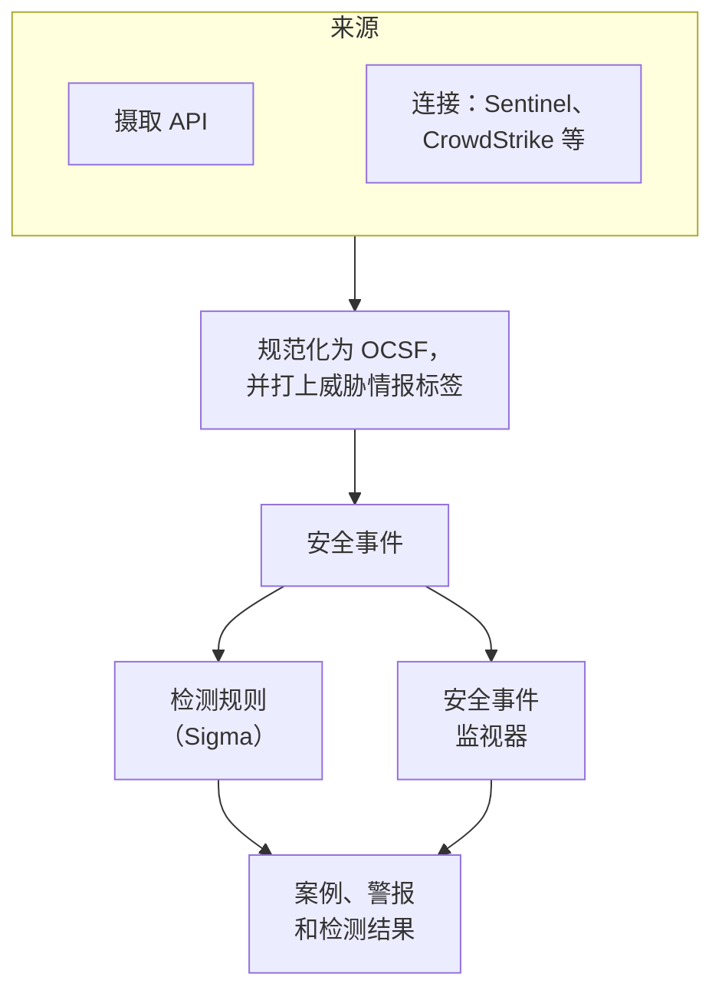
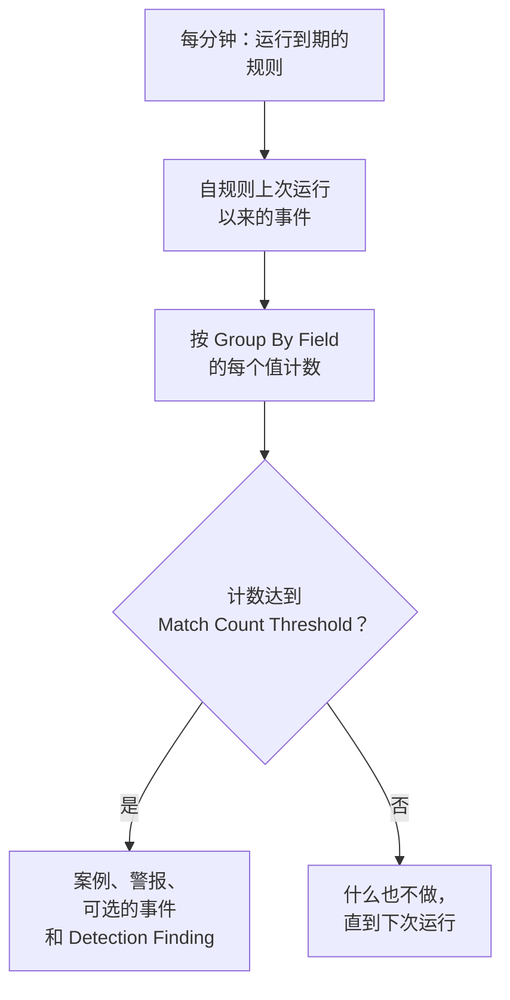

# 安全事件(SIEM)

OneUptime 把安全事件与你的日志、追踪和指标保存在一起，并且无论它们以什么格式到达，都统一成同一种结构：[OCSF](https://schema.ocsf.io/)（Open Cybersecurity Schema Framework）。你可以从任何来源发送事件、搜索它们，并用 Sigma 检测规则、威胁情报和监视器找出重要的事件。它们发现的问题会成为需要处理的 [案例](/docs/telemetry/security-cases)，并由剧本做出响应。

:::cards
- [发送事件](#发送安全事件): 一个 HTTPS POST、一个 Fluent Bit 输出，或与安全产品的连接。
- [搜索和关联分析](#浏览安全事件): 事件浏览器和关联分析图。
- [狩猎](#狩猎): 按计划运行、发现内容时通知相关人员的已保存搜索。
- [检测规则](#检测规则): 会打开案例和警报的 Sigma 规则。
- [监视器](#安全事件监视器): 滚动时间窗口内的计数，以及会恢复的状态。
:::

## 工作原理



在 **安全** 下打开 **产品 → 安全事件**。它的菜单为安全的每个部分设了一个分区，其中每一项都有自己的页面：

| 页面 | 分区 | 用途 |
| --- | --- | --- |
| **概览** | 概览 | 安全的设置情况、现在需要有人处理的内容，以及案例处理的速度 |
| **未结案例** | 安全案例 | 队列：每个尚未关闭的案例，按所涉及的对象分组 |
| **分配给我** | 安全案例 | 分配给你的未结案例 |
| **无人认领** | 安全案例 | 还没有人认领的未结案例 |
| **已关闭案例** | 安全案例 | 已给出结论并关闭的案例，最近的在前 |
| **全部案例** | 安全案例 | 每个案例，无论未结还是已关闭 |
| **事件** | 事件 | 搜索和过滤每个事件，并打开某个事件查看它的所有字段 |
| **狩猎** | 事件 | 从事件保存的搜索，一键再次打开，或按计划运行，发现内容时通知相关人员 |
| **狩猎库** | 事件 | 可在事件中试用或添加到你的狩猎的现成狩猎，每个都显示它读取的事件以及这些事件是否到达 |
| **攻击活动** | 事件 | 每个发送过攻击请求的地址，以及它的请求中是否有任何一个通过 |
| **实体风险** | 事件 | 按本周发现评分的每个用户、主机和地址，风险最高的在前 |
| **关联分析** | 事件 | 共享同一主机、用户或 IP 地址的事件构成的图 |
| **检测规则** | Detections | 按计划运行并打开案例的 Sigma 规则 |
| **规则例外** | Detections | 规则特意跳过的内容，例如扫描器或计划内的测试，每一条都记着是谁添加的、为什么添加 |
| **监视列表** | Detections | 规则所比对的列表，例如 VIP 用户、关键主机、已知恶意文件哈希，以及管理员可以从哪些地址登录 |
| **规则库** | Detections | 可直接添加的现成检测规则，每条都显示它读取的事件以及这些事件是否到达，推荐的规则带有标记 |
| **威胁情报** | Detections | 已知恶意指标的 STIX/TAXII 源 |
| **ATT&CK 覆盖范围** | Detections | 你的规则覆盖的 MITRE ATT&CK 技术 |
| **剧本** | Playbooks | 在案例上自动或手动运行的步骤 |
| **待审批** | Playbooks | 等待有人批准或拒绝的剧本步骤 |
| **剧本运行记录** | Playbooks | 每个剧本逐步做了什么 |
| **自动响应** | Playbooks | 在检测产生时对发起攻击的地址进行质询或封禁的策略，每个都有自己的试运行和护栏 |
| **封禁列表** | Playbooks | 你的项目封禁的地址、截止时间，以及每个封禁在何处生效 |
| **封禁列表源** | Playbooks | 防火墙和代理从中读取封禁列表的秘密 URL，以及它们的获取记录 |
| **受保护的实体** | Playbooks | 任何剧本都不会遏制、任何封禁都不会触及的用户、主机和地址 |
| **设置** | 人工智能 | OneUptime AI 是否研判每个新案例 |
| **连接** | Connections | 您的日志、OneUptime 轮询的安全产品，以及它发送到的 SIEM |
| **设置指南** | Connections | 发送事件的代码片段，已填好你的摄取密钥 |
| **案例优先级** | 设置 | 案例有多紧急：项目自己的优先级，最紧急的在前 |
| **响应目标** | 设置 | 每个优先级的案例必须多快被接手并遏制 |
| **案例状态** | 设置 | 案例经历的各个步骤，以及每个步骤中的案例被视为什么 |
| **自定义字段** | 设置 | 团队在每个案例中填写的字段，例如案例涉及的业务部门 |
| **备注模板** | 设置 | 团队为案例撰写备注时使用的现成文本 |
| **编号规则** | 设置 | 案例编号前的文本，以及下一个案例将获得的编号 |
| **风险评分** | 设置 | 实体风险是否打开案例、在多高风险时打开，以及每个实体的重要程度 |
| **删除请求** | 设置 | 应请求删除的人，以及每次删除所做的更改 |

只需设置一次的 **检测**、**人工智能**、**连接** 和 **设置** 会保持折叠，直到你打开它们。刚开始使用安全功能？[安全入门](/docs/telemetry/security-getting-started) 两次点击即可完成设置。

## 开始之前

只有项目所有者和项目管理员角色，以及三个 Security 角色可以读取安全数据；其他角色在 安全事件 中什么也看不到。请参阅 [角色](/docs/permissions/reference#角色)。

| 角色 | 能做什么 |
| --- | --- |
| 安全管理员 | 一切：事件、案例、剧本、检测规则、威胁情报源和连接 |
| 安全成员 | 读取事件和威胁情报，处理案例，运行剧本并批准其步骤，封禁地址，以及创建、修改和删除检测规则和情报源。不能设置剧本或连接，也不能删除安全数据。 |
| 安全查看者 | 读取事件、案例、剧本、封禁列表、规则、情报源、指标和连接 |

## 发送安全事件

:::steps
### 创建摄取密钥

打开 **项目设置 → 遥测与 APM → 摄取密钥** ，点击 **创建摄取密钥** 。安全事件与其他遥测数据使用相同的密钥。

### 发送你的事件

把 JSON 发送到 `/security-events/v1/ingest`，并在 `x-oneuptime-token` 中携带密钥：

:::tabs
@tab OCSF
```bash
curl -X POST "https://oneuptime.com/security-events/v1/ingest?format=ocsf" \
  -H "Content-Type: application/json" \
  -H "x-oneuptime-token: YOUR_INGESTION_TOKEN" \
  -H "x-oneuptime-service-name: my-security-source" \
  -d '{ "events": [ { "class_uid": 3002, "severity_id": 4, "status": "Failure", "message": "Failed logon for alice", "actor": { "user": { "name": "alice" } }, "src_endpoint": { "ip": "203.0.113.7", "hostname": "laptop-alice" } } ] }'
```
@tab Google UDM
```bash
curl -X POST "https://oneuptime.com/security-events/v1/ingest?format=udm" \
  -H "Content-Type: application/json" \
  -H "x-oneuptime-token: YOUR_INGESTION_TOKEN" \
  -d '{ "events": [ { "metadata": { "event_type": "USER_LOGIN" }, "principal": { "hostname": "laptop-alice", "user": { "userid": "alice" }, "ip": ["203.0.113.7"] }, "security_result": [{ "severity": "HIGH", "action": ["BLOCK"] }] } ] }'
```
@tab Generic JSON
```bash
curl -X POST "https://oneuptime.com/security-events/v1/ingest" \
  -H "Content-Type: application/json" \
  -H "x-oneuptime-token: YOUR_INGESTION_TOKEN" \
  -d '{ "events": [ { "severity": "high", "event_type": "ssh_brute_force", "message": "12 failed SSH logins in 60s", "username": "root", "hostname": "web-01", "src_ip": "203.0.113.7" } ] }'
```
:::

事件进入队列后，端点会返回 `200`。像这些示例一样不带时间的事件，会放在它到达的那一刻。

### 在事件中找到它们

打开 **产品 → 安全事件 → 事件** 。几秒钟内事件就会出现，严重程度、类别、用户、主机和 IP 地址都已填好。
:::

### 格式

| `format` | 读取的内容 | 也接受 |
| --- | --- | --- |
| `ocsf` | OCSF 事件 JSON（`class_uid`、`severity_id` 等） | 无 |
| `udm` | Google SecOps（Chronicle）UDM 事件（`metadata.event_type` 等） | `chronicle`、`google-secops` |
| `google-secops-alert` | Google SecOps 检测和警报：SOAR Webhook 和检测流 | `secops-alert`、`detection` |
| `crowdsec` | CrowdSec 的警报，即其 `http` 通知插件发送的内容（参见 [CrowdSec](/docs/integrations/crowdsec)） | `crowdsec-alert` |
| `generic` | 任何其他 JSON，按常见字段名读取 | 无 |

可以用 `?format=`、`x-oneuptime-security-event-format` 标头，或顶层的 `"format"` 字段指定格式。不指定时，每个事件的格式会单独判断，所以一个 Webhook 可以混合发送检测和原始事件。

- 正文可以是一个事件、一个事件数组，或 `{ "events": [...] }`。
- 一个批次可以用 gzip 压缩，并带上 `Content-Encoding: gzip` 发送：它会被当作未压缩的同一批次读取。Fluent Bit 的 `http` 输出用 `compress gzip` 压缩，Vector 的 `http` 接收器用 `compression = "gzip"`，Logstash 的 `http` 输出用 `http_compression => true`。只有 JSON 会以压缩形式读取：其他类型的压缩正文会以 `400` 被拒绝。
- `x-oneuptime-service-name` 标头指定事件所属的遥测服务。没有它时，事件属于以第一个事件的产品或供应商命名的服务，或属于 `Security Events`。
- 不会因为无法映射而丢弃任何内容：来源的每个字段都会进入事件的属性。

### 通用 JSON 字段

通用事件按常见字段名读取：

| 事件的字段 | 从以下第一个存在的字段读取 |
| --- | --- |
| `message` | `message`、`msg`、`summary`、`description`、`title` |
| `severityName` | `severity`、`severity_name`、`level`、`priority`、`risk_level` |
| `time` | `timestamp`、`time`、`@timestamp`、`event_time`、`created_at` |
| `principalUser` | `user`、`username`、`user_name`、`account`、`actor` |
| `principalHost` | `host`、`hostname`、`computer`、`device`、`machine` |
| `principalIp` | `source_ip`、`src_ip`、`client_ip`、`ip` |
| `targetIp` | `destination_ip`、`dest_ip`、`dst_ip`、`target_ip` |
| `className` | `event_type`、`category`、`type`、`action` |
| `ruleName` | `rule`、`rule_name`、`signature`、`detection` |
| `productName` | `product`、`product_name`、`source`、`log_source` |
| `processName` | `process_name`、`process.name`、`proc.name`、`comm` |
| `processPath` | `process_path`、`Image`、`NewProcessName`、`exe`、`process.executable` |
| `processCommandLine` | `command_line`、`CommandLine`、`cmdline`、`process.command_line`、`proc.cmdline`、`process` |
| `parentProcessName` | `parent_process_name`、`process.parent.name`、`proc.pname` |
| `parentProcessPath` | `parent_process_path`、`ParentImage`、`ParentProcessName`、`process.parent.executable` |
| `parentProcessCommandLine` | `parent_command_line`、`ParentCommandLine`、`process.parent.command_line`、`proc.pcmdline` |

表示严重程度的词会变成 OCSF 级别：`info` 读作 Informational，`warning` 读作 Low，`error` 读作 Medium，`alert` 读作 Critical，`emergency` 读作 Fatal。

### 用 Fluent Bit 转发

要发送你已经在收集的安全日志，例如 auditd、syslog 或 Falco，请给 Fluent Bit 添加一个 `http` 输出：

```ini title="fluent-bit.conf"
[OUTPUT]
    Name             http
    Match            security.*
    Host             oneuptime.com
    Port             443
    tls              On
    URI              /security-events/v1/ingest
    Format           json
    compress         gzip
    Json_date_key    timestamp
    Json_date_format iso8601
    Header           x-oneuptime-token YOUR_INGESTION_TOKEN
    Header           x-oneuptime-service-name my-security-source
    Retry_Limit      5
```

**连接** 下的 **设置指南** 页面提供这些代码片段，并已填好你自己的主机和密钥。

### 在日志中查找安全事件

**连接** 顶部的 **你的日志** 会把您已经发送到 OneUptime 的日志变成一个来源。开启 **在日志中查找安全事件** 后，项目的新日志每分钟都会被读取，其中的每次 SSH 或 Windows 登录、sudo 命令、云审计记录、安全产品的 CEF 或 LEEF 记录、Palo Alto Networks、FortiGate 或 Cisco ASA 防火墙的记录、Kubernetes 审计记录、Web 攻击和敏感文件请求都会存储为安全事件。各类内容的范围请参阅 [安全入门](/docs/telemetry/security-getting-started#在日志中查找安全事件)。

每一类都以普通日志的形式到达 OneUptime：

| 类型 | 从哪里发送 |
| --- | --- |
| SSH 登录、sudo | Linux 机器的 journal 或认证日志，使用 [OpenTelemetry Collector](/docs/telemetry/host-otel-collector) 发送 |
| Windows 事件 | 机器上收集器的 `windowseventlog` 接收器，或把每个事件写成 JSON 的转发器，例如 NXLog 或 Winlogbeat。添加到 OneUptime 的 [主机](/docs/telemetry/hosts) 还会读取它上面的 Sysmon、Microsoft Defender 和 PowerShell |
| AWS CloudTrail | 投递到 CloudWatch Logs 的跟踪，由收集器的 `awscloudwatch` 接收器读取；对于在 **云** 下连接的账户，也可以用 [云审计日志](#读取云账户的审计日志) |
| Google Cloud 审计日志 | 指向 Pub/Sub 的日志接收器（sink），由收集器的 `googlecloudpubsub` 接收器以 `encoding: raw_text` 读取；对于在 **云** 下连接的项目，也可以用它的 [流](/docs/telemetry/cloud-streaming-google-cloud) 或 [云审计日志](#读取云账户的审计日志) |
| Azure 活动和 Entra ID 日志 | 流式传输到 Event Hub 的诊断设置，由收集器的 `azureeventhub` 接收器以 `format: raw` 读取，或发送到已连接订阅的 [流](/docs/telemetry/cloud-streaming-azure) 的事件中心；对于在 **云** 下连接的订阅的活动日志，也可以用 [云审计日志](#读取云账户的审计日志) |
| Azure Key Vault、Storage 和 SQL 日志 | 资源上流式传输到 Event Hub 的诊断设置，由收集器的 `azureeventhub` 接收器以 `format: raw` 读取；或已连接订阅的 [流](/docs/telemetry/cloud-streaming-azure) 的诊断设置，需包含日志。参见 [Azure 资源自身的审计日志](#azure-资源自身的审计日志) |
| OpenStack 审计轨迹 | 云的通知和审计过滤器以 `driver = log` 发送到其日志，由代理的[日志配置档](/docs/telemetry/openstack#谁做了什么)读取 |
| CEF、LEEF | 产品的 syslog，由 [rsyslog](/docs/telemetry/syslog) 转发 |
| Palo Alto Networks、FortiGate、Cisco ASA | 防火墙自身的 syslog，由 [rsyslog](/docs/telemetry/syslog) 转发 |
| Kubernetes 审计日志 | API 服务器的审计日志文件，由收集器的 `filelog` 接收器读取 |
| Web 攻击 | Web 服务器的访问日志，由收集器的 `filelog` 接收器读取 |

在 **你的日志** 上，每一类都会显示上次发现它的时间，**检查一行日志** 则会在任何日志到达之前，显示你粘贴的一行会变成什么。OneUptime 会像扫描读取你的日志那样，结合你的[受信任的代理](#受信任的代理)和访问日志的设置来读取这一行，所以它指出的客户端与存储的事件将指出的相同，并且不保存任何内容。

安全产品写入日志的威胁，例如 CEF 或 LEEF 的发现，或 Palo Alto Networks、FortiGate 或 Cisco ASA 的威胁，会像已连接产品的警报一样打开 [案例](/docs/telemetry/security-cases)，并提高它所指的用户、主机或地址的风险。**你的日志** 上的 **从以下级别开启案例** 决定从哪个严重程度开始：默认为 **高及以上**，你也可以选择其他级别或 **从未**。该产品的登录和被阻止的连接仍然是事件，供你的规则读取。

通过两条途径到达 OneUptime 的记录只存储一次：例如由其连接读取、又由 Azure 导出到您的日志中的 Microsoft Entra ID 登录，同时出现在您的日志和已连接 AWS 账户审计日志中的 CloudTrail 记录，或由云账户的流发送、**云审计日志** 也会读取的审计记录。

#### Azure 资源自身的审计日志

Key Vault、存储账户和 Azure SQL 数据库各自保留一份自己的审计日志，记录每个请求。只有安全团队会查看的内容才会成为安全事件：

| 资源 | 会变成安全事件的内容 |
| --- | --- |
| Key Vault（`AuditEvent`） | 保管库拒绝的请求；被读取的机密；机密、密钥、证书或保管库本身被删除、清除或备份；其访问策略被更改；以及其所保存内容的更改。不包括每个 Azure SDK 客户端为获知租户而在不带令牌的首次调用中收到的 401：Key Vault 把它记录在其 `Authentication` 操作下 |
| 存储账户（`StorageRead`、`StorageWrite`、`StorageDelete`） | 因缺少权限而被拒绝的请求；完全不带凭据而被处理的请求，静态网站的页面和 CORS 预检除外；容器、文件共享、队列或表的访问列表被更改，或其中之一被整个删除；以及由共享访问签名（SAS）签署的写入或删除。不包括成功的读取，通过 SAS 的读取也不例外 |
| Azure SQL（`SQLSecurityAuditEvents`） | 失败的登录；新连接上的登录，而非池化连接的重用；权限的授予、拒绝或撤销，角色成员或密码的更改，模拟，以及登录名、用户或角色的创建、更改或删除；以及权限检查失败的操作。不包括批处理，它占审计的绝大部分 |

存储账户记录的内容大部分是成功的读取：大多数应用都通过 SAS 把文件交给浏览器。这些读取会完整地保留在日志中，位于该账户的 **日志** 标签页上：在那里搜索 `"type":"SAS"`，即可查看共享访问签名读取了什么。每个事件都通过 ID 指向其资源，存储服务的事件还会指向其账户，因此它会显示在该资源的 **安全事件** 页面上；到达两次的记录只存储一次。

### 读取云账户的审计日志

[在 **云** 下连接的](/docs/telemetry/cloud-accounts) AWS 账户、Google Cloud 项目或 Azure 订阅不需要日志管道。在 **连接** 的 **你的 OneUptime 数据** 下开启 **云审计日志** 后，每次读取账户都会把它的审计日志保存为安全事件：

| 云 | 读取的内容 |
| --- | --- |
| AWS | 账户使用的每个区域中会更改内容的 CloudTrail 管理事件：控制台登录、更改，以及被 AWS 拒绝的调用 |
| Google Cloud | Admin Activity 审计日志：对资源及其访问权限的更改，以及被 Google 拒绝的调用 |
| Azure | 活动日志：订阅中的更改、失败的操作、Azure Policy 的拒绝以及 Defender for Cloud 警报 |

- 每条记录的读取方式与 **你的日志** 从管道读取它的方式相同，因此规则库中的 CloudTrail、Google Cloud 和 Azure 规则都能匹配它。
- 事件以存储时的时间为时间戳，记录本身的时间保存在 `oneuptime.cloud.record_time` 中：审计日志会晚几分钟到达 OneUptime，而规则按事件的时间读取事件。
- 账户本身的读取只带来这些：数据事件、Data Access 日志和 Microsoft Entra ID 的日志仍然需要 **你的日志** 或 [连接](/docs/integrations/microsoft-entra-id)。
- 每个事件都通过云资源自己的 ID（ARN、Azure 资源 ID、Google Cloud 资源名称）指向其记录所涉及的云资源，因此会显示在每个资源的 **安全事件** 页面上；一旦无服务器函数的遥测设置了 `cloud.account.id` 和 `cloud.region`，也会显示在该函数的页面上。

### 网络流中 OneUptime 自有的探测器

在 **连接** 的 **你的 OneUptime 数据** 下开启 **网络流** 后，会从你的网络设备导出的流中查找端口扫描、网络扫描、与已知恶意地址的流量以及向外的大量传输。探测器自己的工作在那里看起来像一次扫描：通过 SNMP 轮询 40 台设备，每五分钟会触及 40 台主机的 161 端口。因此，OneUptime 自有探测器的流量中，恰好是该探测器被设置去做的那部分会另行保存：

- 它轮询的网络设备：ping，以及到其端口的 SNMP；
- 它每次发现的范围，在扫描运行期间；
- 它的监视器检查的主机和端口。

这些流量保存为一个注明该探测器的信息级事件 `oneuptime-probe-traffic`，没有任何规则读取它。**网络流** 会显示过去一天另行保存了多少，并附有 **查看**。来自探测器地址的其他流量都和任何人的流量一样计数，超出探测器工作范围的扫描会被报告，并注明该探测器。探测器由它签入时使用的地址，以及它每次签入时列出的自身网络接口地址来识别。不使用主机网络的自定义探测器，例如 Kubernetes Pod 或 Docker 桥接网络上的容器，也由 `PROBE_HOST_IP_ADDRESSES` 告诉它的主机地址来识别：在它拿到这些地址之前，它的轮询会从一个无法识别它的地址离开，并被报告为扫描。请参阅 [探测器上报时发送的内容](/docs/probe/custom-probe#探测器上报时发送的内容)。

### 连接安全产品

**连接** 会替你轮询安全产品，并把它的新记录作为安全事件导入。连接保存产品的设置和加密的凭据；工作进程按你设置的间隔轮询它，并跳过已经导入过的记录。

| 产品 | 导入内容 | 设置指南 |
| --- | --- | --- |
| Google SecOps (Chronicle) | 规则检测、精选检测和警报，作为 Detection Finding | [Google SecOps](/docs/integrations/google-secops) |
| Microsoft Sentinel | 事件（incident），作为 Incident Finding | [Microsoft Sentinel](/docs/integrations/microsoft-sentinel) |
| Microsoft Defender XDR | 警报，作为 Detection Finding | [Microsoft Defender XDR](/docs/integrations/microsoft-defender-xdr) |
| CrowdStrike Falcon | 警报，作为 Detection Finding | [CrowdStrike Falcon](/docs/integrations/crowdstrike-falcon) |
| Splunk Enterprise Security | Notable 事件或任意搜索，作为 Detection Finding | [Splunk Enterprise Security](/docs/integrations/splunk) |
| Elastic Security | 检测警报，作为 Detection Finding | [Elastic Security](/docs/integrations/elastic-security) |
| AWS Security Hub | Finding，作为 Detection Finding 和 Compliance Finding | [AWS Security Hub](/docs/integrations/aws-security-hub) |
| Okta System Log | 登录、MFA、账户和策略事件 | [Okta System Log](/docs/integrations/okta) |
| Microsoft Entra ID | 登录、目录更改和风险检测，可选的失败的后台和应用登录，以及 Microsoft 365 审计日志中的邮件转发、共享和钓鱼判定 | [Microsoft Entra ID](/docs/integrations/microsoft-entra-id) |
| Google Workspace | 登录、Google 自身的检测、管理员更改和应用授权，以及云端硬盘中的共享 | [Google Workspace](/docs/integrations/google-workspace) |
| Cloudflare | 其防火墙在边缘拦截、质询和记录的请求，作为 HTTP Activity | [Cloudflare](/docs/integrations/cloudflare) |
| CrowdSec | 其通知插件发送的警报，作为 Detection Finding，以及对你封禁的地址的封禁 | [CrowdSec](/docs/integrations/crowdsec) |

- 产品自身的警报，只要级别达到或高于 **打开案例的起始严重程度**（默认为 **高及以上**，你也可以选择其他级别或 **从未**），就会打开 [案例](/docs/telemetry/security-cases)，并按它们涉及的用户、主机或地址分组。
- 连接按产品创建记录的时间读取记录，而不是按记录所描述活动的时间。每小时运行一次的 SIEM 规则会在它匹配的事件之后很久才创建检测，这些检测仍然会被导入。
- 第一次轮询会回溯 24 小时，所以新连接会立刻显示最近的记录。
- CrowdSec 连接永远不会被轮询：CrowdSec 每产生一条警报，就通过连接所在行中 **发送警报** 给出的通知立即发送。
- 连接所在行中的 **测试连接** 会检查对产品的访问以及 OneUptime 自身的工作进程是否在运行，不会导入任何内容。**立即运行** 会立即轮询。

## 事件包含什么

每个事件都与类型化字段和来源负载一起存储：

| 分组 | 字段 |
| --- | --- |
| 分类 | `categoryName`、`className`、`activityName`、`statusName`，以及它们的 OCSF ID（`categoryUid`、`classUid`） |
| 严重程度 | `severityName`，取值为 Unknown、Informational、Low、Medium、High、Critical、Fatal 或 Other 之一，以及 `severityId` |
| 谁做的 | `principalUser`、`principalHost`、`principalIp`、`principalProcess` |
| 涉及了什么 | `targetUser`、`targetHost`、`targetIp`、`targetPort`、`targetResource` |
| 进程 | `processName`、`processPath` 和 `processCommandLine`：在进程活动事件中是被启动、打开、注入或结束的进程，其他事件中是执行操作的进程。`parentProcessName`、`parentProcessPath` 和 `parentProcessCommandLine`：启动它的进程 |
| 来源 | `productName`、`vendorName`、`ruleId`、`ruleName`、`eventUid` |
| 内容 | `message`、`mitreTactics`、`mitreTechniques` 和 `observables`：从事件中提取的每个用户、主机、IP 地址、域名和哈希 |
| 属性 | 完整的来源负载，展平为以点分隔的键 |

在 OneUptime 14.0.84 之前存储的事件，进程字段为空，只以 `principalProcess`（执行操作的进程）记录其进程。它们之后不会被补全：在保留期结束之前，它们保持存储时的内容。

### 事件指明的地址

只有当请求的发送者无法写出某个地址时，事件才会把它指明为请求的来源。这个地址是经过验证的，它会成为事件的 **源 IP**：检测规则会统计它，威胁情报会匹配它，案例的 **响应计划** 会建议封禁它。请求指明的其他任何地址都只是声称的：事件把它保留为 **声称的 IP**，任何功能都不会统计或封禁它。

- 连接本身的地址是经过验证的：服务器跨度的 `network.peer.address`，或 Web 服务器访问日志行的第一个字段。没有人能把它写进请求。
- 在你信任的代理之后，连接的地址是代理的地址，客户端是代理在 `X-Forwarded-For` 中转发的地址。每个代理都会追加它接受连接时的地址，所以 OneUptime 从右往左读取这个标头，取第一个不是你信任的代理的地址。发送者在标头中写的内容落在它的左边，仍然只是声称。
- 请求对自身指明的地址是声称的：插桩从标头左侧填入的 `client.address`、`X-Forwarded-For` 的其余部分，以及 `Forwarded`。

声称的地址永远不会从案例中被封禁：任何人都可以发送 `X-Forwarded-For: 192.0.2.44`，封禁会把 192.0.2.44 背后的人挡在外面。只有声称地址的事件，其 **响应计划** 会让你到负载均衡器或防火墙的日志中寻找真实地址。

如果事件的客户端是由你信任的代理转发的，事件会以 **转发代理** 列出它经过的代理：按 `X-Forwarded-For` 列出的顺序，连接自身的地址排在最后。它们记录在 `oneuptime.request.forwarded_by` 中，**检查一行日志** 会说明每一个受信任的原因。

为了让地址经过验证，请在应用的服务器跨度上记录两样东西：连接本身的地址 `network.peer.address`，OpenTelemetry 的 HTTP 插桩会设置它；以及在代理之后的 `X-Forwarded-For` 标头，把它加入 `OTEL_INSTRUMENTATION_HTTP_CAPTURE_HEADERS_SERVER_REQUEST` 后，插桩会把它记录为 `http.request.header.x-forwarded-for`。JSON 访问日志的读取方式相同：它的客户端字段（例如 `remote_addr`）是连接的地址，它的 `http_x_forwarded_for` 字段是标头。

#### 受信任的代理

当代理的地址属于以下之一时，安全事件会信任它所说的客户端：

| 受信任的 | 原因 |
| --- | --- |
| 私有、环回或链路本地地址，例如 `10.0.0.5` | 始终信任：互联网上没有人拥有它，所以它是你网络中的负载均衡器或入口 |
| 列在 **受信任的代理** 中 | 你列出了它 |
| 在你连接的边缘网络公布的地址范围中，例如 [Cloudflare](/docs/integrations/cloudflare) | 连接存在期间 |
| 你自己的应用负载均衡器之一 | 除非你关闭它 |
| 你的 Google Cloud Application Load Balancer 之后的 Google 前端之一 | 随你的负载均衡器一起信任，除非你的某个 TCP 或 SSL 代理负载均衡器也从这些前端连接 |

在 TCP 层工作的代理不会向 `X-Forwarded-For` 添加任何内容：它会原样传递客户端写入的标头。例如 Network Load Balancer、`mode tcp` 下的 HAProxy，以及使用 `externalTrafficPolicy: Cluster` 的 Kubernetes Service，后者会从某个节点的地址把每个连接交给你的入口。这样的代理位于私有地址时会受到信任，所以它后面的客户端可以选择攻击被归咎于哪个地址。在这样的代理之后，请通过客户端 IP 保留或 `externalTrafficPolicy: Local` 在连接上保留客户端自己的地址，并且不要记录 `X-Forwarded-For`，也不要把它写入日志。

**安全事件 → 连接 → 更多设置** 中有 **受信任的代理**（你填写的列表）和 **自动信任**（显示其余受信任的项目及原因）。当代理的地址是公网地址并且没有其他项目信任它时，请把它列在 **受信任的代理** 中，每行一个地址或范围：例如你没有连接的 CDN、经由互联网到达你的应用的负载均衡器，或者在有公网地址的服务器上、位于你的应用前面的 nginx 等反向代理。在你列出之前，经过它的每次攻击都会被归咎于代理。比代理的范围更宽的范围（例如 `0.0.0.0/0`）会被拒绝：它会信任所有地址，这样任何人都能选择攻击被归咎于哪个地址。项目所有者、项目管理员或安全管理员可以编辑该列表，每次更改都会记录在项目的[审计日志](/docs/configuration/audit-logs)中。

你自己的应用负载均衡器是你[连接的云账户](/docs/telemetry/cloud-accounts)列出的那些：AWS Application Load Balancer、所有监听器都是 HTTP 或 HTTPS 的 AWS Classic Load Balancer、Google Cloud Application Load Balancer 和 Azure Application Gateway，按它们的公网地址。每一个都会把它转发的客户端添加到 `X-Forwarded-For`。Google Cloud 负载均衡器会在客户端地址之后追加自己的地址，Application Gateway 会从自己的地址连接公网后端，所以没有这一项，经过它们的每次攻击都会被归咎于负载均衡器。**自动信任** 中的 **你的负载均衡器** 会列出它们，项目所有者、项目管理员或安全管理员可以关闭它。

在 Google Cloud 全球外部应用负载均衡器或经典版负载均衡器之后，到你的应用的连接来自 Google 的前端，而不是负载均衡器自己的地址。因此，只要某个已连接的 Google Cloud 项目中有这样的负载均衡器，安全事件也会信任这些前端的地址范围：`35.191.0.0/16`、`130.211.0.0/22` 和 `2600:2d00:1:1::/64`，与 Google 的[负载均衡防火墙规则](https://cloud.google.com/load-balancing/docs/firewall-rules)列出的一致。**你的负载均衡器** 会在列表的最后一行显示它们，以及带来它们的负载均衡器，它的开关也会关闭它们。Google 之外没有人会从这些范围连接，信任它们也不会让任何人能冒称客户端：经过别人负载均衡器的请求，其 `X-Forwarded-For` 以该负载均衡器的地址结尾，而它不是你的，所以事件会指出这个地址。但 Google 的 TCP 和 SSL 代理负载均衡器也从相同的范围连接，并按客户端发送的原样传递请求，所以只要你有这样的负载均衡器，或者没能列出全部负载均衡器，这些范围就不受信任，该行会说明原因。如果这样的负载均衡器位于你尚未连接的 Google Cloud 项目中，请连接该项目，或关闭 **你的负载均衡器**。

你的其他任何东西都不会被自动信任：不包括你的主机、Kubernetes 节点、探测器或虚拟机、NAT 网关，以及 Network、Gateway 或 Azure 负载均衡器。它们不转发任何人，或者原样传递请求，所以其上运行的任何东西都可能冒称任何客户端：监控带着自己的标头发出的请求、一个 Pod、网关后面的一台笔记本电脑。如果其中一个是你的代理，请把它添加到 **受信任的代理**。Kubernetes 入口会作为它实际所是的负载均衡器受到信任：GKE 入口是 Google Cloud Application Load Balancer，AKS 的 Application Gateway 入口是 Application Gateway，类为 `alb` 的 EKS 入口是 AWS Application Load Balancer。集群内的入口控制器从私有地址转发，私有地址始终受信任。

对其中任何一项的更改会在一分钟内生效，新的负载均衡器会在五分钟内受到信任。

#### 以 X-Forwarded-For 结尾的访问日志

在负载均衡器之后，许多 Web 服务器会把转发的地址记录在最后，就像 nginx 自己的 `main` 格式那样：

```nginx
log_format main '$remote_addr - $remote_user [$time_local] "$request" '
                '$status $body_bytes_sent "$http_referer" '
                '"$http_user_agent" "$http_x_forwarded_for"';
```

一行日志从不说明它的字段是什么，所以只有在你打开 **更多设置** 下 **访问日志** 中的 **日志以 X-Forwarded-For 结尾** 之后，它的最后一个字段才会被读作 `X-Forwarded-For`，而且只在以下情况下：

- 该行的第一个字段是你信任的代理：直接到达你的 Web 服务器的客户端的行属于该客户端；
- 采用 combined 格式，用户代理之后恰好有一个带引号的字段，且其后没有任何内容；
- 该字段是 `-`，或者是最后一个地址不带端口的地址列表。

如果你的格式以另一个包含地址的标头结尾（例如 `X-Real-IP`），或者你的 Web 服务器写入标头时不转义其中的引号（例如 Express 的 `morgan`），请保持关闭：否则请求自己的用户代理就能添加一个字段。JSON 访问日志不需要这个开关，因为它的字段是有名字的。

#### 你自己的日志格式

如果你的 Web 服务器没有把 `X-Forwarded-For` 放在最后，请提供它们的格式：**更多设置** 下 **访问日志** 中的 **日志格式**。按 `nginx.conf` 中的写法粘贴你的 nginx `log_format`，或从已知格式开始：nginx 的 `main` 或 ingress-nginx 的 `upstreaminfo`。例如，下面的格式在标头之后记录每个请求耗费的时间：

```nginx
log_format timed '$remote_addr - $remote_user [$time_local] "$request" '
                 '$status $body_bytes_sent "$http_referer" '
                 '"$http_user_agent" "$http_x_forwarded_for" $request_time';
```

符合你的格式的每一行都按字段读取：发起连接的地址取自 `$remote_addr`，`X-Forwarded-For` 取自 `$http_x_forwarded_for`，无论格式把它放在哪里。它的读取方式与任何 `X-Forwarded-For` 相同：只有在 `$remote_addr` 是你信任的代理时才读取，并且从右往左读。任何其他字段都不会被当作这两者之一，不符合你的格式的行照旧读取，由 **日志以 X-Forwarded-For 结尾** 决定其最后一个字段。

- nginx 会把客户端发送的引号转义为 `\x22`，所以一行中的每个引号都属于你的格式。引号比你的格式多的行（不转义引号的服务器会写出这样的行，例如 `escape=none`、Express 的 `morgan`）不是你的格式的行，其中的任何内容都不会按格式读取。
- **日志格式** 会拒绝其 `X-Forwarded-For` 或 `$remote_addr` 无法与相邻字段区分开的格式，例如位于客户端写入的两个字段之间、没有引号的标头，并提示你给它加上引号，写成 `"$http_x_forwarded_for"`。
- ingress-nginx 的 `upstreaminfo` 不记录 `X-Forwarded-For`，所以每行的客户端就是它的 `$remote_addr`。如果它前面有 Application Load Balancer 或其他 HTTP 代理，请在你的 `log-format-upstream` 中添加 `"$http_x_forwarded_for"`，以读取它转发的客户端。在会原样传递客户端所写标头的 Network Load Balancer 之后，则不要添加。
- 当 nginx 通过它的 realip 模块或 ingress-nginx 的 `use-forwarded-headers`，自己根据 `X-Forwarded-For` 设置 `$remote_addr` 时，它会相信 `set_real_ip_from` 或 `proxy-real-ip-cidr` 指定的任何人，而 ingress-nginx 的默认值指定了所有人。请在 `$http_x_forwarded_for` 旁边记录真正发起连接的地址 `$realip_remote_addr`：安全事件随后会把 `$realip_remote_addr` 读作连接，把 `$remote_addr` 只读作声称的地址，并依据你的受信任的代理作出判断。

项目所有者、项目管理员或安全管理员可以提供该格式，每次更改都会记录在项目的审计日志中。

### 已被清除规则隐藏

清除或遮盖你的日志或追踪的 IP 地址清理规则，会在安全事件读取它们之前隐藏攻击的来源地址。事件仍会被保存，只是没有地址；凡是本应显示地址的地方，它都会说明是某条清理规则隐藏了地址：

- 事件面板中的 **源 IP** 会在可能时指出隐藏地址的规则，并链接到日志或追踪的 **清理规则**。旁边的过滤器会显示地址被清理规则隐藏的所有事件。
- **目标 IP** 在规则隐藏了连接的去向时也会这样说明（例如防火墙的目标，或数据发送到的地方）。旁边的过滤器会显示目标地址被清理规则隐藏的所有事件。
- **后续情况** 会说明请求来自被清理规则隐藏的地址，**攻击活动** 则把这类请求归为单独的一行。
- 如果某个案例的所有事件都丢失了地址，它会在 **响应计划** 中说明：它不会让你封禁该地址，而是让你在负载均衡器或防火墙的日志中找到该地址并在那里封禁，并提供 **打开清理规则**。
- **概览** 会指出隐藏安全事件所读取地址的规则，同样提供 **打开清理规则**。

执行哈希的规则会为安全事件保存地址，因此事件会指出该地址，除非其令牌已超过 30 天，或是在令牌有密钥之前生成的：请参阅[清理敏感数据](/docs/telemetry/drop-filters-and-scrub-rules#清理敏感数据)。要找到这些事件，请搜索 `@oneuptime.request.client_address_hidden:scrub-rule`。规则在地址处留下的内容（例如 `[REDACTED]`）保存在 `oneuptime.request.client_address_scrubbed` 中。对于目标地址，请搜索 `@oneuptime.target_address_hidden:scrub-rule`。

按地址计数的检测规则应按 `principalIp` 或 `targetIp` 计数，就像规则库中的规则那样：它们会指出执行哈希的规则所生成令牌背后的地址。某种格式自身的地址字段，例如 `openstack.audit.initiator_address` 或 `asa.src_ip`，只保存日志写下的地址，因此在清理规则隐藏了地址的地方，它会保持为空。

清除或遮盖用户的规则也会以同样的方式隐藏用户：凡是事件本应指出用户的地方，**源用户** 或 **目标用户** 都会说明是某条清理规则隐藏了该用户。在安全事件读取用户的位置，执行哈希的规则会为安全事件保存该用户：请求的 `enduser.id` 或 `user.id` 、AI 调用的用户，以及日志行指出的用户，例如云审计日志的主体。因此，事件会指出令牌背后的用户，关于该用户的案例会指出该账号，剧本也可以像对待其他任何用户一样对该账号采取行动。规则留下的内容保存在 `oneuptime.principal_user_hashed_as` 或 `oneuptime.target_user_hashed_as` 中，方便你在只包含令牌的日志和追踪中找到该用户。没有保存用户的令牌，例如在令牌有密钥之前生成的令牌，仍是事件的用户：规则会把它算作一个账号，任何剧本都不会对它采取行动。

事件面板会在 **源用户** 和 **目标用户** 中所列用户的下方说明这一点：日志显示“在日志中哈希为 …”，从链路追踪读取的用户显示“在追踪中哈希为 …”，其中 … 为令牌。令牌是一个链接，会在事件发生前一天到后一天的日志或链路追踪中，在读取该用户的字段里搜索该令牌：日志行的正文或其某个属性，或者跨度的属性，例如 `user.id` 或 AI 调用的用户。该字段记录在 `oneuptime.principal_user_hashed_field` 或 `oneuptime.target_user_hashed_field` 中。应请求删除的用户会改为显示 **已应请求删除**，事件则显示其令牌：参见[删除个人](#删除个人)。

## 浏览安全事件

**事件** 是一个与日志和追踪浏览器类似的遥测浏览器：一个按严重程度显示时间窗口内事件的图表、一个分面侧栏、事件列表，以及一个显示所打开事件的每个字段和属性的面板。时间窗口、过滤器和搜索都保存在 URL 中，所以过滤后的视图可以分享，刷新后也不会丢失。

### 搜索

搜索栏使用与其他遥测浏览器相同的语法（参见 [搜索语法](/docs/telemetry/search-syntax)）：

| 语法 | 含义 | 示例 |
| --- | --- | --- |
| 自由文本 | 消息中包含它 | `failed logon` |
| `"quoted phrase"` | 这些词连在一起 | `"brute force"` |
| `<field>:<value>` | 类型化字段 | `severity:Critical` |
| `@<attribute>:<value>` | 来源属性 | `@threat.matched:true` |
| `-<filter>` | 排除这一项 | `-severity:Informational` |
| `<field>:(a OR b)` | 这些值中的任意一个 | `severity:(High OR Critical)` |
| `<field>:a*` | `*` 表示任意文本，`?` 表示一个字符 | `host:web-*` |
| `@<attribute>:*` | 存在该属性 | `@threat.indicator_id:*` |
| `@<attribute>:~text` | 属性包含该文本 | `@finding_info.title:~ransom` |
| `<field>:%<watchlist>%` | 该字段在某个[监视列表](#监视列表)中 | `user:%vip_users%` |

字段要么是简称（`severity`、`class`、`category`、`activity`、`status`、`vendor`、`product`、`rule`、`user`、`host`、`ip`、`targetuser`、`targethost`、`targetip`、`processname`、`commandline`、`parentprocessname`、`observable`、`tactic`、`technique`、`requestoutcome`、`trace`、`session`），要么是字段本身的名称，例如 `severityName` 或 `principalHost`。任何其他名称都会被读作来源属性。`observable:<value>` 会找出提到某个值的每个事件，无论该值出现在活动的哪一方。

### 分面

侧栏按 **来源**、**严重程度**、**请求结果**、**事件类别**、**类别**、**活动**、**状态**、**供应商**、**产品**、**检测规则**、**源用户**、**源主机**、**进程** 和 **父进程** 统计时间窗口内的事件。点击某个值只保留它的事件，点击旁边的减号则排除它们。再次点击即可撤销。图表和每个计数描述的正是列表中的事件。

### 之后发生了什么

从已追踪请求中写入的日志行读取的事件，会被一路跟进到该请求中。它的面板会说明请求走到了哪一步（**已拒绝**、**到达应用**、**出错** 或 **到达数据库**）以及是谁发送的，并链接到它的追踪、异常、会话回放以及日志行本身。属于某次攻击的日志行、追踪和异常，也会在它们自己的页面上说明这一点。

### 你的网站提供出去的敏感文件

对包含机密信息的文件的请求，例如 `/.env`、`/.git/config`、`/.aws/credentials` 或 `wp-config.php` 的副本，如果你的网站用文件本身作答，就是泄露：提出请求的人拿到了其中的密码、密钥和令牌。单页应用会用自己的页面和 200 回应它没有的每个路径，所以单凭 200 永远说明不了这一点。OneUptime 会读取响应中带了什么：

- 任何网页都不会有的类型，例如 `text/plain` 或 `application/octet-stream`：文件本身。
- 网页，或者对并非 JSON 的文件返回的 JSON：你的网站自己的页面。
- 响应为空：没有任何东西被拿走。
- 只有大小而没有类型，就像 Web 服务器访问日志所记录的那样：如果没有其他路径得到这个大小，并且你的网站对它没有的路径返回 404，就是文件本身；如果同一个大小回应了两个不同的路径，就是你的网站自己的页面。旁边没有其他请求的单个请求（例如扫描器单独请求的 `/.env`），按你的网站在过去一天里的响应来判断。如果无法判断，该请求不会成为事件。

被提供出去的文件为 Critical，规则库中的 **Sensitive file served** 会为它打开一个案例，并给出下线该文件、轮换其中机密的步骤。这些请求每一个也都会计入 **Scanning for sensitive files**，单页应用的请求也包括在内。你的网站提供的管理页面（例如 WordPress 的）永远不算，而 WordPress 执行的 `wp-config.php` 是你的网站自己的。Cloudflare 的防火墙事件不会说明你的源站发送了什么，因此 Cloudflare 放行的请求只计入扫描。事件面板会在 **后续情况** 下说明你的网站发送了什么。在 **Sensitive file served** 成为推荐的规则之前就开启了推荐的规则、并且运行着其他所有推荐规则的项目，已在升级时获得这条规则，**概览** 也会说明这一点。

### Campaigns

**攻击活动** 把每个发送过攻击请求的地址列为一行，包括攻击类型、工具、发送的请求，以及有多少请求通过。请求到达了你的应用的地址排在最前面。你的封禁列表已覆盖的行会显示封禁或质询持续到何时，并写明覆盖它的范围或网络。

要一次封禁多个攻击者，请选择它们所在的行并点击 **封禁地址**。一个对话框会列出它封禁的每个地址和排除的每个地址，并说明原因：已被封禁、你自己的地址或受保护的地址、已登录用户在最近 30 天内用过的地址，或 OneUptime 无法检查的地址。除非你选择其他时长，否则封禁 24 小时，也可以用 **改为质询** 改为质询；每个封禁都会以你的名义进入你的[封禁列表](/docs/telemetry/security-cases#封禁列表)。

**按网络分组** 把同一网络的地址放在一行：如果你的 [Cloudflare](/docs/integrations/cloudflare) 连接的事件给出 ASN，就按 ASN 分组，否则 IPv4 按 /24、IPv6 按 /48 分组。ASN 的行会列出其地址发送请求时所用的范围。**质询此网络** 会在执行前说明它将做什么、在哪里以及持续多久：除非你选择其他时长，否则为 24 小时；对之前质询过的网络，则使用阶梯中的下一级。Cloudflare 把范围放进它的质询列表，把 ASN 作为 IP Access Rule 保存，每个套餐都有这项功能。网络所在行的 **查看请求** 会在 **事件** 中打开该网络发送的内容：ASN 的行按其 Cloudflare 事件所带的 ASN 打开，范围的行则以对其地址的搜索打开，例如 `ip:203.0.113.*`，你可以修改这个搜索。

- 包含已登录用户在最近 30 天内用过的地址或你自己地址的网络永远不会被质询，对话框会写明是谁或什么。
- 比 /24 更宽的范围（IPv6 为 /48）和整个 ASN 需要安全管理员、项目管理员或项目所有者。ASN 的行也会列出它的每个范围，任何可以封禁的人都可以质询这些范围。
- 当 OneUptime 无法判断谁在使用某个网络时（因为它是整个 ASN，或清理规则隐藏了客户端地址），只有安全管理员、项目管理员或项目所有者在勾选表示知情后才能质询它。
- 当服务器上关闭了安全事件时，不会封禁或质询任何内容。

### 关联分析

**关联分析** 围绕一个主机、用户或 IP 地址绘制事件：在你搜索的值周围显示它们的事件类别，并按最严重的严重程度标记，同一批事件中出现的其他值显示在外圈。点击某个类别可以列出它的事件，点击某个值可以接着按它进行关联分析。**事件** 中事件面板里的每个 observable 都可以直接在 **关联分析** 中打开。

## 狩猎

狩猎是对安全事件的一次搜索，以名称保存：包括搜索栏的文本、侧栏的过滤器，以及回溯的时间范围。你可以一键再次打开它，按计划运行它并在发现内容时通知相关人员，还可以把它找到的事件保存到案例中。

### 将搜索保存为狩猎

在 **事件** 中搜索和过滤，直到列表显示你要找的内容，然后打开工具栏上的 **狩猎** 并选择 **另存为狩猎**。为它命名，选择是否按计划运行，随后会打开它的页面。**事件 → 狩猎** 列出项目的所有狩猎，每个都显示其搜索、运行频率、通知对象以及上次运行发现的内容；那里的 **创建狩猎** 按你在 **事件** 中输入的方式接收搜索。一个项目最多可保存 200 个狩猎。搜索可以像 `user:%vip_users%` 那样读取[监视列表](#监视列表)；读取项目中不存在的列表的狩猎会在保存时被拒绝。

狩猎的页面就是它的搜索，在事件浏览器中打开。在那里更改搜索或过滤器后，狩猎的页眉会提供 **保存更改** 和 **放弃更改**。**编辑** 可以更改它的名称、搜索、回溯范围、计划和通知对象，**删除狩猎** 在它的菜单中。安全成员及以上角色可以保存、更改和删除狩猎，安全查看者可以打开它们。

使用事件侧栏中的过滤器保存的狩猎，会在 **编辑** 的 **过滤器** 下按事件的样式显示它们，每个都带有一个用于移除的 x。在狩猎页面上通过侧栏添加过滤器。

### 从狩猎库开始

**事件 → 狩猎库** 列出针对安全团队最常查找内容的现成狩猎，例如登录失败、编码的 PowerShell、AWS root 账户以及在 Kubernetes Pod 中打开的 shell。每个狩猎都会显示它查找的内容、按你在 **事件** 中输入的方式写出的搜索，以及它读取的事件是否到达，就像 **规则库** 对其规则所显示的那样。可按 **狩猎分类**、**数据** 和 **状态** 缩小范围，或进行搜索。

**试一试** 会在 **事件** 中按狩猎的时间窗口打开该搜索，不保存任何内容。**添加** 会立即将其保存为项目的一个狩猎，名称和描述使用你的语言，并且与每个新狩猎一样不按计划运行。之后会显示 **已添加**，**打开** 会打开它，你可以在那里为它设置计划。

### 按计划运行狩猎

| 计划 | 运行方式 |
| --- | --- |
| **未计划** | 仅在你打开时 |
| **每小时**、**每 6 小时**、**每天**、**每周** | 按该频率自动运行 |

计划运行的狩猎会通知你在 **通知** 中选择的人员和团队：至少一个，总共最多 50 个。每次运行：

- 读取上一次运行之后、截至两分钟前到达的事件，无论它们何时发生，因此每个事件只会被搜索一次，迟到的事件也一样。第一次运行从设置计划或上次更改搜索的时刻开始读取；中断之后，一次运行最多补读比其间隔多一天的内容。发生一天多之后才到达的事件会被存储且可以搜索，但不会被任何运行计入。
- 按照 **事件** 列出事件的方式，精确统计其搜索在该范围内找到的事件，并且只读取运行身份所属的人员可以读取的内容。
- 发现事件时，通知狩猎指定的人员以及其指定团队中的成员，前提是他们可以读取狩猎和安全事件。

运行不会打开案例，也不会触发警报：应打开案例的内容请写成 [检测规则](#检测规则)。搜索耗时过长或无法读取事件的运行，会在狩猎上说明原因，并在一小时内从停下的位置重试。

计划运行的狩猎以最后一次设置其计划、更改其搜索或通过 **编辑** 保存它的人员身份运行。API 密钥无法设置计划。当该人员离开项目或无法再读取安全事件时，狩猎会显示这一情况：打开 **编辑** 并保存，即可改为以你的身份运行。

### 运行历史

每次计划运行都会保留 90 天。**运行历史** 位于说明狩猎运行发现了什么的那一行末尾，按从新到旧列出运行：每次运行的时间和所搜索事件的到达时间，然后是发现了多少，并带有 **显示** 以在狩猎页面上打开正是这些事件；或者没有发现任何内容；或者无法运行的原因。能打开狩猎的人都能读取它的运行。

### 谁会收到通知

通知 **狩猎发现了安全事件** 会写明狩猎及其搜索、运行发现的事件数量及其到达时间，并链接到正好显示这些事件的狩猎页面：在它们之前一天的时间范围上加上 **到达** 筛选，去掉它即可看到这段时间里的其他所有事件；其中不包含任何事件本身的内容。每个人默认通过电子邮件和推送接收，并可在 **用户设置 → 通知设置** 中选择渠道。与其他例行邮件一样，它可能会被归入 [邮件汇总](/docs/emails/notification-rollup)。

要将狩猎的发现发布到 Slack、Microsoft Teams 或 Mattermost，请在 **产品 → 安全事件 → 工作区 → Slack**（或 **Microsoft Teams**、**Mattermost**）中，在发布[安全案例](/docs/telemetry/security-cases#发布到-slackmicrosoft-teams-和-mattermost-频道)的规则下方，向 **狩猎规则** 添加规则。规则指定要发布到的频道（在 Microsoft Teams 中还包括聊天），以及（如果需要）它适用的狩猎，按 **狩猎名称** 匹配：名称等于、包含、以你的文本开头或以你的文本结尾。每当计划运行发现事件时，它会发布该狩猎、其搜索、事件数量和时间，并附上指向这些事件的链接，不含事件本身的任何内容。狩猎规则由可以设置安全剧本的角色设置，例如项目所有者、项目管理员或安全管理员。

### 将事件保存到案例

在 **事件** 或狩猎页面中选择事件，然后选择 **批量操作 → 添加到案例**；或者打开一个事件并选择 **添加到案例**。按编号或标题选择一个未结案例。一次最多可添加 100 个事件。

OneUptime 会以你的身份重新读取每个事件，并按原样保存在案例的 **证据** 页面上，因此即使事件的保留期结束，案例仍会显示它。你无法读取的事件不会被保存，案例中已保存的事件保持不变。从狩猎中找到的事件会注明该狩猎，**查看事件** 会按保存时的样子打开它。

狩猎拥有与 OneUptime 其他部分相同的 REST API，位于 `/security-hunt` 下，`POST /security-case-evidence/add-events` 用于将事件保存到案例。狩猎的运行可在 `/security-hunt-run` 下读取。请参阅 [API 参考](/docs/api-reference/api-reference)。

## 检测规则

检测规则是一条 [Sigma](https://sigmahq.io/) 规则，一种描述可疑活动的开放 YAML 格式，OneUptime 会按计划对你的事件运行它，或在每个事件到达时对它运行。匹配时，它会打开或并入一个 [案例](/docs/telemetry/security-cases)，打开一个警报，可选地打开一个事件（incident），并把一个 Detection Finding 写回安全事件中。**规则库** 提供了可作为起点的现成规则。



### 创建规则

:::steps
1. 打开 **产品 → 安全事件 → 检测 → 检测规则** ，点击 **创建检测规则** 。
2. 在 **Sigma 规则** 中，把规则的 YAML 粘贴到 **Sigma 规则（YAML）** 中。保存时会解析它，所以错误会显示在表单中。
3. **名称** 会用规则的 `title` 填好：改写它即可给规则起别的名字。新规则会直接运行；**已启用** 在它的编辑表单中。
4. 在 **匹配时** 中保持 **匹配时打开案例** 打开，按规则的分组值把它的匹配归入案例。
5. 在 **警报和事件** 下选择匹配还会引发什么：**创建警报**（默认）、**声明事件**、**两者** 或 **都不**，以及可选的 **警报严重性** 或 **事件严重性**。
6. **更多字段** 中有 **描述**、**匹配时写入 Detection Finding**（打开）、**实时运行**（关闭）、匹配的计数方式以及 **响应步骤**：规则打开案例时要做的事，每个步骤归入你所选的案例响应计划部分，最多 10 个。拖动步骤的拖动手柄，或使用 **上移** 和 **下移**：案例的计划会按你给定的顺序显示每个部分的步骤。参见 [评估设置](#评估设置)。
:::

第一条规则，匹配来自 `10.x.x.x` 之外的登录失败：

```yaml title="failed-logon-burst.yml"
title: Failed logon burst
description: Repeated authentication failures from one source.
level: high
tags:
  - attack.t1110
  - attack.ta0006
detection:
  selection:
    className: Authentication
    statusName: Failure
  filter_internal:
    principalIp|startswith: '10.'
  condition: selection and not filter_internal
```

### 规则能表达什么

OneUptime 运行 Sigma 的布尔核心：

- 选择项是字段映射（每个字段都必须匹配；值列表匹配其中任意一个），或关键字列表，在消息中的任何位置匹配。
- 条件用 `and`、`or`、`not` 和括号，或用 `1 of selection_*`、`all of selection_*`、`any of them` 和 `all of them` 组合选择项。
- 字段修饰符：`contains`、`startswith`、`endswith`、`all`、`re`、`cased`、`gt`、`gte`、`lt`、`lte`、`cidr`、`exists`、`windash` 和读取 [监视列表](#监视列表) 的 `expand`。除非你加上 `cased`，否则文本比较不区分大小写。
- 字段可以是类型化字段（`principalUser`）、它在 Sigma 中的常见写法（`CommandLine`、`src_ip`、`Hostname`），或任何属性键，按它在事件中的写法拼写（`threat.matched`）。
- `Image` 和 `CommandLine` 读取事件所涉及的进程，在进程启动事件中即被启动的进程（`processPath`、`processCommandLine`），`ParentImage` 和 `ParentCommandLine` 读取启动它的进程（`parentProcessPath`、`parentProcessCommandLine`）。`principalProcess` 是执行操作的进程，在进程启动中即父进程。
- `level` 设置严重程度：`informational`、`low`、`medium`、`high` 或 `critical`，缺省时为 `medium`。`tags` 中的 ATT&CK ID（`attack.t1110`、`attack.ta0006`）会填入检测结果的 MITRE 字段。

像 `| count() by principalIp > 5` 这样的聚合会在保存时被拒绝：请改用 [关联规则](#关联规则)，或 **分组字段** 和 **匹配次数阈值** 。`logsource` 只起说明作用，不会缩小任何范围：请把这种过滤放进选择项，例如 `className: Authentication`。`timeframe` 会被忽略，因为规则的间隔决定了它的时间窗口。

### 关联规则

[Sigma 关联](https://sigmahq.io/docs/meta/correlations.html) 在多个事件一起出现时触发，而不是在单个事件上。把它和它读取的规则一起粘贴到 **Sigma 规则（YAML）** 中，作为用 `---` 分隔的 YAML 文档，或者按 Sigma 的 `name` 或 `id` 指定项目中已有的规则。**规则库** 中有现成的规则，例如登录失败后紧跟一次成功登录。

| 类型 | 触发条件 | 显示为 |
| --- | --- | --- |
| `event_count` | 一个分组在 `timespan` 内达到一定数量的事件 | 事件数 |
| `value_count` | 一个分组在 `timespan` 内出现某字段一定数量的不同值 | 不同值 |
| `temporal` | 在 `timespan` 内同一分组的每条规则都匹配，顺序不限 | 同时发生的事件 |
| `temporal_ordered` | 在 `timespan` 内同一分组的规则按顺序匹配 | Sequence |
| `new_value` | 一个分组出现了它在 `timespan` 内没有出现过的字段值 | First seen |

```yaml title="failed-then-success.yml"
title: Failed sign-ins, then a success from the same address
level: high
correlation:
  type: temporal_ordered
  rules:
    - failed_sign_ins
    - successful_sign_in
  group-by:
    - principalIp
  timespan: 10m
---
title: Five failed sign-ins
name: failed_sign_ins
correlation:
  type: event_count
  rules:
    - failed_sign_in
  group-by:
    - principalIp
  timespan: 10m
  condition:
    gte: 5
---
title: Failed sign-in
name: failed_sign_in
detection:
  selection:
    className: Authentication
    statusName: Failure
  condition: selection
---
title: Successful sign-in
name: successful_sign_in
detection:
  selection:
    className: Authentication
    statusName: Success
  condition: selection
```

- 分组是 `group-by` 字段的值，例如一个地址。计数是滚动的：被两次运行分开的一阵突发，在其 `timespan` 内仍会被完整计数，该时间跨度最长 24 小时。
- `new_value` 是 OneUptime 自有的类型，因为 Sigma 没有“首次出现”关联：它会与最多 30 天的历史比较。`value_sum`、`value_avg`、`value_percentile` 和 `value_median` 会在保存时被拒绝。
- **检测规则** 的 **类型** 列会写出每条规则的种类，表单会用一句话说明规则在找什么。

### 评估设置

| 字段 | 作用 |
| --- | --- |
| **评估间隔（分钟）** | 规则运行的频率：整数分钟，1 到 1440。新规则的表单从 5 开始。实时运行时，它是计数规则所读时间窗的长度。 |
| **实时运行** | 新规则默认关闭。打开后，规则在每个事件到达时检查它，而不是每个间隔检查一次；参见 [实时规则](#实时规则)。 |
| **分组字段** | 可选。该字段值相同的匹配，例如 `principalHost`，会一起计数、一起警报、一起去重：每台主机一个警报，而不是成百上千个。 |
| **去重计数字段** | 可选。统计该字段的不同值的数量，而不是匹配的事件数。空值不计入。 |
| **匹配次数阈值** | 只有当一个分组在规则间隔的一个时间窗中的计数达到这个数时才会触发：1 到 1000000，设为 1 时任何匹配都会触发。 |

Group By 和 Distinct Count 使用与规则相同的字段名。有了它们，阈值的意思就是“同一个对象、在一个时间窗中、达到这么多”，无需再在上面叠加监视器：

| 目标 | Group By Field | Distinct Count Field | 阈值 |
| --- | --- | --- | --- |
| 对任何匹配发出警报 | 空 | 空 | 1 |
| 每台主机一个警报 | `principalHost` | 空 | 1 |
| 暴力破解：来自同一个 IP 的 5 次登录失败 | `principalIp` | 空 | 5 |
| 密码喷洒：同一个 IP 在 5 个不同账户上失败 | `principalIp` | `principalUser` | 5 |
| 端口扫描：同一个 IP 访问 20 个不同端口 | `principalIp` | `targetPort` | 20 |

设置了 **分组字段**、并且一个组中需要不止一个事件的规则（阈值大于 1，或设置了 **去重计数字段**），会排除其字段没有值的事件：如果统计它们，它们会全部合计为同一个值，每次没有地址的登录失败都会算作同一个 IP 地址。对每个事件触发的规则会继续对它们触发。**检测规则** 会在规则名称下方显示过去一天匹配的事件中有多少无法计数，这一行可以打开原因：多少没有值，其中多少被清理规则隐藏，并附有 **打开清理规则**。匹配的事件一个都无法计数的规则无法触发，其 **状态** 显示 **需要关注**。**在过去的事件上运行** 会对它读取的时间段说明同样的情况。

### 规则何时运行

OneUptime 每分钟检查一次已启用、且自上次运行以来已过了间隔时间的规则。每次运行读取在上次运行与两分钟前之间到达 OneUptime 的事件，无论它们发生在何时，然后继续往前。这两分钟给仍在写入的事件留出余量：

- 计数规则和关联规则在与间隔一样长的时间窗中计数，时间窗按时钟首尾相接：间隔为 10 分钟时，09:58 和 10:01 的失败落在不同的时间窗中、被分开计数，所以选择阈值时请留出余量。
- 出现空档之后，例如工作进程中断或规则被重新打开，下一次运行会覆盖整个空档，最多覆盖最近 24 小时。
- 运行失败时（例如耗时过长），规则停留在原处：其 **状态** 显示 **运行失败**，并在下一个间隔重试，若间隔更长则在一小时内重试。成功的那次运行会读取自上次成功运行以来到达的所有内容，无论多久以前，每次一天。在处理完匹配后被中断的运行会重新执行，但不会把这些匹配两次加入其案例。
- 迟到的事件仍会被下一次运行读取一次，并计入它发生时所在的时间窗：分组的时间窗达到计数时才会触发，每个时间窗最多触发一次。在发生一天多以后才到达的事件会被存储并可以搜索，但规则的运行不会读取它；**在过去的事件上运行** 会读取。这是有意为之，这样导入历史数据不会打开关于过去的警报：如果最近 7 天内有事件这么晚才到达，规则上方的通知会说明数量、来源以及它们发生的时间，并按那段时间打开 **在过去的事件上运行**。
- 每个达到阈值的分组都会成为一个 Detection Finding，每次运行最多 10,000 个。警报、事件和案例只为计数最高的 100 个分组打开；其余分组共用一个关于该规则的案例，规则的 **最近错误** 会说明有多少分组匹配。

### 实时规则

除使用 `re` 修饰符的规则外，任何规则都可以实时运行，而不是按间隔运行：在 **匹配时** 步骤的 **更多字段** 中打开 **实时运行**。之后，OneUptime 从任何来源收到的每个事件都会在到达时与该规则比对：

- 单个事件即触发的规则（ **匹配次数阈值** 为 1 且没有 **去重计数字段** ）会在每次匹配后几秒内打开它的案例、警报和发现，并且没有间隔。
- 计数规则和关联规则在其计划所读的时间窗中计数：时间窗按时钟首尾相接，每个都与 **评估间隔（分钟）** 一样长。分组的时间窗达到计数的那一刻就会触发，即使促成它的事件迟到也一样；每个时间窗最多触发一次，因此持续的突发会在下一个时间窗再次触发。关联规则的 `timespan` 仍会跨时间窗滚动。
- 由于每个事件都要与每条规则比对，一个项目最多实时运行 50 条规则。
- 在 **检测规则** 中，实时规则的 **状态** 显示 **实时**，间隔列也是如此，计数规则会在间隔之后显示。失败的检查会像一次运行那样显示在 **最近错误** 中。
- 打开后，规则会先读取自上次运行以来到达的内容，因此在计划与实时之间不会漏掉任何事件。关闭后，它回到按间隔运行，从两分钟前开始。
- 停用后再启用的实时规则会像计划规则一样，先读取它关闭期间的事件，最多读取最近 24 小时。
- 例外和监视列表对它的作用与对任何规则相同，**在过去的事件上运行** 也像对待其他规则一样读取它。

### 严重程度

规则的 `level` 就是它的检测结果的严重程度：`informational`、`low`、`medium`、`high` 和 `critical` 分别变为 Informational、Low、Medium、High 和 Critical。它的警报和事件会按以下顺序取用你项目中的某个严重程度：

1. 规则的 **警报严重性**（或 **事件严重性** ），如果已设置。
2. 与级别同名的严重程度，例如 High，不区分大小写。
3. 按等级：`critical` 和 `high` 规则取用你最严重的严重程度，其他规则取用最轻的。

> [!TIP]
> 按 Sigma 级别（Critical、High、Medium、Low、Informational）为你的警报严重程度命名，每条规则无需单独设置就会落到正确的严重程度上。

### 警报和检测结果

每个触发的分组都会打开一个标题为 `[Detection] <rule name> — <group value>` 的警报，没有 Group By Field 的规则则为 `[Detection] <rule name>`。警报打开期间，该分组的更多匹配不会再打开新的警报。规则只能看到匹配，无法判断攻击是否已经停止，所以它的警报会一直保持打开，直到有人解决。

Detection Finding 是来自产品 `OneUptime Detections`、类别为 `Detection Finding`（OCSF 类别 2004）的安全事件，带有规则的 MITRE 标签、位于 `observables` 首位的分组值，以及以下属性：

| 属性 | 值 |
| --- | --- |
| `oneuptime.detection.rule_id` | 触发的规则的 ID |
| `oneuptime.detection.rule_name` | 规则的名称 |
| `oneuptime.detection.match_count` | 该检测结果背后有多少个事件 |
| `oneuptime.detection.distinct_count` | 背后有多少个不同的值，适用于设置了 Distinct Count Field 的规则 |
| `oneuptime.detection.group_value` | 分组的值，适用于设置了 Group By Field 的规则 |
| `oneuptime.detection.sigma_id` | Sigma 规则自己的 `id` |

检测结果就是普通的事件：可以在 **事件** 中搜索它们，在 **关联分析** 中以它们为中心展开分析。要悄悄试用一条新规则，请在信任它之前关闭除检测结果以外的所有动作。

### 例外

例外是规则因为你已经预料到而跳过的内容，例如漏洞扫描器、夜间备份任务或计划内的渗透测试。它只让规则对这一项保持安静，而不会关闭规则，规则的其他匹配仍会触发。所有例外都列在 **产品 → 安全事件 → 检测 → 规则例外** 中：可以在那里用 **添加规则例外** 添加，也可以用规则所在行的 **添加例外** ，或用案例中某条检测所在行的 **添加例外** 添加，后者会以该检测的规则和它触发的对象作为起点。

| 规则跳过的内容 | 它匹配的内容 |
| --- | --- |
| **一个实体** | 事件中无论在哪里提到的用户、主机或 IP 地址：作为执行操作的一方（ `principalUser` 、 `principalHost` 、 `principalIp` ），作为被操作的一方（ `targetUser` 、 `targetHost` 、 `targetIp` ），或在它的 `observables` 中 |
| **一个值** | 一个字段的值，字段按规则中的名称指定： `processName` 、 `principalUser` ，或 `http.user_agent` 这样的属性键 |
| **一个时间窗口** | 从 **开始** 到 **结束** 之间的每个事件，两者最多相隔 30 天 |

- 值的匹配不区分大小写， `*` 代表任意一串字符： `svc-*` 会跳过每个服务账号， `*.lab.example.com` 会跳过某个域的每台主机。IP 地址可以是一个范围，例如 `10.20.0.0/16` 。只有 `*` 的值会被拒绝：要停止一条规则，请关闭它。
- OneUptime 自身审计日志中的事件会在 `principalUser` 中以 `api-key:` 加上 ID 来指代项目 API 密钥，因此两个同名的密钥是两个不同的操作者，任何剧本都不会把密钥当作可停用的用户提供。密钥的名称仍保留在事件的消息和 `audit.api_key_name` 中。针对密钥名称的例外，无论是作为用户还是作为 `principalUser` 的值，仍会跳过所有同名密钥；针对 `api-key:` 加上密钥 ID 的例外只跳过那一个密钥。
- 每个例外都在 **原因** 中说明原因，读这个列表的每个人都能看到，并且会记录是谁在什么时候添加的。实体或值可以设置 **过期时间** ，过期之后规则会重新看到它；时间窗口会自行结束。
- **状态** 说明每个例外所处的状态： **活动** 、尚未开始的时间窗口为 **即将开始** 、 **已过期** 或 **已结束** 。在 **检测规则** 中，规则名称下方的一行会统计它的生效中例外，规则所在行的 **查看例外** 会打开按该规则筛选的列表。
- 被跳过的事件会在规则计数之前被排除，因此它们永远不会计入 **匹配次数阈值** ，也不会打开任何案例、警报、事件或检测结果。例外适用于规则的每一次运行，包括关联规则，也适用于 **在过去的事件上运行** ，但绝不适用于测试攻击，因为测试攻击用来检查事件能否送达。
- 一条规则最多有 100 个例外。能编辑检测规则的人可以添加、修改和删除例外，每个 Security 角色都能读取它们，每次修改都会记入项目的审计日志。

### 监视列表

监视列表是团队只需维护一次、任何规则都能读取的列表，例如 VIP 用户、关键主机、已知恶意文件哈希，或管理员可以从哪些地址登录。所有列表都在 **产品 → 安全事件 → 检测 → 监视列表** 下：在那里用 **创建监视列表** 创建一个，填写名称并选择它包含的内容，或从 **从常用列表开始** 添加一个常用列表。列表页面显示它的值， **使用此列表** 给出一个读取该列表的选择项（可复制到规则中），以及在 **事件** 或狩猎中读取它的搜索。

规则用 `expand` 加上写在两个 `%` 之间的列表名称来读取列表。下面这条规则会在管理员从不在允许列表中的地址登录时触发：

```yaml title="admin-sign-in-from-outside.yml"
title: Admin sign-in from outside the allowed addresses
detection:
  admin_sign_in:
    className: Authentication
    principalUser|expand: '%admins%'
  allowed:
    principalIp|expand: '%admin_addresses%'
  condition: admin_sign_in and not allowed
level: high
```

- 列表包含用户、主机、IP 地址、文件哈希、域名、URL、进程或其他值，在创建时选定。值的匹配不区分大小写， `*` 代表任意一串字符： `svc-*` 匹配每个服务账号。IP 地址列表也接受范围，例如 `10.20.0.0/16` ，文件哈希列表接受 MD5、SHA-1、SHA-256 和 SHA-512 哈希。
- 用 **添加值** 逐个添加值，或用 **导入值** 一次添加许多值：粘贴它们，或选择一个 `.txt` 或 `.csv` 文件，每行一个值，逗号后可以跟一条备注。 **添加到列表** 保留列表中已有的值， **替换列表** 会移除导入内容中没有的值。
- 值可以设置 **过期时间**：从那时起，任何规则、监视器、狩猎或搜索都不再读取它，OneUptime 会在一分钟内将其从列表中移除。留空则一直保留，直到有人移除它。
- **导出值** 会将列表的值下载为包含 `value`、`note` 和 `expires` 列的 CSV 文件， **导入值** 可以再读回它。第一行指明这些列的文件会为每个值提供备注和过期时间：写成 `2026-12-31` 这样的日期，或 UTC 的日期和时间。
- 列表也可以改为从 https 地址上的文件读取，并按 **每小时**、**每 6 小时** 或 **每天** 重新读取：创建时在 **更多字段** 下选择 **某个地址上的文件**。每次读取都会让列表变成文件中的内容，读取方式与导入相同。读取失败不会更改任何值，列表页面会说明原因；**立即读取** 会马上读取。
- IP 地址、文件哈希、域名或 URL 列表可以不自行维护值，而是跟随一个威胁情报源：此时它的值就是情报源中与列表类型相同的有效指标，并在读取情报源时保持更新。
- `expand` 需单独使用，因为如何匹配由列表的值决定。像 `observables` 这样包含多个值的字段，只要其中任意一个在列表中就匹配。 **读取方** 列出读取每个列表的规则、安全事件 监视器和狩猎，规则表单中 YAML 下方也会列出该规则读取的列表。
- 规则按名称引用列表，不区分大小写。引用了项目中不存在的列表的规则、监视器或狩猎会在保存时被拒绝；只要还有任何项读取某个列表，就不能重命名或删除它。
- 对列表的更改会在每条读取它的规则下次运行时生效。关联规则和 **在过去的事件上运行** 也会读取列表。
- 安全事件 监视器在其 **按监视列表筛选** 中读取列表， **事件** 或狩猎中的搜索则像 `user:%vip_users%` 这样读取列表。在前面加减号（如 `-ip:%admin_addresses%`）会保留字段不在列表中的事件。
- 一个列表最多包含 5,000 个值，其中带 `*` 的值最多 100 个、范围最多 100 个；一个项目最多有 200 个列表，更长的列表请跟随威胁情报源。能创建、编辑或删除检测规则的人，也能对列表做同样的操作；能编辑检测规则的人可以添加、修改和移除列表中的值。每个 Security 角色都能读取它们，每次修改都会记入项目的审计日志。

### 在过去的事件上运行

**在过去的事件上运行** 显示一条规则如果一直在运行会找到什么，而不会打开、发送或写入任何东西。它位于规则所在的行，针对已保存的规则；也位于规则表单的 **Sigma 规则（YAML）** 下方，针对表单中当前的规则，在你保存之前即可运行。可选择 **最近 24 小时** 、 **最近 7 天** 或 **最近 30 天** 。

- 规则按它的运行方式计数：按与 **评估间隔（分钟）** 等长的窗口计数，某个分组在一个窗口中的计数达到 **匹配次数阈值** 时就在该窗口触发。关联规则会在整个时段上读取，并列出它本会匹配的分组，每个分组附带发生了什么。
- 结果会说明规则本会触发多少次、每天多少次、针对多少用户、主机或地址，以及有多少事件匹配。触发最多的 50 个分组会被列出，每个分组附带它的事件和最后一次触发的时间。
- 已保存规则的例外会生效，结果会说明它们跳过了多少事件、阻止了多少次触发。本不会触发的规则会说明它有多接近：有多少事件匹配，以及没有任何分组在一个窗口内达到的阈值。
- 每天会触发超过 20 次的规则，触发次数超出了一个人能查看的范围，结果会指出这一点，并给出让它安静下来的方法。
- 它只读取你能读取的来源。运行超过 45 秒会被停止并说明原因：请选择更短的时段。

## 安全事件监视器

安全事件监视器在滚动时间窗口内统计与其过滤器匹配的事件，并对计数运行常规的监视器条件：它会改变监视器的状态、打开警报或事件，并呼叫值班人员。请在 **监视器 → 创建监视器** 下创建，类型选择 **安全事件** ；它会和您的其他监视器一起列在那里。

它的表单显示 **Monitor events that include this text**、**Monitor Security Events for (time)**、**Event Severity** 和 **事件类别** 。**按服务筛选**、**按属性过滤** 和 **按监视列表筛选** 位于 **更多字段** 下，其标题会显示监视器正在使用哪些。**按监视列表筛选** 会保留字段在（或不在）某个[监视列表](#监视列表)中的事件。它的条件检查 **安全事件数量** 。

| | 检测规则 | 安全事件监视器 |
| --- | --- | --- |
| 匹配依据 | 一条 Sigma 规则 | 针对严重程度、类别、消息、服务、属性和监视列表的过滤器 |
| 时间窗口 | 首尾相接，每次运行一个 | 滚动：最近 5 秒到 24 小时 |
| 按分组计数 | 是，通过 **分组字段** | 否：所有匹配合计一个计数 |
| 打开的内容 | 警报、事件和检测结果 | 状态、警报和事件 |
| 会恢复 | 否：警报保持打开直到被解决 | 是：计数恢复时状态也随之恢复 |

请把检测本身写成规则，并带上它的阈值。当你需要滚动时间窗口、能自行恢复的状态、状态页面，或按条件使用不同的值班策略时，再使用监视器。

### 监视你的检测

检测结果就是事件，所以监视器可以监视规则本身：

- 风暴：在 `Detection Finding` 类别上建一个监视器，统计每个检测结果。一小时内有二十条不同的规则触发，是任何单条规则都看不到的信号。
- 频率变化：按某条规则的 `oneuptime.detection.rule_id` 过滤。一条每周触发一次的规则突然每小时触发五十次，需要不同的应对。
- 沉默：平时总能看到几个的检测结果降到零，通常意味着某个来源停止发送了。请使用检查计数是否低于某个数的条件。

规则所在行中的 **创建监视器** 操作会打开一个已经这样设置好的新监视器：`Detection Finding` 类别、规则的 ID（绝不用名称，因为重命名会改变名称），以及最近一小时。这样的监视器统计的是检测结果，每次运行每个分组一个，而不是它们背后的事件。若要在任何东西触发之前要求一定数量的事件，请使用规则的 **匹配次数阈值** 。

## 威胁情报

**威胁情报** 订阅已知恶意 IP 地址、域名、URL、电子邮件地址和文件哈希的 STIX/TAXII 源。提到其中之一的事件会在到达时被打上 `threat.*` 属性，规则和监视器可以按这些属性过滤；此外每分钟都会把最近的事件与情报源进行比对，像规则一样打开警报和检测结果。请参阅 [威胁情报](/docs/telemetry/threat-intelligence)。

## 保留和计费

与其他遥测数据一样，安全事件按摄取的 GB 计费，并按你的遥测保留期保存：即项目在 **项目设置 → 遥测与 APM → 数据保留** 下的 **默认保留期（天）** ，或在其所属遥测服务上设置的保留期。事件的保留期结束时，它会被删除。

安全事件中所有读取过去事件的功能都只读取仍被保留的事件，并在需要更多时说明：

- 时间跨度长于事件保留期的 **首次出现** 规则会按保留的天数判断值是否为新值：时间跨度为 30 天、保留 15 天时，它的警报和案例会显示 `First awsRegion in 15 days` ，最后一次出现于 20 天前的值会被视为新值。它所在的行显示 **需要关注** ， **查看错误** 会说明该改什么。规则表单和规则库中规则的详情会在保存或添加之前说明这一点。窗口长于事件保留期的计数或序列只统计被保留的事件。
- 在开始于保留事件之前的时间段上 **在过去的事件上运行** 时，会说明安全事件保留 15 天，因此回溯了 15 天，未找到的内容只针对这些天。更早发生但迟到的事件仍被保留，也仍会被读取。 **首次出现** 规则会说明它能看到时间段之前 30 天中的多少。
- **时间范围** 长于事件保留期的狩猎找不到更早的内容，其表单会说明这一点。

**项目设置 → 遥测与 APM → 数据保留** 会列出回溯时间超过其 **默认保留期（天）** 的已启用规则。要覆盖它们，可以通过规则下方的 **更改保留期** 延长事件保留期，或把规则的时间跨度缩短到保留期以内。除非你更改，OneUptime 保留 15 天，因为保留期决定了遥测数据的成本，以及事件中的个人数据（例如地址和用户名）保存多久。新的保留期适用于此后到达的事件，因此随着这些事件变旧，规则能回溯得更远。

## 删除个人

当有人要求您删除其数据（例如依据 GDPR 第 17 条）时，请在 **安全事件 → 设置 → 删除请求** 中删除此人。选择 **删除人员**，输入此人的用户 ID 或电子邮件地址（按 Hash 清理规则隐藏之前日志中的写法），或事件在其位置显示的令牌。电子邮件地址也会以小写形式删除。在 **参考源** 中填写您自己的参考信息，例如请求的工单号，切勿填写此人的姓名。

请求会做什么：

- 一分钟内，此人的名字不再显示。此后用户保管库会拒绝此人的令牌，因此即使之后的事件带有相同的令牌，也不会有事件、案例或剧本再次显示此人：该事件会将令牌保留为其用户，与任何未保存用户的令牌一样。保存再次出现的令牌会再次显示此人，而这正是此人要求您停止的事。
- 几分钟内，它会删除保管库中关于此人的条目，并在通过保管库显示此人的事件中把令牌放回原处：**源用户**、**目标用户**、可观测值和属性。对于检测规则或威胁情报源针对此人写入的 Detection Finding，它也会在其消息、可观测值和属性中这样做，并为每个这样的 Finding 标记 `oneuptime.finding_user_erased`。它会将此人从案例和检测的标题、实体和保留事件中移除，并从实体风险中移除，也包括关联规则将此人与另一个值拼接在一起的地方，例如 `alice@example.com / 203.0.113.7`。
- 显示过此人的内容，其指纹也会改变。检测规则或威胁情报源会用您项目自己的密钥，为其分组值（例如用户）生成指纹，因此没有人能根据猜测推算出指纹。此人在 Detection Finding 的事件 ID、检测，以及检测打开的警报和事故中的指纹，会变为令牌的指纹：也就是规则下次匹配到此人时生成的指纹，因此仍处于打开状态的警报会继续归并这些匹配。
- 等待批准以对此人执行操作的剧本运行或 OneUptime AI 操作会被撤回，并说明原因。

每个请求都会显示其状态（**排队中**、**正在删除**、**已删除** 或 **失败**）以及它所做的更改：删除的保管库条目、不再显示此人的事件和案例，以及撤回的提议。删除在请求提交两分钟后开始，此时所有 OneUptime 服务器都已不再显示此人；只有在每项更改都已应用，并且最后一次读取项目的 Detection Finding 时没有发现任何仍需更改的内容后，请求才会显示 **已删除**。这次读取会等到所有读取过此人名字的检测都不可能仍在运行时才进行，因此请求通常在提交约 15 分钟后显示 **已删除**。如果项目的 Detection Finding 多于一次运行能读取的数量，就会分多次运行读取，每次都从上一次停下的地方继续。失败的请求会重试，五次尝试后会显示 **失败** 及原因，并向项目所有者发送电子邮件。此人的名字仍不会显示，再次提交请求即可重试。

请求会保留什么：

- 人们写下的内容：备注、关闭备注、任务、证据、自定义字段，以及 OneUptime AI 关于案例写的内容。
- 因日志或您连接的产品以明文包含此人而显示此人的事件，以及只包含令牌的日志和链路追踪本身。
- 已发送的通知、检测打开的事故和警报的标题和描述、案例的活动、导出、备份和审计日志。
- 在 `ENCRYPTION_SECRET` 已更改的自托管 OneUptime 上，更改之前生成的令牌：请按事件显示的令牌逐一删除。

请求会保留提交人及提交时间、您的参考信息和此人的令牌，保管库正是靠这些令牌继续拒绝此人。用户 ID 或电子邮件地址，以及删除过程用来找到此人的名称，都以加密方式存储，任何页面、导出或 API 都无法读取，并在删除完成后清除；发送给 ClickHouse 的始终只有令牌。请求无法编辑或删除：它们是您删除操作的记录。

项目所有者、项目管理员、安全管理员，以及拥有 Create Security Erasure Request 权限的任何人（例如您的隐私官）都可以在页面上或通过 API 的 `/security-user-erasure-request` 提交请求。所有安全角色都可以读取请求。

## 故障排除

:::details 事件没有出现
检查 `x-oneuptime-token` 中的密钥和路径 `/security-events/v1/ingest`。然后检查 **事件** 中的时间窗口，除非你更改过，它是过去一天：事件按它自己的时间放置，所以时间戳较早的事件会落在窗口之外。
:::

:::details 规则从不匹配
检查它的 **状态** ： **已禁用** 的规则不会运行；显示 **运行失败** 时，可以通过它所在行的 **查看错误** 查看原因。打开一个你预期会匹配的事件，逐个字段与规则进行比较：普通值必须等于整个字段，所以匹配其中一部分时请使用 `contains` 或 `*`。属性按它在事件中的名称书写（写 `threat.matched`，而不是 `attributes.threat.matched`）。阈值大于 1 时，这些匹配必须落在同一次运行中，实时规则则必须落在同一个时间窗中。
:::

:::details 无法打开实时运行
该规则本身或其关联规则所读的规则读取了正则表达式，表单会说明这一点：用 `contains`、`startswith` 或 `endswith` 代替 `re`。一个项目最多实时运行 50 条规则：请先在另一条规则上关闭它。
:::

:::details 实时计数规则在一次长时间突发中只触发了一次
当一个分组在时间窗中达到计数的那一刻，它就会触发，而且每个时间窗最多触发一次：同一时间窗中之后到达的事件不会形成新的检测。如果突发持续，下一个时间窗会再次触发。按计划运行时，它在这个时间窗也只会触发一次，只是晚几分钟。
:::

:::details 规则匹配了，但没有打开警报
**警报和事件** 设为 **声明事件** 或 **都不**，或者同一规则和分组值的警报仍处于打开状态，之后的匹配都会并入其中。项目至少需要一个警报严重程度，规则才能打开警报。
:::

:::details 规则打开的警报太多
**分组字段** 的每个值都会得到自己的警报：请按更粗的粒度分组、提高阈值，或者添加一个 Distinct Count Field。如果你关心的是频率而不是每一次匹配，请把 **警报和事件** 设为 **都不** ，并在规则的检测结果上设置一个监视器。
:::

:::details 规则在你预料之中的内容上触发
请为它添加例外，而不是关闭规则：案例中检测所在行的 **添加例外** 会以该规则和它触发的对象作为起点。如果要修改规则本身，YAML 下方的 **在过去的事件上运行** 会在你保存之前显示修改后的规则本会找到什么。
:::

:::details 例外没有跳过它应跳过的内容
在 **规则例外** 中检查它的 **状态** ：处于 **已过期** 状态的例外不会跳过任何内容，时间窗口只跳过它开始和结束之间的事件。实体会在执行操作的一方、被操作的一方以及事件的 `observables` 中查找；要跳过其他字段的值，请添加一个指定该字段的 **一个值** 例外。没有 `*` 时，值必须等于整个字段： `svc-*` 会跳过 `svc-backup` ，而 `svc-` 不会。
:::

:::details 读取监视列表的规则没有匹配
打开列表检查它的值：不带 `*` 的值必须与整个字段相同（不区分大小写），而跟随威胁情报源的列表只包含情报源中与其类型相同的有效指标。检查规则读取的是否是你的事件会填写的字段： **使用此列表** 以这类列表通常所在的字段开头。对列表的更改会在规则下次运行时生效。
:::

:::details 无法重命名或删除监视列表
仍有规则、监视器或狩猎按名称读取它，提示信息会列出它们。先在其中修改名称或移除该列表，然后再重命名或删除它。
:::

:::details 从地址读取的列表显示错误
它的页面会在 **从地址读取** 中说明原因以及该地址的回应，列表会保留上次成功读取的值。地址必须以 `https` 开头，无需登录即可从互联网访问，并且下载的是不超过 4 MB 的文本或 CSV 文件，而不是网页。在 **编辑** 中修正后，再选择 **立即读取**。
:::

:::details 在过去的事件上运行什么也没找到
它只读取你选择的时段和你能读取的来源。如果有事件匹配，但没有任何分组在一个窗口内达到 **匹配次数阈值** ，结果会说明匹配了多少：请降低阈值，或用更长的 **评估间隔（分钟）** 计数。
:::

## 后续步骤

:::cards
- [威胁情报](/docs/telemetry/threat-intelligence): 将你的事件与 STIX/TAXII 源进行比对。
- [安全案例与剧本](/docs/telemetry/security-cases): 处理规则发现的问题，并用剧本做出响应。
- [Google SecOps](/docs/integrations/google-secops): 导入 Chronicle 的检测和事件。
- [搜索语法](/docs/telemetry/search-syntax): 搜索栏能理解的一切。
- [权限参考](/docs/permissions/reference): Security 角色以及每个角色能做什么。
:::
