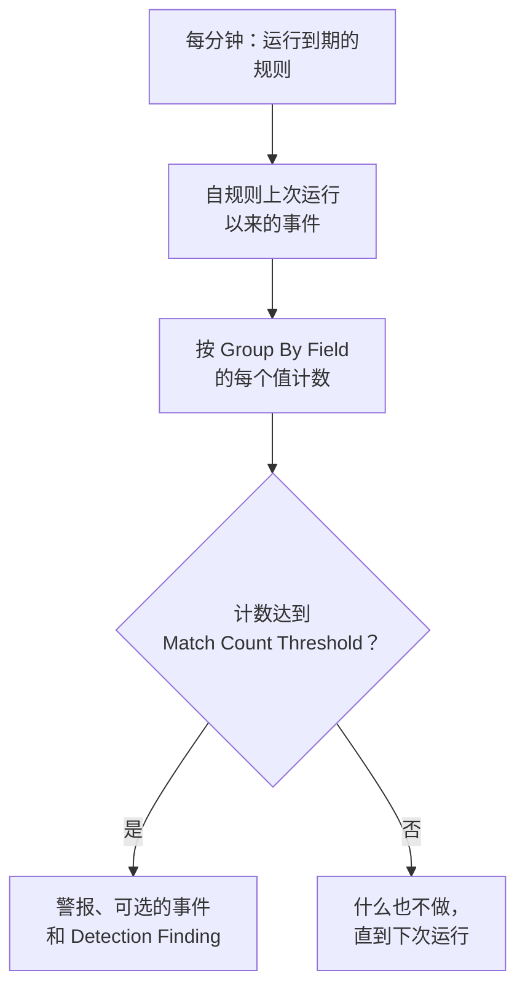

# 安全事件(SIEM)

OneUptime 把安全事件与你的日志、跟踪和指标保存在一起，并且无论它们以什么格式到达，都统一成同一种结构：[OCSF](https://schema.ocsf.io/)（Open Cybersecurity Schema Framework）。你可以从任何来源发送事件、搜索它们，并用 Sigma 检测规则、威胁情报和监视器把重要的事件变成警报。

:::cards
- [发送事件](#发送安全事件): 一个 HTTPS POST、一个 Fluent Bit 输出，或与安全产品的连接。
- [搜索和关联分析](#浏览安全事件): 事件浏览器和关联分析图。
- [检测规则](#检测规则): 会打开警报的 Sigma 规则。
- [监视器](#安全事件监视器): 滚动时间窗口内的计数，以及会恢复的状态。
:::

## 工作原理


在 **可观测性** 下打开 **产品 → Security Events** 。它的标签页如下：

| 标签页 | 用途 |
| --- | --- |
| **事件** | 搜索和过滤每个事件，并打开某个事件查看它的所有字段 |
| **关联分析** | 共享同一主机、用户或 IP 地址的事件构成的图 |
| **Detection Rules** | 按计划运行并打开警报的 Sigma 规则 |
| **Threat Intel** | 已知恶意指标的 STIX/TAXII 源 |
| **监视器** | 项目的安全事件监视器 |
| **Connections** | OneUptime 轮询新记录的安全产品 |
| **设置指南** | 发送事件的代码片段，已填好你的摄取密钥 |

## 开始之前

只有 Project Owner 和 Project Admin 角色，以及三个 Security 角色可以读取安全数据；其他角色在 Security Events 中什么也看不到。请参阅 [角色](/docs/permissions/reference#角色)。

| 角色 | 能做什么 |
| --- | --- |
| Security Admin | 一切：事件、检测规则、威胁情报源和连接 |
| Security Member | 读取事件和威胁情报，并创建、修改和删除检测规则和情报源。不能设置连接，也不能删除安全数据。 |
| Security Viewer | 读取事件、规则、情报源、指标和连接 |

## 发送安全事件

:::steps
### 创建摄取密钥

打开 **项目设置 → 遥测与 APM → 摄取密钥** ，点击 **创建摄取密钥** 。安全事件与其他遥测数据使用相同的密钥。

### 发送你的事件

把 JSON 发送到 `/security-events/v1/ingest`，并在 `x-oneuptime-token` 中携带密钥：

:::tabs
@tab OCSF
```bash
curl -X POST "https://oneuptime.com/security-events/v1/ingest?format=ocsf" \
  -H "Content-Type: application/json" \
  -H "x-oneuptime-token: YOUR_INGESTION_TOKEN" \
  -H "x-oneuptime-service-name: my-security-source" \
  -d '{ "events": [ { "class_uid": 3002, "severity_id": 4, "status": "Failure", "message": "Failed logon for alice", "actor": { "user": { "name": "alice" } }, "src_endpoint": { "ip": "203.0.113.7", "hostname": "laptop-alice" } } ] }'
```
@tab Google UDM
```bash
curl -X POST "https://oneuptime.com/security-events/v1/ingest?format=udm" \
  -H "Content-Type: application/json" \
  -H "x-oneuptime-token: YOUR_INGESTION_TOKEN" \
  -d '{ "events": [ { "metadata": { "event_type": "USER_LOGIN" }, "principal": { "hostname": "laptop-alice", "user": { "userid": "alice" }, "ip": ["203.0.113.7"] }, "security_result": [{ "severity": "HIGH", "action": ["BLOCK"] }] } ] }'
```
@tab Generic JSON
```bash
curl -X POST "https://oneuptime.com/security-events/v1/ingest" \
  -H "Content-Type: application/json" \
  -H "x-oneuptime-token: YOUR_INGESTION_TOKEN" \
  -d '{ "events": [ { "severity": "high", "event_type": "ssh_brute_force", "message": "12 failed SSH logins in 60s", "username": "root", "hostname": "web-01", "src_ip": "203.0.113.7" } ] }'
```
:::

事件进入队列后，端点会返回 `200`。像这些示例一样不带时间的事件，会放在它到达的那一刻。

### 在事件中找到它们

打开 **产品 → Security Events → 事件** 。几秒钟内事件就会出现，严重程度、类别、用户、主机和 IP 地址都已填好。
:::

### 格式

| `format` | 读取的内容 | 也接受 |
| --- | --- | --- |
| `ocsf` | OCSF 事件 JSON（`class_uid`、`severity_id` 等） | 无 |
| `udm` | Google SecOps（Chronicle）UDM 事件（`metadata.event_type` 等） | `chronicle`、`google-secops` |
| `google-secops-alert` | Google SecOps 检测和警报：SOAR Webhook 和检测流 | `secops-alert`、`detection` |
| `generic` | 任何其他 JSON，按常见字段名读取 | 无 |

可以用 `?format=`、`x-oneuptime-security-event-format` 标头，或顶层的 `"format"` 字段指定格式。不指定时，每个事件的格式会单独判断，所以一个 Webhook 可以混合发送检测和原始事件。

- 正文可以是一个事件、一个事件数组，或 `{ "events": [...] }`。
- `x-oneuptime-service-name` 标头指定事件所属的遥测服务。没有它时，事件属于以第一个事件的产品或供应商命名的服务，或属于 `Security Events`。
- 不会因为无法映射而丢弃任何内容：来源的每个字段都会进入事件的属性。

### 通用 JSON 字段

通用事件按常见字段名读取：

| 事件的字段 | 从以下第一个存在的字段读取 |
| --- | --- |
| `message` | `message`、`msg`、`summary`、`description`、`title` |
| `severityName` | `severity`、`severity_name`、`level`、`priority`、`risk_level` |
| `time` | `timestamp`、`time`、`@timestamp`、`event_time`、`created_at` |
| `principalUser` | `user`、`username`、`user_name`、`account`、`actor` |
| `principalHost` | `host`、`hostname`、`computer`、`device`、`machine` |
| `principalIp` | `source_ip`、`src_ip`、`client_ip`、`ip` |
| `targetIp` | `destination_ip`、`dest_ip`、`dst_ip`、`target_ip` |
| `className` | `event_type`、`category`、`type`、`action` |
| `ruleName` | `rule`、`rule_name`、`signature`、`detection` |
| `productName` | `product`、`product_name`、`source`、`log_source` |

表示严重程度的词会变成 OCSF 级别：`info` 读作 Informational，`warning` 读作 Low，`error` 读作 Medium，`alert` 读作 Critical，`emergency` 读作 Fatal。

### 用 Fluent Bit 转发

要发送你已经在收集的安全日志，例如 auditd、syslog 或 Falco，请给 Fluent Bit 添加一个 `http` 输出：

```ini title="fluent-bit.conf"
[OUTPUT]
    Name             http
    Match            security.*
    Host             oneuptime.com
    Port             443
    tls              On
    URI              /security-events/v1/ingest
    Format           json
    Json_date_key    timestamp
    Json_date_format iso8601
    Header           x-oneuptime-token YOUR_INGESTION_TOKEN
    Header           x-oneuptime-service-name my-security-source
    Retry_Limit      5
```

**设置指南** 标签页提供这些代码片段，并已填好你自己的主机和密钥。

### 连接安全产品

**Connections** 会替你轮询安全产品，并把它的新记录作为安全事件导入。连接保存产品的设置和加密的凭据；工作进程按你设置的间隔轮询它，并跳过已经导入过的记录。

| 产品 | 导入内容 | 设置指南 |
| --- | --- | --- |
| Google SecOps (Chronicle) | 规则检测、精选检测和警报，作为 Detection Finding | [Google SecOps](/docs/integrations/google-secops) |
| Microsoft Sentinel | 事件（incident），作为 Incident Finding | [Microsoft Sentinel](/docs/integrations/microsoft-sentinel) |
| Microsoft Defender XDR | 警报，作为 Detection Finding | [Microsoft Defender XDR](/docs/integrations/microsoft-defender-xdr) |
| CrowdStrike Falcon | 警报，作为 Detection Finding | [CrowdStrike Falcon](/docs/integrations/crowdstrike-falcon) |
| Splunk Enterprise Security | Notable 事件或任意搜索，作为 Detection Finding | [Splunk Enterprise Security](/docs/integrations/splunk) |
| Elastic Security | 检测警报，作为 Detection Finding | [Elastic Security](/docs/integrations/elastic-security) |
| AWS Security Hub | Finding，作为 Detection Finding 和 Compliance Finding | [AWS Security Hub](/docs/integrations/aws-security-hub) |
| Okta System Log | 登录、MFA、账户和策略事件 | [Okta System Log](/docs/integrations/okta) |

- 连接按产品创建记录的时间读取记录，而不是按记录所描述活动的时间。每小时运行一次的 SIEM 规则会在它匹配的事件之后很久才创建检测，这些检测仍然会被导入。
- 第一次轮询会回溯 24 小时，所以新连接会立刻显示最近的记录。
- 连接所在行中的 **测试连接** 会检查对产品的访问以及 OneUptime 自身的工作进程是否在运行，不会导入任何内容。**Run now** 会立即轮询。

## 事件包含什么

每个事件都与类型化字段和来源负载一起存储：

| 分组 | 字段 |
| --- | --- |
| 分类 | `categoryName`、`className`、`activityName`、`statusName`，以及它们的 OCSF ID（`categoryUid`、`classUid`） |
| 严重程度 | `severityName`，取值为 Unknown、Informational、Low、Medium、High、Critical、Fatal 或 Other 之一，以及 `severityId` |
| 谁做的 | `principalUser`、`principalHost`、`principalIp`、`principalProcess` |
| 涉及了什么 | `targetUser`、`targetHost`、`targetIp`、`targetPort`、`targetResource` |
| 来源 | `productName`、`vendorName`、`ruleId`、`ruleName`、`eventUid` |
| 内容 | `message`、`mitreTactics`、`mitreTechniques` 和 `observables`：从事件中提取的每个用户、主机、IP 地址、域名和哈希 |
| 属性 | 完整的来源负载，展平为以点分隔的键 |

## 浏览安全事件

**事件** 是一个与日志和跟踪浏览器类似的遥测浏览器：一个按严重程度显示时间窗口内事件的图表、一个分面侧栏、事件列表，以及一个显示所打开事件的每个字段和属性的面板。时间窗口、过滤器和搜索都保存在 URL 中，所以过滤后的视图可以分享，刷新后也不会丢失。

### 搜索

搜索栏使用与其他遥测浏览器相同的语法（参见 [搜索语法](/docs/telemetry/search-syntax)）：

| 语法 | 含义 | 示例 |
| --- | --- | --- |
| 自由文本 | 消息中包含它 | `failed logon` |
| `"quoted phrase"` | 这些词连在一起 | `"brute force"` |
| `<field>:<value>` | 类型化字段 | `severity:Critical` |
| `@<attribute>:<value>` | 来源属性 | `@threat.matched:true` |
| `-<filter>` | 排除这一项 | `-severity:Informational` |
| `<field>:(a OR b)` | 这些值中的任意一个 | `severity:(High OR Critical)` |
| `<field>:a*` | `*` 表示任意文本，`?` 表示一个字符 | `host:web-*` |
| `@<attribute>:*` | 存在该属性 | `@threat.indicator_id:*` |
| `@<attribute>:~text` | 属性包含该文本 | `@finding_info.title:~ransom` |

字段要么是简称（`severity`、`class`、`category`、`activity`、`status`、`vendor`、`product`、`rule`、`user`、`host`、`ip`、`targetuser`、`targethost`、`targetip`、`observable`、`tactic`、`technique`），要么是字段本身的名称，例如 `severityName` 或 `principalHost`。任何其他名称都会被读作来源属性。`observable:<value>` 会找出提到某个值的每个事件，无论该值出现在活动的哪一方。

### 分面

侧栏按 **来源**、**严重程度**、**事件类别**、**Category**、**活动**、**状态**、**供应商**、**产品**、**Detection Rule**、**源用户** 和 **源主机** 统计时间窗口内的事件。点击某个值只保留它的事件，点击旁边的减号则排除它们。图表和每个计数描述的正是列表中的事件。

### 关联分析

**关联分析** 围绕一个主机、用户或 IP 地址绘制事件：在你搜索的值周围显示它们的事件类别，并按最严重的严重程度标记，同一批事件中出现的其他值显示在外圈。点击某个类别可以列出它的事件，点击某个值可以接着按它进行关联分析。**事件** 中事件面板里的每个 observable 都可以直接在 **关联分析** 中打开。

## 检测规则

检测规则是一条 [Sigma](https://sigmahq.io/) 规则，一种描述可疑活动的开放 YAML 格式，OneUptime 会按计划对你的事件运行它。匹配时，它会打开一个警报，可选地打开一个事件（incident），并把一个 Detection Finding 写回安全事件中。



### 创建规则

:::steps
1. 打开 **产品 → Security Events → Detection Rules** ，点击 **创建Detection Rule** 。
2. 在 **基本信息** 中填写 **名称** ，并保持 **已启用** 打开。
3. 在 **Sigma Rule** 中，把规则的 YAML 粘贴到 **Sigma Rule (YAML)** 中。保存时会解析它，所以错误会显示在表单中。
4. 在 **评估** 中，设置它运行的频率以及需要多少次匹配；参见 [评估设置](#评估设置)。
5. 在 **匹配时** 中选择匹配后要做什么：**Create Alert on Match**（打开）、**Create Incident on Match**（关闭）和 **Write Detection Finding on Match**（打开），以及可选的 **警报严重性** 和 **事件严重性** 。
:::

第一条规则，匹配来自 `10.x.x.x` 之外的登录失败：

```yaml title="failed-logon-burst.yml"
title: Failed logon burst
description: Repeated authentication failures from one source.
level: high
tags:
  - attack.t1110
  - attack.ta0006
detection:
  selection:
    className: Authentication
    statusName: Failure
  filter_internal:
    principalIp|startswith: '10.'
  condition: selection and not filter_internal
```

### 规则能表达什么

OneUptime 运行 Sigma 的布尔核心：

- 选择项是字段映射（每个字段都必须匹配；值列表匹配其中任意一个），或关键字列表，在消息中的任何位置匹配。
- 条件用 `and`、`or`、`not` 和括号，或用 `1 of selection_*`、`all of selection_*`、`any of them` 和 `all of them` 组合选择项。
- 字段修饰符：`contains`、`startswith`、`endswith`、`all`、`re`、`cased`、`gt`、`gte`、`lt`、`lte`、`cidr`、`exists` 和 `windash`。除非你加上 `cased`，否则文本比较不区分大小写。
- 字段可以是类型化字段（`principalUser`）、它在 Sigma 中的常见写法（`CommandLine`、`src_ip`、`Hostname`），或任何属性键，按它在事件中的写法拼写（`threat.matched`）。
- `level` 设置严重程度：`informational`、`low`、`medium`、`high` 或 `critical`，缺省时为 `medium`。`tags` 中的 ATT&CK ID（`attack.t1110`、`attack.ta0006`）会填入检测结果的 MITRE 字段。

像 `| count() by principalIp > 5` 这样的聚合会在保存时被拒绝：请改用 **Group By Field** 和 **Match Count Threshold** 。`logsource` 只起说明作用，不会缩小任何范围：请把这种过滤放进选择项，例如 `className: Authentication`。`timeframe` 会被忽略，因为规则的间隔决定了它的时间窗口。

### 评估设置

| 字段 | 作用 |
| --- | --- |
| **Evaluation Interval (Minutes)** | 规则运行的频率：整数分钟，1 到 1440。新规则的表单从 5 开始。 |
| **Group By Field** | 可选。该字段值相同的匹配，例如 `principalHost`，会一起计数、一起告警、一起去重：每台主机一个警报，而不是成百上千个。 |
| **Distinct Count Field** | 可选。统计该字段的不同值的数量，而不是匹配的事件数。空值不计入。 |
| **Match Count Threshold** | 只有当一个分组在一次运行中的计数达到这个数时才会触发：1 到 1000000，设为 1 时任何匹配都会触发。 |

Group By 和 Distinct Count 使用与规则相同的字段名。有了它们，阈值的意思就是“同一个对象、在一次运行中、达到这么多”，无需再在上面叠加监视器：

| 目标 | Group By Field | Distinct Count Field | 阈值 |
| --- | --- | --- | --- |
| 对任何匹配发出警报 | 空 | 空 | 1 |
| 每台主机一个警报 | `principalHost` | 空 | 1 |
| 暴力破解：来自同一个 IP 的 5 次登录失败 | `principalIp` | 空 | 5 |
| 密码喷洒：同一个 IP 在 5 个不同账户上失败 | `principalIp` | `principalUser` | 5 |
| 端口扫描：同一个 IP 访问 20 个不同端口 | `principalIp` | `targetPort` | 20 |

### 规则何时运行

OneUptime 每分钟检查一次已启用、且自上次运行以来已过了间隔时间的规则。每次运行读取事件时间落在上次运行与现在之间的事件，然后继续往前：

- 时间窗口首尾相接，不会滚动。间隔为 10 分钟时，09:58 和 10:01 的失败可能落在不同的运行中、被分开计数，所以选择阈值时请留出余量。
- 出现空档之后，例如工作进程中断或规则被重新打开，下一次运行会覆盖整个空档，最多覆盖最近 24 小时。
- 迟到的事件，即时间早于规则上次运行的事件，会被存储并可以搜索，但那条规则永远不会读取它。
- 每次运行最多触发 100 个分组：计数最高的那些。

### 严重程度

规则的 `level` 就是它的检测结果的严重程度：`informational`、`low`、`medium`、`high` 和 `critical` 分别变为 Informational、Low、Medium、High 和 Critical。它的警报和事件会按以下顺序取用你项目中的某个严重程度：

1. 规则的 **警报严重性**（或 **事件严重性** ），如果已设置。
2. 与级别同名的严重程度，例如 High，不区分大小写。
3. 按等级：`critical` 和 `high` 规则取用你最严重的严重程度，其他规则取用最轻的。

> [!TIP]
> 按 Sigma 级别（Critical、High、Medium、Low、Informational）为你的警报严重程度命名，每条规则无需单独设置就会落到正确的严重程度上。

### 警报和检测结果

每个触发的分组都会打开一个标题为 `[Detection] <rule name> — <group value>` 的警报，没有 Group By Field 的规则则为 `[Detection] <rule name>`。警报打开期间，该分组的更多匹配不会再打开新的警报。规则只能看到匹配，无法判断攻击是否已经停止，所以它的警报会一直保持打开，直到有人解决。

Detection Finding 是来自产品 `OneUptime Detections`、类别为 `Detection Finding`（OCSF 类别 2004）的安全事件，带有规则的 MITRE 标签、位于 `observables` 首位的分组值，以及以下属性：

| 属性 | 值 |
| --- | --- |
| `oneuptime.detection.rule_id` | 触发的规则的 ID |
| `oneuptime.detection.rule_name` | 规则的名称 |
| `oneuptime.detection.match_count` | 该检测结果背后有多少个事件 |
| `oneuptime.detection.distinct_count` | 背后有多少个不同的值，适用于设置了 Distinct Count Field 的规则 |
| `oneuptime.detection.group_value` | 分组的值，适用于设置了 Group By Field 的规则 |
| `oneuptime.detection.sigma_id` | Sigma 规则自己的 `id` |

检测结果就是普通的事件：可以在 **事件** 中搜索它们，在 **关联分析** 中以它们为中心展开分析。要悄悄试用一条新规则，请在信任它之前关闭除检测结果以外的所有动作。

## 安全事件监视器

安全事件监视器在滚动时间窗口内统计与其过滤器匹配的事件，并对计数运行常规的监视器条件：它会改变监视器的状态、打开警报或事件，并呼叫值班人员。请在 **监控 → 创建监视器** 下创建，类型选择 **Security Events** ；**Security Events → 监视器** 会列出所有这类监视器。

它的表单显示 **Monitor events that include this text**、**Monitor Security Events for (time)**、**Event Severity** 和 **事件类别** 。**按遥测服务过滤** 和 **按属性过滤** 位于 **更多字段** 下，其标题会显示监视器正在使用哪些。它的条件检查 **Security Event Count** 。

| | 检测规则 | 安全事件监视器 |
| --- | --- | --- |
| 匹配依据 | 一条 Sigma 规则 | 针对严重程度、类别、消息、服务和属性的过滤器 |
| 时间窗口 | 首尾相接，每次运行一个 | 滚动：最近 5 秒到 24 小时 |
| 按分组计数 | 是，通过 **Group By Field** | 否：所有匹配合计一个计数 |
| 打开的内容 | 警报、事件和检测结果 | 状态、警报和事件 |
| 会恢复 | 否：警报保持打开直到被解决 | 是：计数恢复时状态也随之恢复 |

请把检测本身写成规则，并带上它的阈值。当你需要滚动时间窗口、能自行恢复的状态、状态页面，或按条件使用不同的值班策略时，再使用监视器。

### 监视你的检测

检测结果就是事件，所以监视器可以监视规则本身：

- 风暴：在 `Detection Finding` 类别上建一个监视器，统计每个检测结果。一小时内有二十条不同的规则触发，是任何单条规则都看不到的信号。
- 频率变化：按某条规则的 `oneuptime.detection.rule_id` 过滤。一条每周触发一次的规则突然每小时触发五十次，需要不同的应对。
- 沉默：平时总能看到几个的检测结果降到零，通常意味着某个来源停止发送了。请使用检查计数是否低于某个数的条件。

规则所在行中的 **创建监视器** 操作会打开一个已经这样设置好的新监视器：`Detection Finding` 类别、规则的 ID（绝不用名称，因为重命名会改变名称），以及最近一小时。这样的监视器统计的是检测结果，每次运行每个分组一个，而不是它们背后的事件。若要在任何东西触发之前要求一定数量的事件，请使用规则的 **Match Count Threshold** 。

## 威胁情报

**Threat Intel** 订阅已知恶意 IP 地址、域名、URL、电子邮件地址和文件哈希的 STIX/TAXII 源。提到其中之一的事件会在到达时被打上 `threat.*` 属性，规则和监视器可以按这些属性过滤；此外每分钟都会把最近的事件与情报源进行比对，像规则一样打开警报和检测结果。请参阅 [威胁情报](/docs/telemetry/threat-intelligence)。

## 保留和计费

与其他遥测数据一样，安全事件按摄取的 GB 计费，并按你的遥测保留期保存：即项目在 **项目设置 → 遥测与 APM → 数据保留** 下的 **默认保留期（天）** ，或在其所属遥测服务上设置的保留期。事件的保留期结束时，它会被删除。

## 故障排除

:::details 事件没有出现
检查 `x-oneuptime-token` 中的密钥和路径 `/security-events/v1/ingest`。然后检查 **事件** 中的时间窗口，除非你更改过，它是过去一天：事件按它自己的时间放置，所以时间戳较早的事件会落在窗口之外。
:::

:::details 规则从不匹配
检查它是否处于 **已启用** 状态，并查看它所在行中的 **Last Evaluated** 和 **Last Error** 。打开一个你预期会匹配的事件，逐个字段与规则进行比较：普通值必须等于整个字段，所以匹配其中一部分时请使用 `contains` 或 `*`。属性按它在事件中的名称书写（写 `threat.matched`，而不是 `attributes.threat.matched`）。阈值大于 1 时，这些匹配必须落在同一次运行中。
:::

:::details 规则匹配了，但没有打开警报
**Create Alert on Match** 已关闭，或者同一规则和分组值的警报仍处于打开状态，之后的匹配都会并入其中。项目至少需要一个警报严重程度，规则才能打开警报。
:::

:::details 规则打开的警报太多
**Group By Field** 的每个值都会得到自己的警报：请按更粗的粒度分组、提高阈值，或者添加一个 Distinct Count Field。如果你关心的是频率而不是每一次匹配，请关闭 **Create Alert on Match** ，并在规则的检测结果上设置一个监视器。
:::

## 后续步骤

:::cards
- [威胁情报](/docs/telemetry/threat-intelligence): 将你的事件与 STIX/TAXII 源进行比对。
- [Google SecOps](/docs/integrations/google-secops): 导入 Chronicle 的检测和事件。
- [搜索语法](/docs/telemetry/search-syntax): 搜索栏能理解的一切。
- [权限参考](/docs/permissions/reference): Security 角色以及每个角色能做什么。
:::
