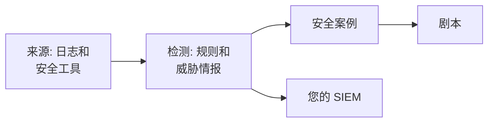

# 安全入门

OneUptime 从您已有的数据中发现威胁——您的日志、您使用的安全工具以及您发送给它的一切——把发现的内容归入案例，并用剧本进行响应。点击两次即可完成设置，无需安装任何东西。

:::cards
- [完成设置](#完成设置): 开启大多数团队需要的功能，然后看一次测试攻击打开一个案例。
- [工作原理](#工作原理): 来源、检测、案例和剧本，以及它们各自的作用。
- [您的日志](#在日志中查找安全事件): 您发送到 OneUptime 的日志中已有的安全事件。
- [您的 SIEM](#把-oneuptime-的发现发送到您的-siem): 把 OneUptime 的发现发送到 Google SecOps。
:::

## 开始之前

设置安全功能需要 Project Owner、Project Admin 或 Security Admin 角色。Security Member 和 Security Viewer 角色可以查看发现的内容；请参阅 [角色](/docs/permissions/reference#角色)。

## 完成设置

:::steps
### 开启大多数团队需要的功能

打开 **产品 → Security Events**。在 **概览** 上点击 **开启推荐设置**。它会一次开启三项：**在日志中查找安全事件**、推荐的检测规则，以及 **Enrich New Cases**——一个将每个新案例与威胁情报比对、并在其中留下分诊清单的剧本。

### 发送测试攻击

点击 **发送测试攻击**。来自一个文档专用地址的十几次登录失败会经过真实的处理流程：它们被存储，暴力破解规则检测到它们，并打开一个案例。不会呼叫任何人，也不会有 SIEM 收到它们。

### 打开案例

点击 **打开案例**。真实的发现就是这个样子：背后的事件、涉及的地址，以及 **Enrich New Cases** 发现的内容。完成后，把它作为测试关闭。
:::

从此以后，**概览** 会在 **需要关注** 下先显示需要有人处理的内容：您的未结案例、无人认领的案例，以及等待审批的剧本步骤。没有这些时显示 **一切正常**。

## 工作原理

| 部分 | 位置 | 作用 |
| --- | --- | --- |
| **来源** | **Connections** | 您的日志、OneUptime 轮询的安全产品，以及您发送的一切 |
| **Detections** | **Detections** | 在每个事件中查找威胁的 Sigma 规则和威胁情报源 |
| **安全案例** | **安全案例** | 发现的内容，按其涉及的用户、主机或地址分组 |
| **Playbooks** | **Playbooks** | 在新案例上运行的步骤：补充信息、发送通知、创建事件或进行遏制 |

在 **概览** 顶部，需要有人处理的内容下方，每个部分都显示其数字：来源及其最近 24 小时的事件、已开启的规则、未结案例和进行响应的剧本。尚未设置的部分会如实显示，并打开用于设置它的页面。

## 在日志中查找安全事件

**Connections** 顶部的 **你的日志** 无需安装任何东西。开启 **在日志中查找安全事件** 后，OneUptime 每分钟读取项目的新日志，并把识别出的行变成安全事件：

| 日志 | 会变成安全事件的内容 |
| --- | --- |
| SSH 登录 | 服务器认证日志、journal 或 syslog 中失败和成功的 SSH 登录 |
| sudo | 以其他用户身份运行的命令、错误的 sudo 密码，以及不允许使用 sudo 的人 |
| Kubernetes 审计日志 | 对集群的更改、在 Pod 中打开的 shell、被读取的 secret 和被拒绝的请求 |
| AWS CloudTrail | 控制台登录、在您的 AWS 账户中所做的更改，以及被 AWS 拒绝的调用 |
| Web 攻击 | Web 服务器访问日志中尝试 SQL 注入、路径遍历或 Log4Shell 的请求 |

您的日志保持原样。只有对安全重要的行才会变成事件：绝不会是 Web 服务器返回的每个页面，也不会是对 API 的每次读取。

## 把 OneUptime 的发现发送到您的 SIEM

如果您的团队已经在使用 SIEM，OneUptime 也会把发现的内容发送到那里。在 **Connections → 发送到你的 SIEM** 下点击 **添加目标**，填写您的 Google SecOps 的区域、实例和服务账号密钥，并在保存前点击 **发送测试事件**。请参阅 [将安全事件发送到 Google SecOps](/docs/integrations/google-secops#将安全事件发送到-google-secops)。

## 故障排除

:::details Turn on recommended 显示为灰色
您的角色无法添加检测规则、剧本或日志来源。请联系 Project Owner、Project Admin 或 Security Admin，或请他们为您分配 Security Admin 角色。
:::

:::details Turn on recommended 未能全部开启
卡片会列出未能开启的每一项及原因：您的角色、您的套餐，或 OneUptime 一侧出了问题。其余都已开启。解决卡片列出的问题后，点击 **重试**：只会开启仍缺少的部分，不会重复添加。
:::

:::details 测试攻击没有打开案例
案例通常会在按钮响应之前打开；如果规则仍在追赶进度，它会说明这一点，案例会在一分钟内打开。请再次查看 **安全案例**，并在 **Detections** 下确认暴力破解规则已开启。
:::

:::details 我的日志没有产生安全事件
请确认 **在日志中查找安全事件** 已开启，并且 **你的日志** 显示了上次检查的时间。只有上表中的那几类行才会变成事件：不发送 SSH、sudo、审计、CloudTrail 或访问日志的服务器，没有可以发现的内容。
:::

:::details 概览显示最后一个安全事件是几天前到达的
此后没有任何内容到达 Security。打开 **Connections**，检查 **你的日志** 和每个连接是否仍已开启，以及各自上次检查的时间。
:::

:::details 开启 Security 的卡片不见了
有人用 **关闭** 把它收起了。只要尚未监视任何威胁，**概览** 就会提供 **设置 Security**，用它可以把卡片找回来。
:::

## 后续步骤

:::cards
- [安全事件(SIEM)](/docs/telemetry/security-events): 发送事件、搜索事件并编写检测规则。
- [安全案例与剧本(SOAR)](/docs/telemetry/security-cases): 处理案例，并用剧本进行响应。
- [威胁情报(STIX/TAXII)](/docs/telemetry/threat-intelligence): 将您的事件与已知的恶意指标进行比对。
- [Google SecOps](/docs/integrations/google-secops): 导入 Google SecOps 的检测结果，并把 OneUptime 的发现发送过去。
:::
