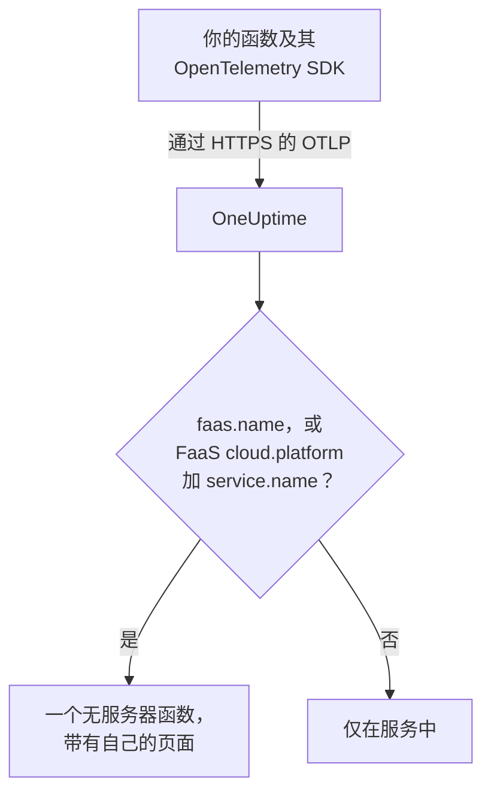

# 无服务器函数

OneUptime 一收到无服务器函数发来的 OpenTelemetry 数据就会识别该函数，并把它连同其跟踪、日志和指标列在 **无服务器函数** 下。它适用于 AWS Lambda、Google Cloud Functions、Azure Functions、Cloudflare Workers，以及任何能发送 OpenTelemetry 的其他 FaaS 运行时。无需手动创建任何东西：用函数运行时对应的 OpenTelemetry SDK 对函数进行插桩，并让其 OTLP 导出器指向 OneUptime。

:::cards
- [OneUptime 如何识别函数](#oneuptime-如何识别函数): `faas.name`，或 FaaS 类型的 `cloud.platform` 加上 `service.name`。
- [发送函数的遥测数据](#发送函数的遥测数据): 导出器设置，以及 Lambda 层。
- [Azure Functions](#azure-functions): 每个 Function App 一个函数，来自 Functions 主机。
- [故障排除](#故障排查): 没有出现的函数，或页面为空的函数。
:::

## 工作原理

OneUptime 在每个批次到达时读取其资源属性。带有 `faas.name` 的资源，或带有 FaaS 类型的 `cloud.platform`（例如 `aws_lambda` 或 `azure_functions`）并同时带有 `service.name` 的资源，就是一个无服务器函数：OneUptime 会随其第一批数据创建该函数，并把遥测数据归到它下面。



## 开始之前

- 一个摄取密钥。在 **项目设置 → 遥测与 APM → 摄取密钥** 下创建一个并复制其值。
- 适用于函数所用语言的 OpenTelemetry SDK 或自动插桩层。

## OneUptime 如何识别函数

OneUptime 根据 `faas.name` 资源属性识别每个函数。有些平台的资源检测器从不设置它（[Azure Functions](#azure-functions) 是常见情况），因此当资源没有 `faas.name`，但其 `cloud.platform` 是 FaaS 平台时，OneUptime 会改用其 `service.name` 作为函数的身份，并把该值作为 `faas.name` 填入它存储的每个 span、日志、指标和性能剖析数据中，使函数的页面能找到其全部遥测数据：

| 属性 | 是否必需 | 用途 |
| --- | --- | --- |
| `faas.name` | **是**，除非设置了后面两个 | 函数身份（例如 `checkout-handler`） |
| `cloud.platform` | 没有 `faas.name` 时，与 `service.name` 一起 | `aws_lambda`、`gcp_cloud_functions`、`azure_functions`、`tencent_cloud_scf` 或 `alibaba_cloud_fc` |
| `service.name` | 在没有 `faas.name` 的 FaaS 类型 `cloud.platform` 上 | 函数身份，以 `faas.name` 写入遥测数据 |
| `faas.version` | 否 | 显示在概览中 |
| `faas.instance` | 否 | 在 **实例** 页面上按实例跟踪 |
| `cloud.provider` / `cloud.region` / `cloud.account.id` | 否 | 显示在概览中 |
| `process.runtime.name` / `process.runtime.version` | 否 | 作为运行时显示在概览中 |

你设置的 `faas.name` 永远不会被替换。`cloud.platform` 的值必须按列出的方式拼写（某些 Azure 检测器发送的带点的 `azure.functions` 也被接受），并且 `service.name` 必须是资源属性：`x-oneuptime-service-name` 请求头命名的是服务，而不是函数。

> [!NOTE]
> 同时设置了 `service.name` 的函数仍然也会出现在 **服务** 下。**无服务器函数** 是为函数构建的视图，按 `faas.name` 划定范围。

## 发送函数的遥测数据

:::steps
### 设置 OTLP 导出器环境变量

大多数语言的自动插桩会读取标准的 OpenTelemetry 环境变量：

```bash
OTEL_EXPORTER_OTLP_ENDPOINT="https://oneuptime.com/otlp"
OTEL_EXPORTER_OTLP_HEADERS="x-oneuptime-token=YOUR_TELEMETRY_INGESTION_TOKEN"
OTEL_RESOURCE_ATTRIBUTES="faas.name=checkout-handler,faas.version=1.4.2"
```

如果你自托管 OneUptime，请把端点替换为 `https://YOUR-ONEUPTIME-HOST/otlp`。在 Azure Functions 上，不要把 `faas.name` 放进 `OTEL_RESOURCE_ATTRIBUTES` —— 参见 [Azure Functions](#azure-functions)。

> [!WARNING]
> 摄取密钥是机密。请使用 **服务器** 类型的摄取密钥，并将其设为函数的环境变量。到达浏览器的密钥，任何查看页面源代码的人都能读到。

### 添加 OpenTelemetry Lambda 层（AWS Lambda）

在 AWS Lambda 上，最简单的方法是 [OpenTelemetry Lambda 层](https://opentelemetry.io/docs/faas/lambda-auto/)。为函数的运行时附加该层，并设置：

```bash
AWS_LAMBDA_EXEC_WRAPPER=/opt/otel-handler
OTEL_EXPORTER_OTLP_ENDPOINT=https://oneuptime.com/otlp
OTEL_EXPORTER_OTLP_HEADERS=x-oneuptime-token=YOUR_TELEMETRY_INGESTION_TOKEN
```

该层根据函数名称设置 `faas.name`，其资源检测器会填入 `cloud.platform`、`cloud.region` 和 `cloud.account.id`。在其他平台上，请跳过这一步。

### 调用函数并检查数据是否到达

检查 OneUptime 是否接受该密钥：

```bash
curl -i https://oneuptime.com/otlp/v1/validate \
  -H "x-oneuptime-token: YOUR_TELEMETRY_INGESTION_TOKEN"
```

带有 `"valid": true` 的 `200` 表示 OneUptime 接受该密钥；`401` 表示该密钥未知、已吊销、已禁用或已过期。然后调用函数。一旦它发送了 span、日志或指标，它就会出现在 **产品 → 基础设施 → 无服务器 → 所有函数** 下。
:::

## Azure Functions

Azure Functions 主机本身就能发送 OpenTelemetry，因此无论 Function App 用什么语言编写，它都无需更改代码即可报告其调用（跟踪、日志和指标）。Microsoft 的指南是 [Use OpenTelemetry with Azure Functions](https://learn.microsoft.com/en-us/azure/azure-functions/opentelemetry-howto)。

### Function App 如何显示

Azure 的资源检测器（Functions 主机自己的检测器、`Microsoft.Azure.Functions.Worker.OpenTelemetry` 中 .NET 隔离工作进程的检测器，以及 `@opentelemetry/resource-detector-azure` 中的 Node.js 检测器）描述的是 **Function App**，而不是单个函数，并且它们都不设置 `faas.name`：

| 属性 | 值 |
| --- | --- |
| `service.name` | Function App 的名称，来自 `WEBSITE_SITE_NAME` |
| `cloud.provider` | `azure` |
| `cloud.platform` | `azure_functions`；Node.js 检测器写的是 `azure.functions`，OneUptime 会将其改写 |
| `cloud.region` | 应用的区域，来自 `REGION_NAME` |
| `cloud.resource_id` | `/subscriptions/<subscription>/resourceGroups/<group>/providers/Microsoft.Web/sites/<app>` |
| `faas.instance` | 实例，来自 `WEBSITE_INSTANCE_ID`：仅 Node.js 检测器 |

因此，OneUptime 根据 `service.name` 识别函数，用 Function App 的名称填入 `faas.name`，并显示 **每个 Function App 一个无服务器函数**。资源描述的是应用，而不是它的某个函数：无论运行的是应用中的哪个函数，每个实例报告的都是相同的应用级属性；在 Flex Consumption 计划中，一些函数甚至会在各自的实例上横向扩展。各个函数体现在遥测数据本身中：

- 主机为每次调用启动一个 span，以它运行的函数命名：在函数的 **追踪** 页面上按该名称搜索。
- 主机记录 `faas.invoke_duration`，这是一个以秒为单位的直方图，函数名称位于数据点属性 `faas.name` 中：在 **指标** 页面或仪表板上按它对该指标分组，即可得到每个函数的延迟。

不要像通用的 [第一步](#设置-otlp-导出器环境变量) 示例那样，在 Function App 上把 `faas.name` 添加到 `OTEL_RESOURCE_ATTRIBUTES`。应用程序设置会到达应用的每个进程，因此其所有函数的遥测数据都会带上这一个名称，而 OneUptime 从不替换它收到的 `faas.name`。Microsoft 的指南也是这么说的：不要把特定于函数的值放在资源上。保持不设置，函数就会以应用命名。

设置了 `OTEL_SERVICE_NAME` 时，主机和 .NET 隔离工作进程会用它代替应用的名称。请让同一个应用的所有进程使用相同的 `service.name`：主机和语言工作进程都会发送遥测数据，报告第二个名称的工作进程会产生第二个无服务器函数。资源中没有 FaaS 类型 `cloud.platform` 的工作进程不会加入任何无服务器函数 —— 参见 [对函数代码进行插桩](#对函数代码进行插桩可选)。

:::steps
### 在 Functions 主机中启用 OpenTelemetry

在应用的 `host.json` 根级添加 `"telemetryMode": "OpenTelemetry"`：

```json title="host.json"
{
  "version": "2.0",
  "telemetryMode": "OpenTelemetry"
}
```

此后，无论应用使用什么语言，主机都会发送它自己的跟踪（每次调用一个 span，外加触发器函数背后的 Service Bus 和 Event Hubs 处理器 span）、它的日志，以及包括 `faas.invoke_duration` 在内的指标。

### 让主机指向 OneUptime

将导出器设置为应用程序设置：

```bash
az functionapp config appsettings set \
  --name my-function-app \
  --resource-group my-rg \
  --settings \
    OTEL_EXPORTER_OTLP_ENDPOINT=https://oneuptime.com/otlp \
    OTEL_EXPORTER_OTLP_PROTOCOL=http/protobuf \
    "OTEL_EXPORTER_OTLP_HEADERS=x-oneuptime-token=YOUR_TELEMETRY_INGESTION_TOKEN"
```

如果你自托管 OneUptime，请把端点替换为 `https://YOUR-ONEUPTIME-HOST/otlp`。`OTEL_EXPORTER_OTLP_PROTOCOL=http/protobuf` 很重要：主机的 .NET 导出器默认使用 gRPC，而设为 `http/protobuf` 后，它会发送到端点下的 `/otlp/v1/traces`、`/otlp/v1/metrics` 和 `/otlp/v1/logs`。只有在设置了 `OTEL_EXPORTER_OTLP_ENDPOINT` 时，主机才会发送 OTLP。

> [!WARNING]
> 此令牌是机密：请使用 **服务器** 类型的摄取密钥。应用程序设置在静态时是加密的；若要改为把令牌保存在 Key Vault 中，请把 `OTEL_EXPORTER_OTLP_HEADERS` 设置为 Key Vault 引用，例如 `@Microsoft.KeyVault(SecretUri=https://my-vault.vault.azure.net/secrets/oneuptime-otlp-headers/)`，并在保管库上为应用的托管标识授予 **Key Vault Secrets User** 角色。该引用会解析为所存储的机密值本身，因此请存储整个请求头 `x-oneuptime-token=YOUR_TELEMETRY_INGESTION_TOKEN`，而不只是令牌。

如果你仍需要 Application Insights，请保留 `APPLICATIONINSIGHTS_CONNECTION_STRING`：两者都设置时，主机会把相同的 OpenTelemetry 数据同时发送到 Application Insights 和 OneUptime。删除它即可只发送到 OneUptime。

### 对函数代码进行插桩（可选）

主机已经跟踪了每次调用。要从你自己的代码中添加与主机相连的 span 和日志，还需在语言工作进程中启用 OpenTelemetry。它使用相同的 `OTEL_EXPORTER_OTLP_*` 设置发送：

- **C# (isolated worker)**：添加 NuGet 包 `Microsoft.Azure.Functions.Worker.OpenTelemetry`、`OpenTelemetry.Extensions.Hosting` 和 `OpenTelemetry.Exporter.OpenTelemetryProtocol`，然后在 `Program.cs` 中：`builder.Services.AddOpenTelemetry().UseFunctionsWorkerDefaults().UseOtlpExporter();`
- **JavaScript / TypeScript**：在 OpenTelemetry Node.js SDK 及其 OTLP 导出器之外运行 `npm install @azure/functions-opentelemetry-instrumentation`，并在 `package.json` 的 `main` 字段所包含的文件中注册 `AzureFunctionsInstrumentation`。
- **Java**：添加 Maven 依赖 `com.microsoft.azure.functions:azure-functions-java-opentelemetry`。
- **Python**：设置应用程序设置 `PYTHON_ENABLE_OPENTELEMETRY=true`，把 Microsoft 列出的 OpenTelemetry 包（其中包括 `opentelemetry-sdk` 和 `opentelemetry-exporter-otlp`）添加到 `requirements.txt`，并在 `function_app.py` 中配置导出器。
- **PowerShell**：设置应用程序设置 `OTEL_FUNCTIONS_WORKER_ENABLED=True`，并从 `profile.ps1` 加载 `AzureFunctions.PowerShell.OpenTelemetry.SDK` 模块。

Microsoft 的指南中有每种语言的完整代码。.NET 工作进程（通过 `UseFunctionsWorkerDefaults()`）和 Python 工作进程（通过 `PYTHON_ENABLE_OPENTELEMETRY`）会告诉主机把它们的日志交给它们自己处理，因此这些日志不会被发送两次。

只有当工作进程的资源像主机的资源那样描述应用时，即具有相同的 `service.name` 和 FaaS 类型的 `cloud.platform`，它的 span 和日志才会到达函数的页面。.NET 隔离工作进程（通过 `UseFunctionsWorkerDefaults()`）和 Microsoft 的 Node.js 示例（通过 `getResourceDetectors()` 包含的 Azure 检测器）两者都会报告。Microsoft 的 Python 示例在构建资源时没有使用 Azure 检测器，因此默认情况下两者都不报告，其遥测数据永远到不了该函数。对于 Python，或任何未配置 Azure Functions 资源检测器的工作进程，请再添加两个应用程序设置。应用的每个进程都会读取它们（包括主机），因此它们都会报告相同的身份：

```bash
az functionapp config appsettings set \
  --name my-function-app \
  --resource-group my-rg \
  --settings \
    OTEL_SERVICE_NAME=my-function-app \
    "OTEL_RESOURCE_ATTRIBUTES=cloud.provider=azure,cloud.platform=azure_functions"
```

把 `OTEL_SERVICE_NAME` 设置为 Function App 自己的名称。这正是没有该设置时主机和 Node.js 检测器报告的名称，因此函数会保留它已有的身份。
:::

### 限制

- **C# 进程内应用** 无法使用 OpenTelemetry：请先把它们迁移到隔离工作进程模型。
- 主机处于 OpenTelemetry 模式时，Azure 门户中的 **日志流** 不起作用，并且门户的 _Recent function invocations_ 列表需要 Application Insights 中的遥测数据。请改用 OneUptime 中该函数的 **日志** 和 **追踪** 页面。
- 一旦 `telemetryMode` 为 `OpenTelemetry`，`host.json` 的 `logging.applicationInsights` 部分就不再适用。
- **实例** 列出 `faas.instance` 的值。在上述检测器中，只有 Node.js 检测器会设置它，因此对于来自主机和 .NET 工作进程的遥测数据，该页面保持为空。

## 你会得到什么

一旦函数发送了 span、日志或指标，它就会出现在 **无服务器函数** 下。它的 **概览** 显示：

- **调用次数**、**错误率** 和 **p95 时长**，根据你所选时间范围内的跟踪计算，并带有趋势图。
- **实例**：函数报告的 `faas.instance` 值的实时列表。
- 限定于该函数的完整 **日志**、**追踪** 和 **指标** 页面。

## 为函数添加标签并分配所有者

以 `oneuptime.label.` 开头的资源属性会成为函数上的项目标签：`oneuptime.label.team=payments` 会添加标签 `team:payments`。把这些属性添加到 `OTEL_RESOURCE_ATTRIBUTES`：

```bash
OTEL_RESOURCE_ATTRIBUTES="faas.name=checkout-handler,oneuptime.label.team=payments,oneuptime.label.env=production"
```

如果要改为按函数名称添加标签或分配所有者，请打开 **产品 → 基础设施 → 无服务器**，并使用侧边菜单中的 **标签规则** 和 **所有者规则**。规则在创建函数时运行，包括自动发现的函数。要把规则应用到已有的函数，请使用该规则的 **Run Now**（参见 [对现有资源运行规则](/docs/configuration/run-rules-now)）。

## 故障排查

:::details 函数没有出现在无服务器函数下
按以下顺序检查：

1. 设置变量后，函数已被调用过：它只在运行时发送遥测数据。
2. 在 AWS Lambda 上，已为函数的运行时附加该层，并且 `AWS_LAMBDA_EXEC_WRAPPER` 为 `/opt/otel-handler`：没有该包装器，层的插桩永远不会启动。
3. 在其他平台上，函数的代码会加载 OpenTelemetry SDK 或自动插桩：仅靠变量不会发送任何数据。
4. 资源带有 `faas.name`，或 FaaS 类型的 `cloud.platform` 加上 `service.name`。没有它们时，遥测数据会改为作为服务归到 **服务** 下。
5. 函数能访问你的 OneUptime URL。位于私有网络中的函数需要一条通往它的出站路由，例如 NAT 网关。
:::

:::details 函数已列出，但其页面为空
函数的 **概览**、**日志**、**追踪** 和 **指标** 显示的是 `faas.name` 与函数名称完全相同（包括大小写）的遥测数据。通过 FaaS 类型的 `cloud.platform` 及其 `service.name` 命名的函数不需要自己的 `faas.name`：OneUptime 会在遥测数据到达时，把 `service.name` 作为 `faas.name` 写入其中。在 OneUptime 开始填入 `faas.name` 之前存储的遥测数据不会被更新，也不会出现在页面中：请调用函数以发送新的遥测数据。还要检查页面顶部的时间范围。
:::

:::details 函数显示为已断开
当 OneUptime 在 15 分钟内没有从函数收到任何数据时，函数会变为已断开；OneUptime 每 5 分钟检查一次，并且它自身未在接收数据的时间不计入在内。只是偶尔运行的函数在两次运行之间处于已断开状态：收到它的下一批遥测数据后，它会重新变为已连接。
:::

## 后续步骤

:::cards
- [OpenTelemetry](/docs/telemetry/open-telemetry): 从任何应用程序发送跟踪、日志和指标。
- [队列](/docs/telemetry/queues): 你的函数发布消息和消费消息的队列与主题。
- [跟踪监控](/docs/monitor/traces-monitor): 针对函数的失败或缓慢调用发出告警。
:::
