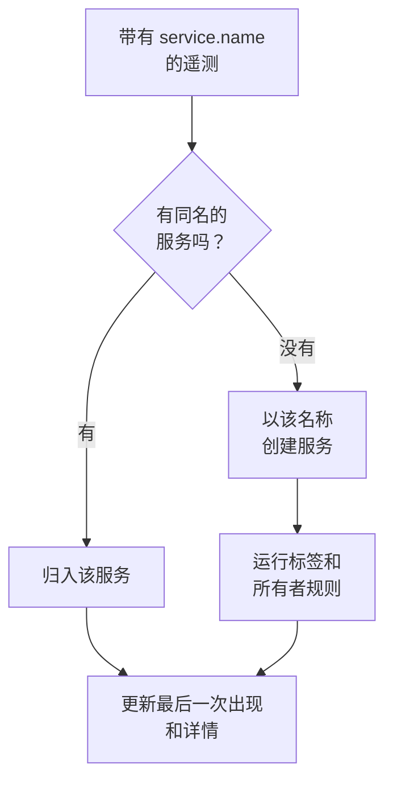

# 服务目录

服务目录列出你运行的应用和微服务。服务的遥测第一次到达时，OneUptime 会添加这个服务，然后把它的日志、追踪、指标、异常、事件和所有者汇集到一个页面上，让任何人都能了解服务做什么、谁负责它以及它的运行状况。

:::cards
- [服务如何进入目录](#服务如何进入目录): 它的 `service.name`，随第一批遥测而来。
- [查找服务](#查找服务): 列表、筛选和列。
- [服务的页面](#服务的页面): 关于一个服务的一切。
- [归档或删除服务](#归档或删除服务): 保留历史，或将其移除。
:::

## 服务如何进入目录

你不需要创建服务。每一批遥测都会在 `service.name` 资源属性中写明发送它的服务。OneUptime 把这批遥测归入同名的服务；如果项目中还没有这个服务，就创建它。

- **名称就是服务的身份。** 比较时不区分大小写，所以 `Checkout-API` 和 `checkout-api` 是同一个服务。新的 `service.name` 会产生一个新服务。
- **容器会自己命名。** 来自 Docker 和 Podman 代理的遥测如果没有 `service.name`，服务会以其容器命名。
- **摄取密钥可以指定服务。** 使用设置了 **固定的服务名称** 的密钥发送的 OpenTelemetry 数据，无论其 `service.name` 是什么，都会归入该名称的服务。参见 [摄取密钥](/docs/telemetry/ingestion-keys#锁定浏览器密钥)。
- **浏览器和手机不是服务。** 来自浏览器或移动应用的遥测属于 [RUM 应用](/docs/rum/applications)。
- **标签可以随遥测一起到达。** 名为 `oneuptime.label.<name>` 的资源属性会为服务添加标签 `<name>:<value>`，例如 `oneuptime.label.team=payments` 会添加 `team:payments`。

每次遥测到达时，服务的 **最后一次出现** 都会向前推进，其详情也会根据随之而来的资源属性刷新：

| 详情 | 来自属性 |
| --- | --- |
| 服务版本 | `service.version` |
| 部署环境 | `deployment.environment.name` 或 `deployment.environment` |
| 服务命名空间 | `service.namespace` |
| 运行时 | `process.runtime.name` 和 `process.runtime.version` |
| 技术 | `telemetry.sdk.language`，或运行时 |
| 云 | `cloud.provider`、`cloud.platform`、`cloud.region` 和 `cloud.account.id` |

## 开始之前

- **正在到达的遥测** 带有 `service.name`。参见 [OpenTelemetry](/docs/telemetry/open-telemetry)：`OTEL_SERVICE_NAME` 用于设置它。
- **可以读取服务的角色。** Project Owner、Project Admin、Project Member、Viewer、Settings Admin、Settings Member 或 Settings Viewer，或者拥有 Read Service 权限的自定义角色。创建、更改和删除服务需要 Project Owner、Project Admin、Project Member、Settings Admin 或 Settings Member，或者相应的服务权限。

## 查找服务

前往 **产品 → 资源 → 服务**。**所有服务** 列出每个服务及其 **名称**、**描述**、**Technology**、**最后一次出现**、**标签** 和 **所有者**。

- 按名称或描述搜索，并用列表上方的栏按所有者或标签筛选。
- 选择多个服务，可以一次为它们全部添加标签或所有者，或将它们归档。
- 点击一个服务即可打开它的页面。

要在服务的遥测到达之前添加它，例如先设置所有者，请点击 **创建服务**，并在 **名称** 中准确输入它将来的 `service.name`。标签和所有者规则会像对待自动发现的服务一样对它运行。保存后，OpenTelemetry 设置指南会打开，每个代码片段中都已填入该名称；指南的最后一步 **等待连接** 会在服务的第一批数据到达时告诉你。

## 服务的页面

服务的侧边菜单有五个部分：

| 部分 | 页面 |
| --- | --- |
| **基础** | **概览**：根据其跨度得出的请求数、错误率和 p95 延迟、图表以及服务详情。**建议**：按服务所用语言挑选的现成监视器。**所有者**：对服务负责的人员和团队。**动态**：服务经历的一切，从它如何被创建到此后的每一次更改。 |
| **遥测** | 已经按此服务筛选的 **日志**、**追踪**、**指标**、**性能配置文件**、**异常** 和 **Source Maps**。 |
| **活动** | 影响此服务的 **事件**、**警报** 和 **计划维护**。 |
| **开发者** | **Terraform**、**API** 和 **AI 助手**：通过代码管理该服务。默认折叠。 |
| **高级** | **设置**、**审计日志** 和 **删除服务**。**高级** 默认折叠：请先展开它。 |

所有者的作用不止于这个页面：范围为 Owned（拥有）的角色会读取你或你的团队所拥有的服务的遥测。参见 [遥测](/docs/permissions/index#遥测)。

## 更改服务

:::steps
### 打开设置

打开服务，在侧边菜单中展开 **高级**，然后点击 **设置**。

### 重命名或添加描述

在 **服务详情** 上，点击 **编辑详情** 以更改其 **名称**、**描述** 或 **标签**。名称必须仍与其遥测报告的 `service.name` 一致：也要在你的 OpenTelemetry 配置中更改它，否则下一批遥测会创建一个新服务。

### 选择颜色和技术栈

在 **服务设置** 上，点击 **编辑设置**。**服务颜色** 用于在图表和列表中标识服务；新服务会得到一个专属颜色。**技术栈** 是可选的：留空则显示从遥测中检测到的语言。
:::

同一个页面的 **更多设置** 中还包含服务的数据保留设置。**遥测数据保留** 和 **按遥测类型保留** 卡片可以让服务的遥测保留得比项目默认保留期更长或更短。它们属于 [Enterprise Edition](/docs/self-hosted/enterprise)，在 OneUptime Cloud 上属于 Scale 套餐；没有它们时，页面会说明它们带来什么，服务沿用项目的保留期。

## 自动设置标签和所有者

规则会在新服务创建时为其添加标签和所有者，自动发现的服务也包括在内。可以在 **服务 → 设置 → 所有者规则** 和 **服务 → 设置 → 标签规则** 中找到它们；侧边菜单中的 **设置** 默认折叠。参见 [标签与所有者规则](/docs/configuration/label-and-owner-rules)。

## 归档或删除服务

对于不再关注、但想保留其历史的服务，请将其归档。已归档的服务不会出现在 **所有服务** 中，但会继续收集遥测。可以在其 **设置** 页面上归档，也可以在列表中选择多个服务。要恢复一个服务，请打开 **服务 → 高级 → 已归档**。

> [!WARNING]
> 删除服务也会删除它的源代码映射，以及为它设置的指标管道规则和 LLM 成本预算。如果 OneUptime 仍在接收它的遥测，服务会被重新添加，但不再带有你给它的标签、所有者和设置。若要把它从列表中移走并保留一切，请改为归档。

## 故障排除

:::details 一个服务出现了两次
有两个 `service.name` 值到达了 OneUptime，例如来自你的配置的两个版本，或者只在一侧改了名。遥测按名称匹配：让每个实例都报告同一个 `service.name`，然后归档或删除不再需要的服务。
:::

:::details 我的服务不在目录中
检查它的遥测是否带有 `service.name`。来自浏览器或移动应用的遥测会进入 Real User Monitoring，而没有服务名称的主机或集群的遥测会归入该主机或集群。
:::

:::details 最后一次出现的时间滞后
**最后一次出现** 大约每分钟更新一次，而不是每一批都更新，所以它可能比实时遥测滞后一分钟左右。
:::

## 后续步骤

:::cards
- [日志浏览器](/docs/telemetry/logs-explorer): 搜索服务的日志。
- [跟踪浏览器](/docs/telemetry/traces-explorer): 跟随它的请求。
- [异常跟踪](/docs/telemetry/exceptions): 分诊它抛出的错误。
- [标签与所有者规则](/docs/configuration/label-and-owner-rules): 为新服务添加标签和所有者。
:::
