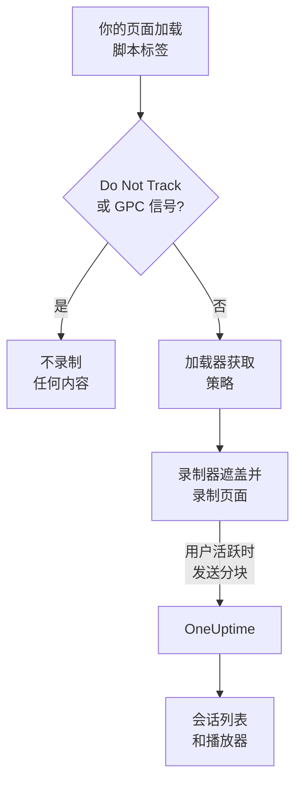
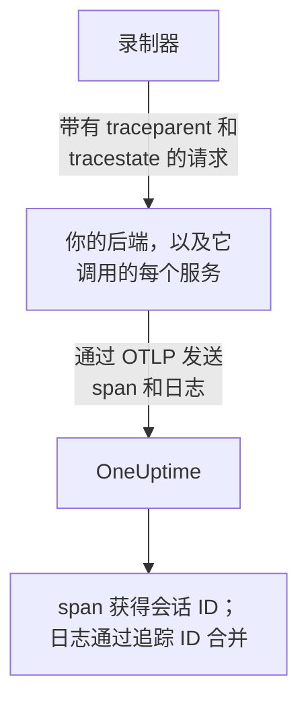
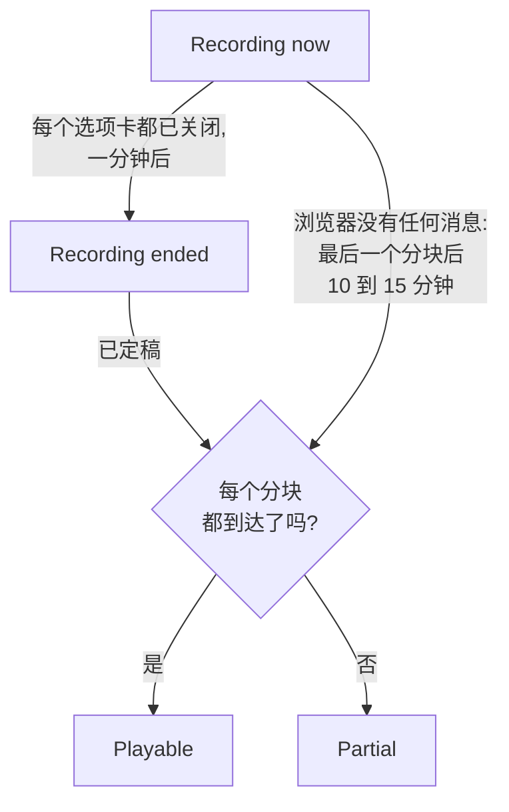
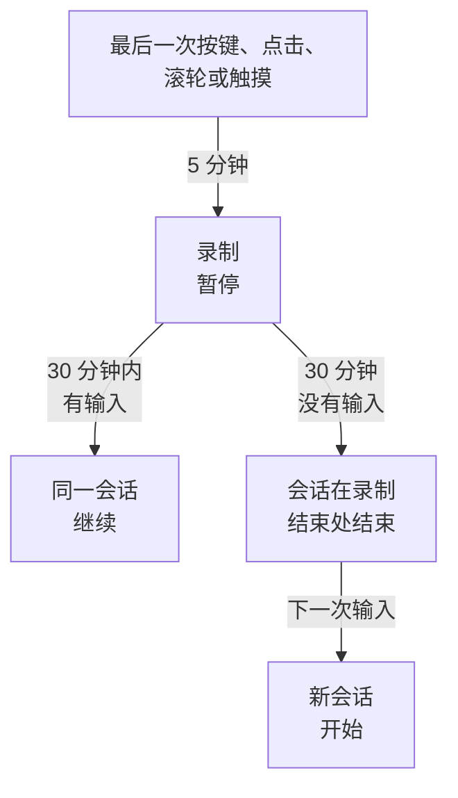

# 会话回放

会话回放会录制真实用户在你的 Web 应用或 React Native 应用中看到的内容，并与同一会话的错误、追踪和日志并排回放。你只需添加一个脚本标签、选择要遮盖的内容，就可以从它所属的 RUM 应用程序中观看任意会话。

:::cards
- [工作原理](#工作原理): 一个加载器、一份策略，以及一个边录边上传的录制器。
- [安装](#安装): 每个页面上的一个脚本标签，或 React Native SDK。
- [隐私](#隐私): 遮盖哪些内容、同意，以及谁可以发送录制。
- [与其他遥测数据关联](#与其他遥测数据关联): 后端追踪、日志和错误，无需代码即可关联。
- [观看会话](#观看会话): 会话列表、用户页面、用户流和播放器。
- [录制健康状况](#录制健康状况): 为什么没有数据到达，以及在预算用尽之前发出告警。
:::

## 工作原理

你页面上的脚本是一个小型加载器。它会检查浏览器的隐私信号，从 OneUptime 获取应用程序的策略，然后才加载录制器；录制器在录制页面的同时进行遮盖，并在用户活跃时按分块上传。



默认情况下，每个会话都会被录制并边录边上传，而不只是出了问题的会话。正是在什么都没出错的会话里，你才能找到没人完成的结账、所有人都放弃的表单，以及客户说“看起来很奇怪”的页面。

要减少存储量，可以组合使用应用程序策略中的两项设置：

| 设置 | 默认值 | 它改变什么 |
| --- | --- | --- |
| **采样百分比** | 100 | 有资格被录制的会话数量。减半后，存储的字节数和存储的最终用户数据都会减半。该决定基于会话 ID 的哈希，每个会话只做一次，所以会话永远不会只录一半。 |
| **何时上传录制** | _Always_ | 设为 _On error or frustration_ 时，录制器在内存中保留一个滚动缓冲区，只在出问题时才上传。这样几乎每个失败的会话都有录制，成本约为录制所有人的 15 分之一，但你无法观看没有出问题的会话。 |

## 开始之前

- 一个 RUM 应用程序。在 **产品 → 资源 → 真实用户监控** 下创建，或让你的遥测数据创建它：参见 [管理应用程序](/docs/rum/applications) 。
- 一个 **浏览器** 摄取密钥，来自 **项目设置 → 遥测与 APM → 摄取密钥** 。Browser 密钥只在你为它设置的来源上有效：参见 [在生产环境中设置允许的来源](#在生产环境中设置允许的来源) 。

会话回放默认开启。它的设置位于三个地方：

| 位置 | 内容 |
| --- | --- |
| 应用程序的 **Replay Policy** 页面 | 策略（录制、遮盖、同意、追踪和限制）、 **录制健康状况** 摘要、 **录制包含的内容** 卡片、 **Test your installation** 面板和 **Record a specific user's next session** 。 |
| 应用程序的 **健康状况** 页面 | 录制是否正在到达，如果没有，原因是什么。参见 [录制健康状况](#录制健康状况) 。 |
| **真实用户监控 → 设置 → 会话回放** | 一次停止所有应用程序的项目级开关，以及每个应用程序策略的只读列表。 |

## 安装

在每个要录制的页面上添加一个脚本标签。

:::steps
### 创建 Browser 密钥

在 **项目设置 → 遥测与 APM → 摄取密钥** 下，点击 **创建摄取密钥** ，选择 **浏览器** 作为 **密钥类型** ，并在 **允许的来源** 中填写你网站的来源。然后复制该密钥的 **密钥** 。 [浏览器端设置](/docs/rum/browser-setup#设置步骤) 展示了每个界面。

### 添加脚本标签

在每个页面上放置该标签，填入你的密钥和应用程序标识符：

```html
<script
  src="https://oneuptime.com/telemetry/session-replay/v1/recorder.js"
  data-oneuptime-token="YOUR_TELEMETRY_INGESTION_KEY"
  data-oneuptime-app-identifier="storefront-web"
  crossorigin="anonymous"
  async
></script>
```

`data-oneuptime-app-identifier` 必须与 RUM 应用程序的标识符一致，也就是你用于 `service.name` 的同一个值。应用程序侧边菜单 **会话回放** 部分中的 **文档** 页面会显示这段已填好两个值的代码片段，以及适用于 Next.js / React 和 Google Tag Manager 的变体。

### 确认录制已到达

打开你的某个页面，四处点击几秒钟。大约一分钟内，该会话会出现在应用程序的 **会话回放** 页面上，标记为 **正在录制** 。如果没有出现，应用程序的 **健康状况** 页面会说明原因：参见 [录制健康状况](#录制健康状况) 。
:::

`/v1/recorder.js` 处的脚本是一个小型加载器。它会检查 Do Not Track，获取你的应用程序的策略，然后才加载 `/latest/recorder.js` 。策略和录制器都以 `no-store` 提供，因此任何一方的更改都会在下一次页面加载时生效，无需等待浏览器缓存过期。

### 脚本标签属性

| 属性 | 必填 | 作用 |
| --- | --- | --- |
| `data-oneuptime-token` | 是 | 你的遥测摄取令牌。 |
| `data-oneuptime-app-identifier` | 是 | RUM 应用程序的标识符。 |
| `data-oneuptime-host` | 否 | OneUptime 来源。省略时会从脚本自身的 `src` 推导，因此只有在通过你自己的域名提供脚本时才需要它。 |
| `data-oneuptime-user-ref` | 否 | 页面加载时已知的最终用户引用（用户 ID，而不是你不想存储的电子邮件地址）。与之后 `identify()` 设置的内容相同；这是唯一适用于 [录制特定用户的下一个会话](#录制特定用户的下一个会话) 的形式。 |
| `data-oneuptime-respect-do-not-track` | 否 | 默认遵守 Do Not Track 和 Global Privacy Control。设为 `"false"` 则无视该信号进行录制；参见 [Do Not Track](#do-not-track) 。 |
| `data-oneuptime-debug` | 否 | `"true"` 会把录制器的决定输出到控制台。参见 [会话回放故障排除](/docs/rum/session-replay-troubleshooting) 。 |
| `data-oneuptime-offline-storage` | 否 | 设为 `"false"` 时，访客离线期间录制的分块只保存在内存中，而不会同时保存到浏览器的 IndexedDB。参见 [离线模式](#离线模式) 。 |

同样的选项也可以通过一个全局对象而不是标签提供，标签管理器和打包安装就是这样做的：

```js
window.__ONEUPTIME_SESSION_REPLAY__ = {
  host: "https://oneuptime.com",
  token: "YOUR_TELEMETRY_INGESTION_KEY",
  appIdentifier: "storefront-web",
  userRef: "user-123", // optional
  respectDoNotTrack: true, // optional
  debug: false, // optional
  offlineStorage: true, // optional; false keeps offline chunks in memory only
};
```

### 正常安装的表现

打开 DevTools → Network 并按 `session-replay` 过滤。一个正常工作的页面会产生：

1. 每次页面加载 **一个 `GET .../session-replay/v1/config`** — 获取策略。
2. **在用户进行操作时，大约每 15 秒一个 `POST .../session-replay/v1/chunk`** ，或在积累了 256 KB 事件时更早发送。空闲的选项卡不产生事件，也就没有 POST：在根据 Network 选项卡判断安装之前，请先移动鼠标或点击。
3. 当选项卡被隐藏时，以及页面消失时再一次，一个以 `keepalive` 发送的 `POST` 。离开页面 — 选项卡被关闭、重新加载或跳转到其他页面，或者页面被放入浏览器的往返缓存（任何 `pagehide` ） — 会将它标记为最后一个，告诉 OneUptime 该选项卡的录制已完成；用户从往返缓存中恢复的页面会作为同一会话中的新选项卡继续录制。仅仅被隐藏的选项卡仍处于打开状态，因此用户回来后录制会继续。它的整个正文保持在 56 KB 以下 — 即浏览器每个来源 64 KB 的 keepalive 配额中录制器所占的份额 — 并且可以在这一个请求中以帧的形式携带多个分块：最后一个分块、大的最后分块被拆分成的各个部分（每部分最多 48 KB 事件，以便帧头仍然放得下），以及仍在等待重试的每个分块。在选项卡仅被隐藏时就已经超出这个预算的分块，会改为在页面仍然存活、可以发送时走常规路径。

在触发器为 _On error or frustration_ 时，第 2 步要等到触发器触发后才会发生 — 参见 [故障排除](#故障排除) 。

## 在 React Native 中安装

React Native SDK 将原生视图层级录制为与 rrweb 兼容的合成事件，因此移动端录制与 Web 录制在同一个会话列表和同一个播放器中打开。它不截取屏幕截图。播放器会将每个录制标记为 React Native 应用，其 **Fidelity** 选项卡会说明无法还原的原生界面。

:::steps
### 安装 SDK

该 SDK 支持 iOS 和 Android 上的 React Native 应用。将它与用于持久发件箱的对等依赖一起安装：

```bash
npm install @oneuptime/react-native-replay @react-native-async-storage/async-storage
```

在不使用 Expo 的 iOS 项目中，添加这些包后照常运行 CocoaPods 安装；当前版本的 React Native 会自动链接 Android，无需手动注册。除了 Async Storage 之外，录制器还有自己的视图树原生模块，因此 Expo 项目必须使用自定义的开发构建或生产构建（例如 EAS Build 或 prebuild）。Expo Go 无法运行这个 SDK，因为这两个原生模块都无法添加到 Expo Go 固定的二进制文件中。

### 启动录制器并包裹你的应用

启动一次单例，并把提供者放在你要录制的应用部分之上：

```tsx
import {
  OneUptimeReplay,
  OneUptimeReplayProvider,
} from "@oneuptime/react-native-replay";

OneUptimeReplay.start({
  host: "https://oneuptime.com",
  token: "YOUR_TELEMETRY_INGESTION_KEY",
  appIdentifier: "storefront-mobile",
  mobileAppIdentifier: "com.example.storefront",
  appName: "Storefront", // optional, shown in session details
  appVersion: "4.2.0", // optional, shown in session details
});

export default function App() {
  return (
    <OneUptimeReplayProvider>
      <Navigation />
    </OneUptimeReplayProvider>
  );
}
```

`appIdentifier` 是 RUM 应用程序的标识符。 `mobileAppIdentifier` 是二进制文件中发布的 Android 应用 ID 或 iOS 包标识符，而不是显示名称。在 [`app://` 允许的来源列表](#在生产环境中设置允许的来源) 中使用同一个值。SDK 从 `host` 获取应用程序的回放策略；采样、触发器、同意、保留和上传预算仍由服务器控制。
:::

提供者拥有一个不可折叠的原生根节点，并录制它的视图树以及触摸的开始、移动和结束事件。如果你已经自己构建录制器实例，请通过 `<OneUptimeReplayProvider recorder={recorder}>` 传入一个。 `MobileReplayRecorder` 也被导出，用于隔离的或多客户端的集成；大多数应用应使用单例。

### React Native API

直接导入 `OneUptimeReplay` ，或在提供者之下调用 `useOneUptimeReplay()` 。该单例提供：

| 方法 | 作用 |
| --- | --- |
| `start(options)` | 获取策略并开始录制。必需的选项是 `host` 、 `token` 、 `appIdentifier` 和 `mobileAppIdentifier` ； `appName` 和 `appVersion` 是可选的显示元数据， `connectivity` 是用于 [离线模式](#离线模式) 的可选网络状态来源。 |
| `stop()` | 冲刷可以发送的内容，停止录制，并解除生命周期处理程序。 |
| `identify(userRef, traits?)` | 关联已登录的用户和可选的特征，受 **捕获最终用户身份** 约束。 |
| `setTags(tags)` / `addTag(key, value)` | 替换所有可搜索的会话标签，或在不替换其他标签的情况下添加一个标签。 |
| `track(name, properties?)` | 在回放时间线上放置一个应用事件。 |
| `setRoute(route)` | 在导航后记录经过清理的逻辑屏幕或路由。在导航器的路由变更回调中调用它。 |
| `captureSession(reason?)` | 在 _On error or frustration_ 下，因应用自定义的原因（例如用户点击“报告问题”）上传滚动缓冲区。 |
| `captureError(error)` | 记录一个已处理的 JavaScript 错误，并激活错误触发的录制。 |
| `grantConsent()` / `revokeConsent()` | 允许上传，或立即清除内存缓冲区、已存储的发件箱、会话和访客 ID。之后再次同意会使用新的标识符开始。 |
| `getSessionId()` / `onSessionChange(listener)` | 读取或订阅当前已获同意的回放会话 ID，用于关联追踪和日志。当录制或同意结束时，监听器也会收到 `null` 。 |
| `getDiagnostics()` | 返回录制器状态和最近的决定，而不返回所录制视图的内容。 |

SDK 会监听 React Native 的 `AppState` ：进入后台时会关闭并冲刷已获同意的事件，而同意之前的录制只保留在内存中。在前台恢复录制之前，SDK 会在不使用缓存响应的情况下刷新策略。它在活跃期间也会定期刷新策略，因此禁用、同意、采样、目标设定和身份变更都会在长时间打开的应用中生效。当你的集成永久卸载时调用 `stop()` ；普通的屏幕间导航应使用 `setRoute()` ，而不是停止并重新启动录制器。

**移动端会话何时因空闲而结束。** 没有输入五分钟就已经会暂停录制（参见 [空闲时间](#空闲时间) ）。三十分钟内没有任何触摸，也没有任何被录制的 SDK 调用（在录制期间进行的 `track()` 、 `setTags()` 、 `identify()` 等）时，会话结束。它在录制结束的最后一次活动处结束，对于已暂停的会话则在暂停处结束 — 而不是在应用回来或录制器察觉时 — 因此后台或暂停的时间永远不会被加到会话末尾。一直在前台打开的应用不会每半小时开始一个新会话。下一个会话在用户回来时开始：第一次触摸、屏幕键盘出现或消失、应用回到前台，或调用 `captureSession()` 。它以新的屏幕快照开始。在此之前， `getSessionId()` 返回 `null` ， `onSessionChange()` 以 `null` 被调用。这期间的错误、导航和 `track()` 调用都不会被录制。

要将移动端遥测与回放关联，请通过 `onSessionChange()` 订阅，并将返回的值设置为 OpenTelemetry 插桩中的 `session.id` 属性。每次回调触发时替换该属性，值为 `null` 时也要清除它。回放 SDK 不会修改原生网络，也不会自行修改 OpenTelemetry 提供者。

### React Native 的隐私与遮盖

移动端录制有意比 Web 的遮盖模式更严格。原生 UI 文本、无障碍值、输入值和图片像素永远不会被序列化；即使应用程序的 Web 遮盖模式允许可读文本，服务器收到的也是线框结构。调用方提供的元数据，例如用户引用、事件名称、路由和可搜索的标签，遵循 API 约定，因此不要在这些字段中放入机密。用 `<ReplayMask>` 包裹特别敏感的子树，可以将该区域替换为隐私占位符，同时保留周围的布局。

同意不会从操作系统权限或你的同意横幅中推断。在 _Require explicit_ 下，只有当你的应用获得了必要的同意时才调用 `grantConsent()` 。调用 `revokeConsent()` 会丢弃队列中未发送的数据和已持久化的数据，以及可能把之后的会话与被撤销的会话联系起来的标识符。

移动端录制器会捕获视图的边界和类型、触摸位置、逻辑路由、自定义事件和 JavaScript 错误。以下限制始终会在播放器的 Fidelity 选项卡中报告：

- 原生 `Image` 的像素是不透明的；只绘制其边框。
- `WebView` 的内容位于 React Native 树之外。如果托管的页面需要自己的录制，请在其中安装 Web 录制器。
- Canvas、Skia、OpenGL、地图、相机预览、视频以及其他特殊绘制的界面都是不透明的。
- `ReplayMask` 或不透明界面内部的触摸轨迹不会被录制。原生桥会检查触摸的真实目标及其祖先，如果无法完成这项隐私检查，就会抑制该手势。
- Reanimated、native-driver 和 UI 线程的动画会在视图树快照时采样，而不是逐帧重建。
- 在冲刷之前就终止 JavaScript 的原生崩溃需要原生崩溃 SDK； `captureError()` 涵盖的是已处理的 JavaScript 错误，而不是进程级的崩溃转储。

## 识别你的用户

在你的页面说明会话属于谁之前，每个会话都是匿名的。没有这一步，列表仍然可以把同一浏览器的会话归到一个匿名访客 ID 之下（参见下文的 [匿名访客](#匿名访客) ），但没有任何东西能说出这个人是谁，也无法把这个人的其他浏览器与第一个浏览器联系起来。一旦知道就调用 `identify()` ，或在脚本加载之前把它放入队列 — 无论哪种方式，它都会在第一个分块上传之前生效，因此会话从出现的那一刻起就可以按用户搜索：

```js
// After the script has loaded:
OneUptimeReplay.identify("user-123", { plan: "pro", tenant: "acme" });

// Or at any time, whether or not the script has loaded yet:
(window.OneUptimeReplayQueue = window.OneUptimeReplayQueue || []).push([
  "identify",
  "user-123",
  { plan: "pro", tenant: "acme" },
]);
```

- 引用是会话列表显示的内容，也是 `user:` 搜索匹配的内容。特征显示在播放器的标题栏和会话详情面板中。
- **身份属于会话，而不只是页面。** 会话涵盖这次访问中的每次页面加载和每个选项卡，只要其中任意一个页面调用了 `identify()` ，整个会话就属于该用户 — 包括登录之前的页面，因为它们属于同一次访问。会话中之后的每个页面和选项卡也都会显示该用户，即使它自己从不调用 `identify()` ：登录后重定向到的落地页、在新选项卡中打开的链接。只要 **捕获最终用户身份** 处于开启状态，录制器就会在 `localStorage` 的 `oneuptime.replay.user` 下记住当前会话属于谁 — 只记录会话 ID 和引用，别无其他；在 _Require explicit_ 同意模式下，只在给出同意之后记录 — 并且只针对这个会话：下一个会话（空闲 30 分钟后或达到 4 小时上限后）在某个页面识别它之前都是匿名开始的，除非开始它的那个页面自己识别过该用户。因此，请在应用知道用户的每次页面加载时都调用 `identify()` ，而不只是在登录后立即调用。
- **不同的用户会得到自己的会话。** 当 `identify()` 指定的人不是会话已经所属的用户时 — 一个人在同一浏览器中退出，另一个人登录，无论在这个选项卡还是另一个选项卡 — 当前会话结束，仍归档在第一个用户名下，并为第二个用户开始一个新会话。 `onSessionChange` 监听器会收到通知，播放器会把这次切换显示为一个录制的结束和下一个录制的开始。再次识别同一个用户不会改变任何东西；引用会在去除两端空白后、区分大小写地进行比较，与服务器的比较方式完全相同。
- `identify()` 交给录制器的内容，只有在该应用程序开启 **捕获最终用户身份** （默认）时，才会随录制一起上传。关闭时，录制器会把引用和特征从分块中去掉，服务器对这个人 **完全不** 存储任何东西 — 没有引用，没有它的带密钥哈希，也没有特征。这些会话是真正的假名会话，代价是无法 _按用户_ 擦除：擦除请求没有可匹配的东西，所以请改用 `BySessionId` 、 `ByDateRange` 或 `ByRumApplication` （参见 [擦除会话](#擦除会话) ）。如果对你来说，能够响应按用户的擦除请求比完全不存储标识符更重要，就让这个开关保持开启 — 存储的键是一个可以比较但无法读取的单向带密钥哈希，只有单独的标签携带引用本身。
- 有一个引用会离开浏览器，与这个开关无关，这是有意的：你的页面在 **加载时** 通过 `data-oneuptime-user-ref` 或 init 全局对象上的 `userRef` 提供的引用，会在每次页面加载获取策略时作为请求标头发送，因为 [录制特定用户的下一个会话](#录制特定用户的下一个会话) 就是通过这种方式在任何录制器存在之前识别访客的。服务器会把它与已设置的目标进行比较，然后丢弃；除非开启了身份采集并且录制器随录制再次发送它，否则它不会写入会话。传给 `identify()` 的引用永远不会以这种方式发送。
- 特征最多 20 个键，每个键 40 个字符，每个值 200 个字符，会被转换为字符串，并经过应用程序的遮盖模式：在 _Mask all text_ 下，它们会在上传前被遮盖。
- 在仪表板中读回身份需要与观看录制相同的权限（参见 [谁可以观看录制](#谁可以观看录制) ）；其他角色看到的是“Identity hidden”。

### 匿名访客

一个从不调用 `identify()` 的页面，仍然需要让它的会话可以被分组，否则一个有四十行 _Anonymous_ 的列表无法告诉你，这是一个人遇到了同一个错误四十次，还是四十个人各遇到了一次。因此，录制器会为每个浏览器配置文件、每个来源创建一个随机的访客 ID — 32 个小写十六进制字符，保存在 `localStorage` 的 `oneuptime.replay.visitor` 下，与会话记录放在一起，所以从两个主机名或端口提供的网站会显示为两位访客，只有 `identify()` 能把他们合并 — 并在每个携带元数据的分块中以 `meta.visitorId` 发送：第一个分块、最后一个分块，以及调用 `identify()` 或 `setTags()` 之后的那个分块。服务器会检查它的格式，并以与会话标题其余部分相同的访问规则把它存储在会话上。它有意比会话 ID 存在得更久：空闲 30 分钟和 4 小时上限引起的轮换会开始一个新会话，而新会话带有同一个访客 ID，所以来自同一浏览器、相隔一周的两次访问会一起出现在 [用户页面](#用户页面) 和播放器的其他会话菜单中（参见 [播放器](#播放器) ）。

要清楚它不是什么：

- **它不是身份。** 它是随机的，在浏览器中创建，不是从你的页面提供的任何内容或设备的任何特征推导出来的。同一台笔记本电脑上的两个浏览器，或同一个人分别使用手机和台式机，都是两位访客；只有 `identify()` 能把他们合并。隐私窗口会得到一个新 ID，并随窗口一起消失；在无法向存储写入任何内容的地方（Safari 的隐私模式、被阻止的站点数据），这个 ID 只持续一次页面加载。
- **它不取决于 Capture end-user identity。** 那个开关决定引用和特征是否离开浏览器；访客 ID 无论如何都会发送，因为它不指向任何人。如果你不希望创建任何 ID，答案是不要录制器：为该应用程序关闭会话回放，或让 [Do Not Track](#do-not-track) 得到遵守。
- **它遵循与会话 ID 相同的同意规则。** `revokeConsent()` 会把它与会话一起从存储中删除，同意被撤销期间不会写入任何内容，之后的 `grantConsent()` 会创建一个新的 — 因此撤销同意后又回来的用户，不会与他们要求你忘记的会话重新关联。在 Do Not Track 或 Global Privacy Control 下不会运行录制器，因此不会创建任何 ID。
- **它永远不会随你自己的请求发送。** 录制器添加到你的页面发往其自身来源的请求中的追踪上下文，指向的是会话，而不是访客（参见 [你自己的请求携带什么](#你自己的请求携带什么) ）；访客 ID 只会随录制发往 OneUptime。
- **它不能作为擦除请求的目标。** 请求类型没有改变（参见 [擦除会话](#擦除会话) ）； `visitor:` 搜索会把列表缩小到一个浏览器的会话，你可以从那里获取要擦除的会话 ID。

`OneUptimeReplay.getVisitorId()` 返回当前的 ID；在录制器启动之前、 `stop()` 之后，以及 `revokeConsent()` 与下一次 `grantConsent()` 之间，它返回空字符串。在这项功能出现之前构建的录制器不会发送它，因此它们录制的会话的 `visitorId` 为空：列表会把它们显示为 _Anonymous_ ，用户页面会把它们归入 **Unlinked sessions** 。会创建访客 ID 的录制器，会在 `getDiagnostics()` 和 **健康状况** 页面的 `capabilities` 中列出 `visitor-id` 。

## JavaScript API

录制器会发布 `window.OneUptimeReplay` 。由于它是异步加载的，你的页面在它到达之前调用的任何东西都必须经过命令队列 — `window.OneUptimeReplayQueue` 是一个由 `[command, ...arguments]` 条目组成的普通数组，录制器一启动就会把它清空，它按名称接受下面的每一个命令：

```js
(window.OneUptimeReplayQueue = window.OneUptimeReplayQueue || []).push(
  ["grantConsent"],
  ["identify", "user-123", { plan: "pro" }],
  ["setTags", { build: "1.4.2" }],
  ["onSessionChange", (sessionId, tabId) => console.log(sessionId)],
);
```

`grantConsent` 、 `revokeConsent` 、 `stop` 、 `identify` 、 `setTags` 和 `addTag` 会在录制器启动之前应用，因此队列中的同意决定决定了是否有任何内容会被上传，而队列中的身份会随第一个分块一起发送。 `track` 、 `captureSession` 和 `onSessionChange` 会在启动后立即运行。

| 方法 | 作用 |
| --- | --- |
| `identify(userRef, traits?)` | 把最终用户关联到会话 — 关联到其中的每个页面和选项卡，从会话开始算起（参见 [识别你的用户](#识别你的用户) ）。 `traits` 是一个值为字符串、数字或布尔值的对象（≤ 20 个键，键 ≤ 40 个字符，值 ≤ 200 个字符），在 _Mask all text_ 下会被遮盖，并且只有在 **捕获最终用户身份** 开启时才会上传。为同一个用户再次调用，会在下一个分块中重新发送身份（以及新的特征，如果有）；指定另一个用户则会结束当前会话，并为该用户开始一个新会话。 |
| `track(name, properties?)` | 在时间线上记录一个业务事件（ `"checkout_failed"` ）。 `name` ≤ 64 个字符，≤ 20 个属性键，值的限制与特征相同。每个 15 秒的分块最多 50 个；超出部分会让该分块携带一个带有数量的“events dropped”标记。 |
| `setTags(tags)` / `addTag(key, value)` | 会话级标签（ `{ build: "1.4.2", experiment: "new-checkout" }` ），≤ 20 个标签，键 ≤ 32 个字符，值 ≤ 128 个字符。可以在会话列表中用 `tag:key=value` 搜索，并显示在会话详情中。 `setTags` 会 **替换** 整个映射，因此第二次调用 `setTags({ experiment })` 会去掉第一次设置的 `build` 标签； `addTag` 只设置一个键，其余保持不变。请在一次 `setTags` 调用中构建映射，或在得知每个值时使用 `addTag` 。 |
| `captureSession(reason?)` | 在 _On error or frustration_ 下，强制这个会话从其滚动缓冲区开始上传；在 _Always_ 下，它不会改变上传，但 `reason` （≤ 80 个字符）仍会被标记在时间线上。在你自己的“报告问题”按钮中使用它。 |
| `onSessionChange(listener)` | 如果存在会话，会立即调用 `listener(sessionId, tabId)` ，并在 ID 每次变化时再次调用 — 用户在空闲 30 分钟后回来时、达到 4 小时上限时、 `identify()` 指定另一个用户时，或同一访客的另一个选项卡先轮换了会话时。返回一个取消订阅的函数。 **可选** ：即使没有它，发往你自己来源的请求也会把后端的 span、日志和异常关联到录制（参见 [与其他遥测数据关联](#与其他遥测数据关联) ）。用它为页面自己产生的遥测设置 `session.id` ，例如来自 OpenTelemetry 浏览器 SDK 的 span；参见 [页面自身的浏览器遥测](#页面自身的浏览器遥测) 。 |
| `grantConsent()` | 在 _Require explicit_ 同意模式下允许上传。在此之前，不会上传任何内容。 |
| `revokeConsent()` | 丢弃缓冲区中的所有内容并停止上传。录制器只在内存中继续运行，因此之后的 `grantConsent()` 会以新的会话 ID 继续。 |
| `getSessionId()` | 当前会话 ID，在没有录制时为 `null` 。优先使用 `onSessionChange()` ，它还能跟踪会话轮换。 |
| `getVisitorId()` | [匿名访客 ID](#匿名访客) — 32 个十六进制字符，每个浏览器配置文件一个，在会话轮换时保持不变 — 在录制器启动之前、 `stop()` 之后以及同意被撤销期间为 `""` 。它是随机的，不是身份；不取决于 **捕获最终用户身份** 。 |
| `stop()` | 上传最后一个分块，封口会话，并在页面的剩余生命周期内停止。 |
| `setDebug(enabled)` | 从现在开始把录制器的决定输出到控制台。 |
| `getDiagnostics()` | 录制器做出的所有决定，无论诊断当时是否开启。见下文。 |

### `getDiagnostics()`

这是要粘贴到支持工单中的第一样东西。按设计，它不包含任何页面内容（参见 [诊断信息从不包含的内容](/docs/rum/session-replay-troubleshooting#诊断信息从不包含的内容) ）。

```js
copy(JSON.stringify(OneUptimeReplay.getDiagnostics(), null, 2));
```

| 字段 | 含义 |
| --- | --- |
| `state` | `none` （没有构建录制器）、 `not-started` 、 `recording` （仅在内存中）、 `uploading` 、 `paused` （五分钟内没有人触碰页面，因此在下一次输入之前不会捕获任何内容 — 参见 [空闲时间](#空闲时间) ）、 `not-sampled` 或 `stopped` 。 |
| `stopReason` | 如果停止了，停止的原因： `api` （你的 `stop()` ）、 `server-directive` 、 `transport-failure` 或 `chunk-cap` 。 |
| `bootstrapDecision` | 构件为什么构建或没有构建录制器： `started` 、 `privacy-signal` 、 `directive-stop` 、 `already-started` 、 `cancelled-before-start` （队列中的 `revokeConsent` / `stop` ）或 `not-started` 。 |
| `decisions` | 每道关卡的答案： `isSampled` 、 `captureTrigger` 、 `consentMode` 、 `consentState` 、 `uploadsAllowed` 、 `uploadBlockedBy` （ `consent` 、 `transport` 或 `null` ）、 `lastDirective` 及其原因，以及 `startDecision` （ `recording-and-uploading` 、 `recording-into-memory` 、 `not-sampled` 、 `not-started` ）。 |
| `capabilities` | 这个版本的录制器能捕获什么： `click-events` 、 `web-vitals` 、 `custom-events` 、 `traits` 、 `tags` 、 `visibility` 、 `visitor-id` 。仪表板的 **健康状况** 页面会为最新的会话显示同样的列表，因此很容易发现来自一个打开已久的旧页面的录制。 |
| `tags`, `hasTraits`, `triggerReason`, `isRecording`, `isUploading`, `sessionId`, `tabId`, `visitorId`, `version` | 会话的当前状态。只有当录制器确实在录制时， `isRecording` 才为 true。在录制器存在之前 `visitorId` 为 `null` ，在同意被撤销期间为 `""` 。 |
| `records` | 最近 250 个带有稳定代码的决定 — 包括构件存在之前加载器做出的决定。每个代码都在 [会话回放故障排除](/docs/rum/session-replay-troubleshooting#代码) 中有解释。 |

## 隐私

**遮盖在录制时、在最终用户的设备上、在任何内容上传之前进行。** 服务器永远不会收到被遮盖的内容，因此遮盖决定既不能事后撤销，也不能追溯应用。在 Web 上，哪些内容被遮盖取决于模式；React Native 始终发送 [React Native 的隐私与遮盖](#react-native-的隐私与遮盖) 中描述的更严格的线框结构。应用程序 **Replay Policy** 页面上的 **录制包含的内容** 卡片会用平实的语句，针对你的配置重述这些决定。

策略中的隐私设置，使用 **编辑策略** 中给出的名称：

| 设置 | 默认值 | 作用 |
| --- | --- | --- |
| **录制此应用的会话** | 开启 | 应用程序自己的开关。关闭它即停止录制这个应用程序。 |
| **遮盖模式** | _Mask sensitive inputs only_ | 遮盖密码、银行卡和一次性验证码字段。页面的其余部分，包括静态文本和普通输入值，都按原样录制。参见 [谨慎选择遮盖模式](#谨慎选择遮盖模式) 。 |
| **同意** | _Not required_ | 上传立即开始。如果每个会话都需要同意交换，请选择 _Require explicit_ ，大多数欧盟部署都需要这样做。 |
| **何时上传录制** | _Always_ | 每个被采样的会话从第一个事件起就上传。选择 _On error or frustration_ 则只在出问题时上传。 |
| **采样百分比** | 100% | 可以被录制的会话比例，也是成本旋钮。0% 加上 _Always_ 什么都不会录制，设置这样的值时策略页面会发出警告。 |
| **允许的来源** | 空：所有来源 | 列出你的域名，以限制谁可以发送录制。参见 [在生产环境中设置允许的来源](#在生产环境中设置允许的来源) 。 |
| **捕获最终用户身份** | 开启 | 存储你的页面提供的最终用户引用和特征，以便你能找到某位指名客户的会话。关闭它可让录制保持假名：关闭后，不会存储关于这个人的任何内容，甚至连按用户擦除请求需要匹配的键也不存储（ [识别你的用户](#识别你的用户) ）。不影响 [匿名访客 ID](#匿名访客) ，它是随机的，不指向任何人，无论如何都会发送。 |
| **同源追踪传播** | 开启 | 在会话上传期间，你的页面发往其自身来源的请求会携带 W3C `traceparent` 和指明会话的 `tracestate` ，因此你的后端遥测无需代码即可关联到录制。你后端的 OpenTelemetry 会把两者转发给它调用的每个服务。参见 [你自己的请求携带什么](#你自己的请求携带什么) 。 |
| **捕获国家** | 开启 | 只采集国家，绝不采集 IP 地址。 |
| **录制画布内容** | 关闭 | 不录制 Canvas 和 WebGL。 |
| **保留期** | 7 天 | 有意比你其他遥测的保留期短。也可选 1、14、30 和 90 天。 |
| **每月预算（GB）** | 空 | 这个应用程序每个日历月上传字节数的可选上限。为空或 0 表示没有上限。 |

### 谨慎选择遮盖模式

> [!WARNING]
> 默认设置会录制一个可读的页面，因为线框很少足以用于调试。页面上显示的任何内容都会进入录制：订单号、页眉中的电子邮件地址、引用用户数据的错误横幅。还有在你的标记没有声明为敏感的字段中输入的任何内容。遮盖在上传前于浏览器中进行，因此之后改用更严格的模式，并不会清理已经生成的录制。

三种模式，从最不私密到最私密：

| 模式 | 页面静态文本 | 普通输入值 | 密码、银行卡和 OTP 字段 |
| --- | --- | --- | --- |
| Mask sensitive inputs only *（默认）* | 录制 | 录制 | 遮盖 |
| Mask inputs only | 录制 | 遮盖 | 遮盖 |
| Mask all text | 遮盖 | 遮盖 | 遮盖 |

在 _Mask all text_ 下，回放是一个线框：文本节点、录制器附加到点击上的标签、来自 `identify()` 的特征以及来自 `track()` 的属性都会在上传前被遮盖，播放器也不会从地址加载页面的任何图片或 Web 字体。录制仍保存着这些地址，以这种模式录制的会话在没有它们的情况下播放，只有一个例外：页面以 `data:` URL 形式持有的图片包含在录制本身中，仍会显示。请阻止可能以这种方式显示个人图片的元素，例如用户上传的文档的预览。样式表仍会加载，因此布局保持其形状（参见 [回放中的图片、样式和字体](#回放中的图片样式和字体) ）。

如果你的页面会显示个人数据，请提高模式，或为特定元素添加遮盖或阻止选择器：参见 [标记你自己的内容](#标记你自己的内容) 。当只有少数几个区域敏感时，选择器是合适的工具；当你无法逐一列出它们时，更严格的模式才是合适的工具。

### 在生产环境中设置允许的来源

会话回放在允许的来源列表为空时即可开箱即用，此时会接受来自任何来源的录制。这便于入门，但不适合生产环境。

你的摄取令牌会交给客户端 — 在页面的 JavaScript 中，或在移动应用的二进制文件中 — 因此有两道关卡，它们会叠加生效：

- **在密钥上。** 创建 **密钥类型** 为 **浏览器** 的摄取密钥。对于 Web，设置它的 **允许的来源** （ `https://app.example.com` ，或用于一级子域名的 `https://*.example.com` ）。对于 React Native，添加应用的确切身份，例如 `app://com.example.storefront` 。还要为密钥设置 **过期时间** ：这样被复制的令牌会在你选择的日期失效，而不是永不失效。
- **在应用程序上。** **Replay Policy → 允许的来源** 限制谁可以向这个应用程序写入录制，无论出示的是哪个密钥。在这里添加同样的 Web 来源和确切的移动端 `app://` 身份。

`app://` 条目是字面前缀，加上以 `mobileAppIdentifier` 提供的、经过规范化的 Android 应用 ID 或 iOS 包标识符。比较时不区分大小写，会先去除空白，并把有效的反向 DNS 标识符转换为小写。移动端身份 **不** 接受通配符： `app://*.example.com` 是无效的。移动端 SDK 不发送浏览器的 `Origin` ；它在自己的标头中发送录制器类型和应用身份。如果请求带有真正的 `Origin` ，始终以该来源为准 — 移动端标头永远不能用来绕过浏览器的来源检查。

移动端身份是自我声明的 HTTP 元数据，不是 Apple/Google 的平台证明，也不能证明请求来自你签名的二进制文件。从客户端提取出令牌的人，可以带着同样的应用身份标头发送非浏览器请求。确切的 `app://` 条目仍然可以防止应用之间的意外误用，并区分你希望接受的各个移动端身份，但不要把它们称为真实性边界。请设置过期时间、轮换已暴露的密钥，并保持速率和字节预算开启以限制滥用；永远不要为了保护而在应用中放入服务器机密，因为它可以被提取出来。

请求必须同时通过两个允许列表。对于 Web 请求，浏览器控制的 `Origin` 检查可以防止一个网站重用另一个网站的密钥；对于原生请求，上面的检查会对自我声明的身份加以限制和区分。在向任一录制器发送真实流量之前，先设置好这两个列表；被拒绝的上传会在 **健康状况** 页面上显示为 `origin-not-allowed` 。

### 始终遮盖的内容

无论何种模式都始终遮盖，且不可配置：

- **密码** ，即使点击了“显示密码”按钮之后也是如此。曾经是密码字段的字段会一直保持遮盖，类型切换本身也会被屏蔽。
- **银行卡字段** ，通过 `autocomplete` （ `cc-number` 、 `cc-csc` 、 `cc-exp` ）识别，因为银行卡输入框是 `type="text"` ，否则基于类型的遮盖看不到它们。
- **一次性验证码** （ `autocomplete="one-time-code"` ）。
- **文件输入框的值** — 浏览器会暴露真实的文件名，而文件名常常是私人的。
- **查询字符串和片段** ：从录制保存的页面 URL 和每个网络请求的 URL 中去除，看起来像标识符的路径段（UUID、电子邮件地址、长数字串、长的不透明令牌）会被替换。这是文本遮盖覆盖不到的唯一通道：否则，密码重置链接就会出现在会话列表中。页面内部的地址是另一回事。链接的目标只有在 _Mask all text_ 下才会被这样清理；在另外两种模式下，它会像页面的其余部分一样被录制。图片、样式表和字体的地址在所有模式下都按页面写的原样保存，包括查询字符串，因为回放要从那里加载它们（在 _Mask all text_ 下只有样式表；参见 [回放中的图片、样式和字体](#回放中的图片样式和字体) ）。如果某个元素的图片地址携带敏感内容（例如签名令牌），请阻止该元素。
- **剪贴板事件** ：从不录制。
- **按键节奏** 会被量化，因为即使值被遮盖，按键之间的间隔也会泄露输入的内容。
- **请求和响应的正文与标头** ：从不录制。播放器中的网络行只包含方法、URL、状态、耗时、字节数和追踪 ID — 别无其他。（录制器会向发往你自己来源的请求 _添加_ 追踪上下文；参见 [你自己的请求携带什么](#你自己的请求携带什么) 。）
- **点击标签** ：取自元素的 `aria-label` 或可见文本，绝不取自表单控件的值，并且在被遮盖的区域内会被完全省略。

被遮盖的值不保留长度。被遮盖的字段是一个固定宽度的占位符，因此无法用它推断出密码或银行卡号的长度。

### 标记你自己的内容

```html
<!-- Not recorded at all: the element and its subtree are omitted. -->
<div class="oneuptime-block">...</div>

<!-- Recorded, but all text inside is masked. -->
<div class="oneuptime-mask">...</div>

<!-- Recorded, but input events inside are dropped. -->
<div class="oneuptime-ignore">...</div>
```

你也可以在应用程序的 **Replay Policy** 页面上添加 **额外的遮盖选择器** 和 **屏蔽选择器** ，而无需修改你的标记。在默认遮盖模式下，它们是保护你的标记没有声明为敏感的内容的主要工具。

### 你自己的请求携带什么

录制器从不录制请求的标头或正文，但它会向你自己页面的部分请求 **添加** 追踪上下文，而这些内容会发往你的后端，而不是 OneUptime。正是这一点把后端遥测关联到录制（参见 [与其他遥测数据关联](#与其他遥测数据关联) ）：

```text
traceparent: 00-<32 hex trace id>-<16 hex parent id>-01
tracestate:  oneuptime=sid:<32 hex session id>;p:<16 hex parent id>
```

- **哪些请求。** 在会话 **上传期间** ，页面发往其 **自身来源** 的 `fetch` 和 `XMLHttpRequest` 调用，但页面自身的 OpenTelemetry 导出（发往以 `/v1/traces` 、 `/v1/logs` 或 `/v1/metrics` 结尾的路径的 `POST` 请求）除外。在 _Require explicit_ 下获得同意之前、 `revokeConsent()` 之后、 _On error or frustration_ 下触发器触发之前、在未被采样的会话中、在录制 [因为没有人在页面上而暂停](#空闲时间) 期间，或在 `stop()` 之后，都不会添加任何内容。请求已经携带的 `traceparent` 或 `tracestate` 永远不会被替换：请求保留自己的，录制器只添加缺少的部分。 `;p:` 只有在录制器自己创建了 `traceparent` 时才会出现。发往其他来源的请求什么也得不到，除非你在 **追踪传播来源** 中列出该来源，而那时也只得到一个不携带会话 ID 的 `traceparent` 。
- **会话 ID 是什么。** 与录制归档所用的同一个随机 32 位十六进制 ID。它不透露这个人的任何信息，并在整个访问期间保持不变，直到空闲 30 分钟或 4 小时上限结束会话、 `identify()` 指定了另一个用户，或 `revokeConsent()` 之后的 `grantConsent()` 创建了一个新的 ID。因空闲而结束的会话在用户回来（开始下一个会话）之前不发送任何 ID。 [匿名访客 ID](#匿名访客) 、用户引用和特征永远不会以这种方式传递。
- **它去往哪里。** 你后端的 OpenTelemetry 会把 `tracestate` 与追踪一起保存，并在它发出的每个调用中转发它 — 发往你的其他服务，以及它带着追踪上下文调用的每个第三方 API — 与追踪 ID 完全一样。OneUptime 在摄取时读取每个 span 上的这个成员，把会话 ID 存入该 span 的会话 ID 列，并从它存储的 trace state 中去掉该成员。
- **它关联什么。** 指明用户的后端 span、日志或异常（ `enduser.id` 属性、日志行中的电子邮件地址）现在离录制只有一次点击之遥，即使关闭了 **捕获最终用户身份** 也是如此：那个开关决定的是录制保留什么，而不是你的后端记录什么。如果录制不能与用户是谁关联起来，请同时关闭 **同源追踪传播** 。
- **谁可以声称它。** 与所有追踪上下文一样，这个成员由客户端写入。知道某个会话 ID 的人，可以把它发送到你的 API，让他们自己请求的 span 被归档到那个会话下。会话 ID 是 128 位随机值，所以他们首先需要拿到这个 ID。客户端指明的追踪也是如此：一个请求如果发送它所知道的某个追踪的 `traceparent` ，并附上它自己会话的成员，就会把那个追踪的后端行拉进它自己会话的面板，以及该会话的擦除范围。只有当一个追踪仅属于被擦除的会话时，擦除才会删除整个追踪；对于与其他会话共享的追踪，它只删除标有被擦除 ID 的行（参见 [擦除会话](#擦除会话) ）。

要按应用程序关闭这一功能，请使用 **Replay Policy** 页面上的 **同源追踪传播** ；参见 [关闭自动关联](#关闭自动关联) 。

### 同意

```js
// After the user accepts. Nothing is uploaded before this.
window.OneUptimeReplay.grantConsent();

// Drops everything buffered and stops uploading. A later grantConsent()
// continues on a fresh session.
window.OneUptimeReplay.revokeConsent();
```

你的横幅通常在录制器脚本加载之前就已做出决定，所以请把决定放入队列，而不是等待全局对象：

```js
(window.OneUptimeReplayQueue = window.OneUptimeReplayQueue || []).push(["grantConsent"]);
```

在 _Require explicit_ 下，录制器从第一个事件起就在内存中录制，并在同意到来时立即上传整个缓冲区，因此横幅被接受之前的那几秒钟不会丢失。在同意到来之前， **健康状况** 页面会显示“waiting for consent”，这是策略给出的答案，而不是错误。

`revokeConsent()` 会忘记三样东西，之后的 `grantConsent()` 会重新创建前两样：

- 会话 ID，这样撤销同意后又回来的用户不会再次关联到同一个会话。
- [匿名访客 ID](#匿名访客) ，它会与会话一起从存储中删除。同意被撤销期间不会写入任何内容，在下一次同意之前 `getVisitorId()` 返回 `""` — 因此重新同意后录制的会话会彼此分组，而永远不会与用户要求你忘记的会话分在一组。
- 会话属于谁（ `oneuptime.replay.user` ），它会与会话一起从存储中删除。调用过 `identify()` 的页面会在内存中保留引用，之后的同意所开始的会话会再次属于该用户；被撤销会话的用户不会留下任何可供之后的页面拾取的信息。

同一道关卡也控制着 [录制器添加到你自己请求中的追踪上下文](#你自己的请求携带什么) ：在 `grantConsent()` 之前或 `revokeConsent()` 之后不会发送会话 ID，重新同意后，请求携带的是新会话的 ID，而绝不是被撤销会话的 ID。

### Do Not Track

`navigator.doNotTrack` 和 `navigator.globalPrivacyControl` 会在发出配置请求之前得到遵守：在脚本标签上没有任何说明的页面，会对发送其中任一信号的用户放弃录制，而且不会仅仅为了弄清他们是否会被录制而发出任何关于他们的请求。加载器会记录 `privacy-signal` ，除此之外不会发生任何事情。

这条规则只有一个例外。如果你的法律依据确实不取决于该信号，设置 `data-oneuptime-respect-do-not-track="false"` （或在 init 全局对象上设置 `respectDoNotTrack: false` ）即可无视该信号进行录制。只有页面自己的标记才能这样声明：仪表板策略中的任何设置都不会放宽这一点，而没有任何说明的页面会遵守该信号。

## Content Security Policy

> [!IMPORTANT]
> 如果你的网站发送 Content Security Policy，在你允许录制器之前，它会静默失败。没有任何错误会从用户的浏览器传到 OneUptime，因此当没有录制出现时，这是首先要检查的地方。

把 OneUptime 来源添加到你已有的指令中。不要替换它们，否则你会把自己的脚本挡在页面之外：

```text
script-src  'self' https://oneuptime.com;
connect-src 'self' https://oneuptime.com;
```

如果你自托管 OneUptime，请改用你自己的主机。

还有一件与 CSP 相关、但涉及样式表而不是你的策略的事：录制器只能保存它能读取的样式表。来自另一个来源的样式表，只有在其服务器发送允许你网站的 `Access-Control-Allow-Origin` 标头， **并且** 你的 `<link>` 带有 `crossorigin="anonymous"` 时才能被读取。否则，录制只保存它的地址，回放会在观看者的浏览器中从那里加载它；参见 [回放中的图片、样式和字体](#回放中的图片样式和字体) 。只有在该标头就位后才添加这个属性：没有标头却有 `crossorigin` ，会让你自己的页面拒绝该样式表。

使用应用程序 **Replay Policy** 页面上的 **Test your installation** 面板，从服务器端确认令牌、策略开关和允许的来源列表。它无法检查你的 CSP：CSP 是你自己的网站发送给你自己的访客的标头，服务器端的任何东西都永远看不到它。CSP 拦截只会在那里间接地表现出来： `script-src` 拦截了录制器，面板的 _Recorder loaded on your site_ 行就会一直等待； `connect-src` 拦截了上传，那一行会通过，而它下面的“已收到录制”行会一直等待。无论哪种情况，被拦截页面上的浏览器控制台都会记录这次拒绝，那是唯一确凿的证据。

## 与其他遥测数据关联

安装录制器就足以把录制与你后端的追踪、日志和异常关联起来。无需在你的页面或服务中添加任何代码。



在会话上传期间，你的页面 **发往其自身来源** 的每个 `fetch` 和 `XMLHttpRequest` 都会携带该会话的 W3C 追踪上下文：

- 一个由录制器创建的 `traceparent` ，除非请求已经有了一个，或页面上的另一个追踪代理被配置为追踪该请求，此时录制器会把它让给那个代理；
- 一个 `tracestate` 成员 `oneuptime=sid:<session id>` ，除非请求已经带有 `tracestate` 。

只有当另一个代理被配置为追踪该请求时，录制器才会把 `traceparent` 让给它：OpenTelemetry 浏览器 SDK 的 fetch 或 XMLHttpRequest 插桩；Datadog RUM — 当它已启动并在跟踪该会话，且其 `allowedTracingUrls` 中第一个匹配该请求 URL 的条目使用 `tracecontext` 传播器时（没有 `propagatorTypes` 的条目会使用它）；开启了分布式追踪且使用默认标头名 `traceparent` （ `distributedTracingHeaderName` ）的活跃 Elastic APM RUM 代理；或开启了分布式追踪的 New Relic。它仍会添加自己的 `tracestate` 成员。对于前三者，只有当那个代理确实随请求发送了 W3C `traceparent` 时，请求才会被关联，而 Datadog 只会在被采样用于追踪的、它所跟踪的 Datadog 会话中发送。New Relic 会随它的 `traceparent` 发送它自己的 `tracestate` ，取代该成员的位置，因此 New Relic 的请求永远不会被盖上会话标记，只能通过追踪 ID 关联（参见 [不会自动关联的内容](#不会自动关联的内容) ）。仅仅被加载的代理并不会阻止录制器自己创建一个：在 `allowedTracingUrls` 中没有你的来源条目的 Datadog RUM、在它启动之前或 `trackingConsent` 被授予之前，或者在它不跟踪的会话中。

同源请求不会进行 CORS 预检，因此这些标头不会触发你的 API 的 CORS 规则；唯一的例外是 [重定向到其他来源](#重定向到其他来源) 。

你后端的 OpenTelemetry SDK 会提取这两个标头，它为该请求记录的每个 span 都会继承 trace state，并在它调用其他服务时一并转发。因此在摄取时，OneUptime 会为 **每个延续 W3C 追踪上下文的服务** 的 span，以及记录在这些 span 上的异常，盖上会话 ID。OTLP 日志记录不携带 trace state，因此后端日志以及通过日志上报的异常，会在你打开录制时 **通过追踪 ID** 与录制合并。当 `traceparent` 是录制器创建的时，这个成员还会携带父 ID（ `;p:<parent id>` ）：那个浏览器 span 永远不会被导出，摄取会用这个 ID 让后端的入口 span 保持为根 span，而不是一个缺少父级的 span。同时携带该成员和 `session.id` 属性的 span 会按成员的 ID 归档，因为 `session.id` 在一些 LLM SDK 中也是对话键。

随后，播放器的 **日志** 、 **追踪** 和 **错误** 选项卡会在录制的时间轴上显示这些行，而 **网络** 选项卡上每个请求的行都会链接到其后端追踪。这些标头对隐私意味着什么，参见 [你自己的请求携带什么](#你自己的请求携带什么) 。

### 其他来源上的 API

默认情况下，发往其他来源的请求什么也得不到：添加任何标头都会把一个简单的跨源请求变成需要预检的请求，而不允许该标头的 API 会因为你安装了录制器而开始失败。要关联这样的 API，在 **Replay Policy** 页面上、 **编辑策略** 的 **性能与追踪** 步骤中，把它的来源添加到 **追踪传播来源** 。只列出其 API 在 `Access-Control-Allow-Headers` 中允许 `traceparent` 的来源；这正是它是一个显式列表的原因。

发往列表中来源的请求只得到 `traceparent` ，没有 `tracestate` ，因此也没有会话 ID，它们的后端遥测会 **通过追踪 ID** 、借助录制观察到的追踪 ID 与录制匹配。已经携带 `traceparent` 的请求，以及以 `Request` 对象而不是 URL 调用的 `fetch` ，不受这条路径影响。

### 浏览器发起的追踪的采样

录制器创建的 `traceparent` 会设置采样标志（ `-01` ），因为否则遵循父级决定的后端会丢弃该请求的每个 span。其副作用是，默认的 `ParentBased` 采样器会保留录制器开始的每条追踪，即使你的后端以比如 10% 的比例对自己的根追踪进行采样：包括每个正在上传的会话中的同源请求，以及录制器运行的每个会话（无论是否被录制）中发往 **追踪传播来源** 中来源的请求。当你的页面运行录制器时，追踪量和摄取成本可能会增加。 `OTEL_TRACES_SAMPLER=parentbased_traceidratio` 的行为相同：比例只适用于根 span。

要对浏览器发起的追踪保留按比例采样，请 **只为你的页面直接调用的那个（或那些）服务** 设置一个针对已采样远程父级的按比例采样器。让它们调用的每个服务继续使用默认的 `ParentBased` 采样器，以便遵循第一跳的决定：

:::tabs
@tab Node.js
```js
import {
  ParentBasedSampler,
  TraceIdRatioBasedSampler,
} from "@opentelemetry/sdk-trace-base";

const sampler = new ParentBasedSampler({
  root: new TraceIdRatioBasedSampler(0.1),
  remoteParentSampled: new TraceIdRatioBasedSampler(0.1),
});
```
@tab Java
```java
Sampler sampler = Sampler.parentBasedBuilder(Sampler.traceIdRatioBased(0.1))
    .setRemoteParentSampled(Sampler.traceIdRatioBased(0.1))
    .build();
```
@tab Python
```python
from opentelemetry.sdk.trace.sampling import ParentBased, TraceIdRatioBased

sampler = ParentBased(
    root=TraceIdRatioBased(0.1),
    remote_parent_sampled=TraceIdRatioBased(0.1),
)
```
@tab Go
```go
sampler := sdktrace.ParentBased(
    sdktrace.TraceIDRatioBased(0.1),
    sdktrace.WithRemoteParentSampled(sdktrace.TraceIDRatioBased(0.1)),
)
```
:::

不要在更下游的服务上设置这个委托。 `TraceIdRatioBased` 在各语言的 SDK 中对追踪 ID 的哈希方式不同：JavaScript 对它的 32 位字做异或，Go 和 Python 使用低 64 位，Java 使用低 64 位有符号值的绝对值。使用另一种语言的下游服务会丢弃第一跳保留下来的追踪中的 span，还会对从你后端开始的追踪重新采样。OpenTelemetry 规范只建议在根 span 上使用这个采样器。要在各服务之间获得一致的采样率，请改为在 OpenTelemetry Collector 中使用尾部采样。

之后被你的后端丢弃的追踪永远不会到达 OneUptime，因此也不会被关联。或者关闭 [自动关联](#关闭自动关联) 。页面自身插桩设置的 `traceparent` 携带的是该插桩的决定，而不是录制器的。

### 关闭自动关联

**同源追踪传播** 位于 **Replay Policy** 页面上 **追踪传播来源** 旁边，对每个应用程序默认开启。关闭后，从下一次页面加载起，录制器不再向同源请求添加任何内容，而 **追踪传播来源** 对其中的每个来源照常工作。因此，如果你把自己的来源加到了那里（本页的早期版本曾建议这样做），也请把它移除，否则你自己的请求会继续得到 `traceparent` 。开启诊断后，录制器会在启动时说明哪一项生效： `same-origin-propagation` ，带有 `enabled` 和一个 `reason` （参见 [会话回放故障排除](/docs/rum/session-replay-troubleshooting#代码) ）。

### 重定向到其他来源

服务器把同源请求重定向到另一个来源（重定向到 S3、GCS 或 Azure Blob 预签名 URL 的下载，从 CDN 提供的头像）时，请求会带着添加的标头过去，于是浏览器必须先通过 CORS 预检向那个来源请求许可。如果那个来源不允许 `traceparent` 和 `tracestate` ，请求就会失败。

录制器会注意到这一点。当它添加了标头的请求在网络层失败时，它会在本次页面加载的剩余时间里停止添加这些标头，并记录 `same-origin-propagation-tripped` 。不带正文的 `fetch` `GET` 或 `HEAD` 会按你的页面发出的原样重试一次，你的页面会得到重试的结果。其他请求都不会重试： `XMLHttpRequest` 无法重试，使用其他方法或带正文的 `fetch` 也不能，所以那个请求会失败。要彻底解决，请在另一个来源的 CORS 配置中允许 `traceparent` 和 `tracestate` （在 S3 上是存储桶的 `AllowedHeaders` ），或者关闭 **同源追踪传播** ，并在你把自己的来源加到了 **追踪传播来源** 时将其移除。

### 不会自动关联的内容

- **录制器看不到的请求：** 文档导航和表单提交、页面的服务端渲染、WebSocket 和 server-sent events、 `navigator.sendBeacon` ，以及来自 Web Workers 或 Service Workers 的请求。
- **每次页面加载中，在录制器启动之前发出的请求。** 录制器是异步加载的，通常是在页面最初的请求发出之后。
- **会话未在上传时发出的请求：** 在 _Require explicit_ 下获得同意之前、 `revokeConsent()` 之后、在 _On error or frustration_ 下触发器触发之前（触发前缓冲的那几秒只能通过你自己页面设置的 `traceparent` 关联），以及在未被采样的会话中。
- **已经携带 `tracestate` 的请求** ，来自 Datadog RUM、Elastic RUM 或你自己的插桩，以及 New Relic 追踪的每个请求。录制器不会写入其他厂商的标头。当录制观察到这些请求的 `traceparent` 时，它们仍会通过追踪 ID 关联。开启分布式追踪的 New Relic 会随它添加的每个 `traceparent` 发送它自己的 `tracestate` ，代替该成员，所以它的请求都不会被盖上会话标记。它的 `XMLHttpRequest` 调用以及以 `Request` 对象发起的 `fetch` 调用仍会通过追踪 ID 关联。当 New Relic 先加载时（其代码片段位于页面的 `<head>` 中），以 URL 调用的 `fetch` 完全不会被关联，因为那时 New Relic 是把它的标头添加到请求选项的一个副本上，而录制器从来看不到这个副本。
- **没有 `traceparent` 的请求。** trace state 只随追踪传递，所以你自己的插桩有意不追踪的请求（其 `ignoreUrls` 中的 URL）不会被关联。
- **本应由另一个追踪代理追踪、却在没有 W3C `traceparent` 的情况下发出的请求。** 当 Datadog RUM 正在跟踪该会话且其 `allowedTracingUrls` 中有该 URL，或开启了分布式追踪的 Elastic APM RUM 代理处于活跃状态时，录制器会把 `traceparent` 让给那个代理，只添加自己的 `tracestate` 成员。如果那个代理随后没有发送 `traceparent` ，你的后端会丢弃单独的 `tracestate` ，什么都不会被关联。Datadog 只会在它为追踪采样的会话中发送：当 `traceSampleRate` 低于 100 并使用默认的 `traceContextInjection: "sampled"` 时，它其他会话中的请求不会被关联。 `traceSampleRate: 100` 会关联 Datadog 跟踪的每个会话。 `traceContextInjection: "all"` 会让 Datadog 在其他会话中也发送 `traceparent` ，但标记为未采样，所以只有当你的后端保留这些追踪时它们才会被关联（默认的 `ParentBased` 采样器会丢弃它们）。开启诊断后，录制器在一次页面加载中第一次退让时，带有 `reason: "agent-stand-down"` 的 `same-origin-propagation` 会指出该代理。如果代理是因为其他原因跳过了该请求（在 Elastic 中是其 `disableInstrumentations` 里的 `fetch` 或 `xmlhttprequest` ），请将它配置为向你自己的来源发送 W3C `traceparent` 。
- **页面自身的 OpenTelemetry 导出。** 发往同源、路径以 `/v1/traces` 、 `/v1/logs` 或 `/v1/metrics` 结尾的 `POST` （通过你自己来源上的代理发送的浏览器导出器）不会从录制器的同源路径获得任何内容，因此导出你的浏览器遥测不会给录制每批增加一条后端追踪。发往这类路径的其他请求，例如对你自己 API 的 `GET /api/v1/logs` ，照常关联。如果你自己的来源也在 **追踪传播来源** 中（本页的早期版本曾建议把它加进去），这些导出仍会得到那个列表的 `traceparent` ，所以请把你的来源从列表中移除。
- **不延续 W3C 追踪上下文的后端：** 传播器中没有 W3C `tracecontext` 的服务（Go 的 OpenTelemetry SDK 在你调用 `otel.SetTextMapPropagator(propagation.TraceContext{})` 之前不会传播任何内容；仅 B3 或仅 X-Ray 的配置），以及在你的后端看到之前就去除了 `traceparent` 和 `tracestate` 的代理或 CDN。
- 你没有在 [Trace propagation origins](#其他来源上的-api) 中列出的 **其他来源上的 API** 。
- **没有真正自身来源的页面：** 沙箱化的 iframe、 `about:blank` 、 `srcdoc` 和 `file:` 页面。
- **React Native。** 该 SDK 不对网络进行插桩，所以请自己用 `onSessionChange()` 关联移动端遥测（参见 [React Native API](#react-native-api) ）。

### 页面自身的浏览器遥测

后端遥测不需要做这些。如果页面还运行着 [OpenTelemetry 浏览器 SDK](/docs/rum/browser-setup) ，它自己的 span（文档加载、路由变化、你上报的错误）是这些标头不会触及的单独遥测。要把它们也归档到录制之下，请借助 `onSessionChange` 在每个 span 开始时为它打上 `session.id` ；如果存在会话，它会立即触发，并在每次会话轮换时再次触发：

```js
let replaySessionId = null;

(window.OneUptimeReplayQueue = window.OneUptimeReplayQueue || []).push([
  "onSessionChange",
  (sessionId) => {
    replaySessionId = sessionId;
  },
]);

// Add to the spanProcessors of your WebTracerProvider.
const replaySessionSpanProcessor = {
  onStart: (span) => {
    if (replaySessionId) {
      span.setAttribute("session.id", replaySessionId);
    }
  },
  onEnd: () => {},
  forceFlush: () => Promise.resolve(),
  shutdown: () => Promise.resolve(),
};
```

span 处理器会为每个 span 打上它开始时有效的 ID。如果改为把 ID 写入 `resource.attributes` ，会话轮换时就会给仍在导出批次中等待的 span 重新打标记。与自动标头不同，监听器在录制器一启动时就会拿到 ID，早于同意或触发器，所以如果这一点重要，请让打标记取决于你自己的同意状态。 [浏览器端设置](/docs/rum/browser-setup#将追踪与会话回放关联) 展示了这在完整设置中应放在哪里。

### 链接在哪里

当存在某个出现过该错误的会话的录制时，仪表板中的异常会显示一张 **Watch what the user saw** 卡片，并在异常发生前十秒打开播放器，选中错误选项卡。span 的详情提供 **Watch session at this span** ；当日志本身携带会话 ID 时，日志行的详情会在该行的时间点提供 **View session replay** ，而通过追踪 ID 关联的日志则通过它的追踪到达录制。反方向上，播放器中的每个网络、日志、追踪和错误行都会链接到追踪视图、限定在该时刻该会话的日志探索器，或异常分组。

## 观看会话

### 会话列表

应用程序的 **会话回放** 页面会列出所选时间范围内的会话（默认是过去 24 小时），最新的在前。录制现在是否正在到达，如果没有，原因是什么，都写在应用程序的 **健康状况** 页面上（参见 [录制健康状况](#录制健康状况) ）；当列表为空时，空状态会给出同样的原因。

每一行显示：

| 列 | 显示内容 |
| --- | --- |
| **会话** | 入口路径，其下为之后访问的最多三个页面（“→ /cart → /checkout → /pay +2”），然后是会话开始时间，以及在空间足够时显示的简短会话 ID。一个闪烁的圆点表示仍在录制的会话。 |
| **User & device** | 一个头像和一个名称：已识别用户的引用；来自当前录制器、未识别会话的 _Visitor a1b2c3_ （ [匿名访客 ID](#匿名访客) 的前六个字符）；会话两者都没有时为 _Anonymous_ ；你的角色无法读取身份时为 _Hidden_ 。然后是浏览器、操作系统、设备类型和国家。点击名称可把列表缩小到这个人：已识别用户使用 `user:` 令牌（显示在搜索框中），访客使用 `visitor:` 令牌，当标签对你隐藏时使用假名键过滤器。 |
| **持续时间** | 时长、页面数、点击数和空闲占比（“idle 40%”）。数字只有在测量后才会显示；尚未定稿的会话显示“counting”。 |
| **信号** | 错误、愤怒点击、无效点击和错误点击、愤怒刷新、追踪、异常分组，以及 _Slow_ （超出了某个性能预算）。每个徽标都会在事件面板的对应选项卡上打开播放器。没有任何可报告内容的已定稿会话显示 _Clean_ ；尚未定稿的显示 _Not counted yet_ 。 |
| **录制** | 一个如实说明是否有录制可看的徽标，加上触发原因（“Always-on”、“Sampled (25%)”、“Error”、“Frustration”、“Slow page”、“Manual”）。 |
| **操作** | **Watch** 是这一行的按钮。行的 **⋯** 菜单中有 **显示 ID** ，可复制会话的完整 ID；如果会话出现过错误，还会有 **Watch from first error** ，它会在第一个错误处打开播放器，并选中错误选项卡。只有存在录制时才会提供 **Watch** ；否则该行显示 _Signals only_ 。点击行的任意位置即可打开它；Cmd/Ctrl 点击会在新选项卡中打开。 |

录制徽标的状态：

| 徽标 | 含义 |
| --- | --- |
| **正在录制** | 会话可能仍在录制；录制在到达时即可播放，播放器每 30 秒刷新一次。在会话的每个选项卡都关闭后大约一分钟，变为 _Recording ended_ 。时长、页面和信号会在会话定稿时统计（见下文）。 |
| **录制已结束** — 正在定稿 | 会话的所有选项卡都已关闭，因此不再录制任何内容。录制已经可以播放；时长、页面和信号会在稍后统计，届时会话定稿，该行变为 _Playable_ 或 _Partial_ 。 |
| **可回放** — 6d 后过期 | 录制已存储，并附有它超出保留期的日期。 |
| **部分** — 约缺失 45s | 有些分块从未到达。播放器会跳过这些漏洞，并在时间线上标出它们。 |
| **仅元数据** | 只剩下会话的元数据 — 信号、设备和页面列表 — 录制已不再存储。 |
| **录制已丢失** | 会话已打开，但录制从未到达，或者在处理之前就过期了。信号和数字仍然正确；只是没有可播放的内容。 |



**会话何时因空闲而结束。** 会话的任何选项卡中三十分钟没有按键、点击、鼠标移动、滚轮或触摸，会话就会结束 — 结束在录制结束的地方，而不是录制器察觉的时候 — 因此在桌面上一直开着的页面，在列表中显示的是有人真正花在它上面的时间，时长也与你能播放的录制一致。在这些分钟中，录制已经 [暂停](#空闲时间) 了 25 分钟，因此那段时间没有捕获或存储任何内容。此后，该选项卡在用户回来之前不再录制任何内容；第一次点击、滚动或按键会以同一个访客 ID、在新的快照上开始一个新会话。所以一个开了一整夜的选项卡只会产生一个会话，而不是每半小时一个。

**会话何时定稿。** 一旦某个会话不会再有更多内容到达，就会统计它的时长、页面和信号，徽标也会确定为 _Playable_ 或 _Partial_ 。当页面消失 — 被关闭、重新加载、离开去往其他页面，或进入往返缓存 — 或者达到分块上限（480 个分块，大约两小时的连续录制）之后，选项卡就算结束，此后 OneUptime 不再接受它的任何内容。当会话的每个选项卡都结束后，OneUptime 会等待大约一分钟，以防同一应用的下一个页面接续这个会话；如果没有页面接续，该行显示 **录制已结束** ，会话通常会在大约再过一分钟内定稿。当浏览器始终没有告知选项卡已结束时 — 被划掉的移动浏览器、崩溃或丢弃了后台选项卡的浏览器 — 会话会改为在最后一个分块之后 10 到 15 分钟定稿，在此之前显示 **正在录制** 。仍在运行比这个 OneUptime 版本发布的录制器更旧的录制器的页面，在进入往返缓存时也是如此：旧录制器不会把这标记为结束。

当你所在的列表页显示着尚未定稿的会话时，列表会每 30 秒自动刷新一次，并保留你的过滤器和页码 — 仅在其浏览器选项卡可见时，并且最多持续到你上次加载列表或回到该选项卡之后 10 分钟；之后，点击 **⋯** 菜单中的 **刷新** 会重新读取列表并重新开始这 10 分钟。当你的指针悬停在列表上或某一行获得焦点时，刷新会等待，这样你正要打开的那一行就不会在你手下移动。

列表上方有一排筛选标签，每个标签对应一个字段。 **信号** 只保留一类会话：Errors、Frustration、Identified（页面调用过 `identify()` ）、Playable、Slow（性能触发器）、Live（尚未定稿：仍在录制，或已结束但仍在统计）或 Traced（至少携带一个后端追踪 ID）。 **浏览器** 、 **操作系统** 、 **设备** 、 **国家** 、 **触发器** 和 **持续时间** 各保留一个值；这一排末尾的 **全部清除** 会将它们全部清空。搜索框旁 **⋯** 菜单中的 **排序** 部分可按 最新、最长、错误最多 或 挫败最多 排列列表。每页显示 20、50 或 100 条。

**搜索。** 搜索框就是列表标题栏中的 **搜索…** 字段；在页面任意位置按 `/` 即可打开它，它为空时会列出可用的令牌。它接受自由文本和令牌，二者可以组合使用：

| 令牌 | 匹配 |
| --- | --- |
| `user:jane@acme.com` | 已识别用户的引用。永远不会写入 URL。 |
| `visitor:<id>` | 通过完整的 [匿名访客 ID](#匿名访客) 匹配一个浏览器的每个会话。点击 _Visitor_ 名称，或点击用户页面某一行中的 **会话** ，都会替你设置它；它在 URL 中写作 `visitor` 。 |
| `url:/checkout` 或 `page:/checkout` | 入口 URL 或某个访问过的路由以该路径开头的会话（完整的 `https://` URL 也可以）。 |
| `tag:build=1.4.2` | 通过 `setTags()` / `addTag()` 设置的标签。要匹配多个标签，重复该令牌。 |
| `browser:Chrome` `os:macOS` `device:mobile` `country:DE` | 设备信息。 `device:` 是 `desktop` 、 `mobile` 或 `tablet` 。 |
| `trigger:error` | 触发原因： `error` 、 `frustration` （或 `rage` ）、 `slow` （或 `performance` ）、 `sampled` （或 `always` ）、 `manual` 。 |
| `min:2m` | 最短时长： `90` 、 `90s` 、 `2m` 、 `1h30m` 或 `1:30` 。 |
| `id:<sessionId>` | 把列表缩小到具有该前缀的 ID；按 `Enter` 会直接打开该会话。 |

不带令牌的文本按其形式解读：以 `/` 或 `http` 开头的是 URL 前缀，包含 `@` 的是用户引用，其他任何内容都是对会话 ID 前缀、入口和出口 URL、访问过的路由、确切的追踪 ID，以及 — 在你的角色可以读取时 — 用户标签的自由文本搜索。自由文本限制在 200 个字符和 30 天的窗口内；更大的时间范围会返回“narrow the range”，而不是一个空列表。请为包含空格的值加上引号。 搜索框保留你搜索的内容，其余条件由筛选标签显示： `browser:` 、 `os:` 、 `device:` 、 `country:` 、 `trigger:` 或 `min:` 令牌在输入时就会缩小列表，按 `Enter` 会把它移入对应的筛选标签。 **⋯** 菜单中的 **过滤器** 会以表单形式打开同样的字段，外加一个搜索框不支持的确切路由过滤器。

列表的 URL 携带完整的状态 — `signal` 、 `browser` 、 `os` 、 `device` 、 `country` 、 `route` 、 `urlPrefix` 、 `tag` （可重复）、 `minDuration` 、 `trigger` 、 `sort` 、 `q` 、 `visitor` 、 `userKey` 、 `range` 或一对绝对的 `startTime` / `endTime` ，以及 `page` — 因此可以从事件中链接到某个过滤后的视图。用户引用是唯一永远不会写入 URL 的过滤器。会被写入的两个人员过滤器本身不指向任何人： `visitor` 是录制器的随机 ID，而 `userKey` 是服务器用来存储已识别用户的假名键 — 当你点击你的角色看到为 _Hidden_ 的名称时，列表使用的就是这个过滤器。原始键永远不会显示；该过滤器的标签显示为“pseudonymous key”。

如果你的角色无法读取最终用户的身份，服务器会丢弃 `user:` 过滤器，列表会显示 **User filter ignored** 提示，而不是悄悄地对所有人作答。 `visitor:` 和假名键过滤器没有这道关卡，因为这两个令牌都不会说出这个人是谁。

**当每个会话都是匿名的时候。** 如果页面上的每一行都未识别，列表上方会有一条不显眼的提示说明这一点 — _No session here is linked to a signed-in user_ — 并解释：当你的页面知道谁已登录时调用 `OneUptimeReplay.identify()` ，就能在这里和播放器中按人分组会话，而在此之前，同一浏览器的会话会按访客 ID 分组。它链接到设置指南和用户页面，关闭后该选项卡中就不再显示。它至少需要三行才会出现，而当某一行的身份只是对你的角色隐藏时它不会出现，因为那一行很可能就是一个已识别的人。

### 用户页面

用户页面是会话列表旁边的一个单独页面：应用程序侧边菜单 **会话回放** 部分中的 **Replay Users** ，位于 `.../session-replay-users` ，可以从会话列表上方关于 `identify()` 的横幅进入。它按人分组显示同一个时间范围。会话列表回答“发生了什么”，用户页面回答“谁遇到了麻烦，以及频率如何”：每个已识别用户一行，每个 [匿名访客](#匿名访客) 一行，以及至多一行 **Unlinked sessions** ，用于没有发送访客 ID 的录制器所录制的内容。行按此人最后一次出现的时间排序。由于分组不支持，该页面没有搜索、排序或过滤控件；只有时间范围适用，这也是两个页面共享的唯一内容 — URL 使用相同的 `range` 或 `startTime` / `endTime` 键携带它，因此指向其中一个页面的链接会在同一窗口中打开另一个页面。

访客的行只统计没有识别出任何人的会话；打开它的会话会显示来自该浏览器的每个会话，包括此人登录后录制的会话，因此列表的行数可能多于这个数字。

| 列 | 显示内容 |
| --- | --- |
| **用户** | 按与会话列表相同的规则显示的头像和名称 — 引用、 _Visitor a1b2c3_ 或 _Hidden_ — 以及此人最新会话的浏览器、操作系统和国家，对于已识别用户，还有其携带的特征数量。 |
| **会话** | 时间范围内有多少个会话，以及其中有多少仍在录制（“2 live”）；如果没有，则显示首次见到此人的时间。 |
| **最近出现** | 他们最新的会话开始的时间。 |
| **时间** | 他们所有会话中录制时间的总和，以及页面总数。 |
| **信号** | 他们所有会话中错误和挫败的总数（错误徽标说明它们发生在多少个会话中）；没有时显示 _Clean_ 。 |
| **操作** | **会话** 会以相同的时间范围打开筛选到此人的会话列表 — 对于已识别用户，列表在搜索框中显示 `user:<reference>` ；对于访客，显示 `visitor:` ；当标签对你隐藏时，使用假名键。引用本身从不在 URL 中传递：链接只携带假名键，列表会从你自己的浏览器选项卡中查出名称。 **Watch latest** 会在播放器中打开他们最新的会话 — 在提供 **会话** 时从行的 **⋯** 菜单打开，否则作为该行自身的链接。 |

已识别用户按服务器存储其引用所用的假名键分组，因此对无法读取身份的角色，分组同样有效；标签和特征只发送给有权读取的角色，否则该行显示 _Hidden_ 。访客按访客 ID 分组。这也是该页面坦诚的局限：一个先匿名浏览、然后在同一浏览器中登录的人， `identify()` 之前的会话计入其访客行，之后的会话计入其用户行。播放器的其他会话菜单会把两者合并；分组不会。 **Unlinked sessions** 行不提供 **会话** 过滤器 — 那些会话中没有任何东西能把它们作为一组选出来 — 不过 **Watch latest** 仍会打开最新的那个。

分组是在服务器上计算的（ `POST /telemetry/rum/session-replay/users` ，权限与列表相同），而不是在浏览器中对会话列表进行分组，因为列表采用键集分页：一页 20 个会话会对拥有 30 个会话的人显示“3 sessions”，而另外 27 个在你没有获取的页面上。服务器对整个时间范围进行分组，改为对人进行分页。

### 用户流

**User Flows** 位于应用程序侧边菜单的 **会话回放** 部分，在 `.../user-flows` 。它根据所选时间范围（默认一周）内的录制，绘制人们如何在你的应用中从一个页面移动到另一个页面：他们从哪里进入、接下来去哪个页面、从哪里离开，以及在哪里兜圈子。

流程图每一步一列。页面是一个方框，高度是该步骤的会话数；两个方框之间的带状连线，粗细与完成该移动的会话数相当。从方框伸出的红色短线，是在那里离开应用的会话；灰色渐隐表示路径延续到最后一列之外。琥珀色的带状连线表示大多数会话回到了它们已经看过的页面。方框上的红点表示有会话在该页面出现了错误。把指针悬停在方框或带状连线上，可以在图中追踪流量；点击可打开详情面板。

| 控件 | 作用 |
| --- | --- |
| **From session start** | 第 1 步是每个会话的落地页。 |
| **After a page** | 把图锚定在一个页面上，并从会话第一次到达该页面时开始跟踪 — “人们在 `/pricing` 之后去哪里？” |
| **Before a page** | 从会话第一次到达某个页面时开始往回跟踪 — “人们是怎么到达 `/checkout` 的？”锚点绘制在右侧。 |
| **步骤** / **Pages per step** | 绘制多少列，以及每列在把其余页面归入 **Other pages** 之前列出多少个页面（点击它可查看其中包含的内容）。 |
| **会话** | 所有会话、仅有错误的会话，或仅有挫败信号（愤怒点击、无效点击、错误点击、愤怒刷新）的会话。 |
| **设备** | 仅限桌面、移动或平板设备的会话。 |
| **Group IDs in URLs** | 默认开启： `/orders/1042` 和 `/orders/1043` 是同一个页面 `/orders/:id` 。数字、十六进制 ID 以及由字母和数字组成的长令牌都会被分组，就像录制器已经替换为 `[redacted]` 的每个路径段一样。 |
| **Hide this page** | 位于页面的详情面板中。从每条路径中移除该页面，使登录或同意的中间页不再把路径一分为二；隐藏的页面列在图的上方，可以重新显示。 |

页面的详情面板会显示在该步骤到达它的会话数、在那里离开的会话数、在那里出现错误的会话数、在整个时间范围内访客从哪里来以及接下来去了哪里、最多五个可观看的会话，以及一个指向筛选到访问过该页面的每个会话的会话列表的链接。对于带状连线，它会显示每个页面的占比，以及恰好完成该移动的会话。

图的上方，几条发现会指出你应该先看的页面：访客出错比例最高的页面、最多正在前往某处的路径在此中断的页面（几乎没人继续前进的页面，比如订单确认页，会被视为自然的终点，从不会被列出）、挫败最多的页面，以及人们来回往返的页面对（A → B → A）。每条发现至少需要三个会话。点击其中一条可把图对准那个页面。图的下方， **Top paths** 按走过的会话数显示完整路径， **Pages** 列出每个页面的进入、退出、退出率、错误和挫败， **Back and forth** 显示往返循环。

每个控件都保留在 URL 中，因此一张图就是一个可以分享的链接。

图的构成：每个录制分块按顺序携带它打开期间访问过的页面，分块跨选项卡按时间排序（录制器会在每次完整页面加载时开始一个新选项卡）。连续重复的页面 — 一次重新加载，或同一页面上的两个分块 — 只计一次，同一分块内对同一页面的两次访问也只计一次，因此图显示的是路径，而不是精确的页面浏览量。错误和挫败归属于分块冲刷时所在的页面。该页面读取时间范围内最新的 5000 个已录制会话，如果时间范围内有更多会话会予以说明；只显示已录制的会话，因此采样和录制触发器对它的影响与对会话列表的影响相同。该页面由 `POST /telemetry/rum/session-replay/user-flow` 提供，权限和订阅与会话列表相同。

### 播放器

播放器默认以宽屏模式打开 — RUM 侧边菜单会收起，让舞台和事件面板占据宽度；按 `W` 或使用标题栏中的 **Wide** 可以恢复它。标题栏是一条紧凑的横带，而不是摘要卡片，因为它不占用的每一行都留给了录制。第一行包含 **All recordings** （返回列表，保留你的过滤器）、用户（对于携带 [访客 ID](#匿名访客) 的匿名会话为 _Visitor a1b2c3_ ，没有时为 _Anonymous_ ，你的角色无法读取身份时为 _Identity hidden_ ）、此人的其他会话，以及 **复制链接** 、 **会话详情** 、 **Wide** 和 **Theater** 按钮。第二行包含浏览器、操作系统、视口和国家、会话的录制时间、简短的会话 ID，以及以偏移量和实际时钟时间两种方式表示的播放头，方便你一眼对照各个面板。

宽度在 1280px 及以上时，播放器会适应窗口：舞台占据标题栏、时间线和控件不占用的每一个像素，因此录制会在屏幕允许的范围内尽可能大地绘制，而不是放在一个固定的框里。它的高度永远不会低于 720px，所以在矮的笔记本窗口中，页面会稍微滚动，而不是把录制挤进边框剩下的窄条中 — 从控件菜单中隐藏时间线的信号泳道，可以为画面腾出大约 90px。低于这个宽度时，页面会退回普通的流式布局 — 舞台保持录制的宽高比，最高为窗口高度的 70%，事件面板移到它的下方。

**此人的其他会话。** 标题栏会在身份旁边说明有多少个会话，例如 _3 sessions_ ：在这个会话之前 30 天内、直到现在，同一个人的每个会话 — 对已识别用户通过假名用户键匹配，否则通过访客 ID 匹配，当会话两者都有时则两者都用，因此用户在同一浏览器中登录之前录制的会话也包括在内。三十天是一个让查询保持轻量的固定窗口；保留期最长可达 90 天，更早的会话仍可通过列表的 `user:` 和 `visitor:` 过滤器找到。这个数字会打开一个下拉菜单，按从新到旧的顺序列出它们 — 时间、入口页面、浏览器和设备、时长、错误数、仍在录制的那个带有红点、屏幕上正在显示的那个带有 _Watching_ — 旁边的 **Older** / **Newer** 按钮可以逐个浏览；用键盘按 `{` 和 `}` 效果相同，它们列在 `?` 快捷键列表中。窗口内没有其他会话的会话会显示 _Only session in 30 days_ 。既没有用户键也没有访客 ID 的会话 — 由旧录制器为一个从未识别任何人的页面录制的 — 会显示 _Not linked to other sessions_ ，因为没有可以用来查找其他会话的依据。当录制播放到结尾、而同一个人还有更新的会话时，舞台上方的结束卡片会在 **Watch again** 旁边提供 **Next session by this user** ，它打开的录制与按 `}` 打开的相同。

舞台上方，一条 URL 栏显示播放头所在时刻用户所在的页面，并带有复制和打开按钮；一个标签显示录制的视口以及绘制时的缩放比例。旁边，舞台的适配方式有三个选项： **Fit** 把整个页面缩放到舞台内， **宽度** 填满舞台的宽度并垂直滚动录制 — 这样你可以细读一个很长的页面，而不是把它当作缩略图 — **1:1** 按录制的像素绘制并可双向滚动（此时标签省略百分比，因为 1:1 按定义就是 100%）。 `Z` 在三者之间切换，所选项会保留到你打开的下一个录制。移动端录制绘制在一个手机形状的边框中。

使用该栏中的 **Select text** 可以暂停播放，并把录制页面上的可见文本复制到缺陷报告、搜索或终端中。页面保持只读：链接不会跳转，控件和媒体不起作用，编辑、粘贴、剪切、拖放和表单提交都被阻止。检查期间的所有滚动都会在退出时恢复；开始播放、跳转时间或切换录制的选项卡都会先退出选择模式。复制无法暴露录制时被遮盖或阻止的内容； _Mask all text_ 录制中仍然是占位符，而不是原来的文字。

播放暂停时，舞台右下角的截图停靠栏会提供 **Copy image** 和 **下载** 。两者都以 PNG 格式截取舞台画面 — 尺寸为录制的视口大小，在高密度屏幕上最多为其两倍，指针位于舞台绘制它的位置 — 并用缩略图确认截取的内容。 **Copy image** 会把它放到剪贴板，可直接粘贴到 issue 或聊天中； **下载** 会把它保存为 `session-replay-<session>-<offset>.png` ，以会话和播放头命名（会话有多个选项卡时还包括选项卡）。图片是在你的浏览器中根据回放本身重新绘制的，制作它时不会获取任何内容，因此它可能比舞台更简单：舞台从其他网站加载的大多数图片会被绘制成同样大小的灰色方块，因为浏览器不允许页面读取它们的像素；CSS 背景图片和 Web 字体会被省略，因此文本以备用字体绘制；浏览器不允许页面读取的、来自其他网站的样式表中的规则也会被省略，只是它用 `display: none` 或 `visibility` 隐藏的内容仍保持隐藏。因此，仅供屏幕阅读器使用的文本，以及该样式表裁剪、变换或移出屏幕的其他任何内容，都可能出现在图片中，即使舞台上没有显示。舞台未能加载的图片会被绘制为损坏状态；仍在加载的图片保持空白，包括地址刚刚改变、而舞台仍在显示上一张图片的那种；录制时被遮盖或阻止的内容仍保持遮盖。浏览器只允许安全页面（ `https` ）复制图片；在普通 http 的安装上， **Copy image** 会说明这一点，并改为提供 **下载** 。在 **Select text** 开启时，停靠栏会移开。

舞台下方的控件位于同一行：播放/暂停、当前时间和时长、−10s / +10s、速度菜单（0.25× 到 8×）、 **Skip idle** 、上一个 / 下一个错误、下一个挫败、一个显示所有快捷键的 **?** 按钮，以及一个用于鼠标轨迹、面板跟随、时间线信号泳道和是否跨选项卡继续播放的菜单。

**时间线** 显示存在哪些录制，以及其中发生了什么：

- 时间线本身按已加载的内容和仍在服务器上的内容着色。 **Gaps** — 录制器从未送达的区段 — 以琥珀色斜线填充并标注（“18s missing”）；回放会以一条两秒钟的提示跳过它们，而不是在漏洞之上重放变更。 **空闲** 区段（五秒或更长时间没有鼠标、滚动、输入或点击）以灰色斜线填充并标注； **Skip idle** 会跳过它们，当播放头位于其中时，舞台上方的标签会提供同样的跳转。选项卡处于后台（用户切换了选项卡）的区段绘制为点状。 **Recording paused** 区段 — 录制器因为没有人触碰页面而停止（参见 [空闲时间](#空闲时间) ）— 绘制为竖条纹并带有虚线边框。回放总会跳过它，并显示类似 _Skipped 23m: recording paused while the page was idle_ 的提示，因为那里没有录制任何内容，事件面板会标出录制暂停和恢复的位置。
- 活动泳道显示每个片段中发生了多少事情。三条标记泳道分别显示 Errors（客户端错误、服务器异常和错误日志）、Network / Traces（4xx、5xx 和失败的请求、慢请求、带错误的 span）和 Navigation / Frustration（路由变化、愤怒点击、无效点击和错误点击、愤怒刷新）。重叠的标记会聚合成一个带数字的标签。空心绘制的标记是近似位置 — 它们所属的片段尚未解码 — 加载后会被填充。控件菜单中的 **Hide signal lanes** 会移除这三条泳道和图例，把这部分高度还给录制；时间线会保留提示某个区段无法播放的颜色和标记，并记住你的选择。
- 悬停可预览时间、最近的路由以及两秒内的信号；点击某个标记可跳到它之前一秒，并在事件面板中选中它；拖动可拖拽定位；用滚轮可每次移动一秒。

**选项卡。** 会话的每个选项卡有一个录制，录制器会在每次页面加载时开始一个新的选项卡 ID — 因此一个浏览了四个页面的访客，会作为一个会话中的四个“选项卡”到达，而一个同时打开两个窗口的访客会再多出一些。标题栏中的选择器先显示仍处于打开状态的选项卡，每个都带有一个表示仍在录制的绿点，然后是已关闭的选项卡；每个标签都写明该选项卡所在的页面及其持续时间（“Tab 3 · /checkout · 30s”），它们上方的一行会统计数量（“3 tabs · 1 open · 2 closed”）。切换选项卡时，播放头会停留在会话时钟上的同一位置。标签会换到额外的行上，而不是水平滚动，没有存储录制的选项卡会被禁用并说明这一点。

超过六个选项卡时，这一条就不再变长：它显示打开的选项卡和你正在观看的选项卡，而 _All 11 tabs_ 会打开一个列出全部选项卡的选择器。选择器把它们分成打开的、已关闭的或没有录制的，并在每个标题上标注数量，在你输入页面或选项卡编号时进行过滤，并为每一行显示页面、选项卡打开的时间、持续时间、错误和挫败信号、一条把该选项卡放到会话时钟上的线（这样“出问题时开着的那个”就能按位置找到），以及屏幕上那个选项卡的 **Watching** 。会话结束后，就没有任何选项卡处于打开状态了，因此标题会合并成一个列表。

**播放整个访问。** 由于每次页面加载都是一个不同的选项卡，否则回放会在访问中的每个页面处停下来。它不会这样：当你正在观看的选项卡结束、而另一个选项卡有更晚的录制时，播放器会跳到那个选项卡继续播放，并说明它跳到了哪个选项卡。因此，一次四个页面的访问只需按一次播放即可从头播到尾。这个串联播放遵循会话时钟，每个选项卡最多进入一次，后面没有内容时就停止 — 此时结束卡片会提供 **Watch again** ，以及在同一个人有更新会话时提供 **Next session by this user** 。

它从不强加于你。在结尾处被你暂停的选项卡会保持暂停，而你自己在选择器中选中一个选项卡，会让你重新掌控那一段的串联播放。要一次只看一个页面加载，请用控件下拉菜单中的 **Stop at the end of each tab** 关闭它；所选项会被记住，此时标题栏和结束卡片上的 _Continue in Tab 2_ 标签就是继续前进的方式 — 点击一次即可切换选项卡并继续。在串联播放拒绝带你前进的地方，你得到的也是这个标签 — 即上面说的暂停的情形，以及它已经进入过一次的选项卡。用户通过浏览器的往返缓存回到的页面会显示为一个单独的选项卡。

**直播会话。** 当会话仍在录制时，标题栏会显示一个红色的 **实时** 标签，播放器每 30 秒获取一次新的录制，而不会在访问日志中写入额外的条目。在会话的每个选项卡都关闭后大约一分钟，这个标签会熄灭；播放器会继续每 30 秒检查一次，直到会话定稿，因此数字无需重新加载即可显示。

**影院模式和链接。** 按 `F` 或使用 **Theater** 可进入全屏，事件面板位于旁边；按 `Esc` 退出。 **复制链接** （或 `C` ）会复制一个指向当前时刻的 URL，包括事件面板中选中的行和选项卡，这样同事打开的正是你所看到的内容。URL 参数有 `t` （从开始算起的秒数）、 `at` （以 Unix 毫秒表示的绝对时间 — 来自日志和异常的链接使用它；优先于 `t` ）、 `tab` 、 `rail` 、 `signal` 和 `q` （事件面板中的搜索）。

**会话详情** （ `I` ）会打开一个有三个选项卡的侧边面板： **会话** （基本信息、观察到的追踪 ID 和异常分组、会话的标签和特征）、 **隐私** （遮盖模式、同意状态，以及录制该会话的录制器版本）和 **Fidelity** （关于录制未能捕获的内容的每条提示 — 来自其他来源的样式表、canvas、iframe、过大而无法存储的快照、录制器错误 — 以及它们各自对回放意味着什么，并在 **Missing assets** 下列出你观看时未能在浏览器中加载的图片和样式表）。

### 事件面板

在舞台旁边，面板按录制的时钟显示发生的一切，并有一条跟随播放头的固定“now”分隔线。点击一行可跳到它之前一秒；展开一行可查看详细信息。每个选项卡在获取到数量后立即显示它 — 从不显示猜测的零。 `R` 可在任何宽度下隐藏并重新显示面板；隐藏后，边缘会留下一条窄窄的 **事件** 条，点击即可重新打开。（面板自身标题栏中的折叠按钮是桌面端的选项，所以在窄屏上请使用 `R` 。）

| 选项卡 | 显示内容 |
| --- | --- |
| **全部** | 以下所有内容的合集。 |
| **控制台** | `console.error` 和 `console.warn` 的输出，参数经过浅层序列化和遮盖。 |
| **网络** | 每个 `fetch` 和 XHR：方法、URL、状态、时长、请求和响应字节数、发起者。当该请求存在后端追踪时，该行会内嵌显示它：根 span、服务、时长、状态、span 数量，以及该追踪中的任何错误日志。录制器每个会话最多捕获 500 个请求。 |
| **导航** | 路由变化、完整页面加载和从往返缓存的恢复，在测量到时附有页面的 LCP。 |
| **交互** | 带有元素选择器和标签的点击，以及愤怒点击、无效点击、错误点击和愤怒刷新。在点击标签出现之前的录制只显示坐标。 |
| **性能** | Web 指标（带有评级的 LCP、CLS、INP、FCP、TTFB）以及超出性能预算的事件。 |
| **错误** | 录制的客户端错误，与关联到该会话的服务器端异常（带有该会话 ID 标记，或位于该会话的某条追踪中）合并显示；消息相同、且彼此相隔两秒以内的客户端错误和服务器异常会相互链接，但绝不会合并。 |
| **日志** | 该会话追踪中的后端日志（通过追踪 ID 合并），加上日志探索器中本身携带会话 ID 的任何日志。参见 [与其他遥测数据关联](#与其他遥测数据关联) 。 |
| **追踪** | 关联到该会话的后端追踪：摄取时打上其 ID 标记的 span，以及其请求携带的追踪。每个追踪一行，详细信息中有一个小型瀑布图。 |

日志和追踪选项卡，以及错误选项卡的服务器端那一半，都以与日志、追踪和异常页面相同的权限读取；没有这些权限的角色会看到一个写明所需权限的锁定选项卡。服务器标记过的行，会通过锚定到录制本身观察到的追踪，放到录制的时钟上；面板会说明锚定是否成功（“server times anchored via 6 traces”），或者某一行的时间是近似的。

面板的搜索框（ `/` ）接受自由文本和令牌： `status:500` 、 `status:>=400` 、 `status:5xx` 、 `status:failed` 、 `level:error` 、 `kind:network` 、 `trace:<id>` 、 `method:post` 、 `url:/api/orders` 、 `service:payment` 。范围选择器可以把任何选项卡缩小到播放头前后 ±30 秒。面板会跟随播放头，直到你滚动它；一个 **Resume following** 标签（或 `M` ）会重新开启跟随。

### 键盘快捷键

在播放器中按 `?` 可查看这份列表。在字段中输入时，快捷键不会触发。

| 按键 | 操作 |
| --- | --- |
| `Space`, `K` | 播放或暂停 |
| `J` / `L` | 后退 / 前进 10 秒 |
| `ArrowLeft` / `ArrowRight` | 后退 / 前进 5 秒 |
| `Shift + ArrowLeft` / `Shift + ArrowRight` | 后退 / 前进 30 秒 |
| `,` / `.` | 后退 / 前进 1 秒 |
| `0` … `9` | 跳到会话的 0% 到 90% 处 |
| `Home` / `End` | 跳到开头 / 结尾 |
| `<` / `>` | 减速 / 加速 |
| `S` | 跳过当前的空闲区段 |
| `Shift + S` | 开启或关闭跳过空闲 |
| `E` / `Shift + E` | 下一个 / 上一个错误 |
| `N` | 下一个挫败 |
| `[` / `]` | 面板当前选项卡中的上一行 / 下一行 |
| `{` / `}` | 该用户的上一个 / 较新的会话 |
| `J` / `K` （面板获得焦点时） | 面板中的下一行 / 上一行 |
| `Enter` （面板获得焦点时） | 跳到面板中选中的行 |
| `Escape` | 清除选择，或关闭模态框 |
| `F` | 影院模式 |
| `W` | 宽屏布局 |
| `M` | 在面板中跟随播放头 |
| `R` | 显示或隐藏事件面板 |
| `Z` | 切换舞台适配方式（Fit、Width、1:1） |
| `/` | 在面板中搜索 |
| `C` | 复制指向此刻的链接 |
| `I` | 会话详情 |
| `?` | 快捷键列表 |

## 录制健康状况

侧边菜单 **会话回放** 部分中的应用程序 **健康状况** 页面，会从服务器端回答“有没有在录制，如果没有，为什么？”， **Replay Policy** 页面会在策略上方用一行重复这个诊断。诊断会指出一个原因，给出相应的数字，并提供一个操作；它从不会不加解释地只说“disconnected”。各种状态按检查顺序如下：

| 状态 | 含义 | 处理方法 |
| --- | --- | --- |
| `disabled-project` | 整个项目的总开关已关闭。 | 在 **真实用户监控 → 设置 → 会话回放** 下将其开启。 |
| `disabled-app` | 这个应用程序关闭了会话回放。 | 在 **Replay Policy** 下将其开启。 |
| `budget-paused` | 应用程序的每月预算或部署的每日字节上限已经用完；活跃的录制器已被告知停止。 | 提高预算，或等到第二天 / 下个月。设置 [存储预算告警](#存储预算告警) ，以便在发生之前得知。 |
| `refusing` | 上传正在到达，但被拒绝 — 诊断会说明主要原因以及过去 24 小时的数量，例如 `origin-not-allowed` （来自不在你允许的来源中的某个来源的 212 次上传）或 `not-sampled` 。 | 按原因处理：编辑允许的来源、提高采样百分比，等等。 |
| `never-loaded` | 从来没有浏览器获取过这个应用程序的策略。脚本标签不在页面上，或者标识符不匹配。 | 应用程序 **文档** 页面 **会话回放** 部分中的设置指南会带你完成。 |
| `loaded-never-uploaded` | 录制器最近获取了它的策略，但从来没有分块到达。详细信息会根据策略加以解释：采样为 0%、同意模式是 _Require explicit_ 而页面没有给出同意、触发器是 _On error or frustration_ 而什么都没有触发 — 或者，在策略正常的情况下，CSP 或广告拦截器拒绝了摄取 URL。 | 操作与原因相对应。 |
| `stale` | 录制器还在获取策略，但已经超过六小时没有分块到达。 | 原因与上面相同，只是发生在一个以前正常的页面上：检查发生了什么变化。 |
| `healthy-quiet` | 超过六小时没有分块， **并且** 过去 24 小时内也没有页面获取过策略，但没有任何东西被关闭、超出预算或被拒绝。目前这个应用程序上没有录制器在运行 — 一个低流量或预发布的应用，或者一个已不在页面上的代码片段。页面会为这两种静默分别给出数字。 | 如果你的页面正在提供服务，检查脚本标签是否仍在页面上；否则无需任何操作。 |
| `healthy` | 分块正在到达：诊断显示最新分块的时长、今天的会话数和采样百分比。 | 无需任何操作。 |
| `unknown` | 无法读取状态端点。 | 重试；检查页面显示的权限错误。 |

在诊断下方，页面把录制拆分为四个阶段 — **Recorder loaded** 、 **Recording allowed** 、 **Chunks received** 和 **Sessions in 24h** — 并根据服务器对每个阶段的了解，分别标为绿色、琥珀色或红色，因此第一个琥珀色或红色的阶段就是录制停止的地方。再往下，它按原因显示在关卡处被拒绝的上传和被接受后又被丢弃的分块、今天和本月相对于上限已使用的字节数、录制器所收到的策略、已发布的录制器构件的标签，以及最近一次上报的录制器的能力。来自 Valkey 的计数器在 Valkey 无法访问时显示 **未知** — 绝不显示 0。在页面底部， **Ask the browser** 可以接收 `getDiagnostics()` 的输出，并解释其中的每个代码。

### 存储预算告警

两项存储预算 — 项目的每日上传上限和应用程序可选的 **每月预算（GB）** — 都是静默执行的：一旦其中一项用完，录制器就会被告知停止，录制便不再到达。为了让有人知道这件事，最好是在它发生之前，OneUptime 每 5 分钟就把每项预算的已用量写成指标，普通的 [指标监控](/docs/monitor/metrics-monitor) 可以据此告警。

**设置它们。** 在应用程序 **会话回放** 下的 **建议** 选项卡上，有四个现成的告警监控这些预算：

| 推荐 | 严重性 | 告警条件 |
| --- | --- | --- |
| **Session Replay Daily Budget Nearly Spent** | 警告 | 项目已用掉今天上限的 80%。 |
| **Session Replay Daily Budget Spent** | 严重 | 项目的每日上限已用完：项目中的每个录制器都被告知停止，直到 00:00 UTC。 |
| **Session Replay Monthly Budget Nearly Spent** | 警告 | 应用程序已用掉其每月预算的 80%。 |
| **Session Replay Monthly Budget Spent** | 严重 | 应用程序的每月预算已用完：录制器被告知停止，直到下个月 1 日（UTC）或预算被提高。 |

只要该应用程序开启了会话回放，它一录制过回放就会提供每日那一对，而当它在 **Replay Policy** 页面上还设置了 **每月预算（GB）** 时，就会提供每月那一对；如果你使用会话回放的某个应用程序缺少其中任何一个，该选项卡会说明原因。一旦提供了每日那一对， **健康状况** 页面 **Storage budget** 面板中的 **设置警报** 就会打开筛选到预算告警的选项卡，包括你已经创建的那些。你创建的每个告警都是该应用程序上的一个普通指标监控，它打开的事件和告警会告诉你该做什么。要让预算用得更久，可以降低 **采样百分比** 、只在 _On error or frustration_ 时上传，或在 **Replay Policy** 上收窄 **允许的来源** — 每一种都会在上传被计数之前阻止它 — 或者提高 **每月预算（GB）** 。每日上限无法在仪表板中提高；在自托管安装上，它是 `SESSION_REPLAY_MAX_BYTES_PER_PROJECT_PER_DAY` （参见 [自托管说明](#自托管说明) ）。

**一个每日监控覆盖整个项目。** 每日上限属于项目，而不是某个应用程序：所有应用程序共同消耗它，每个正在录制的应用程序都携带项目的数字，因此每日那一对会在每个应用程序上提供，任何一个应用程序上的每日监控都能覆盖全部。只在一个保持会话回放开启的应用程序上创建每日那一对（它的监控只看到为该应用程序写入的数据点），并忽略其他应用程序上的每日卡片；否则，一个用完上限的日子会为每个应用程序各产生一个告警。每月那一对属于每个应用程序：在你设置了预算的每个地方都创建它。

**指标。**

| 指标 | 单位 | 聚合 | 包含内容 |
| --- | --- | --- | --- |
| `oneuptime.rum.session.replay.budget.project.daily.used.bytes` | `By` | Max | 自 00:00 UTC 起计入项目每日上限的会话回放上传字节数，所有应用程序合计，按录制器发送时的大小计算（通常已压缩）。 |
| `oneuptime.rum.session.replay.budget.project.daily.used.percent` | `%` | Max | 同一数值，以每日上限的百分比表示。达到 100 或以上时，项目中的每个录制器都会被告知停止，直到 00:00 UTC。 |
| `oneuptime.rum.session.replay.budget.application.monthly.used.bytes` | `By` | Max | 自当月 1 日（UTC）起计入应用程序每月预算的会话回放上传字节数。 |
| `oneuptime.rum.session.replay.budget.application.monthly.used.percent` | `%` | Max | 同一数值，以其 **每月预算（GB）** 的百分比表示。达到 100 或以上时，录制器会被告知停止，直到下个月 1 日（UTC）或预算被提高。 |

百分比向下取整到 0.01，因此 100 或以上的含义与上传关卡认定的用完完全一致。它们没有上限：跨越上限的那次上传会被拒绝，但仍会被计入，所以一个用完的预算可能显示略高于 100，而一个被调低到低于已用量的每月预算会显示远高于 100。

每个数据点都归档在为其写入的 RUM 应用程序之下，这也是由推荐创建的监控只监视其自身应用程序的原因。因此，项目的每日数字会为每个正在录制的应用程序各写一次，每个的值都相同：用 Max 聚合它，永远不要求和。

| 属性 | 适用于 | 值 |
| --- | --- | --- |
| `projectId` | 全部四个 | 项目的 ID。 |
| `rumApplicationId` | 每月那一对 | 应用程序的 ID。按它过滤：它永远不会改变。 |
| `rumApplicationName` | 每月那一对 | 写入数据点时应用程序的名称；为空时省略。 |

每日那一对只携带 `projectId` ：这个数字属于项目，每日数据点中没有任何内容说明是哪个应用程序消耗了它。

**何时不写入数据点。** 缺失的数据点是图上的一个空洞，绝不是 0：

- 今天，或者对每月那一对而言本月，还没有计入任何上传 — 例如在 00:00 UTC 与当天第一次上传之间。
- 无法从 Valkey 读取用量计数器。未知的数字永远不会写成 0，正如 Health 页面显示 **未知** 而不是 0。打开的告警会在其窗口不再包含任何数据点时立即解决，并在计数器可以读取且预算仍高于阈值时重新打开，并发出新的通知。
- 该应用程序（ **Replay Policy** ）或整个项目（ **真实用户监控 → 设置 → 会话回放** ）关闭了会话回放。
- 该应用程序从未录制过回放。
- 该应用程序没有每月预算：未设置的预算不会计入任何内容，所以根本没有每月那一对。删除预算会让每月监控静默，每月数字只统计设置了预算期间的上传：在月中首次设置的预算从那一刻开始计数，而不是从 1 日开始；而同一个月内删除后又重新设置的预算，会延续该月之前的计数。

**构建你自己的监控。** 你自己构建的 [指标监控](/docs/monitor/metrics-monitor) 需要与推荐所用的相同设置：

- 在第一个数据点写入后，在项目的指标探索器（主导航中的 **指标** ）和监控的指标选择器中找到这些指标。它们不在应用程序自己的 **指标** 选项卡上。
- 把 [滚动时间窗口](/docs/monitor/metrics-monitor#滚动时间窗口) 设为 15 分钟或更长。数据点每 5 分钟到达一个，因此更短的窗口可能只包含一个数据点或一个都没有，而空窗口会解决告警：只要有一次运行延迟，就会让告警反复跳变。
- 把查询的聚合设为 **最大** ，把条件的聚合设为 **Maximum Value** 。 **总和** 会把读数加在一起 — 每日数字的各个副本（每个正在录制的应用程序一个），以及在条件中窗口内的每个读数 — 而 **计数** 统计的是读数的个数，而不是使用它们的值。
- 按 `rumApplicationId` 过滤每月那一对以监视一个应用程序，或按它 [分组](/docs/monitor/metrics-monitor#按序列告警group-by) 以便每个应用程序一个告警。每日那一对不需要过滤：一个监控就覆盖整个项目。
- 把 **如果无数据** （在条件的 **更多字段** 下）保留为 **Ignore** 。这里出现空洞是正常的 — 在当天或当月第一次上传之前，或计数器无法读取期间，不会写入任何内容 — 而 **触发器** 会在每个空洞处告警。
- 按百分比告警，而不是按字节。上限以二进制单位计算 — Health 页面上的“GB”是 1024³ 字节 — 而图表以十进制单位缩放字节，所以用完默认 1 GB 上限的一天，在图上显示为大约 1.07 GB。

**告警何时打开和解决。** 超限会在下一次每 5 分钟一次的运行中写入，因此告警会在大约 6 分钟内打开。在数值重新降到阈值以下 10 到 15 分钟后，当最后一个等于或高于阈值的读数离开 15 分钟窗口时，告警解决：每日告警会在 00:10–00:15 UTC 左右自行解决，每月告警在当月 1 日的同一时间解决，或在提高预算后 10 到 15 分钟解决。在 00:00 UTC 之前最后几分钟内用完的每日上限，可能根本不会产生告警：下一次运行还没来得及写入，这一天就结束了。

**保留与用量。** 这些序列与监控指标的保留时长相同：默认 **30 天** ，在自托管安装上由 Admin Dashboard 的 **数据保留** 设置中的 **监视器指标保留期（天）** 设定。它们不计入遥测用量。以 `oneuptime.rum.session.replay.` 开头的指标名称（不区分大小写）为它们保留：你自己的应用程序以这样的名称发送的指标，或通过指标管道规则被赋予这样名称的指标，会在摄取时被丢弃，以这样的名称作为输出的录制规则也无法保存。

## 性能录制触发器

在默认触发器 _Always_ 下，每个被采样的会话都会上传，因此这些预算不会改变录制的内容 — 它们只在时间线和 **性能** 选项卡上标记超出预算的事件。当触发器是 _On error or frustration_ 时，它们会把触发范围扩大到只是 *很慢* 的会话。在 **Replay Policy** 页面上、 **编辑策略** 的 **性能与追踪** 步骤中设置它们：

| 预算 | 触发条件 | 建议起点 |
| --- | --- | --- |
| **Largest Contentful Paint 预算（毫秒）** | 页面的 LCP 超过预算 | 4000 — “poor” LCP 的界限 |
| **长任务预算（毫秒）** | 单个主线程任务的阻塞时间至少达到预算 | 200+ — 浏览器只上报超过 50 ms 的任务 |
| **慢请求预算（毫秒）** | `fetch` / XHR 成功，但耗时至少达到预算 | 该 API 的预期超时时间 |

每项预算在 `0` （默认）时关闭。以这种方式捕获的会话会以触发原因 `performance` 显示（在列表中为 _Slow_ ）。失败和中止的请求不在这里计数 — 5xx 或网络错误已经通过错误路径触发。

与预算无关，录制器会把每个页面的核心 Web 指标 — 带有 good / needs-improvement / poor 评级的 LCP、CLS、INP、FCP 和 TTFB — 作为 **性能** 行上报。Web 指标本身永远不会触发上传。CLS 和 INP 覆盖页面的整个生命周期：如果访问者回到该标签页后其中任何一个变大，它会作为新的一行再次上报，两行的详情会互相链接。

录制器按照 Google 的 `web-vitals` 库的方式测量每项 Web 指标，因此对于同一次访问，录制给出的数字与你自己的 web-vitals 遥测相同。有三种页面加载的测量方式与普通页面加载不同：

- 浏览器在访客打开之前预渲染的页面（Chrome 会对它预计将从地址栏打开的页面这样做），从页面被打开的那一刻开始计时：它的 FCP、LCP 和 TTFB 不包含它在无人看到时等待的时间，LCP 预算也是如此。它的每项 Web 指标的详情都会注明这一点。
- 在后台选项卡中打开的页面不上报 FCP、LCP 或 CLS。浏览器只有在隐藏的页面被显示时才会绘制它，所以这些数字测量的是选项卡，而不是页面。
- 从往返缓存恢复的页面会上报一组自己的数值：TTFB 为 0，FCP 和 LCP 计到它回到屏幕上的第一帧，然后是这次访问的 CLS 和 INP。它们每一项的详情都会注明这一点。

INP 按视图上报，而不是按页面加载上报。在单页应用中，每次路由变化（ `pushState` 、 `replaceState` 、后退/前进，或哈希路由 `#/` ）都会关闭当前视图并开始一个新视图，因此一次经过五个路由的访问最多会得到五行 INP，每行都标有它的路由。交互属于它开始时所在的视图：从 `/products` 导航到 `/cart` 的那次点击计入 `/products` ，也就是响应慢的那个页面。每行 INP 还会说明慢交互是什么 — 指针还是键盘、元素（一个像 `div#checkout > button.pay` 这样的结构化选择器，与点击的选择器构造方式相同，且从不包含文本或属性值），以及时间在输入延迟、处理和呈现之间如何分配。视图会在用户离开它大约一秒后，或在选项卡被隐藏时上报。

错误作为触发器可能太嘈杂：一个在每个页面上都抛出错误的第三方脚本会让每个会话都被上传。在 **编辑策略** 的 **录制** 步骤中，把它们的消息列在 **忽略的错误模式** 中（仅在 _On error or frustration_ 下显示，这是它唯一起作用的触发方式）：一个 JSON 数组，最多包含 20 个正则表达式，每个最多 200 个字符，会与未捕获错误的消息和来源 URL 进行匹配，例如 `["ResizeObserver loop"]` 。匹配的错误仍会被录制在会话中；只是不再启动上传。来自其他来源、没有堆栈的 `Script error.` 噪声会被自动忽略。

## 录制特定用户的下一个会话

当一位指名的客户报告了一个你无法重现的问题时，请设置一个一次性目标，而不是等待错误发生。

:::steps
### 打开策略

打开应用程序的 **Replay Policy** 页面，找到 **Record a specific user's next session** 。

### 设置目标

输入你的页面提供的同一个最终用户引用，然后点击 **Record next session** 。

### 等待访问

该用户的下一次访问会从第一个事件起被录制，触发原因为 `manual` 。
:::

以下限制，免得把“已设置”误读为“有保证”：

- 你的页面必须在 **加载时** 提供引用 — `data-oneuptime-user-ref` 属性或 init 全局对象上的 `userRef` — 因为目标是在获取策略时比较的，此时录制器构件尚不存在。之后通过 `identify()` 设置的引用，对那次页面加载来说为时已晚，不过它仍能让会话可以通过 `user:` 搜索到。
- 同意仍然适用。处于 _Require explicit_ 模式的目标会话，在你的页面给出同意之前不会上传任何内容。
- 目标在 24 小时后过期，会被第一次匹配的页面加载用掉，服务器上只存储引用的带密钥哈希。

## 空闲时间

没有人使用的选项卡，在五分钟后就不再产生任何成本。



- **什么算作有人在。** 按键、鼠标按钮、移动的鼠标、滚轮或对页面的触摸。页面自己做的事情不算，无论它对页面的改动有多大：每次查询后重绘的仪表板、走动的时钟、自动滚动的轮播、向字段写入内容的框架、动画、正在播放的视频。
- **最初五分钟照常录制。** 在用户离开一段时间之前，没人能知道他已经走了，所以在此之前，页面会像其他任何时刻一样被录制。不变的页面在这段时间里不会上传任何内容，因为录制器只发送发生变化的部分；自己会变化的页面会上传这些变化。
- **五分钟没有输入后，录制暂停。** 录制器会在录制末尾放置一个 _Recording paused_ 标记，发送它手头已有的内容，然后停止观察页面：没有 DOM 变化、没有快照、不捕获控制台、网络或错误、没有上传、不存储任何内容，也不在你的页面上做任何工作。暂停期间，你的页面发往其自身来源的请求不携带会话 ID。后台发生的错误或 5xx 既不计入会话，也不会在 _On error or frustration_ 下启动上传，对 `track()` 的调用会被丢弃。在暂停之前，录制器会像选项卡被隐藏时那样上报页面的 Web 指标，因此一个之后被已离开的人关闭的选项卡仍然拥有这些数据。
- **下一次输入会恢复同一个会话。** 在最后一次输入后 30 分钟内，用户的下一次按键、点击、滚动或触摸，会在同一会话、同一选项卡中恢复录制，基于页面当时样子的新快照，随后是一个 _Recording resumed_ 标记。超过 30 分钟后，会话已在录制结束处结束，这次输入会以同一个访客 ID 开始一个新会话。无论哪种情况，暂停后的第一个快照都显示用户回来时看到的页面。没有人在时发生的变化不会被录制。
- **时长统计的是录制，而不是离开的时间。** 在暂停期间结束的会话，会结束于 _Recording paused_ 标记处，无论是选项卡被关闭、调用了 `stop()` ，还是 30 分钟到期，因此午饭期间一直开着的选项卡不会在列表中显示为一小时长。继续进行的会话从第一段录制显示到最后一段，暂停区段包含在其中，列表的空闲占比会把这一区段计为空闲。
- **回放会跳过暂停区段。** 播放器会在时间线上把它绘制为 _Recording paused_ ，并自动带着提示跳过它，无论 **Skip idle** 设置为何，因为那里没有可看的录制。普通的空闲区段是什么都没发生的录制，它们照常遵循 **Skip idle** 。
- **存储与成本。** 暂停期间不上传任何内容，因此超出最初五分钟的空闲时间，不会增加存储的字节数、你的每日和每月预算，也不会增加用户浏览器发送的数据。保留期从会话开始时计算，与空闲时间无关。
- **这不是一个设置。** 五分钟和 30 分钟是固定的。五分钟远远超过有人不滚动、不移动鼠标地阅读一屏内容所需的最长时间，而在那之后、无人观看时页面所做的事情，并不是回放的用途。要在没有人在页面上时录制某个时刻，请调用 `OneUptimeReplay.captureSession()` 。它会立即恢复录制，如果下一次检查时仍然没有人在，录制会再次暂停。
- **React Native** 也以同样的方式暂停。在没有触摸五分钟后，视图树的采样会停止（ `getDiagnostics().status` 显示 `paused` ），直到下一次触摸、屏幕键盘出现或消失，或应用回到前台，才会在同一会话中恢复。屏幕键盘弹出时它从不暂停，因为在键盘上输入不会到达 SDK 能看到的任何视图。

页面会在下次加载时采用这一行为。从 OneUptime 更新之前就一直开着的选项卡，会继续录制空闲时间，直到它被重新加载。

## 离线模式

两种录制器在设备断开网络连接时都会继续录制，并在连接恢复时，按顺序、在同一会话中上传它们录制的所有内容。无需任何配置。

- **断网不是失败。** 无论断网持续多久，从未到达 OneUptime 的请求都不会计入录制器的熔断器，也不会计入分块。服务器的限流也以同样的方式等待。（浏览器录制器在第一次成功上传之前仍会把失败计数，因为拒绝上传 URL 的广告拦截器看起来也是这样。）
- **它会尽快上传。** 浏览器录制器在浏览器报告离线期间不发送任何内容，并在浏览器的 `online` 事件时清空积压；React Native SDK 会以温和的退避重试，在应用回到前台时再次重试，如果你给它一个像 NetInfo 这样的 `connectivity` 来源，就会立即重试： `connectivity: { subscribe: (listener) => NetInfo.addEventListener((state) => listener(state.isConnected)) }` 。
- **关闭的选项卡或被终止的应用不会丢失任何内容。** 浏览器录制器还会把它排队的内容写入浏览器的 IndexedDB（数据库 `oneuptime-session-replay` ），包括在离线时关闭的选项卡的最后几秒，你的应用下一个在有网络时加载的页面会上传它。React Native SDK 把它的队列压缩后保存在 AsyncStorage 中，并在下次启动时上传。在没有网络时启动的应用，会按它最后收到的策略（最多三天前的）进行录制，并在可以时获取新的策略。
- **录制保留其实际时间。** 在飞行途中录制、落地后上传的会话，会在会话列表中显示为它实际发生的时间，而不是它到达的时间。
- **有限且私密。** 浏览器的队列最多容纳 240 个分块或 4 MB，移动端的发件箱为压缩后的 240 个分块或 3 MB；超出后会丢弃最旧的分块，播放器会显示空缺。存储的内容与原本会上传的遮盖后内容相同，如果一直未发送，会在三天后删除，并会被 `revokeConsent()` 立即删除。没有获得同意的页面不会上传之前页面存储的任何内容。设置 `data-oneuptime-offline-storage="false"` 可让排队的分块只保存在内存中。

在离线时 _加载_ 的网页不会录制：录制器在启动之前必须先从 OneUptime 获取应用程序的策略。

## 不会录制的内容

其中大多数会在播放器的 **Fidelity** 选项卡中注明，而不是悄无声息地留空，同一选项卡上的 **Missing assets** 列表会列出你观看时没有加载的图片和样式表：

| 未捕获的内容 | 原因 |
| --- | --- |
| Canvas / WebGL | 默认关闭。可以按应用程序开启；它的开销很大，并可能捕获绘制出来的用户数据。 |
| 来自其他来源的 iframe | 支付 iframe 仍是黑色方框。这是有意的。 |
| 封闭的 shadow root | 无法遍历，因此不会录制，而不是在不遮盖的情况下录制。 |
| 图片 | 以地址而不是文件的形式保存，并在你观看时从原始网站加载 — 在 _Mask all text_ 下从不加载。以 `data:` URL 形式嵌入的图片是录制的一部分，在每种模式下都会显示。参见 [回放中的图片、样式和字体](#回放中的图片样式和字体) 。 |
| Web 字体 | 太大，无法录制。当字体的服务器允许时，回放会从原始地址加载它们 — 在 _Mask all text_ 下从不加载 — 不允许时则回退到系统字体。参见 [回放中的图片、样式和字体](#回放中的图片样式和字体) 。 |
| `<video>` / `<audio>` | 它们不会在回放中播放：它们的来源通常是会过期的签名 URL，播放位置也无法同步。页面设置了海报图片的地方会显示它（ _Mask all text_ 下不显示）；页面以相对形式写出的海报地址会先基于录制页面的地址解析，因此会从你的网站获取，而绝不会从 OneUptime 获取。 |
| 来自其他来源的样式表 | 除非它们带着 `Access-Control-Allow-Origin` 提供，并以 `crossorigin` 链接，否则不会录制。回放会改为从原始地址加载它们，并有一条提示说明这一点。参见 [录制来自其他来源的样式表](#录制来自其他来源的样式表) 。 |
| 非常大的 DOM 快照 | 录制器无法存储的快照会被报告，回放从下一个快照开始。 |
| 超出上限的信号 | 控制台输出、网络请求和点击都有每个会话或每个分块的上限；事件面板会标出捕获停止的位置。 |
| 被打开之前的预渲染页面 | Chrome 可能会在任何人打开之前加载并运行它预计接下来会被打开的页面，网站的 speculation rules 也可以这样做。录制从访客打开页面的那一刻开始，从访客当时看到的内容录起；从未被打开的页面什么也不会录制。 |
| React Native 中的图片像素 | 图片的边框作为不透明的占位符保留；用户的照片和下载的像素不会被复制。 |
| React Native 中的 WebView | 位于原生视图树之外。如有需要，请用 Web 录制器单独录制托管的页面。 |
| React Native 中的 Canvas 和自定义绘制 | Skia、OpenGL、地图、相机/视频预览以及类似的界面都是不透明的占位符。 |
| React Native 中的动画帧 | 原生动效和 UI 线程上的动效在快照时采样，而不是逐帧重建。 |

## 回放中的图片、样式和字体

录制会保留页面的结构、文本和样式，但不保留页面加载的文件。对于图片，它保存的是地址 — `src` 、 `srcset` 、视频的 `poster` 、页面 CSS 中的 `url()` — 而绝不保存图片本身。录制器能读取的样式表会被完整复制进录制；它无法读取的样式表，也就是没有通过 CORS 与你的页面共享的、来自其他来源的样式表，只保存为地址。Web 字体保存为它们的 `@font-face` 规则所指向的地址。录制器从不为了存储而下载图片或字体（你的页面以 `data:` URL 形式嵌入的图片是标记的一部分，会随标记一起录制）。

**回放会在你观看时，在你的浏览器中从原始地址加载这些文件。** 图片（包括 `srcset` 候选项、视频海报和 CSS 背景图片）、录制器无法读取的样式表以及 Web 字体，会从你的页面当初加载它们的网站获取，就像用户的浏览器获取它们那样，只是请求来自你的浏览器，并且来自 OneUptime 来源。你的页面以相对形式写出地址的视频海报（ `poster="/media/hero.jpg"` ）会被原样录制，因此在播放之前，播放器会基于录制所保留的录制页面地址（来源和路径）解析它：它同样会发往你的网站，而绝不会发往 OneUptime；当播放器没有可用于解析的页面地址时，会省略这张海报。这适用于你已经拥有的录制，包括在 OneUptime 开始于播放期间加载这些文件之前生成的录制：录制中无需更改任何内容，因为加载它们的是播放器。

其他一切在回放内部仍然被阻止：脚本、 `fetch` 、XHR 和 WebSocket 连接、在框架中加载页面、 `<object>` 和 `<embed>` 、视频和音频，以及表单提交。在你观看时，录制的页面无法运行代码、打开连接、嵌入另一个页面或提交表单。

在 _Mask all text_ 下，播放器既不从地址加载图片，也不加载 Web 字体。录制保存着这些地址，但回放仍是该模式所承诺的线框，播放器下方的录制说明会写着 _Images and web fonts are not loaded_ 。样式表仍会加载，因此布局保持其形状，你的浏览器仍会连接它们所来自的网站（参见 [观看回放会透露什么](#观看回放会透露什么) ）。你的页面以 `data:` URL 形式持有的图片是例外：它是录制的一部分，而不是一个地址，因此在这种模式下和在其他模式下一样，仍会显示。请阻止可能以这种方式显示个人图片的元素，例如用户上传的文档的预览（参见 [标记你自己的内容](#标记你自己的内容) ）。

遮盖模式未被上报、或不是这个仪表板能识别的模式的会话，为安全起见也会在不加载图片和 Web 字体的情况下播放；文本按录制时的样子播放。播放器以会话上报的遮盖模式为准，也就是最近一次页面加载的模式：在录制期间策略被放宽的会话，会按放宽后的模式播放并加载其图片。

### 文件在回放中显示需要什么

因为请求来自你的浏览器而不是用户的浏览器，并且来自 OneUptime 来源而不是网站的来源，所以只有在以下情况下文件才会显示：

- **它不需要登录。** 你的浏览器没有用户会话中的任何内容，因此只有已登录用户才能获取的文件 — 私人头像、附件、需要登录才能看到的图片 — 不会加载。
- **它不要求来自你网站的 `Referer` 。** 回放发出的图片和样式表请求不携带 `Referer` ，而来自页面 CSS 的请求（背景图片、字体）在 Chrome 和 Edge 中携带你的 OneUptime 来源，因此只接受你自己网站地址的防盗链保护会拒绝它们。让它接受不带 `Referer` 的请求，以及 `Referer` 为你的 OneUptime 来源的请求。
- **服务器允许其他网站使用它。** `Cross-Origin-Resource-Policy: same-origin` 或 `same-site` 会拒绝其他任何网站，包括回放；请为静态文件发送 `cross-origin` ，或者完全不发送这样的标头。Web 字体，以及你的页面用 `crossorigin` 属性加载的图片，还需要把 `Access-Control-Allow-Origin` 设为 `*` 或你的 OneUptime 来源。
- **它仍然存在。** 回放请求的是文件现在的样子。一次给哈希文件起了新名字的部署、一张被删除的图片，或一个过期的签名链接，都会在用户当初看到文件的地方留下一个洞。在你保留录制的期间，让上一次部署的文件保持可用，就能避免这种情况。
- **你的浏览器能访问到它。** 位于内网、VPN 之后或 IP 允许列表之后的文件，只能在能访问它们的网络中加载。
- **与仪表板一样通过 `https` 提供。** 在 `https` 仪表板上，浏览器会把通过 `http://` 加载的样式表、字体、 `srcset` 候选项和 `<picture>` 中的图片作为混合内容阻止，并把其他 `http://` 图片（普通的 `` 、视频海报、CSS 背景）升级为 `https://` ，如果主机不响应 `https` 就会失败。
- **你自己的浏览器中没有东西拒绝它。** 广告或跟踪器拦截器，或者其他扩展程序，在回放中会像在其他任何地方一样拒绝其列表上主机的文件，即使用户当初看到了它们。

从 SVG 精灵图文件绘制的图标（ `<use href="/icons.svg#close">` ）永远不会渲染。浏览器只允许 `<use>` 指向页面自身来源上的文件，而回放的来源是 OneUptime 的，所以即使是你自己域名上的精灵图也无法访问。内联在页面中的精灵图（ `<use href="#close">` ）可以正常工作。

**自托管：** 如果 OneUptime 前面的反向代理在仪表板上添加了 `Content-Security-Policy` 标头，该策略同样适用于回放内部。它的 `img-src` 、 `style-src` 和 `font-src` 必须允许你录制的页面加载文件的网站（ `https:` 可以涵盖它们），否则这些文件不会显示。

### 录制来自其他来源的样式表

录制器能读取的样式表是录制的一部分，因此无论观看者的浏览器能访问到什么，它的规则都会被重放（它引用的图片和字体仍从各自的地址加载）。要让来自其他来源的样式表被录制，请在提供它时附带允许你网站的 `Access-Control-Allow-Origin` 标头（ `*` 或网站的来源）， **并且** 在你的 `<link>` 上添加 `crossorigin="anonymous"` ：

```html
<link rel="stylesheet" href="https://cdn.example.com/app.css" crossorigin="anonymous" />
```

先设置标头，永远不要单独添加这个属性：有 `crossorigin` 而没有标头，你自己的页面就会拒绝该样式表，无论对你的用户还是在回放中都是如此。

### 观看回放会透露什么

加载这些文件会让你的浏览器连接录制页面所使用的网站：

- 这些网站会看到你的 IP 地址和用户代理，以及你观看的时间。
- 图片和样式表请求不携带 `Referer` 。播放器还会在播放之前，从录制中去掉录制页面自身的 referrer 设置 — `referrerpolicy` 属性、 `<meta name="referrer">` 标签 — 这样页面上的任何东西都无法把它加回来。来自录制页面 CSS 的请求 — 背景图片和字体 — 在 Chrome 和 Edge 中携带你的 OneUptime 来源（ `https://oneuptime.com/` 或你自己的主机），而从自身地址加载的样式表发出的请求，最多携带该样式表的地址，与在你的网站上时一样。发往其他网站的请求都不会携带回放的 URL 或会话 ID。页面 CSS 回头发往 OneUptime 主机本身的请求是例外：Chrome 和 Edge 会带着播放器的完整地址发送它。
- 一个 `width` 和 `height` 属性都不超过 1 的 `` ，也就是跟踪像素和转化像素通常的样子，在回放期间永远不会被获取。你的页面用作跟踪器的其他任何图片（例如用 CSS 缩放或隐藏的图片），每次观看回放时都会从你的浏览器重新获取，并可能在该服务中计为一次新的页面浏览、转化或销售，发送时还会带上你的浏览器为该服务保存的 Cookie。请用 **屏蔽选择器** 或 `.oneuptime-block` 把这类元素排除在录制之外。
- 地址按页面写的原样加载，包括查询字符串，因此仍然有效的签名链接可以使用。要把某个元素的地址完全排除在录制之外，请用 `.oneuptime-block` 或 **屏蔽选择器** 中的一个条目阻止它（参见 [标记你自己的内容](#标记你自己的内容) ）：被阻止的元素根本不会被录制。阻止无法触及写在样式表中的地址：它属于样式表，而不是元素。

### 文件未加载时

播放器会告诉你。当图片或样式表没有在你的浏览器中加载时，播放器下方的第一条录制说明会指出这一点 — _2 images didn't load in this replay_ ，并列出它们来自的网站，以及可能阻止文件的原因，从用户的登录到你自己浏览器中的广告或跟踪器拦截器 — 而 **会话详情** （ `I` ）→ **Fidelity** → **Missing assets** 会列出每个地址。两者都涵盖自你打开会话以来播放器播放过的每个选项卡，而不只是舞台上的页面。列表保留前 200 个地址：超出时说明会指出这一点，例如 _At least 200 images didn't load in this replay_ ，列表会以 _More failed than this; only the first 200 are listed._ 结束。两者都链接到 [回放中缺少图片、图标或样式](/docs/rum/session-replay-troubleshooting#回放中缺少图片图标或样式) ，那里逐一介绍了原因以及需要更改什么。该列表涵盖 `` 图片和 `<link>` 样式表。加载失败的 CSS 背景图片或字体不会显示，shadow root 或框架中的任何内容也不会显示，所以请在浏览器的开发者工具中查找它们。你的页面在浏览器中创建的图片（ `blob:` 地址，上传预览和用令牌获取的图片通常如此）在回放中永远不会加载，因为该地址只在用户的选项卡中有意义，它也不会显示在列表中。

## 保留与删除

录制默认保留 7 天；每个应用程序也可选择 1、14、30 和 90 天。过期时间从会话开始时计算，而不是从每个分块到达时计算，因此会话会整体过期，而不是先丢失最后几分钟。会话列表会在每一行上显示过期时间（“expires in 6d”）。

请注意，会话行会与录制一起过期：错误计数、挫败信号、设备信息以及其余元数据，与录制共享同一保留期，录制消失时它们也随之消失。而带有会话 ID 标记的 span 和异常，则遵循应用程序的遥测保留期，仍可在各自的探索器中按会话 ID 搜索到；通过追踪 ID 关联的后端日志，仍可按该追踪 ID 搜索到。删除在后台运行，因此过期后短时间内，会话可能仍出现在列表中，而播放器会说明录制已过期；该行消失后，已保存的链接会返回“expired on ⟨date⟩ under the application's N-day retention”。

### 擦除会话

要满足擦除请求，请通过 OneUptime 的 API 提交擦除请求 — 资源为 `/rum-session-erasure-request` ；仪表板中目前还没有用于此操作的表单。请求需要 `CreateRumSessionErasureRequest` （或项目所有者 / 管理员），并接受：

| 字段 | 取值 |
| --- | --- |
| `requestType` | `BySessionId` 、 `ByIdentifiedUserKey` 、 `ByDateRange` 或 `ByRumApplication` 。 |
| `targetValue` | 会话 ID、会话上存储的最终用户键（引用的单向派生值 — 有意从不接受原始引用），或应用程序的 ID。不用于日期范围。 |
| `startDate` / `endDate` | `ByDateRange` 的时间窗口。 |
| `rumApplicationId` | 请求所针对的应用程序。 |

关于 `ByIdentifiedUserKey` ，坦白说有两个限制。这个键在仪表板中的任何地方都不显示：它会作为 `identifiedUserKey` 出现在会话列表 API（ `POST /telemetry/rum/session-replay/list` ）的每一行中，因此目前按用户擦除要从在那里搜索 `user:` 并复制该字段开始。另外，在 **捕获最终用户身份** 关闭期间录制的会话根本没有键 — 没有存储关于这个人的任何内容 — 因此只能通过会话 ID、日期范围或应用程序来定位它。

每个请求都会记录它的 `status` （ `Pending` 、 `InProgress` 、 `Completed` 、 `Failed` ）、 `sessionsDeleted` 和 `chunksDeleted` 计数，以及任何 `failureReason` ； `ReadRumSessionErasureRequest` 允许查看它们。擦除会删除录制以及与这些会话关联的遥测数据，在请求完成时仍在传输中的任何录制会被丢弃而不是写入。指向已擦除会话的链接会返回“erased”而不是“not found”。关联的遥测数据包括：

- 每个带有该会话 ID 标记的 span 和异常，包括在每个转发了追踪上下文的服务中被 [自动](#与其他遥测数据关联) 打上标记的后端 span，以及本身携带该 ID 的任何日志；
- 仅属于被擦除会话的每条追踪中的日志、异常和 span：追踪中每个带标记的 span 都携带这些会话的某个 ID，并且追踪中没有任何内容在这些 span 中的第一个之前十分钟以上开始，或在最后一个之后十分钟以上开始。这涵盖了你的页面发往其自身来源的请求所产生的后端日志，它们与带标记的 span 共享追踪 ID。

擦除不会沿着追踪 ID 更进一步，因此它会保留：

- 播放器仅通过录制观察到的追踪 ID 与录制匹配的遥测数据，因为该追踪中没有任何内容携带会话 ID：发往 [Trace propagation origins](#其他来源上的-api) 中列出的其他来源上 API 的请求、已经携带 `tracestate` 的请求，以及你的页面在不携带会话 ID 的请求上设置的其他追踪 ID；
- 与其他会话共享的追踪的其余部分，或者在其第一个带标记的 span 之前十分钟以上开始、或在最后一个之后继续了十分钟以上的追踪的其余部分（你的页面在访客之间重复使用的追踪 ID、请求加入的长时间运行的追踪）：只删除带有被擦除 ID 标记的行，因为其他行可能属于其他人；
- 仅由被擦除会话共享、但擦除在不同批次中处理的追踪的其余部分。擦除按每批最多 1000 个会话判断归属，因此在一次涵盖更多会话的擦除中（通常是按应用程序或按日期范围），两个会话共享的追踪可能在每个批次中都被视为共享，只有带有被擦除 ID 标记的行会被删除。

请自行按追踪 ID 擦除这些遥测数据，或让遥测保留期将其删除。擦除只删除本项目中的行。另外，当会话被擦除时仍处于打开状态的选项卡，会在其请求中继续发送已擦除的 ID，直到该会话结束（空闲 30 分钟或达到 4 小时上限），因此擦除之后才打上标记的后端 span 不会被删除；遥测保留期会删除它们。

由于标记会到达浏览器请求经过的每个服务，按应用程序或按日期范围的擦除，也会在上述限制范围内删除来自该浏览器流量的后端 span、日志和异常，而在一个繁忙的应用程序上，这会是大量的行。按用户键、日期范围或应用程序进行的擦除，通过会话列表找到它的会话，而会话列表会与录制一起过期（见上文）；录制过期后，请用 `BySessionId` 擦除遥测数据，因为该 ID 仍在带标记的 span 上，或者让遥测保留期将其删除。

## 谁可以观看录制

观看录制与列出会话是不同的权限，二者都不由项目级的 Viewer 角色授予。项目所有者和管理员拥有全部权限。

| 权限 | 解锁 |
| --- | --- |
| `ReadRumSessionReplay` (_List Session Replays_) | 会话列表、用户页面和每个会话的元数据：数字、信号、设备、访客 ID — 但不包括录制，也不包括用户是谁。支持人员可以在不回放任何人屏幕的情况下，筛查哪些会话出现了错误。 |
| `ReadRumSessionReplayPayload` (_Watch Session Replays_) | 回放录制，并在列表、播放器和 `user:` 过滤器中读取已识别用户的引用和特征。 |
| `ReadRumSessionReplayAudit` (_Read Session Replay Audit_) | **回放访问日志** — 谁观看了什么。 |
| `DeleteRumSessionReplay` (_Delete Session Replays_) | 删除录制。 |
| `CreateRumSessionErasureRequest` / `ReadRumSessionErasureRequest` | 提交和查看擦除请求。 |

基于标签的访问控制同样适用：仅限一组标签的成员只能访问带有其中某个标签的应用程序，身份关卡也遵循相同的范围。授权范围限定为 **Owned** 的成员，可以访问他们自己或其所在团队之一拥有的应用程序，而在这些权限之一上设置的带标签的阻止，无论该成员还拥有什么，都会拿走带有这些标签的应用程序。参见 用户、团队与权限 中的 [遥测](/docs/permissions/index) 。

每次回放都会记录在应用程序 **回放访问日志** 页面上的审计记录中：谁观看了哪个会话、何时、来自哪个 IP 地址和用户代理、观看了多久（在播放器实际播放期间以 15 秒为单位上报，因此“< 15s”表示打开后就关闭了），以及原因 — 观看者是从哪个事件或异常进来的（如果有）。刷新直播会话不会增加条目；每次打开播放器增加一条。

## 故障排除

在默认触发器 _Always_ 下，一个正常工作的页面会在用户进行操作时大约每 15 秒发送一个分块；空闲的页面不发送任何内容，所以在判定安装已损坏之前，请先与页面交互。在 _On error or frustration_ 下，正常的页面每次页面加载只向 OneUptime 发出一个请求 — 获取配置 — 在发生错误、5xx、挫败信号或性能预算超标之前不发送其他任何内容。从 Network 选项卡看，这与一个不工作的安装完全一样。

有两样东西可以告诉你面对的是哪一种情况：

- **从服务器端** ，看应用程序的 **健康状况** 页面（参见 [录制健康状况](#录制健康状况) ）以及 **Replay Policy** 上的 **Test your installation** 面板。
- **从浏览器端** ，看录制器自己的诊断。开启它并重新加载：

  ```js
  localStorage.setItem("oneuptime.sessionReplay.debug", "true");
  // then reload the page
  ```

  此后录制器做出的每个决定都会以稳定的代码输出，而 `OneUptimeReplay.getDiagnostics()` 会返回最近的 250 个决定，连同录制器的 `state` 、 `decisions` 和 `capabilities` ，无论这些决定发生时诊断是否开启。它不携带任何页面内容，因此可以安全地粘贴到支持工单中， **健康状况** 页面上也有一个可以为你解释它的框。

[会话回放故障排除](/docs/rum/session-replay-troubleshooting) 解释了每个代码以及如何处理。如果录制能到达并播放，但其中缺少图片、图标或样式，请参见 [回放中缺少图片、图标或样式](/docs/rum/session-replay-troubleshooting#回放中缺少图片图标或样式) 。

## 自托管说明

- 会话回放在部署级别默认开启。设置 `SESSION_REPLAY_ENABLED_BY_DEFAULT=false` 可以为整个实例关闭它 — 此后，已经在客户页面上运行的录制器会停止录制，而不仅仅是停止上传。
- 设置 `SESSION_REPLAY_MAX_BYTES_PER_PROJECT_PER_DAY` 以限制磁盘用量。回放是系统中最大的表，不设上限的配置可能会把 ClickHouse 推向容量清理。用完上限后， **健康状况** 页面会显示“Uploads paused for today”。上限由应用执行，而 [存储预算告警](#存储预算告警) 背后的百分比由后台工作进程根据它自己的那份变量副本计算，所以二者需要相同的值。使用 Docker Compose 时，在 `config.env` 中设置它：一个 `app` 容器同时运行这两者。使用 Helm 时，在 chart 的通用 `extraEnv` 中设置它，如果你设置了 `app.extraEnv` 或 `worker.extraEnv` ，也要在其中设置，因为设置了自己 `extraEnv` 的组件会替换 chart 的通用列表，而不是追加到其中。用量计数器保存在 Valkey 中，而 Valkey 默认不做持久化，因此重启 Valkey 会把它们清零：今天的用量以及每个应用程序本月的用量，都会从 0 重新开始。
- 录制存储在 ClickHouse 中。不需要对象存储。
- 反向代理添加到 OneUptime 仪表板上的 `Content-Security-Policy` 标头同样适用于回放内部，因此它的 `img-src` 、 `style-src` 和 `font-src` 必须允许你录制的页面加载图片、样式表和字体的网站。参见 [回放中的图片、样式和字体](#回放中的图片样式和字体) 。
- `SESSION_REPLAY_DEBUG=true` 会让这个部署提供的每个录制器把它的决定输出到浏览器控制台。这是唯一一个不需要有人守在出问题的浏览器前的诊断开关，所以当客户在一个你无法打开控制台的页面上报告“什么都没发生”时，它很有用。它不会改变任何策略 — 不改变采样、遮盖或同意 — 但它会在每个录制器运行的每个页面上输出日志，所以开启它，收集一次全新的加载，然后再关闭。

## 后续步骤

:::cards
- [会话回放故障排除](/docs/rum/session-replay-troubleshooting): 录制器的每个代码，以及如何处理。
- [浏览器端设置](/docs/rum/browser-setup): 在同样的页面上添加 OpenTelemetry 追踪、日志和核心 Web 指标。
- [管理应用程序](/docs/rum/applications): 保留、标签，以及谁可以观看录制。
- [指标监控](/docs/monitor/metrics-monitor): 针对存储预算指标，或你的应用发送的其他任何内容进行告警。
:::
