# 存储阵列代理

OneUptime Storage Array 代理监控存储阵列：容量和数据缩减、延迟、IOPS 和带宽、卷、主机、Pod 和复制、硬件健康状况、文件系统和存储桶，在 NetApp ONTAP 上还包括其聚合、SVM、LUN 和 SnapMirror 关系。它是一个标准的 OpenTelemetry Collector，使用只读用户的 API 令牌抓取阵列的 OpenMetrics 端点（对于 ONTAP，则抓取在其旁边运行的 NetApp 自家的 Harvest 导出器），在每个指标上打上阵列的身份信息，并把它发送到 OneUptime。[存储阵列监控](/docs/monitor/storage-array-monitor) 会根据到达的数据发出警报。

:::cards
- [安装代理](#安装代理): 先创建只读用户，再使用安装脚本或 Docker Compose。
- [Dell PowerScale](#dell-powerscale): 集群上的 SNMP、逐个轮询的每个节点，以及其页面显示的内容。
- [代理收集的内容](#代理采集的内容): 每个端点，以及基于它构建的页面。
- [监控多个阵列](#监控多个阵列): 每个阵列一个代理，都在同一台机器上。
- [Dell PowerMax](#dell-powermax): 无需代理：探测器读取 Unisphere 背后的所有阵列。
- [故障排查](#故障排查): 一个诊断脚本，以及常见问题。
:::

## 工作原理

Storage Arrays 是一个对每个厂商都以相同方式工作的产品。它支持：

| 阵列 | `storage.system` | 代理如何读取它 | Collector 配置 |
| --- | --- | --- | --- |
| **Pure Storage FlashArray**，Purity//FA 6.7 及更高版本 | `purestorage.flasharray` | 阵列自己的 OpenMetrics 端点（`https://<array>/metrics/...?namespace=purefa`）：Collector 旁边不需要运行任何东西 | `otel-collector-config.yaml`（默认） |
| **Pure Storage FlashArray**，较旧的 Purity//FA | `purestorage.flasharray` | Pure 的 FlashArray OpenMetrics 导出器，由同一个 Compose 文件作为 `pure-fa-exporter` 服务运行 | `otel-collector-config.flasharray-exporter.yaml` |
| **Pure Storage FlashBlade** | `purestorage.flashblade` | Pure 的 FlashBlade OpenMetrics 导出器，由同一个 Compose 文件作为 `pure-fb-exporter` 服务运行 | `otel-collector-config.flashblade.yaml` |
| **Dell PowerStore** | `dell.powerstore` | Dell 的 PowerStore Metrics Exporter，由同一个 Compose 文件作为 `powerstore-exporter` 服务构建并运行；集群的警报通过 syslog 到达其 `powerstore-syslog` 服务 | `otel-collector-config.powerstore.yaml` |
| **NetApp ONTAP** 9.12.1 及更高版本（AFF、FAS、ASA、ONTAP Select、Cloud Volumes ONTAP），以及 **Amazon FSx for NetApp ONTAP** | `netapp.ontap` | [NetApp Harvest](https://github.com/NetApp/harvest) 26.11，由同一个 Compose 文件作为 `netapp-harvest` 服务运行：它使用只读用户和密码登录集群的 REST API | `otel-collector-config.netapp-ontap.yaml` |
| **Dell PowerScale**（Isilon），OneFS 8.0 及更高版本 | `dell.powerscale` | 通过 SNMP 读取每个节点（Dell 的 ISILON-MIB），使用 Collector 自带的 SNMP 接收器：Collector 旁边不需要运行任何东西 | `otel-collector-config.powerscale.yaml` |

ONTAP 没有自己的指标端点，因此代理会在 Collector 旁边运行 NetApp 的开源导出器 Harvest。Harvest 读取集群的 REST API，并在 Compose 网络上提供它读取到的内容，每个序列都命名为 `netapp_<object>_<counter>`；Collector 抓取它并将其发送出去。Harvest 从不写入集群，其发送给 NetApp 的 AutoSupport 报告也已关闭。

**Dell PowerMax**（`dell.powermax`）无需代理：OneUptime 探测器使用只读帐户读取 Unisphere for PowerMax 管理的所有阵列。请参阅 [Dell PowerMax](#dell-powermax)。

Pure Storage 于 2026 年 2 月更名为 **Everpure**。FlashArray、FlashBlade 和 Purity 保留了原名，`purefa_*` 和 `purefb_*` 指标也没有改名，因此本页的所有内容都适用于以任一名称销售的阵列。

**Dell PowerScale** 集群的读取方式不同：代理通过 SNMP 轮询它的每个节点，使用只读团体字符串或 SNMPv3 用户，不需要 API 令牌。[Dell PowerScale](#dell-powerscale) 一节从启用 SNMP 一直讲到其页面显示的内容；下面的安装步骤适用于 Pure Storage。

```mermaid title="从阵列到 OneUptime"
flowchart TB
    collector["Collector"] -->|"FlashArray，<br/>Purity//FA 6.7+"| array["阵列，<br/>端口 443"]
    collector -->|"较旧的 FlashArray，<br/>FlashBlade"| exporter["Pure 的导出器"]
    exporter -->|"API 令牌"| array
    collector -->|"ONTAP"| harvest["NetApp Harvest"]
    harvest -->|"只读用户，<br/>REST API"| cluster["集群，<br/>端口 443"]
    collector -->|"OTLP"| oneuptime["OneUptime"]
    collector -->|"PowerStore"| dell["Dell's exporter"]
    dell -->|"user and password"| array
    array -->|"syslog, port 5514"| syslog["Syslog collector"]
    syslog -->|"OTLP"| oneuptime
```



一个代理监控一个阵列：请为每个阵列运行一个代理（参见 [监控多个阵列](#监控多个阵列)）。阵列会随其第一批数据自行注册，名称就是代理作为 `storage.array.name` 打到每个指标上的名称。

## 开始之前

- Docker Engine 20.10 或更高版本，带 Docker Compose v2 插件，所在机器能通过 HTTPS（TCP 443）访问阵列的管理接口。
- 阵列上的一个管理员帐户，用于创建具有内置 **readonly** 角色的用户及其 API 令牌。在 ONTAP 上，需要一个集群管理员（在 Amazon FSx for NetApp ONTAP 上为 `fsxadmin`），用于创建带密码的只读 REST 用户。
- 对于 Dell PowerStore，需要一台 x86-64 机器（Dell 只为 x86-64 构建其导出器）和一个供代理使用的 PowerStore 用户：参见 [Dell PowerStore](#dell-powerstore)。
- 一个摄取密钥。在 **项目设置 → 遥测与 APM → 摄取密钥** 下创建一个并复制其值。

### 在哪里运行代理

代理通过 HTTPS 与阵列的管理接口通信，因此可以运行在任何装有 Docker 并能通过 TCP 443 路由到管理网络的机器上：一台监控主机，或一台小型管理 VM。最好选择自身存储不在所监控阵列上的机器：如果阵列宕机，你的监控不应随之宕机。可选的 syslog 监听器还要求阵列能通过 syslog 端口访问代理（参见 [发送阵列的 syslog](#可选-发送阵列的-syslog)）。

## 安装代理

:::steps
### 创建只读用户和 API 令牌

代理只做读取。请给它一个专用用户，使用内置的 **readonly** 角色，绝不要用管理员，并为该用户创建 API 令牌。创建令牌时请 **不设过期时间**，否则令牌过期的那天代理就会停止工作。

:::tabs
@tab Purity CLI
以管理员身份 SSH 登录到 FlashArray。第一个命令会询问新用户的密码；第二个命令会输出其 API 令牌，即一个 UUID：

```bash
pureadmin create --role readonly oneuptime
pureadmin create --api-token oneuptime
```
@tab FlashArray GUI
1. 打开 _Settings → Users and Policies_（在较旧的版本中为 _Settings → Access_）。
2. 在 **Users** 面板的 ⋮ 菜单中选择 **Create User…**，将用户命名为 `oneuptime`，并为其授予 readonly 角色。
3. 在新用户的 ⋮ 菜单中选择 **Create API Token…**，将 **Expires In** 留空，然后复制令牌。
@tab FlashBlade
以同样的方式创建具有 **readonly** 角色的用户及其 API 令牌：在 FlashBlade GUI 的用户设置中创建，或在 Purity//FB CLI 中使用 `pureadmin`。在没有本地用户的版本中，请使用目录服务（LDAP 或 Active Directory）帐户，其所在组映射到 readonly 角色。FlashBlade 的 API 令牌以 `T-` 开头。
@tab ONTAP CLI
以管理员身份 SSH 登录到集群管理地址。第一个命令创建一个只能读取所有 API、不能做其他任何事情的 REST 角色；第二个命令创建一个拥有该角色的 HTTP 用户，并询问其密码：

```bash
security login rest-role create -role oneuptime-readonly -api /api -access readonly
security login create -user-or-group-name oneuptime -application http -authentication-method password -role oneuptime-readonly
```

代理使用此用户和密码登录。不涉及 API 令牌。
@tab ONTAP System Manager
1. 打开 _Cluster → Settings → Users and Roles_。
2. 在 **Roles** 下选择 **Add**，将角色命名为 `oneuptime-readonly`，输入 `/api` 作为 **REST API path**，并选择 **Read-Only** 访问权限。
3. 在 **Users** 下选择 **Add**，将用户命名为 `oneuptime`，为其授予新角色，添加使用 **Password** 的 **HTTP** 登录方式，并设置密码。
@tab Amazon FSx for NetApp ONTAP
以 `fsxadmin` 身份 SSH 登录到文件系统的管理端点（其 DNS 名称或 IP，可在 FSx 控制台中找到），并使用 FSx 预定义的只读角色创建用户。该命令会询问其密码：

```bash
security login create -user-or-group-name oneuptime -application http -authentication-method password -role fsxadmin-readonly
```

文件系统的硬件由 AWS 运行，因此 FSx 不回答任何人关于磁盘、磁盘架或传感器的查询：阵列的 **硬件** 页面会列出其节点和端口，并说明这一点。
:::

### 检查 FlashArray 是否提供自己的指标

Pure 为 **Purity//FA 6.7.0 及更高版本** 记录了原生 OpenMetrics 端点（Pure 的 FlashArray 导出器的弃用通知中写的是 6.6.11 及更高版本）。最快的确认方法是在将要运行代理的机器上询问阵列：

```bash
curl -k 'https://<array>/metrics/array?namespace=purefa' --header 'Authorization: Bearer <api-token>' | grep purefa_info
```

出现 `purefa_info{...} 1` 行表示阵列原生提供其指标：请使用默认配置。出现 `404` 表示不提供：请使用导出器配置，它会在 Collector 旁边运行 Pure 的导出器。Pure 已弃用该导出器，因此阵列升级后请改用原生配置。FlashBlade 始终通过 Pure 的 FlashBlade 导出器，ONTAP 集群则始终通过 NetApp Harvest，因此它们可以跳过这一步。

### 安装并启动代理

每个 OneUptime 都提供其自身发布版本的代理安装脚本和文件：下面的命令从 `https://oneuptime.com` 下载它们，因此在自托管的 OneUptime 上请把这个地址替换为你的 URL。安装脚本会先保存为 `install.sh`，方便你在运行前先阅读它。

:::tabs
@tab install.sh
下载安装脚本，并在将要托管代理的机器上运行它：

```bash
curl -fsSL https://oneuptime.com/install/storage-array-agent -o install.sh
bash install.sh
```

脚本会询问这是哪种阵列（提供原生指标的 FlashArray、运行较旧 Purity//FA 的 FlashArray、FlashBlade，或 NetApp ONTAP 集群），然后询问你的 OneUptime URL、摄取密钥、阵列的名称、阵列的管理地址和只读用户的 API 令牌，对于 ONTAP 则询问只读用户的名称和密码（读取时不回显）。它安装到 `/opt/oneuptime-storage-array-agent`，下载 Compose 文件、所有 Collector 配置和 Harvest 的四个文件，写入一个 `0600` 权限的 `.env` 文件，其中包含匹配的配置和 Compose 配置文件，并用 Docker Compose 启动代理。它会按你输入的原样为 Docker Compose 给每个值加上引号。再次运行它会复用现有 `.env` 中的所有内容，不会再次询问，并在替换你编辑过的文件之前将其保存为 `<file>.bak.<timestamp>`。
@tab Docker Compose
从你的 OneUptime 下载 `docker-compose.yml` 和三个 `otel-collector-config*.yaml` 文件到一个新文件夹中：

```bash
curl -fsSLO https://oneuptime.com/install/storage-array-agent/docker-compose.yml
curl -fsSLO https://oneuptime.com/install/storage-array-agent/otel-collector-config.yaml
curl -fsSLO https://oneuptime.com/install/storage-array-agent/otel-collector-config.flasharray-exporter.yaml
curl -fsSLO https://oneuptime.com/install/storage-array-agent/otel-collector-config.flashblade.yaml
```

在它们旁边创建一个 `.env` 文件。它保存着 API 令牌，因此请用 `chmod 600 .env` 保持其私密。对于提供原生指标的 FlashArray：

```bash title=".env"
ONEUPTIME_URL=YOUR_ONEUPTIME_URL
ONEUPTIME_TELEMETRY_INGESTION_KEY=YOUR_TELEMETRY_INGESTION_TOKEN
STORAGE_ARRAY_NAME=my-storage-array
STORAGE_SYSTEM=purestorage.flasharray
STORAGE_ARRAY_COLLECTOR_CONFIG=otel-collector-config.yaml
COMPOSE_PROFILES=
PURE_FA_ENDPOINT=fa-prod-01.example.com
PURE_FA_API_TOKEN=YOUR_READ_ONLY_API_TOKEN
PURE_FB_ENDPOINT=
PURE_FB_API_TOKEN=
POWERSCALE_ENDPOINT=
POWERSCALE_SNMP_COMMUNITY=
STORAGE_ARRAY_INSECURE_SKIP_VERIFY=true
POWERSTORE_ENDPOINT=
POWERSTORE_PASSWORD=
POWERSTORE_USERNAME=
POWERSTORE_BULK_METRICS=
POWERSTORE_API_VERSION=
POWERSTORE_REQUEST_LIMIT=
POWERSTORE_SYSLOG_PORT=
STORAGE_ARRAY_AGENT_CONTAINER_NAME=oneuptime-storage-array-agent
```

对于 Dell PowerStore，还要下载 `otel-collector-config.powerstore.yaml`、`powerstore-exporter.Dockerfile` 和 `powerstore-syslog.yaml`，设置 `STORAGE_SYSTEM=dell.powerstore`、`STORAGE_ARRAY_COLLECTOR_CONFIG=otel-collector-config.powerstore.yaml` 和 `COMPOSE_PROFILES=powerstore`，并填写 `POWERSTORE_ENDPOINT`、`POWERSTORE_USERNAME` 和 `POWERSTORE_PASSWORD`，密码放在单引号中。

对于运行较旧 Purity//FA 的 FlashArray，设置 `STORAGE_ARRAY_COLLECTOR_CONFIG=otel-collector-config.flasharray-exporter.yaml` 和 `COMPOSE_PROFILES=flasharray-exporter`。对于 FlashBlade，设置 `STORAGE_SYSTEM=purestorage.flashblade`、`STORAGE_ARRAY_COLLECTOR_CONFIG=otel-collector-config.flashblade.yaml` 和 `COMPOSE_PROFILES=flashblade`，并填写 `PURE_FB_ENDPOINT` 和 `PURE_FB_API_TOKEN`，而不是 `PURE_FA_*` 这一对。

对于 NetApp ONTAP 集群或 Amazon FSx for NetApp ONTAP，还需下载 ONTAP 配置和 Harvest 的四个文件：

```bash
curl -fsSLO https://oneuptime.com/install/storage-array-agent/otel-collector-config.netapp-ontap.yaml
curl -fsSLO https://oneuptime.com/install/storage-array-agent/netapp-harvest.yml
curl -fsSLO https://oneuptime.com/install/storage-array-agent/netapp-harvest-rest.yaml
curl -fsSLO https://oneuptime.com/install/storage-array-agent/netapp-harvest-keyperf.yaml
curl -fsSLO https://oneuptime.com/install/storage-array-agent/netapp-harvest-restperf.yaml
```

并使用以下 `.env`。请像这里一样把密码放在单引号中：这样无论密码包含什么，Docker Compose 都会按原样读取。包含 `'` 的密码则改放在双引号中，并用 `\"`、`\\` 和 `$$` 分别表示 `"`、`\` 和 `$`：

```bash title=".env"
ONEUPTIME_URL=YOUR_ONEUPTIME_URL
ONEUPTIME_TELEMETRY_INGESTION_KEY=YOUR_TELEMETRY_INGESTION_TOKEN
STORAGE_ARRAY_NAME=ontap-prod-01
STORAGE_SYSTEM=netapp.ontap
STORAGE_ARRAY_COLLECTOR_CONFIG=otel-collector-config.netapp-ontap.yaml
COMPOSE_PROFILES=netapp-ontap
NETAPP_ONTAP_ENDPOINT=ontap-prod-01.example.com
NETAPP_ONTAP_USERNAME=oneuptime
NETAPP_ONTAP_PASSWORD='YOUR_READ_ONLY_USER_PASSWORD'
STORAGE_ARRAY_INSECURE_SKIP_VERIFY=true
STORAGE_ARRAY_AGENT_CONTAINER_NAME=oneuptime-storage-array-agent
```

启动代理：

```bash
docker compose up -d
```
:::

### 检查代理是否在运行

```bash
docker compose ps
docker logs -f oneuptime-storage-array-agent
```

`docker compose ps` 会列出 Collector（`oneuptime-storage-array-agent`），使用导出器配置时还会列出导出器（`pure-fa-exporter`、`pure-fb-exporter` 或 `netapp-harvest`）。Collector 启动后，其日志中应出现这一行：

```text
Everything is ready. Begin running and processing data.
```

### 在 OneUptime 中找到阵列

打开 **产品 → 基础设施 → 存储阵列 → 所有存储阵列**。第一次抓取之后（大约一分钟），阵列就会出现，带有它的容量、性能、未关闭的警报和硬件。卷、主机和 Pod 会在 2 分钟内出现，FlashBlade 的文件系统和存储桶在 5 分钟内出现，FlashArray 目录在 30 分钟内出现。ONTAP 集群会在 Harvest 读取它之后出现，其完整清单在大约 3 分钟内出现，即 Harvest 轮询其配置的间隔。阵列的 **拓扑** 页面将其主机、卷、文件系统和硬件绘制在一张地图上：请参阅 [拓扑](/docs/telemetry/topology#打开资源自己的地图)。
:::

## Dell PowerStore

代理通过 Dell 的 PowerStore Metrics Exporter（版本 `powerstore-metrics-exporter_v1.0.3`）读取 PowerStore 集群。Dell 将它作为二进制文件而不是镜像发布，因此 `powerstore-exporter` 服务在首次启动时根据 `powerstore-exporter.Dockerfile` 构建 Dell 文档中描述的镜像，并校验二进制文件的 SHA-256；这次构建需要访问一次 `quay.io` 和 `github.com`。

PowerStore 没有 API 令牌，因此 Dell 的导出器使用用户名和密码登录。在 PowerStore Manager 的 _Settings → Users_ 下，添加一个仅供代理使用的本地用户，角色为 **Storage Operator**：导出器从 PowerStore 的五分钟批量指标存档读取性能数据，该存档由导出器自行开启，PowerStoreOS 4.1 及更高版本需要它，而据 Dell 的 README，Operator 角色无法开启它。在较旧的 PowerStoreOS 上，只读的 **Operator** 角色配合 `POWERSTORE_BULK_METRICS=false` 就够了。只有导出器会从 `.env` 读取密码。

Dell 的导出器不读取警报，因此由集群自己发送：`powerstore-syslog` 服务在端口 5514 上通过 TCP 和 UDP 接收其远程 syslog，并把每一行记录到阵列的 **日志** 页面，PowerStore 的记录放在属性中（`powerstore.alert.id`、`powerstore.alert.state`、`powerstore.event.code`），严重性取自 Dell 的事件代码（`powerstore.alert.severity`）。在 PowerStore Manager 中打开 _Settings → Security → Remote Logging_，添加这台机器的端口 5514，并在其防火墙中开放该端口。端口 6514 上基于 TLS 的 syslog 在 `powerstore-syslog.yaml` 中有说明。

Dell 的导出器不报告主机和复制会话，因此此版本两者都没有。

## 环境变量

安装脚本把这些变量写入 `/opt/oneuptime-storage-array-agent/.env`；Docker Compose 安装从 `.env`（位于 `docker-compose.yml` 旁边）中读取它们。更改其中一个后，请在该文件夹中运行 `docker compose up -d`。

| 变量 | 必需 | 说明 |
| --- | --- | --- |
| `ONEUPTIME_URL` | 是 | 你的 OneUptime URL，例如 `https://oneuptime.com` 或你的自托管实例。如果实例只支持 HTTP，请使用 `http://` 及其端口。 |
| `ONEUPTIME_TELEMETRY_INGESTION_KEY` | 是 | 来自 **项目设置 → 遥测与 APM → 摄取密钥** 的摄取密钥。 |
| `STORAGE_ARRAY_NAME` | 是 | 阵列在 OneUptime 中注册所用的名称，作为 `storage.array.name` 资源属性打到每个指标上。请保持不变：之后更改它会注册另一个阵列。缺少它时 Collector 拒绝启动。 |
| `STORAGE_SYSTEM` | 否 | 平台，作为 `storage.system` 资源属性打上：`purestorage.flasharray`、`purestorage.flashblade` 或 `netapp.ontap`。默认为 `purestorage.flasharray`。 |
| `STORAGE_ARRAY_COLLECTOR_CONFIG` | 否 | 运行哪个随附的 Collector 配置：`otel-collector-config.yaml`（FlashArray，原生：默认）、`otel-collector-config.flasharray-exporter.yaml`（较旧的 FlashArray）、`otel-collector-config.flashblade.yaml`（FlashBlade）或 `otel-collector-config.netapp-ontap.yaml`（ONTAP）。 |
| `COMPOSE_PROFILES` | 否 | 启动所选配置要抓取的导出器：原生 FlashArray 配置留空，其他配置分别为 `flasharray-exporter`、`flashblade` 或 `netapp-ontap`。 |
| `PURE_FA_ENDPOINT` | FlashArray | FlashArray 的管理地址：主机名或 IP，不带 `https://`。 |
| `PURE_FA_API_TOKEN` | FlashArray | 具有 readonly 角色的 FlashArray 用户的 API 令牌。 |
| `PURE_FB_ENDPOINT` | FlashBlade | FlashBlade 的管理地址：主机名或 IP，不带 `https://`。 |
| `PURE_FB_API_TOKEN` | FlashBlade | 具有 readonly 角色的 FlashBlade 用户的 API 令牌。 |
| `POWERSTORE_ENDPOINT` | PowerStore | PowerStore 集群的管理地址：主机名或 IP，不带 `https://`。 |
| `POWERSTORE_USERNAME` | PowerStore | Dell 的导出器登录时使用的 PowerStore 用户。 |
| `POWERSTORE_PASSWORD` | PowerStore | 该用户的密码。只有导出器会读取它。 |
| `POWERSTORE_BULK_METRICS` | 否 | `true` 从 PowerStore 的批量指标存档读取性能数据；`false` 逐个读取每个对象。默认为 `true`。 |
| `POWERSTORE_API_VERSION` | 否 | PowerStoreOS 3.6 及更高版本用 `v3`，否则用 `v1`。默认为 `v3`。 |
| `POWERSTORE_REQUEST_LIMIT` | 否 | 导出器同时向集群发送的请求数。默认为 `16`。 |
| `POWERSTORE_SYSLOG_PORT` | 否 | 这台机器通过 TCP 和 UDP 接收集群 syslog 的端口。默认为 `5514`。 |
| `NETAPP_ONTAP_ENDPOINT` | ONTAP | 集群管理地址（在 FSx 上为文件系统的管理端点）：主机名或 IP，不带 `https://`。 |
| `NETAPP_ONTAP_USERNAME` | ONTAP | 只读 REST 用户，例如 `oneuptime`。 |
| `NETAPP_ONTAP_PASSWORD` | ONTAP | 该用户的密码。只有 Harvest 会读取它，并完全按原样读取。 |
| `POWERSCALE_NODES` | PowerScale | 每个节点的地址，以逗号分隔，绝不是 SmartConnect 区域名称。安装脚本据此写入下面的轮询。 |
| `POWERSCALE_ENDPOINT` | PowerScale | 读取集群自身健康状况、容量和配额所经由的节点：`POWERSCALE_NODES` 中的第一个。 |
| `POWERSCALE_SNMP_RECEIVERS` | PowerScale | Collector 运行的轮询：`snmp/cluster`、`snmp/quotas`，然后是 `snmp/node-1` 及之后各项，每个节点一个。 |
| `POWERSCALE_NODE_<n>` | PowerScale | 节点 `<n>` 的地址，从 `1` 到 `252`。IPv6 地址要放在方括号中，例如 `[fd00::11]`。 |
| `POWERSCALE_SNMP_VERSION` | 否 | `v2c` 或 `v3`。默认为 `v2c`。 |
| `POWERSCALE_SNMP_COMMUNITY` | SNMP v2c | 集群的只读团体字符串。 |
| `POWERSCALE_SNMP_USER` | SNMPv3 | 集群的 SNMPv3 只读用户。 |
| `POWERSCALE_SNMP_SECURITY_LEVEL` | 否 | `auth_priv`、`auth_no_priv` 或 `no_auth_no_priv`。默认为 `auth_priv`。 |
| `POWERSCALE_SNMP_AUTH_PROTOCOL` | 否 | `MD5`、`SHA`、`SHA224`、`SHA256`、`SHA384` 或 `SHA512`，与 `isi snmp settings view` 显示的一致。默认为 `SHA`。 |
| `POWERSCALE_SNMP_AUTH_PASSWORD` | SNMPv3 | SNMPv3 用户的认证密码。 |
| `POWERSCALE_SNMP_PRIVACY_PROTOCOL` | 否 | `DES`、`AES`、`AES192`、`AES256`、`AES192C` 或 `AES256C`。默认为 `AES`。 |
| `POWERSCALE_SNMP_PRIVACY_PASSWORD` | SNMPv3 | SNMPv3 用户的隐私密码，用于 `auth_priv` 级别。 |
| `STORAGE_ARRAY_INSECURE_SKIP_VERIFY` | 否 | `true` 在原生端点上和 Harvest 中接受阵列的自签名证书；`false` 则验证它。默认为 `true`。Pure 的导出器从不验证阵列的证书，因此它对导出器不适用。 |
| `STORAGE_ARRAY_AGENT_CONTAINER_NAME` | 否 | 代理的容器名称。默认为 `oneuptime-storage-array-agent`。同一台机器上第二个阵列的代理需要自己的容器名称：参见 [监控多个阵列](#监控多个阵列)。除非你自行设置，否则安装脚本会按新代理的文件夹为它命名，并在你再次运行脚本时保留该名称。 |

## 代理如何抓取

- **每个端点一个抓取作业，各自按其价值决定读取频率。** FlashArray：`/metrics/array` 每 60 秒一次；`/metrics/volumes`、`/metrics/hosts` 和 `/metrics/pods` 每 2 分钟一次；`/metrics/directories` 每 30 分钟一次，这是 Pure 自己的建议，因为计算目录空间对阵列来说开销很大。FlashBlade：`/metrics/array` 每 60 秒一次；`/metrics/filesystems` 和 `/metrics/objectstore` 每 5 分钟一次，同样遵循 Pure 的建议，以低于阵列的频率读取文件系统和对象存储端点。
- **每个作业都给其序列打上 `scrape_endpoint: <endpoint>` 标签。** 每个端点还会导出 `purefa_info` 或 `purefb_info`，因此 OneUptime 知道一个批次是哪些指标族的完整列表：已删除的卷、主机、Pod、文件系统或存储桶正是这样离开清单，而不是一直滞留。请保持这些标签与随附时一致。
- **按卷和按主机的延迟保留三个维度。** 每个卷和主机最多按十六个 `dimension` 导出其延迟。一条 `metric_relabel_configs` 规则保留 `usec_per_read_op`、`usec_per_write_op` 和 `usec_per_mirrored_write_op`，丢弃 QoS 速率限制、队列、SAN 和服务时间的细分，这些细分会使大型阵列的序列数成倍增加。`purefa_array_performance_latency_usec` 上的阵列级细分会保留。删除该规则即可同时保留按卷的细分。
- **API 令牌是 Bearer 令牌。** 原生配置把它发送给阵列本身；导出器配置只通过 Compose 网络把它发送给导出器，导出器的端口从不发布。
- **PowerStore 每 5 分钟一次。** Dell 的导出器在 `/metrics/<cluster>/<part>` 提供集群的每个部分：配置每 60 秒读取一次 `cluster`（即其心跳），每 5 分钟读取一次 `appliance`、`capacity`、`hardware`、`port`、`volume`、`volumeGroup`、`nas` 和 `file`，因为 PowerStore 以五分钟样本计算它们。
- **没有 `send_batch_max_size`。** OneUptime 每个请求都根据一次完整的抓取重建清单，因此随附的 `batch` 处理器从不把一次抓取拆分到多次导出中。请保持随附的 batch 设置不变。
- **ONTAP：Harvest 轮询集群，Collector 抓取 Harvest。** Harvest 每 3 分钟读取一次集群的配置和状态，每分钟读取一次其性能（延迟以每次操作的微秒计，操作数和字节数以每秒计），每 3 分钟读取一次其 EMS 事件，并在 `netapp-harvest:12990` 上提供所有内容的最新值，Collector 每 60 秒抓取一次该端点，并打上 `scrape_endpoint: harvest` 标签。三个 `netapp-harvest-*.yaml` 文件把 Harvest 限制为只读取 OneUptime 需要的内容。Harvest 自己的 `netapp_metadata_*` 序列说明它完整列出了哪些对象，因此已删除的卷会离开清单，而 Harvest 无法读取的对象则保留其最后的计数。Collector 会丢弃 Harvest 对自身的测量以及按磁盘的性能序列，并把每个 SnapMirror 关系的计划转换为 `netapp_snapmirror_schedule_seconds`（每小时一次的计划为 3600），SnapMirror Behind Schedule 用它与滞后进行比较。

## 代理采集的内容

Pure 的语义约定由 FlashArray 原生端点和两个导出器共享；ONTAP 的语义约定则来自 Harvest，见表格之后的说明。每个值都是阵列自己计算出的仪表值（延迟以每次操作的微秒计，吞吐量以每秒计），因此无需计算速率，对象则由 **数据点标签** 命名：卷、Pod、目录、文件系统和存储桶用 `name`，主机用 `host`，FlashArray 硬件用 `component_name`。代理会添加 `storage.array.name` 和 `storage.system` 资源属性，因此 OneUptime 会把所有内容归到你的阵列下：

| 端点 | 指标族 | OneUptime 据此构建的内容 |
| --- | --- | --- |
| FlashArray `/metrics/array` | `purefa_info`、`purefa_alerts_open`、`purefa_array_space_*`、`purefa_array_performance_*`、`purefa_hw_component_status`、`purefa_hw_component_temperature_celsius`、`purefa_hw_controller_info`、`purefa_drive_capacity_bytes`、`purefa_network_interface_*` | 阵列的名称、Purity 版本和系统 ID；容量、已用空间和数据缩减；未关闭的警报数；阵列的健康状况；**硬件** 页面（组件、驱动器、控制器、网络接口） |
| FlashArray `/metrics/volumes` | `purefa_volume_performance_*`、`purefa_volume_space_*`、`purefa_volume_qos_*` | **卷** 页面：每个卷的预配大小和物理大小、数据缩减、读写延迟、IOPS 和带宽 |
| FlashArray `/metrics/hosts` | `purefa_host_connectivity_info`、`purefa_host_connections_info`、`purefa_host_performance_*`、`purefa_host_space_*` | **主机** 页面：每台主机的连接性（是否有冗余路径）、已连接的卷、延迟、IOPS 和带宽 |
| FlashArray `/metrics/pods` | `purefa_pod_performance_*`、`purefa_pod_space_*`、`purefa_pod_replica_links_*`、`purefa_pod_mediator_status` | **复制** 页面：ActiveCluster 和 ActiveDR Pod、副本链接状态和滞后 |
| FlashArray `/metrics/directories` | `purefa_directory_performance_*`、`purefa_directory_space_*` | **目录** 页面（FlashArray File Services） |
| FlashBlade `/metrics/array` | `purefb_info`、`purefb_alerts_open`、`purefb_array_space_*`、`purefb_array_performance_*`、`purefb_hardware_health` | FlashBlade 的名称、Purity 版本和系统 ID；容量和数据缩减；未关闭的警报数；阵列的健康状况；**硬件** 页面 |
| FlashBlade `/metrics/filesystems` | `purefb_file_systems_space_*`、`purefb_file_systems_performance_*` | **文件系统** 页面：每个文件系统的预配空间和已用空间、数据缩减、延迟、IOPS 和带宽 |
| FlashBlade `/metrics/objectstore` | `purefb_buckets_space_*`、`purefb_buckets_quota_space_bytes`、`purefb_buckets_object_count`、`purefb_buckets_performance_*`、`purefb_object_store_accounts_*` | **存储桶** 页面：每个存储桶的空间、配额、对象数和性能，按帐户分组 |
| PowerStore `cluster`、`appliance`、`capacity` | `powerstore_cluster`、`powerstore_metro_*`、`powerstore_appliance`、`powerstore_perf_*`、`powerstore_cap_*` | 集群的名称和状态；**专用设备** 页面：每台专用设备的容量、数据缩减、延迟、IOPS 和带宽 |
| PowerStore `hardware`、`port` | `powerstore_hardware_*`、`powerstore_wear_metrics_by_drive`、`powerstore_fc_port_*`、`powerstore_eth_port_*`、`powerstore_metricFcPort_*`、`powerstore_metricEthPort_*` | **硬件** 页面：节点、风扇、电源、电池、驱动器和前端端口，每个都带有其专用设备 |
| PowerStore `volume`、`volumeGroup`、`nas`、`file` | `powerstore_volume_*`、`powerstore_metricVolume_*`、`powerstore_volumegroup_*`、`powerstore_metricVg_*`、`powerstore_nas_server_operational_status`、`powerstore_metricNas_*`、`powerstore_filesystem_*`、`powerstore_metricFilesystem_*` | **卷**、**卷组**、**NAS 服务器** 和 **文件系统** 页面 |
| ONTAP，通过 Harvest | `netapp_cluster_*`、`netapp_node_*`、`netapp_aggr_*`、`netapp_svm_*`、`netapp_volume_*`、`netapp_lun_*`、`netapp_snapmirror_*` | 集群的名称、版本和 UUID；其容量（其各数据聚合的总和）和数据缩减；**卷** 页面；**聚合**、**SVM**、**LUN** 和 **SnapMirror** 页面，每个对象一个页面 |
| ONTAP 硬件，通过 Harvest | `netapp_disk_*`、`netapp_shelf_*`、`netapp_environment_sensor_*`、`netapp_net_port_*`、`netapp_nic_*`、`netapp_fcp_*` | **硬件** 页面：节点、磁盘、磁盘架及其电源、风扇、模块和传感器，节点的传感器，以及以太网和光纤通道端口 |
| ONTAP 的未解决问题和事件 | `netapp_health_*`、`netapp_ems_events` | 未关闭的警报数和 **活动警报** 卡片（已损坏的磁盘、磁盘架故障、HA 接管、已断开的端口、系统健康警报），以及 EMS 模板 |
| PowerScale `snmp/cluster` | `powerscale_cluster_*`、`powerscale_ifs_*` | 集群的名称、OneFS 版本、健康状况和节点数；`/ifs` 的容量；整个集群的吞吐量、网络和 CPU |
| PowerScale `snmp/quotas` | `powerscale_quota_*` | **配额** 页面：每个配额的用量、其限制，以及它离限制有多近 |
| PowerScale `snmp/node-<n>` | `powerscale_node_*`、`powerscale_protocol_*`、`powerscale_drive_*`、`powerscale_fan_*`、`powerscale_temperature_*`、`powerscale_power_sensor_*`、`powerscale_interface_*`、`powerscale_chassis_*` | **节点** 页面：每个节点的健康状况、CPU、吞吐量和协议性能；**硬件** 页面：它的驱动器、传感器和端口 |

在 ONTAP 上，每个序列都来自 Harvest：对象由其标签命名（`volume` 位于其 `svm` 中，以及 `aggr`、`lun`、`node`、`disk`、`shelf`，SnapMirror 关系则用 `destination_location`），状态是一个值为 1 或 0 的 `netapp_*_new_status`，或是由其标签说明状态的 `netapp_*_labels` 序列，而每个未解决的问题都是一个在问题持续期间存在的 `netapp_health_*_alerts` 序列。

**所有存储阵列** 的 **健康状况** 列读取阵列最新数据中阵列自身的警报和硬件：当它报告未关闭的严重警报，或有硬件组件、驱动器或控制器处于严重、故障、缺失或不健康状态时为 **严重**；当它报告未关闭的警告警报，或有降级或状态未知的组件时为 **警告**；否则为 **OK**；代理断开连接期间为 **未知**。阵列的 **概览** 会判断更多内容，如下一节所述。在监控条件中，阵列的属性要加上 `resource.` 前缀（`resource.storage.array.name`、`resource.storage.system`），而数据点标签保持原样（`name`、`host`、`dimension`、`space`）。

PowerStore 的警报以日志形式到达，因此 PowerStore 的健康状况就是其硬件的健康状况。代理自行计算 `powerstore_cap_physical_used_percent` 和 `powerstore_filesystem_logical_used_percent`，并在节点为 Healthy 时将其状态读作 1。

## 阵列页面显示的内容

阵列的 **概览** 根据需要关注的内容显示其健康状况：**健康**、**性能下降** 或 **不健康**，并在 **需要关注** 中按紧急程度依次列出，每一项只需一步即可到达要查看的地方：

- **阵列本身。** 阵列以严重级别发出的未关闭警报为严重，警告级别的警报需要查看。超过可用容量的 80% 时需要查看，超过 90% 时为严重，这正是 Capacity Above 80% 和 Capacity Above 90% 警报触发的水平。平均读取或写入延迟超过 5 ms 的 FlashArray，或读取耗时超过 10 ms 的 FlashBlade，需要查看。
- **硬件。** 阵列报告为严重、故障、缺失或不健康的组件、驱动器、控制器或网络接口为严重：在更换部件之前，冗余已经失去。报告为降级、未知、无法识别或未就绪的需要查看。未安装、已断电或未使用的部件从不列出。
- **主机。** 不再能通过两个控制器访问阵列的主机需要查看，并说明原因：仅通过一个控制器、路径不均衡，或完全没有路径。
- **Pod。** 阵列报告其副本链路不健康的 Pod 为严重，落后超过一分钟的需要查看。
- **文件系统。** 剩余空间不足已配置大小 10% 的 FlashBlade 文件系统需要查看。
- **ONTAP 集群自身的对象。** ONTAP 报告为离线的卷、聚合或 LUN，已损坏的磁盘，处于错误状态的磁盘架部件，超过严重阈值的节点传感器，以及已断开的端口为严重；已停止的 SVM、风扇或电源故障的节点，以及超过警告阈值的传感器需要查看，并用 ONTAP 自己的措辞说明原因。ONTAP 报告为不健康的 SnapMirror 关系为严重，落后超过一个半计划间隔的需要查看。

**主机**、**复制** 和 **文件系统** 列表按同样的规则显示每个部分的状态，并在下方说明原因；ONTAP 集群的 **卷**、**聚合**、**SVM**、**LUN** 和 **SnapMirror** 列表也是如此，其中每一行都会打开它自己的页面：其状态、需要关注的内容、其上未解决的事项、监视它的集群警报、ONTAP 报告的有关它的信息以及它的图表。每个平台的页面都使用该平台自己的术语：ONTAP 卷会列出其 SVM、其聚合及其使用程度，其页面绘制 ONTAP 的序列。在 Amazon FSx for NetApp ONTAP 上，**硬件** 页面会列出节点和端口，并说明为什么没有磁盘或磁盘架。主机和文件系统各自的页面会说明其中需要关注的内容以及监视它的阵列警报，只需一步即可开启其余警报；每个部分的页面，包括卷和存储桶的页面，都会说明其上未解决的事项。代理断开连接期间，健康状况显示为 **健康状况未知**：阵列的最后一次报告已不再准确。上面的每条阈值都是其警报模板触发的阈值，[存储阵列监控](/docs/monitor/storage-array-monitor)中列出了它们。

在 PowerStore 上，**专用设备**、**卷组** 和 **NAS 服务器** 选项卡列出只有 PowerStore 才有的部分，**硬件** 页面会标出每个部件所属的专用设备，因为每台专用设备给部件起的名称都相同。

## 可选 — 发送阵列的 syslog

PowerStore 的 syslog 收集器按随附配置运行（参见 [Dell PowerStore](#dell-powerstore)）：本节适用于 Pure 的阵列。

默认情况下，代理只发送指标，因此阵列的 **日志** 页面保持为空。阵列会把它们的警报和审计事件作为 syslog 转发，每个随附的 Collector 配置中都有一对已注释掉的 `syslog` 接收器（端口 5514 上的 TCP 和 UDP，RFC 3164），连接到一个已注释掉的 `logs` 管道，该管道会打上 `storage.array.name`，使日志落到你的阵列上。

:::steps
### 打开接收器

在你使用的 Collector 配置中取消注释两个 `syslog/*` 接收器和 `logs` 管道。RFC 3164 时间戳不带时区：除非阵列的时钟使用 UTC，否则请把 `location` 设为阵列的时区。

### 开放端口

取消注释 `ports:` 块（位于 `docker-compose.yml` 中），让机器发布 `5514/tcp` 和 `5514/udp`，然后运行 `docker compose up -d`。在机器的防火墙中为阵列的管理网络开放该端口。

### 让阵列指向代理

请以管理员身份执行此操作，而不是以只读的监控用户身份。在 FlashArray 上，打开 _Settings → System → Syslog Servers_，添加 `udp://<agent-host>:5514`（或 `tcp://<agent-host>:5514`）并发送一条测试消息。在 FlashBlade 上，在其 syslog 设置中添加一个使用相同 URI 的 syslog 服务器。两种阵列都接受 `PROTOCOL://HOST:PORT` 形式，通过它们的 REST API（`syslog-servers`）也是如此。
:::

一个 syslog 接收器只在一种传输方式上监听，所以 TCP 和 UDP 是两个接收器：如果只需要其中一个，就让另一个保持注释状态。标准 Collector 镜像可以原样读取 syslog：不需要自定义镜像。

## 用项目标签标记阵列

以 `oneuptime.label.` 开头的资源属性会成为存储阵列上的项目标签：`oneuptime.label.<dimension>=<value>` 就是标签 `<dimension>:<value>`。在你使用的 Collector 配置的 `resource` 处理器中，紧挨着 `storage.array.name` 添加这些属性：

```yaml
processors:
  resource:
    attributes:
      # ...existing attributes...
      - key: oneuptime.label.team
        value: storage
        action: upsert
      - key: oneuptime.label.env
        value: production
        action: upsert
```

Collector 只在启动时读取其配置：请运行 `docker compose restart oneuptime-storage-array-agent`。之后阵列会显示标签 `team:storage` 和 `env:production`。标签匹配不区分大小写，因此现有的 `Production` 标签会被复用而不是重复创建，并且代理绝不会删除别人在 OneUptime 中添加的标签。

## 监控多个阵列

一个代理读取一个阵列。要从同一台机器监控多个阵列，请把每个代理安装到各自的文件夹中，并使用各自的 `.env` 和各自的容器名称，因为两个容器不能同名：`INSTALL_DIR=/opt/oneuptime-storage-array-agent-fa02 STORAGE_ARRAY_AGENT_CONTAINER_NAME=oneuptime-storage-array-agent-fa02 bash install.sh`。若未设置 `STORAGE_ARRAY_AGENT_CONTAINER_NAME`，脚本会按文件夹为容器命名，在此例中就是同一个名称。它会把名称保存在该代理的 `.env` 中，所以再次运行脚本来升级代理时也会保留它；而若代理的 `container_name` 曾由你在 `docker-compose.yml` 中编辑过，它也会保留那个名称。使用 Docker Compose 时，请改为将 `STORAGE_ARRAY_AGENT_CONTAINER_NAME` 设置在每个代理的 `.env` 中。用 `-d` 把文件夹传给诊断脚本。

第二个 PowerStore 代理也需要自己的 syslog 端口：将 `POWERSTORE_SYSLOG_PORT` 设为例如 `5515`，写在其 `.env` 中。

## 作为 systemd 服务运行

要让代理随机器启动并在失败时重启，请安装它的 systemd 单元。该单元假定代理位于 `/opt/oneuptime-storage-array-agent`，即安装脚本放置它的位置：

```bash
sudo curl -fsSL https://oneuptime.com/install/storage-array-agent/systemd/oneuptime-storage-array-agent.service -o /etc/systemd/system/oneuptime-storage-array-agent.service
sudo systemctl daemon-reload
sudo systemctl enable --now oneuptime-storage-array-agent
```

## 升级代理

代理会把其文件固定的 Collector 版本报告为它的 **代理版本**。当该版本早于此 OneUptime 版本固定的版本时，阵列的 **概览** 页面上会在它旁边出现一个警告标志。选择它即可查看这些命令。在其文件开始报告版本之前安装的代理不会显示版本，直到以这种方式升级为止。

Collector 镜像固定在 `docker-compose.yml` 中，其配置是旁边的文件，因此仅拉取镜像并不能让代理升级。请再次运行 `install.sh`：它会复用你现有 `.env` 中的每个值（不会再询问任何内容），刷新 `docker-compose.yml`、所有 Collector 配置和 Harvest 的文件（你编辑过的文件会保存为 `<file>.bak.<timestamp>`），并重新创建代理，使 Collector 读取新的配置。安装在 `/opt/oneuptime-storage-array-agent` 之外的代理需要指定其文件夹：`INSTALL_DIR=<folder> bash install.sh`。它会保留自己的容器名称。

```bash
curl -fsSL https://oneuptime.com/install/storage-array-agent -o install.sh
bash install.sh
```

如果是用 Docker Compose 安装的，请在代理的文件夹中重新下载 Compose 文件和各个 Collector 配置（对于 ONTAP，还要下载 ONTAP 配置和 Harvest 的四个文件，并重新做一遍你对它们所做的任何修改），然后拉取镜像并重新创建代理：

```bash
curl -fsSLO https://oneuptime.com/install/storage-array-agent/docker-compose.yml
curl -fsSLO https://oneuptime.com/install/storage-array-agent/otel-collector-config.yaml
curl -fsSLO https://oneuptime.com/install/storage-array-agent/otel-collector-config.flasharray-exporter.yaml
curl -fsSLO https://oneuptime.com/install/storage-array-agent/otel-collector-config.flashblade.yaml
curl -fsSLO https://oneuptime.com/install/storage-array-agent/otel-collector-config.powerscale.yaml
docker compose pull
docker compose up -d --force-recreate
```

PowerStore 代理还会重新下载 `otel-collector-config.powerstore.yaml`、`powerstore-exporter.Dockerfile` 和 `powerstore-syslog.yaml`；当新版本移动了标签时，`docker compose up` 会重新构建导出器的镜像。

## 卸载代理

```bash
cd /opt/oneuptime-storage-array-agent
docker compose down
```

然后，如果不再需要，请在阵列上删除只读用户及其 API 令牌。在 ONTAP 上，请运行 `security login delete -user-or-group-name oneuptime -application http -authentication-method password`，然后运行 `security login rest-role delete -role oneuptime-readonly -api /api`。

在 PowerStore 上运行 `docker compose --profile powerstore down`，让导出器和 syslog 收集器也停止。

## Dell PowerMax

Dell PowerMax 无需代理。OneUptime 探测器每 5 分钟使用只读帐户登录一次 Unisphere for PowerMax 的 REST API，并读取该 Unisphere 管理的所有阵列。每个阵列都会以其 Symmetrix ID（例如 `000220200269`）出现在 **存储阵列** 中，你可以重命名它。密码加密存储，不会再次显示，并且只发送给你选择的探测器。

- **Unisphere for PowerMax 10.1 或更高版本**，管理运行 PowerMaxOS 10 或 5978 的阵列。从 Unisphere 10.3 起，只读帐户也能看到端口和 SRDF 组。
- **一个能通过 TCP 8443 访问 Unisphere 的探测器**，通常是位于 Unisphere 网络中的 [自定义探测器](/docs/probe/custom-probe)。在 OneUptime Cloud 上，共享探测器永远不会收到存储密码，因此请选择你项目自己的探测器。
- **一个具有 Monitor 角色的 Unisphere 用户**，在它需要读取的每个阵列上都具有该角色，如需性能数据还需 **PerfMonitor** 角色。无需其他权限：OneUptime 从不更改阵列。

:::steps
### 创建只读用户

在 Unisphere for PowerMax 的 **Settings → Users and Groups** 下，创建一个本地用户或选择一个目录用户。在每个阵列上为其授予 **Monitor** 角色，如需性能数据再授予 **PerfMonitor**。

### 检查 Unisphere 是否采集性能数据

在 **Settings → Performance → System Registrations** 下，检查每个阵列的 **Diagnostic** 采集是否已开启：未开启时，OneUptime 会列出阵列的清单和警报，但不会绘制任何性能图表。要每 5 秒查看一个存储组，请同样在那里为其注册 **Real Time**，每个阵列最多 100 个。

### 连接 Unisphere

前往 **产品 → 基础设施 → 存储阵列 → 连接**，然后点击 **连接 Unisphere**。输入你打开 Unisphere 时使用的地址（例如 `https://unisphere.example.com:8443`）、用户名和密码，然后选择探测器。

### 测试连接

**测试连接** 会让探测器登录并读取该帐户能看到的内容：每个阵列、其存储组和卷，以及 Unisphere 是否采集其性能数据。Unisphere 默认使用自签名证书：测试会显示该证书，**信任此证书** 会把它的 SHA-256 指纹填入表单。请先将该指纹与 Unisphere 自身的指纹核对，例如在探测器所在的机器上运行 `openssl s_client -connect unisphere.example.com:8443`。

### 命名并连接

为连接命名，或保留主机名，然后点击 **连接**。几分钟内，它的页面会显示第一次采集以及它找到的每个阵列，每个阵列都链接到其在 **存储阵列** 中的页面。
:::

探测器读取 Unisphere 有文档说明的 REST 端点：经典的 `/univmax/restapi` 用于阵列、容量、健康状况、警报和存储池，批量的 `/univmax/rest/v1` 用于存储组、卷、导向器、端口、SRDF 组和性能。每次调用都只是读取。它将读取到的内容作为以下序列发送，并把 Unisphere 的毫秒换算为微秒、把其每秒 MB 换算为每秒字节数：

| 序列 | 包含内容 |
| --- | --- |
| `powermax_array_*` | 阵列：其型号和微码，可用、已用和已订阅容量，数据缩减，健康评分，Unisphere 是否采集其性能，以及其 5 分钟的响应时间、IOPS、吞吐量、缓存和繁忙程度数值 |
| `powermax_alert_open` | Unisphere 为该阵列打开的每个 Minor 及以上级别的警报对应一个序列，直到有人确认或清除它 |
| `powermax_storage_group_*` | 每个存储组：其容量和卷，其 5 分钟的响应时间、IOPS 和吞吐量，以及注册实时采集时的 5 秒数值 |
| `powermax_volume_*` | 存储组中的每个卷：其容量，以及其存储组注册实时采集时的数值 |
| `powermax_srp_*` | 每个存储资源池：其容量和响应时间 |
| `powermax_director_*` | 每个导向器：其角色、状态和繁忙程度，以及它不在线期间的 `powermax_director_offline` |
| `powermax_port_*` | 每个端口：其协议、速度、光功率水平和繁忙程度，以及有人依赖的端口宕机期间的 `powermax_port_offline` |
| `powermax_srdf_group_*` | 每个 SRDF 组：其远程阵列和模式、滞后和吞吐量，以及它挂起或离线期间的 `powermax_srdf_group_not_healthy` |

- **每 5 分钟**，或者为了减轻繁忙的 Unisphere 的负担改为每 10 分钟（连接表单中的 **更多字段**）：Unisphere 每 5 分钟计算一次性能。
- **只采集 Unisphere 自己管理的阵列。** 它通过 SRDF 看到的远程阵列会列在连接的页面上，并由其所在站点的 Unisphere 读取：请把那个 Unisphere 也连接上。
- **每个阵列最多 5,000 个存储组和 10,000 个卷**，每次采集最多 200 条新警报（其余的在后续采集中到达）。列表被截断时，连接的页面会注明。
- **Unisphere 10.1 和 10.2** 不向只读帐户列出端口或 SRDF 组：探测器会逐个读取导向器，从存储组中获取 SRDF 组，并注明这一点。

## Dell PowerScale

代理通过 SNMP 读取 Dell PowerScale（Isilon）集群，数据来自 Dell 的 ISILON-MIB，使用 Collector 自带的 SNMP 接收器：不需要 API 令牌，Collector 旁边也不运行任何东西。一个集群就是一个存储阵列，它的节点、配额、驱动器、传感器和端口就是它的清单。

- **每个节点都通过它自己的地址轮询。** 节点只为它自己的驱动器、传感器和端口应答 SNMP，因此代理按每个节点在代理可达网络上的地址轮询它，绝不使用 SmartConnect 区域名称，因为该区域会把每次轮询交给它选中的任意节点。一个集群最多有 252 个节点。
- **集群自身的对象通过第一个节点读取一次：** 每 60 秒读取其健康状况、容量、吞吐量、CPU 和节点数（`snmp/cluster`），每 5 分钟读取其 SmartQuotas（`snmp/quotas`）。每个节点的健康状况、CPU、协议性能（NFS、SMB、S3、HDFS 等）、驱动器、传感器和端口每 60 秒从该节点本身读取（`snmp/node-<n>`）。
- **OneFS 以文本或其他单位给出的读数**（传感器读数、以十分之一百分点为单位的 CPU、以比特为单位的吞吐量）会在发送前由 Collector 转换为数字，因此每个图表和模板读取的都是普通的 gauge。

### 在集群上启用 SNMP

以管理员身份通过 SSH 登录任意节点：OneFS 会将 SNMP 设置应用到整个集群。如果集群已经为其他工具响应 SNMP，请为代理提供相同的只读团体字符串或 SNMPv3 用户，并跳过此步骤。否则，请启用 SNMP 服务，并使用你自己的只读团体字符串启用 SNMP v2c，不要使用 OneFS 默认的 `I$ilonpublic`：

```bash
isi snmp settings modify --service yes
isi snmp settings modify --snmp-v1-v2c-access yes -c '<read-only-community>'
```

或者启用 SNMPv3，它会对每次轮询进行认证和加密。OneFS 只有一个 SNMPv3 只读用户，在你重命名之前名为 `general`：为它设置至少八个字符且不含空格的密码：

```bash
isi snmp settings modify --service yes
isi snmp settings modify --snmp-v3-access yes -u '<read-only-user>' --snmp-v3-password '<authentication-password>' --snmp-v3-priv-password '<privacy-password>'
```

`isi snmp settings view` 会显示设置，包括该用户的认证协议和隐私协议。允许从代理所在机器到每个节点的 UDP 161，并用 `isi network interfaces list` 列出各节点的地址。

### 在 PowerScale 集群上安装代理

使用 PowerScale 配置运行安装脚本：

```bash
curl -fsSL https://oneuptime.com/install/storage-array-agent -o install.sh
STORAGE_ARRAY_COLLECTOR_CONFIG=otel-collector-config.powerscale.yaml bash install.sh
```

脚本会询问你的 OneUptime URL、摄取密钥和集群的名称，然后询问每个节点的地址（以逗号分隔）和 SNMP 版本，再询问只读团体字符串，或 SNMPv3 用户及其两个密码，每一项读取时都不回显。如果用户的协议不是 SHA 和 AES，需要把 `POWERSCALE_SNMP_AUTH_PROTOCOL` 和 `POWERSCALE_SNMP_PRIVACY_PROTOCOL` 放在 `bash install.sh` 前面；不使用隐私保护的用户则需要 `POWERSCALE_SNMP_SECURITY_LEVEL=auth_no_priv`。脚本会为每个节点写入一项轮询到 `.env` 中：

```bash title=".env"
STORAGE_SYSTEM=dell.powerscale
STORAGE_ARRAY_COLLECTOR_CONFIG=otel-collector-config.powerscale.yaml
POWERSCALE_ENDPOINT='10.20.0.11'
POWERSCALE_SNMP_COMMUNITY='YOUR_READ_ONLY_COMMUNITY'
POWERSCALE_SNMP_VERSION='v2c'
POWERSCALE_NODES='10.20.0.11,10.20.0.12,10.20.0.13'
POWERSCALE_SNMP_RECEIVERS='[snmp/cluster, snmp/quotas, snmp/node-1, snmp/node-2, snmp/node-3]'
POWERSCALE_NODE_1='10.20.0.11'
POWERSCALE_NODE_2='10.20.0.12'
POWERSCALE_NODE_3='10.20.0.13'
```

集群新增节点时，请把它的地址加入 `POWERSCALE_NODES`（在 `.env` 中），然后再次运行 `install.sh`：它会写入该节点的轮询并重新创建代理。使用 Docker Compose 时，请下载 `docker-compose.yml` 和 `otel-collector-config.powerscale.yaml`，并把这些行放进快速开始的 `.env`，替换其中的 `STORAGE_SYSTEM`、`STORAGE_ARRAY_COLLECTOR_CONFIG` 和 `POWERSCALE_*` 行。`troubleshoot.sh` 会用 `snmpget`（如果机器上有）向每个节点查询集群的名称。

### PowerScale 的页面显示的内容

集群的 **概览** 从 OneFS 自身报告的健康状况中获取其健康状况，统计其节点和配额，并绘制每个协议的延迟和负载、吞吐量、最繁忙的节点和已用容量。**节点** 列出每个节点及其健康状况、型号、OneFS 版本、CPU 和吞吐量；**配额** 列出每个配额及其已用掉的限制比例，最大的排在最前；**硬件** 列出每个节点的驱动器、风扇、温度和电源传感器及其读数，以及端口。容量是 `/ifs` 的容量，OneFS 为虚拟热备预留的空间计为已用：它不可用于写入。

### 代理暂时还不读取的内容

- **OneFS 的事件及其存储池。** SNMP 两者都不传送：它们来自 OneFS API，将由 OneUptime 探测器读取（[#11249](https://github.com/OneUptime/oneuptime/issues/11249)）。在此之前，请把事件作为 SNMP Trap 发送到 [自定义探测器](/docs/probe/custom-probe)，并把集群的节点作为 [网络设备](/docs/monitor/network-device-monitor) 添加到该探测器：Trap 到达 UDP 162，**收到的 SNMP Trap（Trap OID）** 条件会据此发出警报。对于 SNMPv3 Trap，请为这些网络设备设置集群的 SNMPv3 用户（[SNMPv3 Trap 和 Inform](/docs/monitor/network-device-monitor#snmpv3-trap-和-inform)）。在集群上创建通道并向它发送一条警报：

```bash
isi event channels create oneuptime snmp --host <probe-address> --community '<trap-community>' --use-snmp-trap true
isi event alerts modify <alert> --channel oneuptime
```

- **数据缩减** 由 OneFS 仅通过其 API 报告，将随同一个探测器一起提供。

## 故障排查

:::details 先运行诊断脚本
代理附带一个脚本 [`troubleshoot.sh`](https://oneuptime.com/install/storage-array-agent/troubleshoot.sh)，它会检查整条链路：容器运行时；按 Collector 访问它的方式检查阵列端点（原生端点或 Pure 的导出器：DNS、TLS、FlashArray 是否有原生端点，以及阵列是否接受 API 令牌，脚本通过 stdin 把令牌交给 curl）；打到每个指标上的阵列名称；令牌的格式；Collector 自身的指标；以及 OneUptime 是否接受摄取密钥。最后一项检查最重要。OneUptime 会以 `401` 拒绝错误的密钥（已禁用的密钥或浏览器密钥为 `422`），而 Collector 会把两者都视为永久性错误：它丢弃该批次并记录一条 `Exporting failed` 错误，而容器仍保持健康，这很容易被忽略。该脚本从代理的网络内部请求 `GET <url>/otlp/v1/validate`，直接得到 `200`（有效）或 `401`（无效），在较旧的服务器上回退到 `POST /fluentd/v1/logs`。

```bash
curl -fsSL https://oneuptime.com/install/storage-array-agent/troubleshoot.sh -o troubleshoot.sh
bash troubleshoot.sh    # add -d <dir> if you installed outside /opt/oneuptime-storage-array-agent
```

它最后会输出一个指明最可能原因的结论。
:::

:::details OneUptime 中没有出现阵列
1. 查看 Collector 的日志：`docker logs oneuptime-storage-array-agent`。`server returned HTTP status 401` 表示阵列拒绝了 API 令牌，`404` 表示 FlashArray 没有原生端点，`x509` 表示在阵列的自签名证书上开启了 TLS 验证，`no such host` 或 `connection refused` 表示 `PURE_FA_ENDPOINT` 或 `PURE_FB_ENDPOINT` 错误，导出时出现 `401` 表示摄取密钥错误。
2. 从代理的网络中询问阵列。Collector 镜像没有 shell 也没有 curl，因此请从其网络中的一个容器发起请求：`docker run --rm --network container:oneuptime-storage-array-agent curlimages/curl -sk -H 'Authorization: Bearer <api-token>' 'https://<array>/metrics/array?namespace=purefa'` 应输出 `purefa_*` 行。
3. 检查 `STORAGE_ARRAY_NAME` 是否已设置：阵列是通过其 `storage.array.name` 资源属性找到的，缺少它时 Collector 拒绝启动。
:::

:::details 阵列显示为已断开
当 OneUptime 在 15 分钟内没有从阵列收到任何数据时，阵列会变为已断开；OneUptime 每 5 分钟检查一次，并且它自身未在接收数据的时间不计入在内。请检查 Collector 是否在运行（`docker compose ps`）、其日志是否没有抓取或导出错误，以及机器是否仍能访问阵列和你的 OneUptime URL。收到下一批数据后，阵列会重新变为已连接。
:::

:::details FlashArray 返回 404
它的 Purity//FA 没有原生 OpenMetrics 端点。请再次运行 `install.sh` 并选择较旧 Purity 的选项，或者设置 `STORAGE_ARRAY_COLLECTOR_CONFIG=otel-collector-config.flasharray-exporter.yaml` 和 `COMPOSE_PROFILES=flasharray-exporter`（在 `.env` 中），然后运行 `docker compose up -d`。把阵列升级到 Purity//FA 6.7 或更高版本后，请切回原生配置并去掉该配置文件。
:::

:::details 阵列拒绝 API 令牌
请检查你粘贴的是 API 令牌而不是用户的密码、该用户仍然存在并具有 readonly 角色，以及令牌没有过期。创建一个新令牌（在 FlashArray 上使用 `pureadmin create --api-token oneuptime`），把它放入 `.env` 并运行 `docker compose up -d`。通过 Pure 的导出器时，被拒绝的令牌会在 Collector 的日志中显示为来自导出器的 HTTP `400`，其正文为 `failed to login`。
:::

:::details x509 或 TLS 错误
阵列默认出示自签名证书，没有任何 Docker 镜像信任它。要么设置 `STORAGE_ARRAY_INSECURE_SKIP_VERIFY=true`（在私有管理网络中这是实际的选择），要么在阵列上安装由 Collector 镜像信任的 CA 颁发的证书。
:::

:::details 无法解析 pure-fa-exporter、pure-fb-exporter 或 netapp-harvest
导出器没有运行：`COMPOSE_PROFILES` 必须与 `STORAGE_ARRAY_COLLECTOR_CONFIG` 匹配（FlashArray 导出器配置用 `flasharray-exporter`，FlashBlade 配置用 `flashblade`，ONTAP 配置用 `netapp-ontap`）。修正 `.env` 并运行 `docker compose up -d`；之后 `docker compose ps` 会列出导出器。
:::

:::details ONTAP：Harvest 无法登录，或缺少某个对象
查看 Harvest 的日志：`docker compose logs netapp-harvest`。出现 `401` 或 `Unauthorized` 表示集群拒绝了该用户或其密码：请检查该用户是否具有 **http** 登录方式和只读 REST 角色（`security login show -user-or-group-name oneuptime`），修正 `.env` 并运行 `docker compose up -d`。某个对象上出现 `403` 或 `not authorized` 表示该角色无法访问那个 API；上面的角色可以访问整个 `/api`。在 Amazon FSx for NetApp ONTAP 上，无论谁询问，FSx 对磁盘、磁盘架和传感器都会这样回答：这是预期行为，**硬件** 页面也会说明这一点。`connection refused` 或 `no such host` 表示 `NETAPP_ONTAP_ENDPOINT` 错误：它应是集群管理地址（在 FSx 上为管理端点），而不是某个节点或 SVM 的地址。诊断脚本也会检查所有这些。
:::

:::details PowerStore 什么也没有发送
用 `docker compose logs powerstore-exporter` 查看导出器的日志：`401` 表示用户名或密码错误，`403` 出现在 `latest_five_min_metrics` 上则表示该用户的角色无法开启批量指标存档（授予 **Storage Operator**，或在早于 4.1 的 PowerStoreOS 上设置 `POWERSTORE_BULK_METRICS=false`）。导出器启动后需要一分钟才会响应。**日志** 页面上没有警报：检查集群的 _Remote Logging_ 设置、端口 5514 上的防火墙和 `docker compose logs powerstore-syslog`。
:::

:::details PowerScale 集群或节点没有发送任何数据
Collector 日志中的 `Error scraping metrics`（附带 `request timeout`）指出了一个不响应来自代理所在机器的 SNMP 请求的节点：代理所用版本的 SNMP 已关闭、团体字符串或 SNMPv3 用户不属于该集群，或者 UDP 161 被阻断。`bash troubleshoot.sh` 会用 `snmpget` 询问每个节点。能响应却不在 **节点** 中的节点，就是不在 `POWERSCALE_NODES` 中：添加它，然后再次运行 `install.sh`。
:::

:::details 已删除的卷或主机仍留在清单中
当对某个端点的一次完整抓取中不再有某个对象时，OneUptime 会移除该对象，它通过 `scrape_endpoint` 标签识别这一点。如果你用自己的配置替换了随附的 Collector 配置，请在其抓取作业上保留 `scrape_endpoint` 标签；否则对象只有在过期时才会离开清单。
:::

:::details 指标落到了错误的阵列下
OneUptime 根据 `storage.array.name` 注册存储阵列，代理从 `STORAGE_ARRAY_NAME` 中获取该值。在第一批数据之后更改它，会创建第二个阵列，而不是重命名第一个。
:::

:::details 不通过代理发送指标
代理就是一个标准的 Collector 配置，因此你已经在运行的 Collector 也能完成同样的工作：把抓取作业和 `resource` 处理器从随附的配置复制到你自己的配置中。`storage.array.name` 资源属性负责在 OneUptime 中注册阵列，而删除 `service.name` / `service.instance.id` 可以防止数据被归到某个服务下：请两者都保留，并保留 `scrape_endpoint` 标签。
:::

:::details 测试连接提示 Unisphere 的证书不受信任
除非有人安装了证书颁发机构签发的证书，否则 Unisphere for PowerMax 使用自签名证书。将测试显示的指纹与 Unisphere 自身的指纹核对，然后点击 **信任此证书** 并再次测试。Unisphere 的证书续期后，采集会以 **服务器的证书已更改** 停止，直到你信任新证书：在此之前不会向 Unisphere 发送任何内容。
:::

:::details 测试连接提示该帐户无权读取阵列
对于在阵列上没有角色的帐户，Unisphere 会返回 `403`。请在 **Settings → Users and Groups** 下为该用户在每个阵列上授予 **Monitor** 角色，如需性能数据再授予 **PerfMonitor**。帐户没有角色的阵列会连同原因一起列在连接的页面上，其他阵列照常读取。
:::

:::details PowerMax 不显示响应时间或 IOPS
Unisphere 没有为该阵列采集性能数据，或者该帐户缺少 **PerfMonitor**：连接的页面会说明是哪种情况。请在 **Settings → Performance → System Registrations** 下开启 **Diagnostic** 采集。卷的数值以及存储组每 5 秒的数值，还需要在那里为该存储组注册 **Real Time**。
:::

## 后续步骤

:::cards
- [存储阵列监控](/docs/monitor/storage-array-monitor): 针对警报、容量、延迟、硬件、主机路径、复制和文件系统发出警报。
- [VMware 代理](/docs/telemetry/vmware): 在这个阵列上运行 VMware？也可以查看它的数据存储和 VM。
- [主机 OpenTelemetry Collector](/docs/telemetry/host-otel-collector): 从操作系统的角度查看使用该阵列的机器。
:::
